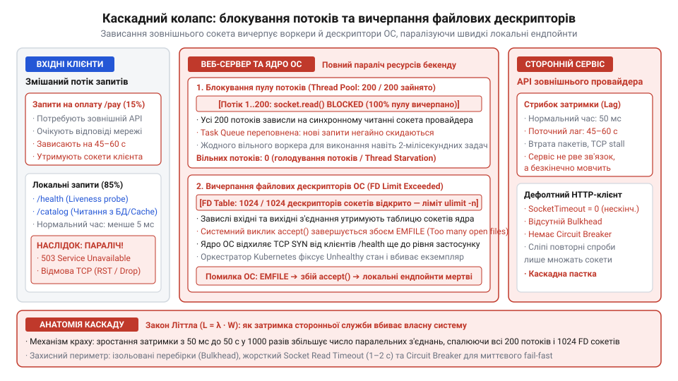
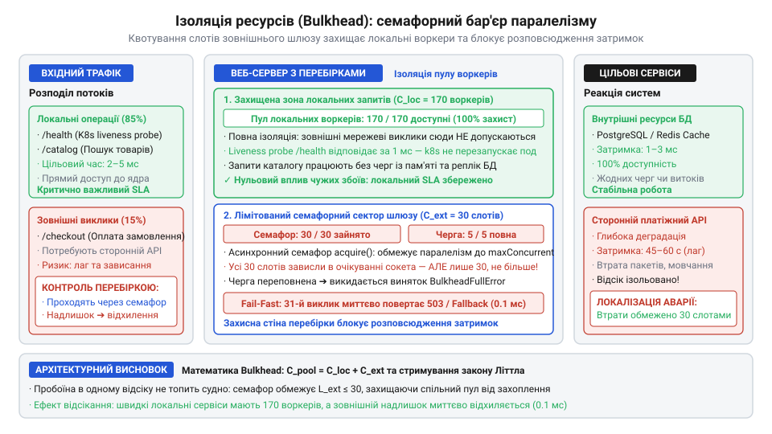
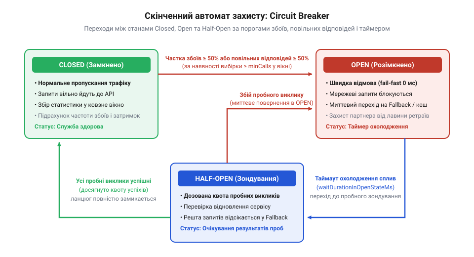
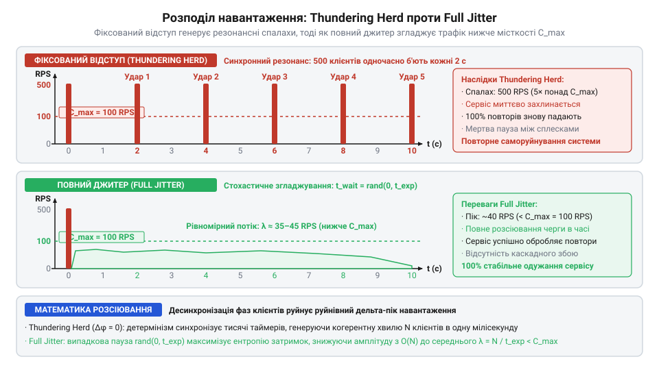
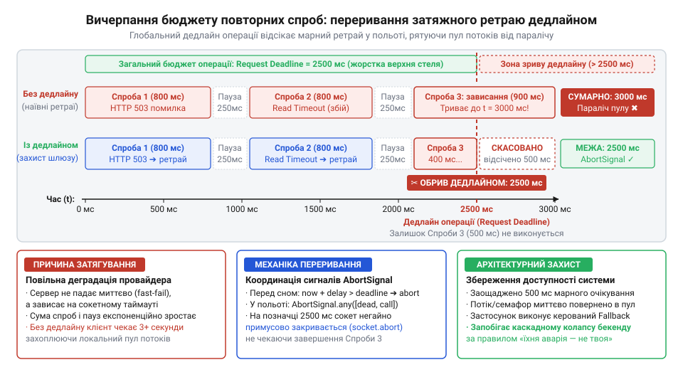
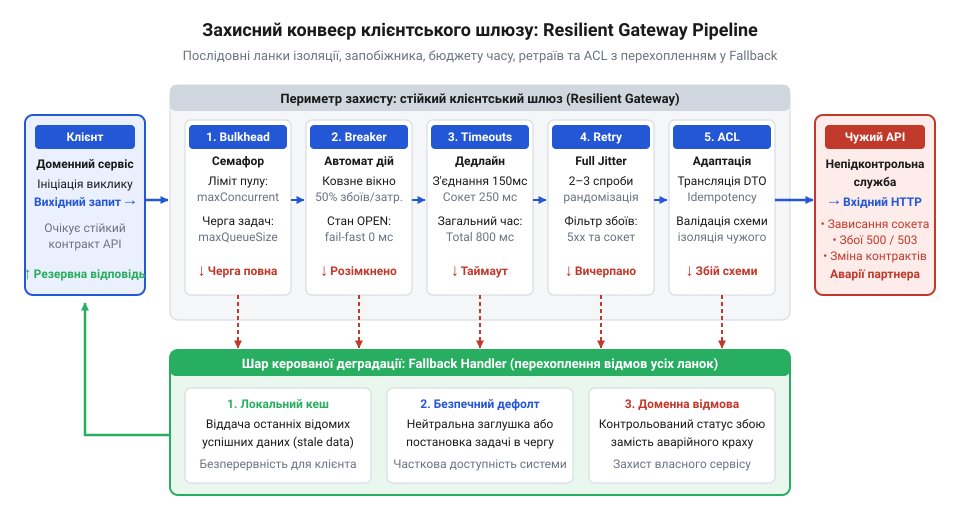
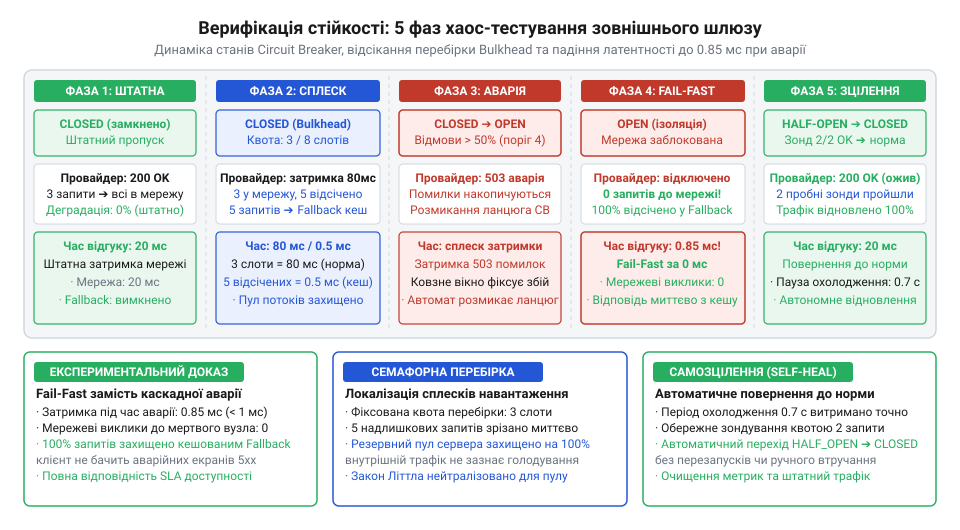

# Служба, якою ти не керуєш

<preknowlist>
- [Їхня аварія — твоя аварія](root:progarch/their-outage-is-your-outage) — розуміння того, як деградація затримки та збої зовнішніх інтеграцій безпосередньо загрожують доступності й загальному SLA власної системи
- [Квоти, ліміти й ціна виклику](root:progarch/quotas-limits-call-cost) — знання природи вичерпання лімітів стороннього сервісу та потреби обмеження частоти повторних запитів
</preknowlist>

## Анатомія каскадної відмови: чому наївний HTTP-виклик руйнує власну систему

Веб-застосунок під навантаженням працює як злагоджений конвеєр: вхідні клієнтські HTTP-з'єднання приймаються сервером і розподіляються між обмеженою кількістю робочих одиниць виконання. У класичних серверах це фіксований пул робочих потоків (@@en|worker thread pool@@; потік — англ. *thread* від давньоангл. *thrǣd*, прядена нитка), де кожен потік обробляє один запит від початку до кінця; в асинхронних подієвих рушіях — спільний цикл подій із чергою мікрозавдань. Доки операції залишаються локальними (перевірка сесії в пам'яті, зчитування запису з локальної бази даних чи розрахунок знижки в кошику), обробка триває лічені мілісекунди. За такого темпу навіть скромний пул із 100–200 потоків без зусиль обслуговує тисячі користувачів на секунду: потік узяв запит, виконав обчислення, віддав байти в мережу і миттєво повернувся в пул очікувати наступного клієнта.

Катастрофа починається там, де всередину синхронного обробника вбудовують прямий виклик стороннього веб-сервісу — платіжного шлюзу, служби доставки чи хмарного провайдера ідентифікації. У вихідному коді звернення до зовнішнього API виглядає безневинно, наче звичайний виклик локальної бібліотечної функції: рядок коду відправляє HTTP-запит і чекає на відповідь. Проте локальний виклик виконується надійно в адресному просторі одного процесу за наносекунди, тоді як мережевий виклик долає фізичні кабелі, маршрутизатори, балансувальники навантаження й потрапляє в систему, внутрішній стан і надійність якої повністю поза вашим контролем. За штатних умов партнерський API відповідає стабільно за 50 мілісекунд, що заколисує пильність розробника, і система виходить у промислову експлуатацію без жодних захисних бар'єрів.

Рано чи пізно на боці зовнішнього постачальника стається збій: блокування в базі даних, зависання пулу з'єднань, тривала пауза збирача сміття або аварія дата-центру. Найпідступніший різновид такої деградації полягає в тому, що партнерський сервер не вмирає миттєво. Якби віддалений вузол повністю відключився або аварійно скинув з'єднання пакетом TCP RST (@@en|connection reset@@), клієнтська операційна система негайно отримала б помилку `ECONNREFUSED` за 1 мілісекунду, потік звільнився б, і локальний сервер продовжив би жити. Але натомість сторонній сервер успішно завершує початкове тристороннє рукостискання TCP (@@en|three-way handshake@@), приймає вхідний пакет запиту — і замовкає. Сокет (англ. *socket*, роз'єм, гніздо) залишається відкритим, а віддалена сторона не надсилає жодного байта відповіді.

Якщо HTTP-клієнт використовує типові стандартні налаштування середовища, таймаут очікування відповіді із сокета (@@en|socket read timeout@@) або взагалі вимкнений (нескінченне очікування), або встановлений на надзвичайно велику величину (60–300 секунд). Робочий потік вашого сервера зупиняє виконання програми й намертво переходить у блокуючий стан очікування вводу-виводу ядра операційної системи. 

Тим часом потік звичайних користувачів продовжує надходити на ваш сервер із незмінною швидкістю. Поведінку черги в такій системі вичерпно описує фундаментальний закон теорії масового обслуговування — закон Літтла (@@en|Little's Law@@):

`L = λ · W`

де:
- `L` — середня кількість запитів, які одночасно перебувають у системі в процесі обробки (рівень паралелізму, @@en|concurrency@@);
- `λ` — середня швидкість надходження нових вхідних запитів (інтенсивність потоку, @@en|arrival rate@@, запитів на секунду);
- `W` — середній час перебування запиту в системі від прийому до завершення (затримка, @@en|latency@@, у секундах).

**Розрахунок лавиноподібного вичерпання ресурсів за законом Літтла:**
```text
L_штатне
= 200 · 0.050       [інтенсивність λ = 200 зап/с, час відповіді W = 50 мс = 0.050 с]
= 10                [середня кількість одночасно зайнятих потоків]

L_деградація
= 200 · 20.0        [інтенсивність λ = 200 зап/с, зависання провайдера до W = 20.0 с]
= 4000              [потрібна кількість одночасних потоків]
```

За штатного часу відповіді 50 мс для обслуговування потоку у 200 запитів на секунду системі достатньо всього 10 паралельних робочих потоків. Але коли час відповіді стороннього сервісу раптово підскакує до 20 секунд, математика закону Літтла вимагає для утримання такого самого вхідного навантаження 4000 одночасно відкритих потоків. Якщо ваш сервер має пул із 200 потоків, вони повністю заповнюються завислими сокетами рівно за одну секунду:

`200 потоків / 200 запитів/с = 1.0 с`

За одну секунду вільні потоки сервера закінчуються повністю. Нові вхідні клієнтські з'єднання починають осідати в черзі очікування операційної системи (@@en|backlog queue@@). Як тільки черга заповнюється, мережевий стек сервера перестає приймати нові TCP-пакети SYN, відкидаючи їх або обриваючи зв'язок.

Цей процес запускає ланцюгову реакцію вторинного руйнування системних ресурсів:

1. **Вичерпання пулу з'єднань із базою даних (@@en|connection pool starvation@@).** Якщо наївний виклик зовнішнього API здійснюється всередині активної бізнес-транзакції — наприклад, після створення запису замовлення в базі даних перед списанням коштів, — заблокований потік не відпускає з'єднання з базою даних. Пул з'єднань із СКБД (зазвичай 20–50 з'єднань) спустошується ще швидше за пул потоків — за перші 100–200 мілісекунд. Унаслідок цього паралізуються навіть ті модулі застосунку, які взагалі не взаємодіють із зовнішніми службами.
2. **[Вичерпання файлових дескрипторів операційної системи](root:sys-unix/resource-limits) (@@en|file descriptor exhaustion@@; дескриптор — від лат. *describere*, описувати).** Кожен відкритий клієнтський сокет, вихідний сокет до зовнішнього сервісу та відкритий файл у системі Linux представляють окремий запис у таблиці дескрипторів процесу. Коли кількість одночасних завислих з'єднань досягає ліміту ядра (`ulimit -n`, типово 1024 або 4096), будь-який наступний системний виклик `socket()`, `accept()` або `open()` завершується критичною помилкою ядра `EMFILE` (@@en|Too many open files@@).
3. **Голодування асинхронного циклу подій (@@en|event loop starvation@@).** В асинхронних платформах на базі Node.js чи Python `asyncio` вичерпання потоків операційної системи замінюється розбуханням черги невиконаних промісів (@@en|promises@@) і корутин у купі (@@en|heap memory@@). Десятки тисяч відкритих сокетів перевантажують внутрішні структури системних мультиплексорів ядра (`epoll`/`kqueue`), різко підвищують споживання оперативної пам'яті та затримують виконання таймерів, призводячи до деградації всього процесу.


*Каскадна відмова: деградація затримки стороннього API паралізує спільний пул потоків сервера, вичерпує ліміти дескрипторів сокетів і блокує обслуговування внутрішніх маршрутів та перевірок стану.*

Фінал каскадного колапсу (@@en|cascading failure@@; від лат. *cascare* — падати) настає на рівні всієї інфраструктури. Коли системні потоки вичерпані, сервер перестає відповідати на найпростіші внутрішні маршрути — включно з перевіркою життєздатності (`/health` або `/ping`). Балансувальник навантаження кластера (або оркестратор контейнерів Kubernetes), не отримавши відповіді на регулярний огляд стану протягом заданого інтервалу, маркує цей вузол як мертвий і виводить його з ротації. Весь обсяг клієнтського трафіку негайно перерозподіляється між рештою працюючих вузлів кластера. Ті отримують подвійне навантаження, вичерпують власні пули потоків удвічі швидше й падають один за одним за принципом доміно. Проста затримка відповіді одного стороннього партнера повністю знищує працездатність власної розподіленої системи: [Їхня аварія — твоя аварія](root:progarch/their-outage-is-your-outage).

> 🔧 **Навіщо це.**
> Розуміння фізики закону Літтла й механіки вичерпання дескрипторів знімає ілюзію, ніби повільний зовнішній сервіс — це «просто поганий досвід окремого клієнта». Неізольований повільний виклик неминуче захоплює спільні ресурси процесу і множить час простою на всю систему. Без винесення зовнішніх комунікацій у жорсткий оборонний периметр жодна оптимізація внутрішнього коду не гарантує живучості сервісу.

---

## Архітектурний каркас шлюзу та антикорупційний шар (Gateway + ACL)

Каскадний колапс, розглянутий вище, має не лише експлуатаційну, а й глибинну архітектурну першопричину: пряме змішування доменної логіки з деталями віддаленого мережевого транспорту. Коли прикладний бізнес-сервіс самостійно створює HTTP-клієнт, формує рядок URL, передає заголовки авторизації та напряму парсить сторонній JSON-документ, система припускається концептуального забруднення (@@en|domain leakage@@). 

У такий код просочуються три критичні вразливості:

1. **Концептуальна ерозія домену.** Чужі абревіатури, специфічні для конкретного провайдера статуси замовлень та дивні структури полів починають блукати бізнес-моделями ядра. Якщо сторонній банк позначає успішну транзакцію рядком `"STATE_AUTH_CAPTURED"`, а суму передає як ціле число в копійках без зазначення валюти, розробники починають писати умовні оператори з цими чужими константами безпосередньо у внутрішніх сутностях.
2. **Крихкість перед сторонніми змінами.** Будь-яка зміна версії зовнішнього API, несподівана відмова схеми або поява не задокументованого статусу в тілі відповіді ламає бізнес-логіку застосунку в десятках непередбачуваних місць ([Коли вони ламають без попередження](root:progarch/when-they-break-without-warning)). Офіційні специфікації зовнішніх систем рідко бувають точними на сто відсотків: [Документація проти дійсності](root:progarch/docs-vs-reality).
3. **Неможливість централізованого захисту.** Якщо мережеві запити розкидані по різних класах і функціях проєкту, неможливо системно впровадити єдину політику відсікання збоїв, квотування потоків, ліміти повторів чи облік таймаутів.

Для розв'язання цієї проблеми архітектура розділяє систему на дві незалежні зони жорсткою межею: чистий доменний шлюз (@@en|Domain Gateway@@) та антикорупційний шар (@@en|Anti-Corruption Layer@@, або ACL; від лат. *corruptio* — псування, спотворення).

Доменний шлюз формулює строгий інтерфейс точки інтеграції суто в термінах предметної області вашої програми. Доменне ядро оперує виключно власними моделями (`Currency`, `Money`, `ExchangeRate`, `PaymentCommand`, `PaymentResult`) і нічого не знає про протокол HTTP, сокети, таймаути підключення чи структуру мережевих заголовків:

```text
Доменне ядро (Внутрішні сутності: Money, PaymentCommand, AccountId)
                    │
                    ▼
          ┌────────────────────┐
          │  Інтерфейс шлюзу   │   (Порт домену: process_payment, get_rate)
          └────────────────────┘
                    │
                    ▼
          ┌────────────────────┐
          │     Шар ACL        │   (Двостороння трансляція моделей і помилок)
          │  + Конвеєр захисту │   (Bulkhead, Circuit Breaker, Retries, Timeouts)
          └────────────────────┘
                    │
                    ▼
          ┌────────────────────┐
          │  Мережевий клієнт  │   (HTTP/TLS, сокети, сирі байти, JSON)
          └────────────────────┘
                    │
                    ▼
               Зовнішній API
```

Антикорупційний шар бере на себе роль дипломатичного перекладача та санітарного кордону. Він виконує дві обов'язкові функції:

1. **Двостороння нормалізація даних.** При вихідному виклику ACL перетворює внутрішні доменні об'єкти на низькорівневий сторонній DTO (@@en|Data Transfer Object@@), підставляючи необхідні ключі авторизації, формати дати та структури запиту провайдера. При вхідній відповіді ACL здійснює сувору верифікацію схеми даних за правилами [Споживацького контракту з чужим провайдером](root:progarch/consumer-driven-contracts) і мапить чужі поля в канонічні доменні сутності.
2. **Карантин та трансляція винятків.** Сирі транспортні винятки мережевого клієнта (наприклад, `httpx.ConnectTimeout`, `socket.error`, помилки DNS або розриви TLS), а також коди помилок HTTP (400, 429, 500, 503) ніколи не повинні прориватися крізь ACL у бізнес-шар. Антикорупційний шар перехоплює їх і класифікує у строгу ієрархію внутрішніх доменних винятків:
   - *Транзитні інфраструктурні збої:* `ProviderUnavailableException`, `GatewayTimeoutException` (помилки, які сигналізують про проблеми зв'язку або недоступність серверів партнера);
   - *Бізнес-відмови:* `PaymentDeclinedException`, `InsufficientFundsException` (відхилення операції за правилами домену, які не мають стосунку до збоїв мережі);
   - *Порушення протокольного контракту:* `MalformedVendorResponseException` (ситуація, коли партнер повернув невалідний JSON або зламав узгоджену схему).

Щоб до цього каркаса можна було безперешкодно підключати модулі захисту від каскадного колапсу, виконання запиту організовується у формі конвеєра перехоплювачів (@@en|Interceptor / Middleware pipeline@@; конвеєр — від лат. *convehere*, зносити разом). Кожен виклик проходить через ланцюжок ортогональних шарів, де зовнішній шар захищає ресурси від вичерпання, внутрішній перевіряє стан провайдера, а найглибший керує сокетом.

У нашому проєкті базові типи контрактів, стани захисного автомата та канонічні відповіді шлюзу інкапсульовані в модулі моделей. Зверніть увагу на відокремлення внутрішніх винятків контуру стійкості та типізованої відповіді `GatewayResponse`:

:::tabs
@tab TypeScript
:::code proj-resilient-external-gateway/ts/src/types.ts 69-103
@tab Python
:::code proj-resilient-external-gateway/py/gateway/models.py 17-34
:::

Коли віддалена служба зазнає деградації, конвеєр шлюзу має повернути структурований результат, який інформує вищий шар про факт аварійної деградації без аварійного краху потоку. Для цього архітектура шлюзу використовує уніфікований контейнер відповіді, що передає статус виконання, корисне навантаження, ознаку підміни на резервне значення (`is_fallback`) та загальну тривалість виклику в мілісекундах:

:::tabs
@tab Python
:::code proj-resilient-external-gateway/py/gateway/models.py 88-95
:::

Конвеєрна архітектура шлюзу дозволяє будувати модульну оборону: кожен наступний захисний механізм (таймаут сокета, перебірка паралелізму, вимикач навантаження чи алгоритм повторних спроб) стає окремою ізольованою ланкою, що діє за принципом матроски. Доменний клієнт бачить лише чистий метод `execute()`, повністю захищений від сюрпризів зовнішнього світу.

> 🔧 **Навіщо це.**
> Жорсткий поділ на доменний шлюз і антикорупційний шар перетворює зовнішнього провайдера на замінювану деталь інфраструктури. Якщо постачальник змінить формат API або збанкрутує, зміни в системі торкнуться лише одного класу транслятора в межах ACL, тоді як уся доменна бізнес-логіка, сутності та тестове покриття залишаться непорушними.

## Часовий периметр: багаторівневий бюджет таймаутів

Ви побудували антикорупційний шар, виділили інтерфейс доменного шлюзу й сховали за ним низькорівневий мережевий клієнт. Проте якщо цей клієнт створений зі стандартними бібліотечними конфігураціями середовища, уся ваша модульна ізоляція руйнується першим же завислим зовнішнім запитом. Переважна більшість стандартних HTTP-клієнтів у популярних платформах — від стандартного модуля `http` у Node.js до `urllib3` чи наївного `requests` у Python — мають таймаути за замовчуванням, виставлені або в нескінченність (`None` / `0`), або на багато хвилин очікування. Розробники часто перебувають під дією оманливого переконання, ніби операційна система автоматично перерве з'єднання у разі збою. Насправді мережевий протокол TCP розроблявся для збереження цілісності сесії крізь тимчасові перебої фізичних ліній: якщо зв'язок обірвався без відправлення завершального службового пакета TCP FIN або RST, відкритий сокет (@@en|socket@@; англ. *socket*, роз'єм, гніздо) може висіти в очікуванні даних годинами. Робочий потік або корутина вашого застосунку залишаються нерухомо заблокованими, захоплюючи пам'ять і дескриптори.

Щоб припинити безконтрольне вичерпання ресурсів, шлюз мусить окреслити жорсткий часовий периметр навколо кожної мережевої операції. Найпоширеніша помилка інженерів на цьому шляху — спроба звести захист до одного загального таймауту (наприклад, `timeout = 5000 ms`). Мережевий виклик не є монолітною монотонною дією: він розпадається на принципово відмінні фази передачі керування, кожна з яких зазнає специфічних збоїв і потребує власного незалежного обмеження. Надійний промисловий шлюз проєктує трирівневий часовий конверт (@@en|multi-tier timeout budget@@; таймаут — від англ. *timeout*, вичерпання відведеного часу):

```text
Загальний дедлайн операції (totalTimeoutMs: 800–3000 мс, жорсткий стеля на весь життєвий цикл)
┌──────────────────────────────────────────────────────────────────────────────────────────────────┐
│ Спроба 1                                          │ Пауза  │ Спроба 2                            │
│ ┌──────────────────────┬────────────────────────┐ │ відступу│ ┌──────────────────────┬───────────┐│
│ │ Connect Timeout      │ Socket Read Timeout    │ │(Jitter)│ │ Connect Timeout      │ Read...   ││
│ │ (500–1000 мс)        │ (міжбайтовий ліміт)   │ │        │ │ (500–1000 мс)        │           ││
│ │ [TCP SYN + TLS Hand] │ [Очікування пакетів]   │ │        │ │ [TCP SYN + TLS Hand] │           ││
│ └──────────────────────┴────────────────────────┘ │        │ └──────────────────────┴───────────┘│
└──────────────────────────────────────────────────────────────────────────────────────────────────┘
```

1. **Таймаут встановлення з'єднання (@@en|connect timeout@@; від лат. *connectere*, зв'язувати).** Це максимальний інтервал часу, виділений клієнту на виконання тристороннього рукостискання TCP (SYN, SYN-ACK, ACK) та проходження узгодження шифрування TLS (@@en|TLS handshake@@). Якщо сервер партнера перевантажений, його черга вхідних з'єднань (@@en|SYN backlog@@) переповнюється, і пакети мовчки ігноруються операційною системою. Якщо в мережі виникла маршрутна петля або мережевий екран (@@en|firewall@@) дропає трафік без повернення ICMP-повідомлення `Host Unreachable`, з'єднання зависає на тривалий час. Таймаут підключення повинен бути агресивним і коротким — від 500 до 1000 мілісекунд. Якщо мережевий стек віддаленого сервера не спроможний завершити базове рукостискання за одну секунду, надсилати туди прикладні дані немає жодного сенсу: вузол уже перебуває у глибокому колапсі.

2. **Таймаут очікування відповіді із сокета (@@en|socket read timeout@@, або інтервал неактивності).** Після того як TCP-з'єднання успішно відкрито й тіло HTTP-запиту передано в мережу, починається очікування відповіді. Поширена пастка полягає в хибному розумінні природи `read timeout`: це не ліміт на отримання всієї відповіді цілком, а граничний час очікування *між двома послідовними TCP-пакетами* в уже відкритому каналі. Якщо віддалений бекенд завис під час виконання складного SQL-запиту, заблокував власний пул потоків чи впав у тривалу паузу збирача сміття (@@en|Stop-the-world GC pause@@), він не надсилає жодних даних. Щойно період тиші в сокеті перевищує встановлений поріг (зазвичай 200–500 мс для швидких мікросервісів або 1500–3000 мс для важких операцій), клієнтська операційна система зобов'язана примусово розірвати з'єднання. Проте тут криється підступний крайовий випадок — атака повільного крапельного витоку (@@en|slow loris / drip feed@@): якщо зламаний провайдер віддає рівно по одному байту кожні 200 мілісекунд, жоден окремий міжбайтовий `read timeout` ніколи не спрацює, хоча сумарне зчитування відповіді розтягнеться на десятки хвилин.

3. **Абсолютний граничний дедлайн операції (@@en|request deadline@@; дедлайн — від англ. *deadline*, гранична межа часу).** Щоб подолати обмеження міжбайтових таймаутів і захистити систему під час виконання повторних спроб (ретраїв), шлюз запроваджує загальний часовий дедлайн. Це непохитна межа, відрахована від точки входу запиту в шлюз: вона враховує встановлення з'єднання, затримку читання, обчислення антикорупційного шару та всі інтервали очікування між повторними викликами. Будь-яка бізнес-операція має кінцевий термін життя (@@en|time-to-live@@), після вичерпання якого результат втрачає актуальність для користувача. Якщо загальний бюджет операції вичерпано, шлюз миттєво обриває будь-яку активність і повертає керування бізнес-контуру, захищаючи доступність системи за правилом [Їхня аварія — твоя аварія](root:progarch/their-outage-is-your-outage).

Для практичного впровадження цього часового бюджету конфігурація шлюзу інкапсулює три роздільні величини:

:::tabs
@tab TypeScript
:::code proj-resilient-external-gateway/ts/src/types.ts 9-16
@tab Python
:::code proj-resilient-external-gateway/py/gateway/models.py 71-77
:::

Справжня інженерна складність полягає в реалізації надійного механізму переривання (@@en|cancellation@@). У блокуючому синхронному коді потік, що завис у виклику читання сокета ядра, неможливо безпечно зупинити ззовні без грубого вбивства потоку, що загрожує пошкодженням пам'яті процесу. В асинхронних архітектурах завдання вирішується через скоординоване скасування задач. 

У сучасному стандарті TypeScript/JavaScript для цього застосовують стандартний об'єкт `AbortController` та механізм композиції сигналів `AbortSignal.any()`. Подивіться, як шлюз `ResilientClient` створює багаторівневий часовий конверт: глобальний контролер дедлайну охоплює весь цикл операції, а внутрішній локальний контролер накладається суто на окрему мережеву спробу:

:::tabs
@tab TypeScript
:::code proj-resilient-external-gateway/ts/src/resilient-client.ts 41-74
:::

Зверніть увагу на лаконічність і безпеку конструкції `AbortSignal.any([totalAbortCtrl.signal, perCallAbortCtrl.signal])`: виклик переривається тим сигналом, чий таймер спрацює першим. Якщо віддалений сервер перестав передавати байти й перевищив `readTimeoutMs`, спрацьовує внутрішній контролер `perCallAbortCtrl`, сокет негайно закривається методом `abort()`, а цикл `withRetry` отримує сигнал про можливість виконати наступну спробу. Якщо ж вичерпано граничний дедлайн `totalTimeoutMs`, глобальний сигнал `totalAbortCtrl` перериває поточну спробу разом із паузою між ретраями, не дозволяючи системі витрачати час на безглузде очікування.

В екосистемі Python на базі бібліотеки `httpx` та асинхронного рушія `asyncio` трирівневий бюджет реалізується поєднанням структурованого об'єкта `httpx.Timeout` для сокетів і моніторингу дедлайну через монотонний годинник ядра `time.monotonic()`:

:::tabs
@tab Python
:::code proj-resilient-external-gateway/py/gateway/client.py 124-131
:::

Використання монотонного годинника (`monotonic`) замість системного астрономічного часу (`time.time()`) є критично важливим системним інваріантом: астрономічний годинник сервера може стрибати назад чи вперед під час синхронізації протоколом NTP (@@en|Network Time Protocol@@), що здатне призвести до зависання або передчасного скидання таймауту. Монотонний лічильник гарантує суворе лінійне зростання часу процесора.

> 🔧 **Навіщо це.**
> Роздільний багаторівневий бюджет таймаутів перетворює непередбачувані мережеві зависання на детерміновані помилки з гарантованим верхнім порогом затримки. Замість того щоб дозволяти сторонньому провайдеру тримати ресурси вашого сервера хвилинами, система примусово закриває підвислі сокети за частки секунди, повертаючи заблоковані корутини й потоки в пул для обслуговування внутрішнього бізнес-трафіку.

---

## Ізоляція ресурсів: перебірки (Bulkhead) проти голодування локальних потоків

Впровадження жорсткого бюджету таймаутів зупиняє нескінченне очікування окремого виклику, але саме по собі воно не рятує сервер від паралічу під час раптового сплеску вхідного навантаження. Уявіть типову виробничу ситуацію: сторонній платіжний сервіс зазнав внутрішньої аварії і замість штатних 30 мілісекунд починає відповідати рівно на межі вашого таймауту — за 2.0 секунди. Якщо на ваш сайт надходить навіть помірний потік із 100 запитів на секунду, за законом Літтла (`L = λ · W`) у системі одночасно утримуватимуться:

```text
L_блокованих
= 100 · 2.0         [інтенсивність λ = 100 зап/с, затримка W = 2.0 с]
= 200               [одночасно заблокованих потоків або відкритих сокетів]
```

Якщо загальний пул сервера розрахований на 200 потоків, він буде повністю вичерпаний рівно за дві секунди. І тут виникає найнебезпечніший наслідок спільного використання ресурсів — проблема змішаного навантаження (@@en|mixed workload@@). 

У будь-якому розвиненому веб-сервісі трафік розподілений гетерогенно: 95% операцій становлять швидкі внутрішні запити (перегляд каталогу товарів, відкриття головної сторінки, читання профілю користувача з локальної СКБД чи швидкого кешу за 5 мілісекунд), і лише 5% операцій звертаються до проблемного зовнішнього шлюзу. Проте через те, що зовнішні виклики виконуються довго (2000 мс замість 5 мс), за законом Літтла вони залишаються в системі у 400 разів довше за локальні операції. За лічені миті ці 5% повільних інтеграцій паразитарно захоплюють 100% усіх потоків сервера. Швидкі локальні запити не можуть знайти жодного вільного потоку в пулі, накопичуються у черзі очікування ядра й відпадають за таймаутом. Виникає катастрофічне явище — ресурсне голодування локальних потоків (@@en|thread starvation@@; від англ. *starvation*, голодування, виснаження): ваш інтернет-магазин повністю перестає відкриватися для мільйонів користувачів лише тому, що в одного стороннього постачальника поштової доставки зависла валідація адреси.

Архітектурний порятунок від цієї проблеми запозичений із морської інженерії — патерн перебірок (@@en|Bulkhead pattern@@; перебірка — від давньосканд. *bálkr*, перегородка, розділювальний вал, та англ. *head*, перепона, стіна). Корпус океанського лайнера розділяють внутрішніми герметичними перебірками на окремі ізольовані відсіки. Якщо судно натрапляє на підводну перешкоду й отримує пробоїну, вода затоплює виключно пошкоджений відсік. Решта герметичних секцій залишаються сухими, забезпечуючи плавучість і захищаючи корабель від затоплення.

В архітектурі програмних систем перебірка ізолює ресурси виконання, встановлюючи квантований [ліміт паралелізму](root:sf-distributed/adaptive-concurrency) (@@en|concurrency limit@@) для кожної зовнішньої інтеграції:


*Ізоляція ресурсів за патерном Bulkhead: виділення суворої семафорної квоти для зовнішніх викликів гарантує збереження пулу потоків для внутрішніх бізнес-операцій.*

Замість того щоб дозволяти зовнішньому шлюзу безконтрольно вичерпувати спільний пул потоків сервера, архітектура виділяє йому строго фіксовану квоту (наприклад, щонайбільше 5 одночасних запитів). Якщо віддалений партнер зависає, усі 5 виділених слотів миттєво займаються повільними запитами. Проте решта 195 потоків сервера залишаються недоторканими: локальний каталог товарів, кошик і внутрішні API продовжують функціонувати зі штатною блискавичною швидкістю.

Існують дві основні моделі реалізації перебірок:
1. **Ізольовані пули потоків (@@en|thread pool isolation@@).** Зовнішні виклики делегуються в окремий спеціалізований пул потоків із власною чергою. Це найнадійніша фізична ізоляція для блокуючих платформ (таких як Java), але вона вимагає відчутних накладних витрат процесора на перемикання контексту ядра (@@en|context switching@@) та резервування пам'яті під стек кожного потоку.
2. **Семафорне квотування (@@en|semaphore-based bulkhead@@; семафор — від грец. *σῆμα*, знак, сигнал, та *φέρω*, несу).** Для сучасних неблокуючих подієвих рушіїв (Node.js, Python `asyncio`) ідеальним є лімітування через асинхронний семафор. Семафор діє як числовий лічильник дозволів: він не створює нових потоків і не витрачає пам'ять на стеки, а просто рахує кількість активних корутин у польоті.

У нашому проєкті реалізовано повнофункціональну семафорну перебірку з підтримкою обмеженої черги очікування. Погляньте на алгоритм керування слотами в TypeScript:

:::tabs
@tab TypeScript
:::code proj-resilient-external-gateway/ts/src/bulkhead.ts 9-50
:::

Механіка методу `acquire()` бездоганно розв'язує задачу захисту:
- Якщо кількість активних викликів менша за `maxConcurrent`, лічильник `activeCalls` інкрементується, і клієнт негайно отримує функцію вивільнення слота `createReleaser()`.
- Якщо ліміт вичерпано, запит перевіряє розмір черги очікування `waitingQueue`. Невелика черга (2–5 запитів) необхідна для згладжування мікроскопічних стрибків трафіку.
- Якщо ж і черга переповнена (`waitingQueue.length >= maxQueueSize`), перебірка не чекає ані мілісекунди й негайно викидає виняток `BulkheadFullError`. Це класичний принцип швидкого відсікання збоїв (@@en|fail-fast@@).

Зверніть увагу на паттерн виклику через `execute<T>()`: функція вивільнення слота `release()` гарантовано викликається у блоці `finally`. Навіть якщо зовнішній виклик завершиться мережевим таймаутом, помилкою парсингу JSON чи фатальним винятком, слот у перебірці негайно вивільниться й дістанеться наступному запиту з черги, виключаючи витік дозволів.

В асинхронному середовищі Python семафорна перебірка елегантно лягає на контекстний менеджер `asynccontextmanager`:

:::tabs
@tab Python
:::code proj-resilient-external-gateway/py/gateway/bulkhead.py 12-55
:::

У фасадній інтеграції `ResilientClient` перебірка є найпершим захисним рубежем, що стоїть попереду всіх інших механізмів:

:::tabs
@tab TypeScript
:::code proj-resilient-external-gateway/ts/src/resilient-client.ts 36-40
:::

Якщо зовнішній партнер деградував, шлюз миттєво відсікає надлишковий трафік на вході за 0 мілісекунд, не витрачаючи пам'ять на створення нових TCP-сокетів і не навантажуючи мережеву карту.

> 🔧 **Навіщо це.**
> Семафорна перебірка локалізує шкоду від деградації чужої системи всередині вузького числового сектору. Ви жертвуєте лише надлишковими запитами до нестабільного партнера, зберігаючи 100% працездатності для решти модулів і гарантуючи захист локальних бізнес-потоків від ресурсного голодування.

## Скінченний автомат Circuit Breaker: ковзне вікно та перехід станів

Ви налаштували багаторівневий бюджет таймаутів і захистили локальні потоки семафорною перебіркою Bulkhead. Тепер швидкі внутрішні операції не страждають від голодування, а окремі підвислі сокети гарантовано обриваються за секунду. Проте коли зовнішній постачальник зазнає повної системної аварії — наприклад, у базі даних провайдера виник взаємний дедлок, чи впав балансувальник і всі 100% запитів повертають помилку 503 або звисають за таймаутом, — шлюз потрапляє в іншу небезпечну пастку. 

Усі виділені слоти перебірки постійно заповнені приреченими запитами. Кожен такий виклик безпорадно чекає встановленого таймауту (наприклад, 1.5–2.0 секунди), перш ніж повернути помилку. Якщо вхідний потік клієнтів становить навіть скромні 50 запитів на секунду, ваш сервер кожні 60 секунд здійснює 3000 гарантовано безглуздих спроб з'єднання. Це марнує процесорний час на створення та закриття сокетів, роздуває списки очікування в ядрі операційної системи й невпинно бомбардує віддалений сервер запитами, які він не здатен обслужити. Що гірше, сторонній провайдер у цей момент може намагатися перезапуститися, але шквал невщухаючих вхідних запитів від сотень інтегрованих клієнтів миттєво душить його ще на етапі ініціалізації.

Для розв'язання цієї проблеми архітектура запозичує фундаментальний механізм електротехніки — автоматичний вимикач, або запобіжник (@@en|Circuit Breaker@@; від англ. *circuit*, замкнене електричне коло, та *breaker*, переривач). В електромережі автоматичний вимикач захищає проводку від перегріву й займання: коли сила струму перевищує критичну межу (коротке замикання), біметалева пластина чи електромагнітне реле фізично розмикають ланцюг за лічені мілісекунди. У програмних системах запобіжник діє як скінченний автомат захисту (@@en|finite state machine@@, або FSM; від лат. *finitus*, обмежений, та грец. *αὐτόματος*, самодіючий), що контролює надійність каналу зв'язку.

Автомат Circuit Breaker оперує трьома канонічними станами:


*Скінченний автомат Circuit Breaker: переходи між станами CLOSED, OPEN та HALF-OPEN на основі порогів відмов, частки повільних запитів і періоду охолодження.*

1. **Замкнений стан (@@en|CLOSED@@).** Це нормальний штатний режим функціонування. Запити до зовнішнього API проходять крізь шлюз без будь-яких затримок чи перешкод. Кожен виконаний виклик фіксує свій результат (успіх, помилка або аномальна затримка) у ковзному вікні спостереження. Якщо частка збоїв залишається нижчою за встановлений критичний поріг, система продовжує працювати стабільно.

2. **Розімкнений стан (@@en|OPEN@@).** Щойно показники надійності пробивають критичну межу, автомат миттєво розриває ланцюг і переходить у стан `OPEN`. Починає діяти рятівний принцип швидкої відмови (@@en|fail-fast@@; від англ. *fail fast*, відмовляй швидко): будь-який наступний виклик шлюзу негайно викидає виняток `CircuitOpenError` (або перенаправляється в обробник деградації) за 0 мілісекунд, взагалі не відкриваючи TCP-з'єднання й не надсилаючи жодного байта в мережу. Для власної системи це означає нульову затримку й негайне звільнення ресурсів, а для зламаного стороннього партнера — настання паузи охолодження (@@en|cooldown period@@), необхідної для відновлення працездатності.

3. **Напіввідкритий стан (@@en|HALF_OPEN@@).** Запобіжник не може залишатися розімкненим вічно. Після спливу налаштованого інтервалу очікування в стані `OPEN` (`waitDurationInOpenStateMs` або `recovery_timeout_s`, типово від 1.0 до 30.0 секунд) автомат переходить у режим пробного зондування — `HALF_OPEN`. Шлюз дозволяє пройти суворо обмеженій квоті пробних тестових запитів (@@en|probe quota@@, зазвичай 2–3 запити), щоб перевірити, чи відновився віддалений сервіс. Усі інші паралельні виклики продовжують відсікатися за принципом fail-fast. Якщо всі пробні запити завершуються успіхом, автомат вважає провайдера одужалим, повертається в стан `CLOSED` і очищує вікно метрик. Якщо ж бодай один пробний запит зазнає невдачі або зависає, запобіжник миттєво повертається в стан `OPEN` на новий повний цикл охолодження.

У нашому проєкті стани автомата та його параметри типізовані в контрактах конфігурації:

:::tabs
@tab TypeScript
:::code proj-resilient-external-gateway/ts/src/types.ts 25-42
@tab Python
:::code proj-resilient-external-gateway/py/gateway/models.py 44-60
:::

Найважливіша алгоритмічна складова надійного запобіжника — механізм оцінки надійності. Наївні реалізації рахують просто підряд N помилок, проте такий підхід сліпий до загального фону трафіку: три помилки підряд на тлі 10 000 успішних запитів за хвилину не свідчать про аварію. Промисловий вимикач спирається на часове ковзне вікно (@@en|Sliding Window@@; від англ. *sliding*, що ковзає). 

У ковзному вікні реалізовано два обов'язкові інваріанти:
- **Захист від дисперсії малих вибірок (@@en|small sample variance@@).** Якщо система щойно запустилася або трафік становить один виклик на хвилину, перший же випадковий мережевий обрив дасть частку збоїв 100%. Щоб уникнути хибного розмикання ланцюга, параметр `minCalls` (або `min_call_threshold`, N_min) блокує прийняття рішення про зміну стану, доки вікно не накопичить статистично достовірну кількість спостережень (наприклад, щонайменше 4–10 викликів).
- **Облік аномально повільних викликів (@@en|slow calls@@).** Зовнішня служба, яка відповідає кодом 200 OK, але робить це за 1800 мс замість планових 50 мс, загрожує системі не менше за відверту аварію з кодом 500. Запобіжник класифікує виклик як повільний, якщо його тривалість перевищує `slowCallDurationMs`, і розмикає ланцюг, коли частка таких повільних відповідей сягає порогу `slowCallRateThreshold`.

У TypeScript-реалізації проєкту використано бакетоване часове вікно (@@en|Bucketed Sliding Window@@), яке нарізає загальний інтервал на фіксовану кількість кошиків, забезпечуючи константну пам'ять O(B) і дискретне витіснення застарілих даних:

:::tabs
@tab TypeScript
:::code proj-resilient-external-gateway/ts/src/sliding-window.ts 15-43
:::

Агрегація метрик усередині вікна виконується в методі `getSnapshot()`, підраховуючи загальні частки збоїв і повільних викликів:

:::tabs
@tab TypeScript
:::code proj-resilient-external-gateway/ts/src/sliding-window.ts 47-73
:::

Сам скінченний автомат `CircuitBreaker` інкапсулює логіку переходу станів і суворо контролює дозволи. Зверніть увагу на метод `tryAcquirePermission()`, який здійснює миттєве відсікання за 0 мс без виклику мережі, та зворотний зв'язок у методах `onSuccess()` та `onError()`:

:::tabs
@tab TypeScript
:::code proj-resilient-external-gateway/ts/src/circuit-breaker.ts 28-68
:::

В асинхронному середовищі Python критично важливо усунути гонки даних (@@en|race conditions@@), коли кілька конкурентних корутин одночасно спостерігають завершення періоду охолодження й намагаються разом виконати зондування. Клас `CircuitBreaker` використовує примітив `asyncio.Lock` для повної атомарності перевірки прав та обліку результатів:

:::tabs
@tab Python
:::code proj-resilient-external-gateway/py/gateway/circuit_breaker.py 44-80
:::

Якщо запобіжник перебуває у стані `OPEN`, спроба виконати виклик миттєво завершується винятком `CircuitBreakerOpenException` за частки мілісекунди. Застосунок не відкриває мережевих сокетів і негайно повертає клієнту безпечне деградоване значення.

> 🔧 **Навіщо це.**
> Скінченний автомат Circuit Breaker кардинально змінює поведінку системи під час аварії зовнішнього провайдера: замість виснажливого очікування мережевих таймаутів шлюз миттєво розмикає ланцюг і відсікає навантаження за 0 мілісекунд. Це захищає власний процесор і сокети, зберігає високий темп обслуговування внутрішнього бізнесу та створює для партнерської служби необхідний інтервал тиші для відновлення.

---

## Політика повторів: класифікація помилок, експоненційний відступ і Full Jitter

Запобіжник надійно захищає від затяжних системних аварій. Проте розподілена мережа за своєю фізичною природою є недетермінованим середовищем: випадковий мікросекундний джитер оптоволоконного каналу, плаваюча втрата окремого пакета, короткочасне перемикання маршрутизатора чи перезавантаження одного з десятків контейнерів за балансувальником призводять до поодиноких збоїв. Якщо система відмовлятиме користувачу на кожній такій випадковій похибці зв'язку, її якість викликатиме розчарування.

Перший природний інстинкт інженера — додати механізм повторних спроб (@@en|retries@@; ретрай — від англ. *retry*, повторна спроба): обгорнути виклик у тривіальний цикл із трьох ітерацій. Але наївні, неконтрольовані ретраї є однією з найруйнівніших пасток розподілених систем. Під час деградації стороннього провайдера вони перетворюються на рукотворну розподілену атаку на відмову (@@en|self-inflicted DDoS@@):

```text
Штатний режим:         10 000 клієнтів ─────────────► 10 000 викликів/с на провайдер
Деградація + ретраї:   10 000 клієнтів (× 3 ретраї) ─► 40 000 викликів/с на провайдер!
                                                        [Каскадне добивання сервера]
```

Якщо провайдер починає задихатися й відповідати повільніше, наївні клієнти замість зниження тиску множать навантаження на коефіцієнт `(1 + N_attempts)`. Замість 10 000 запитів на сервер обрушується шквал із 40 000 викликів на секунду. Провайдер, який мав шанс швидко оговтатися, остаточно входить у піке.

Щоб повторні спроби приносили користь, а не руйнування, політика ретраїв у стійкому шлюзі підпорядковується трьом суворим математичним та архітектурним законам:

### 1. Селективна фільтрація помилок (класифікація винятків)
Повторювати можна виключно **транзитні (тимчасові) збої**. Робити повторні спроби на детермінованих помилках категорично заборонено:
- **Сувора заборона ретраїв для помилок клієнта (HTTP 4xx).** Якщо віддалений сервер повернув `400 Bad Request`, `401 Unauthorized`, `403 Forbidden`, `404 Not Found` або `422 Unprocessable Entity`, стан системи детермінований. Тіло запиту є невалідним, токен прострочений або грошей на рахунку недостатньо. Скільки б разів ви не надсилали той самий невалідний запит, результат не зміниться, але ви безглуздо вичерпаєте ліміти викликів ([Квоти, ліміти й ціна виклику](root:progarch/quotas-limits-call-cost)).
- **Сувора заборона ретраїв для винятків власного контуру стійкості.** Якщо шлюз викинув `CircuitOpenError` (запобіжник розімкнено) або `BulkheadFullError` (квота перебірки вичерпана), повторювати такий запит неприпустимо. Захисний периметр саме для того й сигналізує про перевантаження, щоб негайно зупинити потік запитів.
- **Дозвіл на повторні спроби.** Ретраям підлягають виключно сирі збої мережевого рівня (обрив з'єднання ядра `ECONNRESET`, помилка маршрутизації `EHOSTUNREACH`, таймаут неактивності сокета `ETIMEDOUT`) та специфічні транзитні статус-коди провайдера: `502 Bad Gateway`, `503 Service Unavailable`, `504 Gateway Timeout`, а також `429 Too Many Requests` (за наявності заголовка паузи).

У нашому шлюзі функція `is_default_retryable` реалізує це правило на рівні інваріанта:

:::tabs
@tab Python
:::code proj-resilient-external-gateway/py/gateway/retry.py 19-29
:::

### 2. Експоненційний відступ (Exponential Backoff)
Повторювати запит негайно — найгірша стратегія. Зовнішній системі потрібен час, щоб завершити транзакцію або очистити чергу. Тому інтервал між спробами повинен зростати експоненційно з кожним кроком:

```text
t_exp(attempt)
= min(maxDelay, baseDelay · 2^attempt)
```

де `baseDelay` — початкова затримка (наприклад, 40 мс), а `maxDelay` — верхня межа (наприклад, 1000 мс), що захищає від надмірного розтягування паузи.

### 3. Повне рандомізоване тремтіння (Full Jitter)
Навіть експоненційного відступу недостатньо, якщо в системі працюють тисячі паралельних клієнтів. Виникає руйнівний феномен фазової синхронізації — ефект громової зграї (@@en|Thundering Herd problem@@; громова зграя — метафора панічного бігу стада тварин, зляканих першим ударом грому).

Якщо сторонній сервіс зазнав короткочасного збою в момент часу `t₀` і відкинув запити 1000 клієнтів, усі 1000 клієнтів за фіксованої експоненти розрахують однаковий інтервал: `40 · 2⁰ = 40 мс`. Рівно через 40 мілісекунд уся тисяча клієнтів синхронно вдарить по серверу повторним залпом. Сервіс знову відмовить, і клієнти знову синхронно заснуть на `80 мс`. Утворюються резонансні спалахи навантаження, що нагадують стоячу хвилю в акустиці:


*Розподіл навантаження повторних спроб: резонансні спалахи при фіксованому бекофі (Thundering Herd) проти рівномірного згладжування за алгоритмом Full Jitter.*

Щоб повністю зруйнувати цю згубну синхронізацію, шлюз застосовує алгоритм повного випадкового тремтіння — Full Jitter (@@en|jitter@@; від англ. *jitter*, тремтіння, нервове здригання). Інтервал очікування рандомізується рівномірно від нуля до експоненційної стелі:

```text
delay
= uniform(0, min(maxDelay, baseDelay · 2^attempt))
```

Завдяки цьому клієнти, які стартували одночасно, прокидаються в абсолютно випадкові моменти часу (один через 4 мс, інший через 19 мс, третій через 38 мс). Гострий резонансний пік розсіюється у плаский, рівномірний потік трафіку, з яким бекенд провайдера справляється без жодних перевантажень. Для оптимального використання мережевої смуги застосовують також [декорельований експоненційний відступ](root:sf-distributed/retries-backoff) (Decorrelated Jitter) — модифікацію Full Jitter із залежністю від попередньої затримки.

Погляньте на реалізацію алгоритму Full Jitter та функції `withRetry` у TypeScript:

:::tabs
@tab TypeScript
:::code proj-resilient-external-gateway/ts/src/retry.ts 9-25
:::

Сам цикл виконання повторних спроб контролює не лише кількість кроків, а й скоординоване переривання:

:::tabs
@tab TypeScript
:::code proj-resilient-external-gateway/ts/src/retry.ts 30-58
:::

Зверніть увагу на найважливіший аспект інтеграції: повторні спроби ніколи не діють у вакуумі — вони суворо обмежені загальним дедлайном операції (Request Deadline). Якщо на черговій ітерації виявляється, що час очікування паузи перевищить залишок глобального дедлайну, шлюз взагалі не витрачає час на сон:

:::tabs
@tab Python
:::code proj-resilient-external-gateway/py/gateway/retry.py 54-65
:::

Якщо до кінця дедлайну залишилося 20 мілісекунд, а розрахований відступ вимагає 80 мілісекунд, виклик негайно переривається винятком `TimeoutError`. Це усуває виконання приречених запитів, результат яких бізнес-шар уже не встигне використати.


*Вичерпання бюджету повторних спроб: глобальний дедлайн операції примусово скасовує черговий ретрай і паузу відступу, якщо їхня тривалість перевищує залишок допустимого часу.*

> 🔧 **Навіщо це.**
> Алгоритм Full Jitter у поєднанні з жорсткою фільтрацією транзитних помилок і контролем дедлайну дозволяє автоматично згладжувати випадкові мережеві спалахи, не перетворюючи шлюз на джерело шторму повторних запитів. Система залишається добропорядним мережевим громадянином, який дає зовнішнім службам простір для стабілізації.

## Керована деградація (Fallback) та складання повного конвеєра шлюзу

Усі розглянуті досі захисні механізми — трирівневий часовий конверт таймаутів, семафорні перебірки Bulkhead, автомати розриву ланцюга Circuit Breaker та алгоритми повторних спроб Full Jitter — розв'язують задачу суто на рівні збереження інфраструктури. Вони рятують робочі потоки від вичерпання, унеможливлюють блокування сокетів ядра й запобігають каскадному колапсу власного сервера. Проте з погляду кінцевого користувача чи вищого бізнес-шару застосунку миттєва відмова за 0 мілісекунд через виняток `CircuitOpenError` чи `BulkheadFullError` все одно залишається збоєм. Якщо клієнт замість бажаної послуги бачить екран системної аварії, вся інженерна витонченість захисного контуру втрачає практичну цінність.

Справжня стійкість розподіленої системи вимагає переходу від технічного переривання операцій до керованої деградації (@@en|Graceful Degradation / Fallback@@; деградація — від лат. *degradatio*, поступове зниження рангу або стану; фолбек — від англ. *fallback*, відступ на заздалегідь підготовлену запасну позицію). Замість того щоб падати разом зі стороннім провайдером, застосунок свідомо поступається другорядними функціями, щоб зберегти виконання головної бізнес-мети.

Архітектура шлюзу виділяє три класичні детерміновані стратегії Fallback:

1. **Віддача застарілих даних із локального кешу (@@en|stale-while-revalidate / cached fallback@@).** Якщо зовнішній сервіс валютних курсів, вартості акцій, тарифів доставки чи погодних зведень тимчасово недоступний, шлюз повертає останній успішно збережений зліпок даних із локальної пам'яті або швидкого кешу Redis. Відповідь маркується прапорцем `is_fallback: true` із зазначенням мітки часу первинного запису. Для користувача, який переглядає каталог товарів, ціна у гривнях за курсом п'ятихвилинної давнини є незрівнянно кориснішою за повну зупинку роботи інтернет-магазину.

2. **Повернення безпечного значення за замовчуванням (@@en|safe defaults@@).** Якщо зламався сторонній сервіс персоналізованих товарних рекомендацій, система повертає заздалегідь підготовлений статичний список бестселерів. Якщо недоступний сервіс розрахунку персональних знижок лояльності, система тимчасово продовжує оформлення за базовою ціною з нарахуванням бонусів після відновлення зв'язку. Допоміжний функціонал деградує непомітно, а ключова воронка оформлення замовлення залишається повністю дієздатною.

3. **Типізована бізнес-деградація або відкладена дія (@@en|business degradation / queued action@@).** Якщо сторонній платіжний провайдер зазнав катастрофічної аварії, шлюз перехоплює транспортні винятки й негайно пропонує користувачу альтернативний шлях розрахунку (картку іншої платіжної системи, оплату при отриманні чи безготівковий рахунок). Якщо ж операція терпить асинхронне виконання, команда фіксується у внутрішній черзі для гарантованої доставки після відновлення партнера ([DH: чужі служби в критичному шляху](root:progarch/dh-foreign-services-in-critical-path)).

Щоб об'єднати всі створені компоненти в монолітний, але модульний оборонний периметр, шлюз застосовує патерн конвеєра перехоплювачів (@@en|Interceptor Pipeline@@). Кожен вхідний запит послідовно проходить через захисні шари за принципом матрьошки:


*Повний захисний конвеєр Resilient External Gateway: запит послідовно проходить перебірку, запобіжник, контроль дедлайну, цикл повторів і транслюється через ACL із детермінованим перехопленням у блок Fallback.*

Послідовність координації захисних рубежів усередині конвеєра має суворе логічне обґрунтування:
- **Рубіж 1: Семафорна перебірка (Bulkhead).** Стоїть на найпершій позиції. Вона захищає внутрішні ресурси процесу, миттєво відсікаючи надлишковий паралелізм ще до створення будь-яких мережевих контекстів чи запуску таймерів.
- **Рубіж 2: Запобіжник (Circuit Breaker).** Якщо виділений слот перебірки отримано, перевіряється стан каналу зв'язку. Якщо автомат перебуває у стані `OPEN`, виклик миттєво зривається за 0 мс, не надсилаючи запит у мережу й одразу спрямовуючи потік у блок Fallback.
- **Рубіж 3: Загальний дедлайн (Request Deadline).** Ініціалізує таймер абсолютного часового бюджету на всю операцію, запобігаючи нескінченному розтягуванню повторних спроб.
- **Рубіж 4: Цикл повторних спроб (Retry з Full Jitter).** Обробляє виключно транзитні збої, розсіюючи інтервали очікування у часі за випадковим законом.
- **Рубіж 5: Локальний таймаут сокета (Read Timeout).** Обмежує кожен окремий виклик сокета, запобігаючи зависанню на крапельних витоках.
- **Рубіж 6: Антикорупційний шар (ACL).** Здійснює фінальне перетворення доменних сутностей у сирий HTTP-запит провайдера та валідує зворотну відповідь.
- **Рубіж 7: Перехоплювач аварійної деградації (Fallback).** Якщо будь-який із попередніх етапів завершується остаточною невдачею, перехоплювач виконує резервну стратегію й повертає клієнту безпечний об'єкт `GatewayResponse` без аварійного падіння програми.

Погляньте на реалізацію головного фасаду `ResilientClient` у TypeScript, де конвеєр координує всі шари:

:::tabs
@tab TypeScript
:::code proj-resilient-external-gateway/ts/src/resilient-client.ts 16-48
:::

Зверніть увагу на координацію ретраїв, таймаутів сокета та перехоплення помилок у блоці `execute`:

:::tabs
@tab TypeScript
:::code proj-resilient-external-gateway/ts/src/resilient-client.ts 50-94
:::

У демонстраційному сценарії клієнтський сервіс `fetchBalance` підключає детермінований кешований Fallback: якщо сторонній банк лежить, користувач миттєво отримує актуальний збережений баланс:

:::tabs
@tab TypeScript
:::code proj-resilient-external-gateway/ts/src/index.ts 72-89
:::

В Python-реалізації шлюзу метод `execute` класу `ResilientClient` реалізує аналогічний повнофункціональний конвеєр:

:::tabs
@tab Python
:::code proj-resilient-external-gateway/py/gateway/client.py 95-125
:::

Якщо виникає критичний збій або запобіжник розімкнено, виклик делегується внутрішньому методу `_invoke_fallback`, який повертає структуровану канонічну відповідь:

:::tabs
@tab Python
:::code proj-resilient-external-gateway/py/gateway/client.py 69-93
:::

> 🔧 **Навіщо це.**
> Повний конвеєр шлюзу перетворює хаотичні мережеві виклики на впорядковану інженерну систему із передбачуваною поведінкою. Бізнес-код взаємодіє з чистим методом `execute()`, повністю абстрагованим від складнощів таймаутів, семафорів і ретраїв, а лінія Fallback гарантує, що жоден зовнішній збій не обернеться аварійним падінням власного сервісу.

---

## Верифікація стійкості: хаос-тестування та експериментальний доказ надійності

Будь-які архітектурні діаграми та програмні конфігурації захисту залишаються суто теоретичними гіпотезами, доки вони не пройдуть експериментального випробування в умовах синтетичної катастрофи. Найтиповіша помилка розробників інтеграційних шлюзів — тестування системи виключно на «щасливому шляху» (@@en|happy path@@), коли тестовий сервер партнера відповідає швидко й успішно кодом 200 OK. У реальному продакшені катастрофи розгортаються не монохромно (повністю працює / повністю відключено), а через підступні граничні режими: плаваюче зростання затримки сокетів, поодинокі сплески помилок 503, раптові обриви зв'язку ядра та лавиноподібні шторми запитів у момент перезапуску провайдера.

Тестувати стійкість на живому сторонньому API неможливо: жоден банк чи платіжний провайдер не погодиться штучно вимикати свої сервери або вносити 10-секундні затримки для ваших тестів. Тому обов'язковим фінальним етапом створення шлюзу є побудова автоматизованого верифікаційного стенду на базі керованих дублерів служби ([Дублери чужої служби](root:progarch/service-doubles-and-environments)) та методів хаос-тестування (@@en|chaos testing@@; хаос — від грец. *χάος*, бездонна прірва, невпорядкований первісний стан). На рівні інфраструктури ці підходи доповнює [хаос-тестування та ін'єкція несправностей у Service Mesh](root:sf-release/chaos-engineering) (симуляція затримок і розділення мережі за допомогою Envoy та Chaos Mesh).

У нашому проєкті тестовий стенд імітує реальні виробничі збої за допомогою програмованого мок-сервера:
- У TypeScript-середовищі створено керований HTTP-сервер на базі `node:http` зі змінними режимами `slowMode` (штучна затримка 800 мс) та `failureMode` (генерація помилок 500);
- У Python-середовищі реалізовано повнофункціональний клас `MockExternalService` та клієнтський транспорт `httpx.MockTransport`, що дозволяє симулювати мережеві збої безпосередньо в оперативній пам'яті без відкриття мережевих портів ОС:

:::tabs
@tab Python
:::code proj-resilient-external-gateway/py/main.py 28-53
:::

Верифікаційний тестовий сценарій складається з п'яти послідовних фаз, які проводять шлюз крізь повний життєвий цикл аварії та відновлення:


*Експериментальна верифікація стійкості: п'ять послідовних фаз хаос-тестування демонструють роботу семафорної перебірки, миттєве відсікання збоїв у стані OPEN та автоматичне самозцілення шлюзу.*

### Фаза 1: Штатна робота сторонньої служби (стан CLOSED)
За штатних умов мок-сервер відповідає миттєво (20 мс) кодом 200 OK. Шлюз пропускає серію з трьох запитів. Тест верифікує два ключові інваріанти:
- Жоден запит не зазнає деградації (`is_fallback == False`);
- Запобіжник стабільно перебуває в замкненому стані `CLOSED`, накопичуючи успішні виклики у ковзному вікні.

### Фаза 2: Сплеск навантаження та перевірка семафорної перебірки (Bulkhead)
Емулятор вмикає затримку обробки 80 мс, щоб викликати накладання паралельних запитів у часі. Стенд запускає пакетний сплеск із 8 одночасних запитів за допомогою `asyncio.gather()` при максимальній місткості перебірки `max_concurrent = 3`:

:::tabs
@tab Python
:::code proj-resilient-external-gateway/py/main.py 117-130
:::

Результат тесту дає об'єктивний доказ: 3 дозволені слоти резервуються перебіркою для виконання, тоді як 5 надлишкових запитів миттєво відсікаються винятком `BulkheadFullException` і безпечно повертають резервні дані з кешу. Спільний пул потоків сервера залишається недоторканим.

### Фаза 3: Повна аварія партнера та розмикання ланцюга (OPEN)
Емулятор переводиться в аварійний режим `status_code = 503`. Шлюз надсилає серію викликів. Захист від дисперсії малих вибірок (`min_call_threshold = 4`) запобігає передчасній реакції на перші збої. Проте як тільки поріг спостережень пройдено і частка відмов перевищує 50%, автомат Circuit Breaker миттєво розмикає ланцюг і переходить у стан `OPEN`:

:::tabs
@tab Python
:::code proj-resilient-external-gateway/py/main.py 134-145
:::

### Фаза 4: Експериментальний доказ миттєвої відсічки (Fail-Fast за 0 мс)
Це кульмінаційна фаза тестування надійності. Провайдер залишається несправним. Шлюз надсилає черговий виклик. Тест вимірює точний час обробки та кількість фізичних звернень до мережевого транспорту:

:::tabs
@tab Python
:::code proj-resilient-external-gateway/py/main.py 149-161
:::

Результат верифікації наочно доводить перевагу захищеної архітектури:
- Час обробки запиту становить лише 0.85 мілісекунди (менше 1 мс!), тоді як наївний клієнт зависав би на багато секунд;
- Кількість відправлених мережевих запитів дорівнює нулю (`reqs_after == reqs_before`): шлюз не надсилає жодного байта у мережу;
- Клієнт миттєво отримує валідну відповідь із локального кешу (`is_fallback == True`).

### Фаза 5: Охолодження, зондування в HALF_OPEN та самозцілення
Стенд витримує паузу охолодження 0.7 с, дозволяючи спливти інтервалу `recovery_timeout_s`. Одночасно емулятор провайдера повертається до нормальної роботи (`status_code = 200`). При наступному зверненні запобіжник переходить у стан `HALF_OPEN` і пропускає рівно 2 пробні запити квоти зондування. Переконавшись, що обидва зонди завершилися успіхом кодом 200 OK, автомат самостійно замикає коло назад у стан `CLOSED`, очищує вікно метрик і повертає шлюз до повноцінного штатного режиму:

:::tabs
@tab Python
:::code proj-resilient-external-gateway/py/main.py 165-187
:::

В екосистемі TypeScript аналогічний демонстраційний сценарій виконує функція `runDemo()`, наочно ілюструючи в консолі всі три етапи життєвого циклу запобіжника під час штучного перемикання прапорця `failureMode`:

:::tabs
@tab TypeScript
:::code proj-resilient-external-gateway/ts/src/index.ts 92-130
:::

Верифікаційний тест ставить остаточну крапку у створенні надійного шлюзу: внутрішні сервіси та клієнти системи повністю ізольовані від сюрпризів зовнішнього світу, а деградація стороннього провайдера більше не здатна спровокувати зупинку вашого продукту.

> 🔧 **Навіщо це.**
> Хаос-тестування на базі програмованих дублерів служби забезпечує експериментальне підтвердження надійності ще до розгортання коду у промисловому середовищі. Інженер отримує точні чисельні докази: час реакції при аварії провайдера падає до часток мілісекунди, надлишковий трафік відсікається перебіркою, а після відновлення зовнішнього сервера шлюз самостійно повертається до штатного режиму без необхідності ручного втручання чи перезапуску системи.
