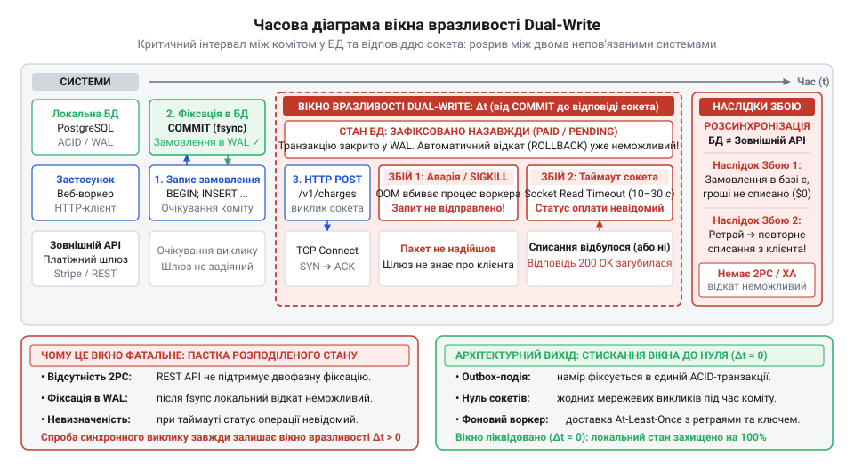
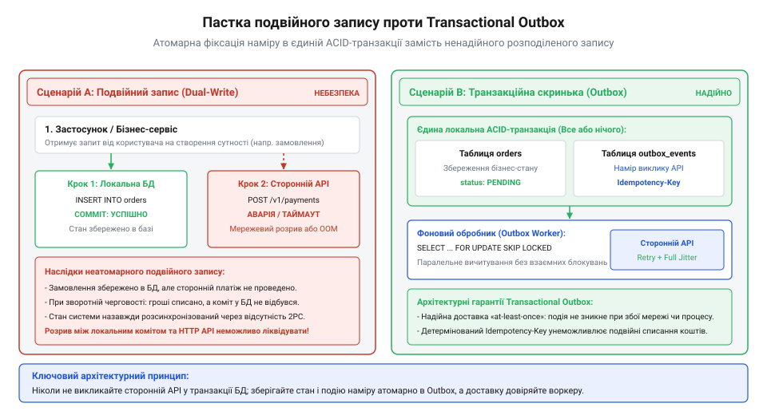
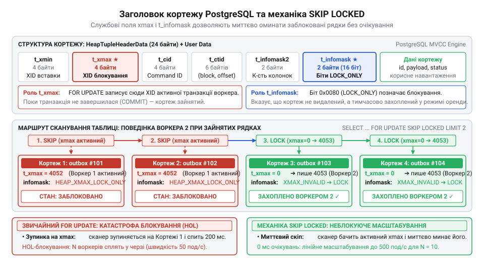
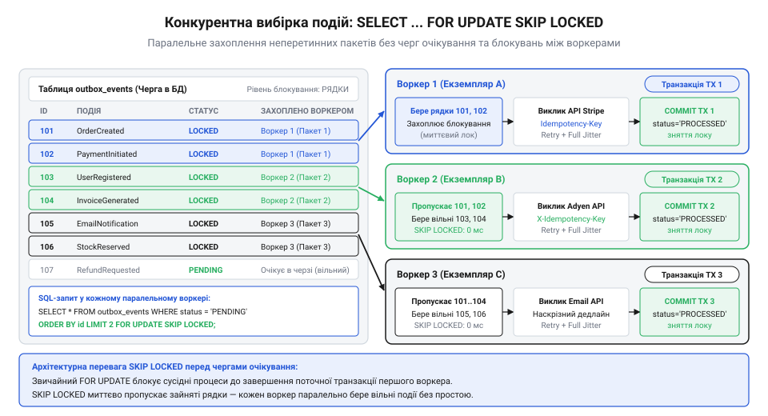
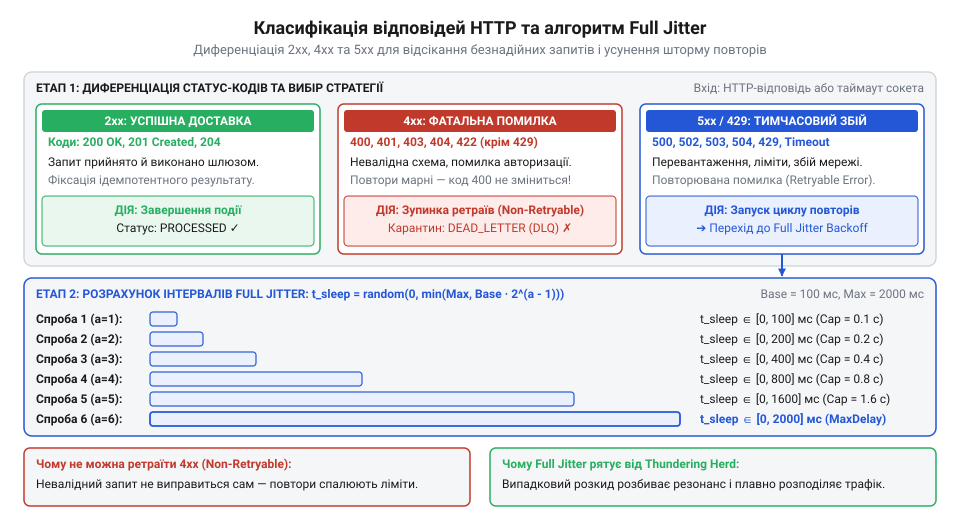
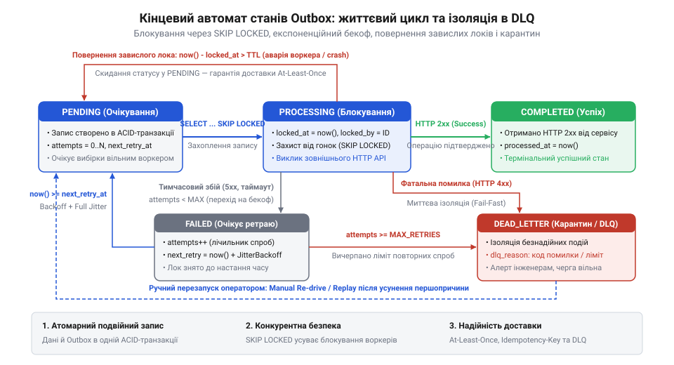
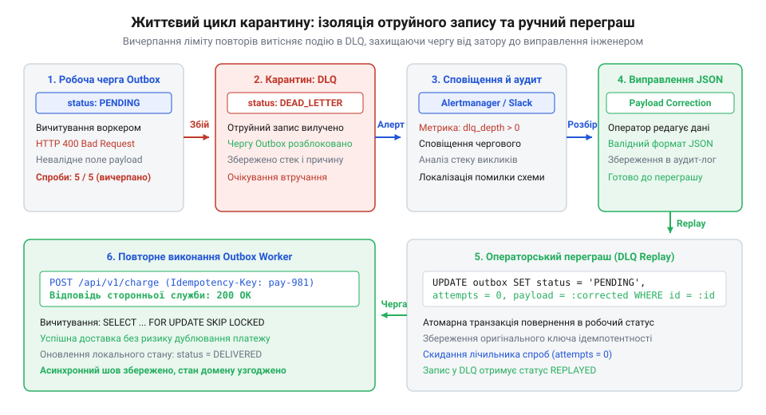
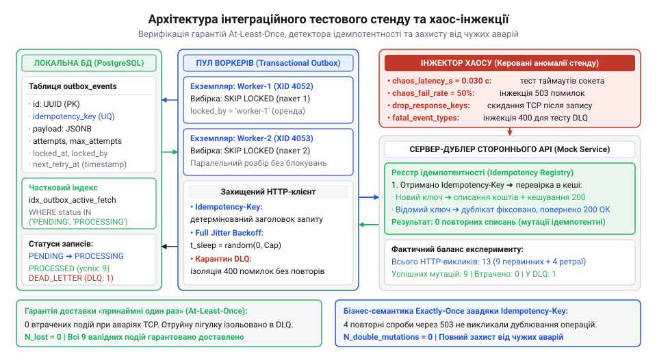

# Служба, якою ти не керуєш

<preknowlist>
- [Їхня аварія — твоя аварія](root:progarch/their-outage-is-your-outage) — неминучість деградації доступності та ризик блокування власного сервісу при синхронній залежності від стороннього провайдера
- [Дублери чужої служби](root:progarch/service-doubles-and-environments) — створення контрольованого тестового дублера для перевірки реакції воркера на таймаути, скидання з'єднань і повторні запити
- [Квоти, ліміти й ціна виклику](root:progarch/quotas-limits-call-cost) — необхідність дозування темпу повторних викликів, щоб уникнути вичерпання рейт-лімітів та фінансових штрафів провайдера
</preknowlist>

## Катастрофа подвійного запису: як синхронний виклик стороннього API руйнує узгодженість

Типовий виробничий веб-обробник оформлення замовлення виглядає оманливо просто. Клієнт надсилає запит на купівлю товару, сервер відкриває транзакцію в базі даних, створює запис замовлення, а потім викликає сторонній платіжний або логістичний шлюз через синхронний виклик HTTP POST. На перший погляд, це природна послідовність дій: щоб повідомити партнерську службу про подію, потрібно спочатку створити сутність у власній системі, а потім відправити мережевий пакет партнеру.

Проте за цією позірною простотою криється фундаментальна пастка розподілених систем — небезпека подвійного запису (@@en|Dual-Write Hazard@@; від давньоангл. *twā*, два, та *wrītan*, вирізати знаки, писати). Подвійний запис виникає щоразу, коли зміна стану застосунку вимагає оновлення двох незалежних систем зберігання або передачі даних — наприклад, локальної реляційної бази даних і віддаленого HTTP API стороннього постачальника, — між якими немає спільного координатора транзакцій.

Розглянемо дві очевидні послідовності дій, якими розробники намагаються зв'язати ці дві системи, і наслідки збоїв для кожної з них:

1. **Сценарій «Спочатку фіксація в БД, потім виклик API»:**
   Сервер виконує команду `INSERT INTO orders ...`, успішно фіксує локальну ACID-транзакцію (`COMMIT`), а наступним рядком коду відправляє HTTP-запит до платіжного шлюзу. Уявімо, що рівно в проміжку між фіксацією в базі та відправкою пакета процес веб-сервера зазнає аварійної зупинки: операційна система вбиває процес через вичерпання пам'яті (сигнал `SIGKILL` від OOM Killer), перезавантажується контейнер у Kubernetes або зникає електроживлення стійки. 
   
   *Результат:* Замовлення в локальній базі даних назавжди зафіксоване в статусі `PENDING` або `PAID`, але сторонній платіжний шлюз ніколи не дізнається про намір списання коштів. Користувач бачить на екрані помилку з'єднання, проте товар зарезервовано або відправлено в обробку без фактичної оплати.

2. **Сценарій «Спочатку виклик API, потім фіксація в БД»:**
   Розробник вирішує перестрахуватися: спочатку списуємо кошти у провайдера, а в разі успіху фіксуємо замовлення в базі. HTTP-клієнт надсилає запит на віддалений сервіс, банк успішно списує гроші з кредитної картки клієнта і повертає статус `200 OK`. Але під час спроби зафіксувати транзакцію в локальній базі даних стається збій: пул з'єднань вичерпано, локальний диск переповнений або виникає конфлікт унікального ключа. Локальна транзакція відкочується (`ROLLBACK`).

   *Результат:* Кошти клієнта списано, банк вважає операцію завершеною, але в локальній базі даних застосунку немає жодного сліду цього замовлення. Це катастрофічний сценарій для бізнесу: обурений покупець вимагає товар, служба підтримки не бачить замовлення, а фінансовий аудит виявляє дірку в балансі.


*Часова діаграма вікна вразливості Dual-Write: критичний часовий інтервал між фіксацією транзакції в базі даних та отриманням відповіді стороннього сервісу утворює небезпечне вікно, де аварійне падіння процесу або мережевий таймаут викликають невідворотну розсинхронізацію розподіленого стану.*

3. **Сценарій «Виклик API всередині відкритої транзакції БД»:**
   Найбільш токсична ілюзія безпеки полягає в спробі виконати мережевий запит безпосередньо всередині блоку транзакції бази даних:
   ```sql
   BEGIN TRANSACTION;
   INSERT INTO orders ...;
   -- Синхронний HTTP-виклик до стороннього API прямо тут!
   COMMIT;
   ```
   У цей момент застосунок потрапляє під нищівну дію закону Літтла (@@en|Little's Law@@):
   `L = λ · W`
   де `L` — середня кількість заблокованих з'єднань із базою даних, `λ` — темп надходження вхідних запитів, а `W` — час очікування відповіді. Якщо зовнішній шлюз починає деградувати й затримує відповіді з 50 мілісекунд до 15 секунд, локальне з'єднання з базою даних утримує блокування рядків і споживає слот пулу СКБД протягом усіх 15 секунд!

**Розрахунок вичерпання пулу з'єднань бази даних:**
```text
L_штатне
= 100 · 0.050       [темп λ = 100 зап/с, час відповіді W = 50 мс = 0.050 с]
= 5                 [активних з'єднань із базою даних]

L_деградація
= 100 · 15.0        [темп λ = 100 зап/с, зависання провайдера до W = 15.0 с]
= 1500              [потрібна кількість з'єднань із БД для утримання черги]
```

Типовий пул з'єднань СКБД на 20–50 конектів вичерпується за перші 200 мілісекунд:
```text
t_колапсу
= 30 / 100          [ємність пулу N = 30, темп надходження λ = 100 зап/с]
= 0.300             [секунди до повної зупинки бази даних]
```

У результаті зупиняється не лише оформлення замовлень, а й уся база даних компанії: користувачі не можуть прочитати новини, авторизуватися чи переглянути каталог, хоча ці операції взагалі не залежать від сторонньої служби. Пряма синхронна залежність від непідконтрольного сервісу призводить до реалізації принципу [Їхня аварія — твоя аварія](root:progarch/their-outage-is-your-outage).

Чому не можна використати класичний протокол двофазної фіксації (@@en|Two-Phase Commit@@, 2PC; від лат. *committo*, з'єдную, довіряю)? По-перше, публічні веб-сервіси (Stripe, PayPal, Нова Пошта) працюють через REST/JSON поверх HTTP і в принципі не підтримують координаторів XA/2PC. По-друге, за теоремою CAP та законами розподілених систем блокуючий протокол 2PC у ненадійній глобальній мережі катастрофічно знижує доступність системи: якщо координатор або один з учасників зависає, ресурси залишаються заблокованими на невизначений термін.


*Порівняння архітектурних сценаріїв: розрив між фіксацією в базі даних та синхронним HTTP-викликом стороннього API (Dual-Write Hazard) неминуче призводить до розсинхронізації стану або блокування пулу потоків, тоді як збереження події Outbox у межах локальної ACID-транзакції гарантує надійний асинхронний шов.*

Єдиним надійним архітектурним виходом із цієї пастки є патерн Transactional Outbox (транзакційна вихідна скринька; скринька — від англ. *outbox*, лоток для вихідної кореспонденції). Його суть полягає у відмові від синхронного подвійного запису на користь двох ізольованих етапів:
1. **Атомарний локальний етап:** Бізнес-сутність (замовлення) та повідомлення про намір виконати зовнішню дію зберігаються в межах *однієї* локальної ACID-транзакції в одній реляційній базі даних.
2. **Асинхронний етап доставки:** Окремий фоновий процес (воркер) вичитує збережені наміри з таблиці аутбоксу й надійно доставляє їх сторонньому сервісу з використанням механізмів повторних спроб та детермінованих ключів ідемпотентності.

> 🔧 **Навіщо це.**
> Transactional Outbox перетворює крихку синхронну залежність від зовнішнього світу на стійкий внутрішній реляційний стан. Навіть якщо віддалений партнер повністю «лежить», локальний бізнес-процес успішно завершується, дані залишаються непорушними, а виклики відкладаються до моменту одужання чужої системи.

---

## Проєктування схеми даних Outbox та атомарна фіксація наміру в реляційній БД

Щоб реляційна таблиця вихідної скриньки могла ефективно обслуговувати мільйони подій, запобігати дублюванню викликів і витримувати конкурентне опитування пулом воркерів, її схема має бути спроєктована з урахуванням специфіки роботи планувальника запитів СКБД та життєвого циклу розподілених задач.

Таблиця `outbox_events` виконує роль черги повідомлень на базі реляційної СКБД (@@en|database-backed queue@@). Кожен її стовпчик відповідає за конкретний інваріант стійкості:

- `id UUID PRIMARY KEY`: Унікальний сурогатний ідентифікатор події. Використання UUID (зокрема версій v4 або v7) усуває конфлікти генерації ключів між незалежними вузлами веб-сервера без звернення до спільних автоінкрементних послідовностей бази.
- `aggregate_type VARCHAR(64)` та `aggregate_id VARCHAR(64)`: Тип агрегату (наприклад, `Order`, `Customer`, `Invoice`) та його ідентифікатор у доменній моделі. Забезпечують трасування контексту предметної області та дозволяють за потреби гарантувати строгий порядок обробки (FIFO) в межах одного агрегату.
- `event_type VARCHAR(64)`: Тип доменної події (`OrderPlaced`, `PaymentRequested`), що визначає формат корисного навантаження та точку призначення виклику.
- `payload JSONB`: Серіалізоване тіло запиту. Використання бінарного формату JSONB у PostgreSQL дозволяє зберігати довільні параметри виклику без зміни схеми бази даних при еволюції контрактів сторонніх сервісів.
- `idempotency_key VARCHAR(128) UNIQUE`: Детермінований ключ ідемпотентності (від лат. *idem*, той самий, та *potens*, сильний; властивість операції давати однаковий результат при багаторазовому застосуванні). Генерується на боці клієнта в момент створення наміру й передається в заголовках HTTP-запитів до зовнішнього API, унеможливлюючи повторні списання коштів.
- `status VARCHAR(32)`: Поточний стан запису в скінченному автоматі воркера (`PENDING`, `PROCESSING`, `PROCESSED`, `DEAD_LETTER`).
- `attempts INT` та `max_attempts INT`: Лічильник фактично виконаних спроб доставки та поріг відсікання.
- `next_retry_at TIMESTAMPTZ`: Часова мітка наступного дозволеного виклику. Саме за цим полем воркер визначає готовність запису до обробки, враховуючи паузи експоненційного відступу (backoff).
- `locked_at TIMESTAMPTZ` та `locked_by VARCHAR(64)`: Атрибути оренди блокування (@@en|lock lease@@). Фіксують, який саме екземпляр воркера зараз обробляє рядок і коли спливає час оренди, що запобігає «вічним зависанням» задач у разі раптового падіння воркера.
- `last_error TEXT`: Текст останньої помилки (мережевий статус, повідомлення віддаленого шлюзу чи стек винятків) для діагностики та аудиту.

Погляньмо на еталонну DDL-схему для PostgreSQL:

:::tabs
@tab Python
:::code proj-transactional-outbox-worker/py/repository.py 14-36
:::

Зверніть особливу увагу на оголошення індексу `idx_outbox_active_fetch`. Звичайний індекс `CREATE INDEX ON outbox_events (next_retry_at, status)` для системи з інтенсивним навантаженням швидко стане джерелом деградації СКБД. У промисловій експлуатації 99.9% рядків у таблиці аутбоксу перебувають у фінальному статусі `PROCESSED`. Звичайний B-дерево індекс буде безперервно розбухати, поглинаючи гігабайти оперативної пам'яті в буферному пулі кешу (@@en|buffer pool cache@@) застарілими архівними даними.

Рішення полягає у створенні [часткового індексу в PostgreSQL](root:sf-data/partial-indexes-postgres) (@@en|Partial Index@@) за допомогою предикату `WHERE status IN ('PENDING', 'PROCESSING')`. Такий індекс індексує виключно активні рядки, що очікують вибірки або перебувають в оренді. Якщо в таблиці накопичилося 10 мільйонів успішно відправлених подій і лише 50 невідправлених, частковий індекс міститиме лише 50 записів. Його розмір становитиме лічені кілобайти, дерево індексу матиме глибину 1–2 рівні й завжди повністю утримуватиметься в оперативній пам'яті CPU, гарантуючи миттєвий пошук готових задач.

У коді застосунку моделі статусів та структури події виражаються строгими типами мови:

:::tabs
@tab TypeScript
:::code proj-transactional-outbox-worker/ts/src/types.ts 5-22
@tab Python
:::code proj-transactional-outbox-worker/py/models.py 11-17
:::

Тепер розглянемо реалізацію ключового інженерного кроку — атомарної фіксації бізнес-мутації та вихідної події в межах єдиної ACID-транзакції бази даних:

:::tabs
@tab TypeScript
:::code proj-transactional-outbox-worker/ts/src/outbox-repository.ts 17-41
@tab Python
:::code proj-transactional-outbox-worker/py/repository.py 85-138
:::

Зверніть увагу на параметр `conn` у методі збереження: репозиторій не відкриває власну окрему транзакцію, а приймає контекст активного клієнтського з'єднання або транзакції бізнес-сервісу. Це гарантує неподільність:

:::code proj-transactional-outbox-worker/sql/snippet-1.sql

Якщо на етапі запису замовлення чи додавання події в аутбокс стається помилка або сервер знеструмлюється, СКБД гарантує відкат обох операцій завдяки журналу випереджального запису (@@en|Write-Ahead Logging@@, WAL). Якщо ж транзакція зафіксована (`COMMIT`), ми маємо математичну гарантію: факт замовлення та намір його оплати надійно записані на постійний носій. Проблему Dual-Write Hazard розв'язано в корені: синхронний ненадійний мережевий виклик повністю усунуто з критичного шляху виконання клієнтського запиту.

> 🔧 **Навіщо це.**
> Атомарне перенесення наміру виклику в таблицю бази даних перетворює леткі мережеві пакети на персистентні записи реляційної системи. Тепер навіть повна ізоляція нашого дата-центру або аварія стороннього банку не здатні порушити цілісність даних: система готова чекати скільки завгодно, гарантуючи, що жодна копійка не загубиться і жодне замовлення не зависне безслідно.

## Конкурентна вибірка без взаємних блокувань: механіка SELECT ... FOR UPDATE SKIP LOCKED

Після того як ми ізолювали критичний шлях веб-сервера й атомарно зафіксували наміри відправки в таблиці вихідної скриньки, постає наступний інженерний виклик: як доставити ці записи адресату. На перший погляд здається, що достатньо запустити найпростіший фоновий цикл, який раз на секунду виконує запит на кшталт `SELECT * FROM outbox_events WHERE status = 'PENDING' LIMIT 10;`, послідовно обробляє записи та оновлює їхній статус.

Проте однопотоковий наївний воркер швидко стає вузьким місцем усієї архітектури. По-перше, він утворює єдину точку відмови (@@en|Single Point of Failure@@, SPOF): падіння процесу повністю зупиняє спорожнення черги. По-друге, щойно темп створення замовлень перевищує швидкість послідовної відправки зовнішніх HTTP-запитів, черга невідправлених подій починає невпинно зростати. Природне архітектурне бажання — масштабувати обробку горизонтально, запустивши пул із кількох незалежних реплік або паралельних асинхронних задач.

Але тут розробника зустрічає небезпечна пастка паралельного опитування без належного блокування. Якщо три паралельні екземпляри воркера одночасно виконають звичайний запит `SELECT ... WHERE status = 'PENDING' LIMIT 10`, вони отримають із бази абсолютно однаковий набір рядків. Усі три воркери почнуть одночасно надсилати однакові мережеві пакети до зовнішньої служби. Навіть за наявності захисту через ключ ідемпотентності це генерує паразитарний трафік, спалює дорогі квоти провайдера ([Квоти, ліміти й ціна виклику](root:progarch/quotas-limits-call-cost)) та створює непотрібне навантаження на систему.

Першою інтуїтивною спробою вирішити проблему гонки стає використання песимістичного блокування на рівні рядків:
```sql
SELECT * FROM outbox_events
WHERE status = 'PENDING' AND next_retry_at <= NOW()
ORDER BY next_retry_at ASC
LIMIT 10
FOR UPDATE;
```

На жаль, класичне блокування `FOR UPDATE` (@@en|pessimistic locking@@; від лат. *pessimus*, найгірший, та англ. *lock*, замок) у розподіленому середовищі призводить до катастрофічної деградації. Оператор `FOR UPDATE` є блокуючим. Коли перший воркер відкриває транзакцію й захоплює перші 10 рядків черги, другий воркер, виконавши той самий запит з `LIMIT 10`, не переходить до наступних вільних рядків! СКБД зупиняє виконання транзакції другого воркера й змушує його чекати на завершення першої транзакції.

Виникає класичний ефект блокування початку черги (@@en|Head-of-Line Blocking@@, HOL-блокування; від англ. *head of line*, голова колони). Усі $N$ паралельних воркерів шикуються в одну послідовну чергу очікування за найпершим процесом. Замість горизонтального масштабування ми отримуємо жорстку серіалізацію, виснаження пулу з'єднань із базою даних та високе змагання за блокування (@@en|lock contention@@). Ба більше, якщо транзакції намагаються блокувати записи в довільному порядку, це неминуче завершується взаємними дедлоками (@@en|deadlock@@; від англ. *dead*, мертвий, та *lock*, замок) з аварійним відкотом транзакцій самою СКБД.

**Порівняння пропускної здатності та затримок при звичайному блокуванні проти неблокуючої вибірки:**

Уявімо пул із `N = 10` паралельних воркерів. Кожен воркер вибирає пачку розміром `B = 10` подій. Обробка однієї пачки (мережеві HTTP-запити до стороннього шлюзу) триває в середньому `T_proc = 200 мс = 0.200 с`.

Розрахунок для наївного песимістичного блокування `FOR UPDATE`:
```text
R_naive
= B / T_proc            [розмір пачки B = 10, час обробки пачки T_proc = 0.200 с]
= 10 / 0.200            [підстановка параметрів]
= 50                    [подій/с — максимальна пропускна здатність системи]

W_max
= (N - 1) · T_proc      [очікування N-го воркера в черзі за блокуванням]
= (10 - 1) · 0.200      [підстановка кількості воркерів N = 10]
= 9 · 0.200
= 1.800                 [секунди марного простою воркера в очікуванні звільнення рядків]
```

Як бачимо, додавання нових екземплярів воркера при звичайному `FOR UPDATE` взагалі не збільшує загальну пропускну здатність системи: вона залишається на рівні 50 подій/с, тоді як час очікування потоків зростає лінійно від кількості реплік!

Справжнім проривом для побудови черг на базі реляційних баз даних (root:progarch/database-backed-queues) є оператор `SKIP LOCKED` (@@en|SKIP LOCKED@@; від англ. *skip*, перестрибувати, та *locked*, заблокований), стандартизований у PostgreSQL починаючи з версії 9.5.

Механіка роботи `SKIP LOCKED` на рівні рушія СКБД докорінно відрізняється від звичайного очікування. Під час індексного сканування рядків рушій перевіряє заголовки кортежів у сховищі MVCC (зокрема службове поле `xmax`). Якщо рядок уже захоплений активною транзакцією іншого воркера, PostgreSQL не блокує викликаючий процес, а миттєво пропускає зайнятий рядок, немов той не відповідає умовам фільтрації `WHERE`, і переходить до наступного відповідного рядка індексу.


*Внутрішня будова заголовка кортежу PostgreSQL: службові поля xmax і t_infomask фіксують ідентифікатор активної транзакції блокування, дозволяючи оператору SKIP LOCKED миттєво перестрибувати зайняті рядки без очікування звільнення замків.*

Завдяки цьому кожен воркер миттєво й без найменших затримок захоплює власний, неперетинний пакет записів:
- Воркер 1 захоплює рядки 1..10;
- Воркер 2 одночасно з ним пропускає заблоковані рядки 1..10 і миттєво захоплює рядки 11..20;
- Воркер 3 пропускає рядки 1..20 і захоплює рядки 21..30.

Розрахунок для конкурентної вибірки `SELECT ... FOR UPDATE SKIP LOCKED`:
```text
R_skip_locked
= N · (B / T_proc)      [N незалежних потоків опрацьовують пачки без блокувань]
= 10 · (10 / 0.200)     [підстановка N = 10 воркерів]
= 10 · 50
= 500                   [подій/с — лінійне зростання пропускної здатності]

W_skip_locked
= t_scan                [час вибірки через частковий індекс без черг очікування]
≈ 0.002                 [секунди — миттєве захоплення пачки]

S
= R_skip_locked / R_naive
= 500 / 50              [коефіцієнт прискорення конвеєра]
= 10                    [десятикратне масштабування для 10 воркерів]
```


*Схема конкурентної вибірки конвеєром воркерів: оператор SKIP LOCKED дозволяє паралельним процесам миттєво захоплювати неперетинні пакети подій без блокувань та дедлоків, трансформуючи реляційну таблицю у високопродуктивну розподілену чергу повідомлень.*

Тепер з'ясуємо, як правильно організувати життєвий цикл захопленого рядка. Утримувати відкритою транзакцію бази даних протягом усього часу виконання зовнішніх HTTP-викликів суворо заборонено: якщо сторонній сервер зависне, з'єднання з базою висітиме відкритим, утримуючи блокування рядків і виснажуючи пул з'єднань веб-сервісу ([Їхня аварія — твоя аварія](root:progarch/their-outage-is-your-outage)).

Рішення полягає в архітектурному розділенні: ми захоплюємо рядки короткою атомарною транзакцією тривалістю кілька мілісекунд, миттєво переводимо їх у проміжний стан `PROCESSING`, оновлюємо часову мітку оренди блокування (root:sf-distributed/distributed-locks) і відразу фіксуємо транзакцію (`COMMIT`). Після цього воркер виконує мережеві виклики вже поза транзакцією бази.

Для цього використовується витончений SQL-запит на основі узагальненого табличного виразу (@@en|Common Table Expression@@, CTE):

:::tabs
@tab Python
:::code proj-transactional-outbox-worker/py/repository.py 39-63
:::

У цій єдиній неподільній операції СКБД виконує цілий комплекс перевірок:
1. Знаходить записи в статусі `PENDING`, час повтору яких уже настав (`next_retry_at <= NOW()`);
2. Перевіряє записи в статусі `PROCESSING`, у яких час оренди перевищив допустимий інтервал (`locked_at < NOW() - $2::interval`), що автоматично повертає в роботу задачі завислих або вбитих аварійно воркерів;
3. Блокує рівно `$1` рядків за допомогою `FOR UPDATE SKIP LOCKED`, ігноруючи все, що вже захоплено іншими паралельними процесами;
4. Атомарно переводить їх у статус `PROCESSING`, встановлює мітку захоплення `locked_at = NOW()` та ідентифікатор поточного воркера `locked_by = $3`;
5. Повертає повні дані відібраних рядків за допомогою речення `RETURNING`.

Погляньмо на реалізацію цього методу вибірки в коді сховища:

:::tabs
@tab TypeScript
:::code proj-transactional-outbox-worker/ts/src/outbox-repository.ts 47-70
@tab Python
:::code proj-transactional-outbox-worker/py/repository.py 140-176
:::

Зверніть увагу: у TypeScript-версії реалізовано детерміновану емуляцію поведінки `SKIP LOCKED` у пам'яті через множину `lockedIds`, тоді як у Python-версії запит безпосередньо звертається до рушія PostgreSQL через пул асинхронних з'єднань `asyncpg`.

На стороні воркера цикл опитування організовано так, щоб не перевантажувати процесор порожніми запитами. Якщо черга порожня, воркер засинає на заданий інтервал `pollIntervalMs` або `poll_interval_s`. Щойно пачка надійшла, воркер передає записи в пул асинхронних задач:

:::tabs
@tab TypeScript
:::code proj-transactional-outbox-worker/ts/src/outbox-worker.ts 49-69
@tab Python
:::code proj-transactional-outbox-worker/py/worker.py 38-66
:::

У Python-воркері додатково задіяно асинхронний семафор `asyncio.Semaphore(self.config.max_concurrent_tasks)`. Він обмежує кількість паралельно активних HTTP-запитів до зовнішнього сервера, щоб навіть при вибірці великих пачок воркер не створював перевантаження локального сокета та не провокував шторму запитів на стороні партнера.

> 🔧 **Навіщо це.**
> Оператор `SELECT ... FOR UPDATE SKIP LOCKED` у поєднанні з короткою CTE-транзакцією перетворює звичайну таблицю реляційної СКБД на горизонтально масштабовану чергу повідомлень. Це дає змогу нарощувати кількість воркерів від 1 до 50 без зміни архітектури сховища, усуває простої на взаємних блокуваннях і надійно захищає пул з'єднань бази даних від вичерпання під час затримок у сторонніх сервісах.

## Стійкий мережевий клієнт: ідемпотентність, бекоф з джитером та диференціація збоїв

Отримавши з бази даних пачку подій у статусі `PROCESSING`, воркер переходить до виконання зовнішніх дій — виклику REST API сторонньої служби. Саме в цій точці локальний реляційний світ із його суворими гарантіями стикається з фундаментальною ненадійністю розподілених мереж.

Якщо до цього моменту розробник міг покладатися на атомарність і транзакційні інваріанти СКБД, то мережевий виклик позбавлений будь-яких апріорних гарантій. Мережевий пакет може загубитися дорогою до сервера, віддалений сервер може впасти під час виконання операції, або зворотна відповідь може обірватися на зворотному шляху через перезавантаження проміжного маршрутизатора. Використання наївного HTTP-клієнта (на зразок стандартного `fetch` або бібліотеки `requests` без налаштувань) у такій взаємодії є джерелом важких системних аварій: від зависання потоків воркера до подвійних списань коштів клієнтів.

Перша фундаментальна проблема будь-якого мережевого виклику — це [Проблема двох полководців](root:sf-distributed/two-generals-problem) (@@en|Two Generals Problem@@; від англ. *two generals*, два полководці). Уявімо, що воркер відправляє запит на списання коштів `POST /api/v1/payments`. Віддалений банківський шлюз успішно списує гроші з рахунку й починає формування відповіді `200 OK`. Рівно в цей момент оператор зв'язку зазнає скидання TCP-сесії (`ECONNRESET`), або спрацьовує клієнтський таймаут. Воркер отримує виняток збою з'єднання. 

Що сталося насправді? Чи списано кошти? Чи створено транзакцію? 

У ненадійній мережі клієнт не має жодного способу дізнатися це без спеціального протоколу. Якщо воркер наївно повторить запит, гроші спишуться вдруге. Якщо ж воркер вирішить, що операція провалилася, клієнт отримає послугу без оплати.

Єдиним надійним архітектурним розв'язком є принцип ідемпотентності (@@en|idempotence@@; від лат. *idem*, той самий, та *potens*, спроможний). Операція називається ідемпотентною, якщо її багаторазове виконання дає рівно такий самий результат, як і одноразове, не створюючи побічних ефектів. 

Оскільки HTTP-метод `POST` за стандартом не є ідемпотентним, надійні шлюзи вимагають передачі унікального ключа операції в заголовку `Idempotency-Key`. Цей ключ формується детерміновано ще на етапі створення наміру в базі даних (наприклад, `idem-order-101-v1`) і не змінюється між повторними спробами воркера.

Отримавши запит, зовнішній сервіс перевіряє свій кеш ключів:
- Якщо ключ зустрічається вперше, сервіс виконує фінансову дію, зберігає результат і повертає відповідь клієнту.
- Якщо запит із таким ключем уже було успішно оброблено, сервіс узагалі не виконує повторної проводки, а миттєво повертає збережену попередню відповідь зі статусом `200 OK` або `ALREADY_PROCESSED`.

Другий критичний елемент — налаштування жорстких дедлайнів на рівні сокета та контексту. Неприпустимо дозволяти мережевому з'єднанню зависати на невизначений термін за замовчуванням операційної системи (типовий таймаут TCP SYN становить 75–120 секунд). Клієнт зобов'язаний встановлювати суворий загальний таймаут запиту (наприклад, 1.5–2.5 секунди), використовуючи механізми переривання на кшталт `AbortController` у JavaScript/TypeScript або `ClientTimeout` у Python. Якщо віддалена служба не відповідає у встановлений термін, з'єднання негайно скидається, звільняючи ресурс для наступних операцій.

Третій обов'язок клієнта — сувора диференціація результатів і помилок. Не всі збої однакові, і сліпе повторення кожного невдалого виклику є шкідливим антипатерном:

1. **Успіх (`2xx Success`):**
   Запит успішно доставлено й прийнято партнером. Воркер переводить подію в базі даних у фінальний статус `COMPLETED` (або `PROCESSED`) та звільняє блокування.

2. **Фатальні клієнтські помилки (`4xx Client Errors`, за винятком `429`):**
   Коди `400 Bad Request`, `401 Unauthorized`, `403 Forbidden`, `404 Not Found`, `422 Unprocessable Entity`.
   Такі статуси свідчать про те, що формат корисного навантаження некоректний, схема даних порушена або облікові дані недійсні. Повторення такого виклику ще 100 разів гарантовано поверне той самий код `400`. Спроби повторів у цьому разі є марною тратою ресурсів процесора та мережевих квот ([Квоти, ліміти й ціна виклику](root:progarch/quotas-limits-call-cost)). Клієнт класифікує таку відповідь як неповторювану помилку (@@en|Non-Retryable Error@@), припиняє цикл повторів і негайно переводить запис у стан `FAILED` або ізолює в черзі карантину (Dead Letter Queue, DLQ).

3. **Тимчасові збої (`5xx Server Errors`, `429 Too Many Requests`, мережеві таймаути):**
   Коди `500 Internal Server Error`, `502 Bad Gateway`, `503 Service Unavailable`, `504 Gateway Timeout`, а також обриви сокетів і таймаути.
   Ці відмови вказують на тимчасову недоступність інфраструктури провайдера або спрацювання рейт-лімітів. Клієнт класифікує їх як повторювані помилки (@@en|Retryable Error@@). Такі задачі підлягають повторній відправці з паузою відступу.

Однак наївні фіксовані повтори чи чистий експоненційний бекоф при масових аваріях сторонньої служби провокують небезпечний ефект — шторм синхронних запитів (@@en|Thundering Herd@@, громове стадо; від англ. *thundering*, громовий, та *herd*, стадо). Якщо віддалений шлюз «лежав» 30 секунд і нарешті відновив роботу, сотні екземплярів воркерів, чиї таймери повторів синхронізувалися за формулою 2^(attempt), одночасно вдарять по серверу мільйонами пакетів, миттєво збиваючи його назад у стан відмови.

Для усунення фазової синхронізації застосовують [Алгоритми бекофу з джитером](root:sf-distributed/retries-backoff), зокрема еталонний алгоритм повного тремтіння (@@en|Full Jitter@@; від англ. *jitter*, тремтіння, нервовий рух):
- Розраховується експоненційна стеля: `Cap = min(MaxDelay, BaseDelay · 2^(attempt - 1))`
- Фактична пауза вибирається випадково з рівномірного розподілу: `t_sleep = random(0, Cap)`

**Покроковий розрахунок паузи Full Jitter для послідовних спроб повтору:**

Початкові параметри конфігурації:
- Базова затримка: `BaseDelay = 100 мс = 0.100 с`
- Максимальна межа затримки: `MaxDelay = 2000 мс = 2.000 с`

```text
Спроба 1 (a = 1):
Cap_1
= min(2.000, 0.100 · 2^(1 - 1)) [формула експоненційного обмеження]
= min(2.000, 0.100 · 1)
= 0.100                         [верхня межа відрізка в секундах]

t_sleep_1 ∈ [0.000, 0.100]      [інтервал випадкового вибору паузи]

Спроба 2 (a = 2):
Cap_2
= min(2.000, 0.100 · 2^(2 - 1)) [подвоєння експоненційної межі]
= min(2.000, 0.100 · 2)
= 0.200                         [верхня межа відрізка]

t_sleep_2 ∈ [0.000, 0.200]      [випадкова пауза від 0 до 200 мс]

Спроба 3 (a = 3):
Cap_3
= min(2.000, 0.100 · 2^(3 - 1)) [чергове експоненційне зростання]
= min(2.000, 0.100 · 4)
= 0.400                         [верхня межа відрізка]

t_sleep_3 ∈ [0.000, 0.400]      [випадкова пауза від 0 до 400 мс]

Спроба 6 (a = 6):
Cap_6
= min(2.000, 0.100 · 2^(6 - 1)) [досягнення максимального порогу]
= min(2.000, 0.100 · 32)
= min(2.000, 3.200)
= 2.000                         [стелю обмежено MaxDelay]

t_sleep_6 ∈ [0.000, 2.000]      [інтервал випадкового вибору паузи]
```

Завдяки тому, що значення затримки рівномірно розмазується по всьому інтервалу від 0 до `Cap`, повторні запити від десятків паралельних воркерів повністю десинхронізуються, розбиваючи піковий резонанс на плавний і безпечний потік.


*Схема класифікації відповідей HTTP-клієнта: диференціація статус-кодів 2xx, 4xx та 5xx дозволяє відокремити фатальні помилки від транзитних збоїв, а алгоритм Full Jitter ефективно запобігає шторму повторних запитів завдяки рандомізації затримок.*

Погляньмо, як цей захищений HTTP-клієнт реалізовано в коді:

:::tabs
@tab TypeScript
:::code proj-transactional-outbox-worker/ts/src/http-client.ts 12-72
@tab Python
:::code proj-transactional-outbox-worker/py/http_client.py 21-86
:::

Зверніть увагу на конструкцію обробки винятків: клієнт не приховує мережеві деталі, а перетворює коди помилок у строгі доменні типи `NonRetryableError` або `RetryableError`.

Алгоритм розрахунку випадкової затримки Full Jitter реалізовано у вигляді чистої математичної функції:

:::tabs
@tab TypeScript
:::code proj-transactional-outbox-worker/ts/src/backoff.ts 6-13
@tab Python
:::code proj-transactional-outbox-worker/py/retry.py 9-30
:::

На рівні воркера обробка відповіді та керування життєвим циклом запису зв'язуються в єдиний стійкий ланцюг диспетчеризації:

:::tabs
@tab TypeScript
:::code proj-transactional-outbox-worker/ts/src/outbox-worker.ts 71-105
@tab Python
:::code proj-transactional-outbox-worker/py/worker.py 71-103
:::

Якщо виклик успішний, воркер негайно переводить подію в статус `COMPLETED` (`mark_processed`). У разі помилки `NonRetryableError` (наприклад, `400 Bad Request`) запис одразу вирушає в карантин, не марнуючи час на повтори. При транзитному збої воркер збільшує лічильник спроб: якщо ліміт ще не вичерпано, обчислюється часова мітка `next_retry_at = now + jitter` і запис повертається в статус `PENDING`, очікуючи свого часу для наступної конкурентної вибірки.

> 🔧 **Навіщо це.**
> Стійкий мережевий клієнт — це захисний бар'єр між нашим воркером і непідконтрольним зовнішнім світом. Передача заголовка `Idempotency-Key` гарантує безпеку повторних запитів при обривах зв'язку, чітке розмежування помилок 4xx та 5xx запобігає марному спалюванню квот на невалідних даних, а рандомізований Full Jitter бекоф рятує партнерський сервіс від резонансного шторму запитів під час його відновлення.

## Відновлення після аварійних зупинок (Crash Recovery) та ізоляція отруйних повідомлень (Dead Letter Queue)

У розподілених системах діє фундаментальне емпіричне правило: усе, що може зламатися, обов'язково зламається в найбільш невідповідний момент. Фоновий воркер може успішно обробляти чергу днями, проте в реальній експлуатації неминуче виникають позаштатні ситуації:
- Операційна система раптово надсилає процесу сигнал `SIGKILL` через брак оперативної пам'яті (OOM Killer);
- Контейнер перезавантажується під час розгортання нової версії застосунку в Kubernetes;
- Стійка сервера втрачає електроживлення або обривається мережеве з'єднання з базою даних рівно посеред очікування відповіді від стороннього API.

Коли воркер зазнає аварійної зупинки прямо в момент виконання мережевого виклику, записи в базі залишаються зафіксованими в статусі `PROCESSING`. Якщо архітектура системи не передбачає механізмів відновлення після збоїв (@@en|Crash Recovery@@; від англ. *crash*, катастрофа, аварія, та *recovery*, відновлення), такі записи перетворюються на «мертві душі» — завислі блокування. Вони більше ніколи не будуть прочитані наївним запитом, оскільки їхній статус уже не `PENDING`, а воркер, що їх захопив, мертвий. Повідомлення назавжди губиться в системі, руйнуючи фундаментальну гарантію доставки «принаймні один раз» (At-Least-Once Delivery).

Для вирішення цієї проблеми застосовують концепцію оренди блокувань — [Оренда розподілених блокувань (Leasing)](root:sf-distributed/distributed-locks) (@@en|lock lease@@; від давньофранц. *laissier*, залишати, передавати в користування). Воркер, захоплюючи пачку подій, не отримує монопольне право на них назавжди; він дістає лише тимчасову оренду на чітко визначений інтервал часу `lease_timeout` (наприклад, 10–30 секунд). У момент вибірки в запис проставляється відмітка часу захоплення `locked_at = NOW()` та ідентифікатор вузла `locked_by`.

Якщо процес воркера раптово гине, його оренда природним чином спливає:
`NOW() - locked_at > lease_timeout`

Щоб повернути завислі задачі в конвеєр, не потрібно городити складні зовнішні планувальники чи окремі демони. Механіка супервізора оренди елегантно вбудовується безпосередньо в базовий запит конкурентної вибірки:

:::tabs
@tab Python
:::code proj-transactional-outbox-worker/py/repository.py 39-63
:::

Погляньте на другу гілку умови `WHERE`:
```sql
(status = 'PROCESSING' AND locked_at < NOW() - $2::interval)
```
Якщо будь-який рядок перебуває в стані `PROCESSING` довше, ніж тривалість оренди `$2::interval`, СКБД вважає попереднього власника аварійно зниклим. Будь-який живий воркер під час чергового такту вибірки захоплює цей рядок через `FOR UPDATE SKIP LOCKED`, оновлює часову мітку `locked_at = NOW()`, перезаписує `locked_by` своїм іменем і безпечно бере задачу в роботу!

А оскільки наш HTTP-клієнт завжди передає збережений детермінований заголовок `Idempotency-Key`, навіть якщо попередній воркер устиг виконати виклик за мілісекунду до аварії, повторна доставка буде відсічена зовнішнім сервісом без дублювання бізнес-дії.

Проте існує критичне обмеження: таймаут оренди блокування `T_lease` не можна обирати навмання. Якщо встановити його занадто коротким (меншим за час виконання HTTP-запиту), виникне небезпечний ефект передчасного перехоплення оренди (@@en|split-brain lease theft@@): перший воркер ще очікує відповіді від повільного провайдера, а другий воркер уже вирішує, що перший помер, і починає відправляти дублюючий запит!

**Розрахунок безпечного ліміту оренди блокування:**

Параметри взаємодії:
- Загальний дедлайн HTTP-клієнта: `T_http = 2.5 с`
- Мережевий лаг передачі та затримка коміту в БД: `t_db = 0.5 с`
- Коефіцієнт запасу стійкості на непередбачувані сплески затримок (GC-паузи, тротлінг CPU): `k_safety = 3`

```text
T_lease_safe
= k_safety · T_http + t_db      [формула гарантованого запасу оренди]
= 3 · 2.5 + 0.5
= 7.5 + 0.5
= 8.0                           [секунди мінімального таймауту оренди]
```

Таким чином, для надійного виключення колізій при таймауті клієнта 2.5 секунди ліміт оренди рядка в базі повинен становити не менше 8.0 секунд.

Друга смертельна загроза для фонового конвеєра — це [Патерн отруйної пігулки (Poison Pill)](root:sf-distributed/poison-message) (@@en|Poison Pill@@; від англ. *poison*, отрута, та *pill*, таблетка). Отруйне повідомлення — це запис, корисне навантаження якого містить невиправну семантичну помилку (наприклад, пошкоджений JSON, від'ємну суму транзакції чи неіснуючий ідентифікатор клієнта).

Коли воркер надсилає таке повідомлення, партнерський сервіс повертає фатальну помилку `400 Bad Request` або `422 Unprocessable Entity`. Якщо система наївно реагує на будь-яку помилку звичайним відкатом у чергу, отруйне повідомлення починає нескінченно циркулювати: вибірка → відмова 400 → повернення в `PENDING` → нова вибірка → відмова 400. 

Така нескінченна петля спалює процесорні ресурси, забиває логи гігабайтами сміття, споживає дорогі квоти ([Квоти, ліміти й ціна виклику](root:progarch/quotas-limits-call-cost)) та блокує просування черги для коректних замовлень.

Для знешкодження отруйних пігулок застосовують механізм ізоляції — чергу мертвих листів (@@en|Dead Letter Queue@@, DLQ; назва походить від поштової служби XIX століття, де «мертвими листами» називали кореспонденцію з нерозбірливою адресою, яку неможливо доставити або повернути відправнику).

Стратегія ізоляції в Outbox-конвеєрі діє за двома контурами:
1. **Миттєвий карантин (Fast-Track DLQ):** Щойно HTTP-клієнт отримує статус `4xx` (фатальний збій `NonRetryableError`), рядок негайно вилучається з активного обігу й переводиться в статус `DEAD_LETTER` (або `FAILED`). Повторні спроби для таких задач навіть не плануються — це заощаджує час і мережеві ресурси.
2. **Карантин за вичерпанням ліміту (Exhaustion DLQ):** Якщо помилка є тимчасовою (`5xx`, `429`, мережевий таймаут), але лічильник спроб досягає граничного значення (`attempts >= max_attempts`), система визнає повідомлення безнадійним і переводить його в карантин, фіксуючи повний діагностичний стек останнього збою в полі `last_error`.

Повний життєвий цикл події описується скінченним автоматом станів (@@en|Finite-State Machine@@, FSM):

:::tabs
@tab TypeScript
:::code proj-transactional-outbox-worker/ts/src/types.ts 5-22
@tab Python
:::code proj-transactional-outbox-worker/py/models.py 11-17
:::


*Діаграма кінцевого автомата станів події Outbox: повний життєвий цикл від атомарного створення наміру до фіксації успіху, повернення завислих локів за таймаутом оренди (leasing) та надійної ізоляції безнадійних задач у Dead Letter Queue.*

У сховищі метод переведення в карантин скидає блокування та фіксує причину відмови:

:::tabs
@tab TypeScript
:::code proj-transactional-outbox-worker/ts/src/outbox-repository.ts 106-119
@tab Python
:::code proj-transactional-outbox-worker/py/repository.py 254-282
:::

А на рівні обробника воркера диспетчер чітко розмежовує напрямки руху задачі:

:::tabs
@tab TypeScript
:::code proj-transactional-outbox-worker/ts/src/outbox-worker.ts 78-93
@tab Python
:::code proj-transactional-outbox-worker/py/worker.py 77-90
:::

Ізольовані в DLQ повідомлення не блокують чергу: вони спокійно очікують втручання чергового інженера. Після з'ясування причин аварії (наприклад, виправлення багу в схемі даних чи поповнення рахунку клієнта) адміністратор може скористатися процедурою [Відновлення та повтор із карантину (DLQ Replay)](root:sf-distributed/dead-letter-queue), масово повернувши повідомлення з `DEAD_LETTER` назад у `PENDING`.


*Схема життєвого циклу карантину: ізоляція отруйних записів у Dead Letter Queue виключає блокування черги, а процедура ручного аудиту та повторного відправлення (replay) повертає виправлені повідомлення в основний конвеєр обробки.*

> 🔧 **Навіщо це.**
> Контури Crash Recovery та Dead Letter Queue гарантують стійкість системи на довгих дистанціях експлуатації. Тайм-аут оренди рятує від втрати повідомлень при раптових аваріях інфраструктури без втручання людини, а карантин DLQ локалізує отруйні записи, не дозволяючи поодиноким битим даним паралізувати конвеєр обробки для всіх інших користувачів.

## Інтеграційний стенд і хаос-тестування: верифікація гарантій доставки «принаймні один раз» (At-Least-Once)

Усі компоненти нашого фонового сервісу Transactional Outbox Worker готові: спроєктовано схему з частковими індексами, реалізовано неблокуючу вибірку через `SELECT ... FOR UPDATE SKIP LOCKED`, налаштовано стійкий HTTP-клієнт з ідемпотентністю та джитером, а також впроваджено контури оренди блокувань і карантину DLQ.

Проте в розподілених системах будь-який код залишається лише гіпотезою, доки його поведінка не доведена експериментально під навантаженням і в умовах нещадного мережевого хаосу. Твердження «на моєму комп'ютері все працює» не має жодної інженерної ваги: модульні тести з простими моками, що миттєво повертають `200 OK`, створюють небезпечну ілюзію надійності. Вони не перевіряють обриви TCP-з'єднань на зворотному шляху, гонки між паралельними воркерами, аварійні зупинки процесів посеред запиту та реакцію на деградацію сторонньої інфраструктури.

Для справжньої перевірки системи потрібне [Хаос-тестування інтеграційних швів](root:sf-release/chaos-engineering) (@@en|Chaos Engineering@@; від грец. *chaos*, безладдя, та англ. *engineering*, інженерія). Проте тестувати такі сценарії на живому виробничому чи навіть публічному пісочному (sandbox) API провайдера неможливо: зовнішні пісочниці зазвичай не дозволяють керувати затримками сокетів, симулювати обриви пакетів чи змушувати шлюз раптово видавати 503 помилки на 50% запитів.

Єдиним надійним інженерним підходом є розгортання автономного інтеграційного стенду, серцем якого є керовані [Дублери чужої служби](root:progarch/service-doubles-and-environments) (@@en|Test Double@@, контрольований дублер стороннього сервісу).

Наш тестовий дублер партнерського API імітує повний спектр мережевих і серверних аномалій:
1. **Інжекція штучної затримки (`chaos_latency_s`):** емулює деградацію провайдера, перевіряючи коректність спрацьовування таймаутів сокетів.
2. **Транзитні відмови (`chaos_fail_rate`):** повернення статусів `503 Service Unavailable` для випадкової частки запитів, що провокує каскад повторів з алгоритмом Full Jitter.
3. **Обрив зв'язку після фіксації операції (`drop_response_keys`):** відтворення найважчого сценарію проблеми двох полководців — сервер успішно проводить операцію, але скидає TCP-з'єднання до відправки відповіді (`HTTPServiceUnavailable` або `ECONNRESET`).
4. **Отруйні повідомлення (`fatal_event_types`):** миттєве повернення помилки `400 Bad Request` для перевірки миттєвої ізоляції в Dead Letter Queue без зайвих повторів.
5. **Детектор ідемпотентності:** внутрішній реєстр усіх отриманих ключів `Idempotency-Key`. Якщо надходить повторний запит із відомим ключем, сервер не створює нову операцію, а фіксує факт дубліката в лічильнику `duplicate_count` і повертає раніше збережений результат.


*Архітектурна схема інтеграційного тестового стенду: координація пулу паралельних воркерів, реляційної бази даних та сервера-дублера з інжекцією хаосу забезпечує повну верифікацію надійності обробки транзитних збоїв та обривів зв'язку.*

Погляньмо на реалізацію цього керованого дублера:

:::tabs
@tab TypeScript
:::code proj-transactional-outbox-worker/ts/src/index.ts 10-50
@tab Python
:::code proj-transactional-outbox-worker/py/mock_server.py 36-112
:::

Стенд проводить систему через серію суворих експериментів:

- **Експеримент 1 (Атомарність і захист від Dual-Write):** Створюється партія замовлень. Події записуються в базу в одній SQL-транзакції з бізнес-даними. Жоден мережевий виклик не виконується в синхронному циклі.
- **Експеримент 2 (Паралельна вибірка SKIP LOCKED):** Одночасно запускаються два незалежні воркери (`Worker-1` і `Worker-2`). Вони одночасно опитують таблицю аутбоксу. Завдяки `SKIP LOCKED` воркери розбирають пачки без жодного дедлоку, взаємного блокування чи дублювання вибірки.
- **Експеримент 3 (Хаос-інжекція 503 помилок та відступ Full Jitter):** Сервер переводиться в стан деградації (50% збоїв 503 + затримка 30 мс). Воркери стикаються з відмовами, коректно збільшують лічильники спроб, обчислюють випадкові паузи Full Jitter і планують наступні спроби, не створюючи резонансного шторму (Thundering Herd).
- **Експеримент 4 (Одужання та гарантована доставка At-Least-Once):** Зовнішній сервіс повертається в штатний режим (`chaos_fail_rate = 0.0`). Воркери вичитують відкладені задачі за міткою `next_retry_at` і успішно доставляють їх усі до єдиної.
- **Експеримент 5 (Скидання з'єднання та перевірка ідемпотентності):** Для події `idem-order-002` перша спроба завершилася обривом мережі вже після проведення платежу на сервері. Під час повторної спроби воркер передає той самий ключ, і сервер фіксує дублікат без повторного списання коштів!
- **Експеримент 6 (Ізоляція отруйної пігулки):** Подія `order-poison-999` з невалідним форматом отримує код `400` і негайно переміщується в статус `DEAD_LETTER`.

Погляньмо на повний сценарій інтеграційного стенду:

:::tabs
@tab TypeScript
:::code proj-transactional-outbox-worker/ts/src/index.ts 52-154
@tab Python
:::code proj-transactional-outbox-worker/py/main.py 15-138
:::

Кінцевий етап симуляції виконує сувору [Верифікацію семантики «принаймні один раз»](root:sf-distributed/delivery-guarantees) за допомогою набору математичних тверджень (`assert`).

**Кількісний баланс операцій та доказ виконання архітектурних інваріантів:**

Початкові умови експерименту:
- Створено валідних бізнес-подій: `M_valid = 9`
- Створено отруйних повідомлень: `M_poison = 1`
- Всього згенеровано намірів: `M_total = 10`

Підсумкові результати роботи конвеєра:
```text
K_calls
= K_unique + K_duplicates       [баланс прийнятих сервером HTTP-запитів]
= 9 + 4
= 13                            [всього викликів з урахуванням ретраїв під час збоїв]

N_processed
= 9                             [рівно стільки, скільки було валідних подій]

N_dead_letter
= 1                             [рівно одне отруйне повідомлення ізольовано в DLQ]

N_lost
= M_total - (N_processed + N_dead_letter) [перевірка на відсутність втрачених подій]
= 10 - (9 + 1)
= 10 - 10
= 0                             [жодна подія не загубилася і не зависла]

N_double_mutations
= 0                             [завдяки Idempotency-Key жодна мутація не повторилась]
```

Усі чотири ключові інваріанти надійності розподіленої взаємодії виконано:
1. **Гарантія At-Least-Once:** Жодна подія не загубилася під час мережевих обривів чи аварій.
2. **Гарантія Exactly-Once на рівні бізнес-ефекту:** Завдяки заголовку `Idempotency-Key` багаторазова фізична доставка повідомлень призвела до рівно одноразової бізнес-мутації у стороннього провайдера.
3. **Захист локальної доступності:** Основний сервіс жодного разу не заблокував свої ресурси через деградацію сторонньої служби ([Їхня аварія — твоя аварія](root:progarch/their-outage-is-your-outage)).
4. **Стійкість до аномалій:** Отруйна пігулка надійно локалізована в DLQ без порушення конвеєра доставки для решти користувачів.

> 🔧 **Навіщо це.**
> Інтеграційний стенд із хаос-тестуванням перетворює теоретичні припущення про надійність на вимірювані та верифіковані факти. Перевірка реакції конвеєра на обриви зв'язку, скидання TCP-сесій та отруйні повідомлення в контрольованому середовищі гарантує, що у виробничій експлуатації система витримає будь-які шторми сторонніх провайдерів без втрати даних і без ручного гасіння пожеж.
