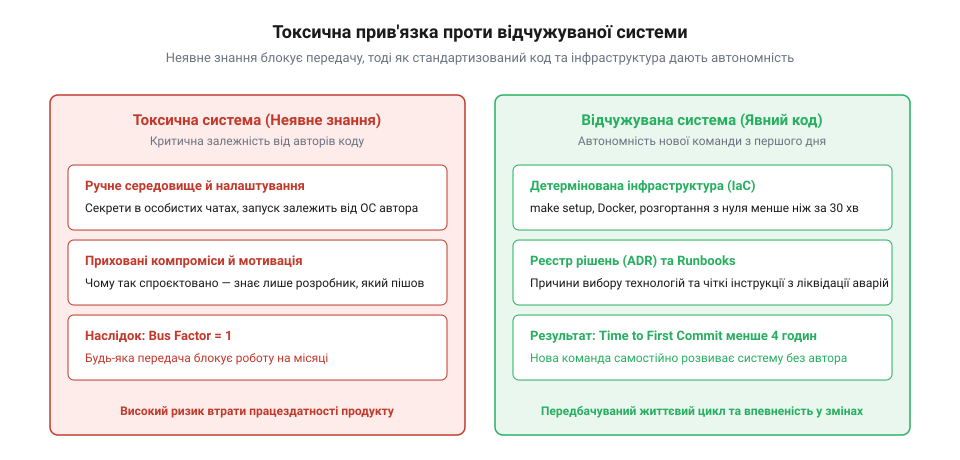
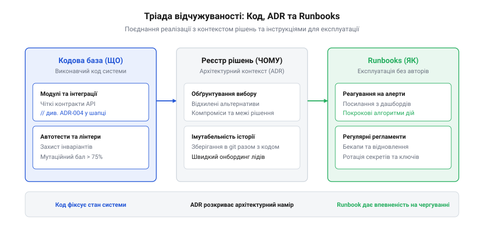

# Система, яку можна передати

<preknowlist>
- [Документ, що не гниє](root:progarch/document-that-does-not-rot) — принципи ведення живої технічної документації, яка не застаріває відносно коду
- [Введення нової команди в систему](root:progarch/onboarding-a-new-team) — типові бар'єри та етапи занурення нових інженерів у чужий проєкт
</preknowlist>

## Пастка неявного знання і синдром покинутої системи

Успішна програмна система живе довше, ніж команда, яка її створила. Рано чи пізно настає момент, коли автори проєкту змінюють роботу, переходять на інші напрями або підрядник завершує свій контракт. У цей переломний момент компанія з'ясовує, чи володіє вона відчужуваною інженерною системою, чи лише набором розрізненого коду, нерозривно зв'язаного з пам'яттю конкретних людей.

Головний симптом непередаваної системи — висока частка неявного знання *(англ. tacit knowledge)*. Це деталі, які ніколи не були зафіксовані в коді чи документації, але без яких система не функціонує:
- Особливі системні змінні оточення, які автор одного разу вручну прописав на сервері через SSH.
- Недокументований порядок запуску мікросервісів, без дотримання якого сервіси падають на ініціалізації.
- Неявні припущення про мережеву топологію, права доступу до спільних дисків або ручні маніпуляції з таблицями бази даних перед випуском нових релізів.

Особливо руйнівною формою накопичення неявного знання є практика «оперативних правок на живому сервері» *(англ. hotfixing via SSH)*. Коли під час нічної аварії або термінового випуску провідний інженер підключається до продакшн-машини через термінал і безпосередньо редагує конфігураційний файл у `/etc/`, встановлює відсутній системний пакет через `apt install` або вручну править скрипт у каталозі розгортання — народжується токсичний розрив між репозиторієм і реальністю. Система входить у стан конфігураційного дрейфу *(англ. configuration drift)*.

У репозиторії проєкту зафіксовано один стан коду та маніфестів, але насправді на бойовому сервері працює гібрид із неврахованих ручних змін, специфічних прав доступу файлової системи та прихованих прапорців у пам'яті процесів. Творець системи пам'ятає, що «на цьому сервері треба перезапустити службу саме з прапорцем `--legacy-mode`», але нова команда не має жодного шансу про це дізнатися.

Коли приходить час перенесення на новий сервер, масштабування або аварійного відновлення після апаратного збою, спроба розгорнути систему зі «стандартного» репозиторію закінчується повною катастрофою: новий сервер не стартує, а старий уже втрачено. Кожна ручна дія через SSH, не зафіксована у вигляді коду інфраструктури (IaC), є міною сповільненої дії, що знищує відчужуваність системи.

Коли нові розробники отримують доступ до репозиторію такої системи, вони стикаються з неможливістю зробити перший крок. Інструкція в README містить три застарілі команди, що завершуються помилками компіляції. Спроби запустити проєкт на новому комп'ютері розбиваються об відсутні приватні ключі, захардкоджені абсолютні шляхи до файлів чи специфічні версії системних утиліт. 


*Відчужуваність системи: неявне знання та ручні операції роблять систему вразливою до зміни розробників, тоді як автоматизована інфраструктура й зафіксовані рішення дозволяють передати її без втрат.*

Це класичний прояв автобусного фактора *(англ. bus factor)*: якщо критичне знання про розгортання та архітектурні обмеження зосереджене в голові одного інженера, втрата цього спеціаліста паралізує розвиток усього продукту. Нова команда боїться змінювати код, оскільки кожен коміт спричиняє непередбачувані регресії в суміжних підсистемах. Будь-яка незначна зміна вимагає днів реверс-інжинірингу, а вартість підтримки стрімко зростає.

> 🔧 **Навіщо це.** Усвідомлення ризику неявного знання змушує архітектора розглядати передачу системи не як разову подію в кінці проєкту, а як щоденну інженерну дисципліну: усе, що не зафіксовано в коді або маніфестах, перестає існувати в день відходу останнього автора.

## Відтворюваність із нуля: інфраструктура як код і детермінізм середовища

Перша фундаментальна вимога до системи, яку можна передати — повний детермінізм її збірки та розгортання. Новий інженер повинен мати змогу схилити чистий репозиторій на чисту машину й підняти повністю працездатне локальне середовище однією командою (наприклад, `docker compose up` або `make run`).

Якщо для запуску проєкту розробник має вручну встановити п'ять різних версій баз даних, налаштувати користувачів у консолі ОС та вручну скопіювати файли конфігурації з корпоративного чату — система не готова до передачі.

Детермінізм забезпечується кількома інженерними практиками:
1. **Інфраструктура як код (IaC):** Усі залежності середовища (бази даних, брокери повідомлень, кеші, симулятори сховищ S3) описуються декларативними маніфестами, які версіонуються в тому самому репозиторії.
2. **Суворе фіксування версій (Lockfiles):** Менеджери пакетів мусять мати замки залежностей (`package-lock.json`, `poetry.lock`, `Cargo.lock`). Збірка через пів року не повинна раптово підтягнути нову мінорну версію сторонньої бібліотеки, яка ламає сумісність.
3. **Конфігурація за правилами дванадцяти факторів:** Усі конфігураційні параметри, що залежать від оточення, передаються через змінні середовища. У репозиторії зберігається файл-зразок `.env.example`, що містить вичерпний перелік змінних із безпечними локальними значеннями за замовчуванням.
4. **Початкові дані (Seed Data):** Система повинна постачатися зі скриптами генерації або імпорту мінімального набору валідних даних для локальної бази. Новачок не повинен самостійно придумувати, які рядки треба вставити в тридцять пов'язаних таблиць, щоб авторизуватися під тестовим користувачем.

Зразок конфігураційного файлу `.env.example` заслуговує на статус повноцінного архітектурного артефакту, адже саме він визначає контракт між кодом програми та зовнішнім середовищем. У невідчужуваній системі такий файл або відсутній, або містить застарілі змінні, через що новачок годинами розбирається, чому застосунок падає на старті з помилкою `KeyError: REDIS_PORT`.

Еталонний `.env.example` структурується за суворими правилами інженерної дисципліни:
- **Чітке зонування за підсистемами:** Змінні групуються за логічними блоками із коментарями: мережевий порт сервера, параметри підключення до бази даних, налаштування черги повідомлень, таймаути зовнішніх шлюзів.
- **Безпечні локальні значення за замовчуванням:** Для кожного локального сервісу вказано робочі локальні параметри (`DB_HOST=localhost`, `DB_PORT=5432`, `DB_USER=postgres`, `DB_PASSWORD=postgres`). Новий розробник повинен просто скопіювати файл командою `cp .env.example .env` і отримати працездатну конфігурацію без необхідності вигадувати паролі.
- **Явне позначення бойових секретів:** Для параметрів, які не мають локального аналога або вимагають справжніх ключів (наприклад, токен стороннього платіжного шлюзу чи приватний ключ підпису), значення залишається порожнім із докладним коментарем: де саме інженер може отримати тестовий ключ або як увімкнути режим локального емулятора (`USE_MOCK_PAYMENTS=true`).
- **Сувора валідація на етапі запуску:** Застосунок під час старту зобов'язаний валідувати змінні середовища за допомогою типізованої схеми (наприклад, через Pydantic або Zod). Якщо обов'язкова змінна відсутня або має невірний тип (передано рядок замість числа), процес повинен негайно завершитися з чітким повідомленням про помилку, вказуючи, яке саме поле не налаштоване.

```bash
# Тест «чистого аркуша» для нового інженера
git clone https://github.com/company/core-service.git
cd core-service
cp .env.example .env
make setup   # завантажує замкнені пакети, підіймає контейнери, накочує міграції та сіди
make test    # запускає повний набір автоматичних тестів
```

Коли збірка детермінована й автоматизована, зникає суб'єктивне тертя на старті. Новий інженер витрачає перші години не на боротьбу з оточенням і з'ясування версій компіляторів, а на вивчення бізнес-логіки та предметної області.

> 🔧 **Навіщо це.** Повна автономність розгортання з чистого репозиторію відокремлює систему від локальних звичок її перших розробників. Це перетворює продукт на відчужуваний інженерний актив, який можна розгорнути на будь-якому контурі без залучення його творців.

## Архітектурна пам'ять: ADR, карта меж та експлуатаційні інструкції (runbooks)

Навіть якщо репозиторій збирається однією командою, нова команда швидко впирається в наступну стіну: відсутність розуміння контексту прийнятих рішень. Чому замість стандартного REST обрано gRPC? Чому таблиця замовлень шардована саме за регіоном, а не за ідентифікатором клієнта? Чому певний запит виконується сирим SQL замість ORM?

Коли ці причини не зафіксовані, нові інженери або бояться чіпати неочевидний код, вважаючи його сакральним, або починають «виправляти» його, миттєво відтворюючи ті самі критичні помилки, які оригінальні автори подолали пів року тому.

Класичні технічні завдання чи сторінкові документи у Wiki не рятують ситуацію: вони пишуться один раз на старті проєкту й ніколи не оновлюються, перетворюючись на небезпечну дезінформацію.

Жива архітектурна пам'ять відчужуваної системи будується на трьох дисциплінах, інтегрованих безпосередньо в репозиторій:
1. **Записи архітектурних рішень (ADR — Architecture Decision Records):** Короткі текстові файли у форматі Markdown, що зберігаються в каталозі `docs/adr/`. Кожен ADR фіксує контекст проблеми, розглянуті альтернативи, обраний варіант і його усвідомлені недоліки. ADR проходять код-рев'ю так само, як і робочий код. Коли новачок запитує: «Чому це зроблено так дивно?», відповіддю є посилання на відповідний ADR.
2. **Карта меж доменів і даних:** Чітка схема (наприклад, у форматі C4 або Mermaid), яка описує відповідальність кожного сервісу та правила володіння даними. Нова команда повинна з першого погляду розуміти, який сервіс є першоджерелом істини *(англ. single source of truth)* для кожної таблиці чи агрегату.
3. **Експлуатаційні інструкції (Runbooks):** Покрокові інструкції дій для чергового інженера під час типових аварійних ситуацій. Що робити, якщо переповнилася черга Dead Letter Queue? Як виконати відновлення бази даних із бекапу? Як безпечно перезапустити реплікацію?

Щоб ADR не перетворювався на хаотичні нотатки, він мусить слідувати стандартизованому канонічному формату (наприклад, шаблону Майкла Найгарда), де центральне місце займає чесна фіксація компромісів:

```markdown
# ADR-014: Використання PostgreSQL Listen/Notify для локальних сповіщень замість Kafka

## Статус
Прийнято (Accepted) — 2025-11-12

## Контекст
Сервісу сповіщень необхідно передавати події про зміну статусу рахунку у веб-сокети клієнтів. 
Очікуваний потік подій на поточному етапі — до 50 повідомлень на секунду. 
Підключення повноцінного кластера Apache Kafka вимагає виділення окремих віртуальних машин,
налаштування моніторингу ZooKeeper/KRaft та ускладнює локальне середовище розробки.

## Рішення
Використовувати вбудований механізм PostgreSQL `LISTEN/NOTIFY` через окремий пулер з'єднань. 
Бекенд публікує повідомлення в канал `account_events` у тій самій транзакції, що й оновлення даних.

## Наслідки
Позитивні:
- Нульові додаткові витрати на нову інфраструктуру: використовується наявна база даних.
- Локальне середовище розробника запускається без додаткових важких контейнерів.
- Гарантована атомарність оновлення даних і генерації сповіщення.

Негативні компроміси та обмеження:
- Відсутність гарантії доставки: якщо процес-слухач упав у момент відправки NOTIFY, повідомлення втрачається.
- Межа масштабування: механізм непридатний для потоків понад 1000 повідомлень/сек через блокування в пам'яті БД.
- Тригер для перегляду рішення: якщо кількість клієнтських підключень перевищить 10 000, переглянути рішення на користь Redis Pub/Sub або NATS.
```

Така стандартизована структура ADR має колосальну цінність саме завдяки розділу «Наслідки» *(Consequences)*. Новий інженер бачить не просто факт використання технології, а межі її застосування та умови, за яких це рішення слід замінити на інше. Це запобігає як передчасному ускладненню системи, так і безпідставній критиці попередніх рішень.


*Архітектурний каркас знання: поєднання кодової бази, ADR (історія рішень) та runbooks (практичні сценарії обслуговування) гарантує безперервність розуміння системи.*

Коли документація структурована таким чином, вона не гниє окремо від коду, а живе разом із ним у системі контролю версій. Новий розробник бачить не лише стан коду в поточному коміті, а й логіку всієї попередньої еволюції системи.

> 🔧 **Навіщо це.** ADR та runbooks у репозиторії захищають команду від втрати контексту. Вони перетворюють минулий досвід і подолані граблі на експлуатаційний актив компанії, запобігаючи деградації рішень після зміни авторів.

## Верифікація відчуження: перевірка на «чистому аркуші»

Фінальним критерієм готовності системи до передачі є практичний тест на відчужуваність — «тест нового інженера» на ізольованій машині.

Будь-які твердження команди, що здає систему: «у нас все описано в README і все чудово працює», є гіпотезою доти, доки зовнішня людина самостійно не пройде повний життєвий цикл роботи з кодом без жодних усних підказок.

Протокол верифікації складається з чотирьох послідовних кроків:
1. **Чистий клон і підйом середовища:** Новий розробник бере комп'ютер зі стандартною операційною системою, слідує README-інструкції й підіймає локальний стек застосунку. Будь-яка вимога «запитати пароль у Миколи» або «скопіювати скрипт із сервера» фіксується як блокуючий дефект передачі.
2. **Проходження наскрізного бізнес-сценарію:** Використовуючи згенеровані тестові дані (seed data), інженер авторизується в локально піднятому інтерфейсі чи через API й успішно завершує ключовий сценарій (наприклад, створює замовлення та проводить тестову оплату).
3. **Виконання контрольної зміни:** Новий інженер отримує просте навчальне завдання на зміну коду (наприклад, додати нове необов'язкове поле до профілю користувача або змінити валідацію). Він реалізує зміну, запускає локальні юніт- та інтеграційні тести, переконується у їхній успішності та відкриває тестовий пул-реквест.
4. **Автоматизований випуск у тестовий контур (Staging):** Зміна проходить автоматичний конвеєр CI/CD і розгортається на тестовому стенді без ручного втручання.

```text
Чекліст готовності системи до передачі:
[ ] Локальний запуск середовища з нуля без сторонньої допомоги (< 30 хв)
[ ] Успішний запуск повного набору тестів на локальній машині
[ ] Наявність каталогу ADR із поясненням ключових архітектурних виборів
[ ] Наявність runbooks для трьох найімовірніших аварійних інцидентів
[ ] Успішне самостійне розгортання тестового патча новою людиною
```

Якщо новий інженер успішно пройшов усі чотири етапи без залучення оригінальних авторів, система вважається повністю відчуженою. З цього моменту попередня команда може спокійно переходити на інші проєкти: продукт став автономним, а ризики автобусного фактора зведено до нуля.

> 🔧 **Навіщо це.** Тест на чистому аркуші — єдиний об'єктивний спосіб довести, що система відокремилася від своїх творців. Він усуває ілюзію готовності й виявляє приховані залежності до того, як розробники залишать компанію.
