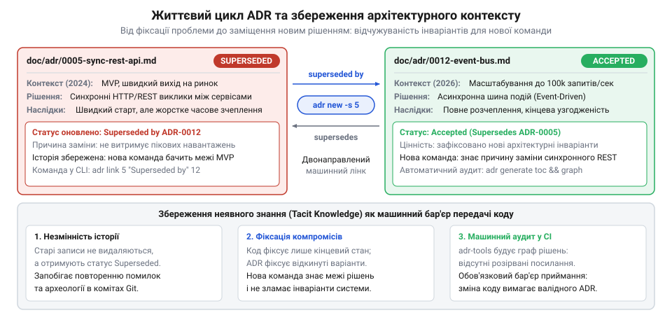
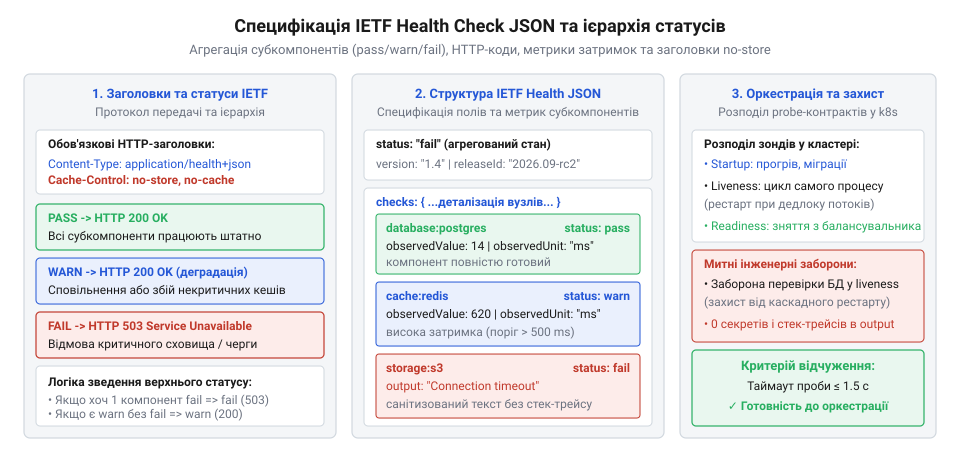
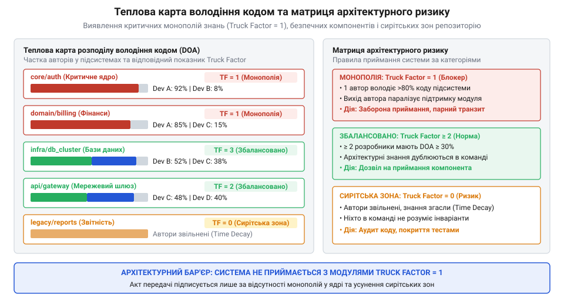

# Система, яку можна передати

<preknowlist>
- [Документ, що не гниє](root:progarch/document-that-does-not-rot) — чому технічна документація та архітектурні вимоги мають зберігатися поруч із кодом у системі контролю версій і верифікуватися як частина конвеєра збірки
- [Приймання системи від підрядника](root:progarch/accepting-a-system-from-a-contractor) — принципи перевірки реальної готовності кодової бази та чому фіксація архітектурних рішень у репозиторії є обов'язковою умовою відчужуваності
- [Введення нової команди в систему](root:progarch/onboarding-a-new-team) — як наявність структурованої хронології архітектурних рішень усуває комунікаційний параліч та скорочує час занурення нових інженерів
</preknowlist>

## Чому архітектурні рішення гниють і роль CLI у відчужуваності кодової бази

Коли інженер відкриває успадкований або чужий репозиторій, він бачить перед собою вичерпний результат, але позбавлений будь-якого вибору. Сирцевий код досконало фіксує поточний стан системи «як саме зроблено»: які типи даних оголошено, які таблиці створено в базі даних, якими протоколами спілкуються мікросервіси. Проте в кодовій базі немає жодного сліду відповіді на фундаментальне питання «чому саме так». Чому в критичній точці обробки замовлень використано синхронний HTTP-виклик замість надійної черги повідомлень? Це тимчасовий компроміс перед релізом, вимушене обмеження через нездатність застарілого фіскального реєстратора працювати асинхронно чи наслідок недостатнього досвіду першого розробника?

Поки над проєктом працює первинна команда авторів, відповіді на ці питання існують у формі неявного знання (англ. @@en|tacit knowledge@@, від латин. @@en|tacitus@@ — мовчазний, прихований). Це знання живе в пам'яті архітекторів, неформальних обговореннях біля дошки, приватних листуваннях у месенджерах та усних домовленостях. Воно не зафіксоване в кодовій базі машинним способом, але саме воно визначає інваріанти системи — невидимі правила й межі, за порушення яких програма втрачає стійкість.

Криза неявного знання вибухає в момент передачі системи. Якщо завершується контракт із компанією-підрядником або ключові інженери змінюють місце роботи, вся неформальна пам'ять проєкту зникає разом із ними. За правилами процесу [приймання системи від підрядника](root:progarch/accepting-a-system-from-a-contractor), замовник має отримати відчужуваний продукт — систему, якою новий колектив може володіти, керувати та безпечно її модифікувати без постійних консультацій із попередніми авторами. Без зафіксованого контексту передача перетворюється на імітацію: нова команда отримує сирцеві файли, але опиняється перед стіною невідомості.

У такій ситуації виникають два деструктивні сценарії:
1. Архітектурний параліч: інженери бояться торкатися неочевидних конструкцій, вважаючи їх сакральною магією попередників. Будь-яка зміна блокується через страх ненавмисно зламати приховане обмеження.
2. Повторення відкинутих помилок: розробники намагаються «покращити» застарілий компонент (наприклад, перевести той самий фіскальний реєстратор на брокер повідомлень), витрачають тижні роботи і лише на стадії промислової аварії з'ясовують, що автори вже проходили цей шлях два роки тому й свідомо відмовилися від нього через несумісність із драйвером постачальника.

Без структурованого журналу рішень [введення нової команди в систему](root:progarch/onboarding-a-new-team) перетворюється на повільні археологічні розкопки коммітів у Git, де повідомлення на зразок «fix issue» чи «refactor pipeline» не дають жодного уявлення про справжні мотиви архітектурних зрушень.

Розробники часто заперечують: «Навіщо нам окремі файли ADR, якщо ми пишемо детальні повідомлення до комітів і ведемо обговорення у пул-реквестах?». Це небезпечна ілюзія. Повідомлення коміту (англ. @@en|commit message@@) жорстко прив'язане до локального дифу: воно пояснює конкретну правку синтаксису у трьох файлах, але не пояснює стратегічний компроміс системи. Коли через пів року в модулі з'являється дві сотні нових комітів, знайти первинний задум стає неможливо. Пул-реквести страждають від ще гіршої вади — платформової залежності. Дискусії живуть на серверах віддалених хостингів, прив'язані до номерів задач у зовнішній системі трекінгу. Якщо репозиторій мігрує на інший хостинг або замовник завантажує локальний архів кодової бази без доступу до хмарного облікового запису підрядника, уся історія обговорень випаровується.

Більше того, обговорення у пул-реквесті — це процес пошуку рішення, а не саме рішення. У коментарях до коду змішуються зауваження щодо стилю, дискусії про назви змінних і тимчасові гіпотези, які так і не були реалізовані. Новий інженер, намагаючись відновити контекст за чужими коментарями, змушений перечитувати сотні повідомлень неструктурованого чату, щоб відсіяти шум від зафіксованого інваріанта. Запис архітектурного рішення, на противагу цьому, є дистильованим підсумком: він фіксує лише кінцевий консенсус, очищений від випадкових суперечок, і зберігається безпосередньо у каталозі doc/adr як постійна складова кодової бази.

Ціна втраченого контексту під час передачі системи вимірюється не абстрактними незручностями, а прямими фінансовими втратами замовника. Коли нова команда не має перед очима чіткої хронології архітектурних роздоріжжів, час виходу на продуктивну розробку перших істотних змін зростає втричі або вчетверо. Замість реалізації бізнес-функцій інженери змушені проводити зворотну розробку чужих конструкцій, будувати здогадки про призначення неочевидних таблиць і витрачати оплачувані години на відновлення знань, які підрядник зобов'язаний був передати у формі відчужуваних артефактів. Наявність повноцінного журналу рішень перетворює процес передачі на перевірку формальних інваріантів: кожен ключовий компонент системи має своє свідоцтво про народження, де зафіксовано дату, мотиви вибору та перелік відхилених альтернатив.

Таким чином, відчужуваність архітектури вимагає не просто збереження окремих файлів, а впровадження системного механізму передачі інженерного контексту. Будь-яка архітектура є результатом компромісів між взаємовиключними вимогами: швидкістю розробки, продуктивністю обробки даних, витратами на інфраструктуру та простотою масштабування. Якщо ці компроміси не зафіксовані в явному вигляді, наступники сприйматимуть систему як випадкове нагромадження коду, а не як цілісний продуманий механізм. Саме тому запис архітектурного рішення стає тим мінімальним атомом відчужуваності, який з'єднує код із наміром його творців.

Звична спроба боротися з цим через зовнішні вікі-системи (Confluence, Notion) чи текстові файли у хмарних сховищах завжди закінчується гниттям знань. Документація, яка живе окремо від коду, миттєво відривається від реальності: посилання губляться під час міграцій облікових записів, права доступу блокуються, а інженери перестають оновлювати віддалені сторінки під час термінових правок. Концепція [документа, що не гниє](root:progarch/document-that-does-not-rot) вимагає суворого підходу «документація як код» (англ. @@en|Docs-as-Code@@): документація повинна лежати поруч із кодом у тій самій системі контролю версій, змінюватися в тих самих пул-реквестах та перевірятися автоматизованими конвеєрами збірки.

Для практичного втілення цього підходу в 2011 році Майкл Нігардт (Michael Nygard) сформулював концепцію записів архітектурних рішень — ADR (англ. @@en|Architecture Decision Records@@, від латин. @@en|decisio@@ — остаточна ухвала). Запис архітектурного рішення — це короткий текстовий файл у форматі Markdown, що фіксує одне важливе інженерне рішення, прийняте командою. За каноном Нігардта, кожен ADR має компактну та прозору структуру:
- Заголовок із фіксованим монотонним номером і назвою ухвали;
- Контекст: опис проблеми, бізнесових чи технічних рушіїв та обмежень, які змусили команду діяти;
- Рішення: точне формулювання обраного інваріанта або технології з чітким описом того, що саме ми робимо;
- Статус: життєва фаза документа (запропоновано, прийнято, відхилено чи заміщено);
- Наслідки: вичерпний баланс результатів — не лише очікувані переваги, але й породжені компроміси, нові ризики та додаткові витрати на супровід.

Важливою рисою моделі є незмінність (@@en|immutability@@): прийнятий ADR фіксує історичний момент часу. Якщо обставини змінилися і технологія застаріла, старий запис не переписують заднім числом і не видаляють з історії — замість цього створюють новий ADR, який явно заміщує попередній. Таким чином формується неперервна лінія еволюції системи, де нова команда бачить не просто випадковий набір технологій, а причинно-наслідковий шлях, що привів проєкт до його поточного стану.


*Життєвий цикл архітектурного рішення: перехід від виникнення проблеми та порівняння альтернатив до прийнятого стану, подальшого заміщення новими інваріантами й неперервного збереження контексту для наступників.*

Попри концептуальну елегантність, ведення ADR виключно вручну рідко приживається на практиці. Створення файлу текстовим редактором вимагає пам'ятати поточний вільний порядковий номер, вручну писати довгі назви з нулями (`0014-use-postgresql-jsonb-for-audit.md`), оновлювати статус у стані попередніх файлів при їх заміщенні та вручну верстати перехресні гіперпосилання. Під час командної роботи розробники помиляються в нумерації, створюють файли з колізіями імен, пропускають обов'язкові блоки або просто забувають створити документ через опір рутині.

Цю проблему вирішує спеціалізована консольна утиліта `adr-tools`, розроблена Нетом Прайсом (Nat Pryce). Вона автоматизує повний цикл роботи з документами через інтерфейс командного рядка (англ. @@en|Command Line Interface@@, CLI, від латин. @@en|inter@@ — між та @@en|facies@@ — вигляд, обличчя):
- генерує правильні монотонні чотиризначні номери з нулями на початку;
- безпечно перетворює довільний текстовий заголовок на валідне ім'я файлу (слаг);
- автоматично заповнює дату та закладає стандартизовану структуру розділів;
- оновлює статус попередніх рішень і коректно прописує взаємні посилання в обох документах при заміні чи доповненні;
- генерує навігаційний зміст та граф залежностей між рішеннями для візуалізації архітектурної карти.

Завдяки цьому ведення архітектурної хроніки стає частиною повсякденної консольної роботи інженера поруч із командами `git commit` чи `cargo build`.

> 🔧 **Навіщо це.**
> Без машинної дисципліни ведення рішень архітектурна пам'ять системи неминуче вивітрюється: за два роки нова команда бачить незрозумілий спагеті-код без пояснення причин компромісів. CLI-утиліта adr-tools усуває рутинний спротив розробників, зводячи створення повноцінного архітектурного артефакту до єдиної консольної команди в поточному терміналі.

## Ініціалізація сховища та конфігурація середовища (adr init та змінні оточення)

Закладання обліку рішень у новому або вже діючому проєкті починається з процедури ініціалізації (від латин. @@en|initialis@@ — початковий, вихідний). Сховище архітектурних рішень повинно мати чітко визначену точку входу в структурі файлової системи та легітимне перше правило, яке встановлює сам факт обов'язкового ведення записів для команди. Утиліта `adr-tools` виконує цю операцію за допомогою команди `adr init`.

### Синтаксис команди та поведінка за замовчуванням

Команда `adr init` має такий синтаксис:

```bash
adr init [каталог]
```

Якщо викликати `adr init` у корені проєкту без зазначення аргументу, утиліта автоматично виконує три операції:
1. Створює цільову директорію для документів за стандартним шляхом: `doc/adr`. Якщо батьківський каталог `doc` був відсутній, утиліта рекурсивно створить його в дереві файлів.
2. Створює прихований конфігураційний файл `.adr-dir` у поточному каталозі. Усередині цього файлу зберігається єдиний рядок — відносний шлях до каталогу з рішеннями:
```text
doc/adr
```
Цей файл є локальним маркером конфігурації (від латин. @@en|configuratio@@ — форма, взаємне розташування). Усі наступні команди (`adr new`, `adr list`, `adr link`, `adr generate`) читають файл `.adr-dir`, щоб визначити, де саме розташовані документи, позбавляючи користувача потреби щоразу вказувати шлях через прапорці командного рядка.
3. Автоматично генерує найперший канонічний документ проєкту — `0001-record-architecture-decisions.md`.

### Анатомія першого системного запису

Перший файл є системним мета-рішенням: він фіксує волю команди документувати всі подальші значущі архітектурні кроки саме у форматі ADR. Утиліта створює його одразу зі статусом `Accepted`, фіксуючи поточну дату запуску ініціалізації:

```markdown
# 1. Record architecture decisions

Date: 2026-09-09

### Status

Accepted

### Context

We need to record architectural decisions made on this project.

### Decision

We will use Architecture Decision Records, as described by Michael Nygard.

### Consequences

See Michael Nygard's article, linked above. For a lightweight ADR toolset, see Nat Pryce's adr-tools.
```

Наявність цього файлу є відправною точкою для будь-якого зовнішнього аудитора чи нової команди: побачивши `0001-record-architecture-decisions.md`, інженери розуміють правила гри та структуру прийняття рішень у репозиторії.

### Налаштування нестандартного каталогу

Якщо в організації прийнято інший стандарт розміщення документації — наприклад, зберігати всі технічні описи в каталозі `docs/decisions` або `documentation/architecture`, — цільовий шлях передається першим позиційним аргументом команди:

```bash
adr init docs/decisions
```

У цьому випадку каталог `docs/decisions` буде створено автоматично, перший файл з'явиться за шляхом `docs/decisions/0001-record-architecture-decisions.md`, а у файлі `.adr-dir` буде зафіксовано вказаний шлях:

```text
docs/decisions
```

Якщо цільова директорія вкладена глибоко в дерево каталогів (наприклад, у мультирепозиторії або монорепозиторії мікросервісів `services/billing/docs/adr`), `adr-tools` створить усі проміжні рівні без потреби окремого виклику системної команди `mkdir -p`.

### Керування через змінні оточення: ADR_DIR та ADR_TEMPLATE

Для автоматизації в скриптах неперервної інтеграції (CI), запуску лінтерів або підключення корпоративних стандартів `adr-tools` підтримує змінні середовища, які мають вищий пріоритет над локальними конфігураційними файлами:

1. `ADR_DIR`: глобально перевизначає шлях до каталогу з рішеннями для поточної командної оболонки або процесу.
Коли запущено будь-яку команду `adr`, утиліта спершу перевіряє, чи визначено змінну `ADR_DIR`. Якщо вона встановлена, значення з конфігураційного файлу `.adr-dir` повністю ігнорується. Це дозволяє виконувати команди з довільних робочих папок або працювати з кількома наборами рішень у монорепозиторії:
```bash
export ADR_DIR="services/billing/docs/adr"
adr list
```

2. `ADR_TEMPLATE`: вказує шлях до користувацького шаблону нового рішення.
За замовчуванням утиліта генерує записи за мінімалістичним шаблоном Нігардта. Проте корпоративні політики великих організацій нерідко вимагають обов'язкової наявності специфічних розділів: оцінки надійності, аналізу загроз безпеці, вимог відповідності регуляторним нормам або фіксації бюджетних витрат.
Щоб забезпечити єдиний корпоративний стандарт, команда створює базовий файл розмітки (наприклад, `.adr-template.md` у корені репозиторію) і вказує шлях до нього через змінну:
```bash
export ADR_TEMPLATE=".adr-template.md"
```
Усі наступні виклики `adr new` братимуть за основу структуру вказаного файлу, автоматично підставляючи в нього новий порядковий номер, дату створення та передану назву.

### Поведінка при повторному виклику та захист від перезапису

Команда `adr init` спроєктована з урахуванням захисту від ненавмисного пошкодження даних:
- Якщо виконати `adr init` у репозиторії, де вже існує файл `.adr-dir` і каталог із наявними документами, утиліта не перезаписує існуючі файли рішень. Навіть якщо викликати `adr init` із зазначенням тієї самої директорії, існуючий файл `0001-record-architecture-decisions.md` залишається недоторканим, оберігаючи накопичену історію від стирання.
- Якщо викликати `adr init` із вказівкою на новий каталог (наприклад, перенести сховище з `doc/adr` у `docs/architecture`), файл `.adr-dir` буде перезаписано новим шляхом, а в новому каталозі буде створено свіжий запис `0001`. Попередні файли в старому каталозі не видаляються, що виключає ризик втрати даних через друкарську помилку.

### Фіксація у системі контролю версій Git

Оскільки каталог ADR є невіддільною частиною підходу Docs-as-Code, результат роботи команди `adr init` повинен негайно стати частиною репозиторію. У систему контролю версій додаються як конфігураційний файл `.adr-dir`, так і вся створена директорія з документами:

```bash
git add .adr-dir doc/adr/
git commit -m "docs: initialize ADR repository with 0001 record architecture decisions"
```

Фіксація файлу `.adr-dir` у репозиторії гарантує, що будь-який інший розробник після клонування проєкту зможе відразу виконувати команди `adr new` чи `adr list` без потреби виконувати повторну ініціалізацію або вручну налаштовувати шляхи до каталогів.

> 🔧 **Навіщо це.**
> Фіксація каталогу рішень через adr init створює в проєкті точку відліку: файл 0001 легітимізує практику архітектурного документування, а файл .adr-dir дає змогу всім інструментам і розробникам звертатися до єдиного канонічного шляху без ручного вказування прапорців.

## Створення та життєвий цикл рішень (adr new, прапорці -s та шаблонізація)

Коли сховище рішень ініціалізовано, команда переходить до фіксації повсякденних інженерних виборів. Головна мета інструмента на цьому етапі — мінімізувати тертя: створення нового архітектурного запису має вимагати не більше зусиль, ніж створення звичайного коміту в Git. Якщо процедура складна або вимагає ручного підбору номерів файлів, розробники почнуть відкладати фіксацію рішень «на потім», і контекст знову буде втрачено. Утиліта `adr-tools` автоматизує цей процес через команду `adr new`.

### Анатомія команди adr new та генерація метаданих

Створення нового запису виконується передачею короткого описового заголовка як аргументу:

```bash
adr new "Використання PostgreSQL для аудиту фінансових транзакцій"
```

Отримавши команду, утиліта виконує сувору детерміновану послідовність дій:
1. Сканує каталог рішень, визначений у конфігурації `.adr-dir` або змінній `ADR_DIR`.
2. Знаходить найвищий числовий префікс серед наявних файлів (наприклад, `0001`) та інкрементує його на одиницю.
3. Форматує номер як чотиризначне число з ведучими нулями: `0002`. Фіксована ширина гарантує правильне алфавітне сортування файлів стандартними засобами операційної системи та в терміналі.
4. Перетворює вказаний заголовок на безпечне ім'я файлу (@@en|slug@@; від англ. *slug* — коротка мітка): приводить літери до нижнього регістру, замінює пробіли та розділові знаки дефісами, видаляє заборонені символи файлової системи. У результаті утворюється файл `0002-vykorystannya-postgresql-dlya-audytu-finansovykh-tranzaktsiy.md`.
5. Копіює структуру шаблону, фіксує поточну системну дату у форматі ISO 8601 (РРРР-ММ-ДД) і встановлює початковий статус.

За замовчуванням у згенерований файл записується статус `Accepted`. Якщо команда використовує практику попереднього рецензування рішень через пул-реквести (@@en|RFC-style review@@), статус у чорновику вручну замінюють на `Proposed` (запропоновано) до моменту схвалення всіма зацікавленими сторонами.

Розробка нетривіального архітектурного рішення рідко буває одноосібною. Коли інженер виконує команду adr new, створення запису є не фіналізацією вибору, а запрошенням до технічного рецензування (англ. @@en|Request for Comments@@, RFC). Для цього початковий статус документа у чорновику змінюють на Proposed (від латин. @@en|proponere@@ — пропонувати, виносити на розгляд). У стані Proposed документ містить чітко сформульований контекст та вибір, але відкритий для аргументованої критики команди в межах пул-реквесту.

Якщо в процесі рецензування колеги виявляють приховані недоліки або пропонують ефективнішу альтернативу, рішення не видаляють із системи контролю версій. Замість цього команда переводить статус у Rejected (від латин. @@en|rejicere@@ — відкидати), коротко фіксуючи в розділі контексту причини відхилення (наприклад, надмірне споживання пам'яті або відсутність промислової підтримки бібліотеки). Відхилені ADR мають колосальну цінність для передачі системи: вони створюють захисний бар'єр проти майбутніх спроб повторити той самий хибний шлях. Якщо ж команда досягає консенсусу, статус змінюється на Accepted, і компроміси рішення стають обов'язковим інваріантом для всіх подальших пул-реквестів.

Для прискорення роботи розробників утиліта adr-tools підтримує інтеграцію зі стандартними змінними середовища операційної системи — VISUAL та EDITOR. Якщо одна з цих змінних встановлена в оболонці (наприклад, export VISUAL=code для Visual Studio Code або export EDITOR=vim), команда adr new після створення файлу, обчислення номеру та підстановки поточної дати автоматично відкриває новостворений документ у вказаному текстовому редакторі. Інженер одразу опиняється в позиції редагування контексту, не витрачаючи час на копіювання шляху файлу з термінала.

При роботі в інтернаціональних або україномовних командах особливого значення набуває безпечна слаганізація назв. Оскільки файлові системи різних операційних систем (Linux, macOS, Windows) по-різному обробляють кодування Unicode, пробіли, апострофи та регістрозалежність, пряме створення файлів із кириличними літерами чи спецсимволами може призвести до пошкодження репозиторію під час клонування на іншу платформу. Команда adr new здійснює санітизацію заголовка: перетворює назву на безпечний латинський набір символів або транслітерує кирилицю, дефісами замінює всі неалфавітні знаки та усуває подвійні роздільники. Це гарантує, що репозиторій залишатиметься стабільним у змішаних гетерогенних середовищах розробки.

Такий цикл перетворює архітектурне проєктування на керовану демократичну дисципліну. Кожен інженер має право ініціювати зміни через adr new, але жодне рішення не набуває статусу чинного інваріанта без формального проходження етапу рецензування та фіксації згоди в системі контролю версій.

### Канонічна структура запису за Нігардтом

Згенерований файл розгортає компактний, але строгий каркас за шаблоном Майкла Нігардта:

```markdown
# 2. Використання PostgreSQL для аудиту фінансових транзакцій

Date: 2026-09-09

### Status

Accepted

### Context

Сервіс білінгу обробляє платежі, і регуляторні вимоги зобов'язують
зберігати незмінний слід кожної операції протягом п'яти років.
Поточне логування у текстові файли не дає змоги виконувати швидкий пошук,
а спільна база даних MySQL перевантажена транзакційними запитами користувачів.
Потрібно обрати надійне ізольоване сховище для аудиторського журналу,
яке підтримує складні аналітичні фільтри та гарантує цілісність даних.

### Decision

Ми виділяємо окрему базу даних PostgreSQL для збереження подій аудиту.
Усі сервіси записуватимуть аудит через асинхронний адаптер,
використовуючи JSONB для гнучких тіл подій та партиціювання таблиць за місяцями.

### Consequences

Переваги:
- Повне виконання вимог регулятора щодо збереження фінансових подій.
- Зняття навантаження аудиторських запитів з основної бази MySQL.
- Підтримка складного пошуку за вкладеними атрибутами через індекси GIN у PostgreSQL.

Компроміси та ризики:
- Необхідність супроводу та резервного копіювання додаткового кластера PostgreSQL.
- Потреба контролю розміру таблиць та налаштування політики ротації партицій.
```

Ця структура змушує інженера зафіксувати обидва боки медалі: кожен вибір розв'язує одну проблему, але створює нові обмеження. Наслідки (@@en|Consequences@@) є найціннішим розділом для наступників, які захищають систему від деградації.

### Управління еволюцією через прапорець заміщення: adr new -s

Архітектура живої системи не є статичною: з часом обсяги зростають, вимоги змінюються, і прийняті раніше компроміси вичерпують свій ресурс. За фундаментальним правилом [документа, що не гниє](root:progarch/document-that-does-not-rot), старі архітектурні рішення заборонено затирати чи виправляти заднім числом. Якщо сьогодні видалити згадку про вибір PostgreSQL, нова команда ніколи не дізнається, чому система була побудована саме так, і скільки зусиль пішло на підтримку цього рішення.

Еволюція (від латин. @@en|evolutio@@ — розгортання) фіксується через операцію заміщення. Для цього команда `adr new` надає прапорець `-s` (англ. @@en|supersedes@@, від латин. @@en|supersedere@@ — сидіти вище, займати місце, заміщати):

```bash
adr new -s 2 "Міграція аудиторського сліду на ClickHouse через зростання навантаження"
```

Коли утиліта отримує прапорець `-s <номер>`, вона виконує зв'язану мутацію двох документів:
1. Створює новий документ із наступним порядковим номером (наприклад, `0003-migratsiya-audytorskoho-slidu-na-clickhouse.md`). У його секцію статусу автоматично додається рядок зв'язку із гіперпосиланням на старий файл:
```markdown
### Status

Accepted
Supersedes [2. Використання PostgreSQL для аудиту фінансових транзакцій](0002-vykorystannya-postgresql-dlya-audytu-finansovykh-tranzaktsiy.md)
```
2. Знаходить документ під номером `2` і модифікує його розділ `### Status`:
```markdown
### Status

Superseded by [3. Міграція аудиторського сліду на ClickHouse через зростання навантаження](0003-migratsiya-audytorskoho-slidu-na-clickhouse.md)
```

Завдяки цьому історія системи не обривається. Читач старого документа одразу бачить, що рішення більше не діє, і за прямим посиланням переходить до актуального стану. Новий документ, у свою чергу, посилається на свого попередника, пояснюючи причини відмови від старої схеми.

> 🔧 **Навіщо це.**
> Прапорець заміщення позбавляє розробника потреби вручну відкривати кілька файлів Markdown, обчислювати відносні шляхи та синхронізувати посилання. Машинна фіксація заміщення усуває людську помилку: старе рішення ніколи не залишиться активним за статусом, якщо його фактично викинули з виробничого контуру.

## Двонаправлене зв'язування та реляції між рішеннями (adr link)

Заміщення (`supersedes`) описує лише один тип відношення між рішеннями — повне скасування старого новим. Проте в реальних програмних комплексах рішення переплітаються у значно складнішу семантичну мережу (від грецьк. @@en|semantikos@@ — значущий, сутнісний). Одне рішення може доповнювати інше, уточнювати деталі реалізації, вводити додаткові обмеження або спиратися на інфраструктурний фундамент сусіднього компонента.

Спроба підтримувати такі перехресні посилання вручну приречена: розробники ставлять посилання в один бік, забувають про зворотний зв'язок, роблять помилки у відносних шляхах або випадково ламають синтаксис заголовків Markdown. Для побудови надійних графів взаємозв'язків утиліта надає команду `adr link`.

### Синтаксис та семантика команди adr link

Команда `adr link` має чотири обов'язкові позиційні аргументи:

```bash
adr link <джерело> <тип-зв'язку> <ціль> <зворотний-зв'язок>
```

Аргументи вказують:
- `<джерело>`: порядковий номер або ім'я файлу першого рішення;
- `<тип-зв'язку>`: текстова мітка реляції, яка записується у файл джерела;
- `<ціль>`: порядковий номер або ім'я файлу другого рішення;
- `<зворотний-зв'язок>`: дзеркальна текстова мітка, яка записується у файл цілі.

Розглянемо практичний приклад. Припустимо, у рішенні `0003` команда впровадила ClickHouse для збереження аудиту, а в рішенні `0004` проєктує регламент ротації та очищення застарілих партицій:

```bash
adr link 4 "Amends" 3 "Amended by"
```

Після виконання команди `adr-tools` знаходить обидва файли, парсить блок `### Status` у кожному з них і автоматично вставляє відносні посилання:

У файлі `0004-polityka-rotatsiyi-partytsiy.md`:
```markdown
### Status

Accepted
Amends [3. Міграція аудиторського сліду на ClickHouse через зростання навантаження](0003-migratsiya-audytorskoho-slidu-na-clickhouse.md)
```

У файлі `0003-migratsiya-audytorskoho-slidu-na-clickhouse.md`:
```markdown
### Status

Accepted
Amended by [4. Політика ротації партицій](0004-polityka-rotatsiyi-partytsiy.md)
```

Операція є строго ідемпотентною (від латин. @@en|idem@@ — той самий, та @@en|potens@@ — здатний): повторний запуск команди з тими самими параметрами не продукує дублікатів рядків і не спотворює розмітку документа.

### Модель заміщення та зв'язування

Механіка роботи прапорця `-s` та команди `adr link` підпорядкована єдиній архітектурній моделі: будь-яка зміна реляцій оновлює метадані обох учасників зв'язку одночасно.


*Механіка заміщення та двонаправленого зв'язування в adr-tools: автоматичне оновлення статусів і формування перехресних відносних посилань між пов'язаними документами без ручного редагування розмітки.*

### Типові архітектурні реляції

Команда проєкту самостійно визначає словник зв'язків залежно від специфіки системи. Найпоширенішими в інженерній практиці є такі симетричні пари:

1. Розширення та доповнення (`Amends` / `Amended by`):
Використовується, коли нове рішення частково коригує або розширює положення попереднього, не скасовуючи його повністю. Наприклад, рішення про використання JWT для авторизації доповнюється рішенням про обов'язкову ротацію ключів через JWKS.
2. Уточнення (`Clarifies` / `Clarified by`):
Застосовується, коли первинне рішення було сформульоване надто широко, і на етапі реалізації виникла потреба зафіксувати деталі інтерфейсу або правила обробки крайових станів.
3. Технічна залежність (`Enables` / `Depends on`):
Фіксує причинний ланцюг: одне рішення відкриває технічну можливість для реалізації іншого. Наприклад, впровадження сервісної сітки (@@en|Service Mesh@@) робить можливим перехід на взаємну аутентифікацію mTLS між усіма вузлами.
4. Взаємовиключні альтернативи (`Alternative to` / `Alternative to`):
Пов'язує два паралельні рішення для різних ізольованих середовищ (наприклад, вибір драйвера сховища для локальної розробки та для промислового хмарного кластера).

Наявність такої мережі зв'язків позбавляє стороннього аудитора потреби читати всі рішення підряд. Під час [приймання системи від підрядника](root:progarch/accepting-a-system-from-a-contractor) новий архітектор бере будь-яке цікаве йому рішення (наприклад, по роботі з базою даних) і крокує за гіперпосиланнями вгору та вниз графом залежностей, миттєво бачачи всі модифікації, уточнення та причини заміни технологій. Це скорочує термін [введення нової команди в систему](root:progarch/onboarding-a-new-team) з тижнів до лічених годин.

> 🔧 **Навіщо це.**
> Двонаправлене зв'язування перетворює пласку теку з текстовими файлами на зв'язний орієнтований граф знань. Завдяки adr link архітектура постає перед розробником не як розрізнений набір інструкцій, а як цілісна мережа причин і наслідків, у якій неможливо випадково пропустити супутнє обмеження.

## Генерація зведених звітів, змісту та візуалізація графу (adr generate)

У міру розвитку проєкту каталог рішень наповнюється десятками окремих документів. Поки записів п'ять чи десять, розробники легко орієнтуються за іменами файлів у терміналі. Проте через рік активної розробки сховище містить сотні файлів із різними статусами: частина рішень залишається фундаментальними інваріантами, частина втратила актуальність і була заміщена, а окремі чернетки ще очікують погодження.

У момент [приймання системи від підрядника](root:progarch/accepting-a-system-from-a-contractor) або під час [введення нової команди в систему](root:progarch/onboarding-a-new-team) розрізнений каталог стає бар'єром: інженер не знає, які рішення діють прямо зараз, а які вже стали історією. Щоб перетворити каталог файлів на структурований навігаційний портал, `adr-tools` надає підсистему генерації зведених звітів — групу команд `adr generate` (від латин. @@en|generatio@@ — народження, утворення).

### Зведений зміст: adr generate toc

Команда `adr generate toc` (англ. @@en|Table of Contents@@ — зміст) аналізує всі наявні файли рішень і формує структурований покажчик у форматі Markdown:

```bash
adr generate toc
```

Утиліта зчитує метадані з кожного файлу: числовий індекс, назву з заголовка першого рівня та поточний статус. Результатом є маркований список із посиланнями на відповідні файли:

```markdown
# Architecture Decision Records

* [1. Record architecture decisions](0001-record-architecture-decisions.md) (accepted)
* [2. Використання PostgreSQL для аудиту фінансових транзакцій](0002-vykorystannya-postgresql-dlya-audytu-finansovykh-tranzaktsiy.md) (superseded)
* [3. Міграція аудиторського сліду на ClickHouse через зростання навантаження](0003-migratsiya-audytorskoho-slidu-na-clickhouse.md) (accepted)
* [4. Політика ротації партицій](0004-polityka-rotatsiyi-partytsiy.md) (accepted)
```

За замовчуванням команда виводить згенерований текст у стандартний потік виводу. Його можна перенаправити у файл `README.md` каталогу рішень або вставити у загальну документацію проєкту:

```bash
adr generate toc > doc/adr/README.md
```

Команда підтримує прапорець префікса `-p <префікс>`: якщо зміст публікується у кореневому `README.md` репозиторію, прапорець `-p doc/adr` додасть правильний відносний шлях до кожного посилання, запобігаючи виникненню битих адрес при навігації.

### Візуалізація топології рішень: adr generate graph

Читання списку показує хронологію, але не дає уявлення про топологію системи: які рішення витікають одне з одного, які ланцюжки заміщення сформувалися за роки життя продукту, і який каркас утворюють активні інваріанти.

Для аналізу взаємозв'язків призначена команда `adr generate graph`. Вона парсить перехресні посилання в усіх документах і генерує опис орієнтованого графу (від грецьк. @@en|grapho@@ — креслю, пишу) у мові розмітки Graphviz DOT:

```bash
adr generate graph
```

Згенерований потік містить вузли для кожного ADR та ребра для кожного виявленого зв'язку (`supersedes`, `amends`, `clarifies`). Передавши цей потік утиліті `dot`, інженер отримує векторне зображення архітектурної карти:

```bash
adr generate graph | dot -Tsvg > doc/adr/adr-graph.svg
```

На графі `adr-tools` застосовує семантичне розфарбовування вузлів і ребер:
- Активні ухвалені рішення (`Accepted`) позначаються суцільними контурами як фундамент поточної системи;
- Заміщені рішення (`Superseded`) позначаються приглушеними або перекресленими вузлами, відображаючи відкинуті альтернативи;
- Попередні пропозиції (`Proposed`) виділяються пунктирними межами;
- Спрямовані стрілки вказують точні вектори змін: суцільні ребра показують лінії заміщення, пунктирні — зв'язки розширення та уточнення.


*Спрямований граф архітектурних рішень: автоматична візуалізація ланцюжків заміщення, семантичних взаємозв'язків та активного ядра архітектурних інваріантів у синтаксисі Graphviz.*

Такий граф стає головною діаграмою під час ознайомлення нової команди з кодовою базою. Замість читання сотень сторінок тексту інженер бачить компактне дерево рішень: які компоненти є стабільними, навколо яких вузлів відбувалися найбільш бурхливі заміни, і де пролягають точки найвищої складності.

> 🔧 **Навіщо це.**
> Генерація змісту та графу перетворює розрізнені текстові записи на автоматично оновлюваний портал знань. Це повністю знімає тягар ручного підтримування архітектурних карт: будь-яка зміна через adr new або adr link миттєво відображається на векторній схемі системи.

## Граничні випадки, конфлікти в Git, лінтинг та автоматизація в CI/CD

У реальних умовах командної розробки використання консольної утиліти стикається з викликами розподілених систем контролю версій. Коли десятки розробників працюють над завданнями одночасно у паралельних гілках Git, лінійна послідовність викликів локального CLI неминуче дає збій.

### Проблема паралельних гілок та колізії номерів

Утиліта `adr new` генерує номер на основі максимального індексу у локальному каталозі. Якщо двоє розробників одночасно створили рішення у різних функціональних гілках (від латин. @@en|collisio@@ — зіткнення):
1. Розробник А у гілці `feature/jwt` запускає `adr new "Впровадження JWT"` і отримує файл `0015-vprovadzhennya-jwt.md`.
2. Розробник Б у гілці `feature/cors` запускає `adr new "Налаштування CORS"` і на тій самій спільній базі також отримує файл `0015-nalashtuvannya-cors.md`.

Коли обидві гілки зливаються в головну гілку `main`, стандартний Git не зафіксує конфлікту вмісту файлів (@@en|merge conflict@@), оскільки імена файлів відрізняються після номера. Проте в репозиторії утворюється порушення інваріанта: з'являються два документи з однаковим індексом `0015`. Наступний виклик `adr new` знайде число `15` як максимальне і створить `0016`, назавжди закріпивши дублювання індексу.

Стратегія вирішення колізії:
- При виявленні колізії розробник пізнішої гілки виконує перенумерацію: перейменовує свій файл на наступний вільний індекс (наприклад, `0016-nalashtuvannya-cors.md`), виправляє заголовок першого рівня у тексті (`# 16. Налаштування CORS`) і оновлює будь-які посилання, якщо інші документи вже посилалися на цей ADR.
- Для повного запобігання таким збоям процес автоматизують на рівні сервера злиття.

### Виявлення та запобігання розриву посилань

Ще один поширений збій — биті перехресні посилання. Якщо хтось із розробників вручну видалив застарілий чорновик або перейменував файл рішення в обхід утиліти, зв'язані документи збережуть посилання на неіснуючі адреси.

Для підтримки цілісності сховища використовується автоматизоване сканування посилань:
- Перевірка того, що кожен рядок у розділі `## Status`, який містить відносне посилання вигляду `[...](00XX-....md)`, вказує на реальний файл у каталозі `doc/adr/`;
- Контроль дзеркальності: якщо файл А містить запис `Amends [B](...)`, файл B обов'язково повинен містити симетричний запис `Amended by [A](...)`.

### Автоматизація та лінтинг у конвеєрі CI/CD

Відповідно до філософії [документа, що не гниє](root:progarch/document-that-does-not-rot), тексти архітектурних рішень мають валідуватися (від латин. @@en|validus@@ — міцний, дійсний) тими самими інструментами, що й програмний код.

У конвеєрі неперервної інтеграції (CI) налаштовуються три рівні автоматизованого контролю:

1. Лінтинг структури файлів (@@en|format linting@@):
Спеціалізований крок збірки перевіряє кожен файл у каталозі ADR на відповідність формату Нігардта:
- Наявність заголовка H1 з коректним числовим номером, що точно збігається з префіксом імені файлу;
- Наявність обов'язкових секцій H2: `## Status`, `## Context`, `## Decision`, `## Consequences`;
- Валідність статусу: значення має належати до дозволеного переліку (`Proposed`, `Accepted`, `Rejected`, `Superseded`, `Deprecated`);
- Відсутність дублікатів індексів або пропусків у нумерації.

2. Перевірка свіжості навігаційних артефактів:
Конвеєр автоматично запускає команди генерації та перевіряє статус робочого дерева Git:
```bash
adr generate toc > doc/adr/README.md
adr generate graph | dot -Tsvg > doc/adr/adr-graph.svg
git diff --exit-code doc/adr/
```
Якщо розробник додав нове рішення, але забув оновити зміст або граф, команда `git diff --exit-code` поверне ненульовий код помилки, блокуючи злиття гілки до синхронізації артефактів.

3. Архітектурний контроль змін (@@en|architectural governance gate@@):
Для гарантії того, що підрядник або внутрішня команда не вносять прихованих архітектурних змін, у CI впроваджується правило відстеження впливу:
Якщо пул-реквест змінює критичні файли системи — схеми бази даних (`db/migrations/`), контракти API (`api/specs/`), базові конфігурації або системні інтерфейси, — але не містить жодного зміненого чи доданого файлу в каталозі `doc/adr/`, конвеєр збірки блокує проходження перевірки з вимогою:
```text
Архітектурна зміна вимагає створення ADR. Будь ласка, виконайте adr new та зафіксуйте контекст рішення.
```

Такий машинний бар'єр перетворює створення ADR із факультативної дії на обов'язковий інженерний інваріант. Завдяки цьому при здачі системи замовник гарантовано отримує повний і валідований архів знань, що забезпечує безболісне відчуження кодової бази новому колективу.

> 🔧 **Навіщо це.**
> Лінтинг та автоматизація в CI/CD усувають людський фактор з процесу передачі системи. Якщо наявність та структурна цілісність ADR перевіряється машинним конвеєром, кодова база застрахована від колізій, битих зв'язків і прихованих архітектурних мутацій під час здачі проєкту.
