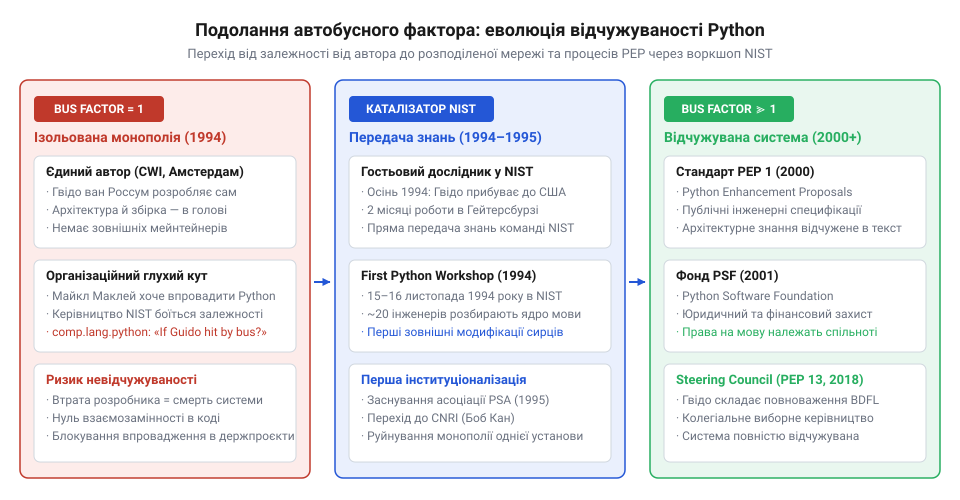

# Система, яку можна передати

<preknowlist>
- [Введення нової команди в систему](root:progarch/onboarding-a-new-team) — типові бар'єри неявного знання та складнощі занурення нових розробників у чужий проєкт
- [Документ, що не гниє](root:progarch/document-that-does-not-rot) — чому пасивна документація застаріває і не може бути єдиним засобом збереження контексту системи
</preknowlist>

## Ранній відкритий софт і пастка незамінного автора

На початку 1990-х років великі інженерні центри, державні дослідницькі інститути та промислові лабораторії намагалися вирватися з глухого кута дорогих пропрієтарних монолітів. Корпоративні вендори тримали замовників у жорстких лещатах ліцензійних угод: вартість супроводу зростала щороку, а будь-яка адаптація підсистеми до нових завдань вимагала місяців бюрократичних погоджень і багатотисячних контрактів. Поява вільного та відкритого програмного забезпечення сприймалася як інженерний порятунок. Сирцевий код поширювався через ранній Інтернет та мережу Usenet, відкриті ліцензії дозволяли модифікацію, а ентузіасти безкоштовно пропонували елегантні скриптові інструменти для автоматизації складних розрахунків.

Проте практична спроба впровадити відкритий інструмент у промислову експлуатацію майже завжди закінчувалася зіткненням із токсичною пасткою: наявність файлів із кодом зовсім не означала відчужуваності системи. Більшість перспективних інтерпретаторів, компіляторів та мов програмування тієї епохи створювалися ентузіастами-одинаками як особисті дослідницькі проєкти або внутрішні утиліти для вузьких наукових завдань. Увесь життєвий цикл такої системи — від неявних залежностей середовища збірки до бачення майбутньої еволюції — існував виключно в пам'яті її єдиного розробника.

Коли зовнішня інженерна команда намагалася зібрати проєкт на власній машині за межами лабораторії автора, процес миттєво зупинявся. Текстові інструкції або були відсутні, або складалися з кількох рядків, які посилалися на неіснуючі шляхи у файловій системі. У Make-файлах виявлялися захардкоджені абсолютні адреси, специфічні версії утиліт компіляції та недокументовані системні бібліотеки, які автор одного разу власноруч зібрав і поклав у свою домашню директорію. Будь-яка спроба повторити цей ланцюжок перетворювалася на виснажливий реверс-інжиніринг.

Ще небезпечнішим виявлявся етап експлуатації. Якщо в процесі обробки реальних даних інтерпретатор завершував роботу аварійним дампом пам'яті через збій у роботі вказівників, сторонні інженери опинялися перед непроникною стіною неявного знання (@@en|tacit knowledge@@; від латинського *tacitus* — мовчазний, прихований). Архітектурні припущення, правила керування пам'яттю та приховані інваріанти внутрішніх структур даних не були зафіксовані в жодному документі.

Система виявлялася заручницею «синдрому одного автора». У ній існувала критична одинична точка відмови (@@en|single point of failure@@, SPOF), втілена не в апаратному компоненті сервера чи каналі зв'язку, а в конкретній людині. Для організацій, чиї виробничі цикли розраховувалися на десятиліття вперед, впровадження такого продукту становило неприйнятний ризик: якщо творець втратить інтерес, змінить місце роботи чи припинить підтримку, вся залежна інфраструктура замовника залишиться без оновлень. Без гарантій спадкоємності [Введення нової команди в систему](root:progarch/onboarding-a-new-team) перетворювалося на нездійсненну місію, а відкритий сирцевий код залишався лише набором невідчужуваних текстів.

> 🔧 **Навіщо це.** Усвідомлення різниці між відкритим кодом і відчужуваною системою вчить архітектора дивитися на продукт очима замовника. Код вважається готовим до промислового життя не тоді, коли автор виклав його у загальний доступ, а коли будь-яка стороння команда здатна зібрати, протестувати й модифікувати його без прямого контакту з автором.

## Червень 1994 року: лист Майкла Маклея та народження автобусного фактора

Саме з цією архітектурною стіною на початку 1994 року зіткнувся Майкл Маклей (@@en|Michael McLay@@), інженер Національного інституту стандартів і технологій США (NIST — @@en|National Institute of Standards and Technology@@). У відділі технологій автоматизованого виробництва (AMRF) у Гейтерсбурзі Маклей опікувався впровадженням міжнародного стандарту обміну промисловими моделями STEP (ISO 10303). Йому була потрібна гнучка, лаконічна високорівнева мова для швидкого прототипування інтерфейсів між різнорідними САПР, верстатами з числовим програмним керуванням та реляційними базами даних.

У поле зору Маклея потрапила молода інтерпретована мова Python, першу публічну версію якої (0.9.0) у лютому 1991 року опублікував нідерландський програміст Гвідо ван Россум (@@en|Guido van Rossum@@). Ван Россум розробляв Python у математичному дослідницькому інституті CWI (@@en|Centrum Wiskunde & Informatica@@) в Амстердамі як наступницю мови ABC для операційної системи Amoeba. Маклей був вражений елегантністю мови: чистий синтаксис на основі відступів, динамічна типізація та вбудовані високорівневі структури даних дозволяли писати складні перетворювачі геометричних моделей за лічені години.

Маклей підготував техніко-економічне обґрунтування використання Python як базової скриптової платформи для федеральних промислових проєктів NIST. Проте реакція керівництва інституту та проєктних аудиторів виявилася категорично негативною. Державні чиновники вказали на очевидну інституційну вразливість: мова створювалася однією людиною в Нідерландах у межах академічного гранту, не мала комерційної підтримки, а єдиним джерелом змін і виправлень був сам Гвідо. Керівництво NIST прямо заборонило будувати критичну державну інфраструктуру на технології, яка не має формалізованого механізму передачі та гарантій довгострокового супроводу.

Усвідомивши, що проблема лежить не в синтаксисі Python, а в організаційній довірі, 29 червня 1994 року Майкл Маклей опублікував у групі новин `comp.lang.python` розлогий лист, тема якого назавжди увійшла в історію комп'ютерних наук: *«If Guido was hit by a bus?»* («Що буде, якщо Гвідо зіб'є автобус?»).

У листі Маклей відверто пояснив спільноті позицію інституційних замовників:
> «Нещодавно я брав участь у нараді щодо використання Python у промисловості. Менеджери висловили серйозні побоювання щодо життєздатності проєкту, який повністю залежить від однієї людини. Що станеться, якщо Гвідо з якихось причин не зможе продовжувати роботу? Якщо його зіб'є автобус, чи виживе Python?»

Маклей виніс на публічне обговорення фундаментальну інженерну проблему: як трансформувати одноосібний авторський проєкт у самодостатній інженерний актив. Питання про автобус не було проявом чорного гумору чи сумнівом у талантах ван Россума. Це була точна метафора ризику несподіваного вибуття ключового носія знання — через зміну роботи, хворобу, припинення фінансування CWI чи професійне вигорання.

Саме з цієї дискусії 1994 року народився термін **автобусний фактор** (@@en|bus factor@@, також відомий як *truck factor*; від англійських слів *bus* — автобус та *factor* — чинник, коефіцієнт). У системній інженерії автобусний фактор визначили як мінімальну кількість учасників команди розробки, раптова втрата яких призводить до повної зупинки або колапсу проєкту через відсутність фахівців із необхідними знаннями та навичками. На червень 1994 року автобусний фактор Python дорівнював одиниці (`bus factor = 1`).

Публікація Маклея стала переломним моментом для всієї індустрії відкритого коду. Вона перевела розмову про відчужуваність систем із площини теоретичних дискусій у площину жорсткого аудиту: будь-яке архітектурне рішення оцінюється не лише за його швидкодією та елегантністю, а й за ціною, яку доведеться заплатити організації в разі раптового зникнення його головного автора.

> 🔧 **Навіщо це.** Оцінка автобусного фактора є базовим інструментом архітектурного аудиту. Якщо для виконання релізу або усунення збою в ядрі системи команда змушена чекати конкретного провідного інженера, архітектура містить критичну вразливість, яку необхідно ліквідувати через делегування повноважень та систематизацію знань.

## Практичний дерискінг: Гвідо в NIST і Перший воркшоп із Python (1994)

Після публікації листа про автобус Майкл Маклей міг піти стандартним бюрократичним шляхом: підкоритися вимогам керівництва, відмовитися від перспективної технології або вимагати від автора написати «повну інструкцію з внутрішньої будови». Проте в системній інженерії пасивний текст не рятує кодову базу: [Документ, що не гниє](root:progarch/document-that-does-not-rot) доводить, що статичні описи без живого виконання застарівають швидше, ніж змінюється код. Маклей обрав іншу стратегію — активний дерискінг (англ. *derisking* — зниження ризиків) через пряме залучення спільноти та державне фінансування.

Замість листування електронною поштою NIST запропонував Гвідо ван Россуму двомісячне оплачуване стажування як гостьового дослідника (@@en|guest researcher@@) у Гейтерсбурзі, штат Меріленд. Восени 1994 року Гвідо прибув до США. Ключовою подією його перебування стала організація першого в історії воркшопу з мови — **First Python Workshop**, який відбувся 15–16 листопада 1994 року в стінах NIST.

На зустріч зібралося близько двадцяти ентузіастів та інженерів із різних американських організацій, зокрема з Геологічної служби США (USGS), Національного інституту стандартів і Корпорації національних дослідницьких ініціатив (CNRI). Це були фахівці, які вже експериментували з мовою на власних машинах, але натикалися на брак розуміння внутрішнього влаштування платформи.

Воркшоп докорінно змінив структуру проєкту. Ван Россум детально розібрав перед учасниками ядро CPython: цикл інтерпретатора байт-коду в модулі `ceval.c`, об'єктну модель на базі структури `PyObject`, механізм підрахунку посилань для керування оперативною пам'яттю та принципи створення розширень мовою C. Проте найважливішим результатом стала не лекція, а спільна інженерна робота. Учасники провели серію хакатонів, узгодили сумісність збірки під різні варіанти операційних систем Unix, стандартизували структуру модулів і розподілили між собою зони відповідальності за суміжні бібліотеки.

*Еволюція відчужуваності: дерискінг одноосібного володіння через відкриті воркшопи NIST, стандартизацію пропозицій змін (PEP) та інституціоналізацію в неприбуткову фундацію.*

Завдяки воркшопу в NIST автобусний фактор перестав бути абстрактною загрозою. Якщо раніше для вирішення будь-якої складної проблеми компіляції чи збою середовища потрібно було звертатися до Амстердама, то тепер у США з'явилася когорта з двох десятків інженерів, здатних розібратися в сирцях і модифікувати ядро. Монополію одного автора було зруйновано: знання про систему перетворилося з приватної власності творця на відкритий інженерний капітал спільноти.

> 🔧 **Навіщо це.** Справжнє зниження автобусного фактора досягається не накопиченням паперових звітів, а створенням умов, за яких зовнішні розробники безпосередньо беруть участь у збірці та налагодженні системи поруч із автором. Тільки жива передача практики здатна трансформувати неявне знання в колективну спроможність команди.

## Від воркшопу до інституції: PSA, стандарти PEP та народження PSF

Успіх листопадового воркшопу 1994 року зняв гостроту проблеми на рівні NIST, проте поставив перед архітектурою наступний виклик. Разове зібрання людей здатне розпорошити знання в певний момент часу, але без формалізованих механізмів врядування система неминуче деградує. З розвитком кодової бази нові функції ризикували знову осідати в локальних форках, а авторське право залишалося вразливим до корпоративних конфліктів роботодавців. Проєкт потребував відчужуваних інституційних рамок.

Першим кроком до постійної координації стало заснування у 1995 році асоціації Python Software Activity (@@en|Python Software Activity@@, PSA). Того ж року ван Россум залишив амстердамський CWI і перейшов на роботу до CNRI у Вірджинії під керівництво піонера Інтернету Боба Кана (Bob Kahn). Це забезпечило стабільне фінансування розробки на базі дослідницьких грантів DARPA, а випуски мови стали регулярними та передбачуваними.

Проте справжня архітектурна зрілість настала у 2000 році із запровадженням механізму пропозицій щодо покращення Python — **PEP** (@@en|Python Enhancement Proposals@@; за зразком інтернет-специфікацій RFC, від англійського *enhancement* — покращення та *proposal* — пропозиція). До появи PEP розвиток мови визначався неформальними дискусіями у списках розсилки, де останнє слово належало автору в ролі «доброзичливого довічного диктатора» (@@en|Benevolent Dictator For Life@@, BDFL).

Створений за ініціативою ветеранів спільноти (Баррі Варшави, Джеремі Гілтона та самого Гвідо) стандарт PEP 1 закріпив жорстке правило: будь-яка суттєва зміна синтаксису, нове системне API чи модифікація внутрішніх структур ядра мають бути зафіксовані у формі структурованого публічного документа. PEP зобов'язаний містити технічне обґрунтування, аналіз зворотної сумісності, розгляд відкинутих альтернатив та еталонну реалізацію. Фактично екосистема отримала власний публічний аналог записів архітектурних рішень (ADR), завдяки якому кожне рішення стало прозорим, а контекст його ухвалення — доступним будь-якому новому учаснику.

Фінальним етапом відокремлення технології від фізичних осіб стало заснування у 2001 році некомерційної організації **Python Software Foundation** (@@en|Python Software Foundation@@, PSF). Усі права інтелектуальної власності, торговельні марки та правовий контроль над репозиторієм були передані фонду, керованому виборною радою директорів.

Ця багаторівнева інституціоналізація пройшла абсолютну перевірку на міцність у липні 2018 року, коли Гвідо ван Россум оголосив про складання повноважень BDFL після виснажливих публічних дебатів довкола синтаксису оператора присвоєння (PEP 572). Система не розкололася і не зупинилася: спільнота розробила та затвердила PEP 13, перевівши керівництво мовою на виборну Керівну раду (@@en|Steering Council@@) з п'яти осіб. Мова, що починалася як приватний експеримент одного вченого, стала стійким світовим стандартом завдяки тому, що її відчужуваність була закріплена на рівні відкритого коду, процедурних стандартів і незалежного врядування.

> 🔧 **Навіщо це.** Передача архітектури не завершується передачею сирцевого коду. Вона вимагає створення інституційних правил гри — стандартизованого протоколу ухвалення рішень (PEP/ADR) та прозорої моделі врядування, які гарантують безперервність розвитку системи навіть у разі повного відходу її первинних лідерів.

## Розвінчання міфів та сучасні уроки відчужуваності

Попри те, що історія Майкла Маклея та воркшопу в NIST відбулася на очах інженерної спільноти, навколо концепції автобусного фактора виникло кілька стійких міфів, які й сьогодні спотворюють архітектурні рішення.

Перший міф стосується походження та природи самого терміна. У популярній IT-культурі часто вважають, що @@en|bus factor@@ (або його варіація @@en|truck factor@@) — це жартівливий фольклор Кремнієвої долини чи породження практик гнучкої розробки (Agile та Extreme Programming) початку 2000-х років. Через це поняття нерідко сприймають легковажно або як похмуру іронію про фізичну небезпеку на дорозі. Проте історичні факти свідчать про протилежне: концепція народилася як сувора вимога інституційного ризик-менеджменту в державному метрологічному агентстві США. Метафора автобуса стосувалася не стільки фізичної загрози людині, скільки захисту довгострокових інвестицій. У реальному інженерному житті «автобусом» набагато частіше стають банальна зміна роботи провідного інженера, втрата бюджету дослідницької лабораторії, професійне вигорання або зміна пріоритетів компанії. Будь-яка ситуація, за якої людина припиняє відповідати на запити команди, миттєво активує автобусний фактор.

Другий міф — ілюзія формального дублера. Багато менеджерів намагаються «підвищити автобусний фактор», формально закріплюючи за критичним модулем другого інженера або призначаючи «заступника автора». Проте якщо цей розробник не контриб'ютить у кодову базу щодня, не бере участі в аналізі аварійних інцидентів і не проводить архітектурні рев'ю, його готовність підхопити систему залишається суто номінальною. Володіння кодом є динамічним процесом: неявне знання накопичується з кожним комітом, і за кілька місяців пасивного спостереження «дублер» втрачає контекст настільки, що [Введення нової команди в систему](root:progarch/onboarding-a-new-team) доводиться починати з нуля.

Третій міф — порятунок через статичну документацію у Wiki. Команди часто вірять, що примус розробника написати багатосторінковий документ нейтралізує ризик його незамінності. Проте [Документ, що не гниє](root:progarch/document-that-does-not-rot) нагадує: пасивний текст, відірваний від автоматизованого конвеєра збірки та тестів, починає деградувати в момент збереження сторінки. Спроби новачків розгорнути складний сервіс за застарілими інструкціями лише збільшують час простою під час аварій.

Урок, який Майкл Маклей і спільнота Python дали світові три десятиліття тому, доводить, що відчужуваність системи будується не на паперах і не на сподіваннях на окремих людей. Вона досягається трьома практичними інженерними дисциплінами:

1. **Інженерний детермінізм середовища:** Архітектура продукту зобов'язана проходити тест «чистого аркуша». Будь-який інженер повинен мати змогу схилити свіжий репозиторій на чисту віртуальну машину й підняти робоче середовище однією командою, не вимагаючи приватних ключів чи усних консультацій автора. Це є базовим критерієм, на якому ґрунтується [Приймання системи від підрядника](root:progarch/accepting-a-system-from-a-contractor).
2. **Публічна архітектурна пам'ять:** Стандартизація рішень через механізми, аналогічні PEP та записам архітектурних рішень (ADR). Контекст кожного технічного компромісу має версіонуватися в репозиторії поруч із кодом, ліквідуючи монополію первинних авторів на неявне знання.
3. **Вимірюваний розподіл володіння кодом:** Моніторинг ступеня авторства (@@en|Degree of Authorship@@, DOA) за історією системи контролю версій. Архітектор зобов'язаний відстежувати модулі, де понад 80% змін генеруються однією людиною, і цілеспрямовано перебудовувати процес: запроваджувати обов'язкове перехресне код-рев'ю, ротувати завдання між командами та розділяти складні монолітні вузли на автономні підсистеми з чіткими контрактами.

Справжня відчужуваність настає тоді, коли автобусний фактор перестає сприйматися як фатальна неминучість і перетворюється на керований параметр проєкту. Життєздатність системи визначається не геніальністю її творця, а тим, наскільки легко вона продовжує свій розвиток після його повного відходу.

> 🔧 **Навіщо це.** Аналіз автобусного фактора виводить архітектора з площини чистого програмування у площину життєздатності бізнесу. Архітектура є надійною лише тоді, коли вибуття будь-якого розробника — навіть головного архітектора — є звичайною робочою подією, а не катастрофою, здатною зупинити розвиток продукту.
