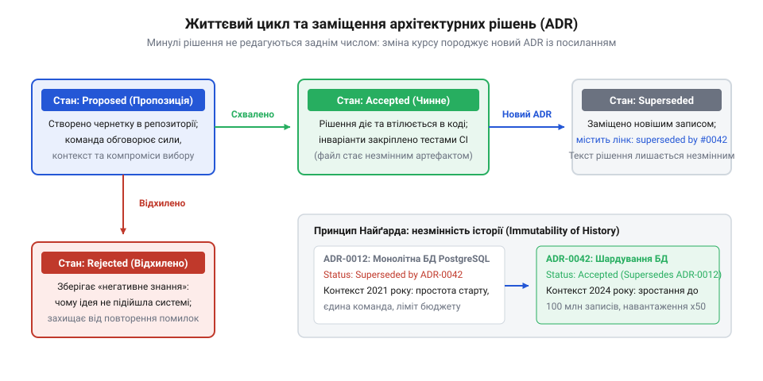

# Система, яку можна передати

<preknowlist>
- [Документ, що не гниє](root:progarch/document-that-does-not-rot) — чому відокремлена від коду документація неминуче застаріває і як зв'язати опис системи з репозиторієм
- [Введення нової команди в систему](root:progarch/onboarding-a-new-team) — типові бар'єри неявного знання та труднощі відновлення архітектурного контексту новими інженерами
- [Приймання системи від підрядника](root:progarch/accepting-a-system-from-a-contractor) — чому замовник не може прийняти систему без прозорої та повної історії архітектурних компромісів
</preknowlist>

## Кладовище специфікацій і параліч нових команд на рубежі 2000-х

Наприкінці 1990-х та у 2000-х роках корпоративне проєктування програмного забезпечення переживало епоху важких монументальних стандартів. Інженерний процес будувався за канонами каскадних методологій (Waterfall) та уніфікованого процесу Rational Unified Process (RUP). Проєктні інститути, оборонні підрядники та фінансові гіганти вимагали обов'язкового створення так званого документа архітектури програмного забезпечення (англ. @@en|Software Architecture Document@@, скорочено SAD; документ — від лат. *documentum*, повчання, доказ). Цей талмуд налічував двісті, триста або навіть п'ятсот сторінок у форматі Microsoft Word, містив десятки формальних діаграм UML, розроблених у середовищах на кшталт Rational Rose чи Enterprise Architect, і зберігався на спільних мережевих дисках чи корпоративних серверах SharePoint.

Фундаментальна вада цієї практики ховалася в її повній просторовій і часовій відірваності від кодової бази. Специфікація народжувалася на етапі передпроєктного аналізу — у мить, коли команда архітекторів володіла мінімальною кількістю знань про реальні технічні виклики та поведінку майбутньої системи під навантаженням. Щойно розпочиналася безпосередня розробка, програма стикалася з суворою фізичною реальністю: зовнішні шлюзи гальмували, сторонні драйвери містили помилки, а бази даних блокували таблиці. Розробники шукали обхідні шляхи, впроваджували компенсаційні механізми, латали вузькі місця й переробляли інтерфейси компонентів. 

Проте ніхто з програмістів не повертався до трьохсотсторінкового файлу Word, щоб синхронізувати UML-діаграму зі свіжими виправленнями. Це вимагало годин бюрократичного узгодження, не впливало на проходження компіляції та не перевірялося жодним автоматизованим тестом. У результаті вже за три-чотири місяці після початку активного кодування виникав незворотний конфігураційний дрейф: кодова база йшла вперед, а паперовий монумент залишався застиглим знімком початкових ілюзій. Документація неминуче перетворювалася на токсичний [документ, що не гниє](root:progarch/document-that-does-not-rot) на папері, але безповоротно згнив у реальності.

Ця криза поглиблювалася інституційним розколом між тими, хто ухвалював рішення, і тими, хто зіштовхувався з їхніми наслідками у коді. В епоху домінування RUP у великих корпораціях культивувалася роль так званого «архітектора зі слонової вежі» (англ. @@en|Ivory Tower Architect@@). Такий фахівець сидів в окремому кабінеті, створював складні діаграми пакетів та класів, але був повністю відрізаний від повсякденної компіляції проєкту, профілювання пам'яті та реального навантаження на систему. Розробники сприймалися як прості оператори кодогенерації: вони мусили сліпо втілювати спущені згори специфікації, не маючи права поставити під сумнів авторитет головного аналітика.

Коли під час навантажувального тестування виявлялося, що запроєктована архітектором витончена схема розподілених транзакцій блокує базу даних або викликає взаємні блокування (англ. @@en|deadlocks@@; дедлок — від англ. dead, мертвий + lock, замок), інженери були змушені рятувати реліз самостійно. Вони викидали транзакційний менеджер, вставляли асинхронні буфери та жорстко прив'язували обробку до локальної пам'яті сервера. Проте розповісти про це архітектору означало зірвати графік здачі проєкту та наразитися на адміністративні штрафи.

Як наслідок, виникала культура приховування технічних компромісів. Програмісти свідомо маскували обхідні шляхи за нейтральними назвами службових класів, а в офіційні звіти для керівництва подавали звіти про «ідеальну відповідність первинному проєкту». Будь-який компроміс, продиктований стислими строками, відсутністю досвіду команди чи дефіцитом серверного заліза, стирався з офіційного наративу ще до першого промислового випуску. Система від самого народження приховувала своє справжнє обличчя від власних творців.

Особливо драматично ця ілюзія розбивалася під час комерційного передавання системи зовнішньому замовнику. Менеджмент підрядника ставився до специфікацій виключно як до юридичного щита: головне було підписати акт прийому-передачі та закрити фінансові зобов'язання. Замовник, отримавши роздрукований талісман із синіми печатками, урочисто ставив його на архівну полицю, щиро вірячи, що отримав повний інтелектуальний контроль над розробленим програмним забезпеченням. Проте фактичний носій знання — живі інженери, які пам'ятали реальні вузькі місця, неявні залежності та справжні причини кожної неочевидної заплатки, — того ж дня переходили на інший комерційний контракт. На руках у замовника залишалася відчужена від коду купа мертвого паперу, яка не давала жодної відповіді на те, як підтримувати продукт у життєздатному стані наступного дня після запуску.

Справжня катастрофа вибухала тоді, коли в життєвому циклі системи наставав момент передачі. Первинні розробники змінювали місце роботи, консультанти підрядника завершували контракт або продукт переходив на баланс внутрішнього відділу експлуатації. Нові інженери, для яких організовували [введення нової команди в систему](root:progarch/onboarding-a-new-team), або замовник під час процедури [приймання системи від підрядника](root:progarch/accepting-a-system-from-a-contractor), відкривали репозиторій і не знаходили там відповідей. Корпоративна wiki містила застарілі інструкції для збірки на вигаданих стендах, а роздутий SAD описував абстрактні шари, яких уже давно не існувало в коді.

Найгіршим було те, що навіть свіжа й детальна специфікація фіксувала виключно поточний стан: *що* саме збудовано (компоненти, таблиці, класи). Вона абсолютно ігнорувала головне запитання інженерії: *чому* систему збудовано саме так. У тексті специфікацій не залишалося жодного сліду про те, які інші альтернативи розглядалися, які технологічні обмеження відкинули швидке очевидне рішення, на які свідомі компроміси пішла команда і якими ризиками вона знехтувала заради дедлайну.

Новачки стикалися з класичною інженерною дилемою, відомою як [паркан Честертона](root:sf-apps/chestertons-fence) (англ. @@en|Chesterton's fence@@; принцип філософа Гілберта Честертона: ніколи не прибирай паркан посеред дороги, доки не дізнаєшся, з якою метою його там спорудили). Натрапивши в коді на дивний адаптер, складний рукотворний буфер повідомлень чи подвійну валідацію запиту, новий розробник не міг зрозуміти: це випадкова неохайність втомленого програміста чи життєво необхідний бар'єр проти збою зовнішнього банку? Без контексту прийнятих рішень команда потрапляла в одну з двох рівноцінно руйнівних пасток:
1. **Параліч страху:** розробники категорично відмовлялися торкатися неочевидних фрагментів коду, оброщуючи старий моноліт новими незграбними шарами посередників. Система деградувала, перетворюючись на крихкий клубок спагеті, в якому будь-яка зміна загрожувала непередбачуваними наслідками.
2. **Арогантне переписування з нуля:** новий архітектор оголошував усе зроблене попередниками «тотальним легасі» та списував працюючий модуль, щоб реалізувати «ідеальне та чисте» бачення. Проте через пів року переписаний модуль неминуче ламався на тому самому граничному випадку мережевої затримки чи блокування бази даних, який перші автори успішно ізолювали п'ять років тому, але не залишили про це жодного запису.

> 🔧 **Навіщо це.**
> Відчужуваність кодової бази визначається не наявністю діаграм, а можливістю відтворити хід думок попередників. Якщо новий інженер бачить у коді шов чи компроміс, але не може дізнатися, від яких саме небезпек цей шов захищає, система перестає бути придатною до передачі й приречена на деградацію або повторення старих катастроф.

## Листопад 2011 року: Майкл Найґард і незмінний журнал рішень

У пошуках порятунку від цього глухого кута американський архітектор Майкл Найґард (Michael Nygard), який здобув світове визнання завдяки класичній праці «Release It!», звернув увагу на щоденну динаміку інженерних суперечок. Консультуючи команди в компанії Relevance (згодом об'єднаній у Cognitect), Найґард спостерігав типову картину: інженери щокілька місяців поверталися до однієї й тієї самої суперечки — наприклад, чи варто відмовитися від реляційної бази на користь документного сховища, або чи слід розбити моноліт на окремі служби. Команда витрачала тижні на гарячі дискусії, не підозрюючи, що півтора року тому це питання вже детально дослідили, провели навантажувальні тести й аргументовано відхилили через несумісність із вимогами аудиту. Контекст було безповоротно втрачено, бо він жив лише в розмовах біля кулера чи в закритих гілках корпоративної пошти.

Найґард зрозумів: головна проблема традиційної документації полягає в спробі створити універсальну, постійно актуальну картину системи. Така картина потребує колосальних зусиль на підтримку й обов'язково програє реальності. Замість монументального моноліту описів Найґард запропонував радикально іншу концепцію: фіксувати не фінальний стан, а точки прийняття рішень (англ. @@en|Architectural Decision Records@@, скорочено ADR; рішення — від лат. *decisio*, відсікання зайвого, обрубування вузла).

15 листопада 2011 року Майкл Найґард опублікував у блозі компанії Relevance маніфест «Documenting Architecture Decisions», який сформулював нову парадигму. Його ідея спиралася на кілька суворих інваріантів:
1. **Зберігання в репозиторії разом із кодом:** записи рішень розміщуються безпосередньо в каталозі проєкту (наприклад, `doc/adr/` або `docs/decisions/`). Вони клонуються разом із сирцевим кодом, відкриваються у тому самому редакторі й доступні кожному розробнику без окремих логінів у зовнішні системи.
2. **Легковажні текстові формати:** жодних пропрієтарних бінарних форматів Word чи PDF. Записи ведуться звичайним текстом у розмітці Markdown або AsciiDoc. Це дозволяє аналізувати історію змін засобами `git log`, шукати ключові слова через `git grep` та порівнювати формулювання у звичних інтерфейсах Pull Request.
3. **Гранична стислість:** документ має займати не більше однієї-двох сторінок. Його створення має вимагати не тижнів бюрократії, а 15–20 хвилин зосередженого мислення, що знижує психологічний бар'єр написання майже до нуля.

Найґард запропонував канонічну п'ятикомпонентну структуру кожного запису:
- **Назва (Title):** складається з послідовного чотиризначного номера та короткої назви суті рішення (наприклад, `0003-use-postgresql-for-audit-trail.md`).
- **Статус (Status):** поточний стан життєвого циклу. На момент написання запис отримує статус «Запропоновано» (@@en|Proposed@@); після погодження командою переходить у «Прийнято» (@@en|Accepted@@); якщо ідею відкинуто — позначається як «Відхилено» (@@en|Rejected@@).
- **Контекст (Context):** детальний опис сил, що впливають на вибір (від лат. *contextus*, тісне сплетіння, зв'язок). Тут фіксуються бізнес-вимоги, технічні обмеження платформи, дефіцит часу, наявний досвід команди та розглянуті компроміси. Це нейтральний опис реальності, який не дає оцінок, а показує роздоріжжя.
- **Рішення (Decision):** пряма констатація інженерного кроку у теперішньому часі та в наказовому способі («Ми використовуватимемо чергу Kafka для передачі подій телеметрії»). Пояснюється, яка саме технологія чи шаблон обирається для задоволення контексту.
- **Наслідки (Consequences):** чесний аналіз результатів ухваленого вибору. Архітектура позбавлена абсолютно правильних рішень — кожен вибір є обміном одних переваг на інші. У цьому розділі фіксується не лише те, що стало простішим, але й те, що ускладнилося: які компоненти потребуватимуть складнішого тестування, яке навантаження додасться на пам'ять, які експлуатаційні ризики усвідомлено бере на себе бізнес.

Найважливішим філософським відкриттям Найґарда стала **незмінність журналу рішень** (англ. @@en|append-only log@@; журнал — від франц. *journal*, щоденник). Архітектурний журнал функціонує за тими самими математичними законами, що й фінансовий бухгалтерський гросбух чи транзакційний лог бази даних: записи в ньому ніколи не редагуються і не знищуються заднім числом.

Якщо через два роки виявиться, що обсяг даних аудиту зріс у тисячу разів і PostgreSQL більше не справляється із записом, інженери не мають права відкривати старий файл `0003-use-postgresql-for-audit-trail.md` і правити його текст. Знищити або змінити минуле рішення — означає стерти контекст, за якого воно було оптимальним, і позбавити наступні покоління розуміння логіки еволюції системи.

Замість редагування команда створює новий запис — наприклад, `0018-migrate-audit-trail-to-clickhouse.md`. Новий документ отримує статус «Прийнято» (Accepted) і явно зазначає у розділі контексту: «Це рішення заміщує ADR-0003». Одночасно у старому файлі `0003` змінюється лише один рядок: статус `Accepted` замінюється на «Заміщено [ADR-0018](0018-migrate-audit-trail-to-clickhouse.md)» (@@en|Superseded@@; від лат. *supersedere*, сидіти зверху, зайняти чиєсь місце). Увесь інший текст старого рішення залишається недоторканим.


*Життєвий цикл архітектурного рішення: переходи між станами та незмінність журналу, де нове рішення заміщує старе без редагування минулих файлів.*

Завдяки цьому незмінному ланцюжку репозиторій перетворюється на точну історичну хроніку. Новий інженер, відкривши теку `doc/adr/`, бачить не просто кінцеву точку, а весь шлях архітектурної думки: чому на старті вибрали реляційну базу, чому це було правильним кроком для того масштабу і за яких саме умов система переросла початкове рішення та вимагала переходу на аналітичну колоночну СУБД.

```markdown
# 3. Використання PostgreSQL для журналу аудиту фінансових операцій

Дата: 2012-03-15

### Статус
Заміщено [ADR-0018](0018-migrate-audit-trail-to-clickhouse.md) (2014-08-10)

### Контекст
Законодавчі вимоги щодо збереження фінансових транзакцій зобов'язують сервіс зберігати всі події списання коштів із гарантією строгої транзакційної узгодженості (ACID). Поточний піковий потік операцій становить до 50 транзакцій на секунду. Команда має глибокий досвід супроводу та резервного копіювання PostgreSQL. Водночас розглядалася спеціалізована база даних подій, проте її експлуатація вимагала б найму окремих інженерів і затримала б запуск продукту на шість місяців.

### Рішення
Ми записуватимемо події аудиту в окрему секціоновану таблицю `audit_log` у кластері PostgreSQL за допомогою транзакційних вставок.

### Наслідки
- **Позитивні:** Повна транзакційна цілісність із бізнес-операціями завдяки локальним транзакціям. Відсутність нових інфраструктурних залежностей.
- **Негативні:** Таблиця аудиту зростатиме зі швидкістю 15 гігабайтів на місяць, що потребуватиме налаштування щотижневого партиціювання та вивантаження старих сегментів у холодний архів S3. За перевищення порогу 500 подій/с базу доведеться замінити спеціалізованим колоночним сховищем.
```

> 🔧 **Навіщо це.**
> Застосування правила «один файл — одне рішення» та принципу незмінності журналів ADR перетворює архітектуру з незрозумілого нагромадження чужого коду на прозору послідовність усвідомлених кроків. Жодне історичне рішення не втрачається: замість сліпого страху чи огульного осуду нова команда дістає чітку карту причин і меж кожної підсистеми.

## Інструменталізація та формалізація стандарту (2014–2018): Nat Pryce, adr-tools, MADR та інтеграція в Pull Request

Після оприлюднення маніфесту Майкла Найґарда інженерні команди відчули полегшення: замість боротьби з багатосторінковими роздутими специфікаціями архітектурні роздоріжжя тепер можна було фіксувати у простих текстових файлах поруч із кодом. Проте перші два роки практичного впровадження виявили приховане операційне тертя. Кожен новий документ розробники мусили створювати вручну: копіювати шаблонний файл, рахувати в каталозі `doc/adr/` наступний порядковий номер (щоб після `0011` не помилитися з форматуванням `0012`), вручну вигадувати назву файлу, а найголовніше — самостійно відшукувати старі файли, аби прописати в них статус заміщення.

У командах із десятком розробників, які працювали в паралельних гілках системи контролю версій Git, це неминуче спричиняло колізії номерів. Двоє інженерів одночасно брали наступний вільний індекс: один створював `0015-use-rabbitmq-for-background-jobs.md`, а інший у сусідній гілці — `0015-switch-frontend-to-typescript.md`. Після злиття гілок історія плуталася, перехресні посилання виявлялися битими, а лагодження нумерації вимагало ручного перейменування файлів і правок у тілі документів. Крім того, переглядати актуальний стан рішень було незручно: доводилося відкривати файли один за одним або писати власні незграбні bash-скрипти.

У 2014 році британський інженер Нат Прайс (Nat Pryce) — співавтор класичної праці з розробки через тестування «Growing Object-Oriented Software, Guided by Tests» та один із піонерів екстремального програмування — запропонував розв'язання, яке перетворило ведення ADR на гладкий і природний процес. Прайс створив легковажний набір POSIX-утиліт командного рядка під назвою @@en|adr-tools@@ (утиліта — від лат. *utilitas*, користь, вжиток).

Інструмент Ната Прайса втілив фундаментальні принципи філософії Unix: мінімалізм, роботу з чистими текстовими потоками та безшовну інтеграцію у звичне оточення термінала. Замість ручної рутини інженери отримали набір чітких консольних дій:
- `adr init doc/adr` — створює базову директорію для записів та автоматично генерує перший установчий документ `0001-record-architecture-decisions.md`. Цей документ фіксує саме правило: відтепер усі ключові інженерні вибори проєкту оформлюються виключно через механізм ADR.
- `adr new "Використання брокера NATS для телеметрії"` — автоматично інспектує каталог, знаходить максимальний чинний номер, генерує файл із правильною назвою `0012-vykorystannya-brokera-nats-dlya-telemetriyi.md`, підставляє поточну дату, призначає статус «Запропоновано» (Proposed) та заповнює стандартні розділи Найґарда.
- `adr new -s 3 "Міграція черги завдань на RabbitMQ"` — автоматизує зв'язок заміщення. Команда створює новий запис `0018`, додає в нього рядок «Заміщує ADR-0003», і водночас знаходить файл `0003`, атомарно оновлюючи в ньому статус `Accepted` на `Superseded by ADR-0018`.
- `adr generate toc` та `adr generate graph` — генерують єдиний актуальний покажчик у файлі `doc/adr/index.md` або візуалізують граф рішень та їхніх зв'язків у синтаксисі Graphviz DOT.

```bash
# Ініціалізація каталогу та установчого ADR
adr init doc/adr

# Створення нового архітектурного рішення
adr new "Використання брокера NATS для телеметрії"

# Створення рішення, що заміщує попереднє (наприклад, заміщення ADR-0003)
adr new -s 3 "Міграція черги завдань на RabbitMQ"
```

Завдяки `adr-tools` бар'єр на створення архітектурного запису впав до трьох секунд. Фіксація рішення перестала сприйматися як бюрократичний обов'язок і стала такою ж звичною дією, як написання чергового модульного тесту чи створення нової гілки.

Однак зі зростанням популярності формату у великих розподілених проєктах оголилася інша, вже змістовна прогалина канонічного шаблону Найґарда. Формула «Контекст — Рішення — Наслідки» була бездоганно лаконічною, проте ця лаконічність нерідко спокушала авторів описувати лише переможний варіант. Документ констатував: «Ми обрали Cassandra», але геть не пояснював, які інші альтернативи (від лат. *alter*, один із двох) розглядала команда і чому саме їх забракували.

У результаті, коли через два роки відбувалося [введення нової команди в систему](root:progarch/onboarding-a-new-team), нові розробники бачили вибір, але не бачили відхилених шляхів. Не розуміючи прихованих причин відмови від популярних технологій, вони починали просувати ті самі рішення знову, марнуючи тижні на повторне проходження тих самих глухих кутів.

Щоб структурувати цей аналіз, у 2016–2018 роках дослідники та архітектори Олівер Копп (Oliver Kopp), Аніта Фрай (Anita Frey) та професор Інституту програмної інженерії HSR Олаф Ціммерманн (Olaf Zimmermann) розробили відкритий стандарт @@en|MADR@@ (англ. @@en|Markdown Architectural Decision Records@@).

Стандарт MADR зберіг компактність і текстову природу формату, але суттєво посилив розділ роздоріжжя:
1. **Драйвери рішення (Decision Drivers):** явний перелік критичних вимог, бізнес-пріоритетів чи законодавчих рамок, що змушують команду діяти саме зараз (наприклад, затримка відповіді до 5 мс, нульовий бюджет на комерційні ліцензії, обмеження пам'яті до 512 МБ).
2. **Розглянуті варіанти (Considered Options):** обов'язкове перерахування всіх реальних кандидатів, які брали участь у технічному порівнянні.
3. **Плюси й мінуси кожного варіанта (Pros and Cons):** аргументована оцінка кожної альтернативи відносно сформульованих драйверів, де зазначаються як сильні сторони, так і фатальні недоліки.

Для фіксації суті вибору Олаф Ціммерманн формалізував концепцію «Y-висловлювання» (англ. @@en|Y-statement@@; названу за формою латинської літери Y, що символізує біфуркацію — розходження єдиного шляху на кілька напрямків). Це коротке формалізоване речення, що розміщується на початку рішення й будується за суворим граматичним шаблоном:
*«У контексті [проблема], враховуючи [драйвери рішень], ми обрали [варіант], відхиливши [інші альтернативи], щоб досягти [бажана мета], змирившись із [неминучі компроміси]».*

```markdown
# 12. Вибір брокера повідомлень NATS для обміну телеметрією

* Статус: Прийнято (Accepted)
* Дата: 2016-10-14

### Y-висловлювання
У контексті збору телеметрії від 50 000 польових сенсорів,
враховуючи вимогу до мінімальної затримки (< 5 мс) та обмежений бюджет пам'яті крайових вузлів,
ми вирішили використати брокер NATS,
відхиливши Apache Kafka та RabbitMQ,
щоб досягти максимальної пропускної здатності при мінімальних ресурсах,
змирившись із відсутністю гарантованого дискового збереження повідомлень у базовому протоколі.

### Драйвери рішення
* Пропускна здатність понад 100 000 повідомлень на секунду на один сервер.
* Обмеження пам'яті: не більше 512 МБ RAM на агент обробки.
* Відсутність зовнішніх важких залежностей (JVM, ZooKeeper).

### Розглянуті варіанти
* **NATS (Core)**
  * Добре: мікросекундна затримка доставки в пам'яті, споживання пам'яті менше 50 МБ, єдиний статичний бінарний файл.
  * Погано: семантика доставки «at-most-once» — за відсутності активного підписника пакет втрачається.
* **Apache Kafka**
  * Добре: гарантоване персистентне збереження на диск, відтворення історії подій, потужна екосистема.
  * Погано: надмірні апаратні вимоги до оперативної пам'яті та дискової підсистеми; висока складність підтримки кластера ZooKeeper для нашої невеликої команди.
* **RabbitMQ**
  * Добре: гнучка маршрутизація повідомлень через обмінники (AMQP), надійне підтвердження доставки.
  * Погано: помітне падіння продуктивності під час чергування на диск при різких сплесках вхідного потоку.
```

Фінальним кроком еволюції стало безшовне впровадження ADR у процес рецензування коду через механізм запитів на злиття (англ. @@en|Pull Request@@ або Merge Request). Архітектурне проєктування остаточно втратило характер таємного кулуарного наказу «головного архітектора».

Коли інженер або технічний лід пропонує нове архітектурне рішення, він створює гілку `adr/nats-telemetry`, додає чернетку файлу зі статусом `Proposed` і відкриває Pull Request. Уся інженерна команда — бекендери, фронтендери, фахівці з експлуатації та тестувальники — отримує змогу коментувати кожен пункт аргументації безпосередньо в інтерфейсі системи контролю версій. Колеги ставлять незручні запитання про граничні випадки, вказують на невраховані ліцензійні обмеження або пропонують альтернативні шляхи. Текст шліфується, доки команда не дійде згоди.

Лише після затвердження запиту статус у файлі змінюється на `Accepted`, PR вливається в основну гілку, і лише тоді команда розпочинає написання відповідного функціонального коду. Кожен наступний коміт, що впроваджує технологію, посилається на номер затвердженого рішення (`git commit -m "feat(telemetry): integrate nats client as per ADR-0012"`). Архітектурна домовленість стає зафіксованим у системі контролю версій публічним контрактом між усіма учасниками розробки.

Паралельно з розвитком текстових шаблонів індустрія потребувала механізмів автоматизованої валідації архітектурних записів у конвеєрах безперервної інтеграції (CI/CD). Якщо перевірка функціонального коду давно опиралася на автоматичні тести та статичні аналізатори, то текстова документація тривалий час лишалася сліпою зоною. Щоб запобігти випадковим помилкам оформлення, пошкодженню перехресних зв'язків та мовчазному пропусканню важливих кроків, команди почали впроваджувати спеціалізовані архітектурні лінтери.

Автоматизований скрипт у складі пайплайну перевіряє цілісність каталогу `doc/adr/` за кількома строгими критеріями. По-перше, він контролює монотонність і неперервність нумерації: якщо двоє інженерів у паралельних гілках випадково створили файли з однаковим порядковим номером, процес збірки в системі контролю версій завершується аварійною помилкою ще до спроби злиття в основну гілку `main`. По-друге, лінтер верифікує двосторонню узгодженість посилань: коли новий документ оголошує себе заміщенням старого запису, перевірка переконується, що у старому файлі статус дійсно переведено у стан `Superseded` із точним посиланням на номер наступника. Якщо зв'язок виявляється одностороннім або вказує на неіснуючий файл, збірка негайно блокується.

Крім того, зрілі інженерні організації запровадили практику так званих «архітектурних тригерів» у системі рецензування. Якщо Pull Request вносить зміни до ключових системних файлів або інфраструктурних маніфестів — наприклад, додає нову сторонню бібліотеку до конфігурації збірки, підключає новий драйвер бази даних чи модифікує мережеві політики, — бот автоматично перевіряє наявність супровідного файлу в каталозі `doc/adr/`. Якщо розробник змінює фундаментальний стек без створення відповідного ADR, запит на злиття блокується до появи формалізованого обґрунтування. Архітектурний журнал стає не факультативним побажанням, а технічно гарантованим інваріантом щоденної інженерної роботи.

Для полегшення навігації та розуміння загальної динаміки змін розробники інтегрували утиліту `adr generate graph`, яка трансформує послідовність Markdown-файлів у візуальний спрямований ациклічний граф (DAG). На такому графі вершини позначають конкретні рішення, а спрямовані дуги відображають їхні семантичні взаємозв'язки — заміщення (supersedes) та розширення (amends). Замість блукання серед сотень файлів новий інженер дістає наочну топологічну схему еволюції: як початкове монолітне рішення розгалужувалося на ізольовані адаптери, де виникали тимчасові компроміси та в який момент їх замінив сучасний подійно-орієнтований шлюз.

> 🔧 **Навіщо це.**
> Інтеграція журналу рішень у щоденний цикл Pull Request перетворює архітектуру з авторитарного наказу на прозорий колегіальний контракт. Специфікація більше не відстає від реальності: рішення приймається, верифікується всією командою та фіксується в історії репозиторію рівно в ту мить, коли народжується відповідний код.

## Межі формату та розвінчання міфів: чим ADR не є і які помилки руйнують практику

Швидке поширення журналів рішень у середині 2010-х породило численні міфи та викривлення, які часто дискредитували саму ідею.

Найбільш поширеною історичною помилкою стало приписування авторства ADR консалтинговій компанії ThoughtWorks або особисто Мартіну Фаулеру. В інженерних блогах та на конференціях часто стверджували: «ADR — це винахід ThoughtWorks». Насправді компанія ніколи не заявляла прав на винахід формату.

Її справжня роль полягала в глобальній популяризації: у травні 2015 року в 12-му випуску свого знаменитого галузевого звіту @@en|Technology Radar@@ компанія ThoughtWorks розмістила практику «Lightweight Architecture Decision Records» у квадранті «Adopt» (Впроваджувати), відкрито зіславшись на оригінальну статтю Майкла Найґарда від 15 листопада 2011 року. Завдяки світовому авторитету радара ThoughtWorks концепція миттєво привернула увагу технічних директорів компаній калібру Spotify, SoundCloud, Red Hat та Amazon, які масово почали замінювати занедбані внутрішні wiki на каталоги `doc/adr/`.

Проте масове впровадження породило дві небезпечні крайнощі, здатні зруйнувати будь-яку інженерну ініціативу.

Перша крайність — спроба замінити журналами рішень цілісну оглядову документацію системи. Нерідко команди, захопившись легкістю підходу, заявляють: «Ми фіксуємо все в ADR, тому жодних інших описів архітектури, схем чи специфікацій нам більше не потрібно». Це фатальна підміна понять, породжена нерозумінням різниці між дельтою еволюції та актуальним станом системи.

Дельта (від грец. *дельта*, четверта літера алфавіту, що традиційно позначає зміну чи приріст) виражає крок переходу від одного стану до іншого. Журнал ADR за своєю математичною природою є потоком дискретних векторів змін: `Δ ADR₁, Δ ADR₂, ..., Δ ADRₙ`.

Проте поточний стан системи в довільний момент часу `t` є інтегралом (від лат. *integer*, цілий, повний, неподільний) усіх накопичених рішень від моменту заснування проєкту:
```
Поточний стан системи = Початковий стан + ∑ (Дельти рішень)
S(t) = S₀ + ∑ Δ ADRᵢ
```

Коли новий спеціаліст починає роботу і для нього проводять [введення нової команди в систему](root:progarch/onboarding-a-new-team), або коли замовник організовує [приймання системи від підрядника](root:progarch/accepting-a-system-from-a-contractor), йому насамперед потрібна актуальна мапа місцевості. Інженер мусить бачити, як система влаштована прямо зараз: які сервіси запущені, які бази даних зберігають стан, якими протоколами взаємодіють модулі та де проходить периметр безпеки.

Якщо замість цілісної мапи новому інженеру надати теку зі 180 файлів ADR, написаних за останні шість років, він буде змушений подумки виконати роботу інтерпретатора: у 2016-му впровадили одну чергу, у 2018-му замінили її на іншу, у 2020-му розділили сервіс на два, а у 2022-му об'єднали назад. Це когнітивне катування, еквівалентне спробі дізнатися баланс рахунку шляхом послідовного читання багаторічного журналу всіх бухгалтерських проводок замість отримання фінальної виписки.

Для опису поточного цілісного стану потрібні інші, статичні топологічні моделі (топологія — від грец. *topos*, місце + *logos*, вчення):
- Ієрархічна [модель C4](root:sf-apps/c4-model) (англ. @@en|C4 model@@: Context, Containers, Components, Code) Саямона Брауна, яка візуалізує статику системи на чотирьох рівнях масштабування подібно до географічних карт.
- Архітектурний шаблон [arc42](root:sf-apps/arc42-framework), що надає структурований каркас із 12 розділів для вичерпного опису цілісного пристрою, вимог та експлуатаційного середовища.

ADR не скасовує моделі поточного стану, а органічно співіснує з ними: C4 або arc42 показують, *що* являє собою система сьогодні, а каталог ADR дає відповідь, *чому* вона стала саме такою і через які випробування та компроміси вона пройшла.

Друга крайність — бюрократичний спам і втрата архітектурного масштабу. Недосвідчені команди, сприйнявши заклик буквально, починають оформлювати ADR на кожну дрібну функцію чи косметичну правку: «ADR-0051: Перейменування сутності User в Account», «ADR-0052: Заміна відступів табуляції на два пробіли», «ADR-0053: Додавання індексу до поля email».

Коли за рік репозиторій наповнюється чотирма сотнями дрібних файлів, співвідношення корисного сигналу до шуму наближається до нуля. Розробники втомлюються від бюрократичного супроводу, припиняють читати журнал, і практика вмирає.

Щоб зберегти життєздатність журналу, команда мусить дотримуватися суворого архітектурного фільтра. Згідно з класичним формулюванням Ральфа Джонсона та Мартіна Фаулера, архітектурним є те рішення, яке **важко й дорого змінити згодом**.

Рішення заслуговує на окремий запис ADR лише тоді, коли воно:
1. Визначає спосіб зберігання даних або фундаментальну парадигму взаємодії (реляційна база проти документного сховища, синхронний HTTP проти подійних шин).
2. Торкається наскрізних якісних атрибутів (автентифікація, шифрування, стратегії ізоляції даних орендарів, гарантії доставки повідомлень).
3. Проводить межі між модулями або формує правила залежностей між підсистемами, які впливають на організаційну структуру команд.
4. Впливає на ліцензійну чи фінансову вартість експлуатації продукту.

Локальні тактичні вибори — вибір конкретної бібліотеки для форматування дат, структура внутрішнього класу або додавання нового HTTP-ендпоінта — мають вирішуватися під час звичайного перегляду коду (Code Review) та коментуватися безпосередньо біля функцій без залучення ADR.

Нарешті, найбільш токсичною помилкою на практиці є так зване «тихе редагування» старих записів заднім числом. Коли розробник у 2024 році вирішує змінити протокол взаємодії з REST на gRPC і просто відкриває файл шестирічної давнини `0007-use-rest-for-internal-services.md`, виправляючи текст на користь gRPC, він вчиняє фальсифікацію інженерної історії.

Це руйнує головну властивість репозиторію як [документа, що не гниє](root:progarch/document-that-does-not-rot). Код, написаний у 2019 році, спирався на рішення того часу. Якщо заднім числом стерти старе рішення, старий код стає аномалією, позбавленою сенсу. Більше того, втрачається розуміння того, які саме проблеми масштабування призвели до вичерпання можливостей REST.

Інваріант журналу залишається непорушним: старі записи є незмінними свідками минулого. Зміна курсу вимагає обов'язкового створення нового ADR з новим порядковим номером, який явно переводить старий документ у статус заміщеного (Superseded).

> 🔧 **Навіщо це.**
> Чітке усвідомлення меж формату захищає інженерну культуру від двох небезпек: девальвації журналу внаслідок напливу дрібного сміття та ілюзії, що хронологічна дельта здатна замінити топологічну мапу системи. ADR фіксує вектор руху, а архітектурні моделі C4 фіксують поточну координату — лише разом вони роблять систему по-справжньому прозорою та придатною до передачі.

## Тест на передачу: ADR як страховка від монополії автора та фундамент відчужуваної системи

Головним мірилом зрілості будь-якої програмної системи є її відчужуваність (від лат. *alienatio*, передача іншій особі, відчуження прав). У бізнес-середовищі існує поширена ілюзія: замовники та технічні менеджери часто вважають, що процес передачі проєкту іншій команді завершується передачею прав доступу до репозиторію Git, ключів у сховищі секретів та облікових записів у хмарному провайдері.

Проте передача вихідного коду без передачі ментальної моделі творців — це не передача системи, а передача заручників. Якщо причини ухвалення компромісів, відкинуті альтернативи та приховані обмеження залишаються замкненими в головах кількох провідних інженерів, виникає штучна монополія (від грец. *monos*, один + *poleo*, продаю) на знання. Показник критичної залежності від окремих людей (англ. @@en|bus factor@@) падає до одиниці, а замовник опиняється у стані технологічної залежності (англ. @@en|vendor lock-in@@): будь-яка спроба замінити команду розробки загрожує повним паралічем і неминучою вимогою новачків «переписати все з нуля».

Саме тут журнал архітектурних рішень стає фізичним фундаментом відчужуваності знання. Розміщення лаконічних записів безпосередньо в репозиторії вирішує проблему, перед якою десятиліттями капітулювали важкі корпоративні регламенти.


*Передача системи: розрив контексту та параліч без архітектурного журналу проти неперервної інженерної хроніки в системі контролю версій.*

Коли система передається без ADR, нова команда потрапляє у випалену пустелю здогадок. Натрапивши у коді на дивний локальний буфер транзакцій або подвійне перетворення форматів даних, інженери стикаються з нерозв'язною дилемою: чи це геніальний захист від затримки зовнішнього шлюзу, чи просто неохайний код втомленого попередника? Застаріла wiki мовчить, коментарі в коді відсутні, а зв'язатися з авторами неможливо. Як наслідок, процедура [введення нової команди в систему](root:progarch/onboarding-a-new-team) розтягується на довгі місяці, а бізнес зазнає колосальних збитків через страх розробників змінювати ключові вузли продукту.

На противагу цьому, наявність каталогу `doc/adr/` перетворює репозиторій на відкриту книгу інженерної думки. Новий розробник, досліджуючи незрозумілий шов у коді за допомогою команди `git blame`, знаходить повідомлення коміту: `refactor(billing): separate payment intent as per ADR-0024`. Відкривши відповідний файл, інженер за дві хвилини отримує вичерпну картину:
1. Яка саме криза платіжного шлюзу вимагала розриву прямої транзакції.
2. Чому спроба зберегти єдину транзакцію призводила до блокування бази даних під час пікових навантажень.
3. Чому було відхилено простіший механізм черги повідомлень через жорсткі часові обмеження банку.
4. На які відомі експлуатаційні компроміси свідомо пішла команда.

Код перестає бути ворожою територією. Нова команда позбавляється страху, бо бачить точні межі та причини встановлених попередниками бар'єрів. Замість ризикованих хаотичних переписувань розробники продовжують еволюцію системи, спираючись на достовірну історію. Завдяки цьому репозиторій набуває властивостей справжнього [документа, що не гниє](root:progarch/document-that-does-not-rot): історія не відстає від коду, бо зафіксована тим самим інструментом, що й сам код.

Для організації процесу [приймання системи від підрядника](root:progarch/accepting-a-system-from-a-contractor) ведення ADR стає головним технічним критерієм завершеності робіт. Зрілий замовник фіксує в контракті вимогу: жодне архітектурне роздоріжжя не вважається зданим без супровідного ADR, що пройшов рецензування. Якщо зовнішній підрядник не може надати каталог з історією ключових рішень або стверджує, що «все очевидно з коду», замовник гарантовано отримує міну сповільненої дії. Вимога вести ADR дисциплінує підрядника ще на етапі проєктування, змушуючи зважувати наслідки замість впровадження поспішних тимчасових латок.

Ба більше, у сучасних інженерних конвеєрах рішення, зафіксовані в ADR, отримують автоматизований захист через тести архітектури — так звані фітнес-функції (англ. @@en|fitness functions@@; [архітектурні фітнес-функції](root:sf-apps/fitness-functions)). Якщо в `ADR-0014` було прийнято рішення: «Шар представлення ніколи не звертається до бази даних напряму, оминаючи сервіси домену», це правило не залишається лише побажанням у тексті. Воно кодифікується автоматизованим інструментом на кшталт @@en|ArchUnit@@:

```java
@ArchTest
public static final ArchRule controllers_must_not_access_database =
    noClasses().that().resideInAPackage("..controllers..")
               .should().dependOnClassesThat().resideInAPackage("..repositories..")
               .because("Див. ADR-0014: доступ до сховища дозволено лише крізь доменні сервіси");
```

Якщо під час майбутньої розробки хтось із новачків випадково порушить цей інваріант, система безперервної інтеграції (CI) негайно зупинить збірку з прямим посиланням на номер відповідного ADR. Текстова домовленість стає виконуваним кодом, що автоматично захищає архітектуру від ерозії протягом років.

Це підводить нас до головного практичного висновку. Архітектура програмного забезпечення — це не статичні діаграми в презентаціях і не абстрактні маніфести. Це неперервна розмова крізь час між інженерами, які, найімовірніше, ніколи не побачать один одного в обличчя.

У листопаді 2011 року Майкл Найґард запропонував напрочуд скромний інструмент: текстові файли в каталозі `doc/adr/`. Проте цей мінімалістичний винахід здійснив справжній тектонічний зсув в інженерній культурі. Він вивів фіксацію контексту з забутих корпоративних сховищ у саме серце щоденної роботи розробника, зв'язав рішення з комітами й дав світовій індустрії універсальний механізм передачі знань.

Справжній тест на передачу кодової бази простий: якщо нова команда, клонувавши репозиторій і прочитавши журнал рішень, здатна пояснити причини влаштування трьох найскладніших швів системи, не телефонуючи колишнім авторам — ця система побудована надійно й готова до тривалого життя в часі.

> 🔧 **Навіщо це.**
> Архітектурні журнали рішень ліквідують феодальну монополію первинних авторів на знання та перетворюють кодову базу на відчужуваний актив. Включення вимоги щодо ведення ADR у контракт розробки та критерії приймання коду гарантує, що разом із вихідними файлами нова команда отримає карту компромісів, без якої будь-яка система швидко деградує або призводить до збиткового переписування з нуля.
