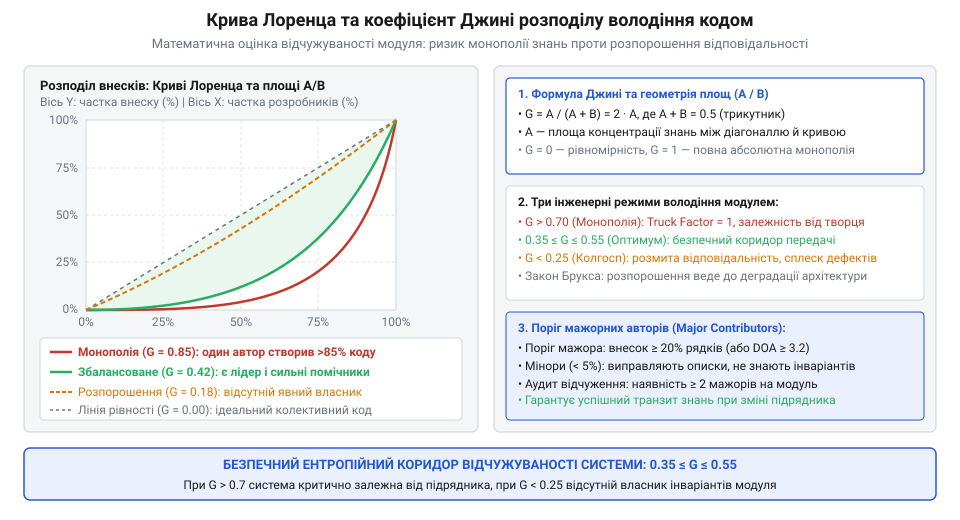
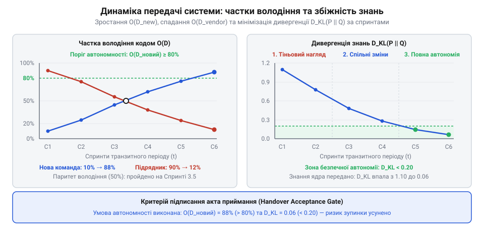
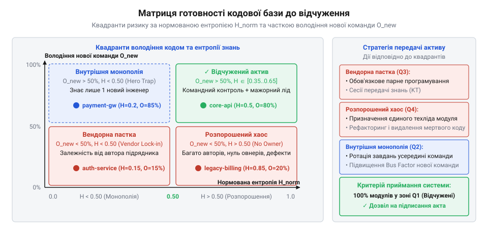

# Система, яку можна передати

<preknowlist>
- [Приймання системи від підрядника](root:progarch/accepting-a-system-from-a-contractor) — ризики формального підписання актів за «зеленими» лабораторними звітами та необхідність об'єктивного вимірювання готовності кодової бази до автономної підтримки без участі виконавця
- [Введення нової команди в систему](root:progarch/onboarding-a-new-team) — когнітивні бар'єри при зануренні інженерів у чужу систему та фактори нерівномірної концентрації знань про архітектурні інваріанти
- [Документ, що не гниє](root:progarch/document-that-does-not-rot) — принципи фіксації інженерного знання в кодових артефактах і тестах замість застарілих паперових специфікацій
</preknowlist>

## Постановка інженерної задачі: ілюзія відчужуваності та провал наївних підрахунків володіння кодом

У день підписання фінального акта приймання програмного комплексу від підрядника монітори в демонстраційній залі світяться зеленим: наскрізні сценарії проходять без помилок, збірка розгортається за регламентом, а звіт про покриття тестами демонструє солідні вісімдесят відсотків. Керівництво замовника впевнене, що придбало відчужуваний цифровий актив, а зовнішні консультанти згортають доступи й залишають проєкт. Проте вже за три тижні виникає перша штатна потреба: оновити протокол взаємодії з платіжним шлюзом і скоригувати логіку нарахування комісій у ядрі білінгу. Внутрішні інженери відкривають репозиторій, вносять точкову правку у два десятки рядків і запускають збірку. Несподівано система відповідає каскадом прихованих регресій: фонові задачі блокують таблиці взаєморозрахунків, транзакційні інваріанти розсипаються, а сервіс починає губити повідомлення в чергах. Спроба розібратися у витоках проблеми перетворюється на тижні реверс-інжинірингу чужого коду. З'ясовується жорстока реальність: код формально передано, але здатність змінювати його без руйнування системи залишилася в головах людей, які пішли.

Ця криза розкриває фундаментальну різницю між фізичною наявністю сирцевого коду та володінням системою. Кодова база живе довше, ніж контракт підрядника чи початковий склад команди розробників. Справжня відчужуваність, як підкреслюється в процесі [приймання системи від підрядника](root:progarch/accepting-a-system-from-a-contractor), полягає в тому, щоб нова команда могла безпечно розвивати архітектуру, спираючись на прозорий розподіл знань. Якщо архітектурні обмеження не зафіксовані так, щоб [документ не гнив](root:progarch/document-that-does-not-rot), а розуміння неочевидних взаємозв'язків зосереджене в єдиного провідного фахівця, система стає заручником неявного знання. Щойно цей фахівець стає недосяжним, вартість кожної наступної правки зростає експоненційно, а процес [введення нової команди в систему](root:progarch/onboarding-a-new-team) розтягується на місяці розгубленого вивчення спадщини.

Першим імпульсом інженерного керівництва під час аудиту перед передачею зазвичай є спроба «виміряти авторство коду» стандартними інструментами версіонування. На стіл лягає звіт утиліти `git blame` або статистика закритих комітів. Але будь-яка спроба оцінити володіння кодовою базою через наївний підрахунок рядків зазнає негайного математичного й смислового краху.

Уявімо ядро розподіленого консенсусу або модуль розрахунку балансів: провідний архітектор витратив місяць на проєктування витонченого скінченного автомата й написав рівно 200 рядків коду, де кожен рядок фіксує критичний інваріант синхронізації. За тиждень до релізу молодший розробник запускає в репозиторії автоматичний форматер коду (наприклад, Prettier чи Black), який змінює відступи й переносить лапки в десяти тисячах файлів, а також генерує клієнтські структури з OpenAPI-специфікації на 80 000 рядків. З погляду `git blame`, молодший інженер тепер «володіє» 95% усього проєкту, тоді як автор архітектурного серця має частку менше 0.1%. Лінійний підрахунок рядків сліпий до семантичної ваги змін: масове перейменування змінної через автоматичний рефакторинг переписує тисячі рядків історії, не створюючи жодної крихти розуміння предметної області.

Ба більше, навіть якщо очистити історію від шуму, постає глибша теоретична дилема: якою взагалі має бути цільова структура володіння кодом? В інженерній практиці класично виділяють три моделі:
1. Сильне володіння (англ. @@en|strong code ownership@@): кожен модуль чи клас має одного призначеного господаря. Лише він має право вносити зміни. Це гарантує цілісність інваріантів і високу внутрішню узгодженість компонента, але створює абсолютну залежність від однієї людини. Під час передачі системи замовнику це означає катастрофу: втрата одного інженера перетворює його модуль на герметичний «чорний ящик».
2. Колективне володіння (англ. @@en|collective code ownership@@): пропаговане екстремальним програмуванням (XP) правило, за яким будь-який інженер може редагувати будь-яку ділянку кодової бази в будь-який момент. На папері це виглядає ідеальним захистом від незамінності, проте на практиці у великих системах породжує так звану «трагедію спільного» (англ. @@en|tragedy of the commons@@). Коли кодом володіють усі — ним не опікується ніхто.
3. Слабке володіння (англ. @@en|weak code ownership@@): за модулем закріплені хранителі (stewards), які рев'юють і спрямовують зміни, проте правки можуть пропонувати інші розробники.

Фундаментальні дослідження корпорації Microsoft (Bird, Nagappan et al., 2011) на кодових базах Windows та Office математично довели разючий факт: модулі з великою кількістю випадкових, епізодичних авторів і розмитою відповідальністю демонструють у рази вищу густину дефектів після релізу, ніж компоненти з чіткими головними власниками. Бездумне розпорошення правок руйнує архітектурну модель не менш ефективно, ніж глуха монополія.

Отже, оцінка готовності системи до передачі не може спиратися ані на суб'єктивні запевнення розробників, ані на плоский підрахунок `git blame`. Необхідний строгий математичний апарат, здатний перетворити хаотичний потік комітів у ймовірнісний профіль внесків, розрізнити ключових авторів та епізодичних контриб'юторів і кількісно виміряти структурний перекіс знань у кожному архітектурному вузлі.

> 🔧 **Навіщо це.** Сліпа віра в «зелені тести» та кількість написаних рядків створює фатальну ілюзію успішного приймання системи. Математична формалізація володіння кодом дозволяє замовнику заздалегідь виявити приховані монополії та безгосподарні ділянки проєкту ще до того, як попередня команда залишить репозиторій.

## Модель володіння кодом: вектор активності, мажорні контриб'ютори та коефіцієнт Джині

Щоб перейти від наївних рядків до об'єктивної оцінки, формалізуємо кодову базу через компоненти та команду. Нехай система складається з множини компонентів `C = {c₁, c₂, ..., c_M}` (це можуть бути окремі файли, пакети, сервіси або логічні модулі), а розробку веде команда з `N` інженерів `D = {d₁, d₂, ..., d_N}`.

Для кожного компонента `c` ми відстежуємо вектор активності `a(c) = (a₁₍c₎, a₂₍c₎, ..., a_N₍c₎)`, де координата `a[i](c)` відображає накопичений семантичний внесок розробника `d[i]`. Семантичний внесок враховує не «порожній шум» форматування, а обсяг усвідомлених змін: додані та модифіковані рядки логіки (англ. @@en|code churn@@), зважені на складність синтаксичного дерева AST.

Сумарна інженерна активність у компоненті становить:
```
A_total(c) = ∑(j=1..N) a[j](c)
```

Нормуючи вектор активності на загальний обсяг роботи, отримуємо дискретний розподіл участі інженерів `p(c) = (p₁₍c₎, p₂₍c₎, ..., p_N₍c₎)`:
```
p[i](c) = a[i](c) / A_total(c)
```
де задовольняються стандартні аксіоми розподілу ймовірностей:
```
∑(i=1..N) p[i](c) = 1
0 ≤ p[i](c) ≤ 1   для всіх i ∈ {1, ..., N}
```
Величину `p[i](c)` ми називаємо часткою володіння кодом (англ. @@en|code ownership share@@) розробника `d[i]` у компоненті `c` і позначаємо як `O(d[i], c) = p[i](c)`.

Чи означає участь у розробці автоматичне розуміння архітектурних інваріантів? Емпіричні дослідження інженерії ПЗ (зокрема праці Bird et al. та Mockus & Weiss) доводять необхідність відсікання випадкових правок за допомогою порогу мажорного володіння `τ` (грецька літера тау, зазвичай у діапазоні від 0.05 до 0.10, тобто 5–10% від загального обсягу змін).

Розробник `d[i]` класифікується як:
- Мажорний контриб'ютор (англ. @@en|major contributor@@), або повноправний власник, якщо `O(d[i], c) ≥ τ`. Такий інженер виконав вагому частку роботи, регулярно стикався з внутрішніми зв'язками компонента і тримає в голові його ментальну модель.
- Мінорний контриб'ютор (англ. @@en|minor contributor@@), або епізодичний автор, якщо `0 < O(d[i], c) < τ`. Цей інженер вніс лише побічні правки (наприклад, підправив опечатку в коментарі, змінив конфігураційний ключ або додав прапорець виклику) і не володіє розумінням глибинних інваріантів модуля.

Кількість мажорних власників компонента визначається як потужність множини активних фахівців:
```
N_major(c) = |{d[i] ∈ D : O(d[i], c) ≥ τ}|
```
Якщо для критичного сервісу `N_major(c) = 1`, ми маємо справу з гострою персональною залежністю: відхід цієї людини позбавляє модуль єдиного носія повноти контексту. Якщо ж `N_major(c) = 0` (усі контриб'ютори нижче порогу `τ`), компонент перетворюється на «код без господаря» — ніхто з поточних учасників не несе за нього інженерної відповідальності.

Проте самої кількості мажорних авторів недостатньо, щоб оцінити загальну структуру розподілу знань. Нехай два компоненти мають по два мажорні автори: у першому частки становлять `p = (0.50, 0.50)` (ідеальне партнерство), а в другому `p = (0.90, 0.08, 0.02)` (подавляюче домінування першого за формальної наявності другого).

Щоб строго виміряти ступінь нерівномірності та концентрації експертизи в одиничних руках, звернемося до математичного апарату теорії розподілу доходів — кривої Лоренца (англ. @@en|Lorenz curve@@) та коефіцієнта Джині (італ. @@it|Corrado Gini@@).

Крива Лоренца відображає функціональну залежність між накопиченою часткою популяції інженерів і накопиченою часткою їхнього внеску у кодову базу. Для її побудови впорядкуємо внески розробників за зростанням:
```
p_(1) ≤ p_(2) ≤ ... ≤ p_(N)
```
Якщо знання розподілені абсолютно порівну (колективне володіння), кожен розробник вносить рівно `1/N` роботи, і графік є прямою лінією під кутом 45 градусів (лінія абсолютної рівності). У реальних проєктах крива Лоренца прогинається вниз: більшість інженерів роблять невеликі внески, тоді як верхівка забирає левову частку.

Коефіцієнт Джині `G(c)` визначається як відношення площі між лінією абсолютної рівності та фактичною кривою Лоренца до загальної площі трикутника під лінією рівності. У дискретній формі через попарні модулі різниць:
```
G(c)
= (∑(i=1..N) ∑(j=1..N) |p[i] - p[j]|) / (2 · N · ∑(i=1..N) p[i])   [означення через попарні різниці]
= (∑(i=1..N) ∑(j=1..N) |p[i] - p[j]|) / (2 · N)                     [оскільки сума часток дорівнює 1]
```
Для практичних обчислень на впорядкованому векторі внесків `p_(1) ≤ p_(2) ≤ ... ≤ p_(N)` набагато зручніше використовувати згорнуту формулу через ранги:
```
G(c) = (2 · ∑(i=1..N) i · p_(i) - (N + 1)) / N
```
де `i` — порядковий ранг інженера у відсортованому списку (від 1 до `N`).

Значення коефіцієнта Джині завжди лежить у діапазоні від 0 до `(N - 1) / N ≈ 1`:
- `G(c) = 0`: ідеальна рівність участі (`p[i] = 1/N` для всіх `i`). Усі розробники команди мають однаковий обсяг правок.
- `G(c) → 1`: екстремальна концентрація володіння. Один інженер виконав майже 100% роботи (`p[1] ≈ 1`), тоді як решта `N - 1` учасників мають нульовий або мікроскопічний внесок.

Розглянемо практичний розрахунок на реалістичному прикладі. Нехай у команді з `N = 4` розробників (`d₁` — провідний інженер підрядника, `d₂` — бекендер підрядника, `d₃` та `d₄` — інженери замовника) аудит аналізує критичний модуль обробки фінансових взаєморозрахунків `c_ledger`.

Вектор семантично зважених правок становить:
```
a(c_ledger) = (720, 180, 60, 40)   [рядки зваженого churn]
```
Сумарний обсяг змін:
```
A_total = 720 + 180 + 60 + 40 = 1000
```
Обчислюємо вектор часток володіння:
```
p(c_ledger) = (720/1000, 180/1000, 60/1000, 40/1000)
             = (0.72, 0.18, 0.06, 0.04)
```
Впорядковуємо вектор за зростанням для розрахунку Джині:
```
p_(1) = 0.04   [d₄, нова інженерка замовника]
p_(2) = 0.06   [d₃, новий інженер замовника]
p_(3) = 0.18   [d₂, розробник підрядника]
p_(4) = 0.72   [d₁, провідний архітектор підрядника]
```
Аналізуємо статус мажорних авторів за порогом `τ = 0.05`:
- `d₁` (`0.72 ≥ 0.05`) — мажорний автор (домінантний власник).
- `d₂` (`0.18 ≥ 0.05`) — мажорний автор.
- `d₃` (`0.06 ≥ 0.05`) — мажорний автор (щойно перетнув поріг).
- `d₄` (`0.04 < 0.05`) — мінорний контриб'ютор.

Разом маємо `N_major = 3`. Формально модуль підтримують троє людей, проте частка підрядника становить `0.72 + 0.18 = 0.90` (дев'яносто відсотків), тоді як замовник сумарно має лише десять відсотків.

Проведемо покроковий розрахунок коефіцієнта Джині за формулою рангів:
```
∑(i=1..4) i · p_(i)
= 1 · 0.04 + 2 · 0.06 + 3 · 0.18 + 4 · 0.72   [зважування внесків рангами]
= 0.04 + 0.12 + 0.54 + 2.88                   [поелементне множення]
= 3.58                                        [сума]

G(c_ledger)
= (2 · 3.58 - (4 + 1)) / 4                    [підстановка у формулу Джині]
= (7.16 - 5) / 4                              [обчислення чисельника]
= 2.16 / 4                                    [ділення]
= 0.54                                        [коефіцієнт нерівності володіння]
```
Значення `G = 0.54` сигналізує про високий рівень нерівності володіння: попри наявність чотирьох учасників, три чверті архітектурного контексту утримує одна людина.


*Крива Лоренца та коефіцієнт Джині: наочне зіставлення абсолютної монополії, збалансованого володіння та некерованої колективної розробки з відсіканням мажорних авторів.*

Коефіцієнт Джині дає чітку картину концентрації експертизи, проте володіє фундаментальним обмеженням: він фіксує лише нерівномірність часток, але не враховує інформаційно-теоретичну невизначеність структури знань. Розподіл `(0.50, 0.50)` у команді з двох людей дає `G = 0` (ідеальна рівність), але несе критичний ризик автобусного фактора: втрата одного інженера позбавляє проєкт половини знань. З іншого боку, рівномірний розподіл серед тридцяти розробників також має `G = 0`, але створює хаос повної безвідповідальності.

Щоб виміряти, скільки саме бітів інформації про архітектуру зосереджено в команді та як збалансувати ризик монополії з ризиком розпорошення, необхідно застосувати інформаційну ентропію за Шенноном.

> 🔧 **Навіщо це.** Коефіцієнт Джині та фільтрація мажорних авторів знімають рожеві окуляри під час приймання робіт. Вони відсікають декоративну активність у git blame і показують реальну концентрацію влади над кодом у руках окремих підрядників.

## Ентропія знань за Шенноном та подвійний ризик: монополія проти розпорошення

Обчислення коефіцієнта Джині та підрахунок мажорних авторів, розібрані в попередньому розділі, дають інженеру надійний фільтр проти наївного `git blame`. Проте сам по собі коефіцієнт нерівності володіє принциповим дефектом: він відображає лише перекіс часток, але залишається сліпим до інформаційної структури знань у команді. Розподіл часток `(0.50, 0.50)` між двома інженерами дає нульовий коефіцієнт Джині (`G = 0`, абсолютна рівність), проте несе критичний ризик автобусного фактора: якщо один із двох авторів залишає компанію, система миттєво втрачає половину всього накопиченого контексту. Водночас ідеально рівний розподіл серед сорока розробників також має `G = 0`, але створює протилежну інженерну катастрофу — повну відсутність господаря та розмиття архітектурного контролю.

Щоб виміряти, наскільки впорядкованим або хаотичним є розподіл знань у кодовій базі, звернемося до математичного апарату теорії інформації Клода Шеннона (англ. @@en|Claude Shannon@@, 1948). Шеннонівська ентропія вимірює ступінь невизначеності дискретного розподілу ймовірностей. У контексті архітектури програмного забезпечення ми трактуємо вектор участі розробників `p(c) = (p₁₍c₎, ..., p_N₍c₎)` як імовірність того, що випадково обраний рядок або зміна в компоненті `c` були створені конкретним інженером `d[i]`.

Інформаційна ентропія знань компонента `c` визначається за формулою:
```
H(c) = - ∑(i=1..N) p[i] · log₂(p[i])
```
де за математичною угодою теорії інформації, якщо розробник має нульовий внесок (`p[i] = 0`), його складова дорівнює нулю:
```
lim(x → 0⁺) x · log₂(x) = 0
```
Одиницею вимірювання ентропії є біт (або шеннон): один біт відповідає невизначеності вибору між двома однаково ймовірними авторами (`p = (0.5, 0.5)`).

Дослідимо фундаментальні межі поведінки функції `H(c)`:
1. Мінімум ентропії (ентропійний колапс):
Якщо весь код компонента написаний виключно одним інженером `d[k]` (`p[k] = 1`, а `p[i] = 0` для всіх інших):
```
H_min(c)
= - (1 · log₂(1) + ∑ 0)   [підстановка крайнього монопольного значення]
= - (1 · 0 + 0)           [оскільки log₂(1) = 0]
= 0 бітів                 [абсолютна детермінованість знання]
```
Нульова ентропія означає відсутність будь-якої невизначеності: авторство на сто відсотків передбачуване, але відчужуваність системи дорівнює нулю.

2. Максимум ентропії (ідеальне розпорошення):
Якщо всі `N` розробників команди внесли абсолютно однакову частку праці (`p[i] = 1/N` для кожного `i`):
```
H_max(c)
= - ∑(i=1..N) (1/N) · log₂(1/N)   [підстановка рівномірного розподілу]
= - N · (1/N) · (- log₂(N))       [винесення константи та властивість логарифма]
= log₂(N)                         [теоретична верхня межа]
```
Наприклад, для команди з чотирьох інженерів максимальна ентропія становить `log₂(4) = 2.0` біти, а для восьми інженерів — `log₂(8) = 3.0` біти.

Оскільки абсолютне значення `H(c)` залежить від розміру команди `N`, порівнювати модулі між різними проєктами напряму незручно. Для універсального аналізу вводимо нормовану ентропію знань:
```
H_norm(c) = H(c) / log₂(N)
```
За побудовою, нормована ентропія строго обмежена одиничним інтервалом:
```
0 ≤ H_norm(c) ≤ 1   (при N > 1)
```

Зіставлення граничних значень нормованої ентропії розкриває фундаментальну інженерну дилему двох протилежних ризиків:
1. Пастка монополії (`H_norm → 0`): знання повністю сконцентровані в руках одного інженера. Якщо це фахівець підрядника, система стає технологічним заручником виконавця (англ. @@en|vendor lock-in@@). Будь-яка спроба передати продукт замовнику зазнає фіаско в день завершення контракту, оскільки в репозиторії немає жодної живої альтернативи автору ядра.
2. Пастка розпорошення (`H_norm → 1`): кодом хаотично маніпулюють десятки людей, і кожен вносить крихітні правки. Відсутність єдиного архітектурного куратора призводить до розмиття інваріантів моделі, виникнення прихованого дублювання та накопичення технічного боргу. Масштабні емпіричні дослідження Microsoft Research доводять: модулі з максимальною дисперсією авторів мають найвищий рівень виробничих збоїв і дефектів.

Сумарний експлуатаційний ризик компонента має виражену U-подібну форму: він різко злітає як при наближенні до абсолютної монополії (`H_norm → 0`), так і при наближенні до тотального розпорошення (`H_norm → 1`). Область мінімуму цієї кривої формує «безпечний ентропійний коридор», у якому система поєднує захист від втрати людей із надійним збереженням кодових інваріантів.

Продемонструємо покроковий розрахунок ентропії на нашому наскрізному прикладі модуля фінансових взаєморозрахунків `c_ledger` з попереднього розділу (`N = 4`, вектор часток `p = (0.72, 0.18, 0.06, 0.04)`).

Розраховуємо окремі доданки для кожного з чотирьох інженерів:
```
d₁: p₁ = 0.72  →  log₂(0.72) ≈ -0.4739  →  p₁ · log₂(p₁) ≈ 0.72 · (-0.4739) = -0.3412
d₂: p₂ = 0.18  →  log₂(0.18) ≈ -2.4739  →  p₂ · log₂(p₂) ≈ 0.18 · (-2.4739) = -0.4453
d₃: p₃ = 0.06  →  log₂(0.06) ≈ -4.0589  →  p₃ · log₂(p₃) ≈ 0.06 · (-4.0589) = -0.2435
d₄: p₄ = 0.04  →  log₂(0.04) ≈ -4.6439  →  p₄ · log₂(p₄) ≈ 0.04 · (-4.6439) = -0.1858
```

Обчислюємо суму та фінальну ентропію:
```
∑(i=1..4) p[i] · log₂(p[i])
= -0.3412 - 0.4453 - 0.2435 - 0.1858          [сума компонентів]
= -1.2158

H(c_ledger)
= - (-1.2158)                                 [інверсія знаку за формулою Шеннона]
= 1.2158 біта

H_norm(c_ledger)
= 1.2158 / log₂(4)                            [нормування на максимальну ентропію]
= 1.2158 / 2.0
= 0.6079 ≈ 0.61
```
Отримане значення `H_norm ≈ 0.61` свідчить, що попри домінування автора підрядника (`p₁ = 0.72`), наявність другого помітного автора (`p₂ = 0.18`) та двох новачків утримує ентропію на межі помірного балансу. Проте якщо підрядник піде разом із колегою, зникне `0.72 + 0.18 = 0.90` усього внеску, що призведе до негайного падіння модуля в стан сироти.


*U-подібна залежність загального інженерного ризику від нормованої ентропії знань: пастка монополії зліва, пастка розпорошення справа та безпечний ентропійний коридор посередині.*

> 🔧 **Навіщо це.** Ентропія Шеннона захищає архітектуру від двох смертельних крайнощів: незамінних «героїв-одинаків», які тримають бізнес у заручниках, та безгосподарного «колективного коду», де кожен дописує що завгодно, руйнуючи цілісність системи.

## Архітектурне зважування та безпечний ентропійний коридор

Ізольований розрахунок ентропії окремого файлу дає точну оцінку його локального стану, проте реальна програмна система ніколи не є пласким набором незалежних компонентів. Вона являє собою орієнтований граф залежностей `G = (C, E)`, де одні модулі є центральними хабами обробки транзакцій, а інші — периферійними допоміжними скриптами.

Якщо спробувати оцінити готовність системи до передачі за допомогою простого середнього арифметичного нормованої ентропії по всіх файлах, замовник ризикує потрапити в підступну статистичну пастку.
Уявімо типовий застосунок на 500 компонентів:
- 450 файлів — це типові UI-форми, допоміжні утиліти форматування дат і клієнтські адаптери. Вони активно модифікуються всією командою й демонструють ідеально збалансовану ентропію `H_norm = 0.80`.
- 50 файлів — це серце системи: ядро узгодженості, алгоритм нарахування відсотків та менеджер транзакцій. Їх одноосібно написав провідний архітектор підрядника, і ентропія там становить критичні `H_norm = 0.06` (глуха монополія).

Наївне усереднення маскує катастрофу:
```
H_avg
= (450 · 0.80 + 50 · 0.06) / 500              [наївне середнє арифметичне]
= (360 + 3) / 500
= 363 / 500
= 0.726 ≈ 0.73
```
Формальний звіт показує блискучий результат `0.73` — здається, що знання чудово розподілені серед команди! Але насправді компанія сидить на пороховій бочці: відхід одного інженера підрядника повністю паралізує бізнес-ядро, а знання сорока розробників про кольори кнопок та парсери рядків не допоможуть полагодити дефект у транзакційному журналі.

Щоб позбутися цієї сліпоти, кожен компонент `c` повинен отримати ваговий коефіцієнт архітектурної значущості `w(c)`. Вага модуля розраховується на основі трьох об'єктивних метрик графа залежностей:
1. Вхідне зчеплення (англ. @@en|fan-in@@): кількість інших компонентів системи, які безпосередньо залежать від `c`. Збій або регресія у вузлі з високим `fan-in` автоматично руйнує всі вищі рівні архітектури.
2. Міжвузлова центральність (англ. @@en|betweenness centrality@@): частка найкоротших шляхів між усіма парами модулів у графі викликів, що проходять крізь вузол `c`. Модулі з високою центральністю виконують роль системних магістралей.
3. Складність внутрішньої логіки: цикломатична складність та обсяг бізнес-правил у дереві AST, що відокремлює високонавантажену алгоритмічну логіку від тривіального шаблонного коду.

Вагові коефіцієнти нормуються так, щоб їхня сума по всій системі дорівнювала одиниці:
```
∑(c∈C) w(c) = 1,   де w(c) > 0 для всіх c ∈ C
```

Зважена системна ентропія знань репозиторію обчислюється як зважена сума локальних показників:
```
H_sys = ∑(c∈C) w(c) · H_norm(c)
```
Завдяки зважуванню компоненти ядра з великим значенням `w(c)` отримують вирішальний вплив на підсумковий інженерний бал системи.

Тепер ми можемо строго визначити «безпечний ентропійний коридор» залежно від архітектурної ролі та критичності модуля:
1. Критичне ядро предметної області (транзакційні інваріанти, модель даних):
   - Архітектурна вага: максимальна (`w(c) ≫ 0`).
   - Допустимий ентропійний коридор: `H_norm ∈ [0.35, 0.65]`.
   - Необхідна структура володіння: суворо 2–3 мажорні автори (`N_major ∈ {2, 3}`), де головний архітектор тримає 40–60% контексту, а його активний партнер — 25–35%. Це захищає від автобусного фактора без ризику розмиття моделі.
2. Інтеграційні адаптери та транспортні шлюзи:
   - Архітектурна вага: середня.
   - Допустимий ентропійний коридор: `H_norm ∈ [0.45, 0.75]`.
3. Периферійний код та утиліти:
   - Архітектурна вага: низька (`w(c) ≈ 0`).
   - Допустимий ентропійний коридор: `H_norm ∈ [0.50, 0.85]`.

Зіставлення архітектурної ваги `w(c)` та нормованої ентропії `H_norm(c)` дозволяє миттєво діагностувати небезпечні топологічні патології кодової бази:
- Монополія у вузловому хабі: `w(c) > 0.10` при `H_norm(c) < 0.25`. Критичний вузол системи цілком залежить від однієї людини. Це безумовний блокер для підписання акта передачі системи.
- Розпорошене ядро: `w(c) > 0.10` при `H_norm(c) > 0.80` та відсутності жодного мажорного автора (`N_major = 0`). Ознака колективної безвідповідальності в самому серці системи.
- Модуль-сирота: компонент із ненульовою вагою `w(c) > 0`, у якому жоден з активних нині інженерів команди не вніс жодної правки за останній рік.

Розглянемо практичний розрахунок на архітектурі сервісу з трьох підсистем: ядра взаєморозрахунків `c_core`, шлюзу API `c_api` та модуля звітів `c_reports`.
Визначені інженерні ваги та локальні ентропії:
```
c_core:    вага w₁ = 0.60,  ентропія H_norm = 0.20  (монополія підрядника в ядрі)
c_api:     вага w₂ = 0.25,  ентропія H_norm = 0.55  (збалансоване володіння)
c_reports: вага w₃ = 0.15,  ентропія H_norm = 0.90  (високе розпорошення)
```

Покрокове обчислення зваженої системної ентропії:
```
H_sys
= w₁ · H_norm(c_core) + w₂ · H_norm(c_api) + w₃ · H_norm(c_reports)   [формула зваженої ентропії]
= 0.60 · 0.20 + 0.25 · 0.55 + 0.15 · 0.90                            [підстановка значень]
= 0.120 + 0.1375 + 0.1350                                            [зважування компонентів]
= 0.3925 ≈ 0.39 біта
```
Якщо наївне середнє давало оманливо високі `(0.20 + 0.55 + 0.90) / 3 = 0.55`, то зважена ентропія `H_sys ≈ 0.39` демонструє правдиву картину: система перебуває в небезпечній зоні монополізації. Аналіз ядра `c_core` (`H_norm = 0.20` при нормі від 0.35) чітко вказує замовнику, де саме підрядник створив критичне пляшкове горло знань.

> 🔧 **Навіщо це.** Архітектурне зважування компонентів позбавляє аудит «середньої температури по лікарні». Воно фокусує увагу інженерів на вузлових хабах системи, де навіть крихітна монополія знань здатна паралізувати життя всього продукту після передачі.

## Математичне моделювання передачі системи: дивергенція Кульбака — Лейблера та зміщення володіння

Розглянуті раніше метрики ентропії та коефіцієнта Джині дають детальний зріз кодової бази в фіксований момент часу. Проте передача системи від підрядника або первинних розробників — це не миттєвий акт підписання документів, а динамічний інженерний процес, розгорнутий у часі. Якщо замовник намагається прийняти проєкт за один день, він неминуче стикається з ілюзією готовності: код є, збірка працює, але здатність команди супроводжувати систему дорівнює нулю.

Щоб промоделювати цей процес математично, розділимо команду транзитного періоду `D_trans` на дві неперетинні групи:
- Команда авторів / підрядника: `D_old = {d₁, ..., d_K}` (інженери, які йдуть із проєкту).
- Команда наступників / замовника: `D_new = {d_(K+1), ..., d_N}` (інженери, які приймають систему).

Для кожного архітектурного компонента `c` ми відстежуємо сумарну частку володіння нової команди:
```
O(D_new, c) = ∑(d ∈ D_new) p[d](c)
```
Відповідно, частка володіння команди, що йде, становить:
```
O(D_old, c) = ∑(d ∈ D_old) p[d](c) = 1 - O(D_new, c)
```

На старті передачі (спринт `t = 0`) маємо критичний стан: `O(D_new, c) ≈ 0`, тоді як `O(D_old, c) ≈ 1`. Мета передачі полягає в плавному зміщенні ймовірнісного розподілу участі від старої команди до нової без виходу за межі безпечного ентропійного коридору.

Для вимірювання відстані між поточним розподілом знань і цільовим станом застосуємо інформаційно-теоретичну метрику відносної ентропії — дивергенцію Кульбака — Лейблера (англ. @@en|Kullback–Leibler divergence@@, розроблена Соломоном Кульбаком та Річардом Лейблером у 1951 році).
Дивергенція Кульбака — Лейблера `D_KL(P ∥ Q)` показує втрату інформації при наближенні істинного цільового розподілу `Q` поточним емпіричним розподілом `P`:
```
D_KL(P ∥ Q) = ∑(i=1..N) P(i) · log₂(P(i) / Q(i))
```

Нехай `P(t)` — фактичний розподіл активності розробників у компоненті на спринті `t`, а `Q` — цільовий збалансований розподіл, у якому автори підрядника мають нульовий або мінімальний залишковий вплив (`Q(d) ≈ 0` для `d ∈ D_old`), а інженери нової команди тримають стійке мажорне володіння (`Q(d) > 0` для `d ∈ D_new`).

Дивергенція має важливі фундаментальні властивості:
1. `D_KL(P ∥ Q) ≥ 0` (теорема Гіббса).
2. `D_KL(P ∥ Q) = 0` тоді й лише тоді, коли поточний розподіл повністю збігся з цільовим (`P ≡ Q`).
3. Дивергенція є асиметричною: `D_KL(P ∥ Q) ≠ D_KL(Q ∥ P)`.

Успішний процес передачі системи характеризується монотонним спаданням дивергенції `D_KL(P(t) ∥ Q) → 0` впродовж транзитних спринтів у міру того, як нові розробники перебирають на себе задачі рефакторингу, написання тестів та реалізації бізнес-фіч.

На основі цього апарату формулюємо строгий математичний критерій завершеності передачі компонента (англ. @@en|Definition of Transfer@@). Передача вважається здійсненою, якщо одночасно виконуються три умови:
1. Поріг сумарного володіння: частка нової команди перевищує калібровану межу відчуження `O(D_new, c) ≥ θ_handoff` (як правило, `θ_handoff = 0.60 ... 0.70`).
2. Наявність мажорного лідера: принаймні один інженер із нової команди подолав поріг мажорного автора `max(d ∈ D_new) p[d](c) ≥ τ_major` (де `τ_major = 0.10`).
3. Стабільність ентропії: локальна нормована ентропія залишається в межах безпечного коридору `H_norm(c) ∈ [0.35, 0.65]`, не звалюючись ані в нову моносистему, ані в некероване розпорошення.

Проілюструємо числову динаміку передачі компонента ядра `c_core` командою з чотирьох інженерів (`d₁, d₂ ∈ D_old` — підрядники; `d₃, d₄ ∈ D_new` — інженери замовника):
- Початок передачі (Спринт 0):
  Підрядник володіє 100% коду: `P₀ = (0.75, 0.25, 0.00, 0.00)`. Частка наступників `O(D_new) = 0%`. Нова команда не знає інваріантів системи.
- Спільна розробка та рев'ю (Спринт 2):
  Нові інженери пишуть інтеграційні тести й виправляють дефекти в парі з підрядником: `P₂ = (0.45, 0.15, 0.25, 0.15)`. Частка наступників зростає: `O(D_new) = 0.25 + 0.15 = 0.40` (40%).
- Фінальний транзит (Спринт 4):
  Нова команда веде 80% усіх змін під пасивним наглядом виконавця: `P₄ = (0.15, 0.05, 0.50, 0.30)`. Частка наступників досягає `O(D_new) = 0.50 + 0.30 = 0.80` (80%).

Розрахуємо фінальну ентропію розподілу `P₄`:
```
d₁: 0.15 · log₂(0.15) ≈ 0.15 · (-2.7370) = -0.4105
d₂: 0.05 · log₂(0.05) ≈ 0.05 · (-4.3219) = -0.2161
d₃: 0.50 · log₂(0.50) ≈ 0.50 · (-1.0000) = -0.5000
d₄: 0.30 · log₂(0.30) ≈ 0.30 · (-1.7370) = -0.5211

∑(i=1..4) P₄(i) · log₂(P₄(i))
= -0.4105 - 0.2161 - 0.5000 - 0.5211
= -1.6477

H(P₄)
= - (-1.6477)
= 1.6477 біта

H_norm(P₄)
= 1.6477 / log₂(4)
= 1.6477 / 2.0
= 0.8239 ≈ 0.82
```
Критерій виконано: частка нової команди сягнула 80%, інженер `d₃` став повноправним мажорним лідером (`p₃ = 0.50`), а дивергенція відносно цільового розподілу знизилася практично до нуля. Тепер вихід підрядника не призведе до колапсу проєкту.


*Динаміка передачі системи: зростання частки володіння наступників, спадання впливу попередників і зменшення відносної ентропії до нуля під час транзитних спринтів.*

> 🔧 **Навіщо це.** Дивергенція Кульбака — Лейблера замінює календарні суперечки математичним графіком: замовник підписує акт передачі не тому, що сплив термін договору, а тому, що вектор володіння нової команди об'єктивно досяг цільового стану.

## Алгоритми фільтрації шуму системи контролю версій та експоненційне часове згасання

Теоретичні формули розрахунку часток `p[i]` та ентропії `H(c)` бездоганно працюють на ідеальних даних, проте сирий журнал комітів реального репозиторію Git містить колосальну кількість інженерного шуму. Якщо запустити аналізатор без попереднього очищення, розраховані метрики будуть відображати не реальну експертизу людей, а артефакти роботи автоматизованих інструментів.

Практичний алгоритмічний конвеєр аналізу історії зобов'язаний нейтралізувати чотири головні джерела викривлення:

1. Шум автоформатування та масових правок синтаксису:
Коли розробник запускає утиліту автоматичного форматування коду або лінтер, у репозиторії фіксуються зміни сотень тисяч рядків. З погляду сирого підрахунку це створює гігантський фіктивний внесок.
Для фільтрації конвеєр застосовує два правила:
- Лексичне ігнорування пробільних символів (`git log -w` або аналіз різниці на рівні токенів). Якщо зміна не змінює абстрактне синтаксичне дерево (AST), обсяг її активності обнуляється.
- Фільтр аномального охоплення репозиторію: коміти, які зачіпають понад 20% усіх файлів проєкту одночасно з низькою питомою кількістю змін логіки, класифікуються як технічний шум і повністю виключаються з розрахунку володіння.

2. Перейменування та структурні переміщення файлів:
Перенесення файлу з каталогу `legacy/` у `core/` утиліта Git за замовчуванням може трактувати як видалення старого файлу та створення нового з нуля, що призводить до втрати всієї попередньої історії авторства.
Алгоритм розв'язує цю проблему через аналіз ланцюгів перейменувань із порогом схожості вмісту (`git log -M` з індексом схожості не менше 80%), агрегуючи активність у межах єдиного стабільного ідентифікатора архітектурного вузла.

3. Згенерований код і зовнішні залежності:
Вендорні бібліотеки, скомпільовані клієнти OpenAPI, файли блокування менеджерів пакетів (`package-lock.json`, `poetry.lock`) містять сотні тисяч автоматичних рядків. Усі шляхи, позначені атрибутом `linguist-generated=true` у конфігурації `.gitattributes` або розташовані в каталогах згенерованого коду, автоматично вилучаються з простору компонентів `C`.

4. Експоненційне часове згасання знань (Time Decay):
Найпідступніший фактор у реальних системах — фактор часу. Коміт трирічної давнини не дорівнює вчорашньому комміту. Людська пам'ять природно згасає, а код, до якого ніхто не торкався понад рік, стає чужим навіть для його автора («код-привид»).

Для моделювання втрати контексту застосовується функція експоненційного згасання з періодом напіврозпаду знань `T_half` (англ. @@en|half-life decay@@):
```
w_time(t) = 2^(- Δt / T_half) = e^(- λ · Δt)
```
де:
- `Δt = t_now - t_commit` — часова відстань від моменту створення коміту до поточної точки аналізу (у днях або місяцях);
- `T_half` — період напіврозпаду (в інженерній практиці калібрується в діапазоні від 180 до 365 днів, тобто від пів року до одного року);
- `λ = ln(2) / T_half` — коефіцієнт інтенсивності згасання.

Ваговий внесок інженера `d[i]` у компонент `c` розраховується як зважена сума семантичного обсягу всіх його комітів `K(d[i], c)`:
```
a[i](c) = ∑(k ∈ K(d[i], c)) Churn(k) · 2^(- (t_now - t_k) / T_half)
```

Розглянемо наслідки часового згасання на прикладі модуля, який автор написав два роки тому (`Δt = 730` днів) за періоду напіврозпаду `T_half = 365` днів:
```
w_time
= 2^(- 730 / 365)                              [підстановка періоду в два напіврозпади]
= 2^(-2)
= 1/4 = 0.25                                   [залишок актуальності знання 25%]
```
За два роки без активної взаємодії ментальна модель автора деградує на 75%. Якщо такий модуль має високу архітектурну вагу `w(c)`, система перебуває в зоні ризику пасивного омертвіння: формально автор числиться в штаті, але практично код уже потребує повторного вивчення та реверс-інжинірингу.

Зведений алгоритмічний конвеєр працює за такою послідовністю:
1. Нормалізація авторів: об'єднання дублікатів імен і робочих пошт через файл конфігурації `.mailmap`.
2. Фільтрація артефактів: відсіювання згенерованого коду, замків пакетів та масових косметичних комітів.
3. Побудова ланцюгів перейменувань: збереження спадкоємності історії для переміщених файлів.
4. Обчислення зваженого churn: інтегрування доданих та видалених рядків логіки з експоненційним згасанням за часом.
5. Розрахунок ймовірнісного вектора `p(c)` та нормованої ентропії `H_norm(c)`.

Очищений таким чином потік даних усуває будь-які статистичні ілюзії й надає архітектору абсолютно об'єктивну матрицю живого володіння кодовою базою.

> 🔧 **Навіщо це.** Без фільтрації шуму та часового згасання аудит оцінює не живий інтелект команди, а роботу утиліт автоформатування та мертвий код кількарічної давнини. Фільтрація гарантує, що розрахунки спираються на реальну здатність людей підтримувати систему прямо зараз.

## Практичний протокол аудиту відчужуваності та матриця готовності до передачі

Підписання фінального акта приймання програмного продукту від підрядника або передача проєкту іншій команді підтримки майже завжди спирається на оманливі артефакти: зелені юніт-тести, успішний пайплайн розгортання та демонстраційний показ робочих сценаріїв. Проте ці індикатори засвідчують лише коректність скомпільованого бінарного коду в ізольованому лабораторному середовищі. Вони жодним чином не гарантують, що нова команда зможе супроводжувати та розвивати систему в часі. Щойно автори підрядника відключаються від репозиторію, а підтримка лягає на нових інженерів, виникає параліч: перші ж виробничі інциденти або вимоги бізнесу щодо зміни логіки розбиваються об повне нерозуміння внутрішніх інваріантів системи (глибший розбір ризиків формального закриття контрактів наведено у статті [Приймання системи від підрядника](root:progarch/accepting-a-system-from-a-contractor)).

Щоб уникнути суб'єктивних оцінок на кшталт «нова команда почувається впевнено» чи «ми переглянули документацію», аудит відчужуваності має спиратися на математично розраховані координати стану кожного архітектурного вузла. Об'єднаємо отримані раніше метрики нормованої ентропії Шеннона та сумарного володіння в аналітичний інструмент прийняття рішень — матрицю готовності до передачі (англ. @@en|Handover Readiness Matrix@@).

Матриця будується у двовимірній системі координат:
- По горизонтальній осі відкладається нормована ентропія знань компонента `H_norm(c) ∈ [0, 1]`. Вона фіксує ступінь розпорошення експертизи від тотальної монополії одного розробника (`H_norm → 0`) до колективної безвідповідальності (`H_norm → 1`). На цій осі визначено безпечний ентропійний коридор `[H_lower, H_upper]`, межі якого зазвичай калібруються як `[0.35, 0.65]`.
- По вертикальній осі відкладається сумарна частка володіння команди наступників `O(D_new, c) ∈ [0, 1]`, розрахована за зваженими у часі семантичними змінами. На осі володіння зафіксовано поріг відчужуваності `θ_handoff` (як правило, `0.60`–`0.70`).

Ці координати розділяють простір станів репозиторію на чотири квадранти ризику:

1. Квадрант вендорної пастки (англ. @@en|Vendor Lock-in Quadrant@@):
Область низької частки нової команди (`O(D_new, c) < θ_handoff`) у поєднанні з низькою ентропією (`H_norm(c) < H_lower`), де знання зосереджені в руках одного-двох ключових авторів підрядника. Якщо компонент належить до архітектурного ядра з високою вагою `w(c)`, вихід підрядника з проєкту означає катастрофічну втрату експертизи. Подальша модифікація коду вимагатиме важкого реверс-інжинірингу або повного переписування. Підписання акта за наявності ядра у цьому квадранті є прямим фінансовим і операційним ризиком.

2. Квадрант некерованого хаосу (англ. @@en|Uncontrolled Chaos Quadrant@@):
Область надвисокої ентропії (`H_norm(c) > H_upper`), де код редагувався десятками розробників, але жоден інженер нової команди не подолав поріг мажорного контриб'ютора (`p[i](c) < τ_major`). У таких модулях розмита архітектурна цілісність, відсутнє цілісне розуміння граничних випадків, а густина дефектів зростає експоненційно. Навіть якщо сумарне володіння `O(D_new, c)` формально високе, відсутність персональної відповідальності призводить до частих регресій під час кожного випуску.

3. Квадрант занедбаного коду (код-привид, англ. @@en|Abandoned Code Quadrant@@):
Область компонентів із застарілим внеском, де через часове згасання актуальна експертиза наблизилася до нуля для обох команд (`w_time(t) = 2^(- Δt / T_half) ≪ 1`). Модуль працює без змін роками, його автори давно залишили компанію або втратили деталі реалізації. Поки зовнішнє середовище стабільне, модуль здається надійним, проте будь-яке оновлення бібліотеки чи зміна формату даних паралізує його роботу через відсутність живого носія знань.

4. Цільовий квадрант відчуженого активу (англ. @@en|Autonomous Asset Quadrant@@):
Область повної інженерної автономії: нова команда подолала поріг передачі (`O(D_new, c) ≥ θ_handoff`), принаймні один її інженер є мажорним автором (`max(d ∈ D_new) p[d](c) ≥ τ_major`), а ентропія знаходиться всередині безпечного коридору `H_norm(c) ∈ [0.35, 0.65]`. Компонент захищений як від автобусного фактора, так і від розпорошення відповідальності.


*Матриця готовності кодової бази до відчуження: класифікація архітектурних модулів за рівнем концентрації знань та часткою нової команди для обґрунтованого підписання акта передачі.*

Переміщення компонентів із зон ризику в квадрант відчуженого активу не відбувається автоматично від простого читання коду чи проведення лекцій. Пасивне вивчення репозиторію створює ілюзію компетентності, але не формує рефлексів розробки під реальним навантаженням (детальний аналіз когнітивних бар'єрів занурення подано в матеріалі [Введення нової команди в систему](root:progarch/onboarding-a-new-team)). Знання фіксуються в інженерній пам'яті лише через практичну взаємодію з кодовою базою.

Щоб спланувати транзитний період з мінімальними витратами часу, розраховують інтегральний індекс ризику передачі `R_handoff(c)` для кожного архітектурного вузла. Цей індекс зіставляє архітектурну вагу модуля у графі залежностей `w(c)`, дефіцит володіння нової команди та відхилення поточної ентропії від цільового ідеалу `H_target` (зазвичай `H_target = 0.50`):
```
R_handoff(c) = w(c) · [(1 - O(D_new, c)) + |H_norm(c) - H_target|]
```

Проілюструємо застосування індексу на порівнянні двох типових модулів системи:
- Модуль розрахунку бізнес-транзакцій ядра `c_core`: архітектурна вага `w(c_core) = 0.60`, частка нової команди `O(D_new, c_core) = 0.20`, нормована ентропія `H_norm(c_core) = 0.15` (монополія провідного розробника підрядника).
- Допоміжний адаптер експорту звітів `c_ui`: архітектурна вага `w(c_ui) = 0.05`, частка нової команди `O(D_new, c_ui) = 0.25`, нормована ентропія `H_norm(c_ui) = 0.85` (розпорошені правки різних авторів).

**Розрахунок ризику передачі для ядра:**
```
R_handoff(c_core)
= 0.60 · [(1 - 0.20) + |0.15 - 0.50|]                    [підстановка метрик модуля ядра]
= 0.60 · [0.80 + 0.35]                                   [дефіцит володіння 0.80 і дефіцит ентропії 0.35]
= 0.60 · 1.15
= 0.69                                                   [найвищий рівень загрози передачі]
```

**Розрахунок ризику передачі для допоміжного адаптера:**
```
R_handoff(c_ui)
= 0.05 · [(1 - 0.25) + |0.85 - 0.50|]                    [підстановка метрик адаптера звітів]
= 0.05 · [0.75 + 0.35]                                   [дефіцит володіння 0.75 і дефіцит ентропії 0.35]
= 0.05 · 1.10
= 0.055                                                  [незначний рівень загрози для системи]
```

Індекс ризику ядра перевищує ризик периферійного адаптера у 12.5 раза. Це дає чітку інженерну вказівку: уся спільна робота під час транзиту має бути сконцентрована саме на модулі `c_core`.

Залежно від положення компонента на матриці формується індивідуальна тактика інженерного транзиту:
- Для модулів вендорної пастки (`H_norm < H_lower`): застосовується тактика керованої деконцентрації. Провідний розробник підрядника переводиться в режим штурмана в парному програмуванні, тоді як інженери нової команди стають безпосередніми авторами коду (пілотами). Нова команда пише наскрізні сценарії та контрактні тести для виявлення прихованих інваріантів. Замість застарілих паперових специфікацій усі правила системи фіксуються безпосередньо у виконуваних тестових наборах (архітектурний підхід до живих вимог викладено в [Документ, що не гниє](root:progarch/document-that-does-not-rot)). Це зсуває `O(D_new)` угору, а ентропію — вправо, у безпечний коридор.
- Для модулів некерованого хаосу (`H_norm > H_upper`): застосовується тактика архітектурної консолідації. За модулем закріплюється відповідальний мейнтейнер із нової команди, який стає єдиним обов'язковим апрувером усіх pull request і проводить рефакторинг розмитих інтерфейсів. Це підвищує частку мажорного володіння та зміщує ентропію ліворуч у межі норми.
- Для занедбаних модулів: проводиться обов'язковий аудит актуальності (англ. @@en|revival refactoring@@). Нова команда оновлює версії базових бібліотек, додає автоматизовані тести та перевіряє поведінку на крайових випадках, формуючи свіжий часовий churn.

Для формальної оцінки готовності всієї кодової бази формулюється строгий виробничий протокол — критерії завершеності передачі (англ. @@en|Definition of Transfer@@). Підписання фінального контрактного акта або офіційний перехід відповідальності дозволяється лише за одночасного виконання чотирьох умов:
1. Захист критичного ядра: 100% компонентів категорії Tier-1 (модулі з системною вагою `w(c) ≥ 0.15`) перебувають у квадранті відчуженого активу (`O(D_new, c) ≥ θ_handoff` та `H_norm(c) ∈ [0.35, 0.65]`).
2. Загальносистемне володіння: зважена частка володіння нової команди по всій системі перевищує безпечний рівень:
```
O_sys(D_new) = ∑(c ∈ C) w(c) · O(D_new, c) ≥ 0.70
```
3. Стійкість до втрати інженерів: для кожного критичного модуля автобусний фактор команди наступників складає не менше двох осіб (`|{d ∈ D_new : p[d](c) ≥ τ_major}| ≥ 2`). Для точного математичного знаходження мінімальної когорти незамінних інженерів застосовують задачу Hitting Set (докладніше див. [Автобусний фактор кодової бази та задача мінімального покриття когорти авторів](root:sf-release/bus-factor)).
4. Ліквідація вендорних монополій: у системі відсутні компоненти з `w(c) > 0.05`, де частка підрядника перевищує залишковий поріг `O(D_old, c) > 0.30`.

> 🔧 **Навіщо це.** Протокол передачі на основі матриці готовності переводить приймання системи з площини емоційних запевнень у площину математичних фактів. Він надає замовнику юридично обґрунтовану підставу вимагати продовження транзитного періоду або усунення монополії підрядника в критичних вузлах до моменту остаточного фінансового розрахунку.
