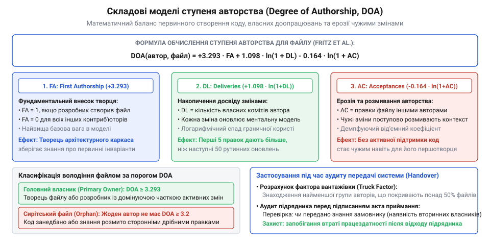
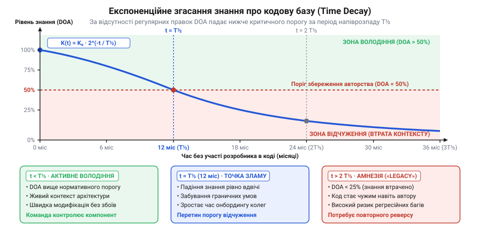
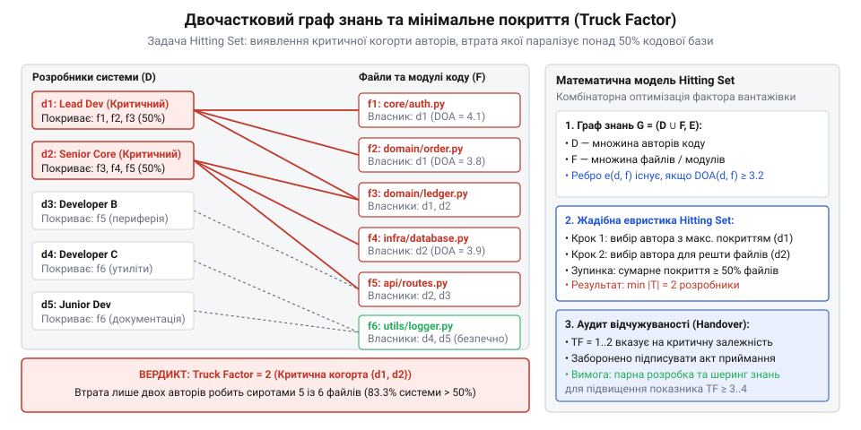
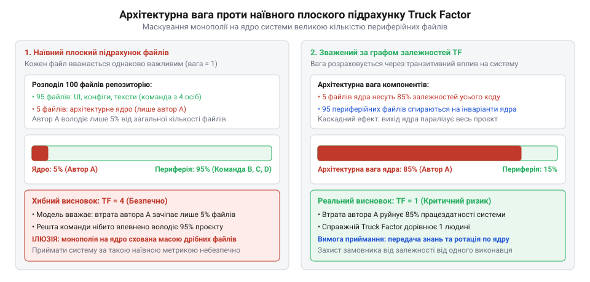

# Система, яку можна передати

<preknowlist>
- [Приймання системи від підрядника](root:progarch/accepting-a-system-from-a-contractor) — критерії відчужуваності кодової бази та ризики підписання актів за формальними звітами без перевірки незалежної підтримки системи
- [Введення нової команди в систему](root:progarch/onboarding-a-new-team) — фактори складності передачі системи стороннім інженерам та роль локалізації знань у кодовій базі
</preknowlist>

## Постановка інженерної задачі: ілюзія готовності до передачі та провал наївних метрик

Уяви типовий сценарій передачі складної системи. Замовник або внутрішня інженерна організація приймає великий програмний комплекс від зовнішнього підрядника або команди засновників придбаного стартапу. Зовні всі формальні критерії приймання дотримано бездоганно: чиста збірка в ізольованому контейнері проходить без помилок, наскрізні автоматизовані тести горять зеленим, специфікації формально узгоджено, а фінальний акт підписано відповідно до рекомендацій у [Приймання системи від підрядника](root:progarch/accepting-a-system-from-a-contractor).

Через кілька місяців контракт завершується, первинні розробники залишають проєкт, а супровід переходить до нової команди. Перша ж бізнес-вимога — наприклад, змінити рівень ізоляції транзакцій у платіжному ядрі чи додати асинхронну чергу обробки замовлень — спричиняє лавину каскадних відмов у суміжних підсистемах. Виникають взаємні блокування потоків, пошкодження розподіленого стану та непередбачувані шторми повідомлень.

Нові інженери намагаються розібратися в причинах, але стикаються з глухою стіною: архітектурні інваріанти, правила неявного синхронізування та критичні домовленості не були зафіксовані у виконуваних тестах, як того вимагає [Документ, що не гниє](root:progarch/document-that-does-not-rot). Вони існували виключно як неявне знання (@@en|tacit knowledge@@, від лат. @@en|tacitus@@ — мовчазний, прихований) у головах двох провідних авторів. Коли ці двоє пішли, система виявилася абсолютно невідчужуваною, повністю паралізуючи процес [Введення нової команди в систему](root:progarch/onboarding-a-new-team).

Як замовник чи технічний лідер міг завчасно виявити цю катастрофічну монополію знань до підписання документів?

Природне перше бажання — використати дані системи контролю версій (@@en|VCS@@, від лат. @@en|versio@@ — видозміна) і подивитися статистику авторів утилітою `git blame`. Проте наївний аналіз історії змін стикається з трьома фундаментальними математичними парадоксами.

Перший парадокс — парадокс лінійного обсягу коду (@@en|Lines of Code trap@@). Уяви компонент розрахунку фінансового балансу. Розробник А протягом місяця проєктував і верифікував строгий алгоритм узгодженості, написавши 120 рядків складного багатопотокового коду зі скрупульозною обробкою граничних випадків. Розробник Б в один клік запустив автоматичний лінтер або згенерував клієнтський SDK із файлу специфікації OpenAPI, додавши в репозиторій 60 000 рядків згенерованого коду. Утиліта `git blame` показує, що 99.8% рядків репозиторію належать розробнику Б, а частка розробника А становить мізерні 0.2%. Наївний алгоритм зараховує розробника Б у «головні експерти» системи, хоча той не розуміє жодного інваріанта бізнес-домену. Коли розробник А залишає компанію, проєкт втрачає 100% розуміння ядра, проте звіт за кількістю рядків фіксує втрату менше ніж 1% авторства.

Другий парадокс — парадокс шуму дрібних коммітів (@@en|commit churn noise@@). Якщо рахувати не рядки, а кількість коммітів, метрика знову зазнає фіаско. Архітектор, який оформлює великі логічно завершені підсистеми поодинокими зваженими коммітами, програє колезі, який щодня робить десятки дрібних виправлень форматування тексту, підтягування відступів чи правок коментарів.

Третій парадокс — парадокс останнього дотику (@@en|recency bias@@). Розробник, який останнім змінив ім'я змінної або оновив версію бібліотеки в заголовку файлу, стає автором рядка в `git blame`, витираючи з історії того, хто заклав усю архітектурну логіку модуля.

Щоб перетворити історію версій на об'єктивний інструмент оцінки відчужуваності, необхідна математична модель, яка задовольняє чотири строгі критерії:

1. Сублінійність та насичення (англ. @@en|sublinear saturation@@): корисний внесок у розуміння файлу зростає сповільнено; п'ятдесята правка дає суттєво менше нового знання, ніж перші три.
2. Асиметрія первинного створення (англ. @@en|first authorship asymmetry@@): інженер, який написав початковий скелет і визначив інтерфейси модуля, отримує постійний бонус авторства, якого не дають звичайні правки.
3. Когнітивне розмивання сторонніми правками (англ. @@en|cognitive erosion@@): кожен комміт іншого інженера змінює код і зменшує актуальність ментальної моделі первісного автора.
4. Дискретизація простору експертизи (англ. @@en|discretization of ownership@@): перехід від розмитих дробових оцінок до чіткого бінарного рішення — хто саме з інженерів належить до множини повноправних власників компонента.

> 🔧 **Навіщо це.**
> Лінійний підрахунок рядків і коммітів у git blame маскує монополію на знання: автоформатування та згенерований код створюють ілюзію чужого авторства над критичними модулями. Математична формалізація авторства відокремлює реальне володіння архітектурними інваріантами від механічного шуму в історії версій.

## Модель ступеня авторства (Degree of Authorship, DOA) та дискретизація володіння

Ступінь авторства (англ. @@en|Degree of Authorship@@, скорочено `DOA`, від лат. @@en|auctoritas@@ — першопочаток, влада) формалізує зв'язок між історією взаємодії розробника `d ∈ D` з файлом `f ∈ F` та його рівнем розуміння цього файлу.

Базова модель розглядає три фундаментальні величини для пари `(d, f)`:

1. `FA(d, f) ∈ {0, 1}` — первинне авторство (@@en|First Authorship@@). Дорівнює 1, якщо розробник `d` створив файл `f` у репозиторії, і 0 в іншому разі.
2. `DL(d, f)` — власні доставки або зміни (@@en|Deliveries@@, від лат. @@en|deliberare@@), тобто сумарна кількість коммітів, виконаних розробником `d` у файлі `f`.
3. `AC(d, f)` — прийняті зміни інших розробників (@@en|Accepted Changes@@), тобто кількість коммітів у файлі `f`, здійснених будь-якими іншими інженерами `k ≠ d`:

```
AC(d, f) = ∑[k ∈ D, k ≠ d] DL(k, f)           [кількість сторонніх правок]
```

Оригінальна формула, емпірично виведена дослідниками (Fritz et al.) на основі зіставлення суб'єктивних оцінок інженерів із графом коммітів, визначає абсолютний бал авторства:

```
DOA_raw(d, f) = 3.293 + 1.098 · FA(d, f) + 0.164 · DL(d, f) - 0.321 · ln(1 + AC(d, f))
```

Розглянемо фізичний зміст кожного компонента:

- Базова константа `3.293` задає стартовий рівень знайомства з компонентом при його створенні чи ґрунтовному переробленні.
- Член `1.098 · FA(d, f)` винагороджує первинне проєктування: автор початкового коду володіє глибинним розумінням неявних обмежень, які часто не фіксуються в коментарях.
- Лінійний внесок `0.164 · DL(d, f)` нарощує експертизу з кожною власною доставкою змін.
- Від'ємний логарифмічний доданок `-0.321 · ln(1 + AC(d, f))` моделює ерозію пам'яті під впливом сторонніх редагувань. Логарифмічне згасання тут математично необхідне: перші 5 правок колег суттєво ламають первісну концепцію автора, тоді як різниця між 100-ю та 105-ю правками вже майже не змінює стан відчуження коду.


*Складові моделі ступеня авторства: первинне створення надає фіксовану перевагу, власні комміти накопичують експертизу, а сторонні правки логарифмічно знижують авторський бал через застарівання ментальної моделі коду.*

Абсолютний бал `DOA_raw(d, f)` визначає якість індивідуального розуміння, проте для аналізу команди необхідна відносна оцінка. Відкидаємо від'ємні значення, де розробник повністю втратив зв'язок із файлом:

```
DOA_pos(d, f) = max(0, DOA_raw(d, f))
```

Нормований ступінь авторства розробника `d` відносно всієї команди обчислюється як частка від загального авторського капіталу файлу:

```
DOA_norm(d, f) = DOA_pos(d, f) / ∑[k ∈ D] DOA_pos(k, f)      [відносна частка володіння]
```

Щоб з'ясувати, чи здатний розробник підтримувати компонент без сторонньої допомоги, застосовується правило дискретизації володіння. Розробник `d` визнається повноправним автором файлу `f` (`d ∈ A(f)`), якщо одночасно задовольняються два пороги:

1. Абсолютний поріг експертизи: `DOA_raw(d, f) ≥ θ_abs`, де базовий емпіричний поріг становить `θ_abs = 3.293`. Якщо інженер не створював файл (`FA = 0`), він зобов'язаний виконати достатню кількість власних коммітів `DL`, щоб компенсувати вплив сторонніх правок `AC` і перевищити цю планку.
2. Відносний поріг володіння: `DOA_norm(d, f) ≥ θ_rel`. Для одноосібного первинного власника беруть `θ_rel = 0.75`, а для кола активних співвласників — `θ_rel = 0.20`.

Формальне означення множини авторів файлу `A(f)` має вигляд:

```
A(f) = { d ∈ D | DOA_raw(d, f) ≥ 3.293  ∧  DOA_norm(d, f) ≥ 0.20 }
```

**Розрахунок розподілу авторства для файлу диспетчера сесій session_store.py:**

В історії файлу `session_store.py` зафіксовано участь трьох інженерів:
- Аліса створила файл (`FA = 1`) і зробила 8 власних коммітів (`DL = 8`).
- Богдан долучився пізніше (`FA = 0`) і виконав 15 коммітів із оптимізації кешу (`DL = 15`).
- Василь виконав 2 дрібні косметичні правки (`FA = 0`, `DL = 2`).

Сумарна кількість коммітів у файлі дорівнює `8 + 15 + 2 = 25`. Обчислимо `DOA_raw` для кожного інженера.

Для Аліси обсяг сторонніх правок становить `AC = 15 + 2 = 17`:

```
DOA_raw(Аліса)
= 3.293 + 1.098 · 1 + 0.164 · 8 - 0.321 · ln(1 + 17)     [підстановка параметрів]
= 3.293 + 1.098 + 1.312 - 0.321 · ln(18)                 [обчислення доданків]
= 5.703 - 0.321 · 2.8904                                  [значення ln(18) ≈ 2.8904]
= 5.703 - 0.9278
= 4.7752                                                  [результат для первинного автора]
```

Для Богдана обсяг сторонніх правок становить `AC = 8 + 2 = 10`:

```
DOA_raw(Богдан)
= 3.293 + 1.098 · 0 + 0.164 · 15 - 0.321 · ln(1 + 10)    [підстановка параметрів]
= 3.293 + 0 + 2.460 - 0.321 · ln(11)                     [обчислення доданків]
= 5.753 - 0.321 · 2.3979                                  [значення ln(11) ≈ 2.3979]
= 5.753 - 0.7697
= 4.9833                                                  [результат для активного модифікатора]
```

Для Василя обсяг сторонніх правок становить `AC = 8 + 15 = 23`:

```
DOA_raw(Василь)
= 3.293 + 1.098 · 0 + 0.164 · 2 - 0.321 · ln(1 + 23)     [підстановка параметрів]
= 3.293 + 0 + 0.328 - 0.321 · ln(24)                     [обчислення доданків]
= 3.621 - 0.321 · 3.1781                                  [значення ln(24) ≈ 3.1781]
= 3.621 - 1.0202
= 2.6008                                                  [результат для випадкового контриб'ютора]
```

Сума додатних балів по файлу становить:

```
∑[k] DOA_pos(k)
= 4.7752 + 4.9833 + 2.6008
= 12.3593                                                 [сумарний авторський капітал файлу]
```

Обчислюємо нормовані частки володіння:

```
DOA_norm(Аліса) = 4.7752 / 12.3593 ≈ 0.3863  (38.6%)
DOA_norm(Богдан) = 4.9833 / 12.3593 ≈ 0.4032  (40.3%)
DOA_norm(Василь) = 2.6008 / 12.3593 ≈ 0.2104  (21.0%)
```

Зіставляємо отримані значення з критеріями належності до множини `A(session_store.py)`:

1. Василь має частку `21.0% ≥ 20%`, проте його абсолютний бал `DOA_raw = 2.6008 < 3.293` не досягає абсолютного порогу `θ_abs`. Дві дрібні правки не дали Василю необхідного контексту для самостійної підтримки коду, тому `Василь ∉ A(session_store.py)`.
2. Аліса має `DOA_raw = 4.7752 ≥ 3.293` і частку `38.6% ≥ 20%`, отже `Аліса ∈ A(session_store.py)`.
3. Богдан має `DOA_raw = 4.9833 ≥ 3.293` і частку `40.3% ≥ 20%`, отже `Богдан ∈ A(session_store.py)`.

У результаті множина повноправних авторів складається з двох осіб: `A(session_store.py) = {Аліса, Богдан}`. Завдяки інтенсивній серії коммітів Богдан подолав вхідний бар'єр і став повноцінним співвласником компонента нарівні з Алісою, водночас Аліса зберегла статус автора навіть після 17 сторонніх правок.

> 🔧 **Навіщо це.**
> Розрахунок `DOA` перетворює суб'єктивні відчуття щодо «авторства» на обчислювану дискретну множину інженерів `A(f)`. Це відсікає як фіктивну експертизу авторів дрібних правок, так і вічну монополію творця над покинутим модулем.

## Динаміка знання в часі: експоненційне згасання та код-сирота

Статична модель ступеня авторства розглядає історію репозиторію як вічний моноліт: комміт, зроблений п'ять років тому, формально додає стільки ж балів експертизи, скільки комміт, надісланий учора. Проте в реальній інженерній практиці людська пам'ять підпорядковується законам забування. Якщо розробник написав бездоганний модуль три роки тому й відтоді жодного разу не відкривав його сирцеві тексти, його активна ментальна модель випаровується. За цей час оновилися версії залежностей, змінилися навколишні сервіси, а тонкі граничні випадки витерлися з пам'яті: когнітивна ціна повторного занурення в старий код наближається до вивчення чужої програми.

Щоб відобразити природну ерозію експертизи, у математичний апарат вводиться оператор експоненційного часового згасання (англ. @@en|exponential time decay@@, від лат. @@en|exponere@@ — виставляти напоказ). Вага кожної події в історії версій моделюється через концепцію періоду напіврозпаду знання `T₁/₂` (англ. @@en|knowledge half-life@@, грец. @@en|periodos@@ — кругообіг). Вагова функція події, що відбулася в момент часу `t` відносно точки спостереження `t_now`, має вигляд:

```
w(t, t_now) = 2^(-(t_now - t) / T₁/₂)
            = e^(-λ · (t_now - t))            [експоненційне згасання ваги]
```

Стала згасання `λ` однозначно визначається через період напіврозпаду:

```
λ = ln(2) / T₁/₂                              [зв'язок сталої згасання з напіврозпадом]
```

В емпіричній інженерії програмних систем типовим базовим калібруванням є період `T₁/₂ = 12` місяців: за один рік бездіяльності авторська вага комміту падає рівно вдвічі, за два роки — у чотири рази, а за три роки становить лише `1/8 = 12.5%` від початкового значення.

Інтегруємо функцію згасання у складові моделі `DOA`. Замість простого підрахунку кількості правок власні доставки `DL` та сторонні зміни `AC` перетворюються на зважені суми за множинами коммітів `C(d, f)` та `C(k, f)`:

```
DL_w(d, f, t_now) = ∑[c ∈ C(d, f)] 2^(-(t_now - t_c) / T₁/₂)         [зважені власні комміти]
AC_w(d, f, t_now) = ∑[k ≠ d] ∑[c ∈ C(k, f)] 2^(-(t_now - t_c) / T₁/₂) [зважені сторонні комміти]
```

Первинне авторство `FA` також зазнає дисконтування: творець модуля зберігає перевагу задуму, але якщо після першого створення він жодного разу не повертався до файлу, його базовий бонус тьмяніє разом із часом створення `t_create`:

```
FA_w(d, f, t_now) = FA(d, f) · 2^(-(t_now - t_create) / T₁/₂)       [згасання первинного авторства]
```

Базовий поріг знайомства `3.293` прив'язується до часу останньої активності розробника у файлі `t_last`:

```
B_w(d, f, t_now) = 3.293 · 2^(-(t_now - t_last) / T₁/₂)              [згасання базового порогу]
```

Динамічна формула ступеня авторства набуває вигляду:

```
DOA(d, f, t_now)
= B_w(d, f, t_now) + 1.098 · FA_w(d, f, t_now)
  + 0.164 · DL_w(d, f, t_now) - 0.321 · ln(1 + AC_w(d, f, t_now))   [динамічний DOA зі згасанням]
```


*Динаміка авторського балу в часі: без регулярних коммітів вага первинного створення та накопичених правок експоненційно падає нижче абсолютного порогу експертизи, породжуючи код-сироту.*

Введення часового згасання розкриває критичне архітектурне явище — код-сироту (англ. @@en|orphaned code@@, від грец. @@en|orphanos@@ — осиротілий, позбавлений опіки). Модуль `f` стає сиротою, якщо в активному складі інженерної команди немає жодного розробника, чий бал перевищує поріг експертизи:

```
A(f, t_now) = ∅                               [умова осиротіння компонента]
```

У статичній моделі файл ніколи не міг стати сиротою без сторонніх змін: творець із `FA = 1` назавжди зберігав бал `DOA ≥ 4.391 > 3.293`. Динамічна модель доводить зворотне: якщо проєкт був написаний підрядником і два роки лежав на полиці без єдиного комміту, він стає абсолютно безгосподарним. Усі його файли перетворюються на код-сироту, навіть якщо жоден сторонній інженер не змінив у них жодного рядка.

**Обчислення часової ерозії авторства для модуля платіжного шлюзу payment_gateway.py:**

Інженерка Олена створила файл `payment_gateway.py` у момент `t = 0`, зробивши 10 коммітів (`FA = 1`, `DL = 10`), і відтоді проєкт не змінювався (`AC = 0`). Період напіврозпаду знання становить `T₁/₂ = 12` місяців. Абсолютний поріг визнання автора дорівнює `θ_abs = 3.293`.

Обчислимо початковий бал у момент створення `t = 0`:

```
DOA(Олена, 0)
= 3.293 · 1 + 1.098 · 1 + 0.164 · 10 - 0
= 3.293 + 1.098 + 1.640
= 6.031                                       [впевнене володіння кодом у момент створення]
```

Олена має високий бал `6.031 > 3.293`, отже `Олена ∈ A(payment_gateway.py)`.

Через два роки (`t_now = 24` місяці) без жодної нової правки коефіцієнт згасання становить:

```
w(24) = 2^(-24 / 12) = 2^(-2) = 0.25         [коефіцієнт залишку пам'яті через 2 роки]
```

Обчислимо залишкові складові балу:

```
B_w = 3.293 · 0.25 = 0.82325
FA_w = 1.098 · 0.25 = 0.2745
DL_w = (10 · 0.164) · 0.25 = 1.640 · 0.25 = 0.410
```

Підсумуємо динамічний бал через 2 роки:

```
DOA(Олена, 24)
= 0.82325 + 0.2745 + 0.410
= 1.50775                                     [залишковий бал експертизи через 24 місяці]
```

Результат: `DOA(Олена, 24) = 1.508 < 3.293`. За два роки пасивної паузи бал Олени впав нижче вхідного порогу. Файл `payment_gateway.py` став сиротою: `A(payment_gateway.py) = ∅`. Приймаючи таку систему, замовник приймає мертвий артефакт, де будь-яка спроба модифікації призведе до дефектів через втрату живого контексту інваріантів, описаних у [Документ, що не гниє](root:progarch/document-that-does-not-rot).

> 🔧 **Навіщо це.**
> Експоненційне згасання усуває ілюзію довічної експертизи. Воно доводить, що занедбаний код без регулярних змін через 2–3 періоди напіврозпаду перетворюється на відчужений код-сироту, вимагаючи повторного інженерного аудиту й відновлення ментальної моделі перед передачею.

## Перехід до системи: формулювання Truck Factor як задачі мінімального покривного набору

Оцінивши локальну множину авторів `A(f)` для кожного окремого файла, здійснимо перехід до системного рівня. Розглянемо всю сукупність файлів репозиторію `F = {f₁, f₂, ..., f_m}` та повний склад доступних інженерів команди `D = {d₁, d₂, ..., d_n}`.

Структуру володіння проєктом представляє двочастковий граф знань (англ. @@en|bipartite knowledge graph@@, від лат. @@en|bis@@ — двічі, @@en|pars@@ — частина; грец. @@en|grapho@@ — пишу):

```
G = (D ∪ F, E)                                [двочастковий граф знань]
```

Множина вершин розділена на дві неперетинні частки: інженерів `D` та файлів `F`. Неорієнтоване ребро `(d, f) ∈ E` існує тоді й тільки тоді, коли розробник `d` входить до дискретної множини авторів файлу `f`:

```
(d, f) ∈ E  ⟺  d ∈ A(f)                       [ребро як відношення повноправного володіння]
```

Тепер змоделюємо аварійний сценарій передачі системи: раптовий вихід із команди підмножини інженерів `K ⊂ D` (метафоричний «удар автобуса» чи розірвання контракту з ключовими розробниками підрядника). Залишковий склад команди позначається як:

```
D_rem = D \ K                                 [інженери, що залишилися]
```

Файл `f` втрачає життєздатність і стає покинутим (англ. @@en|abandoned@@), якщо в залишковій команді `D_rem` не лишилося жодного його автора:

```
f є покинутим  ⟺  A(f) ∩ (D \ K) = ∅
               ⟺  A(f) ⊆ K                   [усі автори файлу входять до когорти вибулих]
```

Множина всіх файлів системи, осиротілих унаслідок виходу когорти `K`, визначається як:

```
F_lost(K) = { f ∈ F | A(f) ⊆ K }              [множина покинутих файлів репозиторію]
```

Система втрачає відчужуваність і переходить у стан некерованості, якщо частка покинутих файлів досягає або перевищує критичний системний поріг `θ` (типово `θ = 0.5`, тобто понад 50% кодової бази стає непідтримуваною):

```
|F_lost(K)| / |F| ≥ θ                         [критерій колапсу системи]
```

Фактор вантажівки (англ. @@en|Truck Factor@@ або @@en|Bus Factor@@, скорочено `TF`) формалізується як потужність найменшої за кількістю людей когорти розробників `K ⊂ D`, чий одночасний вихід призводить до системного колапсу:

```
TF = min { |K|  |  K ⊆ D,  |F_lost(K)| ≥ θ · |F| } [математичне означення Truck Factor]
```

Критична когорта `K* = argmin_{K} |K|` показує персональний склад людей, від яких критично залежить виживання проєкту при переході в новий операційний контур за правилами [Введення нової команди в систему](root:progarch/onboarding-a-new-team). Якщо `TF = 1`, репозиторій перебуває в стані смертельної вразливості: існує хоча б один фахівець, втрата якого миттєво паралізує понад половину кодової бази.


*Двочастковий граф знань системи: ребра показують належність розробників до множин авторів файлів. Виділена критична когорта розробників (Truck Factor) демонструє найменшу групу, вихід якої перетворює понад половину файлів на код-сироту.*

Дослідимо комбінаторну природу обчислення `TF`. Розглянемо сімейство множин авторів для всіх файлів: `S = { A(f) | f ∈ F }`.

У крайньому разі `θ = 1.0` (вимога втрати абсолютно всіх файлів) умова `A(f) ⊆ K` означає, що когорта `K` зобов'язана повністю поглинути кожну множину `A(f)`. У дуальній постановці, якщо ми шукаємо мінімальну команду, здатну зберегти систему (хоча б одного автора на файл), підмножина `D_rem` повинна мати непорожній перетин із кожною множиною `A(f)`:

```
∀ f ∈ F: A(f) ∩ D_rem ≠ ∅                     [умова повного покриття експертизою]
```

Це класична канонічна задача мінімального покривного набору (англ. @@en|Minimum Hitting Set@@, від лат. @@en|transversalis@@ — поперечний). Для загального випадку `θ < 1.0` задача узагальнюється до часткового мінімального покривного набору (англ. @@en|Partial Minimum Hitting Set@@): знайти мінімальну множину елементів, яка покриває щонайменше `(1 - θ) · |F|` гіперребер.

Задача `Hitting Set` є строго NP-повною (вона поліноміально еквівалентна задачі про вершинне покриття графа `Vertex Cover` та задачі про покриття множини `Set Cover`, сформульованій Річардом Карпом у 1972 році). Точний пошук оптимуму вимагає повного перебору всіх можливих комбінацій розробників:

```
N_комбінацій = ∑[k=1 .. |D|] C(|D|, k)
             = 2^|D| - 1                      [експоненційний простір пошуку]
```

Для команди з 30 інженерів простір станів становить `2³⁰ - 1 ≈ 1.07 · 10⁹` варіантів, що робить точний перебір обчислювально нездійсненним для швидких перевірок у контурі CI/CD.

**Обчислення Truck Factor на прикладі біпартитного графа знань:**

Нехай маємо команду з чотирьох інженерів `D = {Аліса, Богдан, Василь, Дарина}` (`|D| = 4`) та шість файлів системи `F = {f₁, f₂, f₃, f₄, f₅, f₆}` (`|F| = 6`). Поріг відмови `θ = 0.5`, тобто система втрачає відчужуваність при втраті `θ · |F| = 0.5 · 6 = 3` файлів.

Множини авторів файлів за результатами розрахунку `DOA`:
```
A(f₁) = {Аліса}
A(f₂) = {Аліса}
A(f₃) = {Аліса, Богдан}
A(f₄) = {Богдан}
A(f₅) = {Василь}
A(f₆) = {Дарина}
```

Проаналізуємо втрати для поодиноких виходів (`|K| = 1`):

1. Вибуває тільки Аліса (`K = {Аліса}`):
```
F_lost({Аліса})
= { f ∈ F | A(f) ⊆ {Аліса} }
= {f₁, f₂}                                    [f₃ не втрачено, бо його знає Богдан]
```
Втрачено `|F_lost| = 2 < 3`. Система зберігає керованість.

2. Вибуває тільки Богдан (`K = {Богдан}`):
```
F_lost({Богдан}) = {f₄}
```
Втрачено `|F_lost| = 1 < 3`.

3. Вибуває тільки Василь або Дарина:
```
F_lost({Василь}) = {f₅},  F_lost({Дарина}) = {f₆}
```
Втрачено по 1 файлу `< 3`.

Жоден інженер поодинці не може обвалити 3 файли, тому `TF > 1`.

Перевіримо двоелементні когорти (`|K| = 2`). Розглянемо пару `K = {Аліса, Богдан}`:

```
F_lost({Аліса, Богдан})
= { f ∈ F | A(f) ⊆ {Аліса, Богдан} }
= {f₁, f₂, f₃, f₄}                            [обидва автори f₃ вибули разом]
```

Кількість втрачених файлів:
```
|F_lost({Аліса, Богдан})| = 4 ≥ 3             [частка 4/6 ≈ 66.7% перевищує поріг 50%]
```

Висновок: критична когорта мінімального розміру складається з двох людей: `K* = {Аліса, Богдан}`, а системний фактор вантажівки дорівнює `TF = 2`. Якщо Аліса та Богдан одночасно залишать проєкт при здачі робіт замовнику, дві третини кодової бази залишаться без єдиного компетентного супровідника, що вимагає негайної зупинки фінальних розрахунків згідно з протоколами [Приймання системи від підрядника](root:progarch/accepting-a-system-from-a-contractor).

> 🔧 **Навіщо це.**
> Формулювання Truck Factor як задачі часткового покривного набору на біпартитному графі знань переводить абстрактну загрозу «автобуса» у точну дискретну комбінаторику. Це дозволяє математично знайти найменшу вразливу групу фахівців і спрогнозувати колапс супроводу ще до того, як розробники залишать проєкт.

## Алгоритми обчислення: жадібна евристика вибору критичної когорти та межі апроксимації

У попередньому розділі доведено, що точне знаходження мінімальної когорти розробників для фактора вантажівки `TF` є NP-повною задачею `Partial Minimum Hitting Set`. Для невеликих команд із 5–10 осіб точний мінімум ще можна знайти методом гілок і меж або розв'язанням задачі цілочисельного лінійного програмування (англ. @@en|Integer Linear Programming@@, скорочено `ILP`). Проте на рівні промислових репозиторіїв із десятками активних контриб'юторів повний комбінаторний перебір простору `2^|D|` стає нездійсненним: запуск перевірки при кожному злитті в основну гілку блокував би конвеєр розгортання на години.

Практичним інженерним виходом є перехід до поліноміального жадібного алгоритму покриття (англ. @@en|Greedy Coverage Heuristic@@, від грец. @@en|heurisko@@ — знаходжу). Жадібний алгоритм будує критичну когорту `K_greedy` покроково, обираючи на кожній ітерації розробника, чиє видалення з поточної команди завдає репозиторію максимальної шкоди.

Формалізуємо ітеративний процес жадібного вибору:

1. **Ініціалізація.** Поточна когорта вибулих інженерів порожня: `K₀ = ∅`. Множина покинутих файлів порожня: `F_lost(K₀) = ∅`.
2. **Оцінка приросту втрат.** Для кожного розробника `d ∈ D ∖ K_i`, що ще залишається в команді, обчислюється інкрементний приріст осиротілих файлів `gain(d, K_i)`. Це кількість файлів, які стануть покинутими саме внаслідок виходу `d`, за умови, що інженери з `K_i` вже залишили проєкт:

```
gain(d, K_i) = |F_lost(K_i ∪ {d}) ∖ F_lost(K_i)|     [приріст покинутих файлів]
```

3. **Жадібний вибір.** На поточному кроці обирається кандидат `d*`, який максимізує приріст осиротілих компонентів:

```
d* = argmax_{d ∈ D ∖ K_i} gain(d, K_i)              [вибір розробника з найбільшим впливом]
```

4. **Оновлення стану.** Обраного розробника додають до когорти: `K_{i+1} = K_i ∪ {d*}`. Перераховується сумарна множина покинутих файлів `F_lost(K_{i+1})`.
5. **Критерій зупинки.** Перевіряється системний поріг втрати керованості:

```
якщо |F_lost(K_{i+1})| / |F| ≥ θ:
    зупинити алгоритм
    повернути TF_greedy = |K_{i+1}|, когорта = K_{i+1}
інакше:
    перейти до кроку 2 з i = i + 1
```

Обчислювальна складність жадібного алгоритму становить `O(|D|² · |F|)`: на кожному з максимум `|D|` кроків ми скануємо не більше `|D|` кандидатів, перевіряючи приналежність до авторів для `|F|` файлів. Для проєкту з 50 інженерів та 10 000 файлів обрахунок займає частки секунди, що дозволяє виконувати його в автоматичному контурі приймання згідно з [Приймання системи від підрядника](root:progarch/accepting-a-system-from-a-contractor).

Дослідимо теоретичні гарантії та похибку жадібної евристики. За класичною теоремою Джонсона та Ловаса, для задачі покриття множини жадібний алгоритм забезпечує логарифмічний фактор апроксимації (англ. @@en|approximation ratio@@):

```
TF_greedy ≤ H(|F|) · TF_opt
          = (∑[j=1 .. |F|] 1/j) · TF_opt
          ≈ (ln(|F|) + γ) · TF_opt                   [межа апроксимації, γ ≈ 0.5772]
```

Жадібний алгоритм гарантовано не помилиться більш ніж у `O(ln |F|)` разів відносно теоретичного глобального оптимуму `TF_opt`. Проте в топологіях із розгалуженим спільним володінням локально-жадібний вибір може давати субоптимальний результат.

**Приклад розбіжності між жадібним вибором та оптимумом (пастка локального максимуму):**

Нехай система має 5 файлів `F = {f₁, f₂, f₃, f₄, f₅}` та 3 інженерів `D = {Аліса, Богдан, Василь}`. Поріг колапсу `θ = 0.6` (вимагає втрати `0.6 · 5 = 3` файлів).
Множини авторів:
```
A(f₁) = {Аліса}
A(f₂) = {Аліса}
A(f₃) = {Богдан, Василь}
A(f₄) = {Богдан, Василь}
A(f₅) = {Богдан, Василь}
```

Крок 1 жадібного вибору:
- Для Аліси: `gain(Аліса, ∅) = |{f₁, f₂}| = 2`.
- Для Богдана: `gain(Богдан, ∅) = 0`, бо всі його файли `{f₃, f₄, f₅}` також знає Василь.
- Для Василя: `gain(Василь, ∅) = 0`, бо всі його файли знає Богдан.

Жадібний алгоритм вимушений обрати Алісу: `K₁ = {Аліса}`, втрачено 2 файли (`2/5 = 40% < 60%`).
Крок 2:
Тепер `gain(Богдан, {Аліса}) = 0` (Василь ще в команді), `gain(Василь, {Аліса}) = 0`. Жадібний алгоритм бере навмання Богдана: `K₂ = {Аліса, Богдан}`, втрати досі 2 файли (`40%`).
Крок 3:
Береться Василь: `K₃ = {Аліса, Богдан, Василь}`, втрачено всі 5 файлів (`100% ≥ 60%`).
Результат жадібної евристики: `TF_greedy = 3`, когорта `{Аліса, Богдан, Василь}`.

Проте точний оптимум інший: якщо вибуває пара `K_opt = {Богдан, Василь}`, одночасно втрачаються файли `{f₃, f₄, f₅}`, тобто 3 файли з 5 (`3/5 = 60% ≥ 60%`). Точний `TF_opt = 2`. Жадібний алгоритм завищив стійкість системи на одиницю, оскільки на першому кроці спокусився легким приростом одинарних файлів Аліси, не помітивши потужного прихованого кластера спільного володіння між Богданом і Василем.

> 🔧 **Навіщо це.**
> Жадібний алгоритм зводить експоненційний пошук Hitting Set до швидкої поліноміальної процедури `O(|D|² · |F|)`, придатної для перевірки в реальному часі. Інженер має пам'ятати про логарифмічну межу апроксимації та враховувати, що при високому перетині знань евристика може дещо завищувати фактор вантажівки.

## Архітектурне зважування компонентів та усунення артефактів версіонування

Базове формулювання фактора вантажівки спирається на наївне припущення: кожен файл у системі має однакову вагу. Проте в реальному репозиторії рівність файлів — це небезпечна інженерна ілюзія.

Уяви проєкт, що містить 200 файлів. Серед них — 198 дрібних конфігураційних YAML-маніфестів, простих структур даних (DTO) та допоміжних шаблонів тестів. Решта 2 файли — це ядро розподіленого консенсусу та диспетчер транзакцій обсягом по 3000 рядків кожен, наповнені нетривіальними асинхронними інваріантами. Якщо ці два файли ядра повністю монополізовані головним архітектором, наївний підрахунок зафіксує частку втрат:

```
|F_lost({Архітектор})| / |F| = 2 / 200
                              = 0.01 = 1%             [наївна оцінка втрат]
```

Оскільки 1% значно менше за поріг 50%, наївний алгоритм бадьоро звітує, що система в абсолютній безпеці, а фактор вантажівки великий. На практиці ж відхід архітектора означає миттєву смерть проєкту: ніхто в новій команді не здатен змінити протокол консенсусу без руйнування узгодженості даних. І навпаки: якщо недосвідчений стажер одноосібно написав 101 шаблонний тест, наївний розрахунок зафіксує втрату `101 / 200 = 50.5%` файлів і оголосить катастрофічний колапс `TF = 1`, хоча реальна функціональність продукту не постраждала ні на йоту.

Щоб подолати цей дефект, вводиться архітектурний ваговий коефіцієнт компонента `W(f) > 0`. Вага кожного файлу формується як добуток трьох мультиплікативних факторів:

```
W(f) = S(f) · C(f) · V(f)                             [архітектурна вага файлу]
```

Розберемо складові ваги:

1. **Структурна складність `S(f)`** (англ. @@en|structural complexity@@, від лат. @@en|structura@@ — побудова). Обчислюється на основі аналізу абстрактного синтаксичного дерева (AST) через цикломатичну складність Маккейба `v(f)` та кількість виконуваних інструкцій без коментарів:

```
S(f) = ln(1 + LOC_exec(f)) · (1 + ln(1 + v(f)))      [структурна складність коду]
```

2. **Топологічна центральність `C(f)`** (англ. @@en|topological centrality@@, грец. @@en|topos@@ — місце, @@en|logos@@ — вчення). Визначається за графом залежностей модулів системи, пройденим у темі «Аналіз ерозії архітектури: граф залежностей». Файл, від якого залежить половина модулів системи (високе аферентне зчеплення `Ca(f)` або високе міжвузлове посередництво `Betweenness(f)`), отримує кратне збільшення ваги:

```
C(f) = 1 + ln(1 + Ca(f))                              [вага за топологічною залежністю]
```

3. **Історична нестабільність `V(f)`** (англ. @@en|volatility churn@@, лат. @@en|volatilis@@ — летючий). Файл, що часто змінюється через виправлення помилок згідно з темою «Логічне зчеплення: залежність, видима лише в історії змін», вимагає постійного ментального контексту:

```
V(f) = 1 + ln(1 + Churn(f))                           [вага за частотою правок]
```

Сумарна архітектурна маса репозиторію визначається інтегральною сумою ваг:

```
M_total = ∑[f ∈ F] W(f)                               [загальна архітектурна маса системи]
```

А втрати від виходу когорти інженерів `K` вимірюються як сумарна вага втрачених компонентів:

```
M_lost(K) = ∑[f ∈ F_lost(K)] W(f)                     [втрачена архітектурна маса]
```

Критерій колапсу модифікується зі звичайного підрахунку файлів на зважену частку втраченої архітектурної маси:

```
M_lost(K) / M_total ≥ θ                               [зважений критерій колапсу]
```


*Архітектурне зважування проти плоского підрахунку: зважений підхід виявляє приховану монополію на ядро системи (TF=1), тоді як наївний плоский підрахунок заспокоює високим показником через масу периферійних файлів.*

Крім зважування, розрахунок зобов'язаний очищати вхідні дані системи контролю версій від трьох типів шумних артефактів:

1. **Фільтрація масових механічних рефакторингів.** Комміти, які змінюють понад 20% файлів репозиторію одночасно (масове оновлення лінтера, форматування відступів, зміна тексту ліцензії в заголовках), виключаються з обчислення `DL` та `AC`. Такі зміни не несуть приросту архітектурного знання і лише спотворюють внесок автора.
2. **Відсіювання згенерованого та вендорного коду.** Файли блокування залежностей (`package-lock.json`, `Cargo.lock`), артефакти компіляції схем protobuf та кодогенерації API виключаються з множини `F`. Їхня втрата нічим не загрожує системі, оскільки вони автоматично відновлюються з чистого аркуша згідно з принципами [Документ, що не гниє](root:progarch/document-that-does-not-rot).
3. **Обробка злиттів гілок (merge commits).** Комміти злиття з двома батьками за замовчуванням мають нульову вагу доставки, якщо вони не містять ручного розв'язання конфліктів у сирцевих текстах.

> 🔧 **Навіщо це.**
> Архітектурне зважування компонентів перетворює Truck Factor із маніпулятивної «гри в кількість файлів» на строгий аудит захищеності критичного ядра. Воно гарантує, що монополія на центральні вузли обробки даних негайно викличе аварійний сигнал перевірки відчужуваності незалежно від обсягу другорядних модулів.

## Інженерний аудит відчужуваності та побудова плану децентралізації знання

Побудований математичний апарат — від моделі ступеня авторства `DOA` з експоненційним часовим згасанням до зваженого за графом залежностей фактора вантажівки `TF` — дає замовнику та технічному лідеру строгий інженерний інструмент. Замість суб'єктивних опитувань і формальних звітів згідно з практикою [Приймання системи від підрядника](root:progarch/accepting-a-system-from-a-contractor), стан відчужуваності репозиторію зводиться до об'єктивного чисельного аудиту.

Першим кроком аудиту є побудова матриці володіння репозиторієм (англ. @@en|repository ownership matrix@@, від лат. @@en|matrix@@ — першоджерело, реєстр). Для кожного файла `f ∈ F` на основі обчисленої множини активних авторів `A(f)` та архітектурної ваги `W(f)` система класифікується на три діагностичні зони:

1. **Червона зона: моносистеми високого ризику (`|A(f)| = 1`).** Файли, що мають рівно одного повноправного власника. Якщо автор залишає команду, компонент миттєво перетворюється на код-сироту. Присутність у червоній зоні файлів із високою архітектурною вагою `W(f)` (ядро бізнес-правил, маршрутизація транзакцій, консенсус) свідчить про критичну вразливість системи перед передачею новому колективу згідно з [Введення нової команди в систему](root:progarch/onboarding-a-new-team).
2. **Зелена зона: стабільна колективна підтримка (`|A(f)| ≥ 2`).** Компоненти, де знання дубльоване між двома або більше інженерами. Навіть раптовий вихід одного з провідних розробників не позбавляє файл компетентного супровідника, забезпечуючи безперервність експлуатації.
3. **Сіра зона: занедбаний код-сирота (`A(f) = ∅`).** Компоненти, які внаслідок часового згасання знання за період `t_now - t_last > 2 · T₁/₂` втратили активних авторів. Жоден інженер у чинній команді не володіє актуальним контекстом роботи цих модулів, перетворюючи їх на потенційне джерело некерованих регресій при зміні інтерфейсів.

На основі матриці володіння формулюється математично обґрунтований критерій готовності до відчуження (англ. @@en|Definition of Done@@ відчужуваності). Система вважається придатною до безпечної передачі тоді й тільки тоді, коли одночасно виконуються три системні інваріанти:

```
1. TF_weighted ≥ k_target                                 [системна стійкість команди]
2. ∀ f ∈ F_core: |A(f)| ≥ 2  ∧  A(f) ∩ D_new ≠ ∅          [дублювання ядра з участю нової команди]
3. (∑[f ∈ F, A(f) = ∅] W(f)) / M_total < ε_orphan         [стеля занедбаного коду-сироти]
```

Перший інваріант гарантує загальну стійкість: втрата менше ніж `k_target` інженерів (наприклад, `k_target = 3`) не здатна обвалити критичну масу репозиторію `θ = 0.5`. Другий інваріант ліквідує персональні монополії на ядро: кожен центральний модуль системи `F_core` зобов'язаний мати щонайменше двох авторів, причому щонайменше один із них повинен входити до складу нової приймаючої команди `D_new`. Третій інваріант обмежує частку покинутих компонентів жорстким лімітом (наприклад, `ε_orphan = 0.05`, тобто не більше 5% архітектурної маси).

Якщо аудит виявляє провал критеріїв відчужуваності, замовник не підписує фінальний акт, а переводить процес у фазу керованої децентралізації знання. Математична модель дозволяє точно розрахувати мінімальний обсяг інженерних зусиль, необхідний для введення нового інженера `d_new` у множину авторів монополізованого файлу `f`.

Нехай файл ядра `f` створений підрядником із `FA = 1`, а сторонні правки в ньому становлять сумарно `AC` коммітів. Новий розробник `d_new` приходить у проєкт з нульовим первинним авторством (`FA = 0`) і початковим `DL = 0`. Його бал у динамічній моделі має перевищити абсолютний поріг `θ_abs = 3.293`:

```
DOA_raw(d_new, f) = 3.293 + 1.098 · 0 + 0.164 · DL_target - 0.321 · ln(1 + AC) ≥ 3.293
```

Розв'яжемо нерівність відносно необхідної кількості результативних коммітів нового інженера `DL_target`:

```
3.293 + 0.164 · DL_target - 0.321 · ln(1 + AC) ≥ 3.293
0.164 · DL_target ≥ 0.321 · ln(1 + AC)                  [віднімання базової константи]
DL_target ≥ (0.321 / 0.164) · ln(1 + AC)
DL_target ≥ 1.957 · ln(1 + AC)                          [розрахунок мінімальної кількості коммітів]
```

Округлюючи до найближчого більшого цілого, отримуємо формулу розрахунку цільової активності:

```
DL_target = ⌈ 1.957 · ln(1 + AC) ⌉                     [цільова кількість правок для входу в A(f)]
```

**Розрахунок плану онбордингу для ядра маршрутизації замовлень order_router.go:**

Модуль `order_router.go` належить до червоної зони: його одноосібно контролює провідний розробник підрядника, а історія налічує `AC = 45` коммітів. Необхідно розрахувати, скільки спільних задач парного програмування та підтверджених змін повинен самостійно реалізувати інженер замовника Тарас, щоб стати визнаним співвласником компонента.

Підставимо значення у виведену формулу:

```
DL_target
= ⌈ 1.957 · ln(1 + 45) ⌉
= ⌈ 1.957 · ln(46) ⌉                                   [підстановка AC = 45]
= ⌈ 1.957 · 3.8286 ⌉                                   [значення ln(46) ≈ 3.8286]
= ⌈ 7.4925 ⌉
= 8                                                    [цільова кількість результативних коммітів]
```

Висновок: Тарас повинен виконати щонайменше 8 самостійних, змістовно перевірених коммітів у модуль під наглядом автора, щоб подолати початковий бар'єр розуміння й зайти у множину `A(order_router.go)`. План передачі системи трансформується з розпливчастого «прочитати код і документацію» у строгий виконуваний беклог із восьми архітектурних задач, що верифікується кодовими інваріантами згідно з [Документ, що не гниє](root:progarch/document-that-does-not-rot).

У результаті інженерний колектив переходить від ілюзорної стабільності зелених тестових стендів до математично гарантованої відчужуваності. Репозиторій стає системою, яку можна передати будь-якій кваліфікованій команді без страху втратити контроль над архітектурою.

> 🔧 **Навіщо це.**
> Матриця володіння та формула цільових коммітів `DL_target` переводять передачу системи з площини юридичних суперечок у площину точного математичного планування. Замовник отримує детермінований спосіб ліквідації монополій на знання та об'єктивний критерій готовності кодової бази до автономного життя.
