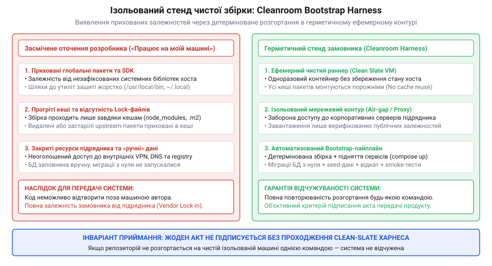
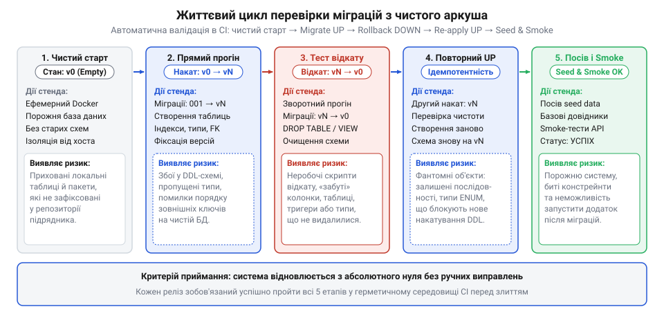
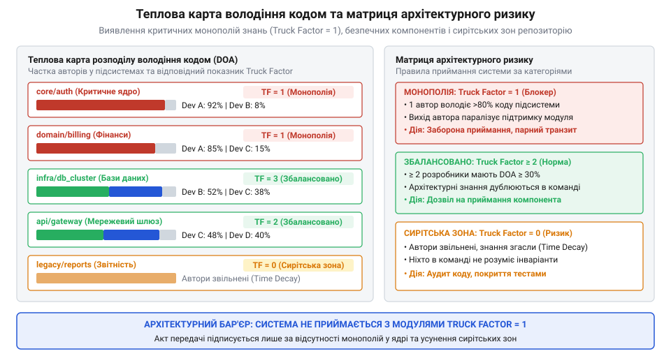

# Система, яку можна передати

<preknowlist>
- [Введення нової команди в систему](root:progarch/onboarding-a-new-team) — типові бар'єри неявного знання та труднощі занурення нових інженерів у чужий монополізований проєкт
- [Приймання системи від підрядника](root:progarch/accepting-a-system-from-a-contractor) — чому замовник не може прийняти систему без прозорої оцінки її відчужуваності та незалежності від конкретних персон підрядника
- [Логічне зчеплення: залежність, видима лише в історії змін](root:progarch/change-coupling-choice) — аналіз спільних комітів та історії репозиторію для виявлення прихованих зв'язків між модулями
</preknowlist>

## Монополія знань як головний бар'єр передачі системи

Наприкінці тривалого етапу розробки настає день приймання системи: зовнішній підрядник або внутрішня команда, що залишає проєкт, звітує про повну готовність продукту. Автоматичні тести проходять із зеленим статусом, тестовий контур успішно піднімається за скриптом, а демонстрація інтерфейсу закриває всі пункти технічного завдання. Менеджери з обох боків сідають за стіл, щоб підписати фінальний акт приймання-передачі.

Саме в цю мить замовник опиняється на краю найнебезпечнішої прірви в життєвому циклі програмного продукту. Програмне забезпечення не є статичним фізичним об'єктом, який після завершення будівництва функціонує сам по собі. Програма — це жива динамічна система, що постійно зазнає тиску мінливого оточення: змінюються протоколи зовнішніх API, виходять оновлення безпеки системних бібліотек, виникають непередбачувані сплески трафіку та змінюються вимоги бізнесу. Якщо архітектурне бачення, нетривіальні інваріанти надійності, механізми відновлення після збоїв та приховані крайові випадки існують виключно в пам'яті одного чи двох провідних інженерів підрядника, замовник купує не життєздатну систему, а небезпечну ілюзію володіння. Підписання акту за таких умов перетворюється на добровільне потрапляння в довічну заручницьку залежність від постачальника (@@en|vendor lock-in@@).

Як показано в матеріалі [Приймання системи від підрядника](root:progarch/accepting-a-system-from-a-contractor), процедура приймання не може обмежуватися перевіркою того, що кодова база працює сьогодні. Її головне завдання — оцінити відчужуваність архітектури: здатність системи продовжувати стабільний розвиток та обслуговування після того, як між замовником та її авторами буде повністю розірвано будь-який контакт.

Трагедія невідчужуваного коду розгортається на наступний день після здачі проєкту. Підрядник завершує контракт і перемикає ключових розробників на іншого клієнта. За два тижні у хмарного провайдера оновлюється формат сертифікатів або стороння платіжна система вводить жорсткіші таймаути. Виникає виробнича аварія, і внутрішня інженерна команда замовника отримує завдання локалізувати й усунути дефект. Як детально розглядає [Введення нової команди в систему](root:progarch/onboarding-a-new-team), нові розробники негайно натрапляють на глуху стіну неявного знання (@@en|tacit knowledge@@; від латинського *tacitus* — мовчазний, прихований). Чому черга повідомлень скидає стан при перезапуску фонового процесу? Чому блокування бази даних реалізовано саме через оптимістичні версії без індексів? Що означають константи в конфігурації кешу? Текстова документація або відсутня, або безнадійно застаріла ще пів року тому, адже будь-який паперовий артефакт піддається невпинній семантичній ерозії, якщо він не захищений автоматичними перевірками — явище, вивчене в темі [Документ, що не гниє](root:progarch/document-that-does-not-rot).

У результаті вартість найменшої правки зростає на порядки, швидкість випуску релізів падає до нуля, а страх зламати незрозумілі зв'язки паралізує команду. Кодова база перетворюється на «сирітську» (@@en|orphan code@@; від грецького *orphanos* — сирота, позбавлений піклування): файли існують у репозиторії, але в організації немає жодної живої людини, яка б розуміла їхній внутрішній устрій та не боялася вносити зміни.

Для кількісної оцінки цієї організаційної та архітектурної катастрофи в інженерії використовують поняття **автобусного фактора** (@@en|bus factor@@, або **фактора вантажівки**, @@en|truck factor@@; від англійських слів *truck* — вантажівка, *bus* — автобус та *factor* — чинник, коефіцієнт). Це мінімальна кількість ключових інженерів команди розробки, раптове вибуття яких (метафоричний сценарій: «якщо провідного автора збиває вантажівка», або реалістичний — звільнення, перехід до конкурента чи завершення контракту підрядником) призводить до повної втрати контролю над проєктом та зупинки його супроводу.

Коли автобусний фактор репозиторію дорівнює одиниці (`truck factor = 1`), вся багатомільйонна система має критичну одиничну точку відмови (@@en|single point of failure@@, SPOF), сфокусовану всередині однієї людської голови. При цьому вкрай небезпечно плутати глобальний автобусний фактор команди з локальними факторами окремих модулів. У компанії може працювати сорок досвідчених розробників, створюючи оманливе враження розподіленого колективу. Проте якщо критичний шлюз авторизації, підсистему криптографічного підпису або алгоритм розрахунку балансів одноосібно створював і змінював лише один фахівець підрядника, локальний фактор цього вузла дорівнює одиниці. Вихід цієї однієї людини миттєво паралізує весь бізнес.

Чому проблему монополії знань не можна розв'язати опитуваннями, анкетами чи інтерв'ю з командою перед підписанням контракту? Людські самооцінки катастрофічно ненадійні:
1. **Когнітивні упередження:** Розробники схильні щиро переоцінювати повноту переданих знань, вважаючи власні архітектурні трюки «очевидними для будь-якого професіонала».
2. **Конфлікт інтересів підрядника:** Комерційні виконавці мають пряму фінансову зацікавленість зберегти замовника на голці дорогого супроводу. На фінальних зустрічах вони завжди запевняють: «Код повністю структурований, система прозора, передача завершена на 100%».
3. **Психологічний бар'єр приймаючої сторони:** Нові інженери замовника під час ознайомчих сесій часто кивають і погоджуються, побоюючись показатися некомпетентними, не усвідомлюючи, з якими підводними каменями вони зіткнуться під час першої нічної аварії.

Суб'єктивні заяви не мають юридичної та інженерної ваги. Єдиним джерелом об'єктивної істини є фізичні сліди життєдіяльності системи — журнал комітів системи контролю версій. Кожен рядок коду, кожна виправлена помилка і кожна зміна структури зафіксовані в часі разом із конкретним автором.

Звідси постає строга інженерна задача: створити автоматизований інструмент аналізу історії Git, який незалежно від слів людей розкриває справжню карту володіння кодом. Цей інструмент повинен видобувати журнал змін і зрізи авторства, фільтрувати випадковий синтаксичний шум, розраховувати ступінь експертизи розробників за зваженими метриками активності, розв'язувати задачу жадібного покриття для визначення точного автобусного фактора репозиторію та будувати автоматизовані перевірочні бар'єри (handover gates) у конвеєрі CI для блокування передачі монополізованого коду.

> 🔧 **Навіщо це.** Замовник не може довіряти суб'єктивним запевненням підрядника на нарадах. Автоматизований розрахунок автобусного фактора перетворює розмите питання «чи готова наша команда перехопити кермо» на математично доведений факт: скільки саме людей тримають у голові критичні вузли системи і які модулі перетворяться на сирітські в день підписання акту приймання.

## Видобування первинних даних з Git та очищення від шуму

Для реконструкції реального ландшафту знань аналізатор звертається до ядра системи контролю версій. Репозиторій Git зберігає історію проєкту у вигляді незмінного напрямленого ациклічного графа комітів (DAG — @@en|Directed Acyclic Graph@@). Щоб побудувати математичну модель володіння кодом, інструмент видобуває з репозиторію два взаємодоповнюючі джерела первинних даних:

1. **Журнал динамічної активності (Commit Log):** вилучається за допомогою команди `git log --numstat`. Він фіксує хронологічну послідовність змін: ідентифікатор коміту, часову мітку, автора, перелік зачеплених файлів та кількість доданих і вилучених рядків у кожному з них. Цей зріз відображає інтенсивність залучення інженера: як часто автор звертався до файлу, скільки разів він виправляв у ньому дефекти та наскільки глибоко рефакторив логіку.
2. **Зріз статичного виживання рядків (Line Attribution / Blame):** вилучається через `git blame`. Для поточного стану файлу у гілці за замовчуванням (HEAD) він зіставляє кожен фізичний рядок коду з останнім комітом, який його модифікував. Це дозволяє порахувати, скільки саме діючих рядків у поточному стані системи належить авторству конкретного розробника.

Спроба безпосередньо завантажити сирі дані з `git log` та `git blame` у математичний алгоритм призводить до повної дискредитації результатів. У реальних комерційних проєктах чистий потік інженерних рішень тоне у велетенській масі артефактів та похибок. Якщо аналізатор довірятиме необробленим рядкам, підсумкові метрики спотворяться до невпізнаваності через два фундаментальні чинники: **фрагментацію авторських ідентичностей** та **синтаксично-структурний шум**.

### Дедуплікація авторів та нормалізація ідентичностей

У системі контролю версій розробник не має єдиного системного ідентифікатора. Ім'я та електронна пошта виставляються локально в конфігурації клієнта через змінні `user.name` та `user.email`. Упродовж кількох років життя проєкту один і той самий інженер неминуче накопичує десятки різних цифрових профілів:
- Коміти з корпоративної пошти підрядника: `oleg.koval@contractor.io`.
- Коміти з робочої скриньки в домені замовника: `o.koval@client-corp.com`.
- Коміти з особистої пошти під час термінового виправлення на вихідних: `koval.dev@gmail.com`.
- Різні варіанти написання імені та псевдоніми: `Oleg Koval`, `Oleh Koval`, `oleg-k`, `okoval`.
- Автоматизовані системні облікові записи сервісів інтеграції: `github-actions[bot]`, `dependabot[bot]`, `deploy-key`.

Якщо аналізатор не об'єднає ці сутності, жадібний алгоритм порахує Олега Коваля за чотирьох різних незалежних контриб'юторів. У звіті для керівництва з'явиться безпечна цифра `truck factor = 4`, тоді як насправді весь критичний модуль тримається на одній-єдиній людині. Створюється смертельно небезпечна ілюзія захищеності.

Для розв'язання цієї проблеми в архітектуру інструмента закладається двоконтурний механізм дедуплікації (author deduplication):

По-перше, підтримка стандартного механізму `.mailmap` (від англійських слів *mail* — пошта та *map* — відображення, карта відповідностей). Файл `.mailmap` у корені репозиторію задає канонічні правила нормалізації. Git підтримує синтаксис зіставлення як імен, так і поштових адрес:

```text
# .mailmap — нормалізація ідентичностей авторів кодової бази
Олег Коваль <oleg.koval@company.ua> Oleh Koval <o.koval@client-corp.com>
Олег Коваль <oleg.koval@company.ua> koval.dev <koval.dev@gmail.com>
Олег Коваль <oleg.koval@company.ua> <okoval@contractor.io>
```

Коли утиліта зчитує логи через команду `git log --use-mailmap` або власноруч парсить `.mailmap` перед обробкою, всі історичні варіації зводяться до єдиного канонічного профілю `Олег Коваль <oleg.koval@company.ua>`.

По-друге, евристичний матчинг для репозиторіїв, де `.mailmap` не вели. Алгоритм нормалізатора виконує каскадну перевірку:
1. Приведення імені до нижнього регістру, вилучення зайвих знаків пунктуації, нормалізація апострофів та транслітерації (наприклад, зведення `oleg` та `oleh` до єдиної лексеми).
2. Співставлення префіксів email (частини адреси до символу `@`): адреси `j.smith@vendor.com` та `j.smith@work.org` автоматично кластеризуються за збігом локальної частини імені `j.smith`.
3. Розрахунок відстані Левенштейна (Levenshtein distance) між текстовими іменами з порогом подібності понад 85%.

### Фільтрація синтаксичного та структурного шуму

Другий смертельний ворог аналізу — це нерівноцінність рядків коду. З погляду архітектури передачі системи зміна 5 рядків, які виправляють алгоритм розподіленого консенсусу чи обробку транзакції, несе колосальний обсяг знань. Натомість зміна 80 000 рядків при автоматичному переформатуванні відступів не несе жодної корисної інформації про розуміння системи.

Якщо запустити `git blame` на репозиторії після глобального запуску Prettier або Black, утиліта визначить інженера, який створив цей коміт, автором практично 100% кодової бази. Справжні творці логіки повністю зникнуть зі зрізу.

Конвеєр попередньої обробки обов'язково фільтрує п'ять категорій паразитного шуму:

1. **Косметичні коміти форматування (Code Formatting):** масові запуски лінтерів, зміна символів кінця рядка (CRLF на LF) або автовирівнювання відступів. Для усунення цього викривлення виклики `git blame` супроводжуються прапорцем `-w` (ігнорувати зміни пробільних символів) та прапорцем `--ignore-revs-file .git-blame-ignore-revs`. До спеціального файлу `.git-blame-ignore-revs` заносяться хеші всіх ревізій реформатування: Git автоматично переступає через них і шукає реального попереднього автора змістовного рядка.
2. **Масові перейменування та переміщення файлів (Renames & Moves):** перенесення каталогів у монорепозиторії (наприклад, переїзд `src/` у `packages/core/src/`). Без прапорця детекції перейменувань `-M` утиліта реєструє знищення тисяч рядків одними авторами та написання їх з нуля іншим інженером. Детектор Git із порогом схожості (за замовчуванням 50%) дозволяє відстежити історію файлу крізь перейменування без обнулення авторства.
3. **Автогенерований код і скомпільовані артефакти:** клієнтські бібліотеки OpenAPI/Swagger, скомпільовані схеми Protocol Buffers (`*.pb.go`, `*_pb2.py`), мініфіковані бандли JavaScript (`bundle.min.js`), зліпки схем баз даних та файли фіксації залежностей (`package-lock.json`, `pnpm-lock.yaml`, `Cargo.lock`, `poetry.lock`). Оновлення одного lock-файлу сторонньої бібліотеки може додати 40 000 рядків за один коміт. Аналізатор відсікає такі файли через системний файл `.gitattributes` (маркер `linguist-generated=true`) та налаштовуваний список масок виключень (`vendor/**`, `dist/**`, `generated/**`, `*.min.js`).
4. **Автоматичні сервісні коміти та бампи версій:** активність ботів автоматичного оновлення бібліотек (Dependabot, Renovate) та скриптів випуску релізів (`Bump version to 2.4.1`). Вони відсікаються на рівні чорного списку авторів та регулярних виразів у текстах повідомлень комітів.
5. **Порожні мердж-коміти (Empty Merges):** злиття стабільних гілок у робочі, які не несуть унікального дифу в коді. У журналі комітів вони відсікаються системним прапорцем `--no-merges`.


*Конвеєр попередньої обробки історії Git: сирий потік комітів та зрізи git blame проходять крізь нормалізацію ідентичностей через .mailmap та послідовні фільтри синтаксичного шуму, ботів і згенерованих артефактів для отримання достовірного потоку авторства.*

Після проходження всіх фільтрів аналізатор отримує чистий нормалізований потік подій: кожна мутація коду прив'язана до єдиної верифікованої персони інженера, стосується лише написаної людиною бізнес-логіки та очищена від артефактів компіляції й косметичних виправлень.

Нижче наведено базовий модуль конвеєра очищення, що демонструє парсинг виводу `git log`, резолвінг псевдонімів через словник відповідностей та відсікання шумних мутацій за регулярними виразами й масками виключення:

:::code proj-git-truck-factor-analyzer/py/normalizedchange.py

Цей чистий потік подій стає надійним вхідним фундаментом для наступного етапу — розрахунку математичної моделі авторства та вагових коефіцієнтів володіння підсистемами.

> 🔧 **Навіщо це.** Очищення первинних даних — це фундамент достовірності аналізу. Якщо пропустити через алгоритм сирі логи, інструмент оголосить головним архітектором системи того розробника, який востаннє запустив форматер коду перед релізом, або підрядник зможе штучно роздути свій внесок мільйонами рядків вендорних пакетів.

## Модель авторства: алгоритм Degree of Authorship (DOA) та часове згасання

Після дедуплікації цифрових профілів інженерів та очищення журналу від синтаксичного шуму аналізатор отримує нормалізований потік подій. Проте наявність очищених комітів і рядків утиліти `git blame` сама по собі ще не відповідає на ключове запитання: хто саме з розробників володіє достатньою глибиною розуміння файлу, щоб вважатися його повноправним супроводжувачем?

У ранніх спробах аудиту кодових баз застосовували примітивні евристики: наприклад, призначали власником того, хто написав понад 50% фізичних рядків у поточному стані файлу. Така наївна оцінка негайно дає збій на двох типових сценаріях:
1. Інженер, який створив архітектурний каркас файлу, вибрав структури даних і заклав ключові інваріанти, міг написати лише 150 рядків лаконічної логіки. Пізніше інший розробник додав 300 рядків коментарів, валідації полів та обробки дрібних помилок. Наївний підрахунок рядків віддасть володіння другому, хоча перший розуміє глибинну структуру на порядок краще.
2. Файл зазнавав десятків дрібних правок від різних людей упродовж двох років, але жоден із них не набрав абсолютної більшості рядків. За наївною метрикою файл оголошується «нічийним», хоча насправді в команді є інженер, який регулярно виправляє в ньому дефекти й тримає в пам'яті актуальний контекст.

Щоб усунути ці викривлення, у програмній інженерії застосовують формальну модель ступеня авторства — **Degree of Authorship (DOA)** (від латинського *auctor* — творець, засновник, та англійського *authorship* — авторство). Модель DOA спирається на три взаємодоповнюючі фактори внеску розробника `d` у файл `f`:
- **Первинне авторство (First Authorship, FA):** бінарний коефіцієнт, що фіксує факт створення файлу. Якщо розробник `d` є автором першого коміту, що додав файл `f` до репозиторію, `FA = 1`, інакше `FA = 0`. Творець файлу володіє унікальним розумінням його початкового призначення, яке часто залишається невисловленим у наступних дифах.
- **Частота змін (Deliveries, DL):** кількість окремих комітів розробника `d`, які модифікували файл `f` у процесі еволюції. Кожна зміна свідчить про те, що розробник знову відкривав файл, занурювався в його код і верифікував працездатність. Оскільки сотий коміт додає менше нового розуміння, ніж другий чи третій, вплив частоти змін згладжують логарифмічною функцією `ln(1 + DL)`.
- **Вцілілий код (Active Code / Accepted Lines, AC):** частка фізичних рядків файлу `f`, останнім автором яких є розробник `d` за даними очищеного зрізу `git blame`.

Класична базова оцінка авторства розраховується як зважена сума цих трьох компонентів:

```text
DOA_raw(d, f) = c_1 · FA + c_2 · ln(1 + DL) + c_3 · AC
```

Емпіричні калібрування моделі (зокрема дослідження Фріца, Мерфі та Авеліно на тисячах відкритих і корпоративних проєктів) визначають типові вагові коефіцієнти: `c_1 ≈ 3.293`, `c_2 ≈ 1.098`, `c_3 ≈ 0.164`. Створення файлу дає потужний початковий гандикап, регулярні доопрацювання нарощують вагу, а частка рядків додає стабільну вагу за обсяг реалізованої логіки.

### Часове згасання знань: модель експоненційного напіврозпаду

Проте навіть класична модель DOA містить фундаментальну архітектурну сліпоту: вона розглядає історію як статичний архів, у якому подія трирічної давнини має таку саму вагу, як і вчорашня.

У реальній експлуатації людська пам'ять підпорядковується законам забування, а програмне оточення зазнає невпинної ерозії. Якщо архітектор підрядника створив складний модуль обробки фінансових транзакцій два з половиною роки тому й відтоді жодного разу не відкривав репозиторій, його реальна здатність оперативно розібратися в сучасній поведінці цього модуля близька до нуля. За цей час оновилася версія мови, змінилися контракти сусідніх сервісів, були додані нові бізнес-правила, а деталі реалізації стерлися з пам'яті. Покластися на такого автора під час аварії — прямий шлях до простою продакшену.

Щоб модель відображала живий стан експертизи, в алгоритм інтегрують функцію **часового згасання** (@@en|time decay@@) на основі моделі експоненційного напіврозпаду (@@en|half-life decay@@; від грецького *ek* — з, *ponere* — класти; half-life: період часу, за який початкова вага активності зменшується вдвічі).

Для кожної події зміни, що відбулася `Δt` днів тому від моменту аудиту, розраховується коефіцієнт актуальності `w(Δt)`:

```text
w(Δt) = 2^(-Δt / t_half)
```

де `t_half` — період напіврозпаду актуальності знань. Для динамічних веб-сервісів та мікросервісних архітектур `t_half` встановлюють у межах від 180 до 365 днів (від 6 місяців до 1 року). Якщо зміна внесена сьогодні (`Δt = 0`), її вага дорівнює `w = 1.0`. Через один рік (`Δt = 365`) вага внеску падає до `0.5`, через два роки — до `0.25`, а через три роки внесок розробника практично нівелюється (`w ≈ 0.125`).

Часове згасання застосовується як до кожного окремого коміту в історії, так і до рядків blame, зважуючи часову мітку останнього дотику до рядка. Модифікована формула згасаючої активності розробника набуває вигляду:

```text
DL_decay(d, f) = ∑ w(t_now − t_commit)     [сума по всіх комітах розробника d до файлу f]
AC_decay(d, f) = ∑ w(t_now − t_line)       [сума по всіх рядках файлу f, збережених за d]
```

Первинне авторство `FA` також множиться на загасаючий коефіцієнт від дати створення файлу, позбавляючи колишніх розробників довічного статусу монополістів кодової бази.

### Нормалізація та пороги експертності

Отримані абсолютні значення `DOA(d, f)` переводять у відносну шкалу, нормуючи їх за сумою балів усіх авторів, які будь-коли долучалися до файлу:

```text
DOA_norm(d, f) = DOA(d, f) / ∑ DOA(u, f)   [сума по всіх авторах u файлу f]
```

Нормований показник `DOA_norm(d, f)` змінюється в діапазоні від `0.0` до `1.0` (від 0% до 100%) і виражає відносну частку поточної експертизи розробника у конкретному компоненті.

На основі `DOA_norm` аналізатор класифікує розробників за рівнями володіння файлом:
1. **Первинний власник (Primary Owner):** розробник, чий показник перевищує поріг експертності `DOA_norm(d, f) ≥ 0.75` (або єдиний лідер із домінуванням `DOA_norm(d, f) ≥ 0.50` за умови, що жоден інший автор не має понад `0.25`). Первинний власник здатний самостійно рефакторити модуль, розуміє граничні умови та може кваліфіковано провести аудит чужих правок.
2. **Вторинний контриб'ютор (Secondary Contributor):** розробник із часткою `0.20 ≤ DOA_norm(d, f) < 0.75`. Він орієнтується у загальній структурі файлу, вносив точкові виправлення, але не володіє повним контекстом системи.
3. **Епізодичний учасник (Marginal Contributor):** розробник із часткою `DOA_norm(d, f) < 0.20`. Його внесок обмежений косметичними змінами або випадковими правками, і він не розглядається як носій архітектурного знання.

Якщо для файлу `f` жоден із діючих розробників команди не досягає порогу первинного власника, такий файл отримує статус **сирітського (orphan file)**. Сирітські файли становлять максимальну небезпеку під час передачі системи: вони функціонують у продакшені, але ніхто в організації не несе за них когнітивної відповідальності. Як зазначалося в темі [Введення нової команди в систему](root:progarch/onboarding-a-new-team), саме накопичення сирітських файлів стає головним бар'єром для продуктивної роботи нових інженерів.

> 🔧 **Навіщо це.** Запровадження часового згасання не дозволяє підряднику маніпулювати історією: якщо ключовий архітектор написав ядро три роки тому й відтоді не торкався коду, його колишнє авторство не врятує замовника від статусу «сирітського модуля».

## Алгоритм жадібного покриття (Greedy Set Cover) для обчислення Truck Factor

Коли кожен файл репозиторію має розрахований вектор первинних власників, аналізатор переходить від локального аудиту файлів до оцінки життєздатності системи в цілому. Перед архітектором постає центральне питання приймання: скільки інженерів має одночасно вийти з команди, щоб система втратила відчужуваність і перейшла у стан некерованого хаосу?

У дискретній математиці ця постановка зводиться до класичної задачі про мінімальне покриття множини — **Set Cover Problem**. Нехай `F = {f_1, f_2, ..., f_m}` — множина всіх критичних файлів системи (або множина рядків бізнес-логіки). Нехай `D = {d_1, d_2, ..., d_n}` — множина активних інженерів. Для кожного файлу `f ∈ F` визначено підмножину його первинних власників `Owners(f) ⊆ D`. Відповідно, кожен інженер `d ∈ D` покриває певну підмножину файлів `Files(d) = {f ∈ F | d ∈ Owners(f)}`.

Задача пошуку автобусного фактора формулюється у термінах катастрофічного сценарію: знайти мінімальну за розміром підмножину розробників `K ⊂ D`, вилучення якої з команди перетворює критичну частку репозиторію `θ` (зазвичай поріг приймають рівним 50% кодової бази) на сирітський код:

```text
OrphanRatio(D − K) ≥ θ
```

де `OrphanRatio` — відношення кількості файлів, що залишилися без жодного первинного власника серед інженерів `D − K`, до загальної кількості файлів кодової бази `|F|`. Мінімальна потужність такої множини `|K|` і є **автобусним фактором (Truck Factor)** проєкту:

```text
Truck Factor = min |K|
```

Як підкреслено в аналізі [Приймання системи від підрядника](root:progarch/accepting-a-system-from-a-contractor), якщо під час фінальної ревізії виявляється, що `Truck Factor` неприпустимо малий, замовник ризикує підписати акт на продукт, що розвалиться при першій зміні команди.

### Ітеративна симуляція жадібного вилучення

Оскільки класична задача Set Cover є NP-складною, для аналізу кодових баз довільного масштабу застосовують жадібний евристичний алгоритм (@@en|Greedy Set Cover Simulation@@; від англійського *greedy* — жадібний). Алгоритм моделює найгірший можливий сценарій відходу людей із проєкту: на кожному кроці з команди примусово вилучається той фахівець, чия втрата завдає максимальної шкоди залишковому покриттю знань (інженер із найбільшим обсягом монопольних володінь).

Покроковий протокол симуляції виглядає так:

1. **Ініціалізація стану:**
   - Поточний склад команди: `D_active = D`.
   - Множина сирітських файлів: `F_orphan = ∅` (файли, які спочатку не мали жодного власника, одразу зараховуються до сирітських).
   - Лічильник вибулих розробників: `k = 0`.
   - Список вилучених персон: `Departed = []`.

2. **Ітеративний вибір критичного інженера:**
   - Для кожного розробника `d ∈ D_active` обчислюється його маржинальна монополія — кількість файлів `ΔOrphan(d)`, які стануть сирітськими саме в разі його негайного виходу:
     ```text
     ΔOrphan(d) = |{f ∈ (F − F_orphan) | Owners(f) ∩ D_active = {d}}|
     ```
   - Обирається інженер `d*`, для якого приріст сирітського коду є максимальним:
     ```text
     d* = argmax ΔOrphan(d)
     ```

3. **Оновлення стану та перевірка порогу:**
   - Інженер `d*` видаляється з активної команди: `D_active = D_active − {d*}`.
   - Усі його монопольні файли переходять до множини `F_orphan`: `F_orphan = F_orphan ∪ Files_monopoly(d*)`.
   - Збільшується лічильник: `k = k + 1`, персона додається до списку `Departed.append(d*)`.
   - Розраховується поточна частка сирітського коду:
     ```text
     Loss = |F_orphan| / |F|
     ```
   - Якщо `Loss ≥ θ` (наприклад, понад 50% репозиторію втратило власників), симуляція зупиняється. Поточне значення `k` фіксується як підсумковий **Truck Factor** репозиторію.
   - Якщо поріг не досягнуто, алгоритм переходить до наступної ітерації кроку 2.


*Симуляція жадібного вилучення ключових інженерів: почерговий вихід розробників із максимальним монопольним володінням демонструє круту траєкторію перетворення кодової бази на сирітську; точка перетину критичного порогу 50% визначає точний автобусний фактор репозиторію.*

На графіку симуляції наочно видно динаміку катастрофи. Якщо крива втрати знань злітає вгору вже на першому чи другому кроці, це сигналізує про гостру концентрацію архітектурного контексту в руках вузького кола осіб.

### Реалізація симулятора жадібного покриття

Розгляньмо компактну та ефективну реалізацію алгоритму моделювання вибуття інженерів мовою Python:

:::code proj-git-truck-factor-analyzer/py/simulationresult.py

### Пастка глобального числа: модульний автобусний фактор

Отримання єдиного підсумкового числа для всього репозиторію таїть у собі підступну архітектурну пастку.

Уявімо монорепозиторій на 2 000 файлів, де працює команда з 25 інженерів. Утиліта запускає симуляцію жадібного вилучення й повертає комфортний вердикт: `Truck Factor = 5`. Керівництво замовника зітхає з полегшенням і готується підписати контракт.

Проте аналіз структури коду розкриває катастрофічну реальність:
- 1 800 файлів — це користувацький інтерфейс, допоміжні веб-контролери, стилі та типові CRUD-форми, які спільно писали 24 розробники.
- Решта 200 файлів — це серцевина системи: модуль клірингу платежів, протокол розподіленої синхронізації та механізм захисту транзакцій (`src/core/ledger/`). Усі ці 200 файлів від першого до останнього рядка створив і супроводжував один провідний архітектор підрядника.

Якщо цей архітектор залишає компанію, частка сирітського коду в масштабах усього проєкту зростає лише на `200 / 2000 = 10%`. Загальний поріг колапсу в 50% не подолано, тому глобальний алгоритм взагалі не помічає загрози. Але з погляду бізнесу компанія паралізована: інтерфейс функціонує, проте будь-який збій у фінансовому ядрі стає фатальним, оскільки ніхто з решти 24 інженерів не розуміє математики розрахунку балансів.

Саме тому відчужуваність архітектури ніколи не вимірюється одним глобальним числом. Аналізатор зобов'язаний розраховувати **модульний автобусний фактор (Modular Truck Factor)** для кожного ізольованого архітектурного шару та підсистеми окремо:

```text
TF_system = min TF(Module_i)    [для всіх критичних бізнес-модулів Module_i]
```

Якщо модульний автобусний фактор ядра бізнес-домену дорівнює одиниці (`TF_core = 1`), загальний автобусний фактор усієї системи автоматично визнається рівним одиниці, незалежно від того, скільки сотень розробників працює над допоміжними компонентами.

> 🔧 **Навіщо це.** Модульний розрахунок автобусного фактора викриває «архітектурні потьомкінські села»: ситуації, коли великий штат другорядних розробників створює видимість командної роботи, маскуючи тотальну одноосібну монополію підрядника на критичне доменне ядро.

## Візуалізація ризиків, теплові карти власності та звітність

Розрахунок чисельного значення автобусного фактора та виявлення сирітських файлів дають вичерпну математичну базу. Проте в процесі передачі системи сухі масиви чисел і списки файлів виявляються неефективними для прийняття стратегічних рішень: технічні директори, керівники напрямків та лід-архітектори потребують швидкого, наочного та структурованого огляду всього ландшафту кодової бази.

Щоб сирі метрики перетворилися на інструмент аудиту, аналізатор виконує агрегацію показників за архітектурними шарами та підсистемами.

### Агрегація за архітектурними шарами

Файли репозиторію не існують ізольовано — вони згруповані в каталоги, що представляють логічні межі системи:
- **Ядро бізнес-логіки (Domain Core):** сутності, правила розрахунку, агрегати (`src/domain/`).
- **Служби застосунку (Application Services):** сценарії використання, оркестрація транзакцій (`src/app/`).
- **Адаптери інфраструктури (Infrastructure):** взаємодія з базами даних, чергами, зовнішніми API (`src/infra/`).
- **Шар представлення (Presentation / API):** HTTP-контролери, обробники подій, CLI (`src/api/`).

Для кожного каталогу аналізатор обчислює інтегральні параметри:
1. Загальний обсяг активного коду (LOC) та кількість файлів.
2. Вектор сумарного авторства: яку частку коду кожного модуля контролює кожен інженер.
3. Локальний автобусний фактор модуля (`TF_module`).
4. Частку сирітського коду всередині модуля (`OrphanRatio_module`).

### Теплова карта володіння кодом (Code Ownership Heatmap)

Головним засобом візуалізації виступає теплова карта володіння кодом. Вона зіставляє архітектурну структуру проєкту з колірною шкалою ризику:

- 🔴 **Критичний ризик (Червона зона / TF = 1):** модуль повністю монополізований одним автором або вибуття одного ключового розробника позбавляє команду понад 50% коду підсистеми. Це найнебезпечніше «вузьке горлечко знань» (knowledge bottleneck).
- 🟠 **Високий ризик (Помаранчева зона / «Сирітський спадок»):** понад 20% файлів модуля не мають активних первинних власників через згасання часу або звільнення авторів. Модуль працює за інерцією, і будь-яка зміна потребує дорогого реверс-інжинірингу.
- 🟡 **Помірний ризик (Жовта зона / TF = 2):** знання поділені між двома інженерами. Система життєздатна, але втрата одного з них негайно переводить підсистему в червону зону.
- 🟢 **Збалансована зона (Зелена зона / TF ≥ 3, Orphan < 5%):** колективне володіння, стабільна децентралізація знань, система легко відчужується та передається іншій команді.


*Теплова карта власності коду та матриця ризику: наочне розбиття архітектурних шарів за автобусним фактором та часткою сирітського коду дозволяє керівництву миттєво локалізувати токсичні монополії знань.*

Аналізатор підтримує як графічний вивід карти у формі інтерактивного дашборду чи SVG-звіту, так і компактне термінальне ANSI-представлення для швидкого перегляду в консолі:

```text
======================= CODE OWNERSHIP RISK MATRIX =======================
Module               Files   LOC    TF   Orphan%   Primary Owners   Status
--------------------------------------------------------------------------
src/domain/ledger/     184  24.5k    1     0.0%    O.Koval (92%)    CRITICAL
src/domain/billing/    112  16.2k    1     8.1%    O.Koval (84%)    CRITICAL
src/infra/postgres/     78   9.1k    2     4.2%    I.Petrenko, A.S. MODERATE
src/infra/kafka/        45   5.4k    0    35.6%    <NONE>           ORPHAN
src/api/graphql/       210  18.0k    4     2.1%    Team (shared)    HEALTHY
src/api/rest/          165  14.3k    3     1.8%    Team (shared)    HEALTHY
==========================================================================
System Summary: Global TF = 4 | Core Domain TF = 1 | Total Orphan = 5.2%
VERDICT: REJECT HANDOVER — CRITICAL MONOPOLY IN DOMAIN CORE
```

### Генерація аудиторських звітів: JSON та Markdown

Для інтеграції з корпоративними системами управління та фіксації результатів аудиту інструмент генерує два типи звітів:

1. **Структурований JSON-звіт:** призначений для автоматичної обробки скриптами CI, збереження в сховищах артефактів та порівняння динаміки між релізами. Звіт містить повний зріз: глобальні метрики, деталізацію по кожному модулю і файлу, історію прогресії вибуття інженерів та перелік критичних осіб.

```json
{
  "timestamp": "2026-09-09T01:30:00Z",
  "summary": {
    "total_files": 794,
    "total_loc": 87500,
    "global_truck_factor": 4,
    "core_domain_truck_factor": 1,
    "total_orphan_percentage": 5.2,
    "handover_ready": false
  },
  "bottleneck_developers": [
    {
      "name": "Олег Коваль",
      "email": "oleg.koval@company.ua",
      "monopoly_files": 296,
      "critical_modules": ["src/domain/ledger", "src/domain/billing"]
    }
  ],
  "modules": [
    {
      "path": "src/domain/ledger",
      "truck_factor": 1,
      "orphan_ratio": 0.0,
      "primary_owners": ["Олег Коваль"],
      "risk_level": "CRITICAL"
    }
  ]
}
```

2. **Аудиторський Markdown-звіт:** документ для технічного керівництва та замовника, який додається як додаток до протоколу перевірки відчужуваності. Він містить резюме для менеджменту, матрицю ризиків, графік кумулятивної втрати знань та чіткі інженерні рекомендації щодо ліквідації виявлених монополій.

> 🔧 **Навіщо це.** Теплова карта перекладає складний математичний розрахунок мовою, зрозумілою як інженерам, так і керівництву. Вона не дає підряднику сховати монополію за загальними звітами: на карті чітко видно, що червона пляма накриває саме доменне ядро, перетворюючи підписання акту на самогубство бізнесу.

## Інтеграція в CI та автоматизований бар'єр приймання коду (Handover Gate)

Аналіз, результати якого залишаються лише у звітах, не здатний захистити інтереси замовника. Коли проєкт підходить до кінця, на менеджмент тиснуть фінансові дедлайни, а підрядник прагне якнайшвидше списати бюджет. Будь-які усні домовленості, рекомендації та письмові зауваження архітекторів неминуче ігноруються заради якнайшвидшого підписання документів.

Як детально доведено в матеріалі [Приймання системи від підрядника](root:progarch/accepting-a-system-from-a-contractor), єдиний спосіб гарантувати відчужуваність — перенести контроль із площини переговорів у площину безкомпромісного програмного коду: вбудувати перевірку автобусного фактора в конвеєр неперервної інтеграції (CI/CD) як автоматизований бар'єр передачі — **Handover Gate**.

### Контрактні пороги відчужуваності

Конвеєр CI функціонує на базі формально затверджених числових порогів (@@en|Quality Gates@@), зафіксованих безпосередньо в договорі на розробку або угоді про рівень якості:

1. **Мінімальний модульний автобусний фактор:** для всіх критичних підсистем бізнес-домену встановлюється вимога `TF_module ≥ 2` (а для систем високої надійності — `≥ 3`). Якщо бодай один модуль із каталогу доменного ядра має `TF = 1`, збірка падає з кодом помилки, а пул-реквест на передачу блокується.
2. **Ліміт сирітського коду:** сумарна частка сирітських файлів не повинна перевищувати встановлений поріг (наприклад, `OrphanRatio ≤ 10%`, а для ядра системи — `≤ 2%`). Наявність занедбаних компонентів свідчить про накопичений технічний борг і відсутність супроводу.
3. **Обмеження максимальної персональної монополії:** жоден окремий інженер не має права володіти понад 60% сукупного авторства бізнес-модуля. Якщо один розробник набрав монопольний відсоток, підрядник зобов'язаний залучити другого інженера для розмиття концентрації знань.

### Конфігурація автоматизованого гейта в пайплайні CI

Автоматизований гейт запускається під час кожного злиття гілок релізу та перед формуванням фінального дистрибутиву. Нижче наведено декларативну конфігурацію конвеєра для GitHub Actions:

```yaml
name: Handover Quality Gate

on:
  pull_request:
    branches: [main, release/*]
  push:
    branches: [main, release/*]

jobs:
  truck-factor-gate:
    runs-on: ubuntu-latest
    name: Audit Knowledge Monopolies and Truck Factor
    steps:
      - name: Checkout Full Git History
        uses: actions/checkout@v4
        with:
          fetch-depth: 0

      - name: Set up Python
        uses: actions/setup-python@v5
        with:
          python-version: "3.12"

      - name: Run Git Truck Factor Analyzer
        run: |
          python -m analyzer.cli             --repo .             --mailmap .mailmap             --min-core-tf 2             --max-orphan-percent 10             --output-json report.json             --output-md report.md

      - name: Publish Markdown Summary to Job Summary
        if: always()
        run: |
          cat report.md >> GITHUB_STEP_SUMMARY

      - name: Archive Audit Artifacts
        if: always()
        uses: actions/upload-artifact@v4
        with:
          name: handover-audit-report
          path: |
            report.json
            report.md
```

Якщо перевірка фіксує порушення встановлених лімітів, утиліта повертає ненульовий код повернення (`exit code 1`). Збірка стає червоною, кнопка злиття блокується захистом гілки (Branch Protection Rule), а звіт із переліком проблемних файлів автоматично публікується в інтерфейсі CI. Підрядник фізично не може передати реліз замовнику, доки машина не підтвердить децентралізацію знань.

### Інженерний критерій Definition of Done для контракту

Впровадження автоматичного гейта докорінно змінює юридичну та інженерну природу критерію готовності — **Definition of Done (DoD)**.

Традиційне визначення готовності, що спирається лише на функціональні тести та наявність супровідних документів, створює небезпечну пастку: паперова документація швидко гниє та втрачає зв'язок із кодом, як показано в темі [Документ, що не гниє](root:progarch/document-that-does-not-rot).

Сучасний контракт на передачу системи формулює Definition of Done через три вимірювані вимоги:
1. **Зелений статус Handover Gate:** кодова база успішно проходить автоматичний аудит у CI без винятків та відключених перевірок.
2. **Обов'язкова ротація та парне програмування:** якщо аналіз виявляє зону монополії `TF = 1`, підрядник зобов'язаний провести роботу над розмиттям знань: передати задачі з цього модуля іншому інженеру або організувати парне програмування з інженером замовника. Нові коміти від іншого автора автоматично підвищують його DOA та виводять модуль із червоної зони.
3. **Перевірка спадкоємності на практиці:** перед фінальним закриттям договору новий інженер приймаючої сторони повинен самостійно виконати тестове завдання (виправити дрібний дефект або додати нове поле в контракт) без консультацій з автором. Якщо процес [Введення нової команди в систему](root:progarch/onboarding-a-new-team) проходить без зупинок, система визнається дійсно відчужуваною.

Тільки за умови поєднання математичного аналізу історії, автоматичного контролю в CI та практичної верифікації замовник отримує стовідсоткову гарантію: прийнятий програмний продукт буде жити, розвиватися та приносити прибуток незалежно від долі його початкових творців.

> 🔧 **Навіщо це.** Включення автоматичного бар'єра в CI перетворює відчужуваність архітектури на юридично дієвий критерій. Підрядник більше не може сказати «ми завершили розробку», якщо автоматика фіксує автобусний фактор 1: контракт вважається виконаним лише тоді, коли робота реально розпаралелена й передана команді замовника.
