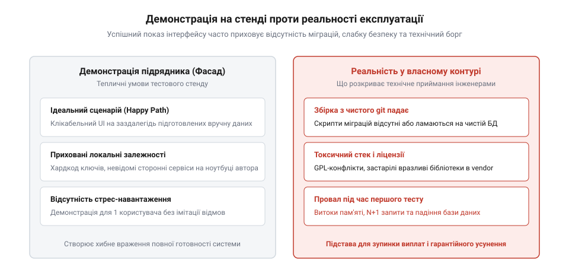

# Приймання системи від підрядника

<preknowlist>
- [Система, яку можна передати](root:progarch/a-system-you-can-hand-over) — базові характеристики та стандарти відчужуваної програмної системи
- [Введення нової команди в систему](root:progarch/onboarding-a-new-team) — критерії того, чи здатна внутрішня інженерна команда супроводжувати новий продукт
</preknowlist>

## Пастка зеленого стенду: чому фінальне демо не є прийманням

Фінальний етап співпраці із зовнішнім виконавцем зазвичай виглядає як урочиста презентація. Підрядник відкриває браузер на власному демонстраційному сервері, швидко проводить представників замовника основними призначеними для користувача екранами, показує створення запису, відправку форми й приємні анімації інтерфейсу. Менеджери проєкту задоволені, функціональні вимоги за списком нібито виконані, і на стіл лягають акти приймання-передачі виконаних робіт.

Але для інженера та архітектора демонстрація на стенді підрядника має нульову доказову силу щодо технічної придатності системи. 

Парадний стенд виконавця часто маскує критичні архітектурні вади:
- База даних на тестовому сервері була наповнена вручну за допомогою сирих SQL-дампів без жодного механізму міграцій, а структура таблиць не відповідає специфікації.
- Проєкт містить жорсткі посилання на приватні репозиторії пакетів або внутрішні сервіси підрядника, до яких у замовника немає і ніколи не буде доступу.
- Критичні конфігурації та секрети закодовані безпосередньо у вихідному коді або тримаються на локальних скриптах сервера розробки.
- Застосунок падає або втрачає дані під час спроби одночасної роботи кількох користувачів, оскільки в коді відсутнє керування транзакціями та блокуваннями.

Приховані маніпуляції з даними на стенді виконавця — це ціле мистецтво створення ілюзії працездатності. Щоб приховати слабку продуктивність складних SQL-запитів і відсутність правильних індексів, розробники підрядника нерідко підготовлюють «стерильну» базу даних, у якій міститься лише тридцять-сорок тестових записів. На такому мікроскопічному обсязі будь-який неефективний запит із п'ятьма послідовними `FULL TABLE SCAN` та декартовими добутками `JOIN` виконується за 2 мілісекунди в пам'яті сервера. Під час демо інтерфейс літає, але щойно база отримає перші десять тисяч реальних рядків від клієнтів, час відгуку зросте експоненційно, блокуючи весь сервіс.

Ще підступніший прийом — пряме ручне редагування записів перед початком презентації. Якщо певний бізнес-процес (наприклад, складний розрахунок податків, генерація бухгалтерського звіту чи підтвердження банківської транзакції) має баги або недописаний, виконавець заздалегідь вручну вносить у таблицю необхідні зовнішні ключі, статус `APPROVED` або готові числові значення. На екрані створюється враження, що система автоматично розрахувала складний ланцюг, тоді як насправді бекенд просто прочитав заздалегідь підкладений рядок.

Також на демо-серверах часто вимикають реальні механізми перевірки цілісності даних (зовнішні ключі `FOREIGN KEY` або обмеження `CHECK`), щоб обійти помилки розробки. У репозиторії ці обмеження можуть бути або закоментовані, або взагалі відсутні. Доки система живе на демонстраційній машині виконавця, вона існує в штучно створеній теплиці, яка не має нічого спільного з суворими законами експлуатації.


*Ілюзія успіху: зовнішній вигляд працюючого інтерфейсу на стенді виконавця не гарантує якості коду, наявності міграцій і можливості автономного розгортання в інфраструктурі замовника.*

Щойно підпис на акті поставлено, а гроші перераховано, мотивація підрядника виправляти архітектурні огріхи зникає. Будь-яка подальша спроба запустити цей код на власних потужностях або передати його своїм інженерам перетворюється на нескінченний ремонт чужого браку за власний кошт компанії. Технічне приймання — це не перегляд красивих екранів, а прискіпливий інженерний аудит кодової бази та операційної готовності системи.

> 🔧 **Навіщо це.** Демонстрація інтерфейсу перевіряє лише видиму поведінку в ідеальних умовах. Технічне приймання має на меті розкрити зворотний бік системи: її автономність, ремонтопридатність і безпеку до того, як замовник візьме на себе повну відповідальність за її експлуатацію.

## Автономна збірка та аудит безпеки в ізольованому контурі

Справжнє технічне приймання починається не в браузері, а в ізольованому контурі інфраструктури замовника *(англ. cleanroom environment)*, де немає жодних слідів робочих станцій підрядника.

Перший бар'єр приймання — чиста компіляція та збірка. Інженер замовника бере вихідний код із переданого репозиторію (конкретний коміт або тег релізу) і запускає процес збірки виключно за інструкціями з файлу документації. Якщо процес вимагає доступу до приватного npm-реєстру розробника, містить недоступні посилання на хмарні скрипти або падає через невідповідність версій компілятора — приймання негайно зупиняється на першому ж кроці.


*Воронка технічного приймання: послідовна система фільтрів від компіляції з чистого вихідного коду до перевірки поведінки під піковим навантаженням і готовності до спостереження.*

Після успішної автономної збірки система проходить три обов'язкові перевірки безпеки та цілісності:
1. **Ліцензійний аудит залежностей:** Автоматизований аналіз сторонніх бібліотек на наявність вірусних ліцензій (наприклад, суворий GPL у комерційному пропрієтарному проєкті) або заборонених пакетів. Виявлення пакетів із невизначеним ліцензійним статусом, що створює прямі юридичні ризики для замовника.
2. **Сканування вразливостей (CVE):** Аналіз транзитивних залежностей кодової бази інструментами статичного аналізу безпеки (SAST та SCA). Якщо підрядник використав застарілі бібліотеки з відомими критичними вразливостями (remote code execution, SQL-ін'єкції), реліз вважається токсичним до повного оновлення версій.
3. **Валідація міграцій бази даних:** Розгортання порожньої схеми бази даних з нуля шляхом послідовного виконання всіх файлів міграцій. Перевірка не лише прямого накатування (`migrate up`), а й обов'язкової здатності до безпечного відкату (`migrate down`). Схема, яка збирається лише за рахунок «ручного накатування» структури, не допускається до приймання.

Юридична чистота сторонніх бібліотек потребує особливої уваги, оскільки недбалість підрядника може поставити під удар усю інтелектуальну власність замовника. Коли зовнішні розробники поспішають закрити завдання, вони нерідко підключають готові бібліотеки з GitHub, не читаючи юридичних умов ліцензійної угоди.

Під час аудиту всі залежності класифікуються на три чіткі зони ризику:
- **Зелена зона (Permissive):** Ліцензії MIT, Apache 2.0, BSD-2-Clause, BSD-3-Clause та ISC. Вони дозволяють вільне комерційне використання, модифікацію та закриття вихідного коду без обов'язку публікувати внутрішню розробку. Єдина вимога — збереження повідомлення про авторське право.
- **Жовта зона (Weak Copyleft):** Ліцензії LGPL, MPL (Mozilla Public License) та EPL (Eclipse Public License). Вони дозволяють динамічне лінкування бібліотеки без відкриття коду всього застосунку, проте вимагають відкриття будь-яких прямих змін у самому файлі цієї бібліотеки. Якщо підрядник модифікував файл під ліцензією LGPL або прилінкував її статично, виникає серйозний ризик зараження кодової бази.
- **Червона зона (Strong Copyleft / Viral):** Ліцензії GPL v2/v3 та особливо AGPL (Affero General Public License). Це категоричний блокатор приймання для комерційного ПЗ. Вірусний характер GPL вимагає, щоб будь-яка похідна робота або програма, що містить хоча б один такий модуль, поширювалася виключно під тією ж відкритою ліцензією. У випадку AGPL ця вимога спрацьовує навіть без поширення бінарника — достатньо надати доступ до сервісу через мережу (SaaS). Використання підрядником хоча б однієї AGPL-утиліти для формування PDF-звітів чи обробки зображень юридично зобов'язує компанію оприлюднити весь вихідний код комерційного продукту.
- **Токсична зона (Non-commercial / Ambiguous):** Пакети під ліцензіями типу CC BY-NC, SSPL (Server Side Public License) або модулі без жодного файлу LICENSE в репозиторії. Використання коду без ліцензії за замовчуванням означає, що всі права захищені автором, а отже, його включення до комерційного релізу є прямим порушенням авторських прав.

Крім того, виконується глибинний аудит наданих тестів. Високий відсоток покриття *(англ. test coverage)* не гарантує якості, якщо тести складаються з беззмістовних викликів функцій із суцільним мокуванням, де перевіряється лише те, що мок повертає сам себе. Тести підрядника мусять перевіряти реальні бізнес-інваріанти системи та реакцію на некоректні вхідні дані.

> 🔧 **Навіщо це.** Ізольований контур збірки гарантує, що система не має прихованих зв'язків із виконавцем. Аудит ліцензій і міграцій захищає компанію від юридичних претензій та технічного глухого кута під час першого ж промислового релізу.

## Стрес-тест навантаження та готовність до експлуатації

Коли чиста збірка успішно пройшла у власному ізольованому середовищі, настає черга перевірки нефункціональних характеристик. Багато систем виглядають бездоганно під час ручного тестування одним QA-інженером, але миттєво складаються під час зіткнення з реальними виробничими реаліями.

Навантажувальне тестування під час приймання повинно відповідати двом обов'язковим критеріям:
1. **Тестування цільового профілю навантаження:** Застосунок випробовується сценаріями генерації трафіку, що імітують пікову активність бізнесу (наприклад, 1000 одночасних замовлень на хвилину). Перевіряються не лише відсотки успішних кодів 200 OK, а й перцентилі затримки (p95 та p99 латентності). Якщо p99 стрибає до 10 секунд через блокування таблиць у базі даних — система не готова до запуску.
2. **Стійкість до тривалого навантаження (Soak Test):** Запуск системи під середнім навантаженням протягом 12–24 годин для виявлення витоків пам'яті *(англ. memory leaks)*, вичерпання пулу підключень до бази даних або переповнення тимчасових дискових сховищ.

Для справжньої перевірки надійності архітектури стандартного навантаження недостатньо: його необхідно поєднувати з експериментами хаос-інжинірингу *(англ. Chaos Engineering)* прямо під час приймальних випробувань. Підрядники часто будують системи, які розраховані на ідеальну роботу без збоїв обладнання. Проте в хмарних середовищах відмови віртуальних машин, втрата мережевих пакетів і рестарти контейнерів є буденністю.

Програма хаос-тестування під час приймання передбачає такі керовані диверсії:
- **Раптова загибель процесу (Process Kill):** За допомогою утиліт (наприклад, Chaos Mesh або ручного `kill -9`) примусово зупиняється один із робочих екземплярів бекенду безпосередньо під час пікового навантаження. Балансувальник навантаження зобов'язаний вилучити мертвий інстанс із пулу за лічені секунди, а клієнти не повинні отримати спалаху помилок `502 Bad Gateway`.
- **Імітація мережевої деградації (Network Latency & Packet Loss):** Через інструменти налаштування мережі ядра (`tc` / `iptables`) між бекендом і базою даних штучно вводиться затримка в 200 мілісекунд та 5% втрати пакетів. Система має продемонструвати роботу механізмів таймаутів сокетів, коректний відступ і відсутність нескінченного накопичення заблокованих потоків.
- **Розрив зв'язку з реплікою бази даних (Split-Brain / Failover):** Штучне відключення основного вузла бази даних для перевірки автоматичного перемикання на гарячу репліку *(англ. master failover)*. Чи здатний застосунок самостійно перепідключитися до нового майстра без ручного перезапуску всіх сервісів інженерами?

Якщо в результаті штучно змодельованого збою система втрачає транзакційні дані, намертво зависає або починає повертати клієнтам пошкоджені відповіді — приймання зупиняється. Здатність до самовідновлення є обов'язковою нефункціональною якістю промислової системи.

Окрім навантаження, перевіряється експлуатаційна готовність *(англ. operational readiness)*:
- **Спостережуваність (Observability):** Чи видає застосунок структуровані логи з наскрізними кореляційними ідентифікаторами (trace ID)? Чи налаштовані стандартні метрики в Prometheus-форматі (кількість запитів, частка помилок, час обробки)? Чи існують готові дашборди моніторингу в Grafana?
- **Реакція на штучний збій (Fault Injection):** Інженер замовника примусово зупиняє один із вузлів бази даних або обриває мережеве з'єднання до черги повідомлень. Система повинна продемонструвати коректне відновлення з'єднання після рестарту вузла без необхідності перезавантаження всього застосунку вручну.
- **Алертинг:** Під час штучного збою перевіряється надходження сповіщень черговим інженерам через налаштовані канали тривоги.

> 🔧 **Навіщо це.** Перевірка навантаження та спостережуваності до підписання документів позбавляє замовника нічних інцидентів після запуску. Якщо система не здатна витримати піковий трафік або не сигналізує про внутрішні відмови, це прямий дефект реалізації, який має усунути виконавець.

## Ворота якості (Quality Gates) та технічний реєстр дефектів

Усі виявлені під час технічного аудиту невідповідності фіксуються в єдиному інженерному документі — Технічному реєстрі дефектів приймання.

Щоб приймання не перетворилося на суб'єктивну суперечку між менеджерами обох сторін, критерії приймання мають бути формалізовані через систему воріт якості *(англ. Quality Gates)* із чітким поділом знахідок за ступенем критичності:
- **Блокатори приймання (Showstoppers / Blockers):** Будь-який дефект цього рівня означає категоричну відмову в підписанні актів до його повного виправлення. Сюди належать: неможливість зібрати репозиторій з чистого вихідного коду у власному контурі, критичні вразливості безпеки (CVE високого рівня), відсутність працездатних міграцій бази даних, падіння системи під узгодженим цільовим навантаженням та наявність вірусних ліцензій у залежностях.
- **Некритичний технічний борг (Minor / Debt):** Недоліки, які не перешкоджають безпечному запуску продукту, але вимагають доопрацювання (наприклад, недостатнє покриття другорядних модулів тестами, відсутність частини коментарів або оптимізація окремих статичних ресурсів).

```text
Матриця рішень воріт якості:
┌──────────────────────────────┬───────────────────┬───────────────────────────────┐
│ Категорія перевірки          │ Статус            │ Рішення                       │
├──────────────────────────────┼───────────────────┼───────────────────────────────┤
│ Автономна збірка в CI        │ ПРОВАЛЕНО         │ Блокування приймання          │
│ Безпека та ліцензії          │ УСПІШНО           │ Допуск до наступного етапу    │
│ Міграції БД (up/down)        │ УСПІШНО           │ Допуск до наступного етапу    │
│ Навантаження (p99 < 500ms)   │ ПРОВАЛЕНО         │ Блокування приймання          │
│ Документація та runbooks     │ ЧАСТКОВО          │ Гарантійний план виправлення  │
└──────────────────────────────┴───────────────────┴───────────────────────────────┘
```

Юридичне закріплення результатів технічного приймання вимагає чіткого формулювання в договорі підряду або додатковій угоді до акта виконаних робіт. Без конкретних юридичних важелів будь-які усні обіцянки підрядника «доробити все за тиждень» залишаються порожніми словами.

Типове формулювання спеціального розділу договору про гарантійний план виправлення дефектів має такий вигляд:

```text
Розділ: Гарантійні зобов'язання та ліквідація технічного боргу

1. Підписання Сторонами фінального Акта приймання-передачі виконаних робіт здійснюється 
   виключно за умови відсутності в узгодженому Технічному реєстрі дефектів (Додаток №3) 
   зауважень зі статусом «Блокатор» (Blocker / Critical).

2. За наявності в Технічному реєстрі дефектів категорії «Некритичний технічний борг» 
   (Minor / Technical Debt), Сторони підписують Акт із застереженням та затверджують 
   обов'язковий Гарантійний план усунення дефектів (Remediation Plan).

3. Виконавець зобов'язується усунути всі зафіксовані дефекти за власний рахунок 
   протягом 14 (чотирнадцяти) календарних днів з моменту підписання Акта.

4. Замовник має право утримати гарантійний платіж у розмірі 15% (п'ятнадцяти відсотків) 
   від загальної вартості етапу робіт до моменту повної ліквідації всіх пунктів 
   Гарантійного плану та повторного проходження автоматизованих тестів у CI Замовника.

5. У разі порушення Виконавцем термінів усунення дефектів понад 10 (десять) календарних днів, 
   Замовник набуває права залучити третю сторону або власну інженерну команду для ліквідації 
   вказаного технічного боргу за рахунок утриманого гарантійного платежу без відшкодування 
   Виконавцю різниці.
```

Така юридична конструкція з утриманням частини оплати *(англ. retention payment)* до повного завершення гарантійного плану створює єдиний працюючий фінансовий стимул для підрядника. Компанія-виконавець не може просто розпустити команду проєкту на нові замовлення, доки всі зауваження інженерів замовника не будуть закриті в коді й перевірені автоматичними тестами.

Якщо блокуючих дефектів немає, але виявлено некритичні зауваження, акти приймання супроводжуються додатковою угодою або гарантійним листом *(англ. warranty remediation plan)*. У ньому чітко прописуються терміни виправлення боргу підрядником за його власний рахунок із фінансовими санкціями за недотримання графіка.

Такий дисциплінований підхід захищає інженерну команду від перетворення чужих недоробок на внутрішній постійний головний біль компанії.

> 🔧 **Навіщо це.** Формальні ворота якості та юридично оформлений реєстр дефектів перетворюють технічні аргументи архітектора на вагомі контрактні вимоги. Це створює надійний щит від тиску бізнесу й гарантує передачу системи в стані повної експлуатаційної придатності.
