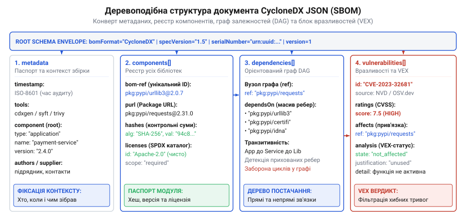
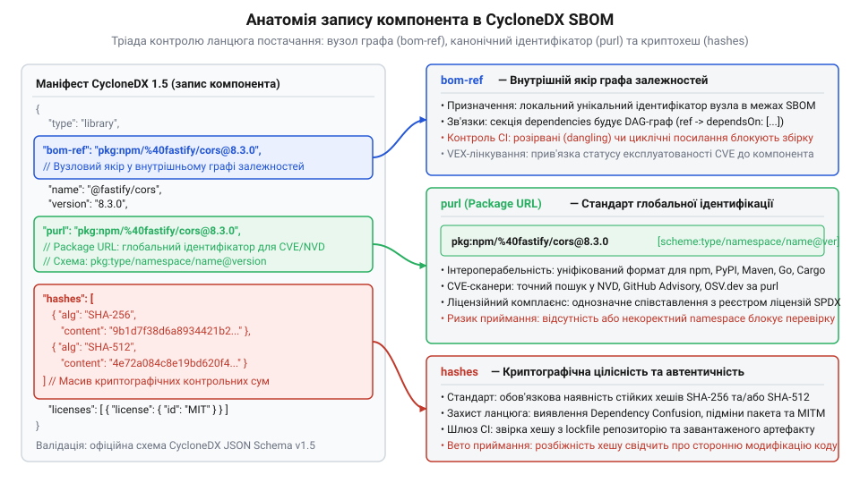
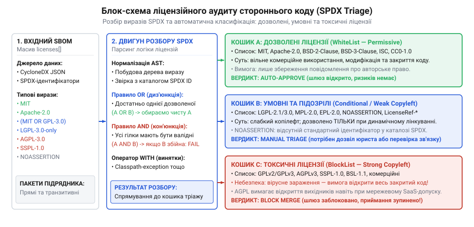
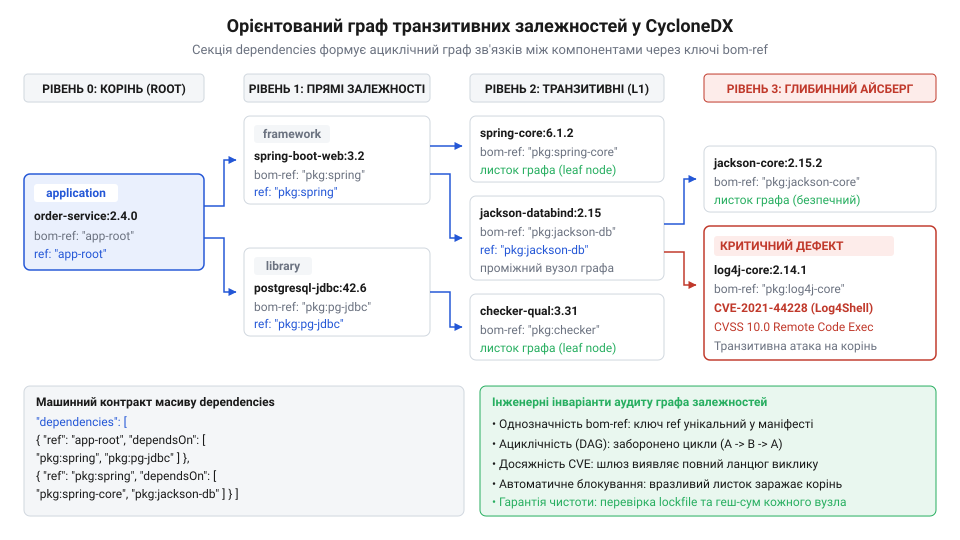
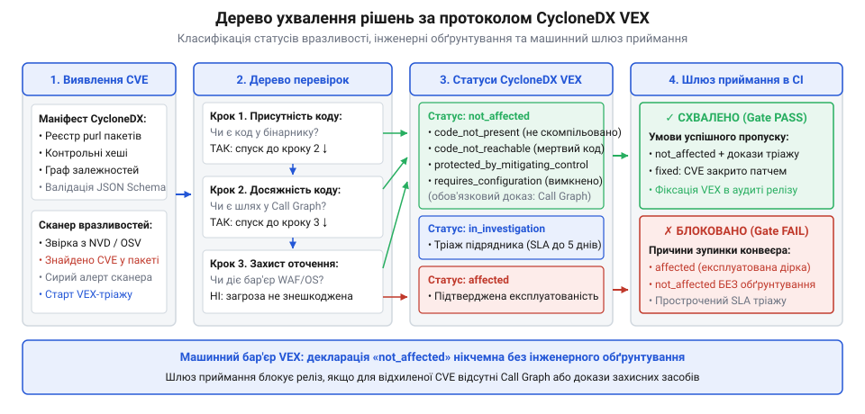
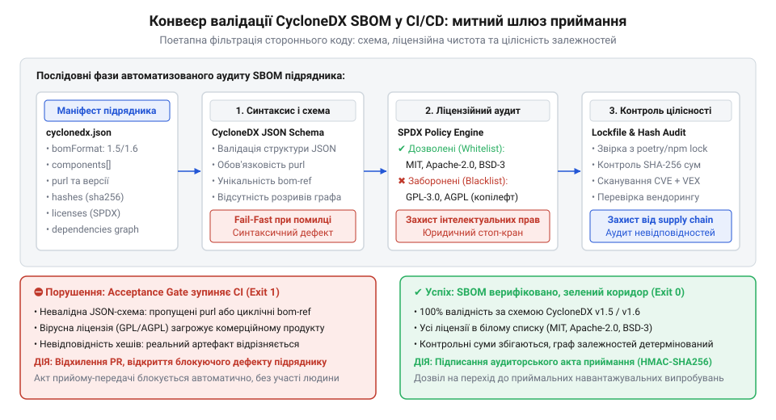

# Приймання системи від підрядника

<preknowlist>
- [Система, яку можна передати](root:progarch/a-system-you-can-hand-over) — принципи інженерного детермінізму, відчужуваності кодової бази та обов'язкові критерії незалежного аудиту системи під час передачі
- [Документ, що не гниє](root:progarch/document-that-does-not-rot) — концепція заміни суб'єктивної паперової документації машинозчитуваними специфікаціями та автоматизованими контрактами у системі контролю версій
- [Введення нової команди в систему](root:progarch/onboarding-a-new-team) — чому невідомі сторонні бібліотеки та відсутність обліку залежностей створюють високий поріг входження для нових інженерів
</preknowlist>

## Анатомія ризику ланцюга постачання та архітектура кореневого конверта CycloneDX JSON

Коли замовник приймає програмний комплекс від зовнішнього підрядника, на демонстраційному стенді система зазвичай виглядає завершеною та надійною. Користувацький інтерфейс швидко відмальовує форми, бізнес-сценарії успішно проходять тестування, а збірка розгортається без видимих помилок. Проте сучасне комерційне програмне забезпечення на 80–90% складається не з власного коду виконавця, а з сотень або навіть тисяч транзитивних бібліотек, фреймворків і сторонніх утиліт відкритого коду. Передаючи репозиторій, підрядник передає не просто власну роботу, а весь невидимий айсберг зовнішніх залежностей.

Приймання системи без формалізованого та машинозчитуваного реєстру компонентів перетворює кодову базу на класичного «троянського коня». У глибинах сторонніх модулів можуть ховатися критичні вразливості нульового дня, закинуті бібліотеки без супроводу, замасковані шкідливі закладки або вірусні копілефтні ліцензії (наприклад, GPL або AGPL), які юридично вимагають відкриття всього пропрієтарного бізнес-коду замовника. 

Поширена спроба покладатися на стандартні файли маніфестів мов програмування (`package.json`, `pom.xml`, `requirements.txt` або `go.mod`) на етапі приймання зазнає цілковитого фіаско з трьох причин:
1. **Фрагментарність екосистем:** У гетерогенній архітектурі, де бекенд написано на Go або Java, фронтенд — на TypeScript, а аналітичні модулі — на Python, не існує єдиного нативного формату для наскрізного аудиту всіх частин продукту.
2. **Сліпота до операційного оточення:** Маніфести пакетних менеджерів фіксують лише бібліотеки застосунку, повністю ігноруючи системні пакети контейнера — динамічні бібліотеки Linux (такі як `glibc`, `libssl`, `curl`), системні сертифікати та вбудовані бінарні утиліти, де найчастіше виникають експлуатовані CVE.
3. **Відсутність юридично-криптографічного контексту:** Стандартний lockfile не містить структурованих метаданих про ліцензійні угоди, відомості про постачальника, криптографічні хеші вихідних архівів та підтверджені зв'язки з базами вразливостей.

Щоб подолати цей розрив, у сучасній інженерії застосовують концепцію **відомості матеріалів програмного забезпечення** (англ. @@en|Software Bill of Materials@@, SBOM, від латин. @@en|materia@@ — речовина, першооснова). Як і в класичному промисловому виробництві, де вузол літака чи автомобіля супроводжується повним паспортом кожної деталі та сплаву, програмна система вимагає вичерпного цифрового паспорта.

Провідним відкритим індустріальним стандартом для опису SBOM у сфері кібербезпеки є специфікація **CycloneDX** (від англ. @@en|cyclone@@ — вихор та @@en|DX@@ / @@en|data exchange@@ — обмін даними), розроблена спільнотою OWASP. На відміну від орієнтованого на ліцензійне право формату SPDX, CycloneDX від самого початку спроєктовано як машиннозчитуваний контракт для конвеєрів неперервної інтеграції, аудиту ланцюга постачання (@@en|supply chain security@@) та автоматизованого пошуку дефектів безпеки.

Відповідно до принципів [Система, яку можна передати](root:progarch/a-system-you-can-hand-over), наявність стандартизованого маніфесту CycloneDX JSON є обов'язковим технічним критерієм завершеності робіт. Це втілення парадигми [Документ, що не гниє](root:progarch/document-that-does-not-rot): замість мертвого паперового звіту з підписами аудиторів замовник отримує строго валідований файл `bom.json`, який перевіряється машинними засобами під час кожного білду.

### Кореневий конверт специфікації CycloneDX JSON

Маніфест CycloneDX є суворо структурованим JSON-документом (версій 1.5 та 1.6), організованим навколо кореневого конверта (від англ. @@en|envelope@@ — обгортка, конверт). Кореневий рівень задає глобальні атрибути стандарту, ідентифікує конкретну ревізію документа та містить контекстні метадані про походження системи.

```json
{
  "$schema": "http://cyclonedx.org/schema/bom-1.5.schema.json",
  "bomFormat": "CycloneDX",
  "specVersion": "1.5",
  "serialNumber": "urn:uuid:7f3b891e-4c2a-48d6-95e2-63b7d159a104",
  "version": 1,
  "metadata": {
    "timestamp": "2026-03-15T09:30:00Z",
    "tools": [
      {
        "vendor": "OWASP Foundation",
        "name": "cdxgen",
        "version": "10.4.2"
      }
    ],
    "authors": [
      {
        "name": "Security Engineering Team",
        "email": "sec-audit@contractor.example.com"
      }
    ],
    "supplier": {
      "name": "Global Software Solutions Ltd",
      "url": ["https://contractor.example.com"],
      "contact": [
        {
          "name": "Delivery Lead",
          "email": "delivery@contractor.example.com"
        }
      ]
    },
    "component": {
      "type": "application",
      "bom-ref": "urn:app:order-processing-service@2.4.0",
      "name": "order-processing-service",
      "version": "2.4.0",
      "description": "Core enterprise distributed order processing backend"
    }
  },
  "components": [],
  "dependencies": [],
  "vulnerabilities": []
}
```


*Деревоподібна структура документа CycloneDX JSON: кореневий конверт інкапсулює метадані походження, реєстр компонентів, граф залежностей та блок оцінки вразливостей.*

### Специфікація полів кореневого конверта

| Поле JSON | Тип даних | Обов'язковість | Інженерне призначення та контрактні інваріанти |
| :--- | :--- | :--- | :--- |
| `bomFormat` | `string` | **Обов'язкове** | Фіксований строковий літерал `"CycloneDX"`. Визначає приналежність документа до сімейства схем OWASP. Будь-яке інше значення робить схему невалідною. |
| `specVersion` | `string` | **Обов'язкове** | Версія специфікації, наприклад `"1.5"` або `"1.6"`. Замовник фіксує в договорі мінімально підтримувану версію стандарту (версії 1.5+ підтримують розширену модель VEX та специфікацію Cryptography Bill of Materials (CBOM)). |
| `serialNumber`| `string` | Рекомендоване | Унікальний ідентифікатор екземпляра SBOM у форматі URN UUID (RFC 4122), наприклад `"urn:uuid:..."`. Гарантує унікальність звіту в реєстрах безпеки та запобігає колізіям. |
| `version` | `integer` | **Обов'язкове** | Числовий лічильник ітерації документа, починаючи з `1`. Якщо підрядник вносить правки в набір залежностей або оновлює звіт, значення `version` інкрементується за незмінного `serialNumber`. |
| `metadata` | `object` | Рекомендоване | Контекстний блок (від латин. @@en|meta@@ та @@en|datum@@ — дані про дані), що описує автора звіту, використані утиліти збірки, часову мітку та цільовий продукт. |
| `components` | `array` | Необов'язкове | Каталог усіх сторонніх та внутрішніх модулів, бібліотек, фреймворків, файлів і контейнерів, з яких побудована система. |
| `dependencies`| `array` | Необов'язкове | Орієнтований граф зв'язків між компонентами, що розкриває повне дерево транзитивних залежностей. |
| `vulnerabilities` | `array` | Необов'язкове | Масив відомостей про виявлені дефекти безпеки (CVE, GHSA) та машинні твердження про їхню експлуатованість (VEX). |

### Блок метаданих: фіксація походження системи

Блок `metadata` відповідає на фундаментальне юридичне та безпекове питання: **хто, коли, чим і яку саме систему зафіксував у цьому маніфесті**. Під час процедури передачі системи на баланс замовника блок метаданих захищає від фальсифікацій та непорозумінь:
- `timestamp`: точний час формування маніфесту в форматі ISO 8601 UTC. Забезпечує прив'язку до конкретного комміту у Git-репозиторії та журналу збірки CI.
- `tools`: структурований список генераторів (назва, виробник, версія). Замовник вимагає використання сертифікованих сканерів останніх версій, унеможливлюючи подання застарілих даних, сформованих несправними утилітами.
- `supplier`: офіційні реквізити компанії-виконавця. Фіксує юридичну відповідальність підрядника за наданий набір модулів.
- `component`: опис кореневого вузла. Саме тут вказується назва та версія сервісу, який здається в експлуатацію. Кореневий компонент дістає локальний ідентифікатор `bom-ref`, від якого в секції `dependencies` будується повний граф зв'язків.

> 🔧 **Навіщо це.**
> Поєднання унікального `serialNumber`, лічильника `version` та зафіксованого `timestamp` у метаданих перетворює CycloneDX на криптографічно підзвітний юридичний документ. Підрядник не може таємно замінити склад системи або заявити, що наданий SBOM стосувався іншої версії коду: маніфест строго прив'язаний до контрольної суми ревізії в системі контролю версій.

---

## Специфікація компонентів та однозначна ідентифікація через Package URL і криптографічні хеші

Кореневий конверт задає межі документа, але його серцевиною є масив `components`. Кожен елемент цього масиву являє собою строго типізований цифровий опис одиничної частини системи — від окремої сторонньої бібліотеки до базового образу операційної системи.

У реальній практиці приймання підрядники нерідко намагаються передати скорочений перелік модулів, обмежуючись полями `name` та `version`. Проте без стандартизованої глобальної схеми іменування та криптографічних контрольних сум такий запис є фікцією: однакова назва пакета в різних реєстрах (наприклад, у npm та PyPI) веде до кардинально різного коду, а відсутність хешів унеможливлює перевірку бінарної автентичності.

### Типізація компонентів: семантика поля type

Поле `type` класифікує сутність за її архітектурною роллю в системі:

```json
{
  "type": "library"
}
```

Специфікація CycloneDX визначає фіксований перелік допустимих типів:
- `application`: виконуваний моноліт, мікросервіс або консольна утиліта.
- `framework`: програмний каркас розробки, що задає архітектурну модель (Spring, React, ASP.NET Core).
- `library`: бібліотека стороннього коду, утиліта чи модуль (найпоширеніший тип для транзитивних залежностей).
- `container`: OCI-образ контейнера або образ віртуальної машини.
- `operating-system`: базовий шар платформи (Debian, Alpine Linux, Red Hat Enterprise Linux).
- `file`: окремий самостійний файл (наприклад, скомпільований бінарний плагін чи сертифікат).
- `data`: набір статичних даних або тренувальна модель машинного навчання.

### Однозначна глобальна ідентифікація: Package URL (purl)

Центральним стандартом для точної та безпомилкової ідентифікації програмних компонентів у сучасному світі є специфікація Package URL (англ. @@en|Package URL@@, purl). 

Purl розв'язує фундаментальну проблему неоднозначності імен. Якщо підрядник вказує лише `log4j: 2.14.1`, автоматичний сканер безпеки не знає, чи це артефакт Maven Central, пакет з NPM чи застарілий tar-архів. Формат purl стандартизує синтаксис ідентифікатора у вигляді канонічного URL:

```
pkg:<type>/<namespace>/<name>@<version>?<qualifiers>#<subpath>
```

Розгляньмо ключові сегменти Package URL:
1. `pkg:` — обов'язкова фіксована схема URL.
2. `<type>` — тип пакетного менеджера або екосистеми (`npm`, `pypi`, `maven`, `golang`, `cargo`, `deb`, `rpm`, `nuget`).
3. `<namespace>` — опціональний простір імен, група або організація (наприклад, `org.apache.logging.log4j` у Maven або `@angular` у NPM, де спецсимволи екрануються у форматі percent-encoding).
4. `<name>` — офіційна назва пакета в каталозі.
5. `@<version>` — точна, зафіксована версія компонента.
6. `?<qualifiers>` — додаткові параметри кваліфікації (наприклад, `?arch=x86_64` або `?distro=debian-12`).

Приклади канонічних ідентифікаторів у реальних системах:
- Java: `pkg:maven/org.apache.logging.log4j/log4j-core@2.17.1`
- JavaScript: `pkg:npm/%40angular/core@16.2.0`
- Python: `pkg:pypi/cryptography@41.0.3`
- Go: `pkg:golang/github.com/gin-gonic/gin@v1.9.1`

Поряд із purl специфікація підтримує формат **CPE** (англ. @@en|Common Platform Enumeration@@, CPE версії 2.3), наприклад `cpe:2.3:a:apache:log4j:2.17.1:*:*:*:*:*:*:*`. Цей формат розроблений американським інститутом NIST і традиційно використовується у базі National Vulnerability Database (NVD). Сучасні зрілі сканери використовують обидва ідентифікатори: purl забезпечує прямий зв'язок із репозиторіями вихідного коду, а CPE — сумісність із застарілими державними базами вразливостей.

### Локальне зв'язування: ідентифікатор bom-ref

Поле `bom-ref` (скорочення від @@en|Bill of Materials Reference@@) є локальним ідентифікатором компонента в межах конкретного JSON-документа. Його головне призначення — виступати однозначним первинним ключем для побудови графа залежностей у секції `dependencies` та зв'язування з дефектами у секції `vulnerabilities`.

Хоча стандарт дозволяє використовувати будь-який унікальний рядок (наприклад, UUID чи ціле число), найкращою інженерною практикою є дублювання рядка `purl` у якості значення `bom-ref`. Це робить документ людинозчитуваним і запобігає помилкам під час аналізу звітів.

### Криптографічна цілісність: масив hashes

Навіть якщо пакетний менеджер зафіксував точну версію бібліотеки, залишається небезпека підміни артефакту в публічному реєстрі або атаки на ланцюг постачання під час складання образу. Щоб гарантувати, що замовник отримує саме той скомпільований байткод, який пройшов перевірку, CycloneDX вимагає документування криптографічних контрольних сум у масиві `hashes` (від грец. @@en|kryptos@@ — прихований, таємний).

Специфікація підтримує криптографічні хеш-функції різної стійкості:
- `SHA-256` — обов'язковий галузевий стандарт безпеки;
- `SHA-512` — посилений стандарт для критичних компонентів;
- `BLAKE2b-256` / `BLAKE3` — сучасні швидкісні криптографічні хеші;
- `SHA-1` та `MD5` — позначені як застарілі та небезпечні; їхня наявність допускається лише для сумісності зі старими системами, але вони не можуть бути єдиним джерелом валідації.

### Еталонна структура опису компонента

Розгляньмо повний приклад промислового запису сторонньої бібліотеки в CycloneDX 1.5 JSON:

```json
{
  "type": "library",
  "bom-ref": "pkg:maven/org.apache.logging.log4j/log4j-core@2.17.1",
  "group": "org.apache.logging.log4j",
  "name": "log4j-core",
  "version": "2.17.1",
  "scope": "required",
  "purl": "pkg:maven/org.apache.logging.log4j/log4j-core@2.17.1",
  "cpe": "cpe:2.3:a:apache:log4j:2.17.1:*:*:*:*:*:*:*",
  "hashes": [
    {
      "alg": "SHA-256",
      "content": "678d91c7849c33bb3e24de4d32a39626e8574744d03e54b684cb32d2c1619888"
    },
    {
      "alg": "SHA-512",
      "content": "8d95ec763d86545d6541f4d85a1ef96b42b6a8e63080db646274488b0a1d489115b81a7428c46011a0e07198a0f5df7e8f52280d9ad26330364d962800185994"
    }
  ],
  "licenses": [
    {
      "license": {
        "id": "Apache-2.0"
      }
    }
  ],
  "externalReferences": [
    {
      "type": "vcs",
      "url": "https://github.com/apache/logging-log4j2"
    },
    {
      "type": "website",
      "url": "https://logging.apache.org/log4j/2.x/"
    }
  ]
}
```


*Анатомія запису компонента: локальний ідентифікатор bom-ref, глобальний Package URL та криптографічний хеш гарантують однозначну ідентифікацію в базах вразливостей.*

### Матриця валідації полів компонента

Під час приймання системи замовник перевіряє дотримання таких інженерних правил для кожного елемента масиву `components`:

| Атрибут компонента | Тип поля | Рівень суворості в шлюзі приймання | Інженерне правило та наслідок порушення |
| :--- | :--- | :--- | :--- |
| `type` | `string` | **Критичний (Error)** | Зобов'язаний відповідати задокументованому переліку. Використання невизначеного типу блокує проходження приймального шлюзу. |
| `name` | `string` | **Критичний (Error)** | Не може бути порожнім. Назва має точно відповідати імені пакета в апстрим-реєстрі. |
| `version` | `string` | **Критичний (Error)** | Заборонено використання плаваючих діапазонів (`^1.0.0`, `latest`, `*`). Дозволяється виключно фіксований SemVer-номер. |
| `scope` | `string` | **Важливий (Warn/Error)** | Значення `required` вказує на рантайм-компонент, що потрапляє в продакшен. Значення `optional` позначає інструменти розробки (тести, лінтери), які відфільтровуються під час перевірки бойового периметра. |
| `bom-ref` | `string` | **Критичний (Error)** | Унікальний рядок у межах документа. Повторення `bom-ref` руйнує граф залежностей і призводить до відхилення маніфесту. |
| `purl` | `string` | **Критичний (Error)** | Обов'язкова наявність валідного Package URL. Без нього автоматичні сканери вразливостей (Trivy, Grype) не зможуть верифікувати безпеку артефакту. |
| `hashes` | `array` | **Критичний (Error)** | Щонайменше один алгоритм (SHA-256 або SHA-512) із валідним шістнадцятковим значенням. Запобігає розбіжностям між кодом у репозиторії та скомпільованим бінарником. |

Такий рівень деталізації є незамінним під час процесу [Введення нової команди в систему](root:progarch/onboarding-a-new-team). Новим розробникам більше не доводиться витрачати місяці на розгадування невідомих сторонніх бібліотек чи з'ясування того, звідки в контейнері з'явився той чи інший двійковий модуль. Точні посилання `purl`, закріплені контрольні суми та метадані джерел дають новій команді повний технологічний суверенітет над архітектурою з першого дня володіння.

> 🔧 **Навіщо це.**
> Ідентифікація через Package URL у поєднанні з криптографічними хешами переводить поняття сторонньої залежності з площини довіри до слів підрядника в площину математичної визначеності. Це унеможливлює підміну версій, захищає від атак класу Dependency Confusion та дає замовнику гарантію, що прийнятий код містить саме ті бібліотеки, які були перевірені автоматичною митницею.

## Формалізація ліцензій та юридичний аудит відкритого коду через вирази SPDX

Коли замовник приймає готовий програмний комплекс від зовнішнього виконавця, увага приймальної комісії традиційно зосереджується на бізнес-сценаріях, стабільності інтерфейсу та проходженні функціональних тестів. Проте за принципами [Система, яку можна передати](root:progarch/a-system-you-can-hand-over), інженерний детермінізм охоплює не лише працездатність бінарників, а й повну юридичну чистоту та відчужуваність кодової бази. Якщо підрядник передає систему, яка бездоганно виконує розрахунки, але містить сторонній модуль із токсичними ліцензійними обмеженнями, замовник купує не цифровий актив, а судовий позов і загрозу примусового відкриття комерційної таємниці.

У практиці комерційної розробки інженери підрядника перебувають під постійним тиском термінів. Щоб не писати з нуля складний математичний алгоритм, парсер мережевих пакетів, модуль експорту звітів у PDF чи бібліотеку криптографічних примітивів, розробник підключає готовий відкритий пакет із публічного реєстру. Якщо такий модуль поширюється під «вірусною» копілефтною (англ. @@en|copyleft@@, від @@en|copyright@@ — авторське право, сатирична гра слів на заміні «право» на «ліво») ліцензією (від латин. @@en|licentia@@ — дозвіл, свобода дій), наприклад GNU General Public License (GPLv2, GPLv3) або Affero General Public License (AGPLv3), уся архітектура замовника опиняється під юридичним ударом.

Фундаментальний механізм суворого копілефту полягає у взаємності: будь-яке похідне програмне забезпечення, що статично або динамічно компонується з копілефтним кодом, автоматично вважається об'єктом ліцензії GPL. Якщо комерційний замовник починає експлуатувати або розповсюджувати таку систему, він за законом зобов'язаний опублікувати повний вихідний код власного пропрієтарного продукту під тією ж вільною ліцензією. Для закритого комерційного продукту (банківського бекенду, платіжного шлюзу, аналітичної платформи) це означає катастрофічну втрату інтелектуальної власності. Ще агресивнішою є ліцензія AGPLv3: її дія активується навіть без фізичного розповсюдження бінарних файлів — достатньо надати кінцевим користувачам мережевий доступ до інтерфейсу сервісу (SaaS).

### Слабкість довільного тексту та каталог ідентифікаторів SPDX

Історично підрядники вказували відомості про ліцензії у вигляді довільних текстових рядків у маніфестах пакетів або додавали сканований файл `LICENSE.txt` у корінь сховища. Спроба автоматизувати юридичний аудит таких даних у конвеєрі неперервної інтеграції зазнає поразки через три типові невизначеності:
1. **Неоднозначність назв:** рядок `"Apache"` може вказувати на Apache 1.0, Apache 1.1 або Apache 2.0, хоча патентна чистота та правила передачі прав між цими версіями радикально відрізняються.
2. **Відсутність уточнення версійного вектора:** запис `"GPL"` не дає відповіді на головне юридичне питання — чи дозволяє автор перехід на нові версії (`GPL-2.0-or-later`), чи обмежує використання суворо другою версією (`GPL-2.0-only`).
3. **Нерозпізнаваність винятків:** текстовий рядок не дає змоги машинно відокремити жорстку ліцензію GPL від ліцензії зі спеціальним винятком для компонування бібліотек (наприклад, Classpath Exception), який знімає вірусний ефект для пропрієтарних модулів.

Щоб перетворити юридичний аудит на строго формалізований машинний контракт за канонами [Документ, що не гниє](root:progarch/document-that-does-not-rot), консорціум Linux Foundation розробив систему **SPDX** (англ. @@en|Software Package Data Exchange@@ — обмін даними про пакети програмного забезпечення). Специфікація SPDX вводить реєстр канонічних ідентифікаторів (@@en|SPDX License Identifiers@@): коротких, незмінних літерно-цифрових кодів із дефісами. Кожен ідентифікатор посилається на еталонний юридичний текст ліцензії: `MIT`, `Apache-2.0`, `BSD-2-Clause`, `BSD-3-Clause`, `ISC`, `LGPL-3.0-only`, `GPL-3.0-or-later`, `AGPL-3.0-only`. 

Стандарт CycloneDX JSON робить ідентифікатори SPDX першокласними громадянами своєї схеми, унеможливлюючи довільне трактування юридичних зобов'язань.

### Опис блоку licenses у структурі компонента CycloneDX

У схемі CycloneDX кожен об'єкт масиву `components` може містити поле `licenses`. Це масив, елементами якого є або поодинокі описи ліцензій через об'єкт `license`, або логічні складені вирази через рядок `expression`.

Розгляньмо типовий приклад опису компонента з однозначною відкритою ліцензією:

```json
{
  "type": "library",
  "bom-ref": "pkg:npm/axios@1.6.8",
  "name": "axios",
  "version": "1.6.8",
  "purl": "pkg:npm/axios@1.6.8",
  "licenses": [
    {
      "license": {
        "id": "MIT",
        "url": "https://spdx.org/licenses/MIT.html"
      }
    }
  ]
}
```

Поле `license.id` вимагає суворої валідації проти офіційного переліку SPDX. Якщо підрядник вкаже `"id": "mit"` у нижньому регістрі або помилковий рядок `"id": "Apache 2"`, валідатор JSON-схеми CycloneDX негайно відхилить маніфест через невідповідність регулярному виразу ідентифікатора.

### Складні умови та логічні вирази SPDX Expression

У реальній інженерній практиці сторонній модуль рідко поширюється під абсолютно однозначною однорідною ліцензією. Часто виникає дуальне ліцензування (розробник дає користувачеві вибір між двома ліцензіями), комбіноване ліцензування (різні частини модуля ліцензовані окремо) або ліцензування зі спеціальними винятками.

Для формалізації таких умов CycloneDX підтримує синтаксис виразів SPDX (від латин. @@en|expressio@@ — вираження, витискання суті) у полі `expression`:

```json
{
  "type": "library",
  "bom-ref": "pkg:npm/dual-licensed-helper@3.1.0",
  "name": "dual-licensed-helper",
  "version": "3.1.0",
  "purl": "pkg:npm/dual-licensed-helper@3.1.0",
  "licenses": [
    {
      "expression": "(MIT OR Apache-2.0)"
    }
  ]
}
```

Граматика виразів SPDX спирається на три базові логічні оператори, які записуються виключно великими латинськими літерами:
- **`OR` (альтернативне ліцензування):** дає право одержувачу системи вибрати одну із запропонованих ліцензій. Якщо модуль декларує `(GPL-2.0-only OR MIT)`, комерційний замовник юридично обирає гілку `MIT`, тим самим захищаючи свій продукт від вірусного копілефту.
- **`AND` (комбіноване ліцензування):** вимагає від замовника одночасного виконання вимог обох ліцензійних угод. Наприклад, вираз `(BSD-3-Clause AND MIT)` зобов'язує зберегти повідомлення про авторські права для кожної частини модуля відповідно до правил обох ліцензій.
- **`WITH` (ліцензія зі спеціальним винятком):** поєднує базову ліцензію з офіційно зареєстрованим модифікатором винятку з каталогу SPDX License Exceptions. Прикладом є виняток зв'язування середовища виконання Java: `GPL-2.0-only WITH Classpath-exception-2.0` або виняток LLVM: `Apache-2.0 WITH LLVM-exception`. Наявність оператора `WITH` у виразі свідчить про те, що первісні обмеження копілефту зняті за умови дотримання правил винятку.

Групування складених умов регламентується круглими дужками, наприклад: `((LGPL-2.1-only OR BSD-3-Clause) AND MIT)`. Це дає змогу однозначно обчислювати результуючий правовий статус модуля булевою логікою без залучення юристів на кожен комміт.

### Фіксація пропрієтарних та нестандартних ліцензій

У великих корпоративних проєктах підрядник часто інтегрує власні закриті модулі, комерційні бібліотеки третіх сторін (наприклад, драйвери Oracle, білінгові шлюзи чи спеціалізовані математичні пакети) або відкритий код із модифікованим текстом ліцензії, відсутнім у реєстрі SPDX.

Спроба підігнати такі компоненти під найближчий ідентифікатор SPDX є грубою фальсифікацією даних SBOM. Для коректної фіксації нестандартного правового поля CycloneDX пропонує альтернативні поля:
- `license.name`: довільна строкова назва комерційної або внутрішньої ліцензії.
- `license.text`: вкладений об'єкт, який інкапсулює безпосередньо юридичний текст угоди.

```json
{
  "type": "library",
  "bom-ref": "pkg:maven/com.contractor.core/payment-vault@4.0.0",
  "name": "payment-vault",
  "version": "4.0.0",
  "purl": "pkg:maven/com.contractor.core/payment-vault@4.0.0",
  "licenses": [
    {
      "license": {
        "name": "Contractor Commercial Enterprise License v3",
        "text": {
          "contentType": "text/plain",
          "encoding": "none",
          "content": "All intellectual property rights reserved. Licensed exclusively to Buyer under Agreement #2026-04. Distribution prohibited."
        },
        "url": "https://contractor.example.com/legal/eula-enterprise-v3.txt"
      }
    }
  ]
}
```

Якщо текст ліцензійної угоди містить службові символи або не-ASCII символи, поле `encoding` набуває значення `"base64"`, а вміст рядка `content` кодується у Base64. Це забезпечує збереження точної юридичної форми ліцензійного договору незалежно від кодування файлової системи чи транспортних протоколів передачі.

### Матриця класифікації та автоматична відбраковка на шлюзі приймання

На етапі приймання системи від підрядника конвеєр автоматичної перевірки (Acceptance Gate) не читає юридичні тексти вручну. Він запускає аналізатор ліцензій, який зіставляє виявлені `license.id` та розібрані вирази `expression` із заздалегідь затвердженими корпоративними категоріями:


*Блок-схема ліцензійного аудиту: автоматичний розбір SPDX-виразів та класифікація компонентів за списками дозволених, умовно дозволених і заборонених ліцензій.*

| Категорія ліцензійної політики | Типові ідентифікатори SPDX | Юридичні умови та вплив на закритий код | Рішення приймального шлюзу |
| :--- | :--- | :--- | :--- |
| **Дозволені (Allowlist / Permissive)** | `MIT`, `Apache-2.0`, `BSD-2-Clause`, `BSD-3-Clause`, `ISC`, `Unlicense` | Дозволяють вільне комерційне використання, закриття коду, модифікацію та поширення. Вимагають лише збереження копірайту автора. | **ПРИЙНЯТИ (Pass)**. Збірка продовжується без застережень. |
| **Умовно дозволені (Review List / Weak Copyleft)** | `LGPL-2.1-only`, `LGPL-3.0-only`, `MPL-2.0`, `EPL-2.0` | Вимагають публікації змін лише до самого модуля бібліотеки. Дозволяють динамічне лінкування з пропрієтарним кодом без вірусного ефекту. | **УВАГА (Review / Conditional Pass)**. Шлюз вимагає верифікації типу лінкування (заборонено статичне компонування з ядром системи). |
| **Заборонені (Denylist / Strong Copyleft)** | `GPL-2.0-only`, `GPL-3.0-only`, `AGPL-3.0-only`, `SSPL-1.0`, `EUPL-1.2` | Суворий вірусний ефект. Вимагають відкриття вихідного коду всієї комерційної платформи замовника у разі поширення або надання доступу через мережу. | **БЛОКУВАННЯ (Fail / Reject)**. Процес здачі робіт зупиняється. Підрядник зобов'язаний замінити бібліотеку. |
| **Безліцензійний код (Unlicensed / No Assertion)** | Відсутність блоку `licenses`, порожній масив або значення `NOASSERTION` | За законом відсутність явної ліцензії означає, що всі права збережені за автором (@@en|all rights reserved@@). Будь-яке використання є правопорушенням. | **БЛОКУВАННЯ (Fail / Reject)**. Код не підлягає прийманню без юридичного врегулювання. |

> 🔧 **Навіщо це.**
> Машинна валідація ліцензій через SPDX захищає замовника від багатомільйонних судових позовів і втрати комерційної таємниці. Підрядник більше не може затягнути в закритий проєкт зручну бібліотеку під ліцензією AGPL або взагалі без ліцензії: шлюз приймання за частки секунди знаходить порушення у файлі `bom.json` і блокує переказ коштів до усунення дефекту.

---

## Орієнтований граф залежностей (dependencies DAG) та виявлення прихованих зв'язків

Масив `components`, розглянутий у попередньому розділі, дає вичерпну відповідь на запитання: «Які саме сторонні модулі входять до складу переданої системи?». Проте в сучасній програмній архітектурі сторонній код ніколи не існує у вигляді ізольованих островів. Комп'ютерна програма — це динамічна мережа взаємодій, де модулі викликають функції один одного через складні ієрархічні ланцюжки.

Уявімо ситуацію: автоматичний сканер безпеки замовника повідомляє, що в прийнятій системі присутня бібліотека `commons-text` версії `1.9`, у якій зафіксовано критичну вразливість віддаленого виконання довільного коду (Remote Code Execution, CVE-2022-42889). Інженер замовника відкриває репозиторій і шукає рядок `commons-text` у файлі конфігурації збірки проекту (`pom.xml` або `build.gradle`), але не знаходить жодного входження. Підрядник стверджує, що взагалі не писав коду, який використовує цей пакет, і вважає зауваження безпідставним.

Плаский список компонентів у цій ситуації безсилий: він підтверджує наявність шкідливого бінарного файлу у фінальному контейнері, але приховує відповідь на фундаментальні запитання:
1. **Хто затягнув цей модуль у систему?**
2. **Яким є ланцюжок викликів від кореневого бізнес-сервісу до вразливого коду?**
3. **Який компонент верхнього рівня необхідно оновити або видалити, щоб знешкодити загрозу без переписування всієї системи?**

Щоб зробити архітектуру абсолютно прозорою для аудиту, специфікація CycloneDX відтворює топологію (від грецьк. @@en|topos@@ — місце та @@en|logos@@ — вчення, слово) системи у вигляді **орієнтованого ациклічного графа** (англ. @@en|Directed Acyclic Graph@@, DAG, від грецьк. @@en|grapho@@ — креслити, писати).

### Формалізація дерева викликів у блоці dependencies

Усі зв'язки між вузлами системи фіксуються в масиві `dependencies` на кореневому рівні документа CycloneDX. Кожен елемент цього масиву являє собою окремий вузол графа і складається з двох атрибутів:
- `ref`: строковий ідентифікатор вузла. Значення `ref` зобов'язане суворо збігатися з унікальним атрибутом `bom-ref`, який раніше було призначено цьому компоненту — або в блоці `metadata.component` (для самої системи), або в масиві `components` (для сторонніх бібліотек).
- `dependsOn`: масив строкових ідентифікаторів `bom-ref`, що перелічує дочірні модулі, від яких безпосередньо залежить даний вузол. Якщо модуль не має власних зовнішніх залежностей (так званий листок графа, англ. @@en|leaf node@@), поле `dependsOn` залишається порожнім масивом `[]`.

Розгляньмо фрагмент маніфесту реального сервісу обробки замовлень `order-processing-service`, який демонструє зв'язування компонентів:

```json
{
  "dependencies": [
    {
      "ref": "urn:app:order-processing-service@2.4.0",
      "dependsOn": [
        "pkg:npm/express@4.18.2",
        "pkg:npm/pg@8.11.3"
      ]
    },
    {
      "ref": "pkg:npm/express@4.18.2",
      "dependsOn": [
        "pkg:npm/body-parser@1.20.2",
        "pkg:npm/qs@6.11.0"
      ]
    },
    {
      "ref": "pkg:npm/pg@8.11.3",
      "dependsOn": [
        "pkg:npm/pg-pool@3.6.1",
        "pkg:npm/pg-protocol@1.6.0"
      ]
    },
    {
      "ref": "pkg:npm/body-parser@1.20.2",
      "dependsOn": []
    },
    {
      "ref": "pkg:npm/qs@6.11.0",
      "dependsOn": []
    },
    {
      "ref": "pkg:npm/pg-pool@3.6.1",
      "dependsOn": []
    },
    {
      "ref": "pkg:npm/pg-protocol@1.6.0",
      "dependsOn": []
    }
  ]
}
```

У наведеному фрагменті чітко зафіксована топологічна ієрархія:
- Кореневий вузол `urn:app:order-processing-service@2.4.0` безпосередньо спирається на два модулі: `express` та `pg`.
- Модуль `express` затягує за собою бібліотеки розбору HTTP-запитів `body-parser` та `qs`.
- Клієнт бази даних `pg` спирається на пул з'єднань `pg-pool` та мережевий серійний драйвер `pg-protocol`.
- Листкові вузли явно позначають край дерева порожнім списком `dependsOn: []`.

### Прямі проти транзитивних залежностей

Графове представлення ділить усі модулі системи на два принципові інженерні класи:
1. **Прямі залежності (англ. @@en|direct dependencies@@):** модулі, до яких веде ребро безпосередньо з кореневого вузла застосунку (`довжина шляху = 1`). Ці бібліотеки підрядник свідомо вибрав і зафіксував у вихідному коді. Команда замовника може безпосередньо керувати їхньою версією або замінити на альтернативні аналоги.
2. **Транзитивні залежності (від латин. @@en|transitivus@@ — перехідний, здатний переходити, англ. @@en|transitive dependencies@@):** модулі, до яких шлях від кореня має довжину 2, 3, 4 або більше ребер (`довжина шляху ≥ 2`). Це «прихована маса» архітектури: підрядник не підключав їх безпосередньо, вони з'явилися автоматично як внутрішні деталі реалізації сторонніх бібліотек.


*Відображення графа транзитивних залежностей: зв'язування кореневого сервісу з прямими та транзитивними компонентами через посилання bom-ref дає змогу точно локалізувати приховані модулі.*

Згідно з індустріальною статистикою безпеки програмного забезпечення, понад 75–80% критичних вразливостей і прихованих копілефтних ліцензій криються саме на транзитивних рівнях глибини 3–5. Без повноцінного графа `dependencies` замовник перебуває у повній сліпоті: навіть якщо сканер виявить небезпечний пакет, ніхто не зможе визначити, яка саме пряма залежність його затягує.

Наявність орієнтованого графа дає змогу алгоритмічно розрахувати так званий **радіус ураження** (англ. @@en|blast radius@@): точний маршрут від кореневої точки входу до небезпечного пакета. Якщо виявлено вразливість у `pg-protocol`, інженер точно знає: ланцюжок іде через драйвер PostgreSQL `pg@8.11.3`. Достатньо оновити версію клієнта `pg` до патченого релізу, і транзитивна вразливість зникне разом зі старим модулем.

Така прозорість має вирішальне значення під час передачі проєкту: у процесі [Введення нової команди в систему](root:progarch/onboarding-a-new-team) інженери отримують карту зв'язків готового комплексу, що скорочує час занурення в чужий код із тижнів до лічених годин.

### Аналіз патологій графа залежностей на шлюзі приймання

Під час приймання коду шлюз Acceptance Gate виконує графовий аналіз залежностей у ланцюгу постачання ПЗ та топологічний аудит маніфесту CycloneDX JSON. Порушення графової структури свідчать або про архітектурну деградацію системи, або про спробу підрядника сфальсифікувати звіт. Автоматичний аудитор виявляє три головні патології:

#### 1. Розірвані зв'язки та висячі посилання (Orphan References)
Патологія виникає, коли в масиві `dependsOn` вказано ідентифікатор `bom-ref`, для якого в секції `components` відсутній відповідний запис, або навпаки — коли в секції `components` описано бібліотеку, якої немає в жодній гілці графа `dependencies` і до якої неможливо дійти від кореня.

Причини появи:
- Підрядник згенерував SBOM несправним сканером, який не зміг розібрати внутрішні зв'язки пакетного менеджера.
- Навмисна маніпуляція: підрядник видалив небезпечну бібліотеку з масиву `components`, щоб пройти сканер вразливостей, але забув очистити блок `dependencies`.

Рішення шлюзу: маніфест вважається пошкодженим або сфальсифікованим. Шлюз приймання безумовно зупиняє конвеєр із фатальною помилкою.

#### 2. Циклічні залежності (Cyclic Dependencies)
Ситуація, за якої компонент A залежить від компонента B, модуль B залежить від C, а модуль C замикає коло, посилаючись назад на A (`A → B → C → A`).

Причини появи:
- Непродумана модульна декомпозиція власного коду підрядника або невдало пов'язані внутрішні мікропакети.
- Складна взаємодія поліфілів чи динамічних завантажувачів у фронтенд-екосистемах.

Наслідки для експлуатації: порушується інваріант ациклічності (DAG перестає бути ациклічним). У рантаймі це призводить до неможливості детерміновано визначити порядок ініціалізації модулів, виникнення станів перегонів під час завантаження класів та ризику переповнення стека (@@en|stack overflow@@) під час рекурсивного обходу дерева. 

Рішення шлюзу: алгоритм виявлення циклів (пошук у глибину DFS з розфарбовуванням вершин у три кольори) знаходить замкнений контур і блокує приймання до усунення циклічного зв'язку.

#### 3. Ромбоподібна залежність та конфлікти версій (Diamond Dependency Conflict)
Патологія виникає, коли кореневий сервіс спирається на дві різні прямі бібліотеки X та Y, а ті, у свою чергу, затягують дві різні, несумісні версії однієї і тієї самої транзитивної бібліотеки Z:
- `App → Library X → Component Z v1.2`
- `App → Library Y → Component Z v2.5`

Наслідки залежать від платформи:
- У середовищах із пласким простором імен класів (Java, Python, C++, Go) це призводить до колізій (@@en|classpath collision@@, так зване «пекло залежностей», @@en|dependency hell@@): завантажувач бере лише одну версію модуля (наприклад, `v1.2`), внаслідок чого модуль `Library Y` падає в рантаймі з помилкою відсутності методу (`NoSuchMethodError` або `ImportError`).
- У середовищах із підтримкою вкладених модулів (Node.js) рушій може завантажити обидві копії пакета, що спричиняє неконтрольоване роздування пам'яті контейнера, а найгірше — ситуацію, коли одна копія пакета безпечна, а інша містить небезпечну вразливість.

Рішення шлюзу: перевірка наявності дубльованих ідентифікаторів Package URL з різними версіями для одного простору імен та імені пакета. Шлюз генерує детальну таблицю конфліктів із зазначенням обох шляхів у графі, вимагаючи від підрядника синхронізації версійного діапазону.

### Матриця інваріантів графа залежностей

| Перевірка цілісності графа | Інженерне правило та математичний інваріант | Наслідок порушення | Рівень блокування в CI |
| :--- | :--- | :--- | :--- |
| **Досяжність від кореня (Reachability)** | Кожен вузол масиву `components` зобов'язаний бути досяжним орієнтованим шляхом від вузла `metadata.component`. | Виявлення «мертвого коду» або залишків тестового оточення, не видалених перед передачею. | **Попередження / Відхилення (Warn/Error)** |
| **Цілісність посилань (Referential Integrity)** | Для кожного посилання `ref` та кожного елемента `dependsOn` існує строго один декларативний об'єкт у масиві `components` або `metadata.component`. | Висячі посилання (випадання компонентів із графа) або посилання на неіснуючі модулі. | **Критична помилка (Fatal Error)** |
| **Ациклічність (Acyclicity)** | Граф не містить замкнених циклічних контурів довжиною ≥ 1. | Неможливість топологічного сортування; ризик зациклення ініціалізації в рантаймі. | **Критична помилка (Fatal Error)** |
| **Однозначність bom-ref (Uniqueness)** | Кожен рядок `bom-ref` зустрічається як батьківський атрибут `ref` у масиві `dependencies` максимум один раз. | Колізія конфігурацій одного й того ж вузла; руйнування детермінізму дерева. | **Критична помилка (Fatal Error)** |

> 🔧 **Навіщо це.**
> Орієнтований граф залежностей перетворює розрізнений набір бібліотек на прозору інженерну схему. Замовник бачить не просто факт наявності стороннього коду, а точний маршрут його виклику. Це дає змогу виявляти приховані транзитивні загрози, контролювати архітектурну чистоту підрядника та проводити безаварійні точкові оновлення компонентів протягом усього життєвого циклу прийнятої системи.

## Інтеграція відомостей про вразливості та машиннозчитуваний статус VEX

Коли замовник у межах процедури приймання системи запускає сканер безпеки поверх отриманого маніфесту компонентів, результат часто викликає стан тривоги. Автоматичні бази сигнатур (такі як NVD або GitHub Advisory Database) зіставляють задекларовані бібліотеки з глобальним реєстром CVE (англ. @@en|Common Vulnerabilities and Exposures@@ — загальновідомі вразливості та експозиції, від латин. @@en|vulnus@@ — рана, вразливість) і генерують довгий звіт із десятками або навіть сотнями зафіксованих дефектів безпеки.

У відповідь на претензії замовника розробники підрядника зазвичай наводять три типові аргументи:
1. «Ця вразливість присутня у допоміжному модулі бібліотеки, методи якого наш застосунок ніколи не викликає».
2. «Дефект проявляється лише при специфічному налаштуванні конфігураційного файлу, яке ми вимкнули в бойовому профілі».
3. «Ми додали власний фільтр санітизації вхідних даних на рівні контролера, тому пряма експлуатація загрози неможлива».

Довіряти усним поясненням підрядника в інженерії неприпустимо: за принципами [Система, яку можна передати](root:progarch/a-system-you-can-hand-over), передача системи вимагає детермінованих, машинно перевірюваних доказів безпеки. З іншого боку, сліпа вимога «оновити абсолютно всі залежності до останньої версії» паралізує процес здачі: для деяких транзитивних модулів оновлень ще не існує в природі, а мажорний стрибок версії може зламати стабільність архітектури.

Щоб розірвати це замкнене коло, індустрія розробила стандартизований відкритий протокол тверджень про експлуатованість вразливостей VEX (англ. @@en|Vulnerability Exploitability eXchange@@ — обмін даними про експлуатованість вразливостей). Протокол VEX перетворює суб'єктивні заяви підрядника на формальний машинозчитуваний контракт, інтегрований безпосередньо в структуру маніфесту CycloneDX JSON.

### Блок vulnerabilities у специфікації CycloneDX JSON

Починаючи з версії 1.4 і в повному обсязі у версіях 1.5 та 1.6, стандарт CycloneDX містить кореневий масив `vulnerabilities`. Кожен елемент цього масиву являє собою структурований паспорт окремої загрози безпеки:

```json
{
  "vulnerabilities": [
    {
      "bom-ref": "vuln:cve-2023-34462",
      "id": "CVE-2023-34462",
      "source": {
        "name": "NVD",
        "url": "https://nvd.nist.gov/vuln/detail/CVE-2023-34462"
      },
      "ratings": [
        {
          "source": {
            "name": "NVD"
          },
          "score": 7.5,
          "severity": "high",
          "method": "CVSSv31",
          "vector": "CVSS:3.1/AV:N/AC:L/PR:N/UI:N/S:U/C:N/I:N/A:H"
        }
      ],
      "description": "Netty OpenSslSniHandler denial of service vulnerability via SNI hostname buffer allocation.",
      "affects": [
        {
          "ref": "pkg:maven/io.netty/netty-handler@4.1.90.Final"
        }
      ],
      "analysis": {
        "state": "not_affected",
        "justification": "code_not_reachable",
        "response": ["will_not_fix"],
        "detail": "Our TLS termination occurs on the external API Gateway. The Netty handler is configured exclusively in plain HTTP mode, and the OpenSslSniHandler class is never loaded into runtime memory."
      }
    }
  ]
}
```

### Анатомія та інваріанти блоку вразливості

Специфікація запису вразливості регламентує такі обов'язкові та контекстні вузли:
- `id`: канонічний ідентифікатор вразливості в міжнародних реєстрах (`CVE-YYYY-NNNNN`, `GHSA-xxxx-xxxx-xxxx`).
- `source`: джерело публікації даних про загрозу (`NVD`, `GitHub Security Advisory`, `OSV`, `Red Hat`).
- `ratings`: масив числових та категоріальних оцінок небезпеки. Фіксує оцінку за міжнародною шкалою CVSS (англ. @@en|Common Vulnerability Scoring System@@, версій v3.1 або v4.0): числовий бал `score` від 0.0 до 10.0, строковий рівень `severity` (`critical`, `high`, `medium`, `low`, `info`) та повний вектор розрахунку `vector`.
- `affects`: масив зв'язування загрози з компонентами системи. Атрибут `ref` посилається строго на локальний ідентифікатор `bom-ref` компонента з масиву `components`. Це встановлює однозначний математичний зв'язок між дефектом і конкретною бібліотекою в кодовій базі.
- `analysis`: серцевина моделі VEX. Саме тут виконавець фіксує свій технічний вердикт щодо реальної загрози дефекту для прийманої системи.

### Машинні статуси та обґрунтування VEX

Блок `analysis` не дозволяє писати довільні відмовки. Схема CycloneDX вимагає використання суворо обмеженого переліку значень поля `analysis.state`:


*Дерево ухвалення рішень VEX: алгоритм класифікації статусів вразливостей та перевірки інженерних обґрунтувань для допуску коду.*

| Статус аналізу (`state`) | Семантичне значення для приймального шлюзу | Обов'язкові супровідні поля |
| :--- | :--- | :--- |
| `not_affected` | Вразливість присутня у вихідному коді залежності, але в контексті даної архітектури експлуатація фізично неможлива. | Поле `justification` (суворе машинозчитуване правило) та поле `detail` (інженерний розбір). |
| `affected` | Вразливість реально загрожує системі, вектор атаки досяжний. Роботи не можуть бути прийняті без виправлення. | Поле `response` (наприклад, `update`, `workaround_available`) та термін виправлення. |
| `fixed` | Вразливість було виявлено раніше, але підрядник усунув її (наприклад, застосував точковий бекпорт патча без зміни версії). | Поле `detail` із посиланням на комміт або вихідний патч. |
| `under_investigation` | Статус досліджується лабораторією підрядника. Тимчасовий стан під час розробки, який блокує фінальне приймання релізу. | Не допускається при фінальній передачі коду в експлуатацію. |

Якщо підрядник декларує статус `not_affected`, він зобов'язаний вказати машинний код `justification` виключно з переліку, зафіксованого стандартом CycloneDX:
- `code_not_reachable`: вразливий метод, клас чи функція взагалі не викликається кодом програми (підтверджується графом викликів).
- `requires_configuration`: експлуатація вимагає специфічного режиму роботи, який деактивовано в конфігурації замовника.
- `requires_dependency`: для активації вектора атаки потрібна додаткова зовнішня бібліотека, яка відсутня у складі збірки.
- `requires_environment`: експлуатація можлива лише на іншій операційній системі або специфічній апаратній архітектурі (наприклад, вразливість специфічна для Windows, а сервіс розгортається на Linux).
- `inline_mitigation_already_exists`: код застосунку вже містить санітизацію параметрів або зовнішній захисний екран, що робить корисне навантаження експлойту нешкідливим.

### Інженерна перевірка тверджень VEX під час передачі

Приймання системи за моделлю VEX виключає безвідповідальні заяви. Коли підрядник передає маніфест CycloneDX із твердженнями `not_affected`, приймальна сторона виконує перехресну валідацію:
1. За твердження `code_not_reachable` відповідає статичний або динамічний аналізатор коду: підрядник зобов'язаний надати звіт трасування або граф викликів (call graph), який підтверджує недосяжність уразливого методу від точок входу контролерів.
2. Поле `detail` стає юридично значущою частиною акта передачі системи: якщо згодом з'ясується, що підрядник сфальсифікував твердження VEX і система зазнала зламу через зазначений вектор, замовник має прямі підстави для стягнення збитків за порушення контракту гарантії безпеки.

Такий підхід повністю втілює концепцію [Документ, що не гниє](root:progarch/document-that-does-not-rot): стан безпеки системи документується не у суб'єктивних протоколах зустрічей, а в машинному форматі, що супроводжує артефакт збірки крізь увесь життєвий цикл.

> 🔧 **Навіщо це.**
> Блок VEX у CycloneDX рятує замовника від «сигналізаційної втоми» (англ. @@en|alert fatigue@@), коли через тисячі теоретичних попереджень безпеки розробники ігнорують справді критичні дірки. Машинні статуси VEX дозволяють автоматично відокремлювати нешкідливий бібліотечний шум від реальних загроз і сфокусувати ресурси приймального контролю на захисті бойового периметра.

---

## Валідація схеми, граничні випадки та реалізація Acceptance Gate у конвеєрі CI

Знання анатомії полів, ліцензійних каталогів SPDX та зв'язків графа залежностей набуває практичного сенсу лише тоді, коли всі ці правила зводяться в єдиний, безкомпромісний механізм — [автоматичний шлюз приймання](root:sf-release/quality-gates) (англ. @@en|Acceptance Gate@@). 

У реальних контрактах приймання системи не може залежати від настрою аудитора чи суб'єктивних переговорів. Підрядник надає репозиторій із кодом, зібрані контейнери та згенерований файл `bom.json`. Завдання конвеєра неперервної інтеграції (CI) замовника — автоматично перевірити цей файл на відповідність стандарту, перевірити відсутність маніпуляцій і винести математично точний вердикт: **прийняти код чи відхилити реліз**.

### Практична валідація проти офіційної JSON Schema

Першим рубежем митного контролю є синтаксична та семантична перевірка маніфесту проти офіційної JSON-схеми стандарту CycloneDX. 

Поширена помилка — перевіряти лише синтаксичну валідність JSON через парсери на кшталт `JSON.parse` або `jq`. Успішний парсинг свідчить лише про правильність розстановки дужок і ком, але нічого не говорить про те, чи є документ легітимним маніфестом CycloneDX. 

Офіційна схема (наприклад, для версії 1.5 доступна за адресою `http://cyclonedx.org/schema/bom-1.5.schema.json`) містить суворі регулярні вирази для перевірки форматів Package URL, ідентифікаторів SPDX, структур UUID та обов'язкових ключів об'єктів. Валідація виконується за допомогою стандартних схемних рушіїв: `ajv` для Node.js або бібліотеки `jsonschema` для Python.

Розгляньмо еталонний скрипт перевірки маніфесту на Python:

:::code api-cyclonedx-json-schema/py/validate-cyclonedx-sbom.py

Якщо підрядник пропустив обов'язкове поле `version`, використав невалідний рядок у `serialNumber` або зазначив заборонений тип компонента, схемний валідатор миттєво поверне код виходу `1`, заблокувавши подальші етапи приймання.

### Граничні випадки та типові дефекти постачання

Після перевірки форми документа шлюз переходить до перевірки змісту. Практика аудиту кодових баз сторонніх підрядників виділяє чотири типові дефекти постачання:

1. **Розбіжність між lockfile репозиторію та наданим SBOM (Artifact Drift):**
   Підрядник генерує SBOM локально за кілька тижнів до здачі проєкту, після чого оновлює бібліотеки в коді, але «забуває» перегенерувати `bom.json`. Або гірше: підрядник свідомо видаляє з маніфесту токсичні пакети.
   - *Метод виявлення:* шлюз приймання у чистому контейнері запускає власний сканер генерації SBOM безпосередньо з вихідного коду та файлів блокування версій (`package-lock.json`, `poetry.lock`, `go.sum`, `Cargo.lock`) і порівнює хеші та списки purl наданого файлу з еталонним зрізом. Будь-яка розбіжність призводить до негайного відхилення релізу.
2. **Фальсифікація ідентифікаторів ліцензій (License Spoofing):**
   Підрядник вказує для бібліотеки з ліцензією AGPL пермісивний рядок `"MIT"`, намагаючись обійти автоматичний фільтр ліцензій.
   - *Метод виявлення:* шлюз зіставляє задекларований ідентифікатор ліцензії з авторитетною базою метаданих відповідного пакетного менеджера за посиланням `purl`. Якщо в `bom.json` вказано `MIT`, а в офіційному реєстрі npm для цієї версії зафіксовано `GPL-3.0`, шлюз реєструє факт навмисної дезінформації.
3. **Відсутність криптографічних хешів бінарних модулів:**
   Підрядник надає перелік компонентів, але поле `hashes` порожнє або містить застарілий алгоритм MD5/SHA-1.
   - *Метод виявлення:* шлюз вимагає обов'язкової наявності щонайменше одного криптостійкого хешу (SHA-256 або SHA-512) для кожного компонента типу `file`, `library` чи `container`. Відсутність хешу позбавляє замовника можливості верифікувати незмінність бінарників.
4. **Невалідні ідентифікатори та висячі зв'язки bom-ref:**
   Помилки генераторів, коли значення `ref` у масиві `dependencies` вказує на неіснуючий компонент або коли два різні модулі мають однаковий рядок `bom-ref`.
   - *Метод виявлення:* перевірка математичної цілісності графа та унікальності ключів перед початком безпекового аналізу.

### Архітектура конвеєра Acceptance Gate у CI

Повний конвеєр автоматичного приймання на базі CycloneDX будується за багаторівневою конвеєрною моделлю:


*Конвеєр валідації SBOM у CI: послідовна верифікація схеми, звірка з lockfile, аудит ліцензійних списків, аналіз VEX-тверджень та автоматичне блокування збірки при виявленні порушень.*

Конвеєр складається з п'яти послідовних кроків:
1. **JSON Schema Gate:** перевірка файлу `bom.json` проти офіційної схеми CycloneDX v1.5/1.6. Блокує неструктуровані або пошкоджені файли.
2. **Lockfile Reconciliation Gate:** верифікація повноти списку компонентів шляхом перехресного порівняння з файлами залежностей репозиторію. Унеможливлює приховування модулів.
3. **DAG Topology Gate:** перевірка ациклічності графа `dependencies`, усунення дублікатів та виявлення висячих посилань.
4. **License Compliance Gate:** аудит виразів SPDX проти списку заборонених ліцензій (`Denylist`: GPL, AGPL, SSPL). Захищає комерційну таємницю замовника.
5. **Security & VEX Gate:** передача маніфесту в сканери безпеки (Trivy, Grype або корпоративний сервер Dependency-Track). Автоматичне зіставлення знайдених CVE зі статусами VEX у блоці `analysis`. Будь-яка критична вразливість (CVSS ≥ 7.0) без валідного обґрунтування VEX зупиняє збірку з кодом помилки `EXIT_CODE != 0`.

### Матриця рішень автоматичного шлюзу приймання

| Етап перевірки шлюзу | Критерій успішного проходження | Поведінка системи при виявленні дефекту | Вплив на контрактні зобов'язання підрядника |
| :--- | :--- | :--- | :--- |
| **Схемна валідність** | Повна відповідність JSON Schema v1.5. Помилок валідації: 0. | Негайне переривання CI (`exit 1`). Лог помилок надсилається підряднику. | Акт приймання блокується. Вимагається виправлення формату маніфесту. |
| **Звірка з lockfile** | 100% збіг переліку пакетів та їхніх версій між сховищем і SBOM. | Фіксація розбіжностей у звіті аудиту, аварійна зупинка збірки. | Підозра на маніпуляцію даними. Повна перевірка вихідного коду. |
| **Цілісність графа** | Відсутність циклів, відсутність orphan references, єдиний корінь. | Помилка лінеаризації залежностей (`exit 1`). | Вимога провести архітектурну ревізію та усунути циклічні зв'язки. |
| **Ліцензійна чистота** | 0 компонентів із забороненими ліцензіями (`Denylist`). Усі `licenses` валідні. | Блокування релізу. Формування переліку токсичних пакетів для негайної заміни. | Роботи не приймаються до повного видалення копілефтного коду. |
| **Безпековий VEX-аудит** | 0 незакритих вразливостей категорій `Critical` та `High`. Усі винятки мають статус VEX. | Блокування збірки. Звіт із переліком експлуатованих CVE та відхилених обґрунтувань. | Вимога надати патчі безпеки або аргументовані інженерні докази VEX. |

Впровадження такого конвеєра кардинально змінює процес [Введення нової команди в систему](root:progarch/onboarding-a-new-team). Нова інженерна команда, приймаючи проєкт, отримує не хаотичну теку з вихідними текстами, а повністю сертифікований, безпечний і юридично чистий програмний актив. Кожен компонент системи має паспорт походження, кожен зв'язок зафіксовано в графі, а кожен потенційний ризик безпеки задокументовано та перевірено автоматикою.

> 🔧 **Навіщо це.**
> Автоматичний Acceptance Gate у конвеєрі CI замінює суб'єктивні суперечки математичним алгоритмом. Підрядник знає: жоден рядок коду не буде оплачено, доки файл `bom.json` не пройде крізь усі фільтри схемного, ліцензійного та безпекового контролю. Для замовника це найкраща гарантія довгострокової життєздатності та надійності прийнятої програмної архітектури.
