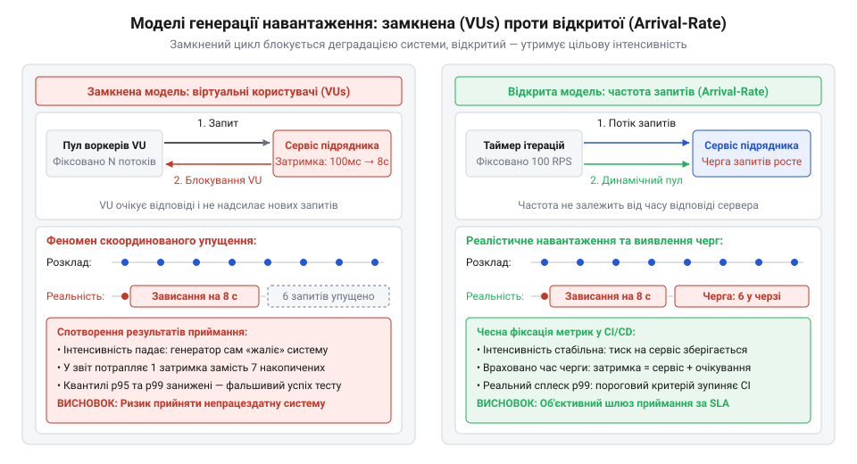
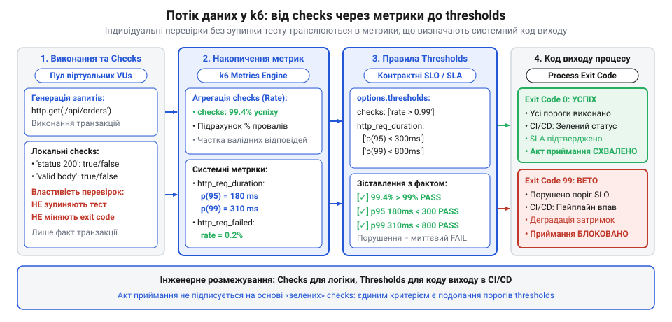
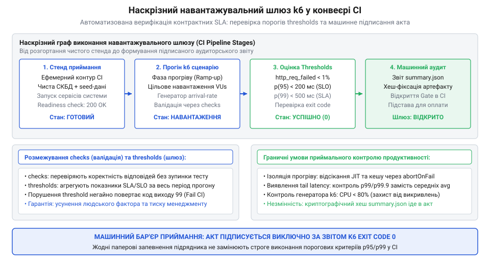

# Приймання системи від підрядника

<preknowlist>
- [Система, яку можна передати](root:progarch/a-system-you-can-hand-over) — критерії відчужуваності системи, автоматизовані шлюзи приймання та відмова від паперових звітів на користь машинного контролю якості
- [Документ, що не гниє](root:progarch/document-that-does-not-rot) — фіксація вимог до продуктивності у вигляді виконуваного коду навантажувальних сценаріїв, а не пасивних текстових регламентів
</preknowlist>

## Анатомія катастрофи сліпого навантажувального тестування та пастка середніх величин під час передачі системи

Під час передачі програмного комплексу від підрядника замовник майже завжди стикається з оптимістичними звітами про продуктивність. У фінальній презентації виконавець демонструє охайні кругові діаграми, скріншоти та висновок: «Під навантаженням 1000 запитів на секунду середня затримка відповіді становить лише 142 мілісекунди, а частка помилок не перевищує 0.05%». Комісія підписує акт передачі робіт, фінансові зобов'язання закриваються, а команда підрядника переходить на інший проєкт. Справжня катастрофа розгортається за місяць, коли замовник запускає першу масштабну маркетингову кампанію. За реального користувацького напливу в 600 одночасних відвідувачів інтерфейс раптово зависає, пули підключень до бази даних вичерпуються, черги запитів балансувальника переповнюються, і система зазнає лавиноподібного колапсу.

Причина цієї катастрофи криється в фундаментальній математичній ваді використання середнього арифметичного значення (англ. @@en|mean latency@@, від лат. @@en|medius@@ — середній). Середнє значення агрегує всі виміри в одне число, повністю стираючи інформацію про розподіл затримок у хвості. Розглянемо простий чисельний приклад типового вебзастосунку. Нехай 95% усіх запитів є простими читаннями зі швидкого кешу й обробляються за 10 мс. Проте решта 5% запитів потребують складного пошуку в реляційній базі даних або очікують на звільнення блокування рядка й виконуються за 3000 мс (3 секунди). Розрахуємо середній час відповіді такої системи:

```
T_avg = (0.95 · 10) + (0.05 · 3000)
      = 9.5 + 150
      = 159.5 мс
```

З погляду некваліфікованого менеджменту цифра 159.5 мс виглядає бездоганною: система нібито вкладається у звичний психологічний норматив у 200 мс. Проте в реальності кожен двадцятий запит зазнає трисекундної затримки. Якщо сучасна фронтенд-сторінка для формування свого вмісту виконує 20 паралельних або послідовних запитів до мікросервісного API, ймовірність того, що користувач натрапить хоча б на одну повільну операцію, розраховується через біноміальний розподіл:

```
P(хоча б один запит повільний)
= 1 - (1 - p)^k
= 1 - (1 - 0.05)²⁰
= 1 - (0.95)²⁰
≈ 1 - 0.3585
= 0.6415  [64.2% користувачів відчувають тяжку затримку]
```

Майже дві третини реальних користувачів спостерігають повільний інтерфейс, який дратує та спонукає закрити сторінку, тоді як у звіті підрядника красується підпис про середні 159.5 мс. Саме тому інженерна дисципліна вимагає повної відмови від середніх величин на користь квантилів або перцентилів (англ. @@en|percentiles@@, від лат. @@en|per centum@@ — на сотню): `p(90)`, `p(95)`, `p(99)` та `p(99.9)`. Показник `p(95) = 200 мс` гарантує, що рівно 95% запитів обробляються швидше за 200 мс, а `p(99) = 500 мс` чітко обмежує максимальну тривалість хвоста затримок (англ. @@en|tail latency@@).

Другою складовою ілюзії є ручне тестування на машинах розробників. Підрядник запускає тестовий генератор на тому самому ноутбуці, де розгорнуто локальну базу даних або тестовий контейнер. У таких умовах відсутні мережеві затримки, конкуренція за дисковий ввід-вивід зведена до мінімуму, а невеликі тестові таблиці цілком вміщуються в оперативній пам'яті. Перевірка не враховує реальних обмежень пулів з'єднань, фрагментації оперативної пам'яті та поведінки збирача сміття під тривалим пресингом.

> 🔧 **Навіщо це.**
> Паперові звіти та середні арифметичні значення дають підряднику змогу формально закрити вимоги технічного завдання, переклавши весь тягар прихованих архітектурних дефектів на замовника. Жорсткий контроль квантилів p95 і p99 перетворює розмиту фразу «сервіс працює швидко» на юридично та математично однозначний інженерний поріг, порушення якого автоматично зупиняє приймання системи.

Щоб приймання системи перестало залежати від суб'єктивних суджень та довіри, взаємодія між замовником і підрядником має спиратися на принципи, закладені в статті [система, яку можна передати](root:progarch/a-system-you-can-hand-over): якість перевіряється машинним способом у відтворюваному ізольованому середовищі. Вимоги угоди про рівень обслуговування (англ. @@en|Service Level Agreement@@, SLA) та внутрішні цілі якості сервісу (англ. @@en|Service Level Objectives@@, SLO) мають трансформуватися у виконуваний програмний код. Специфікація навантаження стає справжнім зразком концепції [документ, що не гниє](root:progarch/document-that-does-not-rot) — замість статичного розділу в ТЗ замовник отримує набір сценаріїв k6, які автоматично верифікують архітектурні інваріанти при кожній зміні та повертають бінарний результат: система відповідає заявленим характеристикам або приймання заблоковано.

## Моделі генерації навантаження: сценарії (Scenarios), стадії (Stages) та виконавці (Executors)

Інструмент навантажувального тестування k6 реалізує декларативний підхід до формування навантаження за допомогою JavaScript-коду, що виконується оптимізованим рушієм на мові Go. Проте успішне проєктування навантажувального шлюзу вимагає від архітектора глибокого розуміння фізики генерації запитів. Найпоширенішою помилкою інженерів є використання наївної замкненої моделі навантаження (англ. @@en|closed workload model@@).

У замкненій моделі тестування керується фіксованим пулом так званих віртуальних користувачів (англ. @@en|Virtual Users@@, VUs). Кожен VU є ізольованим процесом виконання сценарію: він надсилає HTTP-запит, чекає на відповідь від сервера, робить паузу (англ. @@en|sleep@@ або @@en|think time@@) і лише після цього розпочинає наступну ітерацію. Якщо тестований сервер працює швидко (відповідає за 20 мс), пул із 100 VUs генерує інтенсивний потік трафіку. Але щойно сервер потрапляє у стан перевантаження і час відповіді деградує до 2000 мс, кожен VU зависає в очікуванні відповіді. Як наслідок, сумарна кількість запитів, яку генерує тестовий стенд за секунду, різко падає саме в той момент, коли системі найважче.

Цей феномен відомий в індустрії як скоординоване упущення (англ. @@en|coordinated omission@@, термін Гіла Тене). Замкнена модель випадково підіграє підряднику: що гірше почувається система, то менше навантаження на неї надсилає тестовий інструмент. Сервер отримує штучний перепочинок, черги не переповнюються, а підсумковий звіт показує «плавну деградацію» замість катастрофічного відказу. Реальні користувачі в Інтернеті не чекають у черзі, доки сервер обробить запити попередніх клієнтів: у годину пік потік нових відвідувачів прибуває незалежно від стану вашої бази даних.

Для об'єктивного приймання системи підрядника використовується відкрита модель навантаження (англ. @@en|open workload model@@), де частота відправки запитів є фіксованою або змінюється за заздалегідь визначеним планом, повністю незалежно від тривалості обробки запитів сервером. В k6 це досягається за допомогою виконавців частоти прибуття (англ. @@en|arrival-rate executors@@). Якщо сервер сповільнюється, генератор автоматично підключає додаткові VUs з пулу, щоб утримати цільовий темп запитів, безжально демонструючи, де саме ламається тестована архітектура.


*Замкнена модель VUs зменшує тиск при деградації системи, маскуючи катастрофу, тоді як відкрита модель arrival-rate зберігає цільовий потік запитів і виявляє справжню точку відмови.*

Керування моделями навантаження в k6 здійснюється через декларативну конфігурацію об'єкта `options.scenarios`. Кожен сценарій визначає конкретного виконавця (`executor`), набір стадій (`stages`), прив'язку до функцій та виділені ресурси. Розглянемо ключові типи виконавців, доступні в інтерфейсі k6:

| Виконавець (`executor`) | Модель навантаження | Принцип керування потоком | Типове застосування під час приймання |
| :--- | :--- | :--- | :--- |
| `shared-iterations` | Замкнена | Фіксована загальна кількість ітерацій розподіляється між пулом VUs | Швидкі димові перевірки функціональної готовності сервісу (smoke tests) |
| `per-vu-iterations` | Замкнена | Кожен VU гарантовано виконує точну фіксовану кількість ітерацій | Тестування міграцій даних, наповнення бази або валідація ідемпотентності |
| `constant-vus` | Замкнена | Фіксована кількість VUs працює протягом заданого проміжку часу | Базове ізольоване тестування стійкості до витоків пам'яті (soak testing) |
| `ramping-vus` | Замкнена | Кількість VUs змінюється сходами за вказаними стадіями (stages) | Експрес-пошук точки перегину продуктивності без суворої прив'язки до RPS |
| `constant-arrival-rate` | Відкрита | Фіксована кількість ітерацій за секунду генерується незалежно від затримок | Перевірка стабільності пропускної здатності за контрактом SLA (steady-state) |
| `ramping-arrival-rate` | Відкрита | Частота генерації запитів плавно зростає та спадає за стадіями | Повноцінний приймальний стрес-тест із розгоном, піком і контролем місткості |

Під час приймання системи від підрядника еталонним інструментом є саме виконавець `ramping-arrival-rate`. Він дозволяє розбити навантажувальний сценарій на три обов'язкові інженерні фази:
1. **Фаза плавного розгону (ramp-up):** поступове нарощування частоти запитів від нуля до номінального робочого показника. Ця фаза запобігає штучному шоку системи, даючи змогу ініціалізувати пули з'єднань, прогріти JIT-компілятор віртуальної машини та наповнити кеші другого рівня.
2. **Фаза стабільного плато (steady-state plateau):** утримання гарантованого контрактом навантаження протягом тривалого часу (наприклад, 10-30 хвилин). Саме на цьому відрізку знімаються основні показники квантилів затримок та перевіряється стабільність споживання пам'яті.
3. **Фаза стресового тестування (stress / spike):** короткочасне підвищення частоти запитів понад узгоджений ліміт (на 130–150%) для перевірки механізмів самозахисту: чи спрацьовує обмеження частоти (rate limiting), чи коректно відхиляються надлишкові запити без падіння основної бази даних.
4. **Фаза охолодження (ramp-down):** плавне зниження навантаження до нуля для перевірки здатності системи повернутися до номінального стану та звільнити виділені системні ресурси.

Наведемо конфігурацію виробничого сценарію k6, що реалізує відкриту модель навантаження з виконавцем `ramping-arrival-rate`:

:::code api-k6-thresholds-and-checks/js/function.js

У цій конфігурації параметри `preAllocatedVUs` та `maxVUs` відіграють критичну роль: `preAllocatedVUs` одразу виділяє 100 віртуальних користувачів для уникнення затримок виділення пам'яті на старті, а `maxVUs` встановлює верхню межу динамічного пулу (500 VUs). Якщо бекенд підрядника почне сповільнюватися, k6 задіє додаткові VUs аж до ліміту в 500 потоків, щоб гарантувати подачу рівно 200 або 350 запитів щосекунди.

> 🔧 **Навіщо це.**
> Застосування відкритої моделі навантаження ramping-arrival-rate позбавляє підрядника можливості замаскувати системні зависання за рахунок зниження частоти опитування. Тільки випробування фіксованим зовнішнім потоком запитів дає чесну відповідь про те, чи готова система витримати реальний бізнес-трафік замовника.

## Інтерфейс функціональних перевірок (Checks API) під навантаженням

Швидкість роботи системи не має жодного сенсу, якщо система повертає некоректні дані. Порожній HTTP-відповідь або повідомлення про внутрішню помилку сервера `500 Internal Server Error`, надіслане за дві мілісекунди, формально демонструє блискавичний час реакції, але є абсолютно марним для користувача. Під час стресового навантаження програмні комплекси підрядників рідко падають із гучним крахом усього процесу: набагато частіше вони починають «тихо деградувати». База даних не встигає обробити запит і повертає порожній масив, кеш віддає застарілі об'єкти, а обробник помилок маскує збої та повертає код `200 OK` із тілом `{"error": "timeout"}`.

Для верифікації бізнес-інваріантів під навантаженням k6 надає інтерфейс перевірок — функцію `check()`. Її призначення полягає в інспекції властивостей окремих HTTP-відповідей безпосередньо в циклі виконання віртуального користувача. Функція приймає тестований об'єкт (відповідь `Response`), об'єкт предикатів та необов'язковий набір тегів:

:::code api-k6-thresholds-and-checks/js/function.js

Фундаментальна архітектурна відмінність `check()` від класичних модульних асертів (англ. @@en|assertions@@, від лат. @@en|asserere@@ — стверджувати) у тестових фреймворках (Jest, Pytest, JUnit) полягає в їхній неблокуючій природі. Якщо звичайний асерт при виявленні невідповідності генерує виняток і негайно перериває виконання тесту, то функція `check()` ніколи не зупиняє віртуального користувача. Якби невдача на окремому запиті аварійно вбивала потік VU, це призвело б до автоматичного зменшення навантаження на систему: генератор штучно відступив би, зняв тиск із перевантаженого сервера і спотворив би весь експеримент.

Натомість функція `check()` транслює кожен булевий результат перевірки у внутрішній лічильник системної метрики `checks`. У підсумковому звіті ця метрика відображає відсоток успішних перевірок відносно загальної кількості виконаних умов:

```
checks.........................: 99.42% ✓ 49710     ✗ 290
```

Для складних сценаріїв, що охоплюють кілька послідовних бізнес-кроків (авторизація, додавання в кошик, оплата), перевірки структурують за допомогою груп `group()` та тегування запитів `tags`. Це дозволяє локалізувати дефекти й відстежувати успішність перевірок окремо для кожного сервісу:

:::code api-k6-thresholds-and-checks/js/function.js

> 🔧 **Навіщо це.**
> Неблокуюча природа Checks API дозволяє контролювати коректність поведінки підрядного коду без руйнування моделі навантаження. Замовник отримує точну статистику: під яким саме тиском і на яких саме кроках сценарію сервер починає повертати пошкоджені дані замість очікуваних бізнес-сутностей.

## Інтерфейс системних порогових критеріїв (Thresholds API) та перцентилі затримок

Якщо функція `check()` є мікроскопом, який інспектує окремі виклики, то інтерфейс порогових критеріїв (англ. @@en|thresholds@@, від англ. @@en|threshold@@ — поріг, межа) є глобальним автоматичним суддею всього тесту. Порогові критерії — це декларативні правила, які k6 оцінює на агрегованих системних метриках після або під час виконання навантажувального сценарію. Саме через механізм thresholds абстрактні договірні зобов'язання підрядника переводяться в інженерну площину, що виконується в конвеєрі неперервної інтеграції.

Архітектура k6 будується навколо безперервного збирання потоку сирих подій від усіх віртуальних користувачів та їхньої агрегації в накопичувальні метрики. Розглянемо взаємозв'язок між функціональними перевірками, метриками та шлюзом порогів:


*Потік даних у k6: окремі перевірки check() не переривають сценарій, а наповнюють метрики, які зіставляються з thresholds для визначення фінального статусу збірки.*

У конфігурації k6 порогові критерії задаються в об'єкті `options.thresholds`. Ключем є назва цільової метрики (зі значеннями фільтрів або без них), а значенням — масив строкових виразів, що містять агрегатор, оператор порівняння (`<`, `<=`, `>`, `>=`) та числове граничне значення.

Усі метрики k6 поділяються на стандартні системні та користувацькі. До ключових стандартних метрик належать:
- `http_req_duration`: сумарний час виконання HTTP-запиту від початку надсилання до завершення вичитування тіла відповіді. Ця метрика розбивається на супутні фази: `http_req_waiting` (час очікування першого байта від бекенду, TTFB), `http_req_connecting` (встановлення TCP-з'єднання) та `http_req_tls_handshaking` (узгодження TLS).
- `http_req_failed`: частка запитів, що завершилися невдачею на мережевому рівні або повернули HTTP-статус із діапазону 4xx чи 5xx (за замовчуванням).
- `checks`: агрегована успішність усіх виконаних функцій `check()`.
- `iteration_duration`: загальний час, витрачений на повне виконання однієї ітерації сценарію віртуальним користувачем (включно з паузами sleep).

Під час приймання системи порогові критерії вимагають суворого контролю квантилів розподілу затримок: `p(90)`, `p(95)` та `p(99)`. Розглянемо приклад виробничої конфігурації порогових правил для приймального шлюзу:

:::code api-k6-thresholds-and-checks/js/snippet-4.js

Синтаксис виразів дозволяє комбінувати кілька умов для однієї метрики. Якщо хоча б одна з умов масиву порушується, вся метрика позначається як провалена. Крім того, k6 підтримує селектори тегів у фігурних дужках: `'http_req_duration{name:OrderCreation}'` оцінює лише ті запити, які були позначені міткою `{ tags: { name: 'OrderCreation' } }`, що унеможливлює розмивання часу важких транзакцій легкими викликами статичних файлів.

Найважливішим аспектом для інженера автоматизації є механіка завершення роботи утиліти k6:
- Якщо всі оголошені в `thresholds` критерії виконано успішно, процес завершується з кодом повернення `0` (`exit code 0`).
- Якщо порушено бодай один пороговий вираз (наприклад, `p(99)` склав 602 мс замість допустимих 600 мс, або частка помилок досягла 1.05%), k6 миттєво повертає спеціальний код помилки `99` (`exit code 99`).

У конвеєрі неперервної інтеграції (CI/CD) код повернення `99` автоматично перериває складання репозиторію, виставляє червоний статус перевірки пул-реквесту і блокує перехід завдання в стан завершеного. Суб'єктивні суперечки між технічним лідером замовника та менеджером підрядника усуваються самою операційною системою: ненульовий код виходу є об'єктивним доказом порушення інженерного контракту.

> 🔧 **Навіщо це.**
> Порогові критерії Thresholds API з виходом 99 перетворюють навантажувальний тест на безапеляційний бінарний шлюз приймання. Якщо хоча б один перцентиль затримок перевищує договірний норматив або частка помилок перевищує 1%, конвеєр падає, а система юридично та технічно вважається неготовою до експлуатації.

## Кастомні метрики, фаза прогріву та захист від передчасного аварійного завершення

Стандартні метрики протоколу HTTP відображають лише мережевий та транспортний рівні взаємодії. Проте під час приймання складної системи від підрядника головні ризики зосереджені в глибині бізнес-домену: чи не перевищує частка відхилених через відсутність товару замовлень договірний ліміт, чи не зростає час розрахунку податкових ставок, чи не перевищує черга внутрішніх повідомлень поріг стійкості. Стандартних метрик `http_req_duration` та `http_req_failed` тут недостатньо: запит може повернути успішний статус `200 OK`, але містити відмову в проведенні транзакції.

Для вимірювання предметних інваріантів k6 надає інтерфейс створення користувацьких метрик із модуля `k6/metrics`. Інженер має у своєму розпорядженні чотири класи метрик:

1. **`Counter` (лічильник):** кумулятивна сума цілих чисел, яка монотонно зростає або накопичує дельти (наприклад, кількість відкочених транзакцій чи скинутих сесій).
2. **`Gauge` (датчик миттєвого значення):** фіксує останнє передане значення, дозволяючи відстежувати поточний стан ресурсів (розмір пулу з'єднань, чергу завдань чи вільну пам'ять).
3. **`Rate` (відносний коефіцієнт):** розраховує відсоток значень, що дорівнюють логічній істині `true` (або `1`), відносно загальної кількості відправлених вимірів (наприклад, частка успішних платежів).
4. **`Trend` (статистичний тренд):** накопичує числовий ряд і автоматично розраховує для нього перцентилі, середнє, медіану, мінімум та максимум (наприклад, час виконання специфічного SQL-запиту чи затримку обробки в черзі).

Розглянемо практичний приклад використання кастомних метрик у коді сценарію k6:

:::code api-k6-thresholds-and-checks/js/function.js

Під час запуску приймальних тестів у реальних умовах інженери часто стикаються з проблемою «холодного старту» (англ. @@en|cold start problem@@). Коли цільовий мікросервіс щойно розгорнуто в тестовому оточенні, середовище виконання ще не готове до номінальної продуктивності: JIT-компілятор віртуальної машини (JVM, V8) не встиг скомпілювати гарячі цикли у машинний код, пули з'єднань до бази даних відкривають перші сокети, а кеш другого рівня порожній. Перші кілька десятків запитів можуть виконуватися за 1500–2000 мс, тоді як після прогріву час відповіді падає до стабільних 30 мс. Якщо оцінювати поріг `p(99)<200` від першої секунди, холодний старт неминуче отруїть агреговану статистику й спричинить хибнопозитивне падіння тесту.

Для захисту від артефактів фази старту застосовують два взаємодоповнюючі механізми:
- **Тегування фаз сценарію:** запити фази розгону маркуються спеціальним тегом `{ stage: 'warmup' }`, а стабільне плато — тегом `{ stage: 'measurement' }`. Порогові значення налаштовуються виключно на метрики з тегом вимірювання: `'http_req_duration{stage:measurement}': ['p(95)<200']`.
- **Керування перериванням тесту (параметри `abortOnFail` та `delayAbortEval`):** за замовчуванням k6 перевіряє пороги наприкінці прогону. Проте якщо система підрядника зазнала повного колапсу на другій хвилині 30-хвилинного тесту, продовжувати генерацію трафіку безглуздо. Параметр `abortOnFail: true` наказує k6 негайно зупинити тест і повернути код `99`. Щоб уникнути миттєвого зупинення на перших секундах через холодний старт, використовують захисну затримку `delayAbortEval: '30s'` (або `'1m'`). Вона інструктує рушій k6 не оцінювати аварійні пороги протягом перших 30 секунд, даючи системі змогу завершити ініціалізацію.

```javascript
export const options = {
  thresholds: {
    http_req_failed: [
      {
        threshold: 'rate<0.05',
        abortOnFail: true,      // Аварійна зупинка тесту при катастрофічній деградації
        delayAbortEval: '1m',   // Ігнорувати першу хвилину прогріву
      },
    ],
  },
};
```

> 🔧 **Навіщо це.**
> Кастомні метрики дозволяють контролювати доменні бізнес-правила системи підрядника, а параметри delayAbortEval та abortOnFail захищають від хибних спрацьовувань через холодний старт, одночасно заощаджуючи час CI-раннерів у разі реального колапсу архітектури.

## Інтеграція шлюзу в CI/CD конвеєр, генерація підсумкового паспорта приймання та юридична фіксація результатів

Останнім і вирішальним етапом побудови навантажувального шлюзу є його інтеграція у конвеєр неперервної інтеграції (CI/CD). Навантажувальне тестування під час передачі системи не може запускатися вручну на комп'ютері довіреної особи: воно має відбуватися в ізольованому, чистому та строго контрольованому середовищі раннера замовника.

Архітектура приймального конвеєра будується за принципом наскрізного графа виконання, де кожен крок спирається на успішне завершення попереднього:


*Наскрізний конвеєр приймання в CI: детермінований запуск сервісу, виконання сценарію k6 із захистом від прогріву, перевірка порогових правил thresholds та формування машинозчитуваного паспорта передачі робіт.*

Конвеєр складається з чотирьох послідовних стадій:
1. **Підготовка ізольованого тестового контуру:** розгортання цільового сервісу та його залежностей (бази даних, кешів, черг) з фіксованих образів контейнерів через Docker Compose або Helm.
2. **Верифікація готовності (Readiness Barrier):** конвеєр опитує ендпойнт `/ready` цільового сервісу, чекаючи повної ініціалізації внутрішніх пулів перед подачею будь-якого зовнішнього трафіку.
3. **Виконання сценарію k6:** запуск офіційного контейнера `grafana/k6` у спільній мережі з сервісом, відпрацювання фаз розгону, вимірювання плато та перевірка thresholds.
4. **Формування та публікація паспорта приймання:** генерація машинозчитуваного звіту у форматах JSON та Markdown для збереження як підтверджувального артефакту збірки.

Для формування машинозчитуваного звіту k6 надає хук життєвого циклу `handleSummary(data)`. Ця функція перехоплює фінальний агрегований об'єкт результатів і дозволяє зберегти його у файловій системі:

```javascript
import { textSummary } from 'https://jslib.k6.io/k6-summary/0.0.1/index.js';

export function handleSummary(data) {
  return {
    'acceptance-summary.json': JSON.stringify(data, null, 2),
    'stdout': textSummary(data, { indent: ' ', enableColors: true }),
  };
}
```

Фрагмент конфігурації кроку конвеєра в GitHub Actions демонструє запуск приймального шлюзу та контроль коду завершення:

```yaml
jobs:
  performance-acceptance-gate:
    runs-on: ubuntu-latest
    steps:
      - name: Клонування репозиторію
        uses: actions/checkout@v4

      - name: Підняття ізольованого тестового стенда
        run: docker compose -f docker-compose.test.yml up -d --wait

      - name: Запуск приймального навантажувального шлюзу k6
        run: |
          docker run --rm --network host             -v .:/ci             grafana/k6:latest run /ci/tests/k6-acceptance-suite.js

      - name: Збереження паспорта приймання як артефакту
        if: always()
        uses: actions/upload-artifact@v4
        with:
          name: performance-acceptance-passport
          path: acceptance-summary.json
```

Особливу увагу під час конфігурації раннера слід приділити усуненню клієнтського вузького місця (англ. @@en|load generator saturation@@). Якщо віртуальна машина, на якій запущено k6, вичерпує процесорний час (CPU utilization > 85%) або пам'ять, генератор починає самостійно затримувати відправку пакетів і вимірювання. У такому разі стрибок `p(99)` буде спричинений не вадами коду підрядника, а затримками планувальника потоків у самому тестовому раннері. Архітектор замовника зобов'язаний виділяти генератору ізольовані обчислювальні ресурси та моніторити системні показники раннера під час тесту.

Кульмінацією інженерного шлюзу є його юридичне закріплення. Відповідно до концепції [система, яку можна передати](root:progarch/a-system-you-can-hand-over), передача системи вважається завершеною лише тоді, коли всі критерії якості перевірені автоматично. У договорі з підрядником та в розділі критеріїв готовності (англ. @@en|Definition of Done@@, DoD) формулюється однозначний технічний пункт:

> «Передача етапу розробки вважається успішною, а відповідний Акт передачі-приймання підлягає підписанню замовником виключно за умови проходження автоматизованого навантажувального конвеєра (k6 performance gate) у репозиторії замовника з нульовим кодом завершення (exit code 0). Невід'ємним технічним додатком до Акта є збережений артефакт acceptance-summary.json, підписаний криптографічним хешем SHA-256 відповідного коміту збірки».

Таке формулювання трансформує вимоги до продуктивності на справжній [документ, що не гниє](root:progarch/document-that-does-not-rot). Замість суб'єктивних дискусій про швидкість роботи замовник спирається на математично строгий, детермінований та повністю автоматизований арбітраж інструментального шлюзу.

> 🔧 **Навіщо це.**
> Інтеграція шлюзу k6 у CI/CD з виходом 0/99 та генерацією підсумкового JSON-паспорта переводить договірні зобов'язання підрядника з площини усних обіцянок у площину алгоритмічної верифікації. Замовник отримує надійний щит від передчасного підписання актів на нежиттєздатне та неоптимізоване програмне забезпечення.
