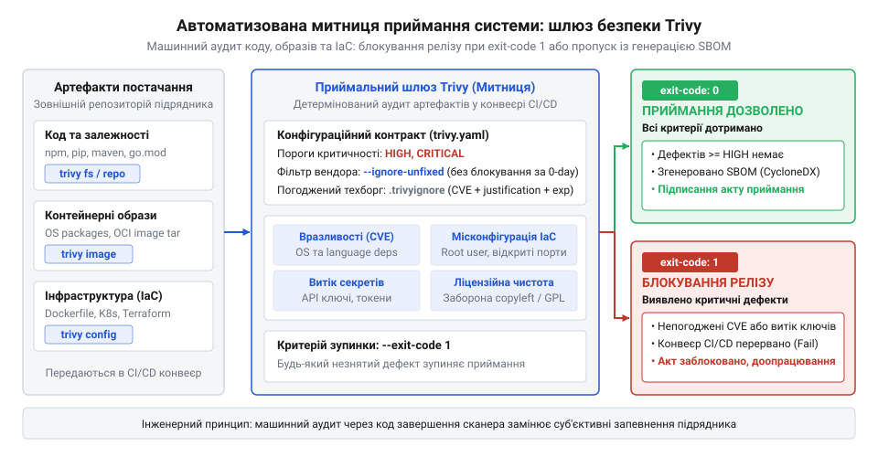
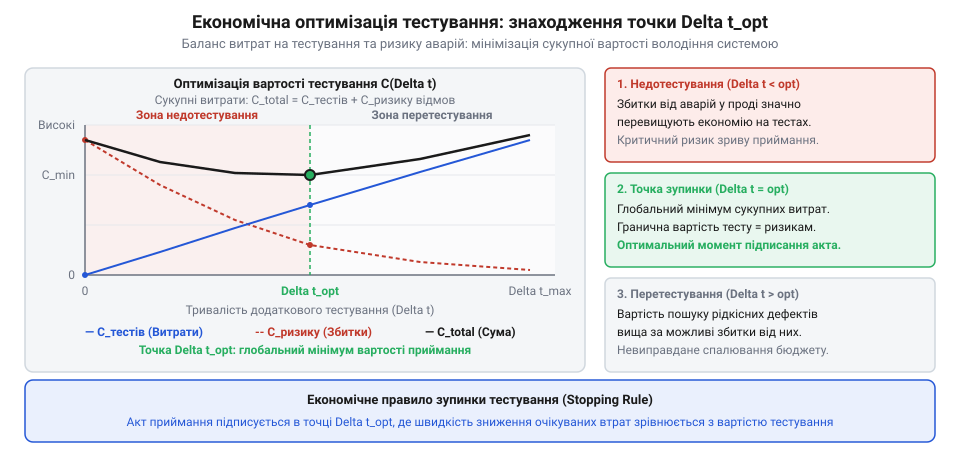

# Приймання системи від підрядника

<preknowlist>
- [Приймання системи від підрядника](root:progarch/accepting-a-system-from-a-contractor) — чому замовник зобов'язаний вимагати об'єктивні автоматизовані перевірки замість паперових звітів і суб'єктивних запевнень
- [Система, яку можна передати](root:progarch/a-system-you-can-hand-over) — чому кодова база має бути самодостатньою, відчужуваною та позбавленою прихованих залежностей від первинних авторів
- [Документ, що не гниє](root:progarch/document-that-does-not-rot) — як перетворити вимоги безпеки на машинозчитувані правила конфігурації, що автоматично верифікуються в CI/CD
- [CVE в ядрі: потік номерів і що з ним робити](root:progarch/cve-in-the-kernel-stream-of-numbers) — поняття загальних уразливостей і експозицій (CVE), класифікація за рівнями небезпеки та ризик накопичення невиправлених дефектів
</preknowlist>

## Чому безпековий аудит є критичним рубежем приймання системи та архітектурна роль сканера Trivy

Завершення контракту на розробку програмного комплексу та перехід до [приймання системи від підрядника](root:progarch/accepting-a-system-from-a-contractor) традиційно супроводжуються оптимістичними звітами: функціональні вимоги реалізовано, інтеграційні тести проходять успішно, а демонстраційний стенд стабільно обслуговує користувацькі сценарії. Проте кодова база, яка виглядає бездоганною на рівні бізнес-логіки, може виявитися непридатною до безпечної експлуатації. Сучасний програмний застосунок лише на 10–20% складається з коду, написаного безпосередньо розробниками; решта 80–90% — це піраміда сторонніх бібліотек із відкритим кодом (Open Source), транзитивних залежностей, системних утиліт базових операційних систем та інфраструктурних маніфестів.

Коли підрядник передає систему замовнику, разом із сирцевими текстами він передає накопичений токсичний технічний борг (англ. @@en|toxic technical debt@@, від грецьк. @@en|toxikon@@ — стрільна отрута). Цей борг не фіксується юніт-тестами, адже застаріла бібліотека продовжує справно обчислювати функції, але несе в собі критичні ризики безпеки:
1. Загальновідомі вразливості у сторонніх пакетах (англ. @@en|Common Vulnerabilities and Exposures@@, CVE, від латин. @@en|vulnerabilis@@ — вразливий): сторонні модулі, додані на ранніх етапах проєкту, з часом застарівають. У глобальних реєстрах публікуються експлойти, і система з першого ж дня після здачі стає відкритою мішенню для автоматизованих мережевих атак.
2. Небезпечні базові образи контейнерів: використання застарілих або перевантажених дистрибутивів ОС (наприклад, повнорозмірних образів Ubuntu чи Debian трирічної давнини) приносить у виробниче середовище сотні вразливих системних пакетів (glibc, curl, OpenSSL), не потрібних для роботи самого застосунку.
3. Дефекти інфраструктурної конфігурації (IaC): запуск контейнерів від імені користувача root, відсутність обмежень на модифікацію кореневої файлової системи, відкриті привілейовані порти та надмірні права доступу до хмарних ресурсів.
4. Витоки конфіденційних даних (англ. @@en|secret leaks@@, від латин. @@en|secretus@@ — відокремлений, таємний): тимчасові токени тестових середовищ, приватні SSH-ключі чи паролі до баз даних, забуті розробниками в коментарях або у маніфестах конфігурацій.
5. Юридичні та ліцензійні міни: використання підрядником компонентів із суворими вірусними копілефт-ліцензіями (наприклад, GPLv3 чи AGPL), що створює загрозу примусового розкриття інтелектуальної власності замовника.

> 🔧 **Навіщо це.**
> Машинний аудит безпеки усуває людську суб'єктивність під час підписання акта приймання робіт. Якщо замовник покладається на чесне слово підрядника або формальний паперовий звіт, він купує кота в мішку: через місяць після розрахунку виявлена критична дірка змусить переписати половину архітектури за власний кошт. Автоматизований шлюз перетворює контрактні вимоги безпеки на строгий бінарний критерій: збірка або відповідає стандарту нульової толерантності до відомих загроз, або блокує передачу грошей.

Відповідно до принципів праць [Система, яку можна передати](root:progarch/a-system-you-can-hand-over) та [Документ, що не гниє](root:progarch/document-that-does-not-rot), безпека кодової бази не може існувати у формі разового аудиту чи зовнішньої експертизи. Вона повинна бути відчужуваною та автоматично верифікованою безпосередньо всередині репозиторію. Якщо підрядник передає систему, яка містить десятки критичних CVE або запускається з правами суперкористувача, процес [Введення нової команди в систему](root:progarch/onboarding-a-new-team) миттєво колапсує. Замість вивчення предметної області та продуктивної реалізації бізнес-завдань штатні інженери змушені займатися екстреним латанням чужих дірок, розв'язанням конфліктів несумісності оновлених бібліотек та ліквідацією наслідків аварій.


*Схема автоматизованої митниці під час приймання системи від підрядника: перевірка кодової бази, контейнерних образів та IaC-маніфестів через Trivy з ухваленням рішення про пропуск або блокування артефактів на основі коду повернення.*

Щоб перетворити вимоги безпеки на незламний машинозчитуваний бар'єр, архітектурний процес приймання спирається на спеціалізований інструмент — Trivy від компанії Aqua Security. Trivy є відкритим універсальним статичним сканером, спроєктованим за принципом максимальної автономності та портативності:
- Єдиний статичний бінарний файл: написаний мовою Go, Trivy не вимагає встановлення сторонніх середовищ виконання (Python, Node.js чи JVM), не потребує фонового системного демона та запускається на будь-якому агенті CI/CD або машині розробника.
- Автономна локальна база знань: сканер автоматично завантажує компактну базу вразливостей (Trivy DB) у форматі OCI-артефакту. Уся перевірка здійснюється локально в оперативній пам'яті та на диску без надсилання сирцевих текстів чи контейнерів на зовнішні хмарні сервери.
- Універсальна поверхня інспекції: замість зоопарку розрізнених утиліт (окремо для npm, окремо для pip, окремо для Dockerfile) Trivy надає єдиний синтаксичний інтерфейс для перевірки файлових систем, репозиторіїв, контейнерних образів та інфраструктурних маніфестів.
- Відтворюваність і детермінізм: сканер не залежить від пропрієтарних сервісів підрядника; замовник може повторити аудит у будь-який момент часу на ізольованій машині й отримати той самий результат.

## Команди сканування цільових артефактів: файлова система, репозиторії та контейнерні образи (trivy fs, trivy repo, trivy image, trivy rootfs)

Інтерфейс командного рядка Trivy організовано довкола цільових типів артефактів, які підрядник передає під час здачі системи. Інженер не повинен шукати специфічні плагіни: кожна цільова команда відповідає конкретній фізичній формі представлення цифрового продукту.

### Сканування локальної файлової системи: trivy fs

Базовою командою аудиту репозиторію вихідного коду є `trivy fs` (від англ. @@en|filesystem@@ — файлова система). Вона рекурсивно обходить зазначену директорію, ідентифікує маніфести пакетних менеджерів та зіставляє версії компонентів із локальною базою вразливостей.

```bash
trivy fs --scanners vuln .
```

Під час приймання кодової бази критично важливо, щоб підрядник передавав не лише декларативні списки прямих залежностей (такі як `package.json` чи `requirements.txt`), а й точні детерміновані файли блокувань (lockfiles: `package-lock.json`, `poetry.lock`, `go.sum`, `Cargo.lock`). Команда `trivy fs` здійснює глибокий аналіз саме файлів блокувань, будуючи повний транзитивний граф (від латин. @@en|transitivus@@ — перехідний):

```text
Target: /workspace/billing-service/package-lock.json
Type: npm

┌──────────────────┬────────────────┬──────────┬───────────────────┬───────────────┬────────────────────────────────────────────────────────┐
│     Library      │ Vulnerability  │ Severity │ Installed Version │ Fixed Version │                         Title                          │
├──────────────────┼────────────────┼──────────┼───────────────────┼───────────────┼────────────────────────────────────────────────────────┤
│ json-schema-ref  │ CVE-2023-45133 │ CRITICAL │ 1.0.4             │ 1.0.5         │ Prototype pollution in resolveByPointer                │
│ axios            │ CVE-2023-45857 │ HIGH     │ 0.21.1            │ 0.21.2        │ Cross-site request forgery via absolute URLs           │
│ semver           │ CVE-2022-25883 │ MEDIUM   │ 7.3.5             │ 7.5.2         │ Regular Expression Denial of Service (ReDoS)           │
└──────────────────┴────────────────┴──────────┴───────────────────┴───────────────┴────────────────────────────────────────────────────────┘
```

Якщо підрядник передав репозиторій без lockfile або намагається приховати наявність транзитивних бібліотек, аудит зафіксує неповноту маніфестів як порушення інженерного стандарту.

### Інспекція віддалених репозиторіїв: trivy repo

Коли аудит проводиться до клонування кодової бази на локальний диск аудитора (наприклад, на етапі попереднього рецензування пул-реквесту підрядника), використовується команда `trivy repo`:

```bash
trivy repo --scanners vuln,secret https://github.com/contractor-org/payment-gateway.git
```

Команда автоматично створює тимчасовий ізольований клон репозиторію у захищеному системному каталозі, аналізує повну історію комітів та маніфестів зазначеної гілки і видає зведений звіт, повністю видаляючи тимчасові файли після завершення сесії.

### Пошаровий аудит контейнерних образів: trivy image

Контейнерні образи (Docker та OCI) є основним форматом передачі сервісів у сучасній архітектурі. Проте контейнер — це не ізольований бінарник, а повноцінний образ файлової системи, побудований шарами (layers). Команда `trivy image` проводить двовимірну перевірку:
1. Системні пакети базової ОС: інспекція баз даних менеджерів пакунків (dpkg у Debian/Ubuntu, rpm у RHEL/CentOS, apk у Alpine).
2. Залежності застосунків: детекція скомпільованих або скопійованих всередину образу бібліотек (JAR-файли Java, Python wheels, модулі Node.js).

```bash
trivy image --scanners vuln,secret internal-registry.corp/services/order-processor:v2.4.0
```

> 🔧 **Навіщо це.**
> Розробники підрядника часто запевняють: «У нашому коді на Go немає жодної вразливості, ми все протестували». Але якщо сервіс спаковано у базовий образ `ubuntu:20.04`, де три роки не оновлювалися пакети `libssl` та `glibc`, зловмисник атакує не бізнес-код на Go, а системні бібліотеки контейнера. Команда `trivy image` знімає рожеві окуляри, показуючи реальну вразливість середовища виконання ще до його розгортання в тестовому чи промисловому кластері.

Trivy автоматично взаємодіє з локальним демоном Docker, середовищем containerd або безпосередньо звертається до віддалених захищених реєстрів образів (Harbor, AWS ECR, GCP Artifact Registry) за наявності стандартних змінних автентифікації.

### Сканування кореневих файлових систем: trivy rootfs

Для вбудованих систем, автономних віртуальних машин або розпакованих контейнерних середовищ команда `trivy rootfs` інспектує довільну директорію, трактуючи її як корінь операційної системи Linux:

```bash
trivy rootfs --scanners vuln /mnt/app-rootfs
```

Вона шукає маркери дистрибутива (`/etc/os-release`, `/var/lib/dpkg/status`, `/lib/apk/db/installed`), точно ідентифікуючи встановлені версії системних демонів і бібліотек ядра користувача.

### Керування сканерами через прапорець --scanners

За замовчуванням сканер може перевіряти лише вразливості (`vuln`). Проте комплексне приймання вимагає суцільного аудиту. Прапорець `--scanners` (від англ. @@en|scanner@@, від латин. @@en|scandere@@ — міряти, пильно роздивлятися) дозволяє активувати потрібні механізми аналізу через кому:
- `vuln`: детекція відомих вразливостей (CVE) у залежностях та ОС.
- `misconfig`: статичний аналіз конфігурацій (Dockerfile, Kubernetes, Terraform).
- `secret`: виявлення відкритих паролів, API-ключів та секретних сертифікатів.
- `license`: перевірка ліцензійної чистоти та виявлення копілефт-ризиків.

Універсальний виклик повної перевірки артефакту перед прийманням:

```bash
trivy fs --scanners vuln,misconfig,secret,license ./source-code
```

Такий багатовимірний аудит створює вичерпну картину якості переданого продукту, унеможливлюючи пропуск неочевидних загроз.

## Декларативний конфігураційний контракт через trivy.yaml та прапорці CLI

Ручний запуск сканера з довгим шлейфом прапорців командного рядка є зручним для поодиноких експериментів, але абсолютно неприйнятним для інженерного процесу приймання робіт. Якщо параметри аудиту не зафіксовані машинним способом у репозиторії, виникає небезпечний розрив між локальним середовищем розробника та перевірочним конвеєром замовника: підрядник на своїй машині запускає інспекцію без урахування вразливостей базової ОС, отримує успішний результат і стверджує, що завдання виконано.

Відповідно до концепції [Документ, що не гниє](root:progarch/document-that-does-not-rot), усі вимоги до безпеки мають зберігатися поруч із кодом у формі декларативного файлу налаштувань — `trivy.yaml` (або `trivy.config.yaml`). Цей файл встановлює незмінний контракт перевірки: будь-який інженер чи автоматизований раннер, виконавши коротку команду `trivy fs .` або `trivy image <назва>`, застосує один і той самий набір правил, порогів та обмежень.

### Структура та параметри конфігураційного файлу trivy.yaml

Файл конфігурації утиліти зіставляє ключі YAML із відповідними прапорцями CLI, усуваючи дублювання складних аргументів:

```yaml
# Декларативний контракт безпекового аудиту приймання системи
timeout: 10m
cache:
  dir: "/tmp/trivy-cache"

scan:
  scanners:
    - vuln
    - misconfig
    - secret
    - license

vulnerability:
  type:
    - os
    - library

severity:
  - HIGH
  - CRITICAL

ignore-unfixed: true
exit-code: 1
format: "table"
```

Кожен ключ цієї конфігурації виконує чітку інженерну функцію:
- `severity` (прапорець `--severity`): визначає градацію загроз, на які реагує сканер. Trivy підтримує п'ять стандартизованих рівнів за шкалою CVSS (Common Vulnerability Scoring System): `UNKNOWN`, `LOW`, `MEDIUM`, `HIGH`, `CRITICAL`. Для приймального гейту впроваджується політика нульової толерантності до рівнів `HIGH` та `CRITICAL`: наявність хоча б однієї вразливості цього класу свідчить про пряму загрозу зламу або відмови в обслуговуванні. Рівні `LOW` та `MEDIUM` фіксуються в аудиторських логах, але не блокують реліз, запобігаючи зупинці проєкту через незначні теоретичні зауваження.
- `ignore-unfixed` (прапорець `--ignore-unfixed`): критично важливий фільтр реалістичності. Вразливість вважається невиправленою (`unfixed`), якщо вендор операційної системи чи автор відкритої бібліотеки ще не випустив оновлену версію пакета з виправленням дефекту. Вимагати від підрядника усунення дірки, для якої в природі немає офіційного патча, безглуздо — це лише заохочує фальсифікацію звітів. Прапорець змушує сканер ігнорувати такі дефекти, фокусуючись виключно на тих проблемах, які вирішуються банальним оновленням версії у файлі блокувань.
- `exit-code` (прапорець `--exit-code`): детермінує код повернення утиліти в операційну систему. За замовчуванням сканер повертає код 0 (успіх), навіть якщо знайдено сотню критичних вразливостей, розглядаючи сканування як суто інформаційну операцію. Передача параметра `exit-code: 1` перетворює Trivy на блокуючий гейт: за наявності невідфільтрованих порушень процес завершується з кодом 1, миттєво обриваючи виконання конвеєра CI/CD.

### Форматування звітів та формування аудиторського паспорта SBOM

Залежно від адресата аудиту Trivy підтримує гнучку зміну формату експорту результатів через прапорець `--format`:
1. `table`: компактне людиночитне представлення для термінала розробника.
2. `json`: повний машинний зріз даних із докладними метаданими, посиланнями на бази знань CVE та деталізацією шарів, призначений для подальшого аналізу скриптами.
3. Стандартизований цифровий склад програмного забезпечення — SBOM (англ. @@en|Software Bill of Materials@@, від латин. @@en|materia@@ — речовина, матеріал): формати `cyclonedx` та `spdx-json`.

```bash
trivy fs --format cyclonedx --output sbom.cdx.json .
```

> 🔧 **Навіщо це.**
> Здача коду без SBOM — це передача системи без технічного паспорта. Якщо через два роки в популярній бібліотеці (як це сталося з інцидентом Log4Shell) виявлять глобальну критичну дірку, новим власникам доведеться екстрено шукати експертів і вручну реверсити старі репозиторії. Згенерований під час приймання SBOM-паспорт у форматі CycloneDX дає змогу за лічені секунди звірити весь склад залежностей на рівні автоматизованих систем інвентаризації компанії, захищаючи процес [Введення нової команди в систему](root:progarch/onboarding-a-new-team).


*Схема структури конфігураційного контракту trivy.yaml, механізм фільтрації за рівнями небезпеки (--severity, --ignore-unfixed) та генерація аудиторського реєстру SBOM (CycloneDX / SPDX) для відчуження системи.*

Такий підхід забезпечує відчужуваність: підрядник передає не просто набір бінарників, а юридично вивірений машинний реєстр кожного стороннього компонента, використаного в архітектурі.

## Аудит конфігурацій інфраструктури (IaC), секретів та ліцензійної чистоти під час приймання

Сучасне програмне забезпечення не працює у вакуумі: разом із бізнес-кодом підрядник постачає інфраструктуру як код (англ. @@en|Infrastructure as Code@@, IaC) — маніфести Kubernetes, інструкції складання Dockerfile та описи хмарних ресурсів Terraform. Помилка конфігурації хмарного периметра чи контейнера несе не меншу загрозу, ніж дірка в мережевому протоколі.

### Інспекція маніфестів інфраструктури: trivy config

Команда `trivy config` аналізує декларативні конфігураційні файли на відповідність вбудованим політикам безпеки, побудованим на рушії Open Policy Agent (OPA) та мові правил Rego:

```bash
trivy config --severity HIGH,CRITICAL ./deploy
```

Під час приймання особлива увага приділяється типовим небезпечним практикам у маніфестах підрядника:
1. Dockerfile:
   - Заборона роботи від суперкористувача (`root`): наявність явної інструкції `USER <non-root-uid>`.
   - Заборона використання тегу `:latest` для базових образів, що порушує детермінізм збірки.
   - Відсутність небезпечних привілеїв у командах `HEALTHCHECK` та інструкціях збірки.
2. Kubernetes маніфести:
   - Налаштування блоку `securityContext`: обов'язкова заборона ескалації привілеїв (`allowPrivilegeEscalation: false`), монтування кореневої файлової системи лише для читання (`readOnlyRootFilesystem: true`) та заборона запуску привілейованих контейнерів (`privileged: false`).
   - Обов'язкове встановлення лімітів ресурсів (`resources.limits`), відсутність яких дозволяє одному контейнеру захопити всю пам'ять робочого вузла кластера.
3. Terraform маніфести:
   - Заборона створення загальнодоступних сховищ (наприклад, AWS S3 buckets із публічним читанням `public-read`).
   - Блокування відкритих груп безпеки (Security Groups із правилами вхідного трафіку `0.0.0.0/0` на чутливі адміністративні порти 22, 3306 чи 5432).

### Пошук зашитих облікових даних і токенів

Розробники підрядника нерідко використовують спрощений підхід до тестування: прописують статичні API-ключі сторонніх платіжних систем, службові паролі до бази даних чи тестові сертифікати прямо в коді або конфігураційних файлах. Активація сканера секретів (`--scanners secret`) дозволяє виявити такі витоки до передачі артефактів:

```bash
trivy fs --scanners secret .
```

Trivy поєднує два методи виявлення:
- Сигнатурний пошук за базою регулярних виразів: детекція відомих форматів токенів (AWS Access Keys, GitHub Personal Access Tokens, JWT-токени, приватні ключі RSA/OPENSSH).
- Ентропійний аналіз Шеннона (англ. @@en|Shannon entropy@@, від грецьк. @@en|entropia@@ — перетворення): обчислення міри випадковості рядків для виявлення високоентропійних паролів та секретних ключів, які не відповідають стандартним шаблонам відомих провайдерів.

### Контроль ліцензійної чистоти сторонніх компонентів

Передача системи замовнику — це правовий акт відчуження прав інтелектуальної власності. Відповідно до засад праці [Система, яку можна передати](root:progarch/a-system-you-can-hand-over), якщо підрядник включив до складу коду бібліотеку із суворою копілефт-ліцензією (англ. @@en|copyleft@@), замовник ризикує втратити комерційні права на власну систему.

Trivy класифікує ліцензії через сканер `license` за ступенем ризику:
1. Дозволені (Permissive): ліцензії типу MIT, Apache-2.0, BSD-2-Clause, BSD-3-Clause та ISC. Вони дозволяють вільне комерційне використання, модифікацію та закриття сирцевих текстів без юридичних обтяжень для замовника.
2. Обмежений копілефт (Weak Copyleft): LGPL, MPL-2.0. Дозволяють використання за умови збереження відкритості сирців самої бібліотеки при динамічному зв'язуванні, проте несуть ризик при статичній лінковці.
3. Суворий копілефт (Strong / Network Copyleft): GPL-2.0, GPL-3.0, AGPL-3.0. Порушення умов ізоляції таких компонентів зобов'язує замовника відкрити сирцевий код усієї комерційної системи.

```bash
trivy fs --scanners license --severity HIGH,CRITICAL .
```

> 🔧 **Навіщо це.**
> Підрядник може розробити чудовий модуль, але «для швидкості» підтягнути утиліту обробки PDF під ліцензією AGPL-3.0. Якщо юристи замовника або сторонній технічний аудит виявлять це після введення системи в експлуатацію, компанія постане перед судовим позовом або вимогою повністю відкрити код свого прибуткового сервісу. Сканування ліцензій усуває цю юридичну міну сповільненої дії в день передачі системи.

Поєднання аудиту конфігурацій, секретів та ліцензій гарантує, що передана кодова база є не лише технічно працездатною, а й безпечною в експлуатації та юридично захищеною.

## Керований технічний борг через .trivyignore та контракт винятків

Під час передачі великих програмних систем вимога негайного досягнення абсолютного нульового рівня вразливостей часто стикається з об'єктивною реальністю: нова вразливість може бути опублікована в базі CVE за добу до запланованого підписання акта, або виробник стороннього пакета ще не встиг випустити офіційний патч. Якщо процедура приймання сприймає правила абсолютно негнучко, проєкт потрапляє в глухий кут: реліз паралізується через дефект у неактивній утиліті тестового стенда.

Зворотна реакція — вимкнення перевірок чи скасування блокування через прапорець `exit-code: 0` — є ще більш руйнівною. Вона перетворює [приймання системи від підрядника](root:progarch/accepting-a-system-from-a-contractor) на профанацію, дозволяючи сторонній команді безконтрольно скинути весь накопичений технічний борг на плечі замовника.

Вихід із цієї дилеми дає контракт керованих винятків через конфігураційний файл `.trivyignore` (або `trivyignore.yaml`). Цей механізм дозволяє тимчасово вивести конкретну вразливість із-під блокування конвеєра за умови суворої аргументації та детермінованого обмеження в часі.

### Структура та контракт файлу винятків .trivyignore

Простий синтаксис файлу містить перелік ідентифікаторів CVE, які сканер повинен ігнорувати. Проте інженерна культура концепції [Документ, що не гниє](root:progarch/document-that-does-not-rot) забороняє безіменні винятки: кожен проігнорований дефект зобов'язаний супроводжуватися коментарями з описом контексту та терміном дії:

```text
# Контракт винятків приймання системи: .trivyignore
# CVE-2023-45857: Вразливість у бібліотеці axios стосується парсингу абсолютних URL.
# У нашій архітектурі всі HTTP-виклики здійснюються виключно через внутрішній шлюз.
# Відповідальний: архітектор інтеграції.
# Дедлайн усунення: оновлення фреймворку в межах релізу Q4.
# Expired at: 2026-10-15
CVE-2023-45857

# CVE-2023-38545: Помилка утиліти curl у базовому образі.
# Вразливість проявляється лише при роботі через SOCKS5-проксі, що заблоковано мережевою політикою.
# Expired at: 2026-11-01
CVE-2023-38545
```

Для сучасних версій Trivy підтримується розширений декларативний YAML-формат, який структурує ці поля в машинні властивості:

```yaml
# .trivyignore.yaml
vulnerabilities:
  - id: "CVE-2023-45857"
    statement: "Метод обробки абсолютних URL не використовується в кодовій базі замовника"
    expired_at: 2026-10-15
  - id: "CVE-2023-38545"
    statement: "SOCKS5 проксі заблоковано інфраструктурними політиками Kubernetes"
    expired_at: 2026-11-01
```

### Механізм часового згасання винятків (Expirations)

Ключовим елементом контракту є параметр `expired_at` (або мітка `# Expired at:` у текстовому форматі). Сканер Trivy автоматично звіряє поточну системну дату з датою закінчення дії винятку:
1. До настання дедлайну: Trivy ігнорує зазначену вразливість, не додає її до блокуючого списку та завершує роботу з кодом 0 (якщо інших порушень не виявлено).
2. Після настання дедлайну: виняток автоматично деактивується прямо в конвеєрі. Сканер знову розцінює цю CVE як блокуюче порушення і перериває білд із кодом 1.

> 🔧 **Навіщо це.**
> Головна небезпека будь-якого «тимчасового» рішення в програмуванні полягає в тому, що воно стає вічним. Коли розробник додає CVE у звичайний список ігнорування, через пів року про це ніхто не згадає, і діра залишиться в продакшні назавжди. Механізм expirations створює вбудовану бомбу сповільненої дії для технічного боргу: якщо команда не оновила бібліотеку до вказаної дати, конвеєр CI/CD автоматично ламається, змушуючи інженерів повернутися до проблеми.


*Життєвий цикл обліку технічного боргу через .trivyignore: фіксація ідентифікатора вразливості, валідація терміну дії (expirations) та автоматичний збій конвеєра після закінчення дедлайну.*

Під час приймання системи замовник затверджує кожен запис у `.trivyignore` як окремий компроміс. Наявність прозорого списку з дедлайнами кардинально спрощує [Введення нової команди в систему](root:progarch/onboarding-a-new-team): нові інженери бачать повний реєстр компромісів попередників, мотиви їхнього ухвалення та точні дати, коли ці компоненти потребуватимуть обов'язкового планового оновлення.

## Граничні режими експлуатації, робота в ізольованих контурах (air-gapped) та інтеграція в CI/CD

Промислова експлуатація сканера в корпоративних середовищах часто зіштовхується з жорсткими інфраструктурними обмеженнями: контури підвищеної безпеки банківського, державного чи оборонного сектору повністю ізольовані від публічної мережі (англ. @@en|air-gapped environments@@, від латин. @@en|aer@@ — повітря).

### Автономне сканування без прямого інтернет-доступу

За замовчуванням перед кожним скануванням Trivy намагається перевірити свіжість локальної бази знань і завантажити оновлений OCI-артефакт бази вразливостей. В ізольованому контурі це призводить до системного збою за таймаутом мережевого з'єднання.

Для стабільної роботи в закритих середовищах застосовуються спеціальні прапорці та механіка кешування:

```bash
trivy fs --skip-db-update --offline-scan --cache-dir /opt/security/trivy-cache .
```

1. `--skip-db-update`: блокує будь-які спроби оновити базу вразливостей через інтернет, примушуючи сканер використовувати вже наявні дані.
2. `--offline-scan`: активує повністю автономний режим аналізу, за якого відключаються всі зовнішні виклики (зокрема запити до віддалених публічних реєстрів).
3. `--cache-dir`: явно перевизначає каталог зберігання бази метаданих та кешу образів, що дозволяє монтувати підготовлений том у контейнери раннерів збірки.

Регламент підтримки ізольованого контуру передбачає регулярну процедуру доставки оновлень через внутрішній репозиторій або фізичний носій:
- На шлюзовій машині з доступом до мережі виконується завантаження бази даних:
```bash
trivy image --download-db-only --cache-dir ./trivy-offline-db
```
- Каталог `trivy-offline-db` архівується, проходить автоматизований антивірусний контроль і доставляється на ізольовані сервери CI/CD.

Для очищення застарілих кешованих образів і звільнення дискового простору на агентах збірки утиліта надає команду `trivy clean`:

```bash
trivy clean --all --cache-dir /opt/security/trivy-cache
```

### Розрізнення кодів повернення та захист від хибних блокувань

У конвеєрах неперервної інтеграції надзвичайно важливо детерміновано розрізняти причину завершення утиліти:
- Код повернення 0: сканування завершено успішно, критичних дефектів не виявлено (або всі вони легітимно покриті діючими записами в `.trivyignore`).
- Код повернення 1 (налаштований через `--exit-code 1`): сканер виявив блокуючі вразливості, помилки конфігурації IaC, відкриті секрети чи заборонені ліцензії. Конвеєр повинен заблокувати злиття гілки та повідомити підрядника про відмову в прийманні.
- Коди повернення вище 1 (системні аварії): помилка парсингу пошкодженого Dockerfile, нестача прав доступу до файлової системи чи збій дискового простору. Такі збої сигналізують про проблему інфраструктури збірки, а не про якість програмного коду.

### Побудова приймального шлюзу (Acceptance Gate) у CI/CD

Відповідно до філософії [Система, яку можна передати](root:progarch/a-system-you-can-hand-over), приймальна митниця повинна бути оформлена як обов'язковий автоматизований конвеєр (наприклад, у GitHub Actions або GitLab CI).

Приклад етапу безпекового приймання в конвеєрі GitHub Actions:

```yaml
name: Security Acceptance Gate

on:
  pull_request:
    branches: [ main ]

jobs:
  trivy-acceptance-audit:
    runs-on: ubuntu-latest
    steps:
      - name: Checkout contractor repository
        uses: actions/checkout@v4

      - name: Run Trivy filesystem audit (vulnerabilities and secrets)
        run: |
          trivy fs --config trivy.yaml --output trivy-fs-report.json --format json .

      - name: Run Trivy infrastructure misconfiguration check
        run: |
          trivy config --config trivy.yaml --output trivy-iac-report.json --format json ./deploy

      - name: Build local container image
        run: |
          docker build -t target-service:audit -f Dockerfile .

      - name: Run Trivy container image audit
        run: |
          trivy image --config trivy.yaml target-service:audit

      - name: Archive audit reports
        if: always()
        uses: actions/upload-artifact@v4
        with:
          name: security-audit-reports
          path: |
            trivy-fs-report.json
            trivy-iac-report.json
```

Така конфігурація перетворює вимоги безпеки на формальний статус перевірки (Required Status Check). Поки всі кроки Trivy не завершаться успішно з кодом 0, злиття коду підрядника в основну гілку репозиторію фізично заблоковано платформою контролю версій. У результаті замовник отримує детермінований цифровий бар'єр, який гарантує чистоту, безпеку та відчужуваність кодової бази в день передачі системи.
