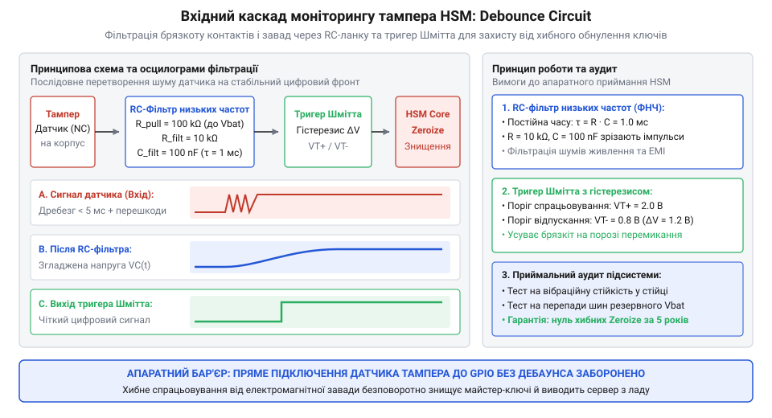
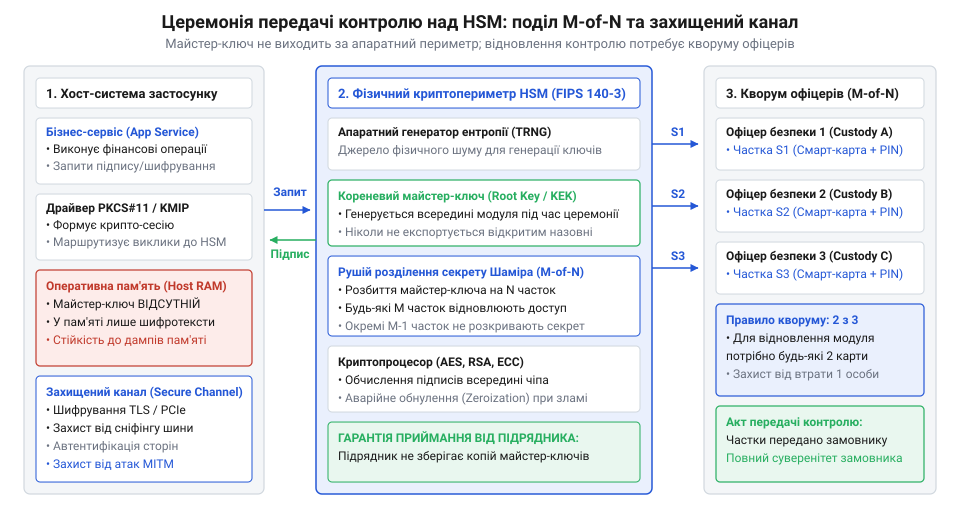

# Приймання системи від підрядника

<preknowlist>
- [Система, яку можна передати](root:progarch/a-system-you-can-hand-over) — критерії відчужуваності архітектури та перевірка відсутності неявних залежностей від розробників підрядника
</preknowlist>

## Пастка програмних ключів та ілюзія захищеності при передачі системи

Уяви типовий фінал масштабного проєкту: зовнішній підрядник здає замовнику критичну підсистему — платіжний шлюз для процесингу банківських карток або центр цифрової автентифікації для юридично значущих документів. Усі автоматизовані тести в ізольованому конвеєрі світяться зеленим, функціональні вимоги виконані бездоганно, код пройшов аудит, а навантажувальні стенди підтвердили цільову пропускну здатність. Замовник підписує фінальний акт приймання, змінює паролі облікових записів адміністраторів і переводить сервіси на власні сервери. Інженери підрядника залишають репозиторій, а внутрішня команда експлуатації святкує успішний запуск, будучи впевненою у повному контролі над новим активом.

Проте за цією ідилією криється фундаментальна вразливість, яка здатна в один момент перекреслити цінність усієї розробки: де саме в переданій системі фізично живуть закриті майстер-ключі шифрування та електронного підпису?

У переважній більшості випадків підрядники обирають найпростіший шлях: секрети розташовують у текстових конфігураційних файлах, прихованих правами доступу операційної системи, передають через змінні середовища контейнера або шифрують за допомогою пароля, що зберігається в іншому сервісі. Але хоч би скільки шарів програмного маскування нагромадила команда, у системі загального призначення (англ. @@en|general-purpose system@@) діє залізний закон комп'ютерної архітектури: щоби процесор міг зашифрувати блок даних або згенерувати цифровий підпис, закритий ключ зобов'язаний з'явитися у відкритому, розшифрованому вигляді в оперативній пам'яті (англ. @@en|Random Access Memory@@, RAM).

У цю саму мить уся криптографічна модель стає беззахисною перед власним середовищем виконання. Програмне забезпечення не здатне зберегти таємницю від операційної системи, в якій воно запущене. Якщо закритий ключ потрапляє в адресний простір процесу, він миттєво стає вразливим для цілого спектра невідворотних векторів витоку:

1. **Привілейований доступ і підміна контексту:** Будь-який користувач із правами суперкористувача (`root` чи `SYSTEM`) або адміністратор середовища віртуалізації може безперешкодно прочитати стан пам'яті процесу через відлагоджувальні механізми чи прямий доступ до системного пристрою пам'яті.
2. **Артефакти експлуатації та аварійні знімки:** Під час збою сервісу операційна система автоматично генерує аварійний дамп пам'яті (англ. @@en|core dump@@), зберігаючи вміст RAM на диск. Цей файл згодом потрапляє в загальну систему моніторингу помилок, корпоративну пошту чи трекер задач, відкриваючи приватні ключі широкому колу осіб.
3. **Знімки віртуалізації та резервне копіювання:** Створення знімка стану віртуальної машини (англ. @@en|VM snapshot@@) зберігає повний зріз оперативної пам'яті у звичайний бінарний файл на системі зберігання даних, який копіюється системними адміністраторами без криптографічного аудиту.
4. **Фізичні витоки за межами ОС:** Навіть при вимкненні живлення залишкова ємність комірок пам'яті зберігає біти інформації впродовж секунд або хвилин. Атака холодного перезавантаження (англ. @@en|cold boot attack@@) або сканування шини передачі даних між процесором і планками пам'яті логічним аналізатором дозволяють перехопити ключ без зміни системних файлів.

Найнебезпечніша властивість викрадення криптографічного ключа з пам'яті полягає в його повній безшумності. Коли зловмисник копіює закритий ключ, дані не зникають із системи, лічильники помилок не спрацьовують, а наскрізні тести продовжують горіти зеленим.

Коли будується [Система, яку можна передати](root:progarch/a-system-you-can-hand-over), передача коду без гарантії непорушності ключів є фікцією. Якщо приватний ключ хоча б раз побував на ноутбуці розробника підрядника, у тестовому репозиторії або конфігураційному файлі на проміжному стенді, замовник ніколи не знатиме напевно, чи не залишилася резервна копія цього ключа в третіх руках. Зміна паролів до серверів не допомагає: маючи копію кореневого ключа, колишній підрядник або зловмисник, що перехопив бекап, може генерувати фальшиві платіжні накази чи підробляти цифрові сертифікати роками, залишаючись цілком невидимим для систем виявлення вторгнень.

> 🔧 **Навіщо це.**
> Корінь довіри не може спиратися на довіру до сумлінності розробника або стабільність конфігурації операційної системи. Якщо система керує реальними грошима, критичною інфраструктурою чи державною автентифікацією, приймання робіт без апаратного відокремлення ключів юридично перекладає відповідальність за будь-який майбутній витік на того, хто підписав акт без технічної перевірки збереження секретів.

Неможливість захистити секрет програмними засобами робить очевидним інженерний висновок: криптографічні ключі ніколи не повинні потрапляти в оперативну пам'ять комп'ютера загального призначення і ніколи не повинні виходити за межі спеціалізованого середовища.

Єдиний архітектурний розв'язок цієї суперечності — винести збереження ключів і виконання криптографічних операцій у фізично автономний апаратний контур. Такий незмінний базис безпеки називають апаратним коренем довіри (англ. @@en|Root of Trust@@, RoT; від давн.-англ. @@en|rot@@ — основа, джерело, та лат. @@la|fides@@ — віра, надійність).

Клас пристроїв, покликаний забезпечити таку ізоляцію, називається апаратними модулями безпеки (англ. @@en|Hardware Security Module@@, HSM; від грец. @@el|perimetros@@ — захисна окружність навколо ядра). Принцип дії таких компонентів радикально змінює контракт взаємодії хоста з ключем: хостовий комп'ютер більше ніколи не запитує сам ключ. Замість цього хост передає в модуль лише відкриті дані, що підлягають підпису чи шифруванню, а модуль повертає назад готовий результат операції. Сам ключ створюється, живе та вмирає всередині захищеного кремнієвого кристала, не полишаючи його меж навіть у зашифрованому вигляді, якщо на це немає спеціальної довіреної процедури.

Наступні розділи розкриють, яка саме фізика та внутрішня архітектура забезпечують непорушність криптографічного периметра HSM, як влаштовані його виводи й інтерфейси зв'язку, та як інженер має підключити й протестувати такий модуль, не ризикуючи спалити його або випадково знищити всю інформацію.

## Фізична анатомія та захисний периметр апаратного модуля безпеки

Якщо збереження кореня довіри винесено в окремий пристрій, постає наступне неминуче питання: що саме заважає зловмиснику прочитати ключ безпосередньо з цього пристрою? Якщо закритий ключ записано в кремнієвій мікросхемі, що заважає фізично розкрити корпус, розчинити захисний пластик кислотою, підключити вимірювальні голки мікрозонда до внутрішніх шин пам'яті чи перехопити випромінювання сигналів?

Відповідь полягає в тому, що апаратний модуль безпеки проектується не як звичайний мікроконтролер із прошивкою, а як замкнена криптографічна фортеця. Його фізичний периметр (англ. @@en|cryptographic boundary@@) починається на рівні кристала кремнію й охоплює як обчислювальні вузли, так і багаторівневі системи виявлення фізичного вторгнення.

Внутрішня архітектура криптографічного процесора складається з чотирьох фундаментальних блоків, тісно пов'язаних між собою:

1. **Апаратний генератор істинно випадкових чисел:** Криптографічна стійкість будь-якого ключа визначається якістю випадкових чисел, використаних під час його генерації. Звичайні сервери використовують псевдовипадкові алгоритми (англ. @@en|Pseudorandom Number Generator@@, PRNG), стан яких можна відтворити або передбачити за недостатньої ентропії операційної системи. Модуль безпеки містить фізичний генератор істинно випадкових чисел (англ. @@en|True Random Number Generator@@, TRNG; від лат. @@la|generare@@ — породжувати). Джерелом ентропії в ньому слугує непередбачуваний фізичний шум кремнієвого p-n переходу (тепловий білий шум або дробовий шум квантових флуктуацій). Цей аналоговий сигнал посилюється, проходить апаратне тестування на нерівномірність розподілу й перетворюється на послідовність бітів, яку принципово неможливо передбачити чи клонувати.
2. **Криптографічний співпроцесор постійного часу:** Обчислення цифрових підписів за алгоритмами RSA чи на базі еліптичних кривих (ECC), а також симетричне шифрування виконуються виділеними апаратними блоками. Головна вимога до них — виконання операцій за строго сталий час (англ. @@en|constant-time execution@@). Якщо час множення чи піднесення до степеня залежить від значення бітів ключа, зловмисник може відновити секрет, заміряючи мікросекундні затримки відповідей хоста (атака за часом) або аналізуючи мікроколивання струму споживання живлення (диференційний аналіз потужності, англ. @@en|Differential Power Analysis@@, DPA). Апаратний співпроцесор розраховує кожен математичний крок за фіксовану кількість тактів незалежно від того, де в ключі стоять нулі чи одиниці, нівелюючи витоки через сторонні канали.
3. **Захищена енергонезалежна пам'ять ключів:** Ключі ніколи не зберігаються у звичайній відкритій флеш-пам'яті. Модулі використовують статичну пам'ять із постійним живленням від внутрішньої літієвої батареї (англ. @@en|Battery-Backed RAM@@, BBRAM) або енергонезалежну пам'ять із шифруванням шин (англ. @@en|Bus Encryption@@). Усі лінії адреси та даних, що з'єднують пам'ять із процесором, зашифровані випадковим апаратним ключем, який оновлюється під час кожного циклу ініціалізації. Навіть якщо зловмисник підключиться до внутрішніх контактів, він побачить лише псевдовипадковий білий шум.
4. **Контур виявлення розтину та схема самознищення:** Найважливіший блок, що відрізняє HSM від будь-якого іншого чипа. Це апаратна логіка, що безперервно відстежує стан фізичного середовища кристала.

*Внутрішня архітектура криптопроцесора: поєднання апаратного генератора ентропії, обчислювального рушія сталого часу та захищеної пам'яті під контролем автономного контуру аварійного обнулення.*

Щоб унеможливити доступ до кристала під мікроскопом, верхній шар мікросхеми вкривають активною захисною сіткою (англ. @@en|active shield@@). Вона є безперервним лабіринтом із мікроскопічних провідників товщиною в частки мікрометра, через які безперервно циркулює контрольний високочастотний сигнал. Якщо нападник намагається зняти захисний епоксидний компаунд хімічним розчинником або підвести надтонку зондову голку до шин пам'яті, провідник сітки обривається або замикається на сусідній шар.

Поруч із сіткою на кристалі працюють інтегровані датчики фізичних аномалій:
- **Детектори перепаду напруги живлення:** захищають від атак внесення збоїв (англ. @@en|voltage glitching@@), коли короткочасне просідання напруги змушує логіку процесора пропустити інструкцію перевірки пароля чи цифрового підпису.
- **Детектори температури:** фіксують спроби різкого охолодження рідким азотом (для сповільнення розряду комірок пам'яті) або перегріву.
- **Оптичні фотодіоди:** фіксують проникнення світла чи імпульсу лазера при розтині непрозорого корпусу мікросхеми.

Коли будь-який із цих датчиків фіксує відхилення за допустимі межі або активна сітка фіксує обрив контакту, спрацьовує механізм аварійного апаратного обнулення (англ. @@en|zeroization@@, нуліфікація; від італ. @@it|zero@@ — нуль).

> 🔧 **Навіщо це.**
> Механізм апаратного обнулення є останнім і абсолютним рубежем захисту. На відміну від програмних систем, де після виявлення атаки запускається тривала процедура перезапису файлів, схема zeroization реалізована повністю на рівні транзисторів і не залежить від процесора чи прошивки. Вона спрацьовує за одиниці наносекунд: живлення комірок пам'яті BBRAM миттєво закорочується на землю або випалюється аварійним струмом. Коли атакуючий нарешті дістається до комірок під електронним мікроскопом, він виявляє абсолютно чистий кристал без жодного біта інформації.

Ця фізична незворотність докорінно змінює правила гри: закритий ключ неможливо вкрасти шляхом фізичного вилучення чи дослідження пристрою. Проте, щоби модуль безпеки міг працювати у складі великої системи, його внутрішня ізоляція має поєднуватися зі зручним і стандартизованим зовнішнім інтерфейсом. У наступному розділі ми розглянемо, якими лініями, виводами та шинами модуль з'єднується з материнською платою та хостовою операційною системою.

## Інтерфейси, фізичні виводи та програмні стандарти підключення

Коли внутрішня фортеця криптопроцесора збудована, постає інженерне завдання її підключення: як ізольований кристал взаємодіє із зовнішнім процесором або сервером, не розкриваючи при цьому свій захисний периметр? Для інженера, який приймає апаратну схему або серверну підсистему від підрядника, критично важливо вміти розпізнати модуль безпеки на кресленнях, зрозуміти призначення кожного його виводу та перевірити коректність програмного стеку керування.

На фізичному рівні архітектура підключення різко варіюється від мініатюрних дискретних мікросхем на друкованій платі до повнорозмірних серверних плат розширення та автономних мережевих пристроїв.

Для дискретних чипів безпеки (англ. @@en|Secure Elements@@), що монтуються на системну плату пристрою, типова функціональна схема виводів містить чотири обов'язкові групи сигналів:

1. **Лінії живлення та землі (VCC, GND):** Забезпечують енергією внутрішню цифрову логіку та аналогові схеми детекції. Оскільки модуль містить високочутливі датчики аномалій напруги, поруч із виводом живлення безпосередньо біля корпусу мікросхеми обов'язково розміщують керамічні блокувальні конденсатори для фільтрації високочастотних перешкод.
2. **Лінія скидання (RESET):** Вхід апаратного перезавантаження (зазвичай із активним низьким рівнем). Він приводить внутрішній кінцевий автомат криптопроцесора у вихідний стан, очищає тимчасові буфери обміну та ініціює самотестування внутрішніх вузлів перед початком сесії.
3. **Послідовна шина обміну даними:** Найчастіше це шини I2C або SPI:
   - **Шина I2C:** Використовує дві лінії — лінію даних (SDA) та лінію тактування (SCL). Обидві лінії потребують зовнішніх підтягувальних резисторів (англ. @@en|pull-up resistors@@) до шини живлення. I2C вимагає мінімуму провідників, проте має помірну швидкість (від 100 до 400 кГц) і є відкритою шиною: якщо на ній розташовані інші датчики, теоретично можливе прослуховування команд шини.
   - **Шина SPI:** Використовує чотири лінії — передачу від хоста (MOSI), прийом від модуля (MISO), тактування (SCK) та вибір мікросхеми (CS, Chip Select). SPI працює на порядки швидше (10–50 МГц) і завдяки виділеній лінії CS забезпечує прямий ізольований зв'язок безпосередньо з керуючим мікроконтролером.
4. **Контур зовнішньої сигналізації вторгнення (Tamper Loop):** Сигнальні виводи для підключення зовнішніх механічних вимикачів корпусу приладу. Доки кришка корпусу закрита, кінцевий вимикач замикає контур. У разі спроби зняти кришку лінія розривається, і модуль безпеки миттєво запускає процедуру обнулення ключів (zeroization), навіть якщо основне живлення пристрою вимкнене (завдяки внутрішньому живленню від батареї).

*Схема типового підключення дискретного модуля безпеки: поєднання шини обміну даними, сигналів керування живленням і замкненого контуру датчика фізичного розкриття шасі.*

Якщо масштабувати систему до рівня серверів обробки транзакцій, модуль безпеки набуває форми плати розширення для шини PCIe (англ. @@en|Peripheral Component Interconnect Express@@). У цьому випадку фізичний обмін даними здійснюється через високошвидкісні диференційні лінії із прямим доступом до виділеної пам'яті (DMA), керований драйвером ядра операційної системи. Для рівня корпоративних центрів сертифікації модуль безпеки постачається як окреме мережеве шасі з резервованими блоками живлення та незалежними Ethernet-інтерфейсами.

Проте за будь-якого фізичного виконання залишається незмінним головне правило криптографічного інтерфейсу (англ. @@en|interface@@, від лат. @@la|inter@@ — між, та @@la|facies@@ — обличчя): апаратний модуль ніколи не повертає значення закритого ключа назовні.

Щоб прикладне програмне забезпечення могло прозоро працювати з модулями різних виробників без переписування коду, індустрія виробила стандартизовані програмні шари абстракції:

- **Стандарт PKCS#11 (Cryptoki):** Загальноприйнятий стандарт C-API для роботи з криптографічними токенами та апаратними модулями. У цьому стандарті ключі ідентифікуються виключно за допомогою непрозорих числових дескрипторів (англ. @@en|handle@@; від лат. @@la|descriptor@@ — той, що описує). Прикладна програма надсилає виклик: «обчислити цифровий підпис для цього хеш-блока за допомогою ключа з дескриптором `0x0004`». Модуль безпеки самостійно знаходить ключ у захищеній пам'яті, виконує обчислення у власному криптографічному рушії й повертає хосту лише готовий підпис. Закритий ключ жодного разу не торкається адресного простору хостової програми.
- **Протокол KMIP (Key Management Interoperability Protocol):** Мережевий протокол для централізованого управління життєвим циклом ключів між розподіленими клієнтами та мережевими кластерами HSM. Він стандартизує операції створення, ротації, блокування та знищення ключів через захищений канал зв'язку.

> 🔧 **Навіщо це.**
> Під час аудиту переданої схеми інженер зобов'язаний перевірити не лише наявність модуля безпеки, а й топологію його підключення. Якщо підрядник під'єднав захищений чип до загальної відкритої шини I2C, до якої паралельно підключені зовнішні сенсори на зовнішніх роз'ємах плати, зловмисник отримує точку доступу для атак відмови в обслуговуванні (закорочування ліній SDA/SCL) або перехоплення незашифрованих пакетів запитів. Грамотне проектування вимагає виділеної шини SPI або шифрування транспортного протоколу обміну між хостом і мікросхемою.

Коли команда замовника проводить [Введення нової команди в систему](root:progarch/onboarding-a-new-team), розуміння апаратного та програмного інтерфейсів дозволяє швидко відокремити проблеми прикладної логіки від збоїв криптографічного шару. Проте на ринку існує ціле розмаїття апаратних рішень безпеки, і для правильного проєктування або аудиту системи замовник повинен чітко орієнтуватися, який саме клас модуля потрібен під конкретні вимоги та які існують стандартизовані рівні їхньої сертифікації. Цю таксономію ми розберемо в наступному розділі.

## Таксономія апаратних модулів і критерії вибору під архітектурну задачу

Коли розробник чує вимогу «захистити систему за допомогою апаратного модуля безпеки», перед ним постає широчезний ринковий діапазон рішень: від мініатюрної мікросхеми розміром із сірникову голівку за один долар до масивного серверного шасі вартістю в десятки тисяч доларів із замками, рідкокристалічними екранами та власним резервованим охолодженням. Для інженера й архітектора, які проектують систему або приймають технічне рішення від підрядника, критично важливо розуміти таксономію (від грец. @@el|taxis@@ — лад, порядок, та @@el|nomos@@ — закон) цього класу пристроїв, щоб не припуститися двох фатальних помилок: надлишкового здорожчання або катастрофічної втрати продуктивності.

Увесь спектр апаратних модулів безпеки за формфактором, обчислювальною потужністю та межами криптографічного периметра поділяється на три фундаментальні категорії:

1. **Дискретні елементи безпеки (Secure Elements):** Це мініатюрні інтегральні мікросхеми, призначені для поверхневого монтажу безпосередньо на друковану плату кінцевого виробу. Їхня стихія — інтернет речей (IoT), платіжні POS-термінали, автомобільні блоки керування, лічильники ресурсів та апаратні ключі автентифікації. Їхня перевага полягає в наднизькому споживанні енергії (одиниці міліватів) та компактності. Проте платою за мініатюризацію є обмежена пропускна здатність: такий чип оптимізований для збереження кількох десятків майстер-ключів і здатний виконувати лише від 10 до 50 операцій асиметричного підпису за секунду.
2. **Серверні плати прискорення (PCIe HSM):** Виконуються у формфакторі стандартних плат розширення для шини PCIe, що встановлюються безпосередньо в слоти материнської плати сервера. Усі критичні компоненти плати (криптопроцесор, генератор випадкових чисел, енергонезалежна пам'ять із літієвою батареєю) закриті суцільним броньованим металевим кожухом, залитим надміцним епоксидним компаундом із вбудованими датчиками розтину. Завдяки потужним криптографічним співпроцесорам та прямому доступу до пам'яті хоста (DMA), такі модулі забезпечують екстремальну швидкість обробки: від 5 000 до 50 000 операцій цифрового підпису чи шифрування на секунду. Вони незамінні для транзакційних ядер банків, вузлів генерації сертифікатів та точок термінації захищених сесій.
3. **Мережеві криптографічні аплайнси (Network HSM):** Автономні спеціалізовані сервери у формфакторі 1U або 2U для монтажу в телекомунікаційну стійку дата-центру. Шасі пристрою містить резервовані блоки живлення, оптичні та мідні Ethernet-інтерфейси й автономну операційну систему жорсткого безпекового профілю. Головна їхня властивість — незалежність від фізичних серверів додатків та підтримка безпечної мультиарендності: один фізичний модуль можна логічно розділити на сотні ізольованих віртуальних партицій (англ. @@en|partition@@; від лат. @@la|partitio@@ — розподіл, відокремлена частка), кожна з яких має власних адміністраторів і власні закриті ключі.

Щоб оцінити ступінь фізичної та алгоритмічної надійності модуля незалежно від рекламних заяв підрядника, у світовій практиці спираються на стандарти сертифікації FIPS 140-2 та оновлений FIPS 140-3 (англ. @@en|Federal Information Processing Standard@@). Стандарт визначає чотири строго висхідні рівні безпеки:

- **Рівень 1 (Level 1):** Базовий рівень. Вимагає використання перевірених і сертифікованих криптографічних алгоритмів, але не висуває жодних вимог до фізичного захисту пристрою.
- **Рівень 2 (Level 2):** Захист від прихованого розтину (англ. @@en|tamper-evident@@). Вимагає наявності спеціальних пломб або оптичних голографічних наклейок, які неможливо зняти без видимого руйнування, а також рольової моделі авторизації операторів.
- **Рівень 3 (Level 3):** Фізична протидія та реакція на вторгнення (англ. @@en|tamper-resistant@@ та @@en|tamper-response@@). Обов'язкова наявність внутрішніх активних сіток, датчиків перепаду напруги й температури та апаратного контуру миттєвого обнулення (zeroization) ключів під час спроби відкриття корпусу чи проникнення щупів. Це стандартний індустріальний рівень для банківських серверних плат і платіжних систем.
- **Рівень 4 (Level 4):** Повний захист від будь-яких факторів зовнішнього середовища (англ. @@en|environmental failure protection@@). Пристрій захищений від проникнення з будь-якого кута, перепадів напруги живлення, лазерного опромінення та рідкого азоту. Використовується в критичній національній інфраструктурі та військових системах зв'язку.

Під час вибору класу пристрою архітектор керується трьома критеріями: пропускною здатністю, моделлю загроз і сукупною вартістю володіння.

| Параметр | Дискретний Secure Element | Серверний PCIe HSM | Мережевий Network HSM |
| :--- | :--- | :--- | :--- |
| **Пропускна здатність** | 10–50 оп/с | 5 000–50 000 оп/с | 10 000–100 000 оп/с |
| **Інтерфейс зв'язку** | I2C, SPI | PCIe | Ethernet (TCP/IP, KMIP) |
| **Рівень FIPS 140-2/3** | Рівень 2–3 (на чипі) | Рівень 3 | Рівень 3–4 |
| **Цільове призначення** | IoT, термінали, прилади | Сервери транзакцій | Корпоративні кластери |
| **Вартість вузла** | Одиниці доларів | Тисячі доларів | Десятки тисяч доларів |

> 🔧 **Навіщо це.**
> Архітектурна помилка у виборі класу модуля завжди б'є по проєкту подвійною ціною. Якщо підрядник інтегрував дешевий Secure Element із шиною I2C у серверну систему процесингу, під час пікового навантаження черга підписів миттєво переповнюється, і система починає відкидати запити клієнтів із таймаутами. Навпаки, вимога закупити дорогі мережеві аплайнси для локального збору телеметрії висмоктує бюджет, не додаючи реальної безпеки проти локальних фізичних загроз.

Вибір відповідного класу модуля — це лише половина справи. Навіть найдосконаліший сертифікований модуль за сотні тисяч доларів можна повністю спалити електрично або перетворити на безкорисний кремній одним хибним дотиком щупа чи стрибком напруги. У наступному розділі ми розглянемо електричні межі, сигнальні вимоги та інженерні пастки, яких необхідно уникнути під час монтажу та підключення пристрою.

## Електричні обмеження, узгодження сигналів та інженерні пастки монтажу

Апаратний модуль безпеки принципово відрізняється від звичайного мікроконтролера чи мікросхеми оперативної пам'яті своєю реакцією на електричні збої. Якщо звичайний процесор при короткочасному просіданні напруги чи імпульсній заваді перезавантажиться або пропустить такт, то модуль безпеки спроєктований так, щоб розцінювати будь-яку електричну аномалію як ворожу фізичну атаку. Спроба вилучити біти ключа через штучне зниження живлення (англ. @@en|fault injection@@ або @@en|voltage glitching@@) чи збій тактового генератора вмикає внутрішню захисну логіку. Реакція модуля на таку подію є безповоротною: миттєве апаратне самознищення (нуліфікація, англ. @@en|zeroization@@) ключів або незворотне перепалювання внутрішніх перемичок (англ. @@en|fuse blowing@@), що перетворює дорогий компонент на мертвий кремній. Через це електрична культура монтажу криптомодулів вимагає значно суворішої дисципліни, ніж звичайна цифрова схемотехніка.

Перша інженерна вимога стосується стабільності ліній живлення. Під час виконання важких криптографічних операцій — наприклад, модулярного піднесення до степеня в алгоритмі RSA чи обчислення раундів блокового шифру — внутрішній криптографічний співпроцесор миттєво нарощує споживання струму на десятки або сотні міліамперів за лічені наносекунди. За високої швидкості наростання струму (велике значення швидкості зміни струму в часі `di/dt`) навіть мізерна паразитна індуктивність друкованих доріжок викликає раптове локальне просідання напруги живлення (англ. @@en|voltage sag@@). Якщо напруга на виводі живлення кристала просідає хоча б на 5–10% нижче номінального порогу, внутрішній компаратор виявляє це як атаку глітчингу й ініціює захисне скидання сесії або стирання ключів.

Щоб запобігти цьому, безпосередньо біля виводів живлення модуля встановлюють розв'язувальні блокувальні конденсатори (від лат. @@la|condensare@@ — згущувати) з мінімальним еквівалентним послідовним опором (Low-ESR). Класична схема вимагає паралельного підключення керамічного високочастотного конденсатора ємністю 100 нФ для придушення високочастотного шуму та більшого танталового або керамічного конденсатора ємністю від 1 до 10 мкФ, що слугує локальним резервуаром заряду під час піків споживання. Ці компоненти мають розташовуватися на друкованій платі на відстані не більше двох-трьох міліметрів від виводів модуля, а з'єднання із суцільним полігоном заземлення повинно мати мінімальну індуктивність — найкоротші доріжки та подвійні перехідні отвори.

Зовнішні лінії живлення та інтерфейсні порти обов'язково захищають від індуктивних викидів комутації та імпульсних перенапруг (англ. @@en|transient overvoltage@@) за допомогою напівпровідникових супресорів (англ. @@en|transient voltage suppression diode@@, TVS; від лат. @@la|supprimere@@ — придушувати, стримувати). Без захисних діодів будь-який перехідний процес під час увімкнення потужного блока живлення здатен пробити захисні структури кристала.

Друга критична зона ризику — захист від електростатичного розряду (англ. @@en|electrostatic discharge@@, ESD; від лат. @@la|electricus@@ — бурштиновий, та грец. @@el|statikos@@ — нерухомий) та узгодження логічних рівнів. Тіло людини або монтажний інструмент можуть накопичувати статичний заряд у кілька тисяч вольт. Для захисту сигнальних ліній шин I2C, SPI чи PCIe від електростатики використовують спеціалізовані діодні матриці зі зверхнизькою паразитною ємністю (менше 0.5–1 пФ). Звичайна ємна діодна збірка спотворить крутизну фронтів високошвидкісного сигналу, спричинивши помилки передачі даних, тоді як швидка матриця з низькою ємністю відводить імпульс розряду на землю без деградації форми хвилі.

Не менш небезпечним є пряме з'єднання сигнальних виводів пристроїв із різними рівнями напруги. Сучасні інтегральні криптоелементи працюють із низьковольтною логікою 1.8 В або 3.3 В, тоді як керівні промислові контролери чи зовнішні шини можуть подавати 5 В. Якщо підключити лінію з напругою 5 В до цифрового входу модуля безпеки, розрахованого на 3.3 В, надлишковий струм потече через внутрішні захисні діоди (англ. @@en|clamping diodes@@) на шину живлення кристала. Це явище викликає паразитне тиристорне замикання (англ. @@en|latch-up@@; від грец. @@el|thyra@@ — двері) — стан низького опору між лініями живлення і землі, за якого через кристал тече струм короткого замикання, що спалює напівпровідникові переходи за лічені мілісекунди. Запобігти цьому дозволяють активні двонапрямлені транслятори логічних рівнів (англ. @@en|logic level translator@@; від лат. @@la|translatio@@ — перенесення), які фізично розв'язують напруги двох контурів.

Третя й найбільш підступна інженерна пастка — це випадкове самознищення ключів через помилки в контурах виявлення вторгнення (англ. @@en|tamper loop@@). Серверні та термінальні модулі високого рівня захисту підключаються до механічних вимикачів, що реагують на відкриття кришки або сервісних дверцят корпусу пристрою. Усі механічні контакти мають фізичну властивість брязкоту (англ. @@en|contact bounce / chatter@@): під час замикання чи розмикання пружні металеві пластини перемикача не переходять у новий стан плавно, а впродовж кількох мілісекунд багаторазово вібрують, створюючи хаотичну серію коротких імпульсів. Якщо вхідний каскад моніторингу тампера не обладнаний фільтром низьких частот (апаратним RC-ланцюгом) і тригером Шмітта для гістерезису, серія цих мікроімпульсів сприймається модулем як спроба швидкого обходу сенсора або навмисне маніпулювання лінією. Результат передбачуваний: негайна нуліфікація енергозалежної пам'яті ключів.

*Принципова схема вхідного каскаду моніторингу тампера: інтегруючий RC-ланцюг фільтрує мікроімпульси брязкоту контактів, а тригер Шмітта виключає хибні спрацьовування апаратного контуру обнулення.*

Аналогічна катастрофа трапляється під час планового технічного обслуговування, якщо сервісний інженер відкриває корпус системи без переведення модуля в спеціальний режим санкціонованого обслуговування (англ. @@en|maintenance mode@@) або без тимчасового перенесення живлення тамперного контуру на сервісний шунт. Модуль чесно виконує своє призначення й видаляє все корисне навантаження.

Нарешті, слід пам'ятати про резервну літієву батарею енергозалежної пам'яті BBRAM (англ. @@en|Battery-Backed RAM@@). У модулях рівня FIPS 140-2/3 Level 3 і 4 оперативні майстер-ключі утримуються в пам'яті виключно завдяки неперервному живленню від крихітного вбудованого літієвого елемента. Якщо готовий виріб чи плата розширення зберігається на холодному складі без зовнішнього живлення впродовж кількох років, або якщо під час ручного паяння друкованої плати батарейка зазнала температурного перегріву й деградувала, напруга резервного живлення падає нижче критичного порогу (зазвичай 2.0 В при номіналі 3.0 В). Вбудована схема захисту констатує втрату напруги підтримки й викликає апаратне обнулення. Модуль назавжди втрачає прошитий виробником унікальний закритий ключ ідентифікації пристрою, перетворюючись на непридатний для повторної ініціалізації брак.

> 🔧 **Навіщо це.**
> Електрична неохайність під час першого пуску здатна зруйнувати проєкт ще до початку тестування програмного забезпечення. Типовий інцидент: інженерна команда під'єднала модуль безпеки до налагоджувальної плати довгими гнучкими дротами без розв'язувальних конденсаторів. Запуск операції цифрового підпису викликав імпульсне просідання напруги на 0.4 В тривалістю 20 наносекунд через індуктивність дротів. Внутрішній монітор модуля розцінив це як спробу глітчингу й занулив кореневі сертифікати. Команда два тижні марно шукала помилки в коді драйвера, поки підключений осцилограф не виявив хаос на лінії живлення.

## Приймання підсистеми від підрядника: церемонія передачі ключів і периметр безпеки хоста

Коли всі електричні контури перевірено, плати змонтовано, а програмні виклики через PKCS#11 бездоганно проходять функціональні тести, настає вирішальний етап: приймання криптографічної підсистеми від підрядника. Для більшості програмних систем успішне проходження автотестів та передача коду в репозиторій означають завершення робіт. Але в підсистемах безпеки функціональна працездатність нічого не говорить про реальну захищеність. Головне архітектурне питання звучить так: хто володіє кореневими ключами довіри, де вони були згенеровані та чи здатний підрядник зберегти прихований доступ до системи після підписання акта приймання-передачі?

Якщо підрядник згенерував майстер-ключі на власному комп'ютері та завантажив їх у модуль безпеки через налагоджувальний скрипт, уся апаратна ізоляція модуля множиться на нуль. Не має значення, наскільки міцний кремнієвий кристал або скільки рівнів сертифікації FIPS має пристрій, якщо копія закритого ключа залишилася на жорсткому диску розробника, в образі віртуальної машини тестового контуру чи у резервній копії робочого середовища підрядника. Тому приймання підсистеми апаратного захисту вимагає обов'язкового проведення регламентованої процедури — церемонії ключів (англ. @@en|key ceremony@@; від лат. @@la|caerimonia@@ — святобливий обряд, священнодійство).

Церемонія передачі контролю складається з чотирьох послідовних кроків, кожен з яких усуває неявну залежність від попередніх розробників і гарантує відчужуваність архітектури за принципами [Система, яку можна передати](root:progarch/a-system-you-can-hand-over):

1. **Апаратна атестація та перевірка автентичності модуля:** Перш ніж довіряти пристрою збереження секретів, необхідно довести, що модуль є оригінальним сертифікованим виробом, а не підробленим клоном зі шкідливими модифікаціями мікропрограми. Для цього запускається процедура криптографічної атестації (англ. @@en|cryptographic attestation@@; від лат. @@la|attestari@@ — засвідчувати). Кожен модуль містить зашитий на кремнії сертифікат ідентифікації пристрою, підписаний закритим ключем заводу-виробника. Замовник зчитує цей сертифікат і перевіряє цифровий підпис за допомогою публічного кореневого сертифіката виробника, звіряючи серійний номер і контрольні суми прошивки.
2. **Повна нуліфікація та скидання до заводського стану:** Усі тимчасові, налагоджувальні та демонстраційні ключі, завантажені підрядником під час розробки, підлягають безумовному знищенню. Модуль переводиться в стан апаратного очищення (англ. @@en|zeroization@@ / @@en|factory reset@@), що повністю очищає внутрішню пам'ять BBRAM та EEPROM, видаляючи будь-які попередні конфігурації.
3. **Генерація кореня довіри всередині криптопериметра:** Нові майстер-ключі шифрування (Master Key) та ключі кореневого центру сертифікації генеруються замовником безпосередньо всередині самого модуля з використанням його внутрішнього апаратного генератора випадкових чисел (TRNG). Цей процес виключає присутність ключів у пам'яті хоста чи на екранах моніторів: закритий матеріал народжується всередині кремнію й ніколи не виходить назовні у відкритому вигляді.
4. **Розділення часток секрету за схемою Шаміра M-of-N:** Для керування модулем, резервного копіювання чи оновлення мікропрограми потрібен адміністративний майстер-доступ. Якщо надати цей пароль або токен одній людині — системному адміністратору чи архітектору, — система створює критичну точку відмови та підпадає під катастрофічний внутрішній ризик зловживань. Замість цього адміністративний майстер-секрет (від лат. @@la|secretus@@ — відокремлений, прихований) математично розщеплюється за пороговою схемою [розділення секретів Шаміра](root:sf-security/shamir-secret-sharing) (англ. @@en|Shamir's Secret Sharing@@, схема M-of-N).

У схемі M-of-N загальний секрет розділяється на `N` незалежних часток (англ. @@en|shares@@), кожна з яких записується на окрему фізичну смарт-карту або апаратний токен і передається призначеним офіцерам безпеки замовника. Жодна окрема частка не дає можливості відновити секрет або виконати адміністративну дію. Щоб розблокувати модуль або ініціювати критичну операцію, потрібна одночасна фізична присутність щонайменше `M` уповноважених власників часток (наприклад, 3 із 5), які підключають свої токени та вводять персональні PIN-коди.

*Схема церемонії передачі контролю: генерація внутрішнього кореня довіри, поділ повноважень за схемою M-of-N та захищений канал обміну без витоку відкритих даних на хості.*

Проте навіть ідеально проведена церемонія та повністю захищений модуль не рятують систему, якщо навколо нього залишається незахищений периметр хоста. Апаратний модуль виконує криптографічні команди, які надходять від операційної системи хоста. Якщо канал зв'язку між хостом і модулем або оперативна пам'ять самої хостової програми мають вразливості, зловмисник отримає відкриті дані безпосередньо перед їхнім шифруванням.

Архітектура захисту хостового периметра спирається на три бар'єри:

- **Захищений канал обміну (Secure Channel):** Передача команд і корисного навантаження через системну шину PCIe, послідовну лінію чи локальну мережу повинна відбуватися крізь захищений автентифікований тунель (англ. @@en|Secure Channel Protocol@@ або сесія TLS). Якщо дані йдуть відкрито, будь-який зловмисник із доступом рівня суперкористувача (root) до операційної системи хоста або підключений апаратний логічний аналізатор перехоплять дані під час передачі шиною. Захищений канал шифрує трафік сесійними симетричними ключами, узгодженими безпосередньо між прикладним процесом і процесором модуля.
- **Ізоляція та блокування пам'яті (Memory Locking):** Відкриті текстові блоки, геші та тимчасові симетричні сесійні ключі у просторі пам'яті хостового застосунку повинні розміщуватися виключно у виділених сторінках пам'яті, заблокованих від скидання на диск системним викликом `mlock` (англ. @@en|memory lock@@). Якщо сторінку не заблоковано, під час дефіциту пам'яті операційна система вивантажить її у файл підкачки (swap) на накопичувач, де конфіденційні дані залишаться у відкритому вигляді навіть після завершення програми.
- **Гарантоване занулення буферів (Zeroize on Free):** Після завершення криптографічної операції всі проміжні структури та буфери хоста мають бути негайно перезаписані нулями за допомогою функцій гарантованого очищення (як-от `explicit_bzero`), оптимізацію яких заборонено компілятору. Крім того, на рівні ядра операційної системи мають бути заборонені аварійні дампи пам'яті застосунку (англ. @@en|core dumps@@) та будь-яке журналювання вхідних корисних навантажень у лог-файли.

Завершальним артефактом передачі є юридично й технічно зафіксований протокол церемонії, що оформлюється як [Документ, що не гниє](root:progarch/document-that-does-not-rot): таблиця серійних номерів пристроїв, відбитки згенерованих публічних ключів, список призначених власників часток M-of-N та акти утилізації тестових ключів. Без цього регламенту будь-яка ротація кадрів або аварія перетворять систему на некерований «чорний ящик».

> 🔧 **Навіщо це.**
> Класичний провал приймання від підрядника: фінтех-стартап придбав серверний криптомодуль і прийняв роботу підрядника, переконавшись, що цифрові підписи платіжних транзакцій працюють штатно. Через шість місяців виявилося, що підрядник для спрощення тестування зашив однаковий тестовий майстер-ключ у всі продані ним системи, а бекап конфігурації зберігався на незахищеному сховищі розробників. Стартапу довелося відкликати тисячі сертифікатів клієнтів і зупиняти сервери. Тільки внутрішня генерація ключів під час формальної церемонії з поділом часток M-of-N дає юридичну та інженерну впевненість, що контроль над системою належить виключно замовнику.
