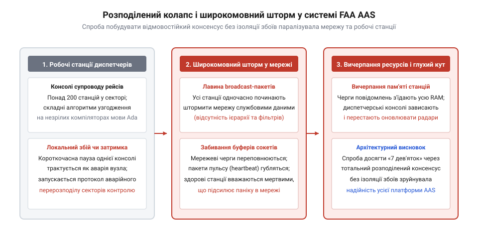

# Приймання системи від підрядника

<preknowlist>
- [Система, яку можна передати](root:progarch/a-system-you-can-hand-over) — замовник зобов'язаний вимагати від підрядника середовище чистої збірки та виконувані тести для забезпечення повної відчужуваності системи
- [Документ, що не гниє](root:progarch/document-that-does-not-rot) — технічні специфікації та вимоги повинні верифікуватися через кодові інваріанти, а не існувати як безконтрольно зростаючі паперові декларації
</preknowlist>

## Криза авіадиспетчерської системи США на межі 1970–1980-х років

У другій половині 1970-х років цивільна авіація Сполучених Штатів опинилася на межі інфраструктурного колапсу. Прийнятий Конгресом у 1978 році Закон про дерегуляцію авіакомпаній (англ. @@en|Airline Deregulation Act@@) скасував державний контроль над маршрутами та ціноутворенням. Авіаперевізники миттєво перебудували польотні графіки за схемою хабів і спиць (англ. @@en|hub-and-spoke@@), що спричинило вибухове зростання інтенсивності перевезень і безпрецедентну концентрацію повітряного трафіку над великими вузловими аеропортами.

Проте цифрова основа Федерального управління цивільної авіації (FAA, англ. @@en|Federal Aviation Administration@@) не була пристосована до такого навантаження. Усі двадцять районних центрів керування повітряним рухом (англ. @@en|Air Route Traffic Control Centers@@, ARTCC) покладалися на мейнфрейми IBM 9020. Цей комплекс було спроєктовано ще в середині 1960-х років на основі архітектури IBM System/360: його обчислювальні блоки працювали на гібридних мікромодулях перших поколінь і пам'яті на магнітних осердях. До кінця 1970-х техніка фізично та морально зносилася. Електронні компоненти перегрівалися й деградували, а потрібні деталі доводилося шукати на складах списаного військового обладнання.

У години пікових навантажень мейнфрейми IBM 9020 регулярно виходили з ладу. Щойно центральна обчислювальна машина гасла, радіолокаційні екрани диспетчерів миттєво втрачали синтетичні формуляри літаків: з них зникали номери рейсів, поточна висота за показами літакових відповідачів та швидкісні вектори. На індикаторах залишалися лише «первинні відмітки» — бліді відблиски відбитого радіосигналу без жодної ідентифікації.

У таких критичних ситуаціях контроль руху переходив у суто ручний режим. Диспетчери розкладали на металевих напрямних пластикові рамки з паперовими смужками рейсів (англ. @@en|flight progress strips@@), опитували екіпажі по голосовому радіозв'язку та вручну розраховували інтервали між бортами в умі. Кожна раптова відмова мейнфрейма довше ніж на кілька секунд перетворювала сектор на зону потенційної авіакатастрофи, де важкі реактивні лайнери зближувалися на швидкості понад дев'ятсот кілометрів на годину.

У 1981 році керівництво FAA ухвалило принципове рішення: відмовитися від подальшого ремонту застарілих машин і створити нову континентальну систему з чистого аркуша. Агентство представило амбітний Національний план модернізації повітряного простору (англ. @@en|National Airspace System Plan@@, NAS Plan). Його наріжним каменем мала стати цифрова розподілена Система перспективної автоматизації (англ. @@en|Advanced Automation System@@, AAS). Система покликана була повністю перевести радіолокаційне супроводження на графічні робочі станції, автоматично виявляти конфлікти траєкторій за десятки хвилин до зближення та назавжди ліквідувати паперові смужки рейсів.

Прагнучи виключити навіть найменший ризик відмови, автори технічного завдання вписали вимогу до доступності, яка згодом стане легендарним прикладом інженерної утопії: готовність системи на рівні `0.9999999` — так звані [сім дев'яток доступності](root:sf-apps/seven-nines-availability) (англ. @@en|seven nines@@).

Річний фонд астрономічного часу становить 31 536 000 секунд. Розрахунок допустимого часу простою виглядає так:

```text
31 536 000 c × (1 - 0.9999999)
= 31 536 000 c × 0.0000001        [частка допустимого простою]
= 3.1536 c                         [максимальний простій на рік]
```

Для всієї загальнонаціональної мережі районних центрів і диспетчерських веж сумарна тривалість усіх збоїв не повинна була перевищувати 3.15 секунди на рік.

Цю цифру чиновники затвердили як політичний орієнтир абсолютної безпеки, проте в агентстві не було проведено жодного дослідження здійсненності (англ. @@en|feasibility study@@, від лат. *facilis* — легкий, здійсненний). У теорії розподілених систем стрибок від трьох чи п'яти дев'яток до семи дев'яток змінює саму природу архітектури. Якщо доступність у `0.999` (близько 8.7 години простою на рік) покривається регулярним обслуговуванням, а `0.99999` (приблизно 5 хвилин на рік) вимагає подвійного гарячого резерву з протоколами серцебиття (англ. @@en|heartbeat@@), то сім дев'яток не залишають часу навіть на перемикання процесів в операційній системі. Жодна втрата пакета, жодне апаратне перезавантаження чи виявлення помилки не могли тривати довше часток секунди. Це вимагало миттєвого розподіленого консенсусу, абсолютної стійкості до візантійських відмов (англ. @@en|Byzantine fault tolerance@@) та відсутності єдиної точки відмови (англ. @@en|single point of failure@@). FAA заклало цю нездійсненну вимогу в юридичний контракт, не розуміючи, як перевіряти її дотримання під час приймання.

> 🔧 **Навіщо це.**
> Нереалістичні нефункціональні вимоги, сформульовані замовником без математичного та архітектурного аудиту, гарантовано руйнують проєкт. Кожна нова дев'ятка доступності після 99.9% експоненційно ускладнює протоколи координації та консенсусу в розподіленій системі. Якщо замовник вимагає неможливого, підрядник не будує надійну систему — він будує декорацію, здатну проходити лише штучні демонстраційні сценарії.

## Тендер століття та архітектурна пастка монолітного контракту (1984–1988)

Масштаб завдання вимагав промислових ресурсів найбільших технологічних корпорацій світу. У 1984 році FAA розпочало двохетапний тендер, у фінальну фазу якого вийшли два гіганти: консорціум Hughes Aircraft та корпорація IBM Federal Systems у партнерстві з Raytheon. Протягом чотирьох років обидві команди вели жорстку конкурентну боротьбу на фазі визначення дизайну (англ. @@en|Design Competition Phase@@), витративши майже пів мільярда доларів державних субсидій на прототипи інтерфейсів, комп'ютерні симуляції та розробку специфікацій.

У липні 1988 року FAA оголосило переможця: генеральний контракт на фазу придбання та розгортання AAS (англ. @@en|Acquisition Phase@@) вартістю 3.6 мільярда доларів дістався IBM Federal Systems. На той час це була найдорожча закупівля програмного забезпечення в цивільній історії.

Архітектурний проєкт IBM радикально відрізнявся від колишньої централізованої моделі. Замість одного масивного комп'ютера обчислення розподілялися між сотнями Спільних консолей (англ. @@en|Common Console@@) — індивідуальних робочих станцій диспетчерів. Консоль оснащувалася передовим квадратним монітором Sony з роздільною здатністю 2048 на 2048 точок та обчислювальним вузлом на базі процесорів IBM RISC System/6000 під керуванням UNIX-подібної системи AIX.

Кожна робоча станція повинна була самостійно декодувати радіолокаційний сигнал, вести векторну віконну графіку та відображати електронні смужки рейсів. Консолі в межах центру об'єднувалися через локальну мережу Token Ring та Ethernet. Для досягнення семи дев'яток надійності IBM розробила концепцію Системних сервісів AAS (англ. @@en|Advanced Automation System Services@@) — високонавантаженого розподіленого програмного шару, покликаного в реальному часі синхронізувати стан пам'яті між десятками вузлів і прозоро перехоплювати керування в разі відмови будь-якої консолі.

Основним інструментом розробки обрали мову Ada (англ. @@en|Ada@@, названу на честь першої програмістки Ади Лавлейс). Міністерство оборони США стандартизувало Ada для критичних систем через її строгий контроль типів, механізм пакетної інкапсуляції та модель паралелізму на основі рандеву. Для проєкту AAS планувалося створити понад два мільйони рядків коду мовою Ada.

Однак за технологічною масштабністю ховалася фатальна методологічна помилка, закріплена умовами контракту.

FAA сформулювало контракт як монолітну закупівлю «під ключ» (англ. @@en|turn-key contract@@) за класичною каскадною моделлю водоспаду. Замість інкрементного виділення функціональних шарів агентство зажадало одночасної розробки та заміни всієї диспетчерської інфраструктури США: консолей аеропортових веж (TCCC), термінальних центрів підходу (TRACON) та двадцяти магістральних районних центрів (ACCC). Проєкт задумувався як гігантський стрибок: роки ізольованої розробки в лабораторіях IBM, після яких мало відбутися одномоментне включення континентальної системи.

Агентство виступило типовим пасивним замовником. У штаті FAA не було системних архітекторів програмного забезпечення, які могли б на інженерному рівні проаналізувати здійсненність розподілених алгоритмів реплікації та консенсусу, запропонованих підрядником. Колектив агентства складався з авіаційних фахівців, чиновників із закупівель і колишніх диспетчерів: вони бездоганно знали правила навігації, але не розумілися на пропускній здатності шин даних, фрагментації оперативної пам'яті та мережевих штормах повідомлень. FAA повністю переклало архітектурну відповідальність на генерального підрядника, щиро вірячи, що контрактні штрафи гарантують успіх.

Як розглядається у темі [система, яку можна передати](root:progarch/a-system-you-can-hand-over), замовник, який не володіє процесом чистої збірки, тестовим стендом та інженерним контуром приймання, втрачає реальний контроль над продуктом. FAA повністю віддало архітектурну владу підряднику, сподіваючись на формальні звіти виконавця.

Замість кодових інваріантів, які можна виконати в автоматизованих тестах, FAA спиралося на багатотисячні стоси технічних вимог, перетворюючи специфікацію на класичний паперовий артефакт, що суперечить концепції [документа, що не гниє](root:progarch/document-that-does-not-rot).


*Пастка монолітного контракту: формальна закупівля надскладної розподіленої системи без власної архітектурної експертизи та незалежного контуру приймання створює ілюзію контролю до моменту інтеграції.*

Фатальною вадою контракту стала відсутність вимоги до постачання робочих вертикальних зрізів (англ. @@en|vertical slices@@). Вертикальний зріз — це мінімальний робочий ланцюг функціональності, що проходить крізь усі рівні архітектури (від отримання сигналу радара до рендерингу позначки на моніторі) і регулярно тестується в реальних умовах. Якби FAA зобов'язало IBM спершу розгорнути простий екран відображення радара на одній станції, перевірити його надійність протягом року в реальному аеропорту, а вже потім нашаровувати розподілені протоколи синхронізації, хибність монолітного задуму виявилася б на самому початку.

Натомість контракт дозволяв підряднику демонструвати «прогрес» виключно за паперовими метриками заробленого обсягу: підписаними специфікаціями, затвердженими інтерфейсними документами та кількістю рядків коду Ada, що успішно пройшли компіляцію. Демонстрації проводилися на штучних лабораторних стендах із парою комп'ютерів. Реальну працездатність розподіленої системи з сотень вузлів в умовах насиченого радіолокаційного трафіку ніхто не перевіряв, а розрив між паперовими звітами та реальним станом софту з кожним місяцем ставав дедалі глибшим.

> 🔧 **Навіщо це.**
> Замовник, який наймає генерального підрядника, зобов'язаний зберегти за собою архітектурну владу та інженерний контроль збірки. Якщо замовник не має власних інженерів, здатних розгорнути вихідний код у незалежному контурі та піддати його стрес-тестам, він стає заручником оптимістичних звітів виконавця. Приймання складної системи за монолітною моделлю «все або нічого» без проміжних робочих зрізів коду неминуче призводить до того, що фундаментальні архітектурні вади виявляються лише тоді, коли виправляти їх уже запізно.

## Лавина змін вимог та ілюзія прогресу паперового приймання (1988–1992)

Щойно генеральний контракт набув чинності, у системі управління розробкою виник фундаментальний дисбаланс. FAA не мало сильної централізованої архітектурної групи, яка захищала б межі системи та контролювала бюджет обчислювальних ресурсів. Натомість агентство відкрило шлюзи для некерованого розширення специфікацій (англ. @@en|scope creep@@).

Диспетчери з різних регіональних центрів, профспілкові комітети, інженери радіолокації та чиновники центрального апарату почали масово висувати власні побажання. Протягом перших чотирьох років розробки FAA надіслало IBM понад 500 масштабних запитів на зміну інженерного проєкту (англ. @@en|Engineering Change Proposals@@, ECP). Ці запити охоплювали все: від кольорової палітри та шрифтів на екранах Sony до правил взаємодії з трекболом, логіки контекстних меню та складних алгоритмів передачі керування бортом між секторами.

Чиновники FAA ставилися до програмного забезпечення як до нескінченно податливої матерії, яку можна перекроювати без архітектурних наслідків. Жодна нова вимога не проходила аналізу на сумісність із жорстким часовим бюджетом обробки радарних сигналів чи допустимим обсягом пам'яті консолей. Специфікація перетворилася на багатотисячні стоси паперу, які постійно змінювалися. Замість кодових інваріантів, які автоматично верифікуються в тестах, проєкт потонув у нескінченних узгодженнях — класичному симптомі того, як за відсутності живих перевірок гниє технічна документація, що суперечить принципам статті [документ, що не гниє](root:progarch/document-that-does-not-rot).

Паралельно розгорталася криза проміжного приймання. Відповідно до державних стандартів закупівель прогрес розробки вимірювався методом освоєного обсягу (англ. @@en|Earned Value Management@@, EVM). Ця методика прийшла з будівництва та суднобудування: вона оцінювала прогрес за освоєними бюджетами, витраченими людино-годинами та підписаними актами проходження формальних віх.

IBM звітувала про завершення попереднього огляду проєкту (англ. @@en|Preliminary Design Review@@, PDR) та критичного огляду проєкту (англ. @@en|Critical Design Review@@, CDR). На регулярних нарадах графіки проєкту світилися «зеленим»: підрядник здавав томи архітектурних описів і звітував про сотні тисяч рядків коду, що успішно пройшли компіляцію.

Демонстрації працездатності мали виключно штучний характер. Підрядник показував роботу станцій на ізольованих лабораторних стендах у присутності делегацій FAA. На екрані симулювався рух кількох літаків на статичному фоні секторної карти. У таких тепличних умовах консоль виглядала бездоганно: меню відкривалися, трекбол переміщував курсор, шрифти відповідали затвердженим стандартам.

Але в FAA не було власного незалежного контуру приймання та автоматизованих стрес-тестів, як того вимагає концепція [система, яку можна передати](root:progarch/a-system-you-can-hand-over). Ніхто не перевіряв, як поведеться система, коли замість двох синтетичних цілей станція отримає потік від двадцяти трасових радарів із двома тисячами реальних рейсів, одночасно синхронізуючи стан із двома сотнями інших консолей через завантажену локальну мережу. Бюрократичне приймання створювало ідеальну ілюзію успіху, тоді як архітектурна прірва між паперами та реальністю щодня поглиблювалася.

> 🔧 **Навіщо це.**
> Паперові метрики виконання робіт (людино-години, томи специфікацій, статус компіляції) не мають жодного стосунку до реальної готовності софту. Єдиною достовірною мірою прогресу складної системи є працюючий вертикальний зріз коду, розгорнутий у тестовому контурі замовника під реалістичним стресовим навантаженням. Якщо замовник приймає етапи за звітами та лабораторними показами підрядника, він платить за комфортну брехню, яка неминуче лусне під час першої справжньої системної інтеграції.

## Архітектурний колапс Ada-моноліту та криза продуктивності (1992–1993)

Момент істини настав на початку 1990-х років, коли IBM спробувала зв'язати окремо розроблені модулі в єдиний комплекс і розгорнути його на тестовому кластері з десятків Спільних консолей. Система миттєво зазнала повної дезінтеграції.

Першим ударом став колапс мережевого прошарку. Щоб забезпечити виконання контрактної вимоги семи дев'яток доступності, IBM спроєктувала підсистему відмовостійкості AAS Services за принципом тотальної взаємної перевірки. Кожна робоча станція безперервно розсилала широкомовні повідомлення серцебиття (англ. @@en|heartbeat@@) всім іншим вузлам мережі. Якщо від консолі не надходило відповіді протягом кількох сотень мілісекунд, інші станції вважали її такою, що вийшла з ладу, і запускали розподілений протокол переобрання лідера та реплікації сесійних даних.

На практиці це призвело до катастрофічного [шторму широкомовних повідомлень](root:sf-distributed/broadcast-storm-consensus) (англ. @@en|broadcast storm@@). Достатньо було одній консолі затриматися з відповіддю через тривалу графічну операцію чи збирання пам'яті, як мережу накривала лавина діагностичних пакетів. Цей трафік перевантажував мережеві інтерфейси сусідніх станцій, викликаючи затримки вже в їхній роботі. У результаті спалахувала каскадна реакція: консолі масово оголошували одна одну «мертвими», витрачали всі обчислювальні ресурси на нескінченні процедури реконфігурації кластера та повністю припиняли обробку даних радарів.


*Архітектурна криза розподіленої системи AAS: надлишкові протоколи виявлення збоїв породжують шторм широкомовних повідомлень, перевантажуючи пам'ять і процесори робочих станцій до повної втрати відгуку.*

Другим нездоланним фактором стала криза пам'яті та компіляції мови Ada. На початку 1990-х років інструменти розробки для Ada перебували в стадії становлення. Тогочасні компілятори ще не володіли зрілими алгоритмами оптимізації та усунення мертвого коду. Вони генерували громіздкі двійкові файли з масивним службовим оточенням часу виконання (англ. @@en|runtime environment@@) для диспетчеризації завдань (англ. @@en|tasking@@).

Кожна консоль IBM RS/6000 комплектувалася обмеженим обсягом оперативної пам'яті — типово від 64 до 128 мегабайтів. Коли монолітний виконуваний файл AAS, роздутий до понад півтора мільйона рядків коду, завантажувався в пам'ять разом із динамічними структурами даних радарних траєкторій, фізичної пам'яті катастрофічно не вистачало. Операційна система AIX починала агресивне скидання сторінок на диск (англ. @@en|thrashing@@). Затримка відгуку інтерфейсу зростала від допустимих мілісекунд до десятків секунд: екран зависав, а трекбол диспетчера переставав реагувати на рухи руки.

Намагаючись врятувати становище, IBM почала масово залучати нових програмістів. Проте різке розширення штату підрядника лише прискорило деградацію процесів згідно з законом Брукса: новачки не розуміли взаємозв'язків у гігантському моноліті, а витрати на комунікацію вибухнули, як описано в темі [введення нової команди в систему](root:progarch/onboarding-a-new-team).

До 1993 року затримка графіка здачі перевищила п'ять років. Прогнозний кошторис програми з початкових 3.6 мільярда злетів до астрономічних 7.6 мільярда доларів. Комп'ютерний моноліт падав навіть від мінімального навчального навантаження, і в кулуарах агентства визнали гірку правду: прийняти систему в промислову експлуатацію в такому вигляді фізично неможливо.

> 🔧 **Навіщо це.**
> Розподілена відмовостійкість не є безкоштовною властивістю, яку можна механічно додати до коду на фінальному етапі. Протоколи консенсусу, серцебиття та реплікації створюють колосальний мережевий і обчислювальний оверхед, який за відсутності суворої ізоляції доменів відмов призводить до лавиноподібного самоблокування системи. Перевіряти життєздатність обраної топології та алгоритмів узгодженості потрібно на ранніх прототипах під граничним навантаженням мережі, а не після того, як написані мільйони рядків прикладного коду.

## Нищівні висновки GAO та скасування програми адміністратором Гінсоном (1993–1994)

На початку 1993 року завіса секретності та оптимістичних звітів навколо проєкту AAS остаточно впала. Рахункова палата США (GAO, англ. @@en|General Accounting Office@@) оприлюднила серію нищівних викривальних аудиторських звітів. Висновки урядових інспекторів приголомшили Конгрес: програма перебувала в стані повної некерованості, терміни зірвано мінімум на п'ять років, а прогнозований загальний кошторис роздувся з початкових 3.6 мільярда до понад 7.6 мільярда доларів.

Аудитори GAO розкрили головну причину катастрофи: повну відсутність у замовника інженерного контролю над прийманням розробки. FAA платило IBM десятки мільйонів доларів щомісяця на основі розрахунків заробленого обсягу робіт, але жоден чиновник агентства не міг підтвердити реальну працездатність софту в експлуатаційних умовах. Підрядник створював мільйони рядків коду, який не проходив інтеграційних тестів, а агентство безперервно генерувало сотні нових змін до вимог, не оцінюючи їхню сумісність із ресурсами апаратних станцій.

У серпні 1993 року посаду адміністратора FAA обійняв Девід Гінсон (англ. @@en|David Hinson@@) — колишній військовий льотчик і досвідчений топменеджер авіаційної індустрії. На відміну від попередників, які перебували в полоні [пастки безповоротних витрат](root:sf-apps/sunk-cost-fallacy-in-architecture) (англ. @@en|sunk cost fallacy@@) і вимагали нових мільярдів на «порятунок розпочатого», Гінсон призначив незалежний технічний аудит програми.

Висновки технічних експертів були однозначними: розподілена архітектура AAS була фундаментально хибною. Спроба створити загальнонаціональний розподілений консенсус із доступністю «сім дев'яток» на незрілій версії мови Ada призвела до архітектурного глухого кута. Жодне додаткове фінансування чи набір нових програмістів не могли усунути системні затримки й мережеві шторми пакетів усередині моноліту.

У червні 1994 року Девід Гінсон оголосив безпрецедентне в історії державних закупівель США рішення: програму AAS офіційно зупинено, а її центральний компонент — Комплекс комп'ютерів районних центрів (ACCC) — повністю скасовано.

Фінансові наслідки були катастрофічними. Більше 2.6 мільярда доларів прямих витрат платників податків було списано як безповоротно втрачені. За дванадцять років розробки агентство не отримало жодної працюючої системи в промисловій експлуатації: диспетчери в усіх двадцяти районних центрах продовжували працювати на аварійних лампових мейнфреймах IBM 9020 та паперових смужках.

Катастрофа змусила FAA докорінно змінити інженерну стратегію: відмовитися від монолітного каскадного підходу на користь модульного та інкрементного постачання. Замість спроби замінити все одночасно агентство розбило завдання на ізольовані частини:

1. Заміна дисплейної системи (англ. @@en|Display System Replacement@@, DSR). FAA врятувало найуспішніший апаратний компонент розробки — ергономічні робочі станції Sony з роздільною здатністю 2048 на 2048 точок. Відкинувши складний софтверний шар розподіленого консенсусу AAS, інженери створили простий, прямий драйвер інтерфейсу до наявних мейнфреймів. Проєкт DSR зосередився виключно на заміні моніторів і був успішно введений у дію в усіх центрах США вчасно та в межах виділеного бюджету.
2. Стандартна термінальна автоматизована система заміни (англ. @@en|Standard Terminal Automation Replacement System@@, STARS). Для диспетчерських вишок та радарів підходу агентство повністю відмовилося від розробки з нуля, зробивши ставку на готові комерційні компоненти (англ. @@en|commercial off-the-shelf@@, COTS) із відкритими стандартами та модульною архітектурою.

> 🔧 **Навіщо це.**
> Пастка безповоротних витрат — головний психологічний ворог інженерного керівництва. Коли багаторічний проєкт зазнає краху через фундаментальні вади архітектури, правильним управлінським рішенням є списання збитків і закриття глухого кута, а не нескінченні фінансові вливання. Порятунок працюючих вертикальних модулів (як екранні станції в DSR) та їхнє поетапне підключення до стабільної бази дозволяє вийти з кризи з мінімальними втратами.

## Розвінчання міфів та фундаментальні уроки для інженерного приймання систем

Крах програми FAA AAS миттєво обріс міфами в інженерній спільноті 1990-х років. Найпопулярнішим стало звинувачення мови програмування Ada. Публіцисти та комп'ютерні журналісти стверджували, що мова виявилася надмірно складною, повільною та непридатною для систем реального часу. Проте ретельні ретроспективні розслідування Інституту програмної інженерії (SEI) спростували цю тезу. Мова Ada сумлінно виконувала закладені інструкції: причиною провалу були не синтаксис чи компілятори, а архітектурні вимоги до тотального широкомовного серцебиття та відсутність ізоляції відмов. Жодна мова програмування — чи то C, C++ чи асемблер — не змогла б врятувати систему від деградації пам'яті та мережевих штормів за такої помилкової топології розподіленого стану.

Другим міфом стала теза про виняткову провину та некомпетентність підрядника — корпорації IBM. Безумовно, генеральний виконавець припустився серйозних інженерних прорахунків під час масштабування кодової бази. Однак підрядник діяв у межах контрактних стимулів, створених замовником. Методика заробленого обсягу заохочувала написання тонни документації та роздування кодової бази, а постійні зміни вимог із боку FAA генерували додаткові платні замовлення.

Катастрофа AAS стала вододілом в історії системної інженерії, сформулювавши ключові принципи успішного замовлення та приймання програмних комплексів:

1. **Замовник зобов'язаний зберігати власну архітектурну владу.** Неможливо ефективно прийняти складну систему, якщо в штаті організації немає системних архітекторів, здатних рецензувати креслення компонентів, моделювати поведінку системи за граничних умов і зупиняти нездійсненні забаганки бізнес-користувачів. Перекладання архітектурної відповідальності на зовнішнього виконавця завжди веде до втрати контролю над проєктом.
2. **Приймання можливе лише через робочі вертикальні зрізи коду.** Здача системи єдиним монолітним біг-бенгом після років закритої розробки гарантовано приховує критичні вади до фази фінальної інтеграції. Замовник має вимагати постачання мінімальних наскрізних ланцюгів функціональності кожні кілька тижнів.
3. **Власний незалежний контур збірки та автоматизованого тестування.** Як доводить інженерна практика в темі [система, яку можна передати](root:progarch/a-system-you-can-hand-over), передача системи вважається здійсненою лише тоді, коли замовник може розгорнути вихідний код у власному ізольованому середовищі, скомпілювати його без участі підрядника та виконати наскрізні тести під граничним стресовим навантаженням.
4. **Кодові інваріанти замість паперових специфікацій.** Зміни вимог повинні негайно виражатися у виконуваних тестах, які верифікують архітектурні обмеження (бюджет затримок, ліміти споживання пам'яті, пропускну здатність шин). Без цього вимоги неминуче деградують у томи мертвого тексту, як описано в матеріалі [документ, що не гниє](root:progarch/document-that-does-not-rot).
5. **Масштабування штату не рятує затриману систему.** Спроба влити сотні нових розробників у заплутаний монолітний код під час кризи не прискорює завершення, а лише посилює комунікаційний параліч. Процес адаптації нових фахівців у складній системі вимагає суворої модульності та ізольованих контекстів, як наголошується в темі [введення нової команди в систему](root:progarch/onboarding-a-new-team).

Головний урок AAS простий і безжальний: замовник ніколи не приймає документи чи людино-години. Приймання системи від підрядника — це безперервний процес інженерної валідації працюючого програмного коду на власних стендах замовника від першого рядка до завершення життєвого циклу.

> 🔧 **Навіщо це.**
> Контрактні гарантії та штрафні санкції ніколи не компенсують відсутність власної інженерної експертизи. Перш ніж підписувати багатомільйонний контракт із підрядником, замовник зобов'язаний розгорнути власний тестовий контур, сформувати архітектурний комітет і закріпити в договорі обов'язкове щомісячне приймання робочих вертикальних зрізів коду. Тільки працюючий білд у ваших руках дає реальне право власності на систему.
