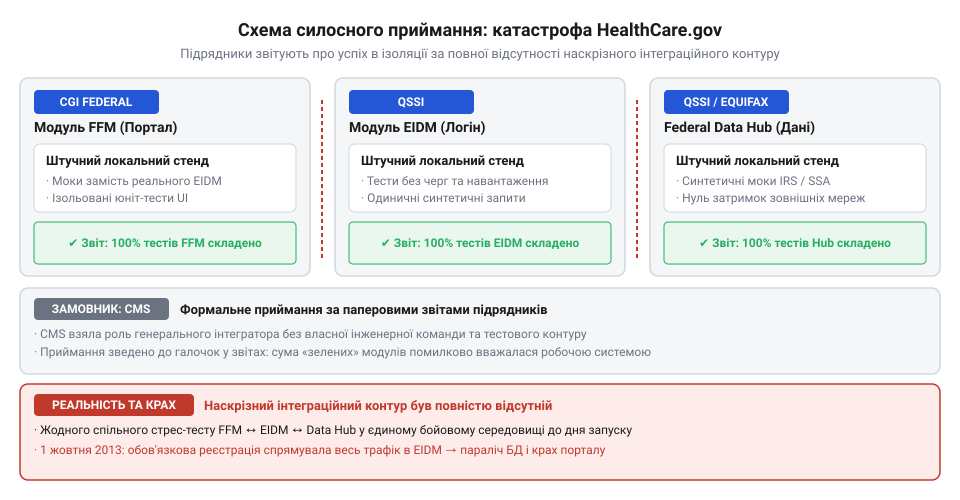
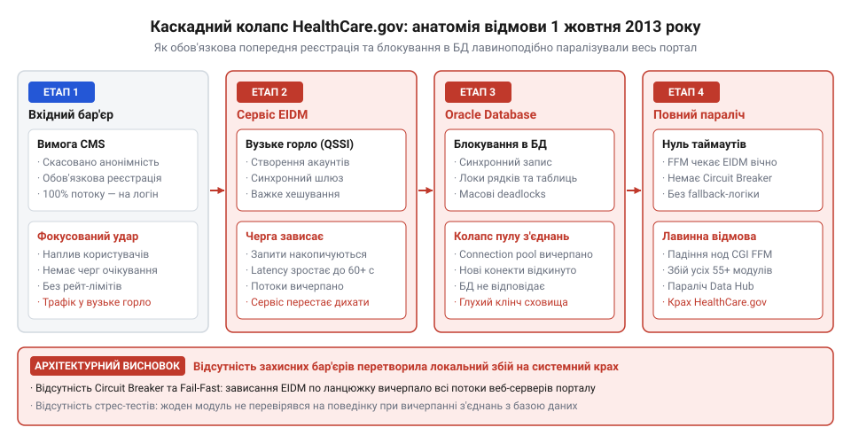

# Приймання системи від підрядника

<preknowlist>
- [Система, яку можна передати](root:progarch/a-system-you-can-hand-over) — критерії автономності кодової бази та відчужуваності системи без залежностей від середовища підрядника
- [Введення нової команди в систему](root:progarch/onboarding-a-new-team) — здатність сторонньої команди інженерів розгорнути та підтримувати систему з чистого аркуша
- [Документ, що не гниє](root:progarch/document-that-does-not-rot) — чому паперові специфікації та статус-звіти застарівають і втрачають зв'язок із дійсним станом коду
</preknowlist>

## Політичний дедлайн і пастка замовника як генерального інтегратора (2010–2012)

Коли велика організація замовляє розробку складної цифрової платформи десяткам сторонніх компаній, найбільша загроза виникає не в рядках вихідного коду, а в просторі між ними. Кожен виконавець отримує власне технічне завдання, пише свій модуль, налаштовує власну базу даних і тестує інтерфейси у закритому лабораторному контурі. На рівні окремих компонентів усе виглядає бездоганно: кнопки натискаються, запити виконуються, внутрішні тести завершуються успішно. Але щойно ці фрагменти спробують об'єднати в єдину живу мережу під реальним потоком користувачів, система розсипається: виклики між сервісами блокують один одного, неузгоджені формати даних ламають обробку, а знайти відповідального неможливо, бо кожен підрядник виконав свій контракт буквально.

У березні 2010 року уряд США ухвалив закон про доступне медичне страхування (англ. @@en|Affordable Care Act@@, скорочено ACA). Закон вимагав безпрецедентного інженерного рішення: створити національний вебпортал HealthCare.gov, де мільйони громадян могли б через єдину точку входу перевірити право на субсидію, порівняти страхові плани й оформити медичний поліс. Політичний календар визначив непохитну дату відкриття системи для загалу — 1 жовтня 2013 року. На створення складної розподіленої системи залишалося трохи більше трьох років, проте федеральні відомства понад рік витратили на бюрократичні узгодження нормативних вимог, перш ніж сформулювати технічні завдання для розробників.

Коли черга дійшла до інженерної реалізації, державна агенція Центрів послуг Medicare та Medicaid (англ. @@en|Centers for Medicare & Medicaid Services@@, CMS), яка підпорядковувалася Міністерству охорони здоров'я, опинилася перед вибором моделі керування проєктом. У великих державних замовленнях замовник зазвичай винаймає [генерального системного інтегратора](root:sf-apps/lead-system-integrator) (англ. @@en|lead system integrator@@, від лат. integer — цілий) — потужну технологічну компанію, яка бере на себе повну архітектурну відповідальність за наскрізну працездатність комплексу, координацію субпідрядників, стандарти інтерфейсів, автоматизацію збірок і фінальне стрес-тестування.

Проте CMS ухвалила фатальне рішення: агенція вирішила виступити генеральним системним інтегратором самостійно. У штаті урядового відомства працювали досвідчені чиновники, юристи та фахівці з медичного регулювання, але не було жодного головного архітектора програмних систем чи команди інженерів із досвідом побудови високонавантажених вебзастосунків. Чиновники сприймали системну інтеграцію не як технічну дисципліну контролю інваріантів, узгодженості даних та ізоляції збоїв, а як адміністративний нагляд за дотриманням календарних графіків і контрактних бюджетів.

У результаті розробку платформи роздробили на понад 55 окремих комерційних контрактів. Створення користувацького вебінтерфейсу та федеральної біржі (англ. @@en|Federally-facilitated Marketplace@@, FFM) доручили компанії CGI Federal — американському підрозділу канадської корпорації CGI Group. Розробку центрального хабу даних (англ. @@en|Data Services Hub@@), який мав у реальному часі запитувати конфіденційні відомості з баз даних Податкової служби (IRS), Управління соціального захисту (SSA) та Міністерства внутрішньої безпеки (DHS), а також модуль єдиного входу й автентифікації Enterprise Identity Management (EIDM) віддали компанії Quality Software Services Inc. (QSSI). Розрахунок страхових субсидій, керування каталогами медичних планів і платіжні шлюзи доручили іншим постачальникам, а фізичні сервери та хмарну інфраструктуру надала компанія Terremark (підрозділ Verizon).

Жоден із цих підрядників не мав контракту чи повноважень контролювати архітектуру сусідів. Між ключовими виконавцями утворилися ізольовані колодязі розробки (англ. @@en|silos@@). Компанії самостійно тлумачили мінливі специфікації, обирали несумісні технологічні стеки, писали власні протоколи взаємодії та проєктували схеми баз даних без узгодження глобальних блокувань. Агенція CMS створила управлінську структуру, в якій за окремі модулі відповідали десятки зовнішніх менеджерів, але за стабільність інтегрованого комплексу як єдиного інженерного організму не відповідав ніхто.

> 🔧 **Навіщо це.** Дроблення розподіленої системи на незалежні комерційні контракти без наділеного технічною владою головного архітектора створює вакуум інженерної відповідальності: коли кожен виконавець дбає лише про ізольовану функціональність власного вузла, глобальні проблеми сумісності, продуктивності та надійності виявляються вже після запуску у промислову експлуатацію.

## Ілюзія «зеленого статусу» та паперове приймання (2012 — літо 2013)

Протягом 2012 та першої половини 2013 року робота над порталом HealthCare.gov зовні виглядала як зразковий успіх. Підрядники справно надсилали щотижневі звіти, брали участь у міжвідомчих комісіях і запевняли замовника у бездоганному прогресі. У презентаціях для чиновників CMS панував «зелений статус»: графіки дотримувалися, витрати вкладалися в затверджені кошториси, а підрядники публічно декларували використання гнучких методологій розробки (Agile).

Насправді під модною вивіскою Agile ховався класичний неповороткий водоспад (Water-scrum-fall). Кожен підрядник писав код за застарілими паперовими специфікаціями, які посадовці CMS регулярно змінювали, надсилаючи сотні сторінок додаткових роз'яснень у форматі PDF. Оскільки реальні бізнес-вимоги постійно дрейфували, розробники не встигали синхронізувати зміни в моделях даних і API. Замість того, щоб будувати живі автоматизовані тести на рівні коду, сторони вели нескінченні паперові листування про межі контрактних зобов'язань.

Приймання виконаних робіт з боку CMS мало суто формальний, бюрократичний характер (англ. @@en|compliance-based acceptance@@, від лат. complere — виконувати). Чиновники звіряли виконані пункти контракту за контрольними списками вимог: якщо модуль FFM містив заявлені екрани вводу анкети, а модуль EIDM мав форму створення логіна й пароля, роботу вважали прийнятою та підписували фінансові акти. Перевірка працездатності проводилася виключно у вигляді демонстрацій на локальних стендах підрядників. Виконавці запускали застосунки на власних машинах, підключали стерильні тестові бази даних із кількома десятками штучно підготовлених записів і показували успішне проходження ідеального користувацького сценарію. На таких обсягах даних не виникало ані вичерпання пулів з'єднань, ані конкурентних блокувань таблиць.

*Ілюзія готовності: кожен виконавець звітує про успішне проходження локальних тестів, проте відсутність єдиного контуру збірки та інтеграції замовника приховує критичну несумісність сервісів.*

Справжня [система, яку можна передати](root:progarch/a-system-you-can-hand-over), передбачає повну відчужуваність: замовник зобов'язаний мати ізольоване середовище чистої збірки (англ. @@en|cleanroom environment@@), де код із репозиторію збирається з нуля без доступу до внутрішніх ресурсів виконавця, розгортається автоматизованими скриптами та проходить валідацію міграцій бази даних. У проєкті HealthCare.gov такого середовища не існувало взагалі. CMS не мала власної інфраструктури для перевірки збірок, не вимагала від підрядників відтворюваних скриптів розгортання й навіть не володіла централізованим репозиторієм коду всього комплексу. 

Замовник сліпо покладався на затверджені технічні документи та протоколи погодження, забуваючи, що будь-який [документ, що не гниє](root:progarch/document-that-does-not-rot), повинен бути нерозривно зв'язаний із реальною кодовою базою через автоматизовані тести та перевірку інваріантів, а не існувати як окрема статична декларація про наміри.

У березні-квітні 2013 року, за пів року до офіційного старту, міжнародна консалтингова компанія McKinsey за дорученням уряду провела незалежний аудит стану підготовки порталу. Звіт McKinsey містив тривожні висновки: через затримки у розробці та постійні перегляди вимог графіки інтеграційного тестування було зірвано, наскрізне тестування взаємодії між компонентами відкладалося на останній момент, а агентство CMS не мало дієвих інструментів для вимірювання готовності системи. Аудитори прямо вказали, що запуск неінтегрованої розподіленої системи несе критичний ризик повного операційного збою.

Проте керівництво CMS проігнорувало застереження консультантів. Оскільки формальні звіти підрядників продовжували світитися зеленими прапорцями, а політичний тиск вимагав відкриття маркетплейсу строго 1 жовтня 2013 року, чиновники ухвалили рішення продовжувати рух за планом. Будь-які сумніви глушилися бюрократичним самозаспокоєнням: кожен окремий підрядник гарантував, що його модуль виконаний за контрактом, а отже, загальна система просто зобов'язана запрацювати після з'єднання кабелів.

> 🔧 **Навіщо це.** Демонстрація роботи програми на обладнанні підрядника перевіряє лише видиму поведінку в ідеальних тепличних умовах. Без незалежного приймання в автономному контурі замовника з перевіркою відтворюваної збірки, міграцій баз даних і наскрізної інтеграції підписання актів перетворюється на самообман, за який компанія платить катастрофою в день релізу.

## Зміна правил в останній момент і зірвані випробування (серпень — вересень 2013)

Найнебезпечніша ситуація для будь-якої складної системи настає тоді, коли за лічені тижні до промислового випуску замовник несподівано змінює фундаментальний сценарій взаємодії користувача з платформою. Початковий архітектурний задум HealthCare.gov передбачав вільний попередній анонімний перегляд (англ. @@en|window shopping@@). Відвідувач мав зайти на сайт, вказати свій вік, склад родини й поштовий індекс, після чого система видавала каталог доступних страхових тарифів із розрахованою вартістю. Створення облікового запису та перевірка персональних документів були потрібні лише на фінальному етапі, коли людина вже обрала конкретний план і переходила до підписання договору. Такий розподіл навантаження дозволяв згладити потік звернень: переважна більшість користувачів споживала лише кешовані статичні дані, а важкі операції реєстрації виконувалися асинхронно та порційно.

Однак наприкінці серпня 2013 року політичне керівництво CMS та Міністерства охорони здоров'я охопила паніка через так званий «шок цін» (англ. @@en|rate shock@@). Чиновники побоювалися, що громадяни побачать повну комерційну вартість страхових полісів без урахування персональних державних субсидій, злякаються високих цифр і залишать портал ще до подання заявки. Щоб уникнути політичного резонансу, керівництво агентства видало директивне розпорядження: повністю закрити анонімний доступ до каталогів. Будь-який відвідувач був зобов'язаний спершу пройти повну процедуру реєстрації, створити обліковий запис, підтвердити особу та дочекатися розрахунку індивідуальної допомоги, і лише після цього отримував дозвіл побачити доступні медичні плани.

Це рішення стало фатальною інженерною міною. Одномоментно 100% усього вхідного трафіку було перенаправлено через єдиний вузький перешийок — підсистему Enterprise Identity Management (EIDM), створену підрядником QSSI. Модуль EIDM ніколи не проєктувався для такого режиму роботи: його розраховували як сервіс фонової реєстрації кількох тисяч користувачів на добу, а не як першу лінію оборони під шквальним трафіком мільйонів людей. Кожна спроба реєстрації ініціювала ланцюжок важких синхронних викликів за протоколом SOAP/XML до хабу даних та численних зовнішніх баз, супроводжуючись масивними транзакційними записами в центральну реляційну базу даних Oracle.

Через те, що інтеграційні випробування постійно відкладали, перший наскрізний навантажувальний тест системи у повній конфігурації вдалося провести лише за два тижні до запуску — у середині вересня 2013 року. Результати виявилися катастрофічними: під симульованим навантаженням усього в кілька сотень одночасних сесій система намертво зависла. База даних Oracle захлинулася через взаємні блокування (англ. @@en|deadlocks@@, від dead — мертвий, lock — замок) на таблицях сесій, черги запитів у модулі EIDM перевищили критичні ліміти пам'яті, а вебінтерфейс почав повертати користувачам порожні сторінки.

Інженери підрядників бачили колапс на власні очі, проте у звітах для вищого керівництва проблеми знову приховали за розпливчастими формулюваннями. Політичний тиск не залишав простору для маневру: дата 1 жовтня була закріплена федеральним законом, а президент публічно обіцяв запуск у визначений термін. Замість того, щоб оголосити аварійну зупинку, відновити анонімний перегляд і перенести публічний запуск до усунення вузького горла (англ. @@en|bottleneck@@), чиновники CMS вирішили сподіватися, що система якось витримає перший день за рахунок додавання оперативної пам'яті на серверах.

> 🔧 **Навіщо це.** Будь-яка зміна призначеного для користувача маршруту безпосередньо впливає на профіль навантаження архітектури. Якщо зміна вимог перетворює другорядний сервіс на обов'язковий бар'єр для всього потоку запитів, система потребує негайного повторного стрес-тестування; ігнорування цього правила гарантує миттєву відмову в промисловому контурі.

## Публічний запуск і каскадний колапс системи (1 жовтня 2013)

Опівночі 1 жовтня 2013 року портал HealthCare.gov офіційно відкрив реєстрацію для громадян США. Протягом перших годин ресурс відвідали сотні тисяч користувачів, і система зазнала блискавичного системного паралічу. Оскільки вхід без створення облікового запису був заблокований, весь гігантський потік людей одночасно кинувся заповнювати реєстраційні анкети в модулі EIDM.

Розпочалася класична [каскадна аварія розподіленої архітектури](root:sf-distributed/cascading-failures). Сервіс автентифікації намагався створити облікові записи, відкриваючи важкі транзакції в базі даних Oracle. Через непродуману схему індексації та конкурентні блокування рядків час виконання одного запису зріс із мілісекунд до десятків секунд. Пул з'єднань до бази даних (англ. @@en|connection pool@@) вичерпався за лічені хвилини. Нові запити від користувачів почали накопичуватися в чергах пам'яті сервісу EIDM.

*Анатомія каскаду: блокуючий синхронний виклик до вузького горла EIDM вичерпує пули з'єднань і паралізує незалежні вебсервери за відсутності circuit breaker і лімітування запитів.*

Далі збій перекинувся на фронтенд-сервери під керуванням Apache та IBM WebSphere, створені підрядником CGI Federal. Вебсервери виконували блокуючі синхронні виклики до завислого модуля EIDM. Оскільки розробники не налаштували агресивні таймаути сокетів і не застосували патерн автоматичного вимикача ланцюга (англ. @@en|circuit breaker@@), кожен завислий запит утримував виділений системний потік процесора. Це призвело до швидкого вичерпання пулу потоків — явища голодування потоків (англ. @@en|thread starvation@@). Вебсервери припинили відповідати навіть на базові статичні запити, і екран браузера мільйонів американців потонув у повідомленнях про помилки 500 Internal Server Error та 502 Bad Gateway. За першу добу роботи із мільйонів відвідувачів успішно завершити реєстрацію й подати заявку змогли лише шість осіб.

Найгіршим наслідком роздільного силосного проектування стала абсолютна діагностична сліпота. У системі не було передбачено наскрізної кореляції подій (англ. @@en|correlation ID@@) між логами CGI Federal, сервісами QSSI та базою даних Terremark. Агенція CMS не мала централізованого дашборду моніторингу, який би відображав здоров'я сервісів у реальному часі. Ні замовник, ні виконавці не могли з'ясувати, який саме компонент упав першим і де локалізована першопричина збою.

Замість спільного виправлення архітектури між компаніями розпочалася війна взаємних звинувачень: CGI Federal стверджувала, що їхній портал бездоганний, а винен модуль автентифікації QSSI; QSSI заявляла, що їхній код працює штатно, але хостинг Terremark не виділяє достатньо апаратних ресурсів; Terremark доводила, що сервери функціонують нормально, а проблеми викликані неякісним програмним забезпеченням. Коли розподілена система впала, відсутність документації та заплутана архітектура унеможливили швидке [введення нової команди в систему](root:progarch/onboarding-a-new-team): зовнішні спеціалісти, покликані рятувати ситуацію, витрачали дні лише на те, щоб з'ясувати фізичну топологію мережі та де саме зберігаються конфігураційні файли. Замовник залишився сам на сам із мертвою платформою, за яку було сплачено сотні мільйонів доларів.

> 🔧 **Навіщо це.** Наскрізні ідентифікатори запитів, ліміти черг і захисні вимикачі збоїв (circuit breakers) є обов'язковими бар'єрами життєздатності будь-якої розподіленої архітектури. Якщо під час приймання замовник не тестує реакцію системи на відмову або уповільнення суміжних сервісів, перший же локальний збій у промисловому середовищі неминуче переросте в повний системний блекаут.

## «Tech Surge»: порятунок живої системи інженерною гігієною (жовтень — листопад 2013)

Коли в середині жовтня 2013 року масштаби катастрофи HealthCare.gov стали очевидними для всієї країни, класичний управлінський апарат зайшов у глухий кут. Підрядники продовжували перекладати вину одне на одного, чиновники готувалися до слухань у Конгресі, а система залишалася непрацездатною. У цей момент Білий дім ухвалив безпрецедентне рішення: відсторонити традиційну бюрократичну вертикаль і залучити зовнішню групу цивільних інженерів із Кремнієвої долини. Ця операція отримала назву «технологічний сплеск» (англ. @@en|Tech Surge@@, від лат. surgere — підійматися), а її координацію доручили головному технічному директору США Тодду Парку (Todd Park).

Ключовим технічним лідером рятувальної групи став Майкі Дікерсон (Mikey Dickerson) — колишній інженер із надійності систем Google (англ. @@en|Site Reliability Engineering@@, скорочено SRE). Прибувши до штаб-квартири CMS у Меріленді разом із невеликою групою добровольців, Дікерсон виявив повний вакуум технічних даних: ніхто з керівників не міг назвати точну кількість діючих серверів, топологію з'єднань чи хоча б відсоток запитів, які завершувалися помилками.

Замість того, щоб зупиняти систему на багатомісячне переписування коду з нуля, команда Дікерсона зосередилася на відновленні базової інженерної гігієни живої платформи. Першим кроком стало розгортання комерційних інструментів наскрізного моніторингу продуктивності застосунків (англ. @@en|Application Performance Monitoring@@, скорочено APM), зокрема агента New Relic, безпосередньо на робочих вузлах. За лічені години інженери вперше отримали об'єктивну телеметрію: точні перцентилі часу відгуку (p95 та p99), розподіл помилок за HTTP-кодами та перелік найповільніших викликів до бази даних Oracle.

Озброївшись метриками, Дікерсон зламав силосну структуру комунікації. Усіх провідних інженерів від компаній-виконавців — CGI Federal, QSSI, Terremark та CMS — зібрали в одній фізичній кімнаті, перетвореній на командний пункт подолання інцидентів (англ. @@en|war room@@). Замість юридичних листувань було впроваджено щоденні спільні розбори метрик: кожен збій аналізували за фактами в логах, а не за контрактними зонами відповідальності.

Протягом кількох тижнів команда ліквідувала головні архітектурні дефекти. В базі даних Oracle розробники зняли надлишкові блокування на таблицях сесій, переписали неефективні SQL-запити та налаштували суворі ліміти для пулу з'єднань JDBC. Одночасно на рівні вебінтерфейсу було увімкнено агресивне кешування незмінних списків страхових планів, а на фронтенді нарешті відкрили анонімний попередній перегляд цін, знявши колосальний потік марних реєстрацій із модуля EIDM. Замість масивних небезпечних релізів запровадили короткі нічні вікна оновлень, у яких розгортали лише перевірені точкові виправлення.

До 30 листопада 2013 року ситуація стабілізувалася: рівень доступності порталу перевищив 90%, затримка обробки запитів скоротилася з кількох хвилин до часток секунди, а система набула здатності одночасно обслуговувати десятки тисяч активних користувачів без ризику повторного колапсу.

> 🔧 **Навіщо це.** Під час системної кризи порятунок починається не з написання нового коду, а з увімкнення наскрізної спостережуваності: доки архітектор не бачить перцентилів затримок та точок блокування ресурсів у реальному часі, будь-які спроби оптимізації залишаються сліпими здогадками.

## Розвінчання міфів, висновки GAO та спадщина USDS (2014 і далі)

Після успішної стабілізації порталу масштаби події стали предметом прискіпливих офіційних розслідувань. У 2014–2015 роках Рахункова палата США (англ. @@en|Government Accountability Office@@, скорочено GAO) та комітети Конгресу оприлюднили вичерпні звіти, які зруйнували зручні для політиків і підрядників міфи навколо запуску HealthCare.gov.

Першим і найпопулярнішим був міф про «непередбачуваний наплив трафіку»: у перші дні чиновники та менеджери публічно стверджували, що система просто захлинулася під небувалою хвилею мільйонів патріотично налаштованих американців. Розслідування GAO довело цілковиту безпідставність цієї тези. Архітектурні випробування підтвердили, що портал втрачав працездатність уже за одночасної присутності 200–300 активних користувачів. Навіть якби на сайт завітала незначна частка очікуваної аудиторії, система все одно зазнала б краху через внутрішні блокування транзакцій, відсутність таймаутів та каскадне голодування потоків.

Другим спростованим міфом стало перекладання всієї провини на «некомпетентних програмістів підрядника». Звіти комісій засвідчили: вихідний код CGI Federal чи QSSI здебільшого суворо відповідав письмовим специфікаціям, наданим урядом. Катастрофа стала результатом фундаментальної вади моделі приймання (англ. @@en|compliance-based trap@@): замовник перевіряв відповідність окремих пунктів технічного завдання на папері замість того, щоб протестувати наскрізну поведінку інтегрованої системи у власному контурі.

Крах HealthCare.gov показав усьому світу, що закупівля складного програмного забезпечення не може будуватися за правилами придбання будівельних матеріалів чи автомобілів. Затверджені паперові плани створюють ілюзію стабільності, але лише справжня [система, яку можна передати](root:progarch/a-system-you-can-hand-over), гарантує бізнесу відчужуваність продукту — завдяки автоматизованій збірці в ізольованому контурі замовника, наявності робочих міграцій баз даних та доведеній стійкості до відмов.

Гіркий досвід 2013 року призвів до докорінної реформи інженерних стандартів у державному секторі США. У 2014 році за прямою вказівкою президента було засновано дві спеціалізовані інженерні структури: Цифрову службу США (англ. @@en|U.S. Digital Service@@, скорочено USDS), яку очолив Майкі Дікерсон, та агенцію 18F. Головним завданням цих команд стало запровадження сучасної інженерної культури в державних органах влади.

Результатом роботи USDS стало створення «Посібника з цифрових послуг» (англ. @@en|Digital Services Playbook@@), який перетворив уроки HealthCare.gov на обов'язковий стандарт приймання програмних систем:
- **Автономність збірки:** заборона приймання коду, який не може бути зібраний і розгорнутий автоматизованими інструментами в ізольованому середовищі замовника.
- **Обов'язкові [ворота якості](root:sf-release/quality-gates) (Quality Gates):** впровадження системи автоматизованих бар'єрів, яка блокує підписання фінансових актів за наявності критичних вразливостей або дефектів продуктивності.
- **Наскрізні навантажувальні тести:** перевірка роботи підсистеми під цільовим піковим профілем навантаження ще задовго до публічного релізу, а не за два тижні до нього.
- **Спостережуваність як контрактна вимога:** включення метрик затримки (p95/p99) та структурованого логування з обов'язковими кореляційними ідентифікаторами до списку критеріїв приймання робіт.

Катастрофа HealthCare.gov закріпила в сучасній архітектурній інженерії непорушне правило: система вважається прийнятою від підрядника не тоді, коли представники сторін підписали протокол виконаних робіт, а лише тоді, коли живий інтегрований код успішно витримав випробування в незалежному контурі замовника під реалістичним бойовим навантаженням.

> 🔧 **Навіщо це.** Формальна відповідність коду контрактній специфікації нічого не варта без доведеної надійності в умовах промислового навантаження. Запровадження інженерних воріт якості та автономних acceptance-тестів переносить ризики з дня публічного релізу на етап попередніх випробувань, зберігаючи життєздатність бізнесу та репутацію замовника.
