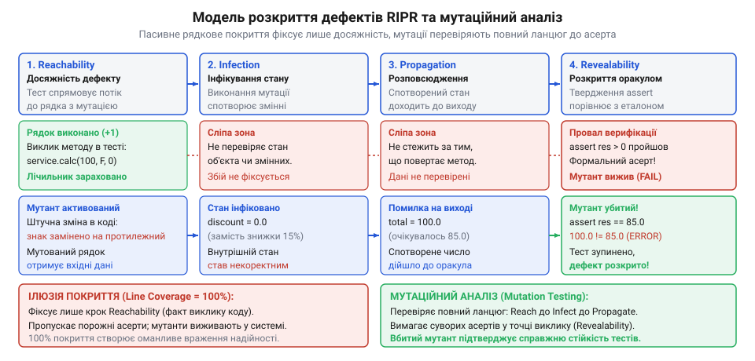
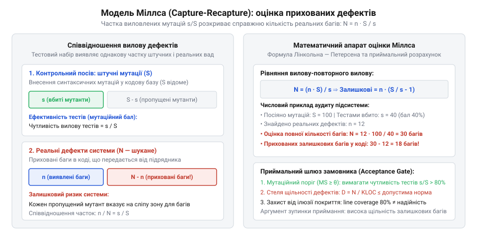

# Приймання системи від підрядника

<preknowlist>
- [Система, яку можна передати](root:progarch/a-system-you-can-hand-over) — критерії технічної відчужуваності кодової бази та ризики підписання актів прийому-передачі за формальними паперовими звітами підрядника
- [Документ, що не гниє](root:progarch/document-that-does-not-rot) — концепція автоматизованих перевірок та виконуваних тестів у репозиторії як машинозчитуваного контракту замість застарілої пасивної документації
</preknowlist>

## Ілюзія рядкового покриття та сліпота приймальних звітів

Команда підрядника готується передати замовнику ядро системи білінгу та обробки платежів. Щоб продемонструвати високу інженерну культуру, виконавець додає до фінального звіту скриншоти з конвеєра безперервної інтеграції: генератор звітів JaCoCo чи pytest-cov показує бездоганні 94% рядкового покриття (англ. @@en|Line Coverage@@) та 88% покриття розгалужень (англ. @@en|Branch Coverage@@). Усі тести світяться зеленим, збірка проходить без єдиного зауваження, і підрядник урочисто пропонує підписати акт приймання-передачі ([Система, яку можна передати](root:progarch/a-system-you-can-hand-over)).

Замовник ставить підпис і перераховує фінальний транш. Проте вже на другий тиждень промислової експлуатації система починає втрачати гроші: клієнтам із пільговими тарифами нараховуються нульові комісії за транзакції, повернення коштів для скасованих підписок дублюються, а частина платежів зависає у невідомому статусі. Коли внутрішня команда починає технічний аудит ([Введення нової команди в систему](root:progarch/onboarding-a-new-team)), інженери відкривають тести підрядника і стикаються з неприємною реальністю: рядки коду дійсно виконуються, але тести практично нічого не перевіряють.

Ця ситуація оголює фундаментальну інженерну ваду наївних приймальних метрик: **ілюзію покриття коду** (англ. @@en|coverage illusion@@). Класичне рядкове покриття фіксує лише фізичний факт проходження лічильника команд через конкретний рядок вихідного тексту. Воно гарантує, що під час виконання тесту середовище виконання торкнулося цієї інструкції. Проте виконання інструкції комп'ютером принципово не еквівалентне верифікації її бізнес-коректності.

Розрив між виконанням та верифікацією виникає через три типові хвороби комерційного тестування:
1. **Тести без тверджень (Assertion-free testing):** тест викликає складний бізнес-метод із валідними аргументами, позначає рядок зеленим, але не містить жодного оператора `assert`. Якщо метод поверне помилкове значення або пошкодить стан об'єкта, тестовий фреймворк усе одно повідомить про успішне завершення.
2. **Поверхневі перевірки:** замість верифікації розрахованих сум, транзакційних статусів чи інваріантів стану бази даних розробник пише формальні перевірки на кшталт `assert response is not None` або `assert len(result) > 0`. Рядки, що рахують податки чи знижки, мають 100% покриття, але їхня математична коректність залишається сліпою зоною.
3. **Хибні очікування в ізоляційних заглушках (моках):** заглушки зовнішніх сервісів повертають заздалегідь зашиті структури даних, маскуючи реальні збої логіки в обробниках помилок та крайових випадках.

Щоб математично та логічно формалізувати цей розрив, у теорії тестування застосовують **модель RIPR** (від англ. @@en|Reachability, Infection, Propagation, Revealability@@ — досяжність, інфікування, розповсюдження, розкриття). Модель стверджує, що для успішного виявлення дефекту тестом необхідне одночасне виконання строгого ланцюжка з чотирьох послідовних умов:

1. **Досяжність (Reachability):** вхідні тестові дані повинні змусити потік керування дійти до рядка чи інструкції, де міститься помилка.
2. **Інфікування (Infection, від лат. *inficere* — вносити зміну, заражати):** виконання дефектної інструкції має призвести до того, що внутрішній стан програми (значення локальних змінних, регістрів або полів об'єкта) відхилиться від правильного стану.
3. **Розповсюдження (Propagation, від лат. *propagare* — поширювати):** спотворений внутрішній стан має пройти крізь наступні операції та дійти до точки спостереження — повернутого значення функції, стану глобальної моделі чи вихідного потоку даних, не будучи випадково стертим або нормалізованим проміжними обчисленнями.
4. **Розкриття (Revealability):** тестовий оракул (твердження `assert`) у точці спостереження зобов'язаний порівняти фактичний спотворений результат з еталонним очікуванням і зафіксувати розбіжність, аварійно зупинивши тест.


*Модель розкриття дефектів RIPR: пасивне рядкове покриття фіксує лише факт досяжності коду (Reachability), тоді як мутаційне тестування вимагає проходження повного ланцюга інфікування, розповсюдження та розкриття (Revealability) через строгі перевірочні твердження.*

Стандартне рядкове покриття фіксує виключно першу ланку ланцюжка — досяжність (`Reachability`). Якщо підрядник передає систему із 95% покриття, замовник отримує лише підтвердження того, що 95% рядків коду хоча б раз побували в оперативній пам'яті під час прогону тестів. Чи здатні ці тести інфікувати стан, розповсюдити помилку й розкрити дефект через строгий асерт — метрика рядкового покриття не відповідає в принципі.

Погляньмо на реальний приклад сервісу білінгу, що розраховує вартість рахунку для корпоративних клієнтів з урахуванням знижок та штрафів за заборгованість:

:::code math-mutation-testing-and-defect-density/py/billingservice.py

А ось приймальний тест, наданий підрядником у звіті:

```python
def test_calculate_invoice_coverage():
    service = BillingService()
    # Виклик 1: звичайний клієнт без прострочення
    res1 = service.calculate_invoice(100.0, False, 0)
    assert res1 > 0
    
    # Виклик 2: VIP-клієнт із простроченням
    res2 = service.calculate_invoice(100.0, True, 5)
    assert res2 is not None
```

Ці два виклики забезпечують **100% рядкового покриття** (Line Coverage = 1.0) та **100% покриття розгалужень** (Branch Coverage = 1.0). Проте обидва твердження є фіктивними. Якщо програміст підрядника випадково помилиться в логіці й замість `overdue_days > 0` напише `overdue_days < 0` (або просто закоментує рядок `discount = 0.0`), тест `test_calculate_invoice_coverage` все одно успішно пройде! Помилка досягається, інфікує стан, розповсюджується на вихід, але не розкривається, оскільки умови `res1 > 0` та `res2 is not None` залишаються істинними. Репозиторій не виконує функцію [документа, що не гниє](root:progarch/document-that-does-not-rot): тести не фіксують реальний поведінковий контракт системи.

> 🔧 **Навіщо це.** Замовник не може довіряти зеленим звітам рядкового покриття від підрядника. Потрібен об'єктивний інструментальний механізм, який перевіряє не код системи, а якість самих тестів: чи впаде тестовий набір, якщо штучно внести в код реальну інженерну помилку.

## Мутаційний аналіз як інструментальне зондування чутливості тестів

Щоб перевірити, чи має тестовий набір справжню виявляльну здатність, інженерія звертається до методу активного зондування — **мутаційного тестування** (англ. @@en|mutation testing@@, від латинського *mutatio* — зміна, перебудова). Замість пасивного підрахунку рядків ми починаємо активно атакувати кодову базу: систематично вносимо в код програми штучні синтаксичні дефекти та запускаємо існуючі тести підрядника. Якщо тести якісні, вони зобов'язані зафіксувати дефект і впасти. Якщо ж тести залишаються зеленими попри зміну поведінки коду, ми отримуємо математичний доказ фіктивності тестового контролю.

Кожна згенерована модифікована копія вихідної програми називається **мутантом** (англ. @@en|mutant@@). Внесення модифікацій здійснюється не хаотично, а за допомогою суворих формальних правил — **мутаційних операторів** (англ. @@en|mutation operators@@):

1. **AOR (Arithmetic Operator Replacement):** підміна арифметичних операцій. Наприклад, `amount * (1.0 - discount)` замінюється на `amount / (1.0 - discount)` або `amount + (1.0 - discount)`.
2. **ROR (Relational Operator Replacement):** інверсія та модифікація операторів відношення. Наприклад, `overdue_days > 0` мутує в `overdue_days >= 0`, `overdue_days == 0` або `overdue_days < 0`.
3. **COR / LCR (Conditional and Logical Connector Replacement):** підміна логічних зв'язок. Оператор `and` замінюється на `or`, а логічне заперечення `not` інвертується.
4. **SDL (Statement Deletion Operator):** видалення окремих виразів або операторів. Наприклад, стирання рядка `discount = 0.0` або видалення виклику збереження аудиту.
5. **UOI (Unary Operator Insertion):** додавання унарних мінусів або операторів інверсії (`-amount`, `~flags`).

Чому генерація простих синтаксичних мутацій є валідним методом оцінки стійкості до складних збоїв у промисловій системі? Мутаційний аналіз ґрунтується на двох фундаментальних теоретичних положеннях, сформульованих Річардом ДеМілло, Річардом Ліптоном і Фредеріком Сейвардом у 1978 році:

- **Гіпотеза компетентного програміста** (англ. @@en|Competent Programmer Hypothesis@@): професійні інженери підрядника пишуть код, який є близьким до семантично коректного. Реальні дефекти в репозиторії рідко бувають тотальним хаосом випадкових конструкцій; здебільшого це точкові синтаксичні або логічні похибки — неправильний знак нерівності, пропущена гранична умова, не той індекс у зрізі або хибна константа.
- **Ефект зчеплення** (англ. @@en|Coupling Effect@@): складні багатокомпонентні дефекти тісно пов'язані з простими помилками через ланцюжки керування та даних. Якщо тестовий набір володіє достатньою чутливістю, щоб знешкодити всі окремі прості мутації першого порядку (англ. @@en|first-order mutants@@), він емпірично й математично виявляє понад 99% складних взаємопов'язаних дефектів вищих порядків.

Під час прогону тестового набору над кожним згенерованим мутантом фіксується один із трьох станів:

1. **Вбитий мутант** (англ. @@en|killed mutant@@): хоча б один тест із набору впав із помилкою твердження (`AssertionError`), аварійно завершився з винятком (`RuntimeException`) або перевищив ліміт часу виконання (таймаут через нескінченний цикл). Це успіх тестування: дефект інфікував стан і був розкритий оракулом.
2. **Вижилий мутант** (англ. @@en|survived mutant@@): усі тести набору пройшли успішно зі статусом «OK». Це пряма діра в тестовому наборі: семантика коду змінилася, але система верифікації промовчала.
3. **Еквівалентний мутант** (англ. @@en|equivalent mutant@@): мутація змінює синтаксис коду, але залишає його семантичну поведінку незмінною для всіх можливих вхідних значень (наприклад, заміна циклу `for i in range(0, n)` на `for i in range(n)` або мутація в мертвому коді). Такий мутант ніколи не призведе до інфікування стану, і жоден коректний тест не здатен його вбити.

Позначимо множини мутантів:
- `M` — загальна кількість згенерованих мутантів.
- `K` — кількість вбитих мутантів (англ. @@en|killed mutants@@).
- `E` — кількість еквівалентних мутантів (англ. @@en|equivalent mutants@@).
- `S` — кількість вижилих мутантів (англ. @@en|survived mutants@@), де `S = M - K - E`.

Математична метрика якості тестів — **мутаційний бал** (англ. @@en|mutation score@@, або показник мутаційного покриття `MS`), визначається як відношення кількості вбитих мутантів до загальної кількості семантично валідних (нееквівалентних) мутантів:

    MS
    = K / (M - E)

Значення `MS` лежить у замкненому інтервалі `[0, 1]` (або від 0% до 100%). Якщо еквівалентні мутанти не виділяються явно через високу трудомісткість їх ручного аналізу, використовують сирий мутаційний бал:

    MS_raw
    = K / M

Проілюструємо обчислення на нашому сервісі `BillingService`. Згенеруємо набір із 12 мутацій операторами ROR, AOR та SDL для методу `calculate_invoice`:

| ID | Тип оператора | Оригінальний вираз | Мутований вираз | Результат тестів підрядника | Фінальний стан |
| :--- | :--- | :--- | :--- | :--- | :--- |
| `m₁` | ROR | `if is_vip:` | `if not is_vip:` | Тести пройшли (зелений) | **Вижив (Survived)** |
| `m₂` | AOR | `discount = 0.15` | `discount = -0.15` | Тести пройшли (зелений) | **Вижив (Survived)** |
| `m₃` | AOR | `discount = 0.15` | `discount = 0.0` | Тести пройшли (зелений) | **Вижив (Survived)** |
| `m₄` | ROR | `if overdue_days > 0:` | `if overdue_days >= 0:` | Тести пройшли (зелений) | **Вижив (Survived)** |
| `m₅` | ROR | `if overdue_days > 0:` | `if overdue_days < 0:` | Тести пройшли (зелений) | **Вижив (Survived)** |
| `m₆` | SDL | `discount = 0.0` | `pass` (видалено) | Тести пройшли (зелений) | **Вижив (Survived)** |
| `m₇` | AOR | `1.0 - discount` | `1.0 + discount` | Тести пройшли (зелений) | **Вижив (Survived)** |
| `m₈` | AOR | `amount * (1.0 - discount)` | `amount / (1.0 - discount)` | Тести пройшли (зелений) | **Вижив (Survived)** |
| `m₉` | AOR | `taxable_amount * 1.20` | `taxable_amount * 0.0` | `assert res1 > 0` впав! | **Вбитий (Killed)** |
| `m₁₀`| AOR | `taxable_amount * 1.20` | `taxable_amount * -1.20` | `assert res1 > 0` впав! | **Вбитий (Killed)** |
| `m₁₁`| AOR | `round(total, 2)` | `round(total, 0)` | Тести пройшли (зелений) | **Вижив (Survived)** |
| `m₁₂`| SDL | `return round(total, 2)` | `return None` | `assert res2 is not None` впав! | **Вбитий (Killed)** |

З 12 згенерованих мутацій перевірки підрядника змогли вбити лише 3 мутанти (`m₉`, `m₁₀`, `m₁₂`), які або повертали `None`, або робили загальну суму нульовою чи від'ємною. Решта 9 мутацій спокійно вижили. Еквівалентних мутацій серед них немає (`E = 0`).

Обчислимо мутаційний бал тестового набору підрядника:

    M = 12
    K = 3
    E = 0

    MS
    = K / (M - E)
    = 3 / (12 - 0)
    = 3 / 12
    = 0.25 (25.0%)

Звіт підрядника демонстрував **100% рядкового покриття**, але реальний мутаційний бал становить лише **25%**! Три чверті логіки сервісу залишаються беззахисними перед помилками.

Тепер напишемо строгий тестовий набір, що перевіряє конкретні бізнес-інваріанти на граничних значеннях:

```python
def test_calculate_invoice_robust():
    service = BillingService()
    
    # VIP-клієнт без заборгованості: 100 * (1 - 0.15) * 1.20 = 85 * 1.20 = 102.00
    assert service.calculate_invoice(100.0, is_vip=True, overdue_days=0) == 102.00
    
    # VIP-клієнт із заборгованістю: знижка анулюється: 100 * (1 - 0.0) * 1.20 = 120.00
    assert service.calculate_invoice(100.0, is_vip=True, overdue_days=1) == 120.00
    
    # Звичайний клієнт без прострочення: 100 * 1.20 = 120.00
    assert service.calculate_invoice(100.0, is_vip=False, overdue_days=0) == 120.00
```

Прогін цього тестового набору на тому самому пулі з 12 мутантів знищує всі 12 мутацій (`K = 12`):

    MS
    = 12 / (12 - 0)
    = 12 / 12
    = 1.0 (100.0%)

Мутаційний бал є об'єктивною мірою якості тестів: він вимірює частку дефектів, яку тести гарантовано здатні розкрити. Проте для замовника постає наступне фундаментальне питання: якщо тестовий набір виявляє лише певну частку дефектів, як за результатами тестування математично оцінити кількість реальних, ще не знайдених багів, прихованих у переданому програмному продукті?

## Модель вилову-повторного вилову та оцінка прихованих дефектів

Розрахунок мутаційного балу дав замовнику точну оцінку якості самих тестів. Проте під час приймання системи ключове питання звучить інакше: якщо тестовий набір виявляє лише частину проблем, **скільки невідомих дефектів усе ще ховається в кодовій базі**? 

Ця задача є класичним прикладом оцінки розміру закритої популяції з невідомою чисельністю. В екології та біостатистиці для підрахунку кількості риб в озері чи птахів у лісі десятиліттями застосовують метод **вилову-повторного вилову** (англ. @@en|Capture-Recapture@@, або оцінювач Лінкольна — Петерсена). У 1972 році американський вчений Гарлан Міллс (Harlan Mills) запропонував перенести цей математичний принцип у програмну інженерію під назвою **моделі посіву дефектів** (англ. @@en|fault seeding@@).

Ідея методу елегантна. Нехай у переданій системі об'єктивно існує невідома кількість реальних дефектів `N` (англ. @@en|inherent faults@@). До початку тестування незалежний аудитор або спеціалізований інструмент штучно вносить у код `S` контрольованих синтаксичних мутацій (англ. @@en|seeded faults@@). Після цього запускається тестовий конвеєр.

Під час прогону тестів фіксується:
- `s` — кількість виявлених («вбитих») штучних мутацій (де `s ≤ S`).
- `n` — кількість випадково виявлених природних, реальних дефектів коду (де `n ≤ N`).


*Схема моделі вилову-повторного вилову (Capture-Recapture / Mills Seeding): перетин множин посіяних штучних дефектів (мутацій) та реальних прихованих багів, що виявляються тестовим набором підрядника.*

Ключове статистичне припущення моделі Міллса — **гіпотеза рівноймовірності виявлення** (англ. @@en|equiprobable capture hypothesis@@): імовірність виявлення штучно внесеного мутанта `p_s` дорівнює ймовірності виявлення реального дефекту `p_n`:

    p_s = s / S
    p_n = n / N

Прирівнюючи ці ймовірності (`s / S = n / N`), отримуємо класичну точкову оцінку повної кількості реальних дефектів у системі:

    N_hat
    = (n · S) / s

Відповідно, кількість **залишкових прихованих дефектів** `N_rem`, які залишилися в коді після завершення приймального тестування і не були знайдені, становить:

    N_rem
    = N_hat - n
    = (n · S) / s - n
    = n · (S - s) / s

Математично ймовірність виявлення рівно `s` штучних дефектів за умови, що сумарно знайдено `k = s + n` помилок із загального пулу `S + N`, описується **гіпергеометричним розподілом**:

    P(s | S, N, k)
    = [ C(S, s) · C(N, n) ] / C(S + N, k)
    = [ C(S, s) · C(N, k - s) ] / C(S + N, k)

де `C(a, b) = a! / (b! · (a - b)!)` — біноміальний коефіцієнт (число сполучень).

Максимізація функції правдоподібності за параметром `N` при фіксованих спостереженнях дає оцінку максимальної правдоподібності (англ. @@en|Maximum Likelihood Estimator@@, MLE), яка з точністю до округлення збігається з формулою Лінкольна — Петерсена `(n · S) / s`.

Проте класичний оцінювач Лінкольна — Петерсена має систематичний статистичний недолік: при малих обсягах вибірки він дає **додатне зміщення** (переоцінює кількість багів), а у випадку `s = 0` (коли тести не зловили жодної мутації) знаменник обнуляється, і формула стає математично невизначеною.

Для усунення цього зміщення Девід Чепмен (David Chapman) у 1951 році вивів модифікований незміщений оцінювач:

    N_chap
    = [ (n + 1) · (S + 1) / (s + 1) ] - 1

Дисперсія оцінювача Чепмена розраховується за аналітичною формулою:

    Var(N_chap)
    = [ (S + 1) · (n + 1) · (S - s) · (N_chap - n) ] / [ (s + 1)² · (s + 2) ]

Стандартна похибка оцінки дорівнює:

    SE
    = √Var(N_chap)

Для заданого рівня надійності `1 - α` (наприклад, 95%, де квантиль нормального розподілу `z = 1.96`) асимптотичний довірчий інтервал для кількості реальних дефектів становить:

    [ N_chap - z · SE,  N_chap + z · SE ]

Розглянемо числовий приклад розрахунку для модуля білінгу. Під час аудиту приймання в код модуля посіяли `S = 60` синтаксичних мутантів. Набір тестів підрядника зміг знешкодити `s = 45` мутантів і паралельно виявив `n = 9` реальних функціональних помилок (некоректне округлення сум та пропуск перевірки прав).

Обчислимо точкову оцінку за Лінкольном — Петерсеном:

    N_hat
    = (9 · 60) / 45
    = 540 / 45
    = 12

Кількість залишкових невідомих дефектів:

    N_rem
    = 12 - 9
    = 3

Обчислимо скориговану оцінку за Чепменом:

    N_chap
    = [ (9 + 1) · (60 + 1) / (45 + 1) ] - 1
    = [ 10 · 61 / 46 ] - 1
    = [ 610 / 46 ] - 1
    = 13.26 - 1
    ≈ 12.26 дефектів

Розрахуємо дисперсію та стандартну похибку:

    Var(N_chap)
    = [ (60 + 1) · (9 + 1) · (60 - 45) · (12.26 - 9) ] / [ (45 + 1)² · (45 + 2) ]
    = [ 61 · 10 · 15 · 3.26 ] / [ 46² · 47 ]
    = [ 29829 ] / [ 2116 · 47 ]
    = 29829 / 99452
    ≈ 0.30

    SE
    = √0.30
    ≈ 0.55

З надійністю 95% (`z = 1.96`) загальна кількість дефектів лежить у межах `12.26 ± 1.96 · 0.55 ≈ [11.18, 13.34]`, що дає від 2 до 4 прихованих помилок. Замовник бачить точну математичну оцінку прихованого дефектологічного стану системи.

> 🔧 **Навіщо це.** Посів мутацій дозволяє замовнику отримати об'єктивну оцінку кількості невидимих дефектів ще до запуску системи в експлуатацію. Замість віри у твердження підрядника «ми все ретельно протестували», архітектор оперує довірчим інтервалом залишкових ризиків.

## Нормалізація щільності дефектів та масштабування аудиту

Абсолютна кількість прогнозованих дефектів `N_hat` не дає вичерпної відповіді про надійність системи без прив'язки до її масштабу. Знайдені 15 прихованих дефектів у ядрі розміром 100 000 рядків коду свідчать про найвищу зрілість розробки, тоді як ті самі 15 дефектів у мікросервісі на 500 рядків означають інженерну катастрофу.

Щоб порівнювати системи між собою та оцінювати відповідність галузевим стандартам, використовують **щільність дефектів** (англ. @@en|Defect Density@@, `D`). Вона визначається як відношення прогнозованої кількості дефектів до обсягу кодової бази, виміряного в тисячах фізичних або логічних рядків коду (англ. @@en|KLOC@@, від *Kilo Lines of Code*):

    D
    = N_hat / KLOC

Якщо розмір кодової бази оцінюється за метрикою функціональних точок (англ. @@en|Function Points@@, `FP`), нормалізація здійснюється аналогічно: `D_FP = N_hat / FP`.

При прийманні великих промислових комплексів архітектор стикається з серйозною практичною перешкодою: **комбінаторним вибухом мутаційного тестування**. Якщо система містить 300 000 рядків коду, кількість потенційних синтаксичних мутантів сягає кількох мільйонів. Якщо прогін повного набору тестів триває 10 хвилин, послідовна верифікація всіх мутантів вимагатиме років процесорного часу.

Розв'язанням цієї проблеми є **стратифікована випадкова вибірка** (англ. @@en|Stratified Sampling@@). Архітектура системи декомпозується на `K` однорідних функціональних шарів (страт):

1. **Страта 1 (Доменне ядро):** бізнес-інваріанти, правила розрахунків, транзакційні переходи (найвищий пріоритет надійності).
2. **Страта 2 (Інтеграційні шлюзи):** клієнти сторонніх API, адаптери баз даних, черги повідомлень (середній пріоритет).
3. **Страта 3 (Периферія):** конфігураційні перетворювачі, утиліти, шаблонізатори UI (базовий пріоритет).

Для кожної страти `k` випадково генерується репрезентативна вибірка з `S_k` мутантів, на основі якої обчислюється локальна оцінка залишкових дефектів `N_hat_k` та локальна щільність дефектів:

    D_k
    = N_hat_k / KLOC_k

Загальна щільність дефектів системи оцінюється як зважена сума за всіма стратами репозиторію:

    D_total
    = ∑ [ w_k · D_k ]      (для k від 1 до K)

де вага страти `w_k` дорівнює її частці в загальному обсязі коду: `w_k = KLOC_k / KLOC_total`.

Дисперсія загальної щільності дефектів за умов незалежності вибірок між модулями обчислюється як:

    Var(D_total)
    = ∑ [ w_k² · Var(D_k) ]

Галузеві емпіричні дослідження якості програмного забезпечення (зокрема стандарти IEEE та дані Каперса Джонса) визначають такі орієнтири щільності залишкових дефектів `D` на момент приймання:

| Рівень зрілості системи | Гранична щільність `D` (дефектів / KLOC) | Область застосування |
| :--- | :--- | :--- |
| **Критична надійність (Class A)** | `D < 0.5` | Авіоніка, медичні прилади, ядра криптографії |
| **Висока надійність (Class B)** | `0.5 ≤ D < 2.0` | Фінансовий білінг, платіжні шлюзи, телеком |
| **Комерційна норма (Class C)** | `2.0 ≤ D < 5.0` | Корпоративні ERP/CRM, системи електронної комерції |
| **Підвищений ризик (Class D)** | `5.0 ≤ D < 10.0` | Стартапи на стадії прототипу, системи без суворих SLA |
| **Аварійний стан (Reject)** | `D ≥ 10.0` | Неструктурований спагеті-код, непридатний до приймання |

Проведемо розрахунок для переданої системи обробки замовлень загальним обсягом `KLOC_total = 40`. Система розділена на дві ключові страти:
- Доменне ядро: `KLOC_1 = 10` рядків (`w_1 = 10 / 40 = 0.25`).
- Інтеграційний шар: `KLOC_2 = 30` рядків (`w_2 = 30 / 40 = 0.75`).

Аудит вибіркового посіву мутацій дав такі результати:
- У доменному ядрі оцінка залишкових дефектів склала `N_hat_1 = 8`, отже `D_1 = 8 / 10 = 0.8` дефектів/KLOC.
- В інтеграційному шарі оцінка склала `N_hat_2 = 120`, отже `D_2 = 120 / 30 = 4.0` дефектів/KLOC.

Обчислимо середньозважену щільність дефектів системи:

    D_total
    = w_1 · D_1 + w_2 · D_2
    = 0.25 · 0.8 + 0.75 · 4.0
    = 0.2 + 3.0
    = 3.2 дефекти / KLOC

Розрахунок виявляє приховану асиметрію: доменне ядро відповідає вимогам високої надійності Class B (`D_1 = 0.8 < 2.0`), тоді як інтеграційний шар тяжіє до комерційної норми Class C (`D_2 = 4.0`). Замовник отримує точну локалізацію технічного боргу.

Знаючи математичний апарат оцінки залишкових дефектів та їхньої щільності, постає критичне питання верифікації: які математичні пастки та граничні випадки можуть спотворити результати моделі Міллса та перетворити об'єктивний аудит на хибний висновок?

## Математичні пастки: еквівалентні мутанти та нерівноймовірний вилов

Формули розрахунку мутаційного балу та оцінки дефектів за моделлю Міллса виглядають бездоганно на папері. Проте під час практичного аудиту реальної системи замовник неминуче стикається з відхиленнями, здатними спотворити результати вимірювань і призвести до хибних висновків.

Першою фундаментальною перешкодою є **проблема еквівалентних мутантів** (англ. @@en|Equivalent Mutants Problem@@). Нехай `P` — вихідна програма, а `P'` — програма, отримана застосуванням мутаційного оператора. Мутант `P'` називається еквівалентним до `P`, якщо для будь-якого коректного вхідного вектора `x` з області визначення програми результат їхнього виконання повністю збігається:

    ∀ x ∈ Inputs: P'(x) = P(x)

Прикладом еквівалентної мутації є заміна умови оптимізації або циклу:

```python
# Оригінальний код
for i in range(len(items)):
    process(items[i])

# Мутант (оператор AOR/ROR замінив діапазон)
for i in range(0, len(items)):
    process(items[i])
```

Обидві версії продукують абсолютно ідентичний потік команд та кінцевий стан. Такий мутант ніколи не призведе до інфікування внутрішнього стану (`Infection`), і жоден тест у світі не зможе його вбити. Якщо в системі згенеровано `M = 500` мутантів, з яких `E = 80` є еквівалентними, а тести вбили `K = 380`, то розрахунок наївного сирого балу дає:

    MS_raw
    = K / M
    = 380 / 500
    = 0.76 (76.0%)

Тоді як справжній мутаційний бал очищеного набору становить:

    MS_true
    = K / (M - E)
    = 380 / (500 - 80)
    = 380 / 420
    ≈ 0.9048 (90.5%)

Ігнорування еквівалентних мутантів штучно занижує якість тестів підрядника майже на 15 процентних пунктів, створюючи привід для безпідставних претензій.

Чи можна автоматично виявити та відфільтрувати всі еквівалентні мутанти? Теоретична комп'ютерна наука дає однозначну відповідь: **ні**. Доведення семантичної еквівалентності двох довільних програм для всіх можливих входів зводиться до класичної **проблеми зупинки Тюрінга** (англ. @@en|Halting Problem@@) та теореми Райса. Задача точного виявлення еквівалентних мутацій є строго **алгоритмічно нерозв'язною** (англ. @@en|undecidable@@). На практиці застосовують компромісні евристики: аналіз мертвого коду оптимізуючими компіляторами, символьне виконання (concolic execution) та вибірковий ручний аналіз невеликої частки вижилих мутацій для калібрування коефіцієнта `E`.

Другою математичною пасткою є **порушення гіпотези рівноймовірності виявлення** (англ. @@en|heterogeneous detection probability@@). Модель Міллса припускає, що ймовірність виявлення штучного мутанта `p_s` та реального дефекту `p_n` однакова: `p_s = p_n`.

Проте в реальному житті природа штучних мутацій та реальних дефектів кардинально відрізняється:
- Синтаксичні мутанти вносять локальні зміни в арифметику чи умовні переходи, які за наявності адекватних тестів легко інфікують стан і швидко виявляються модульними тестами (`p_s` високе).
- Справжні архітектурні баги часто є наслідком станів гонитви (race conditions), взаємних блокувань у базі даних, витоків ресурсів або розсинхронізації розподіленого кешу. Такі помилки проявляються лише за рідкісних збігів таймінгів і майже не вловлюються звичайними тестами (`p_n` низьке).

Якщо штучні мутації виявляються легше за реальні дефекти (`p_s > p_n`), оцінювач Лінкольна — Петерсена зазнає систематичного зміщення:

    p_s > p_n
    ⇒ s / S > n / N
    ⇒ N_hat = (n · S) / s < N_true

У цьому випадку формула Міллса **систематично занижує** реальну кількість прихованих багів! Замовник отримує фальшиве заспокоєння, вважаючи, що в коді залишилося лише кілька помилок, тоді як складні архітектурні дефекти залишаються непоміченими.

Третя небезпека — **патологія малої вибірки та вибух дисперсії при слабких тестах** (`s → 0`). Якщо підрядник надав вкрай низькоякісні тести, які змогли вбити лише 1 або 2 посіяні мутації (або жодної, `s = 0`), знаменник формули Лінкольна — Петерсена прямує до нуля. 

У цій точці дисперсія оцінювача `Var(N_hat)` катастрофічно злітає до нескінченності. Випадкове виявлення або пропуск одного єдиного мутанта змінює оцінку в рази: наприклад, при `S = 100` і `n = 5`, якщо `s = 1`, то `N_hat = 500`; якщо ж випадково вбито `s = 2`, оцінка падає вдвічі до `N_hat = 250`. За таких умов довірчий інтервал стає ширшим за весь обсяг кодової бази, роблячи статистичну екстраполяцію безглуздою.

> 🔧 **Навіщо це.** Знання меж моделі захищає архітектора від двох крайнощів: безпідставного звинувачення підрядника через еквівалентних мутантів та сліпої віри в оцінки залишкових багів, якщо тести виконавця взагалі не здатні ловити помилки.

## Контрактний приймальний шлюз: від паперових звітів до Acceptance Gate

Математичний апарат мутаційного тестування та оцінки щільності дефектів набуває справжньої сили тоді, коли перетворюється на автоматизований інструмент захисту інтересів замовника. У процедурі приймання системи від підрядника ([Система, яку можна передати](root:progarch/a-system-you-can-hand-over)) ключовим кроком є перехід від суб'єктивних паперових звітів до **виконуваного приймального шлюзу** (англ. @@en|Acceptance Gate@@).

Приймальний шлюз розгортається у конвеєрі CI/CD на ізольованому стенді замовника. Підрядник надає репозиторій із кодом, документацією та тестами ([Документ, що не гниє](root:progarch/document-that-does-not-rot)). Замовник запускає автоматичний аудит без участі інженерів виконавця.

Для юридичної бездоганності процедури вимоги до якості кодової бази фіксуються в договорі розробки у розділі критеріїв готовності (англ. @@en|Definition of Done@@) у вигляді двох формальних математичних нерівностей:

1. **Мінімальний поріг мутаційного балу:**
   Тестовий набір підрядника зобов'язаний продемонструвати чутливість не нижче встановленого рівня для кожної страти:

       MS = K / (M - E) ≥ θ_MS

   де `θ_MS` (тета) становить не менше `0.80` (80%) для критичного доменного ядра та не менше `0.70` (70%) для інтеграційних компонентів.

2. **Гранична верхня межа щільності залишкових дефектів:**
   Розрахована за незміщеним оцінювачем Чепмена верхня межа 95%-го довірчого інтервалу щільності дефектів не повинна перевищувати контрактний ліміт:

       D_upper = [ N_chap + z · SE ] / KLOC ≤ θ_D

   де для бізнес-критичних транзакційних підсистем поріг становить `θ_D = 1.0` дефект на тисячу рядків коду за довірчої ймовірності `95%` (`z = 1.96`).


*Діаграма прийняття рішень автоматизованого шлюзу приймання (Acceptance Gate): перевірка мутаційного балу (MS >= θ_MS) та довірчого інтервалу щільності залишкових дефектів (D <= θ_D) перед підписанням фінального акта.*

Процедура роботи автоматизованого приймального шлюзу реалізує алгоритм прийняття рішень:

1. **Етап 1: Базовий прогін.** Запуск стандартних модульних та інтеграційних тестів підрядника. Якщо бодай один тест падає або рядкове покриття не досягає базових 80%, шлюз негайно зупиняється зі статусом `REJECT_BUILD`.
2. **Етап 2: Мутаційне сканування.** Інструмент аудиту (наприклад, Stryker, Pitest або mutmut) вносить пули мутацій відповідно до архітектурних страт. Розраховується фактичний показник `MS`. Якщо `MS < θ_MS`, збірка відхиляється зі статусом `REJECT_WEAK_TESTS`.
3. **Етап 3: Оцінка дефектності.** За кількістю вбитих мутантів `s` та виявлених реальних дефектів `n` обчислюється `N_chap`, стандартна похибка `SE` та верхня межа щільності `D_upper`. Якщо `D_upper > θ_D`, шлюз повертає статус `REJECT_HIGH_DEFECT_DENSITY`.
4. **Етап 4: Успішне приймання.** Лише за одночасного виконання обох критеріїв формується електронний сертифікат проходження аудиту зі статусом `ACCEPT_READY`.

Головна перевага мутаційного звіту — його **абсолютна конкретність**. Звіт шлюзу містить не абстрактні нарікання, а точні координати незахищеного коду: назву файла, номер рядка, синтаксичну мутацію та перелік тестів, які проігнорували підміну логіки.

Цей машинозчитуваний звіт стає додатком до мотивованої відмови від підписання акта прийому-передачі. Підрядник позбавляється можливості маніпулювати формальним «зеленим» покриттям, а нова команда, яка прийде на супровід системи ([Введення нової команди в систему](root:progarch/onboarding-a-new-team)), отримує гарантовано верифіковану кодову базу зі строгими тестами-оракулами.
