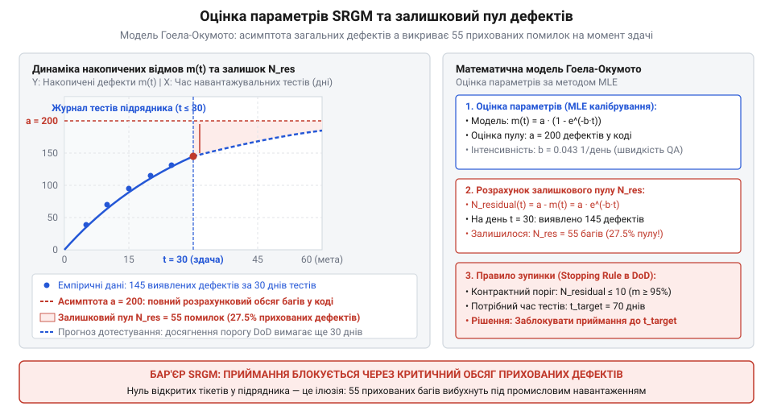
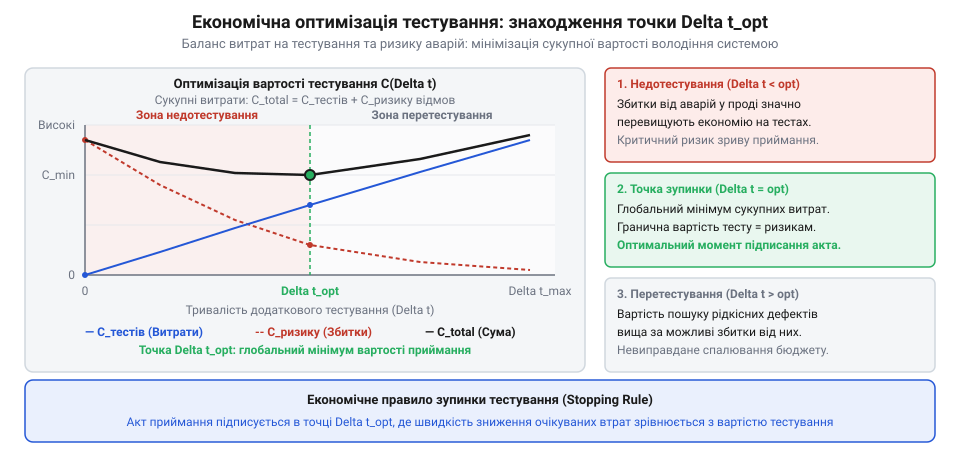

# Приймання системи від підрядника

<preknowlist>
- [Система, яку можна передати](root:progarch/a-system-you-can-hand-over) — що робить систему відчужуваною та чому технічний аудит передачі вимагає кількісних метрик замість паперових звітів
- [Документ, що не гниє](root:progarch/document-that-does-not-rot) — як машинозчитувані контракти та математично верифіковані критерії замінюють застарілу текстову документацію
- [Введення нової команди в систему](root:progarch/onboarding-a-new-team) — типові бар'єри неявного знання та ризики отримання нестабільного коду без об'єктивної оцінки залишкових дефектів
</preknowlist>

## Пастка наївного тестування та стохастична природа надійності програмного забезпечення

Під час приймання складного програмного комплексу від зовнішнього підрядника замовник майже завжди потрапляє в психологічну пастку поверхневого спокою. На фінальній демонстрації перед підписанням акта підрядник демонструє звіт із системи відстеження дефектів: за останні три дні перед релізом не було відкрито жодного критичного тікета, усі раніше знайдені блокуючі баги позначені як успішно виправлені, а графік нових помилок асимптотично притиснувся до нуля. Менеджмент виконавця робить оптимістичний висновок: кодова база стабілізувалася, дефектів більше немає, продукт готовий до промислової експлуатації.

### Анатомія ілюзії «чистого коду»

Насправді нульовий темп надходження нових звітів про дефекти в останні дні перед здачею може свідчити про два діаметрально протилежні стани системи:

1. **Реальна висока надійність.** Система справді протестована за всіма можливими сценаріями, і в коді не залишилося явних помилок.
2. **Параліч або спад інтенсивності тестування.** Команда тестувальників вичерпала відомий їм набір позитивних тест-кейсів, перейшла на перевірку дрібних косметичних правок інтерфейсу або просто припинила навантажувальні експерименти, щоб не зірвати дедлайн здачі робіт.

Якщо тестувальники не генерують нових запитів і не моделюють нетривіальних граничних станів, система фізично не може проявити приховані вади. Відсутність зареєстрованих відмов є функцією зусиль тестувальників, а не показником внутрішньої бездоганності архітектури.

Коли замовник приймає систему на основі такої наївної візуальної картини, катастрофа стається в перший же день промислової експлуатації. Реальні користувачі на відміну від тестових сценаріїв генерують непередбачувані комбінації вхідних даних, створюють високі паралельні навантаження та стикаються з лавиною відмов. Саме тому концепція [система, яку можна передати](root:progarch/a-system-you-can-hand-over) вимагає повної відмови від суб'єктивних вражень і переходу до математично строгих критеріїв оцінки надійності.

### Фундаментальна різниця між фізичною та програмною надійністю

Інтуїтивне розуміння надійності зазвичай спирається на інженерний досвід механічних або електронних систем. У класичній теорії надійності обладнання фізичні деталі зазнають тертя, температурного розширення, деградації напівпровідників та корозії металу. Інтенсивність відмов апаратних засобів описується відомою U-подібною кривою (крива ванни, @@en|bathtub curve@@): після початкового періоду припрацювання настає тривалий інтервал стабільної роботи з постійною інтенсивністю випадкових збоїв, після чого починається лавиноподібне зростання відмов через фізичний знос матеріалів.

Програмне забезпечення влаштоване принципово інакше:

* **Програми не зазнають фізичного зносу.** Рядки вихідного коду не стираються від тривалого виконання, логічні оператори не окислюються, а алгоритми не старіють під дією радіації чи тепла.
* **Усі дефекти коду є статичними та присутніми з моменту компіляції.** Помилка або закладена в архітектуру під час написання, або її там немає. Програма не генерує нових власних багів у процесі роботи — вона лише розкриває ті, що вже існують у її пам'яті.
* **Відмова настає виключно через активацію латентного дефекту.** Помилка перетворюється на збій (@@en|failure@@) лише тоді, коли комбінація вхідних даних, внутрішнього стану та послідовності викликів активує дефектну гілку логіки.

З цього випливає ключовий інженерний висновок: надійність програмного забезпечення не можна вимірювати астрономічним (календарним) часом. Сервіс, який простояв на тестовому стенді вихідні без користувацького трафіку, не став надійнішим за цей час.

Справжнім чинником виявлення дефектів є **час напрацювання** (англ. @@en|execution time@@) — обсяг фактично спожитих процесорних циклів, кількість оброблених транзакцій або сумарний час активного виконання коду. Другим чинником є **операційний профіль** (англ. @@en|operational profile@@) — статистичний розподіл реальних вхідних запитів, що надходять до системи.

### Стохастична природа відмов

Оскільки надходження вхідних даних до системи має випадковий характер, поява відмов у часі також є випадковою подією. Нехай T_1, T_2, ..., T_k — моменти часу, у які система зазнає послідовних збоїв під час випробувань.

```text
Послідовність відмов у часі напрацювання:
0 -------- T_1 ------- T_2 ------------ T_3 ------------------ T_4 --------> Час (t)
   [ Δt_1 ]    [ Δt_2 ]      [ Δt_3 ]            [ Δt_4 ]
```

Інтервали між послідовними відмовами:

```text
Δt_i = T_i - T_{i-1}
```

є неперервними випадковими величинами. Щоб спрогнозувати поведінку системи в майбутньому, замовнику потрібен математичний апарат, здатний за історією виявлення дефектів під час тестування оцінити дві критичні величини:

1. Скільки латентних дефектів усе ще приховано в коді?
2. Якою буде інтенсивність відмов системи, якщо тестування припинити прямо зараз і перевести продукт у промислову експлуатацію?

Відповідь на ці запитання дає клас стохастичних моделей, відомий як моделі зростання надійності програмного забезпечення (Software Reliability Growth Models, SRGM).

> 🔧 **Навіщо це.**
> Розуміння стохастичної природи дефектів захищає замовника від маніпуляцій з боку підрядника. Показники «успішно виконаних тестів» або «тиша в баг-трекері» за останні дні перед релізом не мають жодної доказової сили, доки вони не співвіднесені з обсягом напрацювання та математичною моделлю інтенсивності відмов.

## Експоненційна модель Гоела — Окумото та неоднорідні пуассонівські процеси (NHPP)

Щоб кількісно описати процес виявлення дефектів, звернемося до теорії випадкових процесів. Найпростішою моделлю потоку випадкових подій є однорідний пуассонівський процес, де інтенсивність надходження подій є сталою величиною. Проте для тестування сталий потік не підходить: якщо випробування організовано ефективно, знайдений дефект локалізується й виправляється. Пул прихованих дефектів неминуче скорочується, а отже, інтенсивність відмов із часом повинна закономірно падати.

Саме тому математичним фундаментом SRGM є **неоднорідний пуассонівський процес** (англ. @@en|Non-Homogeneous Poisson Process@@, NHPP).

### Формалізм неоднорідного пуассонівського процесу

Нехай N(t) — випадкова величина, що позначає загальну кількість дефектів, виявлених за інтервал напрацювання від 0 до t. У процесі NHPP ймовірність того, що до моменту t буде зафіксовано рівно k відмов, описується пуассонівським розподілом:

```text
P(N(t) = k) = ( (m(t))^k / k! ) * exp(-m(t)),   k = 0, 1, 2, ...
```

Функція m(t) називається **функцією середнього накопичення відмов** (англ. @@en|mean value function@@). Вона є математичним сподіванням кількості виявлених дефектів до моменту часу t:

```text
m(t) = E[N(t)]
```

Швидкість зміни функції середнього накопичення в будь-який момент часу визначає **миттєву інтенсивність відмов** (англ. @@en|failure intensity function@@), яку позначають lambda(t):

```text
lambda(t) = dm(t) / dt
```

Якщо для однорідного процесу Пуассона lambda є константою, то в моделях зростання надійності lambda(t) є монотонно спадною функцією часу: що довше триває тестування, то рідше стаються відмови.

### Класичні припущення моделі Гоела — Окумото

У 1979 році дослідники Амріт Гоел та Казу Окумото (@@en|Amrit L. Goel, Kazu Okumoto@@) сформулювали першу практичну модель надійності на базі NHPP. Модель Гоела — Окумото спирається на чотири фундаментальні інженерні гіпотези:

1. **Скінченність дефектів.** Загальна початкова кількість дефектів у системі на момент початку випробувань є фіксованою величиною, яку позначають параметром `a` (де a > 0).
2. **Пропорційність темпу виявлення.** Швидкість виявлення нових помилок у будь-який момент часу прямо пропорційна кількості залишкових дефектів, що все ще залишаються в коді:
   ```text
   dm(t) / dt = b * (a - m(t))
   ```
   де `b` (b > 0) — коефіцієнт інтенсивності виявлення дефектів на одиницю часу напрацювання. Кожен невиявлений баг робить однаковий незалежний внесок у сумарну інтенсивність збоїв системи.
3. **Ідеальне виправлення (Perfect Debugging).** Кожен знайдений дефект усувається миттєво та безпомилково. Під час внесення змін розробники не створюють жодних нових дефектів (вторинних помилок).
4. **Статистична незалежність відмов.** Виникнення збою в одному модулі не впливає на ймовірність виникнення відмов в інших частинах коду.

### Аналітичне виведення функцій надійності

Розв'яжемо базове диференціальне рівняння моделі Гоела — Окумото:

```text
dm(t) / dt = b * (a - m(t))
```

Розділимо змінні:

```text
dm / (a - m) = b * dt
```

Проінтегруємо обидві частини рівності:

```text
-ln(a - m(t)) = b * t + C
```

де C — стала інтегрування. Визначимо C з початкової умови: на момент початку випробувань (t = 0) кількість виявлених дефектів дорівнює нулю:

```text
m(0) = 0
```

Підставимо t = 0 у рівняння:

```text
-ln(a - 0) = b * 0 + C
C = -ln(a)
```

Повернемо знайдену сталу в рівняння:

```text
-ln(a - m(t)) = b * t - ln(a)
ln(a) - ln(a - m(t)) = b * t
ln( a / (a - m(t)) ) = b * t
```

Потенціюємо обидві частини:

```text
a / (a - m(t)) = exp(b * t)
(a - m(t)) / a = exp(-b * t)
1 - m(t) / a = exp(-b * t)
```

Звідси отримуємо замкнений аналітичний вираз для функції середнього накопичення відмов Гоела — Окумото:

```text
m(t) = a * (1 - exp(-b * t))
```

Диференціюючи m(t) за часом t, знаходимо функцію миттєвої інтенсивності відмов:

```text
lambda(t) = dm(t) / dt = a * b * exp(-b * t)
```

### Зв'язок інтенсивності відмов із середнім наробітком до відмови (MTBF)

Миттєва інтенсивність відмов lambda(t) показує очікувану кількість збоїв на одиницю часу напрацювання в околі моменту t. Оберненою до неї величиною є **середній наробіток до відмови** (англ. @@en|Mean Time Between Failures@@, MTBF):

```text
MTBF(t) = 1 / lambda(t) = 1 / (a * b * exp(-b * t)) = exp(b * t) / (a * b)
```

Дослідимо граничну поведінку системи:

* **Початок випробувань (t = 0):**
  ```text
  m(0) = 0
  lambda(0) = a * b
  MTBF(0) = 1 / (a * b)
  ```
  На початку тестування інтенсивність відмов максимальна й дорівнює добутку загальної кількості багів на темп їхнього виявлення. Час між збоями мінімальний.
* **Нескінченне тестування (t -> infinity):**
  ```text
  lim_{t -> inf} m(t) = a * (1 - 0) = a
  lim_{t -> inf} lambda(t) = 0
  lim_{t -> inf} MTBF(t) = inf
  ```
  З плином часу кількість накопичених відмов асимптотично наближається до загальної кількості дефектів a. Інтенсивність відмов падає до нуля, а середній інтервал безвідмовної роботи зростає до нескінченності.

Кількість залишкових прихованих дефектів, що все ще залишаються в системі в момент t:

```text
N_residual(t) = a - m(t) = a - a * (1 - exp(-b * t)) = a * exp(-b * t)
```

Зверніть увагу: залишкові дефекти та інтенсивність відмов пов'язані прямою пропорційною залежністю:

```text
lambda(t) = b * N_residual(t)
```

Це означає, що кожна знайдена й усунена помилка зменшує поточну інтенсивність збоїв системи на фіксовану величину `b`.

### Наскрізний числовий розрахунок надійності платіжного сервісу

Уявімо практичну ситуацію аудиту. Замовник приймає від підрядника мікросервіс авторизації транзакцій. Попередній статистичний аналіз аналогічних модулів показує, що для кодової бази такого обсягу початковий пул латентних дефектів оцінюється величиною `a = 100`, а коефіцієнт інтенсивності виявлення становить `b = 0.04` за одну годину активного навантажувального тестування (execution hours).

Обчислимо стан надійності системи на різних часових відрізках випробувань:

1. **Початковий стан (t = 0 год):**
   * Знайдено дефектів: `m(0) = 0`.
   * Залишок прихованих багів: `N_residual(0) = 100`.
   * Інтенсивність відмов: `lambda(0) = 100 * 0.04 = 4.0` відмови/год.
   * Середній наробіток до відмови: `MTBF(0) = 1 / 4.0 = 0.25` год (15 хвилин).
2. **Після першого дня тестування (t = 24 год машинного часу):**
   * Накопичено відмов:
     ```text
     m(24) = 100 * (1 - exp(-0.04 * 24)) = 100 * (1 - exp(-0.96))
     exp(-0.96) ≈ 0.3829
     m(24) = 100 * (1 - 0.3829) = 61.71 дефекту
     ```
   * Залишок прихованих помилок у коді:
     ```text
     N_residual(24) = 100 - 61.71 = 38.29 дефекту
     ```
   * Інтенсивність відмов:
     ```text
     lambda(24) = 38.29 * 0.04 = 1.53 відмови/год
     MTBF(24) = 1 / 1.53 ≈ 0.65 год (39 хвилин)
     ```
3. **Після тижня інтенсивних стрес-тестів (t = 100 год машинного часу):**
   * Накопичено відмов:
     ```text
     m(100) = 100 * (1 - exp(-0.04 * 100)) = 100 * (1 - exp(-4.0))
     exp(-4.0) ≈ 0.0183
     m(100) = 100 * (1 - 0.0183) = 98.17 дефекту
     ```
   * Залишок прихованих помилок:
     ```text
     N_residual(100) = 100 - 98.17 = 1.83 дефекту
     ```
   * Інтенсивність відмов:
     ```text
     lambda(100) = 1.83 * 0.04 ≈ 0.073 відмови/год
     MTBF(100) = 1 / 0.073 ≈ 13.7 год безперервної роботи
     ```

Цей числовий розрахунок наочно показує, як за допомогою аналітичного апарату абстрактні дебати трансформуються в конкретні цифри: замовник точно бачить, що після 100 годин навантаження в коді залишається менше двох дефектів, а час між збоями зріс із 15 хвилин до майже 14 годин.

Нижче наведено модуль мовою Python, який реалізує математичний апарат моделі Гоела — Окумото та розраховує ключові метрики надійності за заданими параметрами.

:::code math-software-reliability-growth-model/py/goelokumotomodel.py

> 🔧 **Навіщо це.**
> Експоненційна модель Гоела — Окумото дає змогу пов'язати кількість виправлених багів із ймовірністю падіння сервісу в реальному часі. Без цієї математики замовник змушений вірити суб'єктивним звітам тестувальників; з моделлю NHPP він отримує аналітичну формулу, що прогнозує залишковий брак і середній час життя системи під навантаженням.

## S-подібна модель Ямади: крива навчання та точка перегину темпу відмов

Експоненційна модель Гоела — Окумото дає чітку аналітичну базу, проте спирається на жорстке припущення: інтенсивність відмов є максимальною на самому початку тестування (в момент t = 0) і надалі виключно спадає. Практика інженерного приймання складних програмних систем демонструє іншу закономірність: у перші дні або тижні тестування темп виявлення дефектів часто не спадає, а стрімко наростає, досягає локального піка й лише після цього переходить у фазу поступового вичерпання.

### Феномен кривої навчання та двоетапний процес виявлення

Причина невідповідності експоненційної кривої раннім етапам тестування криється в реальних фізичних умовах розгортання проєкту:

1. **Крива навчання команди (Learning Curve).** Інженерам з тестування або новій команді потрібен час, щоб розібратися в архітектурі стороннього коду, розгорнути стенди, налаштувати генератори навантаження та створити тестові сценарії, спрямовані на неочевидні ділянки бізнес-логіки.
2. **Двоетапний характер усунення дефектів.** Процес не є миттєвою подією. Він складається з двох послідовних фаз:
   * **Фаза 1: виявлення симптому відмови.** Клієнтський запит або тестовий сценарій отримує неочікувану помилку (наприклад, HTTP 500 або тайм-аут).
   * **Фаза 2: локалізація та ізоляція кореневої причини.** Інженери аналізують логи, відновлюють стан пам'яті, знаходять точний рядок коду чи стан взаємного блокування та підтверджують наявність дефекту.

Наявність часової затримки між появою симптому та його фіксацією призводить до того, що на початковому етапі накопичується черга ще не локалізованих помилок. Щойно тестова інфраструктура виходить на повну потужність, темп реєстрації дефектів різко зростає.

У 1983 році японські дослідники Сігеру Ямада, Сюндзі Осакі та Хіроюкі Наріхіса (@@en|Shigeru Yamada, Shunji Osaki, Hiroyuki Narihisa@@) розробили S-подібну модель зростання надійності із затримкою (англ. @@en|Delayed S-Shaped NHPP Model@@).

### Математичне виведення S-подібної моделі Ямади

Модель Ямади розглядає процес виявлення як неоднорідний пуассонівський процес, де коефіцієнт виявлення дефектів сам є зростаючою функцією часу через адаптацію тестувальників:

```text
dm(t) / dt = b * (a - m(t)) - d(t)
```

де d(t) — затримка ізоляції дефектів. У канонічному формулюванні диференціальне рівняння динаміки накопичення відмов має вигляд:

```text
dm(t) / dt = b^2 * t * (a - m(t))   [або через систему двох послідовних стадій виявлення]
```

Розв'язок цього рівняння за початкової умови m(0) = 0 дає аналітичний вираз для функції середнього накопичення відмов Ямади:

```text
m(t) = a * (1 - (1 + b * t) * exp(-b * t))
```

де:
* `a` (a > 0) — загальний початковий пул прихованих дефектів;
* `b` (b > 0) — коефіцієнт темпу виявлення та усунення помилок.

Диференціюючи m(t) за часом t, знаходимо функцію миттєвої інтенсивності відмов lambda(t):

```text
lambda(t) = dm(t) / dt = d/dt [ a - a * (1 + b * t) * exp(-b * t) ]
lambda(t) = -a * [ b * exp(-b * t) + (1 + b * t) * (-b) * exp(-b * t) ]
lambda(t) = -a * exp(-b * t) * [ b - b - b^2 * t ]
lambda(t) = a * b^2 * t * exp(-b * t)
```

### Дослідження екстремуму та точка перегину (Inflection Point)

Проаналізуємо властивості отриманої функції інтенсивності відмов lambda(t):

1. **Початок тестування (t = 0):**
   ```text
   lambda(0) = a * b^2 * 0 * exp(0) = 0
   ```
   На відміну від моделі Гоела — Окумото, у моделі Ямади інтенсивність відмов починається з нуля. Це точно відображає реальність запуску нового тестового стенда.
2. **Асимптотична межа (t -> infinity):**
   ```text
   lim_{t -> inf} lambda(t) = a * b^2 * lim_{t -> inf} (t / exp(b * t)) = 0
   ```
   У міру вичерпання дефектів інтенсивність відмов спадає до нуля, а накопичена кількість помилок m(t) прямує до асимптоти `a`.

Знайдемо точку максимуму інтенсивності відмов, обчисливши першу похідну d(lambda)/dt:

```text
d(lambda(t)) / dt = a * b^2 * [ 1 * exp(-b * t) + t * (-b) * exp(-b * t) ]
d(lambda(t)) / dt = a * b^2 * exp(-b * t) * (1 - b * t)
```

Прирівняємо похідну до нуля:

```text
a * b^2 * exp(-b * t) * (1 - b * t) = 0
1 - b * t = 0
t_inflection = 1 / b
```

Значення `t_inflection = 1 / b` є критичною інженерною характеристикою системи — **точкою перегину S-подібної кривої**:

* **Фаза розгону та навчання (t < 1 / b):** похідна d(lambda)/dt > 0. Інтенсивність відмов зростає, крива m(t) є опуклою вниз (темп реєстрації дефектів прискорюється).
* **Пік відмов (t = 1 / b):** інтенсивність відмов досягає глобального максимуму:
  ```text
  lambda_max = lambda(1 / b) = a * b^2 * (1 / b) * exp(-1) = (a * b) / exp(1) ≈ 0.3679 * a * b
  ```
  У цей момент накопичена кількість знайдених помилок становить:
  ```text
  m(1 / b) = a * (1 - (1 + 1) * exp(-1)) = a * (1 - 2 / exp(1)) ≈ 0.2642 * a
  ```
  До моменту проходження піку відмов тестувальники встигають виявити лише близько 26.4% від загального пулу латентних багів.
* **Фаза стабільного очищення (t > 1 / b):** похідна d(lambda)/dt < 0. Крива m(t) стає опуклою вгору, інтенсивність збоїв монотонно спадає, наближаючись до нуля.


*Порівняння кривих накопичення відмов m(t) та інтенсивності відмов lambda(t) для експоненційної моделі Гоела — Окумото та S-подібної моделі Ямади: наочна демонстрація точки перегину та фази зростання темпу дефектності.*

> 🔧 **Навіщо це.**
> Точка перегину t = 1/b є найважливішим інженерним орієнтиром під час передачі системи. Якщо підрядник передає систему замовнику до моменту t_inflection, продукт передається на висхідній хвилі дефектності, коли понад 70% помилок ще не розкрито. Приймання системи можна розпочинати лише тоді, коли статистичні дані підтверджують проходження точки перегину та вхід у фазу насичення.

## Чисельне калібрування параметрів методом максимальної правдоподібності (MLE)

Теоретичні формули моделей Гоела — Окумото та Ямади мають практичну цінність лише тоді, коли інженер може розрахувати невідомі параметри `a` (загальний пул багів) та `b` (коефіцієнт інтенсивності) на основі реальних емпіричних спостережень. У ході випробувань система фіксує хронологію виникнення збоїв: моменти часу t_1, t_2, ..., t_n, де t_n — поточна тривалість тестування, а n — сумарна кількість зафіксованих інцидентів.

Основним методом статистичної ідентифікації параметрів SRGM є **метод максимальної правдоподібності** (англ. @@en|Maximum Likelihood Estimation@@, MLE).

### Функція правдоподібності для пуассонівського процесу

Для неоднорідного пуассонівського процесу з миттєвою інтенсивністю відмов lambda(t) спільна функція густини ймовірності фіксації n збоїв у дискретні моменти часу t_1 < t_2 < ... < t_n на інтервалі спостереження [0, t_n] має вигляд:

```text
L(a, b) = [ \prod_{i=1}^n lambda(t_i) ] * exp(-m(t_n))
```

Перейдемо до натурального логарифма функції правдоподібності ln L, оскільки максимізація логарифма еквівалентна максимізації самої функції, але спрощує диференціювання:

```text
ln L(a, b) = \sum_{i=1}^n ln(lambda(t_i)) - m(t_n)
```

### Виведення рівнянь правдоподібності для моделі Гоела — Окумото

Підставимо в логарифмічну функцію правдоподібності аналітичні вирази для моделі Гоела — Окумото:

```text
lambda(t_i) = a * b * exp(-b * t_i)
ln(lambda(t_i)) = ln(a) + ln(b) - b * t_i
m(t_n) = a * (1 - exp(-b * t_n))
```

Отримуємо розгорнутий вираз цільової функції:

```text
ln L(a, b) = \sum_{i=1}^n [ ln(a) + ln(b) - b * t_i ] - a * (1 - exp(-b * t_n))
ln L(a, b) = n * ln(a) + n * ln(b) - b * \sum_{i=1}^n t_i - a * (1 - exp(-b * t_n))
```

Для знаходження точки максимуму обчислимо частинні похідні за невідомими параметрами `a` та `b` і прирівняємо їх до нуля:

1. **Частинна похідна за параметром a:**
   ```text
   \partial(ln L) / \partial a = n / a - (1 - exp(-b * t_n)) = 0
   ```
   Звідси виражаємо параметр `a` через параметр `b`:
   ```text
   a = n / (1 - exp(-b * t_n))
   ```
   Цей результат має глибокий інженерний зміст: загальний очікуваний обсяг дефектів дорівнює кількості вже знайдених дефектів n, поділеній на теоретичну частку вичерпання пулу до моменту t_n.
2. **Частинна похідна за параметром b:**
   ```text
   \partial(ln L) / \partial b = n / b - \sum_{i=1}^n t_i - a * t_n * exp(-b * t_n) = 0
   ```

Підставимо вираз для `a` у друге рівняння:

```text
n / b - \sum_{i=1}^n t_i - [ n * t_n * exp(-b * t_n) ] / (1 - exp(-b * t_n)) = 0
```

Поділимо обидві частини рівняння на n:

```text
1 / b - (1 / n) * \sum_{i=1}^n t_i - [ t_n * exp(-b * t_n) ] / (1 - exp(-b * t_n)) = 0
```

Введемо позначення для середнього часу появи дефектів у вибірці:

```text
t_mean = (1 / n) * \sum_{i=1}^n t_i
```

Поділивши чисельник і знаменник дробу на exp(-b * t_n), отримаємо фінальне трансцендентне рівняння відносно єдиної невідомої змінної `b`:

```text
f(b) = 1 / b - t_mean - t_n / (exp(b * t_n) - 1) = 0
```

### Чисельне розв'язання методом Ньютона — Рафсона

Рівняння f(b) = 0 є нелінійним і не має аналітичного розв'язку в елементарних функціях. Його розв'язують чисельно за допомогою ітераційного методу Ньютона — Рафсона:

```text
b_{k+1} = b_k - f(b_k) / f'(b_k)
```

Обчислимо похідну функції f'(b):

```text
f'(b) = d/db [ 1 / b - t_mean - t_n * (exp(b * t_n) - 1)^(-1) ]
f'(b) = -1 / b^2 + [ t_n^2 * exp(b * t_n) ] / (exp(b * t_n) - 1)^2
```

Як початкове наближення b_0 обирають величину:

```text
b_0 = 1 / (2 * t_mean)
```

Завдяки строгій монотонності f(b) метод Ньютона — Рафсона збігається до машинної точності за 4–6 ітерацій.

Щойно оптимальне значення коефіцієнта темпу `b*` знайдено, параметр `a*` обчислюється миттєво:

```text
a* = n / (1 - exp(-b* * t_n))
```

Після цього замовник отримує точну оцінку кількості залишкових дефектів у коді:

```text
N_residual(t_n) = a* - n = n * exp(-b* * t_n) / (1 - exp(-b* * t_n))
```


*Графік калібрування параметрів за емпіричними журналами відмов: апроксимація накопичених даних, асимптотична межа загального пулу дефектів a та візуалізація залишкового пулу прихованих помилок N_residual(t).*

Нижче наведено автономну реалізацію оцінювача параметрів MLE мовою Python, яка калібрує модель за масивом часових міток відмов.

:::code math-software-reliability-growth-model/py/goelokumotomle.py

> 🔧 **Навіщо це.**
> Калібрування через MLE виключає підгонку параметрів «на око». В автоматизованому контурі CI/CD скрипт зчитує сирі часові мітки багів із репозиторію та за секунду обчислює точний числовий залишок прихованих помилок. Це перетворює суб'єктивні суперечки між замовником і підрядником на строгий математичний факт.

## Математичні критерії зупинки тестування (Stopping Rules) та економічна оптимізація

Знання поточного наробітку на відмову та оцінки кількості залишкових дефектів ставить перед архітектором і замовником головне практичне питання: коли саме тестування можна вважати завершеним, а продукт — готовим до підписання акта приймання? Продовження випробувань коштує грошей і відкладає запуск бізнесу, але передчасне припинення загрожує катастрофічними збитками від аварій у реальній експлуатації.

Відповідь на це запитання дають математичні правила зупинки (англ. @@en|stopping rules@@), які поділяються на інженерні та економічні.

### Інженерні критерії: поріг інтенсивності та цільовий наробіток на відмову

Інженерний підхід ґрунтується на досягненні нормативних показників стабільності, зафіксованих у технічному завданні.

#### 1. Критерій цільової інтенсивності відмов
Замовник встановлює гранично допустиму інтенсивність відмов `lambda_target` (наприклад, не більше 0.01 збою на годину роботи або 1 збій на 100 годин). Нехай на момент t_n випробування тривали t_n годин, а поточна інтенсивність становить lambda(t_n) > lambda_target.

Розрахуємо додатковий час напрацювання `Delta t`, необхідний для зниження інтенсивності до цільового рівня за моделлю Гоела — Окумото:

```text
lambda(t_n + Delta t) = a * b * exp(-b * (t_n + Delta t)) <= lambda_target
```

Логарифмуємо обидві частини нерівності:

```text
ln(a * b) - b * (t_n + Delta t) <= ln(lambda_target)
b * (t_n + Delta t) >= ln( (a * b) / lambda_target )
t_n + Delta t >= (1 / b) * ln( (a * b) / lambda_target )
```

Звідси отримуємо необхідну тривалість додаткового тестування:

```text
Delta t_intensity = max( 0, (1 / b) * ln( (a * b) / lambda_target ) - t_n )
```

#### 2. Критерій цільового наробітку на відмову (Target MTBF)
Якщо контракт формулює вимогу через середній інтервал між аваріями `MTBF_target`, формула набуває прямого вигляду, враховуючи, що MTBF = 1 / lambda:

```text
MTBF(t_n + Delta t) >= MTBF_target
Delta t_mtbf = max( 0, (1 / b) * ln( a * b * MTBF_target ) - t_n )
```

Якщо розрахунковий `Delta t` виявляється меншим або рівним нулю, це означає, що система вже досягла контрактних вимог і тестування можна зупиняти.

### Економічна оптимізаційна модель вартості надійності

Інженерні критерії не враховують фінансової вартості часу. Проте кожен день тестування оплачується замовником (оренда хмарних стендів, зарплати інженерів, ціна затримки виходу на ринок — Cost of Delay). Водночас пропуск дефекту в промислову експлуатацію коштує значно дорожче, ніж його усунення на стадії приймання (відоме правило десятикратного зростання витрат Баррі Боема: виправлення бага в продакшені обходиться в 10–50 разів дорожче через аварійні зупинки, втрату транзакцій і витік даних).

Побудуємо цільову функцію сукупних витрат `C_total(Delta t)` як функцію тривалості додаткового тестування:

```text
C_total(Delta t) = C_test * Delta t + C_fix_test * [ m(t_n + Delta t) - m(t_n) ] + C_fix_field * [ a - m(t_n + Delta t) ]
```

де:
* `C_test` — питома вартість однієї години навантажувального тестування (інфраструктура та оплата команди);
* `C_fix_test` — середня вартість локалізації та виправлення одного дефекту під час тестових випробувань;
* `C_fix_field` — середня ціна аварії та термінового виправлення дефекту в промисловій експлуатації (C_fix_field >> C_fix_test);
* `m(t_n + Delta t) - m(t_n)` — очікувана кількість дефектів, які будуть знайдені за додатковий час тестування;
* `a - m(t_n + Delta t)` — залишкова кількість прихованих помилок, які прорвуться в реальну експлуатацію.

Знайдемо точку глобального мінімуму сукупних витрат, обчисливши першу похідну функції за змінною Delta t:

```text
dC_total / d(Delta t) = C_test + C_fix_test * dm(t_n + Delta t)/d(Delta t) - C_fix_field * dm(t_n + Delta t)/d(Delta t)
```

Оскільки dm(t)/dt = lambda(t), запишемо:

```text
dC_total / d(Delta t) = C_test - (C_fix_field - C_fix_test) * lambda(t_n + Delta t)
```

Прирівняємо похідну до нуля для знаходження екстремуму:

```text
C_test - (C_fix_field - C_fix_test) * lambda(t_n + Delta t) = 0
lambda(t_n + Delta t) = C_test / (C_fix_field - C_fix_test)
```

Це фундаментальне рівняння **економічної рівноваги тестування**: тестування слід продовжувати рівно доти, доки гранична вартість однієї години випробувань менша за очікувані збитки від дефектів, які могли б бути знайдені протягом цієї години.

Підставимо аналітичний вираз інтенсивності Гоела — Окумото:

```text
a * b * exp(-b * (t_n + Delta t_opt)) = C_test / (C_fix_field - C_fix_test)
exp(-b * (t_n + Delta t_opt)) = C_test / [ a * b * (C_fix_field - C_fix_test) ]
-b * (t_n + Delta t_opt) = ln( C_test / [ a * b * (C_fix_field - C_fix_test) ] )
t_n + Delta t_opt = (1 / b) * ln( [ a * b * (C_fix_field - C_fix_test) ] / C_test )
```

Звідси отримуємо точну формулу оптимальної додаткової тривалості випробувань:

```text
Delta t_opt = max( 0, (1 / b) * ln( [ a * b * (C_fix_field - C_fix_test) ] / C_test ) - t_n )
```


*Оптимізаційний графік вартості тестування та ризику відмов: крива витрат на тестування, крива очікуваних втрат від аварій у продакшені та знаходження глобального мінімуму сукупних витрат у точці Delta t_opt.*

Якщо розраховане значення Delta t_opt дорівнює нулю, це означає, що подальше тестування є економічно невигідним: пошук одиничного рідкісного бага коштуватиме дорожче, ніж можливі збитки від його усунення після запуску.

> 🔧 **Навіщо це.**
> Економічне правило зупинки усуває конфлікт інтересів між інженерами та бізнесом. Замість нескінченного «нам треба ще протестувати» або безвідповідального «запускаємо завтра», сторони отримують математичну точку мінімуму фінансових витрат, де кожна вкладена в тестування гривня приносить максимальну економію на відмовах.

## Практичні обмеження моделей, конвеєрний аудит та контрактне приймання (Acceptance Gate)

Будь-яка математична модель є спрощенням реальності. Застосування SRGM в інженерній практиці вимагає чіткого розуміння припущень, які можуть бути порушені в реальному процесі розробки стороннім підрядником.

### Пастки та інженерні обмеження SRGM

Розгляньмо три головні фактори, що спотворюють класичні розрахунки:

#### 1. Недосконале налагодження (Imperfect Debugging)
Класична модель припускає, що виправлення знайденого бага є абсолютно безпечним. Насправді кожна спроба усунути дефект із певною ймовірністю `p` (типово 5–15%) породжує вторинний дефект (регресію).

Якщо підрядник працює з високим рівнем регресій, загальний пул дефектів не є сталою величиною `a`, а зростає з часом:

```text
a(t) = a_0 + alpha * m(t)
```

де alpha — коефіцієнт генерації вторинних помилок. Якщо alpha >= 1, система потрапляє в режим розбіжності (багогенерації), за якого кількість нових помилок перевищує кількість виправлених, і тестування ніколи не зійдеться до стабільності.

#### 2. Невідповідність операційного профілю (Operational Profile Mismatch)
Якщо тестувальники підрядника ганяють синтетичні тести виключно за одним зручним маршрутом, коефіцієнт виявлення `b` відображає лише надійність цього вузького шляху. Коли замовник випускає продукт на реальний трафік, операційний профіль змінюється, активуючи раніше не задіяні ділянки коду, що викликає раптовий сплеск нових збоїв. Модель дає достовірний результат лише тоді, коли тестовий профіль статистично відповідає реальному бізнес-навантаженню.

#### 3. Зміна обсягу коду під час тестування (Code Churn)
Якщо підрядник продовжує паралельно дописувати нову функціональність під час проведення приймальних випробувань, у систему постійно впорскуються нові порції дефектів. Математична модель у таких умовах втрачає адекватність, оскільки параметр `a` зазнає ступінчастих стрибків. Для проведення коректного приймання обов'язковим є введення режиму заморожування коду (Code Freeze).

### Побудова автоматизованого приймального шлюзу (Acceptance Gate)

Щоб зробити надійність об'єктивним критерієм якості, розрахунок SRGM перетворюють на автоматичний шлюз приймання (англ. @@en|acceptance gate@@) у конвеєрі неперервної інтеграції (CI/CD). Концепція [документ, що не гниє](root:progarch/document-that-does-not-rot) стверджує, що контракт має перевірятися машиною, а не зберігатися у вигляді статичного звіту на полиці.

Автоматизований шлюз приймання працює за чітким алгоритмом:

```text
[Логи навантажувальних випробувань] -> [Калібрування MLE] -> [Розрахунок MTBF та N_residual] -> [Перевірка контрактних порогів] -> [ACCEPT / REJECT]
```

1. Конвеєр зчитує структурований журнал збоїв із тестового середовища (часові мітки та рівні критичності).
2. Модуль калібрування автоматично розв'язує рівняння правдоподібності та обчислює оптимальні параметри a* та b*.
3. Виконується перевірка інваріантів:
   * Якщо використовується модель Ямади, перевіряється умова проходження точки перегину: `t_n > 1 / b*`.
   * Обчислюється поточний наробіток на відмову: `MTBF(t_n) >= MTBF_contract`.
   * Обчислюється залишкова кількість прихованих помилок: `N_residual(t_n) <= N_residual_limit`.
4. Якщо хоча б один поріг порушено, білд автоматично блокується, а статус приймання позначається як невідповідний.

Наявність такого прозорого машинного бар'єра захищає [введення нової команди в систему](root:progarch/onboarding-a-new-team): інженери, які приймають систему на супровід, спираються на числовий доказ надійності, а не на запевнення сторонніх розробників.

Нижче наведено приклад автоматизованого приймального скрипту, що виконує роль блокуючого шлюзу в CI/CD.

:::code math-software-reliability-growth-model/py/acceptancegate.py

### Формулювання вимог у Definition of Done та договорі підряду

Математична модель набуває юридичної сили лише тоді, коли її інтегровано в текст комерційної угоди та правила Definition of Done. У договорі на розробку або передачу системи замовник фіксує строгі кількісні зобов'язання підрядника.

Типовий фрагмент договору підряду формулюється таким чином:

> «Приймання Програмного забезпечення здійснюється за результатами навантажувальних випробувань тривалістю не менше ніж T_test годин чистого машинного напрацювання в еталонному середовищі Замовника за узгодженим Операційним профілем. Підрядник зобов'язується надати повний структурований журнал усіх зафіксованих інцидентів. Програмне забезпечення вважається таким, що відповідає критеріям надійності та підлягає оплаті, виключно за умови, що за результатами калібрування моделі Гоела — Окумото методом максимальної правдоподібності розрахунковий наробіток на відмову становить не менше MTBF_contract годин, а розрахункова кількість залишкових латентних дефектів не перевищує N_residual_max. Недосягнення зазначених числових порогів є підставою для відмови в підписанні акта приймання-передачі та продовження випробувань за рахунок Підрядника».

Включення цього пункту до договору докорінно змінює баланс сил. Замовник більше не залежить від оптимістичних запевнень менеджерів підрядника: акт приймання підписується лише тоді, коли математика пуассонівського процесу підтверджує готовність системи до промислового життя.
