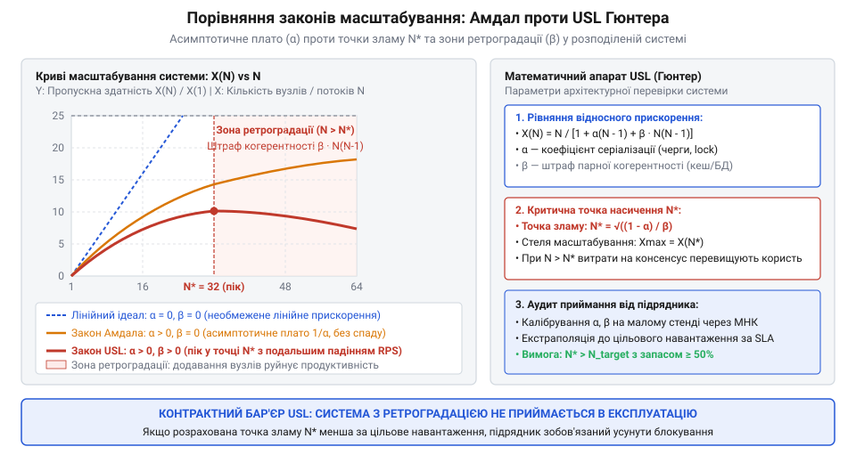
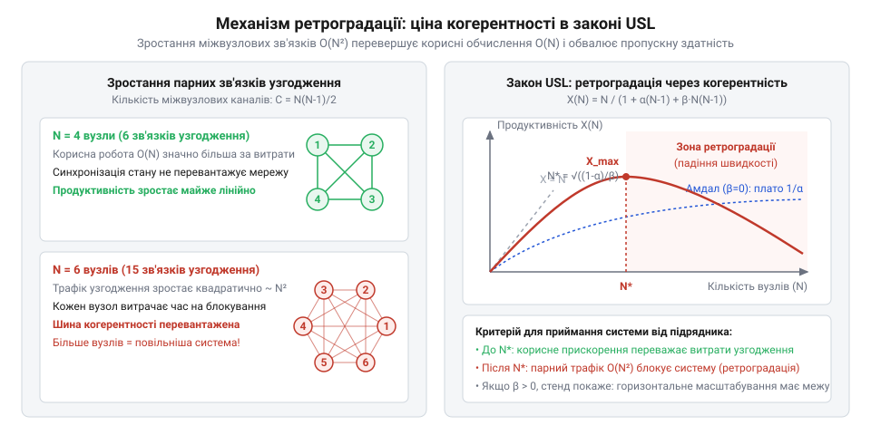
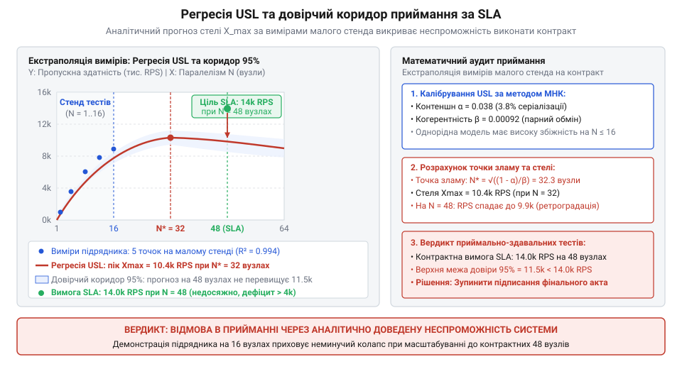

# Приймання системи від підрядника

<preknowlist>
- [Система, яку можна передати](root:progarch/a-system-you-can-hand-over) — критерії технічної відчужуваності та ризики підписання актів за формальними стендовими звітами підрядника без перевірки граничного навантаження
- [Введення нової команди в систему](root:progarch/onboarding-a-new-team) — розуміння того, як прихована архітектурна складність та неявні міжсервісні залежності проявляються у збоях під час розширення системи
</preknowlist>

## Ілюзія лінійного масштабування та пастка приймання на малих стендах

Зовнішня команда підрядника урочисто демонструє замовнику завершення робіт над високонавантаженим ядром розподіленої системи. Приймально-здавальні випробування проходять на спеціально виділеному тестовому стенді: на одному серверному вузлі сервіс стабільно видає 1000 запитів на секунду (@@en|requests per second@@, RPS), на двох вузлах фіксують 1980 RPS, а на чотирьох — майже бездоганні 3900 RPS. Менеджмент підрядника будує красивий графік і демонструє коефіцієнт ефективності масштабування 97.5%: «Архітектура розпаралелюється майже ідеально. Якщо ваш бізнес вимагає цільової пропускної здатності у 30 000 RPS, вам достатньо розгорнути в продуктивному хмарному кластері 32–36 таких самих вузлів».

Піддавшись чарам лінійної екстраполяції та бездоганним стендовим звітам, замовник підписує фінальний акт приймання-передачі ([Система, яку можна передати](root:progarch/a-system-you-can-hand-over)), здійснює повний фінансовий розрахунок і відпускає команду виконавця. Проте справжня катастрофа вибухає за місяць, коли новий програмний комплекс нарешті розгортають у бойовому середовищі на орендованому пулі з 32 серверних інстансів.

Замість очікуваних 30 000 RPS система насилу видає 8100 RPS, споживаючи при цьому 100% ресурсів процесора. Спроба інженерів експлуатації «залити пожежу залізом» і наростити кластер до 48 вузлів перетворює проблему на аварію: загальна пропускна здатність падає до 6200 RPS, черги повідомлень переповнюються, а 99-й перцентиль затримки відповіді (p99 latency) злітає з штатних 30 мілісекунд до катастрофічних 14 секунд. Система остаточно зависає у взаємних таймаутах.

Цей сценарій є типовим проявом класичної пастки приймання замовленого коду: **наївне припущення про лінійну масштабованість** (@@en|scalability@@; від латинського *scala* — сходи, драбина). Причина провалу криється в фундаментальному розриві між фізикою паралельних обчислень і спрощеним лінійним мисленням. Комп'ютерні вузли в розподіленій системі ніколи не працюють у повній ізоляції. Вони неминуче ділять між собою спільні фізичні та логічні ресурси: пули з'єднань до реляційної бази даних, глобальні блокування в розподілених транзакціях, шини передачі даних, мережеві комутатори та протоколи забезпечення когерентності розподіленого стану.

У процесі приймання системи завжди присутній глибокий інженерний конфлікт інтересів:
- **Підряднику** вигідно випробувати систему на малих стендах (від 1 до 4 вузлів), де рівень конкуренції за спільні ресурси мізерний, накладні витрати синхронізації ще не помітні на тлі мережевого шуму, а графік масштабування виглядає майже прямою лінією з нахилом 45 градусів. Його мета — зафіксувати формальне виконання функціональних вимог, отримати підпис на акті й перекласти ризики на чужі плечі.
- **Замовник**, навпаки, залишається наодинці з реальними експлуатаційними витратами. Якщо архітектура системи містить приховані точки серіалізації або надлишкову міжвузлову балакучість, додавання нових серверів у хмарі не просто збільшує щомісячний рахунок за інфраструктуру, а наближає момент повного паралічу сервісу.

Емпірична екстраполяція кількох замірів на малих стендах є інженерною ілюзією. Щоб захистити себе від прийняття нежиттєздатного моноліту чи неефективної мережі мікросервісів, архітектор замовника зобов'язаний спиратися на строгий математичний апарат. Цей апарат має на основі точкових вимірювань на малих тестових конфігураціях аналітично виявити внутрішні коефіцієнти опору системи та математично точно спрогнозувати: чи здатна передана програма витримати цільове навантаження, де лежить її гранична межа продуктивності та після якої кількості вузлів кожен наступний сервер почне шкодити загальній роботі.

> 🔧 **Навіщо це.** Аналіз масштабованості під час приймання переводить розмову з підрядником із площини суб'єктивних обіцянок («у проді додамо серверів і поїде») у площину об'єктивних математичних обмежень. Це дає замовнику юридично та технічно бездоганну підставу відхилити приймання системи, якщо її архітектура не здатна досягти цільового навантаження за законами фізики розподілених систем.

## Від моделі Амдала до закону Гюнтера: конкуренція та плата за когерентність

Першою історичною спробою математично описати обмеження паралельних систем був закон Джина Амдала, сформульований у 1967 році. Амдал показав, що прискорення будь-якої обчислювальної системи принципово обмежене її строго послідовною частиною.

Нехай загальний обсяг роботи прийнято за одиницю, а частка обчислень, яка може бути ідеально розпаралелена між `N` незалежними виконавцями, становить `1 - α`. Відповідно, величина `α` (де `0 ≤ α ≤ 1`) позначає частку строго послідовного коду, який виконується виключно в один потік (наприклад, читання з диску, синхронний запис у WAL-журнал або очікування глобального м'ютекса). Тоді загальний час виконання задачі `T(N)` відносно початкового часу одиничного вузла `T(1)` виражається як:

    T(N)
    = T(1) · (α + (1 - α) / N)

Коефіцієнт прискорення (або масштабованості) `C(N) = T(1) / T(N)` за законом Амдала дорівнює:

    C(N)
    = 1 / (α + (1 - α) / N)
    = N / (N · α + 1 - α)
    = N / (1 + α · (N - 1))

Якщо частка послідовного коду дорівнює нулю (`α = 0`), ми отримуємо ідеальне лінійне масштабування: `C(N) = N`. Проте якщо хоча б 5% коду є послідовними (`α = 0.05`), то граничне прискорення системи стає жорстко обмеженим асимптотою:

    lim_{N → ∞} C(N)
    = lim_{N → ∞} [ N / (1 + α · (N - 1)) ]
    = 1 / α
    = 1 / 0.05
    = 20

За законом Амдала, скільки б тисяч серверів чи ядер ми не додали до кластера, система з 5% послідовного коду в принципі не зможе прискоритися більш ніж у 20 разів.

Проте закон Амдала має критичну теоретичну ваду, яка робить його непридатним для аналізу сучасних розподілених застосунків: **функція Амдала є монотонно неспадною**. Її перша похідна за `N` є строго додатною для всіх фізичних значень:

    dC/dN
    = (1 - α) / (1 + α · (N - 1))² > 0       [для будь-якого α < 1]

Це означає, що за моделлю Амдала додавання кожного наступного процесора чи сервера може сповільнювати темп зростання продуктивності, але ніколи не здатне зменшити абсолютну пропускну здатність системи. Вона прогнозує плавний вихід на горизонтальне плато, але категорично не пояснює той факт, з яким постійно стикаються інженери в реальності: катастрофічний обвал продуктивності при збільшенні розміру кластера.

Цю фундаментальну прогалину усунув комп'ютерний вчений Ніл Гюнтер (Neil J. Gunther), який у 1993 році запропонував **Універсальний закон масштабованості** (@@en|Universal Scalability Law@@, USL). Гюнтер звернув увагу на те, що модель Амдала враховує лише очікування в черзі до одного неподільного ресурсу, але повністю ігнорує витрати на міжвузлову комунікацію та узгодження стану.

У розподіленій системі, де `N` вузлів обробляють спільні транзакції, кожен вузол повинен звіряти стан своїх локальних даних із рештою `N - 1` вузлів. Це класична задача повного графа зв'язків: кількість унікальних парних інформаційних взаємодій між `N` вузлами становить число комбінацій `C(N, 2)`:

    Кількість парних взаємодій
    = N · (N - 1) / 2

Витрати часу на пересилання повідомлень, інвалідацію розподілених кешів, протоколи двофазної фіксації (2PC) та досягнення кворуму зростають не лінійно, а **квадратично** — пропорційно `N · (N - 1)`.

Гюнтер об'єднав обидва фізичні фактори в єдину модель відносного коефіцієнта масштабованості `C(N)`:

    C(N)
    = N / (1 + α · (N - 1) + β · N · (N - 1))

Відповідно, абсолютна пропускна здатність системи `X(N)` (виміряна у RPS або транзакціях за секунду) виражається множенням коефіцієнта масштабованості на продуктивність одиничного ізольованого вузла `γ` (гамма, `γ = X(1)`):

    X(N)
    = γ · C(N)
    = (γ · N) / (1 + α · (N - 1) + β · N · (N - 1))

Кожен із трьох членів у знаменнику закону USL має абсолютно чіткий фізичний та архітектурний сенс:

1. **`1` — Ідеальний паралелізм (Concurrency):** продуктивна корисна робота, за якої кожен вузол виконує свій запит без жодного впливу на сусідів.
2. **`α · (N - 1)` — Втрати на конкуренцію (Contention, від лат. *contendere* — змагатися):** моделює час очікування в чергах за неподільними ресурсами. Коефіцієнт `α` показує частку часу, яку запит проводить у серіалізованих блокуваннях (м'ютекси, блокування таблиць БД, дискові черги запису). Оскільки в черзі перед вузлом стоять максимум `N - 1` суперників, цей штраф росте лінійно від `N`.
3. **`β · N · (N - 1)` — Втрати на узгодженість (Coherency, від лат. *cohaerere* — бути зчепленим):** моделює час затримки, витрачений на підтримку узгодженості та консистентності розподілених даних (@@en|coherency crosstalk@@). Коефіцієнт `β` кількісно оцінює штраф за кожну пару взаємодіючих вузлів: протоколи gossip, інвалідація кешів Redis/Memcached, реплікація в розподілених сховищах та консенсус Raft/Paxos. Оскільки кількість зв'язків пропорційна `N²`, при зростанні `N` саме цей доданок починає абсолютно домінувати у знаменнику.

*Порівняння кривих масштабування: лінійний ідеал не враховує жодних накладних витрат, закон Амдала (α) прогнозує вихід на плато через послідовні блокування, а Універсальний закон масштабованості Гюнтера (α, β) враховує квадратичні втрати на когерентність, виявляючи точку насичення N* та неминучу ретроградацію.*

Проілюструємо математичну силу закону Гюнтера числовим розрахунком на прикладі системи підрядника, описаної на початку розділу. Нехай під час приймання базовий вузол продемонстрував продуктивність `γ = 1000` RPS, а внутрішні характеристики архітектури становлять `α = 0.03` (3% конкуренції за блокування) та `β = 0.002` (0.2% затримки на когерентність між парами вузлів).

Розрахуємо прогнозовану продуктивність для кластера з `N = 1, 4, 16, 32` вузлів:

При `N = 1`:

    X(1)
    = (1000 · 1) / (1 + 0.03 · 0 + 0.002 · 1 · 0)
    = 1000 RPS

При `N = 4` (розмір демонстраційного стенду підрядника):

    Знаменник
    = 1 + 0.03 · (4 - 1) + 0.002 · 4 · (4 - 1)
    = 1 + 0.03 · 3 + 0.002 · 12
    = 1 + 0.09 + 0.024
    = 1.114

    X(4)
    = (1000 · 4) / 1.114
    = 4000 / 1.114
    ≈ 3590.66 RPS

Ефективність масштабування становить `3590.66 / (4 · 1000) ≈ 89.8%`. Підрядник бачить майже 3600 RPS і звітує про успіх.

Проте погляньмо, що станеться при спробі масштабування до `N = 16`:

    Знаменник
    = 1 + 0.03 · (16 - 1) + 0.002 · 16 · (16 - 1)
    = 1 + 0.03 · 15 + 0.002 · 240
    = 1 + 0.45 + 0.48
    = 1.930

    X(16)
    = (1000 · 16) / 1.930
    = 16000 / 1.930
    ≈ 8290.16 RPS

Штраф за узгодженість (`0.48`) уже перевищив штраф за пряму конкуренцію (`0.45`), а загальна продуктивність зросла лише у 8.3 рази замість 16.

А тепер обчислимо точку, на якій замовник спробував запустити бойовий кластер з `N = 32`:

    Знаменник
    = 1 + 0.03 · (32 - 1) + 0.002 · 32 · (32 - 1)
    = 1 + 0.03 · 31 + 0.002 · 992
    = 1 + 0.93 + 1.984
    = 3.914

    X(32)
    = (1000 · 32) / 3.914
    = 32000 / 3.914
    ≈ 8175.78 RPS

Результат приголомшливий: кластер із 32 серверів видає `8175` RPS — **менше**, ніж кластер із 16 серверів (`8290` RPS). Квадратичний доданок когерентності досяг величини `1.984`, повністю паралізувавши корисні обчислення. Додавання 16 додаткових серверів призвело не до прискорення, а до чистого падіння пропускної здатності.

Як аналітично розрахувати ту точну критичну точку, де крива масштабування переламується і починає стрімко падати вниз, і яка теоретична стеля продуктивності системи підрядника взагалі можлива в цій архітектурі?

## Точка зламу N* та ефект ретроградації: аналітичний розрахунок межі продуктивності

Числовий приклад із попереднього розділу наочно продемонстрував аномалію: при переході від 16 до 32 вузлів загальна пропускна здатність системи не просто сповільнила зростання, а впала з 8290 до 8175 RPS. Додавання додаткової обчислювальної потужності перетворилося на чистий збиток. Виникає фундаментальне інженерне запитання: де саме проходить та невидима межа, після якої кластер починає деградувати, і якої максимальної пропускної здатності в принципі здатна досягти система підрядника?

Щоб знайти цю межу, дослідимо функцію відносного масштабування Гюнтера `C(N)` на екстремум (від латинського *extremum* — крайній, найбільший або найменший) методами класичного математичного аналізу:

    C(N)
    = N / (1 + α · (N - 1) + β · N · (N - 1))

Розкриємо дужки у знаменнику `D(N)` і згрупуємо члени за степенями `N`:

    D(N)
    = 1 + α · N - α + β · N² - β · N
    = (1 - α) + (α - β) · N + β · N²

Знайдемо першу похідну функції масштабування за кількістю вузлів `dC/dN`, застосувавши правило диференціювання частки двох функцій `(u / v)' = (u' · v - u · v') / v²`:

    dC/dN
    = d/dN [ N / D(N) ]
    = [ 1 · D(N) - N · D'(N) ] / [ D(N) ]²

Знайдемо похідну знаменника `D'(N)`:

    D'(N)
    = d/dN [ (1 - α) + (α - β) · N + β · N² ]
    = (α - β) + 2 · β · N

Підставимо отриманий вираз у чисельник похідної `dC/dN`:

    Чисельник
    = D(N) - N · D'(N)
    = [ (1 - α) + (α - β) · N + β · N² ] - N · [ (α - β) + 2 · β · N ]
    = (1 - α) + (α - β) · N + β · N² - (α - β) · N - 2 · β · N²
    = (1 - α) - β · N²

Знаменник `[D(N)]²` є квадратом суми додатних величин, тому він строго додатний для будь-якого фізичного розміру кластера `N ≥ 1`. Отже, перша похідна коефіцієнта масштабування набуває винятково компактного та елегантного вигляду:

    dC/dN
    = [ (1 - α) - β · N² ] / [ 1 + α · (N - 1) + β · N · (N - 1) ]²

Необхідною умовою існування локального екстремуму є рівність першої похідної нулю: `dC/dN = 0`. Оскільки знаменник не дорівнює нулю, прирівнюємо чисельник до нуля:

    (1 - α) - β · N² = 0
    β · N² = 1 - α
    N² = (1 - α) / β
    N* = √((1 - α) / β)

Оскільки частка послідовного коду завжди менша за одиницю (`α < 1`), а коефіцієнт когерентності строго додатний (`β > 0`), підкореневий вираз є строго додатним. Це гарантує існування єдиної дійсної додатної критичної точки `N*`.

Дослідимо знак похідної обабіч точки `N*`:
- При `N < N*` маємо `N² < (1 - α) / β`, звідки чисельник `(1 - α) - β · N² > 0`, а отже `dC/dN > 0`. Функція строго зростає: кластер ефективно нарощує пропускну здатність.
- При `N > N*` маємо `N² > (1 - α) / β`, звідки чисельник `(1 - α) - β · N² < 0`, а отже `dC/dN < 0`. Функція строго спадає.

Точка `N*` є точкою глобального максимуму. Після подолання критичного порогу `N*` масштабування переходить у фазу ретроградації (@@en|retrogradation@@, від латинського *retrogradus* — той, що рухається назад; *retro* — назад та *gradi* — ступати, йти).

*Механізм ретроградації: корисна обчислювальна робота масштабується лінійно, тоді як обсяг міжвузлового обміну та узгодження стану зростає квадратично O(N²), поглинаючи всі ресурси процесора та мережі після проходження критичної точки N*.*

Фізичний механізм ретроградації полягає в перерозподілі системних ресурсів:
- Поки `N < N*`, корисна робота кожного нового сервера переважає накладні витрати на синхронізацію.
- Щойно кластер перевищує `N*`, сумарний час, який усі вузли витрачають на координацію з новим учасником, перевищує повну обчислювальну потужність цього доданого вузла.

Система потрапляє в режим паразитного самоблокування: процесори завантажені на 100%, але замість бізнес-транзакцій вони обслуговують реплікацію кешів, маркерні протоколи консенсусу, серцебиття gossip і черги взаємних блокувань. Якщо приховані інваріанти синхронізації не були зафіксовані в архітектурній документації ([Документ, що не гниє](root:progarch/document-that-does-not-rot)), розробники підрядника не зможуть оперативно локалізувати причину обвалу.

Тепер розрахуємо абсолютну стелю продуктивності `X_max = X(N*)`, яку ця архітектура здатна видати в піку. Підставимо значення `N* = √((1 - α) / β)` у рівняння пропускної здатності `X(N) = γ · C(N)`:

    X_max
    = X(N*)
    = (γ · N*) / [ (1 - α) + (α - β) · N* + β · (N*)² ]

Враховуючи, що за означенням точки екстремуму `β · (N*)² = 1 - α`, спростимо перший і третій доданки знаменника:

    Знаменник
    = (1 - α) + (α - β) · N* + (1 - α)
    = 2 · (1 - α) + (α - β) · N*

Поділимо чисельник і знаменник на `N*`:

    X_max
    = γ / [ (2 · (1 - α) / N*) + α - β ]

Оскільки `(1 - α) / N* = (1 - α) / √((1 - α) / β) = √(β · (1 - α))`, отримуємо фінальну аналітичну формулу граничної продуктивності системи:

    X_max
    = γ / [ 2 · √(β · (1 - α)) + α - β ]

Ця формула має фундаментальне значення для приймання системи. Вона доводить, що абсолютна пропускна здатність системи жорстко обмежена константою `X_max`, яка залежить виключно від архітектурних коефіцієнтів `α`, `β` та базової швидкості вузла `γ`. Жодні фінансові вливання в хмарну інфраструктуру не здатні підняти продуктивність вище цієї стелі.

Повернемося до нашого наскрізного прикладу із системи підрядника: `γ = 1000` RPS, `α = 0.03`, `β = 0.002`.

Обчислимо точну координату точки зламу `N*`:

    N*
    = √((1 - 0.03) / 0.002)
    = √(0.97 / 0.002)
    = √485
    ≈ 22.02

Розрахуємо теоретичний максимум пропускної здатності `X_max`:

    X_max
    = 1000 / [ 2 · √(0.002 · (1 - 0.03)) + 0.03 - 0.002 ]
    = 1000 / [ 2 · √0.00194 + 0.028 ]
    = 1000 / [ 2 · 0.044045 + 0.028 ]
    = 1000 / [ 0.088091 + 0.028 ]
    = 1000 / 0.116091
    ≈ 8613.93 RPS

Математика безжальна:
1. Оптимальна конфігурація кластера становить рівно **22 сервери**, на яких система видасть свій абсолютний максимум — **8614 RPS**.
2. Розгортання запропонованих підрядником 32 або 48 серверів заганяє систему глибоко у вирву ретроградації: на 32 вузлах пропускна здатність падає до 8176 RPS, а на 48 вузлах — до 6934 RPS.
3. Обіцяна підрядником продуктивність у 30 000 RPS для цієї архітектури є фізично неможливою: розрахункова стеля 8614 RPS покриває лише 28.7% від вимог технічного завдання замовника.

> 🔧 **Навіщо це.**
> Аналітичний розрахунок `N*` та `X_max` дає замовнику об'єктивний кількісний аргумент для відхилення робіт. Замість безплідних дискусій про конфігурацію серверів архітектор пред'являє підряднику суворий висновок: система має структурний дефект зв'язності (завелике `β`), через який її масштабування зупиняється на позначці 22 вузлів, не досягаючи контрактних вимог.

Утім, щоб скористатися цією аналітичною зброєю, інженеру замовника потрібно звідкись отримати числові значення параметрів `α`, `β` та `γ`. Підрядник передає лише протокол стендових випробувань із кількома рядками сирих вимірів паралелізму та пропускної здатності `(N_i, X_i)`. Як перетворити ці розрізнені емпіричні точки на каліброване рівняння закону USL і перевірити його математичну достовірність?

## Ідентифікація параметрів за вимірюваннями: лінеаризація та метод найменших квадратів

У реальному процесі приймання архітектор не має готових параметрів моделі: він бачить лише таблицю експериментальних випробувань, проведених підрядником на тестовому стенді. Протокол зазвичай містить вимірювання пропускної здатності `X_i` для кількох значень розміру кластера `N_i` (наприклад, для 1, 2, 4, 8 та 16 вузлів).

Завдання полягає в тому, щоб розв'язати обернену задачу математичного моделювання: знайти такі значення трійки невідомих параметрів `(γ, α, β)`, за яких теоретична крива USL якнайкраще описує експериментальні точки.

Рівняння USL у своєму канонічному вигляді є нелінійною функцією:

    X(N)
    = (γ · N) / [ 1 + α · (N - 1) + β · N · (N - 1) ]

Пряма нелінійна оптимізація незручна для швидкої аналітичної перевірки: вона вимагає ітераційного підбору початкових наближень і може сходитися до хибних локальних мінімумів. Проте рівняння Гюнтера має чудову алгебричну властивість: воно допускає точну лінеаризацію (@@en|linearization@@, від латинського *linearis* — лінійний; від *linea* — нитка, лінія).

Розділимо розмір кластера `N` на пропускну здатність `X(N)`:

    N / X(N)
    = [ 1 + α · (N - 1) + β · N · (N - 1) ] / γ
    = (1 / γ) + (α / γ) · (N - 1) + (β / γ) · N · (N - 1)

Введемо нові змінні та коефіцієнти:

    y(N) = N / X(N)
    a = 1 / γ
    b = α / γ
    c = β / γ
    x₁ = N - 1
    x₂ = N · (N - 1)

Підставивши ці позначення, отримаємо класичну лінійну модель множинної регресії (@@en|regression@@, від латинського *regressio* — зворотний рух, повернення назад):

    y = a + b · x₁ + c · x₂

Змінна `y` має прозорий фізичний зміст: це питома затримка виконання запиту, приведена до одного вузла (вимірюється в секундах на запит). Кожен коефіцієнт лінеаризованого рівняння відповідає за свій фізичний внесок у затримку:
- `a = 1 / γ` — базовий час обробки одного запиту ізольованим вузлом за відсутності будь-якої конкуренції;
- `b = α / γ` — додаткова затримка, спричинена послідовними чергами та блокуваннями за спільні ресурси;
- `c = β / γ` — додаткова затримка на кожну пару вузлів, спричинена пересиланням пакетів і підтримкою когерентності розподіленого стану.

Нехай маємо вибірку з `m` вимірювань: `(N₁, X₁), (N₂, X₂), ..., (N_m, X_m)`, де `m ≥ 3`. Для кожного заміру обчислюємо значення залежної змінної `y_i = N_i / X_i` та предиктора `(x_{1,i}, x_{2,i})`.

Запишемо задачу в матричній формі:

    y = X_mat · θ + e

де `y` — вектор спостережень розмірності `m × 1`:

    y = [ y₁,  y₂,  ...,  y_m ]ᵀ

`X_mat` — матриця плану експерименту (дизайну) розмірності `m × 3`:

            [ 1   (N₁ - 1)   N₁ · (N₁ - 1) ]
    X_mat = [ 1   (N₂ - 1)   N₂ · (N₂ - 1) ]
            [ ...   ...           ...      ]
            [ 1   (N_m - 1)  N_m · (N_m - 1) ]

`θ` — вектор шуканих параметрів розмірності `3 × 1`:

    θ = [ a,  b,  c ]ᵀ

`e` — вектор випадкових похибок вимірювання.

За класичним методом найменших квадратів (@@en|Ordinary Least Squares@@, OLS) оцінка вектора параметрів `θ̂` мінімізує суму квадратів нев'язок `eᵀ · e = (y - X_mat · θ)ᵀ · (y - X_mat · θ)`. Прирівнюючи градієнт до нуля, отримуємо систему нормальних рівнянь Гауса:

    (X_matᵀ · X_mat) · θ = X_matᵀ · y

Якщо матриця Грама `X_matᵀ · X_mat` є невиродженою (що завжди виконується за наявності щонайменше трьох різних значень розміру кластера `N_i`), єдиний замкнений розв'язок задачі OLS має вигляд:

    θ̂ = (X_matᵀ · X_mat)⁻¹ · X_matᵀ · y

Знайшовши числові оцінки вектора `θ̂ = [ â, b̂, ĉ ]ᵀ`, виконуємо зворотне перетворення до вихідних фізичних параметрів архітектури:

    γ̂ = 1 / â
    α̂ = b̂ / â = b̂ · γ̂
    β̂ = ĉ / â = ĉ · γ̂

Для практичного використання лінійний МНК є неперевершеним: він розраховується за частки мілісекунди без ітерацій і чисельної нестабільності. Проте інженер повинен розуміти методичну тонкість: лінійний OLS мінімізує суму квадратів відхилень у просторі питомих затримок `∑ (y_i - ŷ_i)²`, а не у просторі пропускної здатності `∑ (X_i - X̂_i)²`.

Якщо замовник вимагає абсолютної математичної строгості безпосередньо у шкалі RPS, вектор `θ̂`, отриманий із лінійного OLS, використовують як ідеальне початкове наближення для алгоритму нелінійного оцінювання Левенберга-Марквардта (@@en|Levenberg-Marquardt algorithm@@). Цей чисельний метод ітеративно комбінує градієнтний спуск та метод Гауса-Ньютона:

    (Jᵀ · J + λ · diag(Jᵀ · J)) · Δθ = Jᵀ · r

де `J` — матриця Якобі часткових похідних `∂X / ∂θ`, `r` — вектор нев'язок у просторі RPS, а `λ` — адаптивний демпфуючий коефіцієнт. Оскільки стартова точка з лінійного розв'язку лежить у безпосередній близькості до оптимуму, алгоритм сходиться за 3–4 ітерації без ризику потрапляння в хибні локальні мінімуми.

Щоб перевірити, чи дійсно експериментальні точки підпорядковуються закону USL, обчислюють коефіцієнт детермінації `R²` (від латинського *determinare* — визначати, обмежувати; @@en|coefficient of determination@@):

    SS_res = ∑ [ y_i - ŷ_i ]²             [залишкова сума квадратів]
    SS_tot = ∑ [ y_i - ȳ ]²                [повна варіація вибірки]
    R² = 1 - (SS_res / SS_tot)

Значення `R² ≥ 0.98` свідчить про майже ідеальний збіг: архітектурна динаміка системи повністю описується балансом між лінійним масштабуванням, блокуваннями та узгодженістю. Якщо ж `R² < 0.90`, це тривожний сигнал: експеримент містить критичні артефакти або система страждає на хаотичні зовнішні збої.

Оцінимо також статистичну невизначеність параметрів через коваріаційну матрицю оцінок. Залишкова дисперсія на `m - 3` ступенях свободи дорівнює:

    s² = SS_res / (m - 3)

Коваріаційна матриця вектора параметрів:

    Cov(θ̂) = s² · (X_matᵀ · X_mat)⁻¹

Стандартні похибки коефіцієнтів визначаються як квадратні корені з діагональних елементів: `SE(θ̂_j) = √(Cov(θ̂)_{jj})`. Для довірчої ймовірності `95%` довірчий інтервал кожного параметра визначається через квантиль розподілу Стьюдента: `θ̂_j ± t_(0.025, m-3) · SE(θ̂_j)`.

**Практичний розрахунок калібрування USL за результатами випробувань підрядника:**

Підрядник надав звіт про випробування мікросервісного кластера, що складається з `m = 5` контрольних точок:
- Замір 1: `N₁ = 1` вузол, `X₁ = 1000` RPS
- Замір 2: `N₂ = 2` вузли, `X₂ = 1940` RPS
- Замір 3: `N₃ = 4` вузли, `X₃ = 3590` RPS
- Замір 4: `N₄ = 8` вузлів, `X₄ = 5950` RPS
- Замір 5: `N₅ = 16` вузлів, `X₅ = 8290` RPS

Обчислимо компоненти вектору `y_i = N_i / X_i`:

    y₁ = 1 / 1000 = 0.00100000 с
    y₂ = 2 / 1940 ≈ 0.00103093 с
    y₃ = 4 / 3590 ≈ 0.00111421 с
    y₄ = 8 / 5950 ≈ 0.00134454 с
    y₅ = 16 / 8290 ≈ 0.00193004 с

Побудуємо матрицю плану `X_mat` для кожного рядка `[ 1, (N_i - 1), N_i · (N_i - 1) ]`:

            [ 1    0      0 ]
            [ 1    1      2 ]
    X_mat = [ 1    3     12 ]
            [ 1    7     56 ]
            [ 1   15    240 ]

Обчислимо симетричну матрицю Грама `X_matᵀ · X_mat`:

    X_matᵀ · X_mat
    = [   5     26      310 ]
      [  26    284     4030 ]
      [ 310   4030    60884 ]

Обчислимо вектор правої частини `X_matᵀ · y`:

    X_matᵀ · y
    = [ 0.00641971 ]
      [ 0.04273585 ]
      [ 0.55393513 ]

Знайдемо обернену матрицю `(X_matᵀ · X_mat)⁻¹`:

    (X_matᵀ · X_mat)⁻¹
    = [  0.59519292  -0.18912081   0.00948767 ]
      [ -0.18912081   0.11806873  -0.00685220 ]
      [  0.00948767  -0.00685220   0.00042167 ]

Перемножимо обернену матрицю на вектор правої частини та отримаємо вектор оцінок `θ̂`:

    θ̂
    = (X_matᵀ · X_mat)⁻¹ · (X_matᵀ · y)
    = [ â ]   [ 0.00099428 ]
      [ b̂ ] = [ 0.00003599 ]
      [ ĉ ]   [ 0.00000165 ]

Відновимо фізичні архітектурні параметри:

    γ̂ = 1 / â = 1 / 0.00099428 ≈ 1005.76 RPS
    α̂ = b̂ / â = 0.00003599 / 0.00099428 ≈ 0.03620 (3.62% втрат на конкуренцію)
    β̂ = ĉ / â = 0.00000165 / 0.00099428 ≈ 0.001663 (0.166% втрат на когерентність)

Перевіримо якість калібрування моделі:
- Залишкова сума квадратів: `SS_res ≈ 1.36 · 10⁻¹⁰`;
- Повна дисперсія: `SS_tot ≈ 5.95 · 10⁻⁷`;
- Коефіцієнт детермінації: `R² = 1 - (1.36 · 10⁻¹⁰ / 5.95 · 10⁻⁷) = 0.99977` (99.98%).

Значення `R² = 0.9998` свідчить про виняткову узгодженість вимірювань підрядника із законом Гюнтера. Розрахуємо на основі знайдених коефіцієнтів критичну точку ретроградації та максимальну стелю продуктивності:

    N* = √((1 - 0.0362) / 0.001663) ≈ √579.55 ≈ 24.07 вузла
    X_max ≈ 8776 RPS

Отриманий результат стає об'єктивним технічним доказом під час передачі системи замовнику. Навіть із урахуванням статистичних похибок натурних випробувань реальна межа цієї системи лежить біля 24 вузлів і 8776 RPS. Будь-які плани інтеграції системи у велику інфраструктуру ([Введення нової команди в систему](root:progarch/onboarding-a-new-team)) без попереднього усунення джерел когерентності приречені на експлуатаційний провал.

> 🔧 **Навіщо це.**
> Лінеаризація USL перетворює складний нелінійний аналіз на стандартну процедуру лінійної регресії. Інженер замовника може закласти цей алгоритм у скрипт на Python або звичайну електронну таблицю, миттєво обробляти сирі логи навантажувального тестування та отримувати точні числові значення `α`, `β`, `N*` і `X_max` прямо під час приймальних випробувань.

Математична модель лінеаризації виглядає елегантною та бездоганною, доки вхідні дані є чистими. Проте на практиці вимірювання завжди спотворюються високочастотним шумом: паузами на збирання сміття (GC), прогрівом віртуальної машини, коливаннями затримок у хмарній мережі та раптовою зміною домінуючого вузького місця (bottleneck switching) при вичерпанні пулів бази даних. Як розпізнати артефакти експерименту, відфільтрувати шуми вимірювань і визначити межі застосовності закону USL за допомогою закону Літтла?

## Підводні камені вимірювань: артефакти стенду, зміна вузьких місць і закон Літтла

Математична модель лінеаризації USL виглядає бездоганною, доки вхідні дані є чистими. Метод найменших квадратів спирається на класичне припущення: системні параметри `α` та `β` є фундаментальними сталими досліджуваної архітектури, а похибки вимірювань — це незалежний білий шум. Проте під час натурних випробувань у реальних хмарних дата-центрах інженер стикається з фізичними артефактами (від латинського *artefactum* — штучно зроблене, від *ars* — ремесло та *factus* — зроблений), здатними зруйнувати будь-яку аналітичну модель.

Перша типова пастка навантажувального тестування — **високочастотний шум нестаціонарного стану** (від латинського *stationarius* — постійний, нерухомий; @@en|steady state@@). Якщо підрядник запускає генератор навантаження відразу після старту сервісу і проводить вимірювання впродовж 60 секунд, отримані точки будуть повністю спотворені:
- Віртуальна машина (наприклад, JVM або V8) витрачає перші хвилини на прогрів JIT-компілятора та оптимізацію гарячих шляхів виконання коду, що штучно завищує час серіалізації `α` та занижує базову продуктивність `γ`.
- Збирач сміття (GC) здійснює фонове накопичення об'єктів. Якщо в тестове вікно не потрапила фаза повного збирання (Full GC pause), продуктивність виглядає бездоганною. Якщо ж пауза сталася, затримки злітають у десятки разів.
- Мережеві та дискові драйвери у мультиорендних віртуальних машинах піддаються впливу непередбачуваних «галасливих сусідів» (@@en|noisy neighbors@@).

Щоб усунути ці шуми, методика випробувань зобов'язує відокремлювати фазу прогріву (warmup) від фази стабільного плато. До вимірювань приймаються лише метрики стаціонарного режиму, зібрані впродовж мінімум 15–30 хвилин безперервного тесту. При цьому для калібрування USL замість випадкових точкових середніх значень використовують робастні медіани часових інтервалів.

Друга, набагато небезпечніша пастка — **зміна домінуючого вузького місця** (@@en|bottleneck switching@@).

Закон Гюнтера передбачає, що в системі діє єдиний домінуючий набір лімітів синхронізації та конкуренції. Проте в гетерогенних розподілених застосунках при зміні масштабу характер фізичних обмежень зазнає стрибкоподібного перемикання:
1. На малих масштабах (`N = 1...8`) система є суто процесорно-обмеженою (CPU-bound): ядра завантажені бізнес-логікою, конкуренція за пам'ять невисока, втрати відповідають чистому закону Амдала з малим коефіцієнтом `α`.
2. При зростанні до `N = 12` раптово вичерпується конфігураційний пул з'єднань до реляційної бази даних (наприклад, жорсткий ліміт у 100 пулів з'єднань).
3. При `N = 16` навантаження досягає апаратного ліміту смуги пропускання мережевого адаптера або переповнює таблицю з'єднань міжмережевого екрана (conntrack table).

Коли стається перемикання вузького місця, коефіцієнти `α` і `β` не є стабільними: вони зазнають якісного стрибка. Спроба підігнати єдину криву USL одночасно під точки до зламу пулу з'єднань і після нього призведе до різкого падіння коефіцієнта детермінації `R² < 0.90` та систематичного зміщення нев'язок. Щоб виявити перемикання режимів, інженер замовника зобов'язаний під час кожного тесту моніторити утилізацію апаратних ресурсів (CPU, дискові черги IOPS, вичерпання пам'яті, глибину черг пулу БД). Якщо хоча б один ресурс демонструє насичення на рівні 100%, вимірювання за цією точкою фіксує перехід у локальну відмову й не може екстраполюватися як загальносистемна крива масштабування.

Третій фундаментальний аспект стосується **динаміки часу відгуку системи** та різниці між закритими й відкритими моделями навантаження.

У закритій моделі навантажувального стенду (@@en|closed workload model@@) фіксована кількість потоків тестувальника генерує запити за принципом «надіслав — дочекався відповіді — зачекав паузу — надіслав наступний». Згідно із законом Джона Літтла (@@en|Little's Law@@, 1961), взаємозв'язок між кількістю запитів у системі `L`, пропускною здатністю `X` та середнім часом відгуку `R` описується строгим співвідношенням:

    L = X · R

Під час випробувань кластера розміром `N` вузлів, де кожен вузол обслуговує запити, сумарний паралелізм пропорційний `N`. Виразимо час відгуку `R(N)` через функцію закону USL:

    R(N)
    = N / X(N)

Підставимо у формулу рівняння пропускної здатності Гюнтера:

    R(N)
    = N / [ (γ · N) / (1 + α · (N - 1) + β · N · (N - 1)) ]
    = [ 1 + α · (N - 1) + β · N · (N - 1) ] / γ
    = (1 / γ) + (α / γ) · (N - 1) + (β / γ) · N · (N - 1)

Цей результат розкриває вражаючу закономірність: у той час як крива пропускної здатності `X(N)` сягає максимуму `X_max` і потім спадає, **час відгуку системи `R(N)` зростає строго монотонно і квадратично** пропорційно `N²`!

Обчислимо динаміку часу відгуку для нашого наскрізного прикладу (`γ = 1000` RPS, `α = 0.03`, `β = 0.002`):
- При `N = 1`: `R(1) = 1 / 1000 = 0.00100` с (1.00 мс);
- При `N = 4`: `R(4) = (1 + 0.03 · 3 + 0.002 · 12) / 1000 = 1.114 / 1000 = 0.00111` с (1.11 мс);
- При `N = 16`: `R(16) = (1 + 0.03 · 15 + 0.002 · 240) / 1000 = 1.930 / 1000 = 0.00193` с (1.93 мс);
- При `N = 22` (точка піку `N*`): `R(22) = (1 + 0.03 · 21 + 0.002 · 462) / 1000 = 2.554 / 1000 = 0.00255` с (2.55 мс);
- При `N = 32`: `R(32) = (1 + 0.03 · 31 + 0.002 · 992) / 1000 = 3.914 / 1000 = 0.00391` с (3.91 мс);
- При `N = 48`: `R(48) = (1 + 0.03 · 47 + 0.002 · 2256) / 1000 = 6.922 / 1000 = 0.00692` с (6.92 мс).

У закритій стендовій моделі генератор навантаження чемно чекає на відповідь, тому при деградації сервісу навантаження автоматично стримується. Проте в реальній експлуатації система працює як **відкрита модель** (@@en|open workload model@@): користувачі надсилають запити незалежно від того, встигає сервер відповідати чи ні.

Щойно зовнішній потік запитів `λ` перевищує граничну пропускну здатність системи `X_max`, за законами теорії масового обслуговування час очікування в черзі прямує до нескінченності:

    lim_{λ → X_max} R = ∞

Затримка злітає гіперболічно. Клієнти починають обривати з'єднання за таймаутом і здійснювати повторні спроби (@@en|retry storm@@), що створює лавиноподібне вторинне навантаження. Кластер остаточно зависає у стані мертвої блокування (livelock), де всі сервери зайняті обробкою запитів, чиї клієнти вже давно пішли.

> 🔧 **Навіщо це.**
> Розуміння зв'язку між законом Літтла та моделлю USL дає архітектору інструмент контролю якості стендових випробувань. Якщо підрядник демонструє звіт із високим RPS, але не надає графіків затримки перцентилів p95/p99 та метрик черг пулів ресурсів, його випробування є фікцією: стенд міг працювати в штучному закритому режимі, приховуючи катастрофічне вибухове зростання затримок при наближенні до `N*`.

## Контрактний критерій приймання: матриця дефектів та Definition of Done

Математичний апарат не має практичної цінності, якщо він не захищає інтереси замовника на рівні контрактних зобов'язань. Щоб перетворити аналітичний апарат USL на юридичний та технічний бар'єр приймання коду, замовник зобов'язаний закласти метричні вимоги масштабованості безпосередньо у технічне завдання (ТЗ), договірні угоди SLA (@@en|Service Level Agreement@@) та критерії готовності (@@en|Definition of Done@@, DoD) при здачі робіт ([Система, яку можна передати](root:progarch/a-system-you-can-hand-over)).

Перший крок — стандартизація експериментального протоколу верифікації (від латинського *verificare* — перевіряти істинність, від *verus* — істинний та *facere* — робити). Договір повинен чітко фіксувати обов'язкову сітку навантажувальних випробувань:
1. Випробування проводяться щонайменше на 5 різних конфігураціях кластера: `N ∈ {1, 2, 4, 8, 16}` серверних інстансів фіксованої специфікації (CPU, RAM, диск, смуга мережі).
2. Навантаження здійснюється на стандартизованому наборі даних, еквівалентному обсягу річної продуктивної бази.
3. Профіль генерації трафіку точно відтворює продуктивне співвідношення операцій (наприклад, 85% читань, 15% записів).
4. Тривалість кожного випробування становить не менше 30 хвилин після 15-хвилинного прогріву для досягнення стаціонарного стану.
5. Результати вимірювань підлягають автоматичній обробці методом найменших квадратів із побудовою регресійної моделі USL.

Другий крок — формулювання формальних математичних нерівностей для контрактного Definition of Done.

Замовник не повинен приймати розпливчасті формулювання кшталт «система має бути високопродуктивною». Замість цього в контракт (від латинського *contractus* — договір, угода; від *contrahere* — стягувати, зводити докупи) вносяться точні критерії якості:

1. **Поріг конкуренції за ресурси (послідовне блокування):**

       α ≤ α_req                             [наприклад, α ≤ 0.02, тобто не більше 2%]

2. **Поріг витрат на узгодженість (когерентність стану):**

       β ≤ β_req                             [наприклад, β ≤ 0.0005, тобто не більше 0.05%]

3. **Коефіцієнт безпечного запасу масштабованості:**

       N* ≥ 1.5 · N_prod                     [критична точка ретроградації на 50% вища за продуктивний кластер]

4. **Гарантована стеля пропускної здатності:**

       X_max ≥ 1.3 · X_target                [стеля продуктивності мінімум на 30% перевищує пікові бізнес-вимоги]

5. **Статистична надійність моделі:**

       R² ≥ 0.98                             [відсутність неконтрольованої зміни вузьких місць]

*Регресійна крива USL та контрактний коридор приймання: експериментальні точки тестового стенду підрядника з 95% довірчим інтервалом, розрахункова стеля X_max, точка зламу N* та безпечна робоча зона SLA, що унеможливлює потрапляння системи у фазу ретроградації при продуктивній експлуатації.*

Наведена схема наочно демонструє інженерний сенс контрактного коридору: якщо розрахункова крива USL на основі малих стендів перетинає межу продуктивного кластера `N_prod` після проходження свого максимуму `N*`, система категорично непридатна для розгортання в промисловому середовищі.

Третій крок — використання розрахованих коефіцієнтів як **діагностичної карти архітектурних дефектів** (від грецького *diagnostikos* — здатний розпізнавати, від *dia* — крізь, через та *gnosis* — знання).

Параметри `(α, β)` працюють як рентгенівський знімок архітектури системи, вказуючи інженерам замовника, де саме підрядник припустився грубих помилок проєктування:

### 1. Високий коефіцієнт `α` при низькому `β` (домінування затримок Амдала)
- **Симптом:** Продуктивність швидко виходить на горизонтальне плато вже на 4–8 вузлах, але обвалу не відбувається.
- **Діагноз:** У системі існує єдиний неподільний вузький ресурс, до якого шикуються всі потоки:
  - Глобальні табличні блокування або `SELECT ... FOR UPDATE` на спільних агрегатах у базі даних;
  - Синхронні монолітні черги або запис у єдину неподілену партицію Kafka;
  - Монолітні блокування пам'яті (глобальні м'ютекси, synchronized-методи у спільних сервісах);
  - Послідовне дискове логування без асинхронної буферизації.
- **Вимога до підрядника:** Розділення блокувань, партиціонування таблиць, перехід на оптимістичне блокування (optimistic concurrency control) або шардинг бази даних.

### 2. Низький коефіцієнт `α` при високому `β` (домінування втрат на когерентність Гюнтера)
- **Симптом:** Система стрімко набирає швидкість на малих масштабах, але раптово зазнає жорсткої ретроградації при збільшенні кількості серверів.
- **Діагноз:** Архітектура страждає на патологічну міжвузлову балакучість (coherency crosstalk) та надмірну централізацію узгодження стану:
  - Розподілені транзакції за протоколом двофазної фіксації (2PC) між мікросервісами;
  - Неефективна інвалідація спільних кешів (broadcast cache invalidation), коли оновлення одного запису змушує всі сервери кластера скидати кеш-пам'ять;
  - Надмірно часті або неоптимальні вибори лідера та кворумні опитування (Raft/Paxos) у широкому кластері;
  - Ланцюжки синхронних REST/gRPC-запитів між мікросервісами без локальної ізоляції стану.
- **Вимога до підрядника:** Заміна 2PC-транзакцій на патерн Saga та кінцеву узгодженість (eventual consistency), перехід на локальні незалежні кеші з TTL або версіонуванням замість широкомовного скидання, декомпозиція міжсервісної взаємодії.

### 3. Високий коефіцієнт `α` та високий коефіцієнт `β` (повний архітектурний колапс)
- **Симптом:** Система не здатна вирости навіть удвічі, а додавання третього сервера вже спричиняє падіння швидкості.
- **Діагноз:** Невдала спроба побудови мікросервісної архітектури поверх централізованої монолітної бази даних із тотальним синхронним блокуванням між сервісами.
- **Вимога до підрядника:** Повна зупинка робіт, відмова у підписанні фінального акта приймання робіт та повернення на стадію базового перепроєктування архітектурних меж.

Коли нова команда експлуатації бере на баланс систему від підрядника ([Введення нової команди в систему](root:progarch/onboarding-a-new-team)), наявність каліброваного паспорта USL та протоколів бенчмаркінгу усуває будь-яку невизначеність. Інженери точно знають межі витривалості кожної підсистеми, безпечний експлуатаційний діапазон розміру кластера та архітектурні точки відмови.

> 🔧 **Навіщо це.**
> Інтеграція Універсального закону масштабованості в договірні зобов'язання перетворює абстрактну надію на масштабованість у строгу інженерну угоду. Замовник отримує юридичне право зупинити оплату рахунків підрядника, якщо параметри `α` або `β` перевищують порогові значення технічного завдання, захищаючи компанію від мільйонних збитків на оренду непотрібних серверів і катастрофічних простоїв у промисловій експлуатації.
