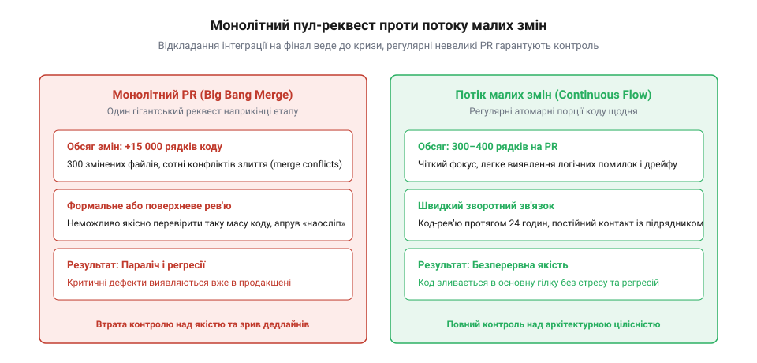
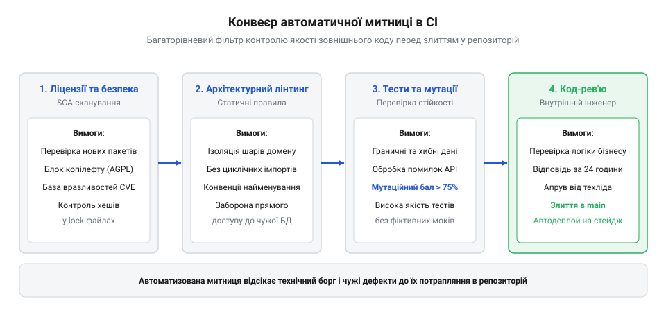

# Приймання чужої роботи

<preknowlist>
- [Код, який пишуть не твої люди](root:progarch/code-written-by-others) — розуміння відмінностей у мотивації та довгостроковій зацікавленості зовнішньої команди
- [Що має бути в інтерфейсі до підписання](root:progarch/interface-before-signing) — формалізація меж компонентів і контрактів перед початком реалізації
</preknowlist>

## Пастка великого злиття: чому приймання в кінці ітерації руйнує проєкт

Залучення аутсорс-команди чи зовнішнього підрядника для розробки нової функціональності часто супроводжується оманливою практикою «автономної гілки». Стороннім розробникам надають завдання, вони створюють окрему гілку або приватний репозиторій і зникають на три-чотири тижні. Менеджмент отримує оптимістичні звіти про виконання графіку, а внутрішня команда спокійно займається своїми поточними справами.

Катастрофа настає в передостанній день спринту або за добу до дедлайну етапу. Підрядник відкриває пул-реквест на п'ятнадцять тисяч рядків коду, що зачіпає три сотні файлів у всіх куточках системи. 

У цій точці внутрішня команда потрапляє в безвихідну пастку:
1. **Неможливість якісного перегляду:** Жоден старший інженер або архітектор фізично не здатний осмислити зміни в сотнях файлів одночасно. Код-рев'ю перетворюється на поверхове гортання diff-зрізу, під час якого неможливо помітити витончені порушення доменної ізоляції, неефективні SQL-запити всередині циклів чи потенційні гонки за ресурси.
2. **Тиск менеджменту:** Проєктний графік «горить», бізнес чекає запуску, кошти за спринт мають бути списані. Будь-яка справедлива критика архітектора сприймається як «бюрократичний саботаж релізу».
3. **Вимушений компроміс із якістю:** Команда змушена прийняти сирий, погано структурований код і злити його в основну гілку проєкту під обіцянку підрядника «порефакторити це в наступному спринті» — обіцянку, яка ніколи не виконується.

Психологічний клімат навколо такого злиття заслуговує окремого аналізу, адже саме тут ламається інженерна дисципліна. Коли до фінансового закриття кварталу чи публічного релізу лишається кілька годин, технічний лід опиняється в позиції крайнього. Менеджери вищої ланки приходять із безапеляційними аргументами: «Ми вже заплатили за це тридцять тисяч доларів», «Клієнти чекають функціонал у понеділок», «Ти хочеш зірвати договір через кілька неідеальних класів?».

У такій атмосфері архітектор відчуває колосальний когнітивний дисонанс: його професійний обов'язок вимагає натиснути кнопку «Reject» і заблокувати злиття токсичного коду, але організаційний тиск змушує капітулювати. Якщо інженер відхиляє пул-реквест, його оголошують «негнучким перфекціоністом, який не розуміє бізнес-потреб». Якщо погоджується — за кілька тижнів саме його звинуватять у збоях системи, падінні продуктивності та провалі наступних релізів.

Цей психологічний цугцванг є прямим наслідком дискретної моделі контролю. Поки підрядник писав код у темряві, ніхто не бачив накопичення архітектурних помилок. А коли помилки вийшли на світло, виправляти їх уже запізно, бо це вимагатиме тижнів повторної роботи. Запобігти цьому можна лише тоді, коли внутрішні інженери перевіряють роботу щодня, позбавляючи менеджмент можливості шантажувати команду «фінальним дедлайном».


*Ритм інтеграції: монолітний пул-реквест наприкінці ітерації паралізує команду й приховує дефекти, тоді як щоденні малі поставки дозволяють контролювати архітектуру без затримок.*

Подібне «пакетне приймання» неминуче руйнує цілісність архітектури. Стороння команда, не інтегрована в щоденний ритм проєкту, розв'язує задачу в ізоляції найкоротшим шляхом, часто ігноруючи встановлені внутрішні конвенції. Єдиний спосіб зберегти здоров'я системи — відмовитися від дискретного приймання на користь безперервного потоку малих, атомарних змін.

> 🔧 **Навіщо це.** Запобігання накопиченню великих відкладених злиттів усуває ефект несподіванки. Коли чужий код перевіряється невеликими частинами щодня, помилки дизайну виявляються на етапі створення каркаса, а не тоді, коли на кривому фундаменті вже зведено всю будівлю.

## Автоматична митниця в CI: архітектурні бар'єри та контроль залежностей

Щоб інженери замовника не витрачали години на суперечки про форматування, іменування чи заборонені імпорти, першу лінію оборони кодової бази передають автоматизованому конвеєру неперервної інтеграції (CI). 

Конвеєр CI діє як сувора митниця на державному кордоні: чужий пул-реквест узагалі не потрапляє на очі рецензентам-людям, доки не пройде всі обов'язкові автоматичні фільтри.


*Автоматична митниця в CI: система гейтів послідовно відсікає небезпечні залежності, порушення архітектурних меж і неякісні тести перед тим, як відкрити код для інженерів.*

Митний контур CI перевіряє чотири ключові аспекти:
- **Архітектурний лінтинг меж:** Спеціалізовані інструменти (наприклад, ArchUnit для Java, depguard для Go або dependency-cruiser для TypeScript) перевіряють правила допустимих напрямків залежностей. Якщо зовнішній розробник спробував напряму імпортувати низькорівневий репозиторій бази даних у шар доменних сутностей, або створив циклічну залежність між модулями, збірка автоматично падає з червоним статусом.
- **Контроль нових залежностей:** Скрипти CI порівнюють файли маніфестів (`package.json`, `pom.xml`, `go.mod`). Якщо підрядник без попереднього архітектурного узгодження додав нову сторонню бібліотеку (навіть для простої операції форматування дати), пул-реквест блокується. Це зупиняє роздування розміру застосунку та проникнення ненадійних компонентів.
- **Аналіз кодової бази та безпеки:** Статичні аналізатори (SAST, SonarQube тощо) перевіряють складність методів, дублювання коду, правильність закриття ресурсів (файлів, з'єднань) і відсутність захардкоджених токенів або паролів.
- **Дотримання угод форматування:** Лінтери та форматери гарантують, що стиль коду підрядника на 100% збігається з внутрішнім стилем проєкту, усуваючи будь-яку вкусовщину під час ручного рев'ю.

Щоб правило заборони імпортів не було абстрактним побажанням у тексті регламенту, його формулюють у вигляді декларативного конфігураційного файлу, що виконується під час кожного білду. Розгляньмо приклад конфігурації архітектурного лінтера `dependency-cruiser` для модульного TypeScript-проєкту, де зафіксовано шари чистої архітектури:

:::code accepting-contracted-work-d/js/snippet-1.js

Якщо підрядник для спрощення коду вирішить підтягнути прямий виклик `TypeORM` або імпортувати об'єкт `express.Request` прямо в клас доменної сутності `Order`, лінтер у CI впаде з чітким діагностичним повідомленням: `error: domain-must-not-depend-on-infrastructure (src/domain/order.ts -> src/infrastructure/database.ts)`. Пул-реквест буде відхилено машиною ще до того, як внутрішній інженер витратить хоча б хвилину свого робочого часу на його відкриття.

Коли людина відкриває чужий пул-реквест, вона повинна бути впевнена: базова інженерна гігієна вже перевірена машиною. Це вивільняє час архітектора для оцінки головного — відповідності бізнес-вимогам, стійкості до збоїв і чистоти інтерфейсів.

> 🔧 **Навіщо це.** Автоматичні бар'єри в CI знімають емоційне напруження між командами. Замість того, щоб внутрішній лід відчував себе прискіпливим цензором, заборонені речі зупиняються об'єктивним правилом у коді пайплайну, єдиним для всіх.

## Definition of Done і контроль справжньої якості тестів

Коли автоматизована митниця в CI надійно фільтрує синтаксичні та архітектурні дефекти, настає черга змістовного приймання кожного окремого завдання. Тут ключовим інструментом взаємодії стає формальний критерій готовності *(англ. Definition of Done, DoD)*, зафіксований на рівні команди замовника й обов'язковий для підрядника.

Головна пастка під час роботи із залученими розробниками — сліпа довіра до відсотка покриття коду тестами *(англ. code coverage)*. Коли підряднику ставлять умову «покриття тестів не менше 80%», зовнішня команда часто йде найлегшим шляхом: пише швидкі тести, що лише смикають методи із заздалегідь підготовленими заглушками (моками), але не перевіряють жодного реального бізнес-інваріанта. Якщо всі сторонні виклики й база даних змоковані, тест буде зеленим навіть тоді, коли SQL-запит містить синтаксичну помилку, а схема даних давно змінилася.

Щоб об'єктивно викрити фіктивне тестування, коли код формально виконується, але твердження *(assertions)* відсутні або беззмістовні, застосовують мутаційне тестування *(англ. mutation testing)* за допомогою інструментів типу Stryker або PIT. 

Механіка мутаційного тестування полягає у навмисному внесенні штучних дефектів у вихідний код програми (створенні «мутантів»):
- Заміна оператора порівняння: `>` замінюється на `<=`.
- Інвертування логічних умов: `if (user.isActive)` перетворюється на `if (!user.isActive)`.
- Видалення тіла критичних методів або заміна повертаємого значення на `null` чи `0`.
- Зміна арифметичних операцій: `+` замінюється на `-`.

Після створення кожної мутації запускається наданий підрядником набір тестів. Якщо тести якісні й дійсно перевіряють результат обчислень, хоча б один тест зобов'язаний впасти з помилкою. У такому разі мутант вважається «вбитим» *(killed)*. Але якщо код мутовано, значення спотворено, а всі тести підрядника залишаються безтурботно зеленими — мутант «вижив» *(survived)*.

Відсоток убитих мутантів називають мутаційним балом *(англ. Mutation Score)*. Якщо підрядник звітує про 95% рядкового покриття, але мутаційний бал становить лише 20% — це незаперечний доказ того, що тести написані фіктивно заради закриття вимог звітності. Мутаційні тести доводять, що тести підрядника дійсно охороняють систему від помилок, а не є бутафорією.

Справжній контроль якості тестів підрядника вимагає перевірки таких критеріїв:
1. **Тестування крайових умов і граничних випадків:** Чи перевірено поведінку коду на порожніх масивах, граничних числових значеннях (нуль, від'ємні числа, переповнення), довгих рядках і спеціальних символах? Код підрядника повинен падати передбачувано й безпечно, а не кидати неперехоплені `NullPointerException` чи завішувати процес.
2. **Негативні сценарії:** Тести повинні доводити, що система коректно відхиляє невалідні вхідні дані, повертає правильні доменні коди помилок і не записує сміття в базу даних у разі виникнення збою на півдорозі.
3. **Мінімізація фіктивного мокування:** Критичні шляхи бізнес-логіки мають тестуватися інтеграційними тестами на реальних піднятих контейнерах (наприклад, через Testcontainers для реальної бази даних і брокера), а не на абстрактних моках у пам'яті.
4. **Недоторканність наявних тестів:** Заборонено послаблювати, відключати (`@Ignore`, `skip`) або видаляти наявні тести системи, щоб «протягнути» свої зміни.

```text
Критерії Definition of Done для пул-реквесту підрядника:
[ ] Реалізовано повний обсяг бізнес-вимог задачі без скорочень
[ ] Написано юніт-тести на всі крайові та негативні стани
[ ] Мутаційний бал (Mutation Score) для нових модулів перевищує 75%
[ ] Написано інтеграційний тест на реальній схемі бази даних
[ ] Не змінено жодного стороннього тесту без попереднього погодження
[ ] Повністю оновлено супровідну документацію або схему API
```

Якщо переданий пул-реквест не відповідає хоча б одному з пунктів DoD, він повертається на доопрацювання без подальшого розгляду.

> 🔧 **Навіщо це.** Чіткий Definition of Done встановлює недвозначні правила гри. Він усуває ситуацію, коли виконавець вважає задачу завершеною просто тому, що вона «як-небудь запускається», і змушує підрядника дбати про реальну надійність коду.

## Режим спільної розробки: дисципліна код-рев'ю та швидкий зворотний зв'язок

Найуспішніша інтеграція чужого коду відбувається тоді, коли зовнішні розробники працюють у тому ж інженерному контурі, що й внутрішня команда, а не як ізольований острів.

Основою такої співпраці є дисципліна щоденного взаємного код-рев'ю з обов'язковим фінальним словом штатного інженера:
- **Обмеження розміру пул-реквестів:** Жоден пул-реквест від підрядника не повинен перевищувати 300–400 рядків суттєвих змін. Великі функціональні блоки мають розбиватися на послідовну серію дрібних, самодостатніх кроків (створення міграції -> додавання доменної моделі -> реалізація API -> прив'язка інтерфейсу).
- **Швидкість зворотного зв'язку:** Внутрішня команда зобов'язується переглядати невеликі зміни протягом 24 годин. Якщо чужий пул-реквест висить без уваги тижнями, підрядник блокується, гілки розходяться, і подальше злиття стає болісним кошмаром ребейзів і конфліктів.
- **Двохетапний підпис (Approval Gate):** Для злиття пул-реквесту підрядника в основну гілку обов'язково потрібні два схвалення: одне від піра (колеги з команди виконавця) та одне фінальне від внутрішнього архітектора або техліда замовника. Це гарантує, що підрядник не може сам собі дозволити сумнівні рішення.
- **Культура конструктивного діалогу:** Коментарі під час рев'ю не повинні бути суб'єктивними («мені так не подобається»). Кожне зауваження має спиратися на об'єктивні архітектурні принципи: «цей виклик порушує закон Деметри», «тут виникає проблема N+1 запитів до БД», «це рішення суперечить ADR-008».

Автоматичне закріплення відповідальності за рев'ю реалізується за допомогою файлу `.github/CODEOWNERS` (або аналогів у GitLab/Bitbucket). Цей механізм гарантує, що система керування репозиторієм автоматично призначає відповідних внутрішніх інженерів і блокує злиття, доки саме вони не поставлять свій цифровий підпис:

```text
# .github/CODEOWNERS - автоматичний розподіл архітектурної відповідальності

# За замовчуванням будь-який загальний код переглядається лідом команди
*                       @company/core-team-leads

# Критичне доменне ядро: зміни дозволені тільки за згодою головного архітектора
/src/domain/            @company/chief-architect @company/domain-leads

# Схеми та міграції бази даних: вимагають схвалення DBA або інженера даних
/migrations/            @company/data-platform-team
/src/infrastructure/db/ @company/data-platform-team

# Конфігурації безпеки, шифрування та токенів авторизації
/src/security/          @company/security-guild
/.github/workflows/     @company/devops-infrastructure-team

# Зовнішні контракти API та специфікації OpenAPI
/docs/api/              @company/api-governance
```

Коли розробник підрядника торкається хоча б одного файлу всередині каталогу `/migrations/` або `/src/domain/`, GitHub автоматично вимагає затвердження від `@company/data-platform-team` або головного архітектора. Жоден лід аутсорсу не може самостійно заапрувити такий пул-реквест у гілку `main`. 

Це унеможливлює випадкове або навмисне проштовхування небезпечних архітектурних змін: права доступу та правила рев'ю строго розмежовані на рівні інфраструктури репозиторію.

```bash
# Типовий контур захисту гілки main:
# 1. Заборона прямих пушів (protected branch).
# 2. Обов'язкове проходження всіх зелених перевірок CI.
# 3. Обов'язкове схвалення від групи CODEOWNERS (внутрішніх інженерів).
# 4. Вимога актуального стану гілки перед злиттям (require branch to be up to date).
```

Такий підхід перетворює чужий код на органічну частину власної кодової бази. Підрядник поступово переймає внутрішні інженерні стандарти, якість рішень зростає від спринту до спринту, а компанія отримує стабільну систему без прихованого технічного боргу.

> 🔧 **Навіщо це.** Спільне щоденне код-рев'ю з чіткими правилами виховує зовнішню команду й контролює кожну кому в спільній кодовій базі. Воно гарантує, що чужий код стає невіддільним від власного, а відповідальність за архітектуру завжди лишається в руках замовника.
