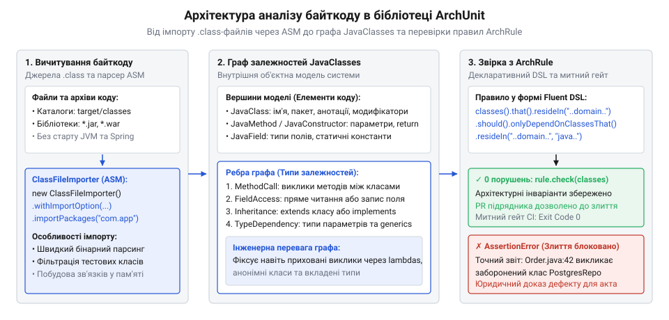
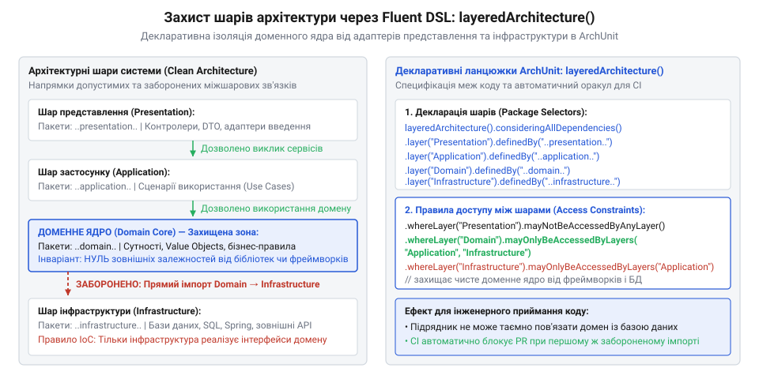
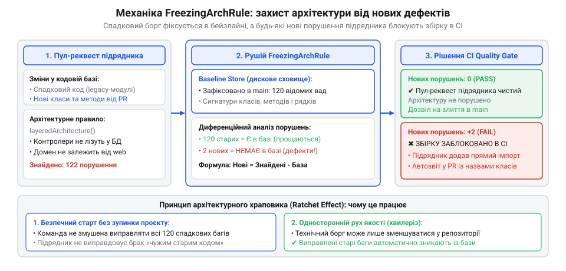

# Приймання чужої роботи

<preknowlist>
- [Код, який пишуть не твої люди](root:progarch/code-written-by-others) — розуміння відмінностей у мотивації та довгостроковій зацікавленості зовнішньої команди
- [Що має бути в інтерфейсі до підписання](root:progarch/interface-before-signing) — формалізація меж компонентів і контрактів перед початком реалізації
</preknowlist>

## Архітектурна ерозія від чужого коду та імпорт байткоду (ClassFileImporter)

Зовнішній підрядник здав черговий етап проєкту: сервіс обробки замовлень. Усі функціональні тести проходять, користувацькі сценарії виконуються без видимих збоїв, а пул-реквест на півтори сотні файлів очікує на злиття. Проте коли внутрішня команда розгортає код і починає детальний огляд, відкривається неприємна картина: бізнес-сутність `Order` всередині чистого доменного ядра безпосередньо імпортує драйвер бази даних PostgreSQL, низькорівневі класи HTTP-клієнта та анотації веб-фреймворку. Архітектурні межі, які мали захищати предметну логіку від зовнішнього світу, виявилися зруйнованими.

Зовнішня команда розробки працює в умовах жорстких термінів та закриття фіксованих етапів контракту ([Код, який пишуть не твої люди](root:progarch/code-written-by-others)). Для інженера підрядника найпростіший шлях виконати вимогу «зберегти стан замовлення» — це зробити прямий виклик методу репозиторію або навіть відкрити з'єднання з базою прямо в обчислювальному методі доменної моделі. Стандартний компілятор мови Java (`javac`) не вважає це порушенням: якщо всі залежності присутні в загальному шляху класів (від англ. @@en|classpath@@), вони доступні одна одній згідно зі стандартними правилами видимості мови (`public`, `protected`). Для компілятора імпорт стороннього драйвера в серцевину бізнес-логіки — повністю легітимна дія.

Ручне рецензування великих пул-реквестів також не рятує: увага інженера притупляється вже після другого десятка переглянутих файлів, а небезпечний імпорт або прихований транзитивний виклик легко губиться серед сотень рядків змін. Текстові лінтери шукають лише синтаксичні шаблони в межах одного файлу і часто не мають інформації про повний семантичний тип об'єкта та його розташування в загальній ієрархії системи.

Щоб припинити суб'єктивні суперечки під час приймання робіт, архітектурні інваріанти необхідно перевіряти автоматично — так само строго, детерміновано й безжально, як компілятор перевіряє сумісність типів. Для цього в екосистемі Java застосовують бібліотеку ArchUnit (від англ. @@en|architecture unit@@ — архітектурна одиниця). Її ключовий принцип полягає в аналізі реального скомпільованого байткоду (від англ. @@en|bytecode@@ — двійковий код віртуальної машини) у файлах `.class`.

Вихідний текст програми може містити синтаксичний цукор, неявні приведення типів чи генеруватися кодогенераторами, але фінальний байткод фіксує абсолютно всі реальні зв'язки. У кожному файлі `.class` міститься таблиця констант (від англ. @@en|constant pool@@) та точні байткод-інструкції: виклики методів (`invokevirtual`, `invokestatic`, `invokespecial`), виділення пам'яті (`new`), читання або запис полів (`getfield`, `putfield`). Саме на цьому бінарному рівні видно кожен фактичний виклик, незалежно від того, як витончено його намагалися замаскувати у вихідному коді.

Точкою входу для зчитування бінарних артефактів у пам'ять слугує клас `ClassFileImporter`. Він сканує каталоги збірки, архіви JAR або структуру модулів, парсить скомпільовані класи та будує в оперативній пам'яті цілісну об'єктну модель — граф `JavaClasses`.

Об'єкт `JavaClasses` об'єднує колекцію описів типів (`JavaClass`), їхніх методів (`JavaMethod`), полів (`JavaField`), конструкторів та анотацій. Найважливіше те, що `ClassFileImporter` одразу обчислює спрямовані залежності: якщо метод `Order.calculateTotal()` звертається до методу `TaxRate.getValue()`, у графі формується спрямоване ребро від вихідного класу до цільового із фіксацією точного номера рядка у файлі вихідного коду, де відбувся виклик. При цьому тестований застосунок взагалі не запускається: віртуальна машина не підіймає важкі контейнери впровадження залежностей на кшталт Spring, не створює пулів з'єднань до бази даних і не витрачає гігабайти оперативної пам'яті. Перевірка виконується за мілісекунди як швидкий модульний тест.


*Архітектура аналізу байткоду в ArchUnit: вичитування class-файлів через ClassFileImporter, побудова графу JavaClasses та звірка з ArchRule.*

> 🔧 **Навіщо це.**
> Під час приймання коду підрядника ручний контроль неминуче дає збій через втому та обсяг кодової бази. `ClassFileImporter` перетворює бінарні файли на точний об'єктний граф залежностей за лічені частки секунди без розгортання інфраструктури. Це дозволяє вбудувати архітектурний митний контроль у конвеєр збірки та автоматично відхиляти неякісну роботу підрядника ще до початку рев'ю.

Під час налаштування `ClassFileImporter` критично важливо правильно обмежити область імпорту. За замовчуванням імпортер спробує завантажити всі файли, які знайде у вказаному шляху, включно з тестовими класами та зовнішніми бібліотеками. Тестові класи за своєю природою часто порушують виробничі межі: створюють тестові моки, підміняють адаптери та напряму конструюють інфраструктурні об'єкти для перевірки крайніх випадків. Якщо тестові класи потраплять до спільного графу `JavaClasses`, правило «доменне ядро не знає про інфраструктуру» впаде через сам тест домену, який налаштовував тестовий дублер бази даних.

Для фільтрації використовують опції імпорту `ImportOption`:

1. `ImportOption.Predefined.DO_NOT_INCLUDE_TESTS` — відсікає скомпільовані класи тестів (як-от каталоги `target/test-classes` або `build/classes/java/test`).
2. `ImportOption.Predefined.DO_NOT_INCLUDE_JARS` — забороняє сканування сторонніх JAR-бібліотек у classpath, концентруючи аналіз виключно на коді проєкту.
3. `ImportOption.Predefined.DO_NOT_INCLUDE_ARCHIVES` — запобігає завантаженню класів із будь-яких ZIP- чи JAR-архівів.

Для вказування цільових пакетів застосовують шаблон шляхів із двокрапками (`..`), де дві крапки позначають будь-яку кількість довільних пакетів і підпакетів. Наприклад, вираз `"com.company.order.."` охоплює пакет `com.company.order` та всі його дочірні простори імен (`com.company.order.domain`, `com.company.order.infrastructure.persistence` тощо).

Нижче наведено практичний приклад ініціалізації `ClassFileImporter` у межах тестового класу JUnit 5 для імпорту виробничого коду сервісу замовлень:

:::code api-archunit-fluent-rules/java/bytecodeimporttest.java

Після виконання цього коду в пам'яті з'являється детермінований цифровий відбиток кодової бази підрядника. Тепер у нас є дані про всі типи та зв'язки, але для формулювання обмежень над цими даними потрібен зручний та формалізований інструмент опису правил.

## Анатомія правила ArchRule та точка входу ArchRuleDefinition

Отримавши об'єктний граф `JavaClasses`, можна було б перевіряти архітектурні обмеження вручну — обходячи колекцію звичайними циклами мови Java, фільтруючи класи через `stream()` та генеруючи власні винятки у разі знаходження заборонених імпортів. Проте такий підхід швидко перетворює архітектурні тести на заплутаний імперативний код, який складно підтримувати, важко читати колегам і майже неможливо узгоджувати як формальний контракт приймання робіт.

Щоб декларативно описувати обмеження, бібліотека ArchUnit надає текучий інтерфейс (від англ. @@en|fluent interface@@ — стиль проектування об'єктно-орієнтованих API, де виклики методів об'єднуються в ланцюжки й читаються подібно до звичайних речень природної мови). Центральною точкою входу для побудови будь-якого архітектурного правила виступає фабричний клас `ArchRuleDefinition`.

Кожне архітектурне правило в ArchUnit реалізує інтерфейс `ArchRule` і будується за чіткою трифазною граматикою:

1. **Фаза селекції** (від латинського @@en|selectio@@ — добір, вибір): визначення множини елементів, до яких висуваються вимоги. Вибір починається зі статичних методів класу `ArchRuleDefinition`:
   - `classes()` — вибір усіх класів для формулювання позитивних обмежень («усі класи в пакеті A повинні...»);
   - `noClasses()` — синтаксична інверсія, що забороняє певні властивості («жоден клас у пакеті A не повинен...»);
   - `methods()`, `fields()`, `members()` — деталізований вибір методів, полів або конструкторів для мікроархітектурних перевірок (наприклад, правил іменування чи наявності анотацій).

2. **Фаза фільтрації предикатом** (від латинського @@en|praedicatum@@ — заявлене, стверджуване): звуження вибраної множини через метод `that()`. За допомогою об'єктів `DescribedPredicate` тут вказуються умови відбору. Наприклад:
   - `.that().resideInAPackage("..domain..")` — вибирає лише класи предметної області;
   - `.that().areAnnotatedWith(Entity.class)` — вибирає класи, помічені певною анотацією;
   - `.that().implement(Repository.class)` — вибирає реалізації певного інтерфейсу. Предикати можна об'єднувати логічними зв'язками `.and()` та `.or()`.

3. **Фаза ствердження або асерції** (від англ. @@en|assertion@@, від латинського @@en|asserere@@ — стверджувати, заявляти): формулювання обов'язкової умови через метод `should()`. Тут задається об'єкт `ArchCondition`, порушення якого призводить до аварійної зупинки тесту. Наприклад:
   - `.should().onlyDependOnClassesThat().resideInAnyPackage("..domain..", "java..")` — дозволяє залежати лише від власного шару або стандартної бібліотеки;
   - `.should().notDependOnClassesThat().resideInAPackage("..infrastructure..")` — явно забороняє зв'язки з інфраструктурним шаром;
   - `.should().bePackagePrivate()` — вимагає приховання деталей реалізації на рівні пакету.

Для того щоб правило стало зрозумілим юридичним та інженерним документом, ланцюжок доповнюють методами опису:
- `.as("Назва правила")` — перевизначає машинне формулювання правила на чітку назву у звіті;
- `.because("Архітектурне обґрунтування")` — фіксує бізнес- або технічну причину обмеження, посилаючись на домовленості, зафіксовані перед початком робіт ([Що має бути в інтерфейсі до підписання](root:progarch/interface-before-signing)).

> 🔧 **Навіщо це.**
> `ArchRuleDefinition` перетворює абстрактні домовленості («домен не повинен ходити в базу даних») на виконуваний код контрактного приймання робіт. Якщо підрядник порушив кордони шарів, правило не просто впаде, а видасть юридично неспростовний звіт із зазначенням файлу, класу та рядка коду, що виключає суперечки про інтерпретацію вимог.

Для перевірки сформульованого правила викликають метод `rule.check(importedClasses)`. Під час виклику рушій ArchUnit обходить усі завантажені класи `JavaClasses`, відбирає ті, що відповідають предикату `that()`, і застосовує до кожного з них умову `should()`.

Якщо хоча б один клас порушує задану умову, рушій не перериває роботу миттєво, а продовжує сканування, накопичуючи всі виявлені дефекти в результуючий звіт. Наприкінці перевірки метод викидає стандартну помилку перевірки тверджень `java.lang.AssertionError`, тіло якої містить вичерпну інформацію про кожен виявлений випадок порушення.

Нижче наведено повноцінний тестовий клас, що демонструє оголошення правила ізоляції домену та його перевірку на завантаженому байткоді:

:::code api-archunit-fluent-rules/java/domainarchitecturetest.java

Уявімо, що недбалий підрядник у класі `Order.java` на 42-му рядку викликав підключення драйвера PostgreSQL, а на 84-му рядку звернувся до інфраструктурного клієнта `HttpPaymentGateway`. У такому разі виклик `domainIsolationRule.check(productionClasses)` завершиться викиданням структурованої помилки:

```text
java.lang.AssertionError: Architecture Violation [Priority: MEDIUM] - Rule 'Ізоляція чистого доменного ядра від зовнішніх адаптерів' was violated (2 times):
because бізнес-логіка повинна залежати лише від внутрішніх абстракцій і залишатися незалежною від деталей зберігання та транспорту:
Method <com.company.order.domain.Order.saveDirectly()> calls method <org.postgresql.Driver.connect(java.lang.String, java.util.Properties)> in (Order.java:42)
Field <com.company.order.domain.Order.paymentGateway> has type <com.company.order.infrastructure.gateway.HttpPaymentGateway> in (Order.java:84)
```

Діагностичне повідомлення містить чотири обов'язкові компоненти:
1. **Назву правила та рівень пріоритету**: чітко вказує назву перевірки, задану через метод `.as()`.
2. **Архітектурне обґрунтування**: виводить текст із секції `.because()`, нагадуючи причину обмеження.
3. **Лічильник дефектів**: кількість виявлених порушень у межах усієї кодової бази.
4. **Конкретні координати порушень**: для кожного дефекту зазначається вихідний метод або поле, цільовий тип виклику, а також ім'я вихідного файлу та номер рядка в дужках `(Order.java:42)`. Сучасні середовища розробки (IntelliJ IDEA, Eclipse) автоматично перетворюють цей запис на інтерактивне посилання, натиснувши на яке інженер одразу потрапляє на рядок із забороненим кодом.

Така структура діагностичного виведення унеможливлює суперечки між замовником та підрядником: дефект зафіксований об'єктивно на рівні байткоду з точним посиланням на місце правопорушення.

## Предикати класів, шаблони пакетів та правила ізоляції

У попередніх розділах ми розібрали загальний трифазний каркас `ArchRuleDefinition.classes().that()...should()...`. Проте реальна кодова база ніколи не буває однорідною. Під час здачі проєкту підрядник рідко припускається явних грубих помилок на кшталт виклику драйвера бази даних із кореневого класу сервісу. Зазвичай архітектурна ерозія просочується значно тонше: розробник зовнішньої команди робить усі внутрішні класи та допоміжні методи відкритими (`public`), щоб швидше написати тест, або навішує на чисті сутності предметної області анотації персистентності `@Entity` та `@Table`, економлячи час на створенні окремих об'єктів відображення ([Код, який пишуть не твої люди](root:progarch/code-written-by-others)). Щоб унеможливити такі маніпуляції, потрібен точний інструментарій накладання предикатів на структуру пакетів, типи та метадані байткоду.

Центральну роль у вибірці цільових компонентів відіграє синтаксис шаблонів пакетів. Бібліотека ArchUnit використовує систему підстановочних знаків (від англ. @@en|wildcard@@ — спеціальний символ для позначення невизначених фрагментів рядка):
- Подвійна крапка (`..`): позначає будь-яку кількість довільних пакетів і підпакетів, включно з нульовою глибиною. Шаблон `..domain..` охоплює і `com.company.order.domain`, і `com.company.order.domain.model.aggregate`, і навіть кореневий пакет `domain`. Якщо поставити подвійну крапку лише наприкінці (`com.company.order..`), селектор вибере сам пакет `com.company.order` та всі його вкладені рівні, але відкине сторонні простори на кшталт `com.company.billing..`.
- Одинарна зірочка (`*`): відповідає рівно одному сегменту імені пакету між розділовими крапками. Наприклад, вираз `com.company.*.domain` вибере класи з `com.company.order.domain` та `com.company.shipping.domain`, але проігнорує глибші вкладення на зразок `com.company.order.internal.domain`.
- Чергування та вибіркові списки в дужках `(..)`, розділені символом вертикальної риски (`|`): дозволяють компактно вказувати альтернативні групи. Вираз `..service.(order|customer)..` вибере лише ті класи, що лежать у підпакетах сервісів замовлень або клієнтів.

Після визначення пакетної адреси вмикається фаза фільтрації типу за допомогою методів об'єкта `that()`. ArchUnit надає великий набір готових предикатів для перевірки властивостей мови Java:
1. Модифікатори видимості (від латинського @@en|modificator@@ — той, що обмежує або змінює): методи `arePublic()`, `arePackagePrivate()`, `areProtected()`, `arePrivate()`. Приймаючи роботу підрядника, архітектор повинен контролювати поверхню публічного API. Якщо підрядник передає модуль із сотнею класів, і кожен із них оголошено як `public`, внутрішня реалізація стає доступною будь-якому сторонньому компоненту. Предикат `should().bePackagePrivate()` або `classes().that().resideInAPackage("..internal..").should().notBePublic()` змушує підрядника закривати внутрішні класи всередині пакетів, залишаючи відкритими лише узгоджені інтерфейси швів.
2. Успадкування та контрактні типи: методи `implement(Interface.class)` (перевіряє, чи реалізує клас конкретний інтерфейс) та `areAssignableTo(SuperType.class)` (перевіряє, чи належить клас до ієрархії типу, включно з абстрактними суперкласами). Це дозволяє вимагати, наприклад, щоб усі репозиторії домену реалізовували базовий інтерфейс `DomainRepository`, але ніколи не наслідували інтерфейси фреймворків (як-от `org.springframework.data.repository.Repository`).
3. Анотації (від латинського @@en|annotatio@@ — зауваження, позначка): методи `areAnnotatedWith(Annotation.class)` та `areNotAnnotatedWith(...)`. У чистій архітектурі доменне ядро не повинно знати про технології серіалізації або збереження стану в реляційній таблиці. Порушенням є навіть використання анотацій Jackson (`@JsonProperty`) чи JPA (`@Entity`) всередині ядра, адже це жорстко прив'язує бізнес-модель до формату передачі даних чи структури таблиць БД. За допомогою предикату `noClasses().that().resideInAPackage("..domain..").should().beAnnotatedWith("javax.persistence..")` така спроба підрядника заощадити зусилля миттєво відхиляється.

> 🔧 **Навіщо це.**
> Підрядник завжди прагне зменшити кількість коду за рахунок суміщення ролей: зробити доменну сутність водночас JPA-ентіті та DTO для REST-контролера. Предикати типів та анотацій в ArchUnit ставлять жорсткий заслін цій практиці: бізнес-ядро залишається чистим POJO, а будь-які інфраструктурні зв'язки змушують виносити в окремі адаптери відповідно до підписаного контракту ([Що має бути в інтерфейсі до підписання](root:progarch/interface-before-signing)).

Поєднавши селектори пакетів, перевірку модифікаторів та предикати анотацій, ми отримуємо можливість формулювати повні архітектурні інваріанти для перевірки коду підрядника. Нижче наведено практичний клас тестів JUnit 5, що реалізує набір обов'язкових правил контролю чистоти домену та інкапсуляції сервісів:

:::code api-archunit-fluent-rules/java/componentisolationarchitecturetest.java

Кожне з цих правил вирішує конкретну точкову проблему. Але коли проєкт складається з десятків модулів і багаторівневої структури, написання індивідуальних парних обмежень для кожного пакету призводить до розростання тестового коду та пропущених комбінацій. Для цілісного контролю потрібен інструмент декларації архітектури всієї системи загалом.

## Декларація багатошарової системи через layeredArchitecture()

Коли кодова база містить чотири чи п'ять рівнів абстракції — наприклад, рівень представлення (`presentation`), прикладні сценарії (`application`), доменне ядро (`domain`), інфраструктурні адаптери (`infrastructure`) та спільні утиліти (`shared`) — спроба захистити систему через парні виклики `noClasses()` швидко виявляє свою межу. Для системи з N шарів кількість потенційних заборонених напрямків зростає пропорційно N². Якщо інженер описує кожен зв'язок окремо, тестовий набір перетворюється на полотно з десятків правил. Будь-який новий підпакет або шар вимагає додавання нових перевірок у всі існуючі тести, а якщо про один із векторів залежностей забули — підрядник отримує лазівку, крізь яку інфраструктурний код проникає в бізнес-логіку.

Щоб вирішити цю проблему на системному рівні, ArchUnit надає високорівневий текучий конструктор `Architectures.layeredArchitecture()`. Він дозволяє визначити логічні шари системи та в одному декларативному блоці зафіксувати матрицю доступу (від латинського @@en|matrix@@ — таблиця або реєстр, що визначає допустимі зв'язки між сутностями): кому дозволено викликати певний шар і до яких шарів має доступ він сам.

Робота з `layeredArchitecture()` складається з двох кроків:
1. **Ідентифікація та визначення шарів**: за допомогою методу `.layer("Ім'я").definedBy("шаблон_пакету..")` кожному логічному рівню призначається зрозуміле ім'я та відповідний простір імен. Класи, які не потрапили в жоден із визначених шарів, залишаються поза контролем або можуть перевірятися окремо.
2. **Формулювання правил доступу до шарів**:
   - `.whereLayer("X").mayOnlyBeAccessedByLayers("Y", "Z")`: встановлює суворе обмеження на те, хто має право залежати від шару `X`. Якщо будь-який інший шар або сторонній клас спробує звернутися до `X`, правило негайно зафіксує порушення.
   - `.whereLayer("X").mayNotBeAccessedByAnyLayer()`: повністю ізолює шар зверху. Ця умова ідеально підходить для шару представлення (REST-контролерів чи обробників повідомлень), від якого не повинен залежати жоден внутрішній сервіс або доменний компонент.
   - `.whereLayer("X").mayOnlyAccessLayers("Y")`: визначає вихідні залежності шару `X`, забороняючи йому викликати будь-які шари, крім явно дозволеного `Y`.

Нижче наведено схему, яка наочно показує, як шари чистої архітектури транслюються у відповідні методи текучого DSL `layeredArchitecture()`:


*Відображення шарів системи на ланцюжки layeredArchitecture(): захист доменного ядра від інфраструктури та представлення.*

Для команд, які проектують систему за канонами цибулевої архітектури (від англ. @@en|onion architecture@@ — пошарова архітектурна модель, де залежності спрямовані строго всередину до доменного ядра), ArchUnit надає ще більш спеціалізований фабричний метод `Architectures.onionArchitecture()`. Замість ручного переліку напрямків доступу він пропонує готові семантичні блоки:
- `.domainModels("..domain.model..")` — опис незмінних сутностей ядра;
- `.domainServices("..domain.service..")` — сервіси предметної області;
- `.applicationServices("..application..")` — оркестрація бізнес-сценаріїв;
- `.adapter("persistence", "..infrastructure.persistence..")` та `.adapter("rest", "..infrastructure.web..")` — зовнішні адаптери.

Конструктор `onionArchitecture()` автоматично накладає всі фундаментальні інваріанти чистої архітектури: адаптери можуть залежати від прикладних сервісів та домену, прикладні сервіси — від домену, а доменне ядро не має жодних вихідних ребер залежностей до зовнішніх кілець.

> 🔧 **Навіщо це.**
> Один компактний виклик `layeredArchitecture()` або `onionArchitecture()` замінює десятки розрізнених перевірок і створює непорушний каркас приймання чужого коду. Коли підрядник завершить контракт і покине проєкт ([Передача, депонування, кінець контракту](root:progarch/handover-escrow-end-of-contract)), система перейде на підтримку внутрішньої команди ([Хто веде це потім](root:progarch/who-maintains-it-afterwards)). Наявність такого тесту гарантує, що жоден поспішний коміт підрядника в останні дні контракту не перетворить модульну архітектуру на нероздільний монолітний клубок.

Нижче наведено реалізацію комплексного тесту архітектури сервісу замовлень, де вся багатошарова структура захищається одним виконуваним правилом:

:::code api-archunit-fluent-rules/java/systemlayersarchitecturetest.java

Використання таких комплексних DSL-конструкторів забезпечує самодокументованість кодової бази: архітектурний тест стає найточнішою живою специфікацією системи. Тепер жодне несанкціоноване зчеплення не пройде повз автоматичну митницю. Проте вертикальний поділ на шари — це лише одна площина захисту; не менш небезпечним є утворення горизонтальних циклів між паралельними модулями одного шару.

## Модульні зрізи slices() та контроль циклічних залежностей

Навіть якщо вертикальні шари архітектури надійно захищені правилом `layeredArchitecture()`, залишається інша небезпечна зона — горизонтальна взаємодія між підсистемами одного шару. У межах бізнес-логіки зазвичай співіснують кілька функціональних доменів: модуль замовлень (`order`), модуль оплати (`billing`), управління складом (`inventory`) та взаємодія з клієнтами (`customer`).

Коли зовнішній підрядник реалізує нову функціональність у стислі терміни ([Код, який пишуть не твої люди](root:progarch/code-written-by-others)), найпростішим рішенням для розробника стає прямий імпорт сусіднього класу. Спочатку модуль замовлень викликає сервіс рахунків, щоб отримати статус транзакції. Потім інший розробник підрядника для формування квитанції викликає з модуля рахунків деталі замовлення. Утворюється пряма взаємна циклічна залежність: `order ⇄ billing`. Згодом до них долучається модуль доставки, створюючи трикутний цикл: `order → billing → shipping → order`.

Наявність таких циклічних зв'язків призводить до важких наслідків:
- Модулі втрачають автономність: їх неможливо виділити в окремий мікросервіс, зібрати в ізольовану бібліотеку чи протестувати окремо від усієї системи.
- Зміна структури даних в одному модулі спричиняє каскадну рекомпіляцію та непередбачувані побічні ефекти в усіх залежних компонентах.
- Будь-який рефакторинг блокується, перетворюючи кодову базу на заплутаний монолітний клубок.

Для автоматичного запобігання таким пасткам ArchUnit пропонує API модульних зрізів (від англ. @@en|slice@@ — функціональний зріз або логічна скибка кодової бази), точкою входу до якого є фабрика `SlicesRuleDefinition.slices()`.

Конструктор зрізів використовує механізм виділення підпакетів через круглі дужки захоплення `(*)`:
- Метод `.matching("com.company.order.module.(*)..")`: сегмент у круглих дужках стає унікальним ідентифікатором зрізу. Якщо класи розташовані в пакетах `com.company.order.module.order.domain` та `com.company.order.module.billing.service`, ArchUnit створить два окремі зрізи — `order` та `billing`.
- Кілька груп захоплення: якщо шаблон містить кілька пар дужок, можна викликати метод `.namingSlices(...)` для компонування складених імен зрізів за номерами груп.
- Базове твердження асерції: метод `.should().beFreeOfCycles()`. Він вимагає, щоб граф спрямованих зв'язків між виділеними зрізами був строго ациклічним (від латинського @@en|acyclicus@@ — такий, що не має замкнених контурів).

В основі роботи правила `beFreeOfCycles()` лежить класичний алгоритм Тар'яна для пошуку компонентів сильної зв'язності (від англ. @@en|Tarjan's strongly connected components algorithm@@). Рушій ArchUnit аналізує бінарні залежності між усіма класами зрізів, будує орієнтований граф взаємодій між зрізами як вершинами та знаходить будь-які замкнені цикли довільної довжини: як прямі взаємні звернення між парою модулів, так і складні багатоланкові кільця з трьох і більше модулів.

> 🔧 **Навіщо це.**
> Цикли між пакетами — це тихий руйнівник модульності. Вони непомітні для компілятора, але роблять неможливим поступове розпилювання кодової бази або паралельну роботу команд. `slices().matching().should().beFreeOfCycles()` унеможливлює ситуацію, коли підрядник здає систему, де формально існують окремі модулі, а фактично будь-яка зміна ламає всі компоненти одночасно.

Нижче наведено тестовий клас JUnit 5, що автоматично контролює відсутність циклів між усіма функціональними модулями сервісу замовлень:

:::code api-archunit-fluent-rules/java/slicescyclearchitecturetest.java

Якщо підрядник допустить виникнення циклу між модулями `order` та `billing`, метод `check()` сформує вичерпне діагностичне повідомлення `AssertionError`:

```text
java.lang.AssertionError: Architecture Violation [Priority: MEDIUM] - Rule 'Заборона циклічних залежностей між функціональними модулями' was violated (1 times):
because модулі мають бути ациклічними для забезпечення незалежного тестування та подальшого масштабування:
Cycle detected:
Slice order ->
  Method <com.company.order.module.order.domain.Order.initiatePayment()> calls method <com.company.order.module.billing.service.PaymentService.charge(...)> in (Order.java:67)
Slice billing ->
  Method <com.company.order.module.billing.service.InvoiceService.attachOrderSummary()> calls method <com.company.order.module.order.domain.Order.getSummary(...)> in (InvoiceService.java:34)
Slice order
```

У звіті чітко розгорнуто повний ланцюг циклу: видно не лише імена зрізів-порушників, а й конкретні методи, виклики та рядки файлів, які замкнули контур.

## Заморожування технічного боргу (FreezingArchRule) та архітектурна митниця в CI

На практиці архітектор рідко підключає інструменти валідації до абсолютно нового проєкту. Набагато частіше доводиться приймати роботу в наявній системі, де вже накопичено значний технічний борг ([Хто веде це потім](root:progarch/who-maintains-it-afterwards)), або здійснювати приймання чергового етапу від підрядника, коли контракт уже триває ([Передача, депонування, кінець контракту](root:progarch/handover-escrow-end-of-contract)).

Якщо на старій кодовій базі увімкнути суворе правило `layeredArchitecture()` чи `noClasses()`, тест миттєво знайде сотні існуючих порушень і заблокує збірку. Зупинити розробку всієї компанії на кілька місяців заради повного виправлення старих огріхів зазвичай неможливо. Проте якщо взагалі не впроваджувати архітектурний контроль, підрядник продовжуватиме множити дефекти в кожному наступному пул-реквесті.

Щоб вирішити цю дилему, бібліотека ArchUnit надає механізм заморожування порушень через клас-обгортку `FreezingArchRule.freeze(ArchRule rule)`.

Механіка роботи `FreezingArchRule` базується на концепції еталонного зліпка порушень (від англ. @@en|baseline store@@):
1. **Перший запуск (фіксація стану)**: під час першого виконання правила обгортка аналізує кодову базу, фіксує всі наявні порушення та зберігає їхні текстові цифрові відбитки у спеціальному сховищі (за замовчуванням це каталог файлів у текстовому форматі, наприклад `src/test/resources/archunit_store`). При цьому тест завершується успішно, фіксуючи поточний технічний борг як дозволений статус-кво. Файли сховища комітяться до системи контролю версій Git.
2. **Наступні перевірки в CI (блокування нового боргу)**: під час кожного нового прогону тестів у конвеєрі інтеграції `FreezingArchRule` порівнює фактичні порушення з раніше збереженим зліпком. Якщо пул-реквест підрядника містить порушення, які вже були в списку, тест їх ігнорує. Але якщо підрядник додав хоча б одне нове нелегітимне звернення, тест негайно падає з помилкою.
3. **Храповий механізм (зменшення боргу)**: за замовчуванням увімкнено поведінку храповика (від нім. @@de|Ratsche@@ — механізм односпрямованого руху). Коли інженери виправляють старі порушення, `FreezingArchRule` автоматично видаляє їх зі зліпка під час локального оновлення. Повернути ці виправлені порушення назад уже неможливо: архітектурний борг у системі може лише зменшуватися, але ніколи не зростати.


*Механіка FreezingArchRule: збереження бази наявних порушень (baseline store) та блокування нових дефектів підрядника в CI.*

> 🔧 **Навіщо це.**
> `FreezingArchRule` усуває головний опір бізнесу проти впровадження архітектурних тестів: правило не вимагає миттєвої переробки старого коду. Воно ставить автоматичну митницю для підрядника за принципом нульової толерантності до нових помилок: старий код працює як є, але жоден новий коміт із порушенням шарів не потрапить до основної гілки.

Під час аналізу байткоду в реальних проєктах інженери нерідко стикаються з хибними спрацьовуваннями (від англ. @@en|false positive@@), спричиненими діями компілятора. Компілятор мови Java для реалізації певних можливостей (лямбда-виразів, анонімних класів, таблиць перемикачів для enum) автоматично генерує так звані синтетичні класи (від грецького @@el|synthetikos@@ — штучно скомпонований компілятором тип). Такі класи отримують службові імена на зразок `OrderService$1`.

Якщо синтетичний клас створює неявний міст між областями видимості, архітектурне правило може порахувати це як порушення інкапсуляції. Для нейтралізації хибних спрацьовувань застосовують фільтрацію предикатом `areSynthetic()` або налаштовують виключення через конфігураційний файл `archunit.properties`:

```properties
# archunit.properties в корені classpath тестів
# Активація автоматичного оновлення еталонного сховища порушень
freeze.store.default.allowStoreUpdate=true
# Шлях до сховища зафіксованих дефектів
freeze.store.default.path=src/test/resources/archunit_store
```

Нижче наведено реалізацію тесту із застосуванням `FreezingArchRule` для перевірки коду підрядника в системі з наявним технічним боргом:

:::code api-archunit-fluent-rules/java/legacygatearchitecturetest.java

Фінальним кроком є інтеграція таких архітектурних тестів в автоматичну митницю системи неперервної інтеграції (CI). Оскільки ArchUnit працює як звичайні модульні тести JUnit, для його підключення не потрібні спеціальні плагіни:
- У збірці Maven перевірка автоматично запускається плагіном `maven-surefire-plugin` на фазі `mvn test`.
- У збірці Gradle тести виконуються стандартною задачею `./gradlew test`.

Якщо підрядник надсилає пул-реквест, який порушує архітектурні інваріанти, завдання тестування падає з ненульовим кодом повернення. Це блокує можливість злиття гілки в основну гілку коду на рівні перевірок системи контролю версій (Branch Protection Rules). Архітектурний суверенітет системи переходить під захист об'єктивного програмного коду, унеможливлюючи приймання технічно дефектної роботи.
