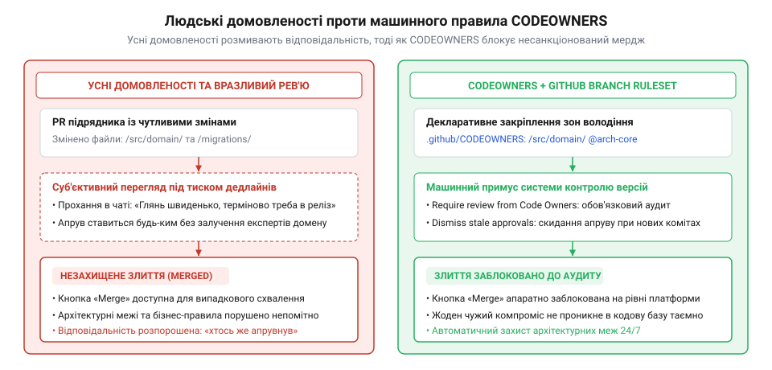
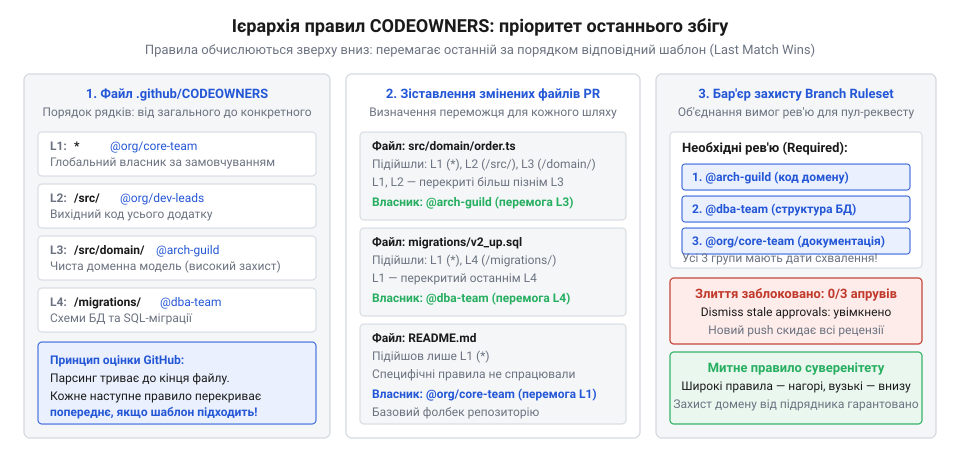
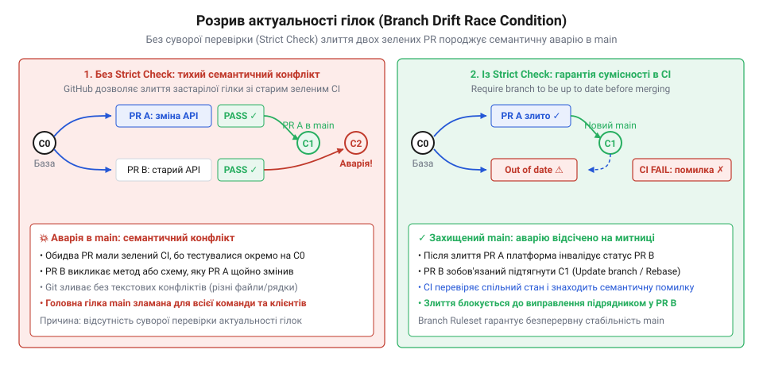
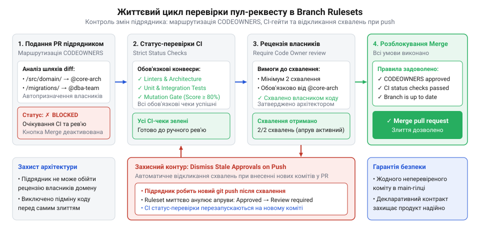
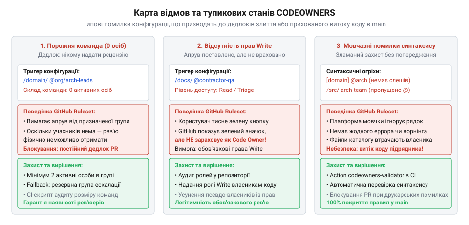

# Приймання чужої роботи

<preknowlist>
- [Код, який пишуть не твої люди](root:progarch/code-written-by-others) — розуміння ризиків неконтрольованого злиття стороннього коду та необхідності машинного розмежування зон архітектурної відповідальності
- [Що має бути в інтерфейсі до підписання](root:progarch/interface-before-signing) — визначення меж доменних модулів і контрактів компонентів, що підлягають безумовному захисту від самовільних правок
</preknowlist>

## Призначення та архітектура декларативного контролю

У п'ятницю ввечері стороння команда розробників, найнята для інтеграції нового периферійного шлюзу в платформу розумного будинку Digital Homes, завершує спринт і відкриває пул-реквест (@@en|pull request@@). За договором завдання вимагало реалізації адаптера зовнішнього протоколу виключно в ізольованому каталозі `src/adapters/locks/`. Проте під час аналізу змін з'ясовується, що разом із кодом адаптера до гілки `main` тихо додано файл міграції бази даних `migrations/0042_add_lock_credentials.sql`, де поле пароля доступу збережено у відкритому текстовому вигляді, а в конфігурації автоматизованого конвеєра `.github/workflows/ci.yml` закоментовано крок лінтингу та перевірки безпеки залежностей, щоб усунути помилки компіляції перед дедлайном. Два розробники з команди підрядника поставили схвалення (@@en|approval@@) один одному, скористалися наданими правами запису в репозиторій та самостійно виконали злиття (@@en|merge@@). У понеділок уся внутрішня команда платформи стикається з відмовою тестового кластера, спотвореною схемою бази даних та прямою загрозою безпеці, хоча регламент компанії прямо вимагав залучення внутрішніх експертів до перегляду будь-яких системних змін.

Ця аварія розкриває головну ваду розробки із залученням сторонніх виконавців: людська дисципліна перегляду коду (@@en|code review@@) зазнає неминучого краху під дією календарного тиску. Як показано в [Код, який пишуть не твої люди](root:progarch/code-written-by-others), мотивація найманого підрядника суворо обмежена виконанням умов контракту та якнайшвидшим підписанням акта приймання. Про довгострокову стабільність архітектури, чистоту доменної моделі та експлуатаційні витрати думатимуть інші інженери — [Хто веде це потім](root:progarch/who-maintains-it-afterwards). Коли права доступу до репозиторію налаштовано за спрощеною бінарною моделлю (дозвіл на запис усім учасникам команди), система контролю версій не розрізняє внутрішнього архітектора та тимчасового аутсорсера. Сподівання на те, що сторонній розробник добровільно згадає призначити на перегляд адміністратора баз даних або спеціаліста з безпеки, перетворює захист системи на лотерею.

> 🔧 **Навіщо це.**
> Машинне закріплення зон архітектурної відповідальності переносить контроль із площини непевних усних домовленостей у площину інфраструктурних інваріантів. Замість покладання на уважність розробників система контролю версій автоматично блокує інтеграцію змін, доки авторизовані власники кожного зачепленого компонента не поставлять свій цифровий підпис.

Для надійного захисту кодової бази контроль над прийманням чужої роботи передають безпристрасним машинним механізмам на рівні хостингу репозиторіїв (GitHub або GitLab). Цей бар'єр утворюють два взаємодоповнюючі компоненти:
1. Декларативний маніфест власності коду `CODEOWNERS` (від англ. @@en|code owners@@ — «власники коду»). Цей конфігураційний файл зіставляє шляхи до каталогів і файлів у репозиторії з конкретними внутрішніми інженерами чи командами, призначаючи їх обов'язковими рецензентами у разі внесення будь-яких правок у відповідні зони.
2. Правила захисту цільових гілок (@@en|Branch Rulesets@@ або @@en|Branch Protection Rules@@). Це набір політик платформи, який гарантує, що пул-реквест фізично неможливо злити в основну гілку без виконання обов'язкових умов: проходження автоматичних статус-перевірок конвеєра та отримання прямого схвалення від усіх груп власників коду, чиї файли було модифіковано.


*Контраст моделей контролю: усні домовленості та самостійні схвалення підрядників руйнують архітектуру, тоді як машинний бар'єр CODEOWNERS та правил захисту гілок блокує несанкціоноване злиття до отримання підписів штатних експертів.*

Як зазначено в [Що має бути в інтерфейсі до підписання](root:progarch/interface-before-signing), архітектурні межі та відповідальність за їхню цілісність мають бути формалізовані в контракті розробки. Тандем `CODEOWNERS` та `Branch Rulesets` перетворює ці паперові домовленості на програмно виконуваний інтерфейс керування репозиторієм, усуваючи будь-яку можливість обійти рецензування критичних модулів.

## Декларативний синтаксис та семантика .github/CODEOWNERS

Файл `CODEOWNERS` розміщується безпосередньо у версіонованій структурі проєкту. Система керування репозиторієм шукає його за строго визначеними шляхами з таким порядком пріоритету: спочатку в службовому каталозі `.github/CODEOWNERS`, потім у корені репозиторію `CODEOWNERS`, і нарешті в теці документації `docs/CODEOWNERS`. Загальноприйнятим стандартом для проєктів є розташування `.github/CODEOWNERS`, де конфігурація зберігається поруч із дескрипторами конвеєрів неперервної інтеграції.

Граматика файлу побудована на декларативному принципі зіставлення шляхів та суб'єктів відповідальності:
```text
[шаблон-шляху] [власник-1] [власник-2] ... [власник-N]
```
Рядки, що починаються із символу решітки `#`, ігноруються як коментарі. Порожні рядки слугують для візуального структурування зон проєкту.

### Ідентифікація власників

У правій частині правила вказуються суб'єкти, чий цифровий підпис є обов'язковим для схвалення змін. Платформа підтримує три формати ідентифікаторів:
- `@username` — конкретний обліковий запис інженера на платформі. Цей формат створює вузьке місце: якщо інженер іде у відпустку або звільняється, пул-реквест підрядника виявляється заблокованим до ручного втручання адміністратора.
- `@organization/team-slug` — системна група чи команда всередині організації (наприклад, `@company/database-administrators`). Це рекомендований виробничий стандарт: дозвіл на злиття надає будь-який уповноважений член команди, а склад експертів регулюється централізовано без необхідності редагування самого файлу `CODEOWNERS`.
- `user@example.com` — підтверджена адреса електронної пошти користувача. Формат використовується рідко й здебільшого для сумісності з локальними git-утилітами.

Критична вимога платформи: призначені власники зобов'язані мати явні права на запис (@@en|write access@@) до репозиторію. Якщо правило посилається на команду, яка має лише права читання, GitHub мовчки ігнорує її присутність і не створюватиме обов'язкового блокування злиття.

### Семантика зіставлення шляхів і правило останнього збігу

Для вибору файлів `CODEOWNERS` використовує модифікований синтаксис глоб-шаблонів (англ. @@en|glob patterns@@, від лат. *globus* — куля, суцільна маса), подібний до формату `.gitignore`. Проте між `.gitignore` та `CODEOWNERS` існує фундаментальна відмінність у пріоритетах обчислення.

Утиліта `git` під час фільтрації ігнорованих файлів застосовує ранній вихід за наявності негативних правил. На противагу цьому, механізм `CODEOWNERS` послідовно читає файл зверху вниз від першого рядка до останнього:

> **Правило останнього збігу (Last Matching Rule Wins):** Якщо модифікований файл підпадає під дію кількох правил у різних рядках конфігурації, остаточний набір власників визначається **виключно останнім правилом**, що збіглося з цим шляхом. Попередні збіги повністю скасовуються.

Якщо на початку конфігурації призначити команду ядра для всього каталогу `/src/domain/ @company/domain-leads`, а наприкінці файлу розмістити широке правило `*.ts @contractor-devs`, підрядник стане одноосібним власником усіх TypeScript-файлів у домені, а захист ядра буде непомітно нейтралізовано.


*Дерево зіставлення правил CODEOWNERS: оцінка шляху зверху вниз веде до заміщення попередніх призначень останнім збіглим правилом, що визначає остаточний набір обов'язкових рецензентів.*

Специфіка інтерпретації шаблонів шляхів підпорядковується таким правилам:
- `*` — зіставляє довільну кількість символів у межах одного каталогу, не перетинаючи роздільник `/`.
- `**` — зіставляє будь-яку кількість проміжних підкаталогів довільної глибини (наприклад, `src/**/contracts/**`).
- Початковий слеш `/` — жорстко прив'язує пошук до кореня репозиторію. Шаблон `/migrations/` зіставляє виключно каталог `migrations` у корені проєкту. Шаблон без початкового слеша `migrations/` спрацює для будь-якого вкладеного каталогу, наприклад `services/billing/migrations/`.
- Завершальний слеш `/` — позначає каталог. Правило `/docs/` автоматично поширюється на всі вкладені підкаталоги та файли всередині `docs/`. Без завершального слеша шаблон `/docs` збігатиметься як із каталогом `docs`, так і з файлом `docs.md` або `docs.json` у корені.

### Практична структура власності модульного репозиторію

Щоб запобігти діркам у безпеці та забезпечити надійну ізоляцію від сторонніх підрядників, конфігурацію розбивають на логічні шари за зростанням специфічності. Розгляньмо робочий приклад файлу `.github/CODEOWNERS` для платформи Digital Homes:

```text
# .github/CODEOWNERS - декларативний розподіл архітектурної відповідальності

# 1. Глобальне базове правило: будь-який неприв'язаний файл за замовчуванням
# контролюється штатними технічними лідами платформи
*                               @company/core-team-leads

# 2. Документація та публічні специфікації контрактів API
/docs/                          @company/technical-writers
/docs/api/                      @company/api-governance-guild
/api/schemas/                   @company/api-governance-guild

# 3. Базові інфраструктурні конфігурації та скрипти розгортання
/.github/                       @company/devsecops-team
/.github/workflows/             @company/devsecops-team
/infra/                         @company/platform-infrastructure
Dockerfile                      @company/devsecops-team
docker-compose*.yml             @company/devsecops-team

# 4. Схеми даних та міграції: вимагають виключного схвалення інженерів даних
/migrations/                    @company/data-platform-dba
/src/infrastructure/db/         @company/data-platform-dba

# 5. Критичне доменне ядро: зміни бізнес-інваріантів затверджує головний архітектор
/src/domain/                    @company/chief-architect @company/domain-leads

# 6. Конфігурації аутентифікації, шифрування та безпеки
/src/security/                  @company/security-guild
/src/auth/                      @company/security-guild

# 7. Зона автономної розробки підрядника: робота над конкретним адаптером замків
/src/adapters/locks/            @external-contractors @company/integration-liaison
```

Коли розробник зовнішньої команди надсилає пул-реквест, платформа одночасно перевіряє повний перелік змінених файлів. Якщо зміни зачіпають лише `src/adapters/locks/door_lock.ts`, для злиття достатньо схвалення від зв'язкового архітектора замовника `@company/integration-liaison`. Але якщо в цьому ж пул-реквесті підрядник змінив рядок у файлі `/migrations/0042_add_lock.sql` та підкоригував `.github/workflows/ci.yml`, система автоматично заблокує злиття до отримання підписів від трьох незалежних груп: адміністраторів баз даних (`@company/data-platform-dba`), команди безпеки інфраструктури (`@company/devsecops-team`) та відповідального за інтеграцію.

## Конфігурація Branch Rulesets: правила захисту гілок та обов'язкові статус-перевірки CI

Створення декларативного маніфесту `CODEOWNERS` визначає, кому належить код у репозиторії, але саме по собі не створює перешкод для несанкціонованого злиття. Якщо розробник сторонньої команди може зі свого локального термінала виконати команду `git push origin main`, обійшовши вебінтерфейс хостингу, або за допомогою примусового оновлення (@@en|force push@@) перезаписати історію цільової гілки, будь-який список власників перетворюється на порожню декларацію. Контроль набуває інженерної та дисциплінарної сили лише тоді, коли платформа контролю версій бере на себе роль автоматичного вартового, який фізично блокує запис у захищені гілки без виконання комплексу перевірок.

У сучасній екосистемі GitHub цю функцію виконує [механізм наборів правил гілок](root:sf-release/git-repository-rulesets) (@@en|Branch Rulesets@@, від англ. @@en|ruleset@@ — набір правил). Rulesets прийшли на зміну застарілим класичним правилам захисту гілок (@@en|Branch Protection Rules@@), запропонувавши суттєві архітектурні переваги: підтримку нашарування кількох незалежних політик на одну гілку, гнучке націлювання за шаблонами імен посилань (@@en|fnmatch patterns@@) та можливість повноцінного декларативного керування конфігурацією як кодом через GitHub REST та GraphQL API.

### Націлювання та базові заборони

Конфігурація Ruleset починається з визначення цільових гілок репозиторію. Для проєктів, де працюють зовнішні підрядники, захисту підлягають як основна гілка інтеграції (`main` або `master`), так і всі версійні гілки випуску релізів:
- `refs/heads/main` — головна лінія стабільності продукту;
- `refs/heads/release/*` — гілки підготовки релізів, стабілізації та випуску виправлень.

Щодо цих гілок встановлюється перший рівень безапеляційних обмежень:

1. **Категорична заборона прямого пушу (Restrict Pushes).** Жоден інженер — ані штатний співробітник, ані сторонній контрактор — не має права надсилати коміти безпосередньо в захищену гілку. Єдиним допустимим маршрутом внесення змін стає створення ізольованої тематичної гілки та відкриття пул-реквесту (@@en|pull request@@).
2. **Блокування примусового перезапису історії (Block Force Pushes).** Параметр забороняє операції нелінійного оновлення покажчиків гілок (@@en|non-fast-forward push@@). Захист від `force push` є критичним інваріантом аудиту: підрядник позбавляється можливості «переписати минуле» — затерти невдалі проміжні коміти, вилучити зафіксовані раніше сліди вразливостей або змінити базову точку відліку своєї гілки повз історію рецензування.
3. **Заборона видалення гілки (Block Branch Deletion).** Запобігає випадковому або навмисному знищенню ключових гілок проєкту через графічний інтерфейс чи засобами консольного клієнта.

### Автоматизовані фільтри якості: статус-перевірки CI

Навіть найдосвідченіший архітектор неспроможний під час візуального перегляду тисяч рядків чужого коду виявити всі регресійні дефекти, побічні виклики чи порушення внутрішніх контрактів. Людський перегляд коду має починатися лише після того, як комп'ютер підтвердив технічну бездоганність запропонованих змін. Цей фільтр формують обов'язкові статус-перевірки (@@en|Status Checks@@) — контрольні сигнали від конвеєрів неперервної інтеграції (CI), без зеленого статусу яких операція злиття лишається апаратно заблокованою.

Для ефективного приймання коду підрядника в репозиторії налаштовують щонайменше три обов'язкові конвеєри перевірки:
1. **Архітектурний лінтер (Architectural Linter).** Статичний аналізатор залежностей (наприклад, Dependency Cruiser або ArchUnit), який перевіряє дотримання кордонів між шарами системи. Він гарантує, що сторонній розробник, реалізуючи свій адаптер у каталозі `src/adapters/locks/`, не імпортував напряму приватні структури доменного ядра `src/domain/` або службові утиліти інших периферійних модулів.
2. **Мутаційний гейт (Mutation Gate).** Спеціалізований конвеєр перевірки стійкості тестів. Підрядники нерідко прагнуть формально виконати договірний норматив покриття ліній коду (наприклад, 85%), пишучи формальні тести без реальних перевірок (`assert`). Мутаційне тестування генерує синтаксичні мутації в AST-дереві коду підрядника (інвертує умовні переходи, змінює математичні оператори) і перевіряє, чи падають модульні тести. Якщо мутанти виживають, конвеєр завершується аварійно, сигналізуючи про фіктивний характер написаних тестів.
3. **Аудит безпеки та ліцензійної чистоти (License & Dependency Audit).** Сканер складу програмного забезпечення (SCA), який перевіряє всі підтягнуті зовнішні пакети на наявність відомих CVE-вразливостей та відповідність корпоративній ліцензійній політиці. Він миттєво блокує пул-реквест, якщо підрядник підключив бібліотеку під суворою копілефтною ліцензією (наприклад, GPLv3), яка загрожує примусовим розкриттям пропрієтарного коду платформи.

> 🔧 **Навіщо це.**
> Статус-перевірки гарантують, що час штатного архітектора не витрачається на рутинний пошук синтаксичних огріхів, пробитих архітектурних меж або токсичних відкритих ліцензій. Автоматика безжально відсікає неякісний код на підступах до рецензування.

### Усунення інтеграційного розриву: прапорець суворої актуальності

У типовому процесі розробки виникає небезпечна часова колізія, відома як інтеграційний розрив або дрейф гілок (англ. @@en|branch drift@@).

Нехай сторонній інженер відгалужує свою робочу гілку `feature/lock-adapter` від актуального стану гілки `main` на коміті `A`. Усі автоматичні перевірки в його конвеєрі завершуються успішно. Поки триває процес рецензування, штатна команда завершує власний пул-реквест і зливає в `main` коміт `B`, який змінює протокол обробки подій або видаляє застарілий метод у сервісі автентифікації.

Якщо в налаштуваннях захисту гілки вимкнено вимогу актуальності (несуворий режим, @@en|loose mode@@), система GitHub вважає статус-перевірки гілки підрядника задовільними, оскільки на момент перевірки коміту `A` вони були «зеленими». Платформа дозволяє виконати злиття в `main`. Проте внаслідок злиття утворюється новий синтетичний стан `A + B`, який **ніколи не проходив збірку та тестування**. У продакшені виникає бінарний збій через несумісність сигнатур або конфлікт бізнес-логіки.

Щоб повністю ліквідувати цей ризик, у конфігурації Ruleset активують прапорець суворої актуальності:
```json
"strict_required_status_checks_policy": true
```
(у графічному інтерфейсі: «Require branches to be up to date before merging»).

Коли цей прапорець увімкнено, поява будь-якого нового коміту в цільовій гілці `main` негайно переводить статус пул-реквесту підрядника в стан «Потрібне оновлення» (@@en|Update required@@) і блокує кнопку злиття. Розробник підрядника зобов'язаний виконати операцію підтягування свіжого стану `main` (через `git rebase main` або `git merge main`) у свою гілку. Лише після того, як повний набір обов'язкових перевірок CI успішно виконається на актуальному гібридному стані коду, злиття буде дозволено. Для запобігання конфліктам та затримкам у високонавантажених репозиторіях застосовується [архітектура черг злиття](root:sf-release/merge-queue-architecture) (@@en|Merge Queue@@), яка оптимістично тестує транзитні стани перед злиттям.


*Схема розриву актуальності гілок: за несуворого режиму статус-перевірок паралельне злиття коміту в цільову гілку створює неперевірений синтетичний стан, тоді як прапорець strict вимагає ребейзу та повторного прогону тестів перед злиттям.*

### Декларативний маніфест Branch Ruleset

GitHub дозволяє експортувати та застосовувати конфігурацію захисту у вигляді структурованого JSON-документа через ендпоінт `POST /repos/{owner}/{repo}/rulesets`. Нижче наведено вичерпний маніфест захисту головної гілки платформи Digital Homes:

```json
{
  "name": "protect-main-contractor-gate",
  "target": "branch",
  "enforcement": "active",
  "conditions": {
    "ref_name": {
      "include": [
        "refs/heads/main",
        "refs/heads/release/*"
      ],
      "exclude": []
    }
  },
  "rules": [
    {
      "type": "deletion"
    },
    {
      "type": "non_fast_forward"
    },
    {
      "type": "pull_request",
      "parameters": {
        "required_approving_review_count": 1,
        "dismiss_stale_reviews_on_push": true,
        "require_code_owner_review": true,
        "require_last_push_approval": true,
        "required_review_thread_resolution": true
      }
    },
    {
      "type": "required_status_checks",
      "parameters": {
        "strict_required_status_checks_policy": true,
        "required_status_checks": [
          {
            "context": "ci/architecture/linter-boundaries"
          },
          {
            "context": "ci/testing/mutation-gate-score"
          },
          {
            "context": "ci/security/license-and-cve-audit"
          }
        ]
      }
    }
  ],
  "bypass_actors": []
}
```

Цей маніфест закладає фундамент системи: гілка надійно зачинена для прямого запису, вимагає обов'язкових успішних тестів на найсвіжішому коді бази та передає остаточне право вето шлюзу рецензування.

## Механіка шлюзу схвалень (Approval Gate) та життєвий цикл рецензій

Зелений статус усіх перевірок компілятора та лінтера засвідчує, що код стороннього розробника не руйнує синтаксис і проходить базові інваріанти. Проте жодна автоматизована система не здатна повністю оцінити глибину інженерного рішення, читабельність реалізації чи приховані контрактні пастки. Остаточний бар'єр формує людино-машинний шлюз схвалень (@@en|Approval Gate@@).

Шлюз схвалень зв'язує правила захисту гілки з файлом `.github/CODEOWNERS`, перетворюючи статичний список експертів на обов'язковий етап погодження пул-реквесту.

### Параметри шлюзу рецензування

У блоці конфігурації `pull_request` правил Ruleset ключову роль відіграють три взаємопов'язані директиви:

1. **`require_code_owner_review: true` (Вимагати рецензію від власників коду).** Це центральний рушій розподілу відповідальності. Коли підрядник відкриває пул-реквест, платформа аналізує весь перелік змінених файлів (диференціал, @@en|diff@@) і зіставляє його з правилами файлу `CODEOWNERS`. Якщо в маніфесті змінені каталоги закріплені за різними командами, GitHub автоматично призначає їх усіх обов'язковими рев'юерами. Пул-реквест отримує блокуючий статус: кнопка злиття залишається сірою та неактивною доти, доки **кожна зачеплена група власників** не надасть свій офіційний цифровий підпис.
2. **`required_approving_review_count: 1` (Кількість схвалень).** Визначає мінімальний загальний поріг позитивних рецензій. Проте наявність активного прапорця `require_code_owner_review` має абсолютний пріоритет над лічильником: якщо для відкриття замка потрібно 1 схвалення, а пул-реквест підрядника модифікував файли у трьох захищених зонах (наприклад, `/migrations/`, `/src/domain/` та `/.github/workflows/`), системі знадобиться щонайменше три незалежних схвалення — по одному від уповноважених представників кожної відповідної зони.
3. **`require_last_push_approval: true` та блокування самостійного схвалення.** Параметр блокує можливість схвалення змін особою, яка створила пул-реквест або надіслала останній коміт. Якщо сторонній розробник має формальні права рецензента в іншій частині репозиторію, він фізично не зможе підтвердити власні правки.

### Запобігання підміні коду: автоматичне відкликання схвалень

Найнебезпечніший вектор порушення цілісності кодової бази виникає внаслідок людської неуважності на стику процесів рецензування. Цей сценарій називають атакою підміни схваленого коду (@@en|stale approval bypass@@).

Розгляньмо типовий розвиток подій:
1. Підрядник надсилає пул-реквест із чистою, бездоганно оформленою реалізацією інтерфейсу.
2. Провідний архітектор замовника уважно вичитує код, переконується у відповідності контрактам і ставить позначку `Approved` («Схвалено»).
3. Пул-реквест отримує зелену галочку й технічно готовий до злиття.
4. Перед самим злиттям розробник підрядника згадує, що забув додати «дрібницю», або поспішає виправити зауваження з іншого чату. Він локально додає новий коміт, який послаблює таймаути сокетів або вмикає дебаг-лог із виведенням чутливих ключів доступу, і виконує `git push`.

Якщо в системі не активовано параметр автоматичного відкликання застарілих схвалень:
```json
"dismiss_stale_reviews_on_push": true
```
платформа продовжує вважати пул-реквест схваленим! Попередній підпис архітектора залишається чинним, хоча новий коміт він в очі не бачив. Підрядник натискає `Merge`, і неперевірений потенційно небезпечний код потрапляє в основну гілку.

> 🔧 **Навіщо це.**
> Параметр `dismiss_stale_reviews_on_push` усуває будь-яку можливість підміни коду. Будь-який новий коміт у гілці пул-реквесту миттєво анулює всі попередні схвалення архітекторів, повертаючи запит у стан очікування повторного повного перегляду.

Активація цього прапорця гарантує, що підпис архітектора засвідчує не «намір автора», а **точний і незмінний зліпок комітів**, який буде безпосередньо інтегровано в цільову гілку.


*Життєвий цикл проходження перевірок у Branch Rulesets: модифікація вихідного коду ініціює паралельний запуск CI-конвеєрів та динамічне визначення обов'язкових рецензентів за маніфестом CODEOWNERS; будь-який додатковий коміт анулює схвалення, а злиття стає можливим лише за одночасного успіху всіх гейтів.*

### Управління списками винятків (Bypass List)

У будь-якій системі захисту найбільшою спокусою залишається «кнопка екстреного обходу» (@@en|emergency bypass@@). У класичних налаштуваннях репозиторіїв GitHub існував сумнозвісний прапорець «Do not include administrators», зняття якого дозволяло будь-якому адміністратору проєкту злити пул-реквест усупереч червоним тестам і відсутності схвалень.

Під час контрактної розробки це створює класичний організаційний конфлікт: коли до завершення етапу залишаються лічені години, підрядник звертається до керівника проєкту замовника з проханням: «У нас не проходить один тест лінтера через конфлікт форматування, злийте руками, ми поправимо в понеділок». Якщо адміністратор володіє правом обходу правил, дисципліна капітулює перед дедлайном.

Сучасні Branch Rulesets запроваджують гранулярний список винятків (`bypass_actors`). Для підтримки суворої дисципліни діють такі правила:
- **Повна заборона обходу для людей.** Жоден живий користувач — включно з технічним директором та системними адміністраторами репозиторію — не повинен бути присутнім у списку постійного обходу правил. Якщо виникає аварійна ситуація, конфігурація змінюється усвідомлено окремим аудитованим комітом.
- **Виділення автоматизованих сервісних облікових записів.** Єдиними легітимними кандидатами на винятки є службові боти розгортання та випуску релізів (наприклад, `github-actions[bot]` або спеціалізований сервісний акаунт підготовки патчів). Для таких облікових записів встановлюється суворо обмежений режим винятку: `pull_requests_only` (дозвіл на злиття виключно через PR без можливості прямого пушу в терміналі).
- **Непохитний аудит.** Кожна дія з обходу правил або модифікації списку `bypass_actors` фіксується в незмінному корпоративному журналі аудиту (@@en|Audit Log@@). Під час приймання робіт замовник проводить перевірку журналу — як зазначено в [Передача, депонування, кінець контракту](root:progarch/handover-escrow-end-of-contract), будь-які випадки неавторизованого обходу конвеєра сторонніми або внутрішніми виконавцями фіксуються в інспекційному звіті приймання.

## Граничні випадки, типові помилки конфігурації та аварійні стани

Навіть бездоганно продумана інфраструктурна конфігурація у виробничому середовищі стикається з тонкими крайовими ефектами. Поєднання семантики Git, поведінки парсера GitHub та організаційних змін у командах здатне призвести як до повної втрати контролю, так і до мертвого блокування роботи всього проєкту.

### Затінення вузьких правил глобальними патернами

Найчастіша помилка конфігурації виникає через нерозуміння правила останнього збігу (@@en|last-matching-rule-wins@@), детально розібраного в попередньому розділі. Розробники звикають до логіки фаєрволів або списків контролю доступу (ACL), де перше збігле правило припиняє подальший пошук. У файлі `CODEOWNERS` порядок оцінки діаметрально протилежний.

Типовий приклад прихованого саботажу захисту:
```text
# Спроба захистити ядро платформи
/src/domain/                    @company/chief-architect

# Широке правило, додане наприкінці файлу для зручності автоформатування
*.ts                            @external-contractors
```

Коли підрядник змінює файл `src/domain/OrderProcessor.ts`, рушій GitHub знаходить два збіги: правило `/src/domain/` на першому рядку та правило `*.ts` на останньому. Оскільки останнім було правило `*.ts`, єдиним обов'язковим власником файлу призначається `@external-contractors`. Правило головного архітектора виявляється повністю затіненим (@@en|shadowed@@) і безшумно анульованим. Підрядник отримує право одноосібно схвалювати зміни в серці бізнес-логіки.

**Правило запобігання:** Структурувати файл за принципом піраміди специфічності: від найширших масок (`*`, `*.ts`) на самому початку документа до найбільш специфічних критичних каталогів (`/src/domain/`, `/migrations/`, `/.github/`) у його фінальних рядках.

### Мовчазне ігнорування помилок рушієм GitHub

Найбільш підступна властивість парсера `CODEOWNERS` полягає в його внутрішній філософії безпеки: рушій спроєктовано за принципом відкритої відмови (@@en|fail-open parsing@@), щоб помилка розмітки не паралізувала розробку всього репозиторію. Якщо в конфігурації допущено синтаксичну помилку, вказано неіснуючий логін розробника або припущенося одруківки в системному імені команди:
```text
# Помилка в назві команди (пропущено літеру 'i')
/src/security/                  @company/securty-team
```
GitHub **не видає жодних попереджень у веб-інтерфейсі** і не блокує обробку пул-реквесту. Він просто мовчки ігнорує цей некоректний токен або весь рядок.

У результаті складається оманливе відчуття захищеності: у репозиторії лежить гарний файл `CODEOWNERS`, але каталог безпеки лишається абсолютно безгоспним (або перехоплюється глобальним правилом за замовчуванням).

Для захисту від мовчазних збоїв у конвеєр неперервної інтеграції вбудовують обов'язковий [крок валідації маніфесту](root:sf-release/codeowners-validation-ci) (наприклад, утиліту `codeowners-validator` або скрипт перевірки через GitHub API). Конвеєр опитує ендпоінт організаційних команд:
```bash
gh api /orgs/company/teams/securty-team
```
й у разі повернення статусу `404 Not Found` аварійно зупиняє збірку з кодом помилки, запобігаючи попаданню битих правил у головну гілку.

### Тупикові блокування злиття (Merge Deadlocks)

Протилежний крайній стан — параліч репозиторію, коли пул-реквест стає принципово неможливо злити через нездійсненність умов шлюзу:

1. **Брак прав на запис (Write Permission).** GitHub висуває непохитну вимогу: призначений власник коду зобов'язаний мати явні права на запис (`Write` або `Admin`) до репозиторію. Якщо в `CODEOWNERS` вказати спеціалізовану команду (наприклад, `@company/legal-compliance`), яка має в репозиторії лише статус читача (`Read` або `Triage`), система не зможе зарахувати її рецензію як легітимну для зняття блокування. За увімкненого прапорця `Require review from Code Owners` пул-реквест зависає назавжди.
2. **Порожні команди та відсутні учасники.** Якщо всі інженери, які входили до складу команди-власника, звільнилися, були переведені на інший проєкт або вилучені з організації через корпоративний каталог Active Directory / Okta, команда стає порожньою (`0 members`). GitHub автоматично призначає рев'ю на порожню групу, але фізично поставити схвалення ніхто не може.

**Запобігання дедлокам:**
- Керування командами репозиторію за моделлю «інфраструктура як код» (Terraform / OpenTofu), де наявність прав `Write` у рев'юерів перевіряється декларативними тестами.
- Призначення щонайменше двох незалежних груп на кожен критичний модуль (наприклад, спеціалізована команда домену + спільна група архітектурного нагляду `@company/architecture-guild`), щоб відпустка чи ротація одного спеціаліста не зупиняла конвеєр.


*Карта відмов та тупикових станів CODEOWNERS: мовчазне ігнорування синтаксичних помилок рушієм GitHub створює приховані дірки в захисті, тоді як брак прав Write чи порожні команди викликають мертві блокування злиття.*

### Поведінка при перейменуванні та захист від нових підкаталогів

Семантика контролю версій Git не містить операції «перейменування» як атомарної дії. У моделі збереження знімків Git операція `git mv` розглядається як видалення файлу за старим шляхом і створення нового файлу за новим шляхом.

Ця особливість безпосередньо впливає на роботу `CODEOWNERS`:
Якщо підрядник вирішить виконати «рефакторинг» і перемістити файл сутності `src/domain/BillingAccount.ts` у свій робочий каталог адаптерів `src/adapters/locks/BillingAccount.ts`, система оцінить зміни за **обома шляхами одночасно**. Видалення файлу з каталогу `/src/domain/` вимагатиме обов'язкового схвалення від `@company/chief-architect`, а створення за новим шляхом — від власників адаптерів. Спроба обійти контроль простим перейменуванням файлів гарантовано натикається на блокування.

Проте виникає інша загроза: створення нових невідомих підкаталогів. Якщо підрядник додасть до проєкту каталог `src/features/new_gateway/`, для якого в маніфесті немає прямого рядка, виникає питання: хто відповідає за цей код?

Саме тут спрацьовує рятівний глобальний патерн із самого початку файлу:
```text
*                               @company/core-team-leads
```
Якщо файл не збігся з жодним вузьким правилом, він автоматично призначається технічним лідам платформи замовника. Без цього базового правила новий каталог виявився б «сірою зоною» без жодного призначеного власника, що дозволило б злити його взагалі без рецензій.

### Захист та ротація самого файлу CODEOWNERS

Найголовніша вразливість системи управління — це відсутність контролю за контролером.

Якщо файл конфігурації `.github/CODEOWNERS` не захищений власними правилами, сторонній підрядник може надіслати пул-реквест, де просто видалить рядок з обмеженнями для доменного ядра, схвалити цей пул-реквест і злити його в `main`.

Щоб унеможливити цю мета-атаку, діють такі інваріанти:
1. Каталог конфігурацій `/.github/` та сам файл `/.github/CODEOWNERS` повинні бути закріплені за вищим технічним керівництвом організації:
   ```text
   /.github/                     @company/chief-architect @company/devsecops-team
   ```
2. У правилах Branch Ruleset налаштовується заборона редагування файлів конфігурації без безпосереднього підпису адміністраторів безпеки.
3. **Ротація після завершення контракту.** Коли термін дії договору спливає і зовнішня команда здає проєкт, конфігурація власності негайно переглядається. Облікові записи підрядника вилучаються з маніфесту `CODEOWNERS`, а супровід розроблених адаптерів передається штатній команді експлуатації відповідно до плану життєвого циклу — [Хто веде це потім](root:progarch/who-maintains-it-afterwards).
