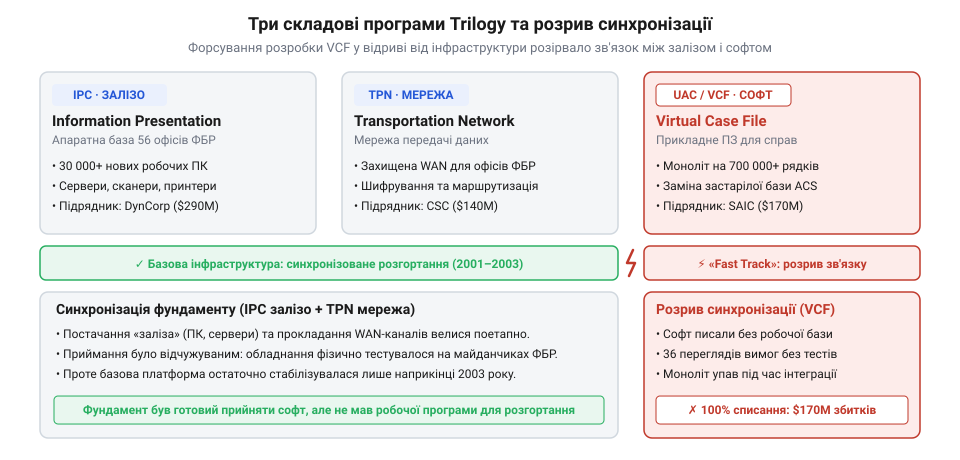
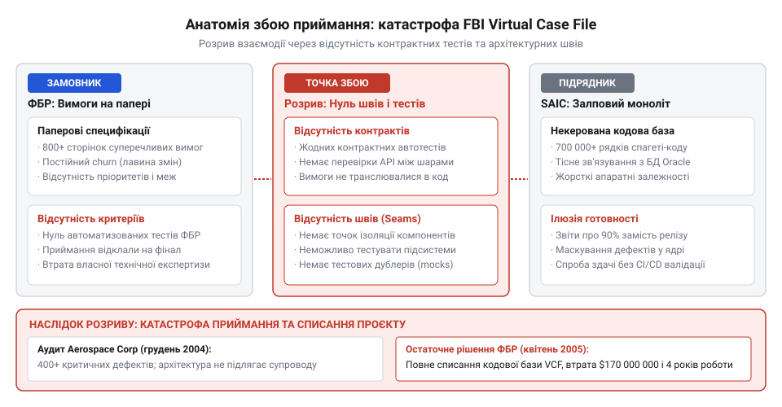

# Приймання чужої роботи

<preknowlist>
- [Що має бути в інтерфейсі до підписання](root:progarch/interface-before-signing) — необхідність попередньої фіксації вимірюваних контрактів та умов здачі до початку реалізації
- [Хто веде це потім](root:progarch/who-maintains-it-afterwards) — розуміння того, як неспроможність замовника самостійно супроводжувати отриманий код робить замовлену систему мертвонародженою
</preknowlist>

## Параліч у паперових бункерах: стан автоматизації ФБР на межі тисячоліть

Улітку 2001 року спеціальний агент Федерального бюро розслідувань у Фініксі Кеннет Вільямс надіслав до штаб-квартири меморандум із попередженням: підозрілі особи, пов'язані з міжнародними терористичними мережами, масово проходять навчання в американських цивільних льотних школах. Приблизно в той самий час польовий офіс у Міннеаполісі затримав Закаріаса Муссауї, який сплатив готівкою тисячі доларів за тренування на пілотажному симуляторі Boeing 747 і цікавився виключно маневруванням пасажирського лайнера в повітрі, а не злетом чи приземленням. Обидва епізоди містили критичні відомості про підготовку масштабного терористичного нападу. Проте аналітики у Вашингтоні не змогли пов'язати ці зачіпки: розслідування велися різними підрозділами, а головна інформаційна система спецслужби фізично не вміла співвідносити розрізнені факти між собою.

Інформаційним фундаментом бюро на межі тисячоліть була система ACS (англ. @@en|Automated Case Support@@), запущена в 1995 році. Її збудували за канонами мейнфреймів 1980-х років: бекенд на платформі IBM 3090/ES9000, взаємодія через термінали IBM 3270 з монохромними зеленими екранами та вкрай негнучка реляційно-ієрархічна модель даних. Комплекс складався з трьох ізольованих модулів:
1. ICM (англ. @@en|Investigative Case Management@@) — журнал відкриття, призначення та закриття справ;
2. ECF (англ. @@en|Electronic Case File@@) — сховище текстових звітів слідчих;
3. UNI (англ. @@en|Universal Index@@) — глобальний покажчик імен, адрес, організацій і телефонних номерів.

На практиці ACS не автоматизувала роботу, а створила над нею додатковий бюрократичний бар'єр. Система підтримувала виключно фіксовані текстові поля: вона не могла зберігати цифрові фотографії підозрюваних, скани документів чи аудіозаписи спостереження. Пошук у покажчику UNI вимагав абсолютного збігу символів: якщо агент робив друкарську помилку або вносив альтернативну транслітерацію арабського імені, пошуковий запит повертав порожній екран. До того ж процедура внесення даних була навмисно ускладнена паперовим регламентом: перед тим як слідчий документ потрапляв у базу, його роздруковували, погоджували фізичними підписами в кількох начальників і передавали операторам терміналів для повторного ручного введення. Щоби передати важливі матеріали між відділеннями в Нью-Йорку, Міннеаполісі та Вашингтоні, агенти зазвичай пересилали паперові теки кур'єрською службою FedEx.

> 🔧 **Навіщо це.**
> Дослідження справжнього стану успадкованої системи (@@en|legacy@@) перед початком проєктування рятує від наївних оцінок. Спроба замінити систему, не розібравшись у її фізичних обмеженнях, реальних користувацьких маршрутах та причинах виникнення обхідних шляхів, неминуче перетворює новий продукт на ще гіршу подобу старого.

Теракти 11 вересня 2001 року оголили цю технологічну неспроможність перед усім світом. Комісія Конгресу та преса звинуватили бюро в нездатності «з'єднати крапки» (англ. @@en|connect the dots@@). Причина аналітичного паралічу полягала не в браку розвідувальних даних, а в архітектурній нездатності застарілої системи агрегувати та зіставляти інформацію з різних джерел. Керівництво ФБР дістало від уряду США безпрецедентне фінансування та категоричний наказ: негайно створити сучасну безпаперову платформу, здатну об'єднати слідчі та контртерористичні потоки в єдине сховище.

## Старт проєкту Trilogy та ілюзія «швидкого треку» для VCF (2001–2002)

План подолання кризи застарілих систем отримав кодову назву Trilogy. Програму модернізації загальним кошторисом 380 мільйонів доларів США Конгрес схвалив іще восени 2000 року, розділивши її на три взаємозалежні складові:
1. IPC (англ. @@en|Information Presentation Upgrade@@) — оновлення парку персональних комп'ютерів, постачання 30 тисяч сучасних робочих станцій, сканерів та периферії;
2. TPN (англ. @@en|Transportation Network Upgrade@@) — створення захищеної високошвидкісної мережі зв'язку між 56 польовими офісами (англ. @@en|field offices@@) та центральним офісом;
3. UAC (англ. @@en|User Applications Component@@) — нове прикладне програмне забезпечення, покликане назавжди вивести з експлуатації ACS.

*Три стовпи програми Trilogy: форсування софтової частини (VCF) відірвало розробку від модернізації мереж та робочих станцій, зруйнувавши синхронне постачання системи.*

У червні 2001 року контракт на розробку компонента UAC вартістю 126 мільйонів доларів виграла корпорація SAIC (англ. @@en|Science Applications International Corporation@@) — один із найбільших оборонних підрядників уряду США. Початковий графік передбачав виважений інженерний цикл: 36 місяців планомірної розробки з поетапним постачанням функціональності та плавною міграцією баз даних.

Проте шок національного масштабу після 11 вересня зруйнував будь-які раціональні плани. Новопризначений директор ФБР Роберт Мюллер зазнавав нищівного тиску політиків і вимагав результату в найкоротші терміни. У січні 2002 року керівництво бюро перевело розробку на так званий «швидкий трек» (англ. @@en|Fast Track@@). Термін здачі скоротили з 36 до 22 місяців, визначивши фінальний дедлайн на грудень 2003 року, а саму програму перейменували на Virtual Case File (VCF).

Паралельно бюро кардинально змінило саме призначення майбутньої системи. VCF більше не розглядали як просту цифрову заміну паперових кримінальних справ — від програми вимагали стати повноцінною аналітичною платформою запобігання злочинам у реальному часі. Щоб укластися в скорочений дедлайн, замовник відкинув ідею поступового розгортання окремих модулів. Було обрано [стратегію одномоментної заміни](root:sf-apps/big-bang-rewrite) (англ. @@en|Big Bang@@): одного дня всі агенти мали повністю припинити роботу з терміналами ACS і перейти в абсолютно новий інтерфейс VCF.

> 🔧 **Навіщо це.**
> Архітектурна стратегія одномоментної заміни (Big Bang) практично завжди веде до катастрофи у складних доменних системах. Безпечний перехід вимагає поступового відкушування функціональності старого моноліту через шви та антикорупційні шари, що дозволяє отримувати зворотний зв'язок від живих користувачів задовго до фінального дедлайну.

Фатальна проблема полягала в моделі взаємодії між клієнтом і виконавцем. Як зазначено в [Код, який пишуть не твої люди](root:progarch/code-written-by-others), повне делегування розробки зовнішньому підряднику без сильної внутрішньої архітектурної команди позбавляє замовника будь-якого контролю над реальним станом проєкту. У ФБР на той момент не було ані головного системного архітектора, ані затвердженої доменної моделі. Ба більше, угоду з SAIC уклали за типом відшкодування витрат із фіксованою націнкою (англ. @@en|cost-plus-award-fee@@), за якої підрядник збільшував свій дохід із кожною додатково списаною людино-годиною.

Як показано в [Що має бути в інтерфейсі до підписання](root:progarch/interface-before-signing), передача розробки без чітко зафіксованих специфікацій інтерфейсів і виконуваних критеріїв приймання перетворює контракт на відкритий кредитний рахунок. Замовник не заклав у контракт автоматизовані приймальні тести чи правила перевірки проміжних збірок, а підрядник отримав можливість нарощувати обсяг коду в режимі повної невизначеності.

## Лавина змін і втрата архітектурного контролю (2002–2003)

Після переходу на скорочений графік проєкт VCF потрапив у класичну пастку розмивання меж (англ. @@en|scope creep@@). Замовник не мав затвердженого базового переліку вимог (англ. @@en|requirements baseline@@): замість фіксації мінімально життєздатного ядра підрозділи ФБР почали надсилати розробникам нескінченні списки побажань. Кримінальні слідчі вимагали збереження звичних форм паперової звітності, контррозвідка наполягала на складній ієрархії рівнів доступу до секретних джерел, а аналітики штаб-квартири хотіли автоматичних інструментів побудови графів зв'язків.

Ситуацію загострила хронічна управлінська нестабільність усередині самого бюро. Упродовж розробки VCF у ФБР змінилося п'ять керівників проєкту та кілька директорів з інформаційних технологій (CIO). Кожен новий менеджер приносив власне бачення пріоритетів і переглядав домовленості попередника. За відсутності постійного технічного лідера замовник висунув понад 400 офіційних запитів на зміну вимог (англ. @@en|Change Requests@@), до яких додавалися сотні неформальних правок від польових агентів.

За обраної моделі контракту виконавець не мав жодного економічного стимулу зупиняти цей потік. Оскільки угода базувалася на відшкодуванні витрат із націнкою, будь-яка нова вимога означала додаткові оплачувані години для інженерів SAIC. Підрядник слухняно погоджувався реалізувати все, що просив замовник, не вимагаючи паузи на стабілізацію архітектури та не оцінюючи системний вплив нових функцій на стабільність платформи.

В інженерному вимірі це призвело до повної втрати модульних меж. Замість проєктування ізольованих сервісів із чіткими контрактами розробники нарощували монолітний масив коду на C++ під керуванням операційної системи Solaris та СУБД Oracle. Бізнес-правила розслідувань, логіка перевірки прав доступу та маршрутизація документів не виносилися в окремі шари чи конфігурації, а жорстко вшивалися безпосередньо в призначений для користувача інтерфейс і тригери бази даних.

> 🔧 **Навіщо це.**
> Відсутність архітектурних швів і формалізованих інтерфейсів робить кодову базу заручником змін. Будь-яка додаткова вимога в немодульному моноліті спричиняє хвильовий ефект по всій системі, перетворюючи кожне локальне виправлення на джерело прихованих регресій у непов'язаних модулях.

У проєкті повністю були відсутні автоматизовані тести та перевірки контрактів. Прогрес вимірювали суто кількістю написаних рядків і паперовими звітами про статус задач. До кінця 2003 року кодова база VCF розрослася до понад 700 тисяч рядків складно переплетеного, нетестованого коду. Ніхто в команді замовника вже не розумів, як саме взаємодіють між собою внутрішні компоненти системи й [хто веде це потім](root:progarch/who-maintains-it-afterwards), коли контракт завершиться. Проєкт перетворився на гігантську чорну скриньку, готову вибухнути в момент першої реальної спроби експлуатації.

## Спроба здачі й колапс процедури приймання (грудень 2003 – початок 2004)

У грудні 2003 року корпорація SAIC офіційно оголосила про завершення робіт за прискореною програмою Fast Track і передала ФБР фінальну версію системи VCF. Підрядник надав замовнику монолітну кодову базу обсягом понад 730 тисяч рядків на C++, масивні схеми реляційної бази даних Oracle та сотні сторінок супровідної документації. З формального погляду виконавця контракт було виконано: усі погоджені переліки функцій було реалізовано в коді, тож SAIC розраховувала на підписання акта приймання та виплату фінальної винагороди.

Проте щойно на початку 2004 року бюро розгорнуло систему для тестової експлуатації в польових офісах, процес приймання зазнав нищівного фіаско. Реальне ПЗ виявилося повністю непридатним до використання у щоденній оперативній роботі. Насамперед обвалилася мережева продуктивність: на розподіленій корпоративній мережі WAN запити між віддаленими офісами та центральним сервером зависали, а відкриття справи або виконання простого пошуку тривали хвилинами замість лічених секунд. До того ж архітектура не витримувала навіть помірного навантаження при одночасній роботі кількох десятків користувачів.

Інтерфейс користувача викликав масове обурення слідчих. Замість обіцяного прискорення роботи елементарні операції вимагали надмірної кількості ручних дій: щоби внести слідчий звіт і прикріпити супровідний файл, агенту доводилося здійснювати до 39 окремих кліків через вкладені діалогові вікна. Механізм розмежування доступу містив критичні вади: система або блокувала доступ слідчих до власних поточних матеріалів, або навпаки — відкривала секретні розвідувальні дані особам без відповідного рівня допуску. Головним інженерним глухим кутом виявилася повна відсутність інструментів міграції: VCF не вміла надійно імпортувати мільйони наявних архівних справ з архаїчної бази ACS, що робило перехід на нову платформу фізично неможливим.

*Анатомія збою приймання: відсутність контрактних тестів та архітектурних швів унеможливила об'єктивну верифікацію зданого моноліту, загнавши замовника й виконавця у взаємне блокування.*

Процедура приймання чужої роботи миттєво зайшла у правовий та технічний глухий кут. Підрядник наполягав: «Ми збудували рівно те, що ви просили в сотнях запитів на зміну; якщо поведінка програми вас не влаштовує, це нові вимоги, які потребують додаткового фінансування». Замовник відповідав: «Система падає і загрожує національній безпеці, ми не підпишемо акт». Оскільки контракт не містив виконуваних приймальних тестів і суворих кількісних метрик відгуку під навантаженням, сторони не мали об'єктивного критерію істини. Процедура, якою має регулюватися коректна [передача, депонування, кінець контракту](root:progarch/handover-escrow-end-of-contract), перетворилася на війну взаємних звинувачень без жодного інженерного арбітражу.

> 🔧 **Навіщо це.**
> Приймальні критерії мають бути виконуваним кодом, а не текстовими побажаннями в додатках до контракту. Якщо перевірка працездатності, обмежень на час відгуку та безпеки не реалізована у вигляді автоматизованих тестових сценаріїв із першого дня розробки, приймання перетворюється на нескінченні суперечки менеджерів і юристів навколо мертвого коду.

## Аудит Aerospace Corporation і безповоротне списання (2004–2005)

Опинившись перед загрозою публічного скандалу та не маючи власних фахівців для інженерної експертизи коду, у березні 2004 року ФБР залучило зовнішнього незалежного аудитора — некомерційну дослідницьку корпорацію Aerospace Corporation. Її інженери мали дати неупереджену відповідь на ключове питання: чи можна доопрацювати та стабілізувати передану систему серією швидких патчів і скільки це коштуватиме платникам податків.

Висновки детального технічного аудиту кодової бази та документації VCF виявилися нищівними. Аудитори з'ясували, що система практично не мала формалізованої архітектури. Проєктна документація не відповідала дійсності: вона описувала уявну ідеальну структуру, тоді як реальні 730 тисяч рядків коду C++ були написані як монолітна спагеті-структура без модульних швів та ізоляції шарів. Бізнес-логіка, запити до бази даних Oracle і графічний інтерфейс користувача були переплетені настільки щільно, що будь-яка спроба виправити дірку в безпеці призводила до каскадного падіння пошукового рушія або зависання підсистеми журналювання.

Аудит зафіксував явище повної архітектурної крихкості: за відсутності антикорупційного шару та автоматизованих регресійних тестів вартість внесення кожної нової правки зростала експоненційно. Інженери Aerospace Corporation дійшли висновку, що VCF принципово непридатна для ремонту, модернізації чи навіть безпечної локалізації помилок. Будь-які спроби врятувати систему шляхом латання вимагали б більше ресурсів, ніж написання нової платформи з нуля.

> 🔧 **Навіщо це.**
> [Пастка незворотних витрат](root:sf-apps/sunk-cost-fallacy-in-architecture) (англ. @@en|sunk cost fallacy@@) — найнебезпечніша спокуса для замовника, який отримав неробочу систему. Якщо архітектурний аудит засвідчує відсутність модульних меж і неможливість ізольованого тестування, спроби «доробити» чужий моноліт лише помножують збитки: вчасне списання та фіксація збитків завжди дешевші за нескінченне субсидування гнилої архітектури.

У січні 2005 року директор ФБР Роберт Мюллер був змушений офіційно визнати крах програми на слуханнях у Конгресі США. Навесні того самого року проєкт Virtual Case File остаточно поховали, списавши понад 170 мільйонів доларів прямих витрат на розробку програмного забезпечення (а загальні витрати на програму Trilogy перевищили пів мільярда доларів). Федеральне бюро розслідувань опинилося в тій самій точці, з якої починало чотири роки тому: агенти повернулися до архаїчних зелених терміналів ACS 1995 року, а критично важлива реформа аналітичних систем була відкинута на роки назад.

## Війна наративів, міф про «недбалих програмістів» та архітектурний урок

Слухання в Конгресі США та розслідування генерального інспектора Міністерства юстиції Гленна Файна породили зручний для політиків публічний наратив: уряд став жертвою некомпетентного підрядника. Газети майоріли заголовками про «криворуких кодерів» SAIC, які спалили сотні мільйонів доларів платників податків і не змогли створити базовий вебзастосунок. Підрядника звинувачували в шахрайстві та штучному роздуванні годин, перетворивши корпорацію на головного цапа-відбувайла за крах національної ІТ-програми.

Проте інженерна дійсність була набагато складнішою за публічний міф. Корпорація SAIC не була аматорською фірмою: вона десятиліттями проєктувала складні системи навігації ракет, радари раннього попередження та ядерні моделі для Пентагону, маючи в штаті тисячі висококваліфікованих інженерів. Програмісти підрядника не писали випадковий код — вони ретельно кодували саме те, що вимагало ФБР у понад 400 офіційних запитах на зміну. Проблема полягала не в кваліфікації окремих розробників, а в фундаментальній архітектурній помилці замовника.

ФБР намагалося віддати на аутсорсинг те, що принципово не підлягає зовнішній передачі: архітектурне бачення своєї предметної області та технічну відповідальність за продукт. Як узагальнює принцип [Код, який пишуть не твої люди](root:progarch/code-written-by-others), жодна стороння компанія не може вгадати реальні потреби замовника, якщо сам замовник не розуміє власних процесів і не має всередині команди архітекторів, здатних сказати «ні» черговій порції хаотичних побажань.

> 🔧 **Навіщо це.**
> Архітектурну відповідальність неможливо передати за контрактом. Зовнішній виконавець завжди оптимізує власні метрики — закриття тасок, виробіток годин і формальну відповідність ТЗ. Якщо всередині команди замовника немає архітектора, який тримає межі домену та контролює модульність, здача коду неминуче перетворюється на здачу хаосу.

Катастрофа Virtual Case File сформулювала найважливіший закон приймання чужої роботи. Приймання — це не підписання фінального юридичного акта через два роки після укладання договору; це безперервна інженерна дисципліна, яка починається ще до першого рядка коду. Чужу роботу можна прийняти лише тоді, коли система розбита на шви, кожен модуль ізольовано антикорупційним шаром, а відповідність вимогам перевіряють щоденні автоматизовані тести контрактів. Якщо замовник замість цього покладається на залпову поставку моноліту, він купує не систему, а гарантовану катастрофу.
