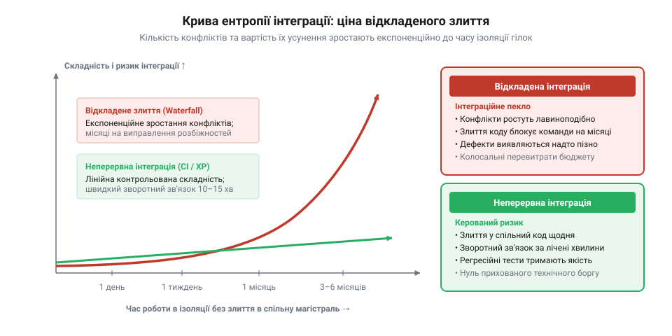
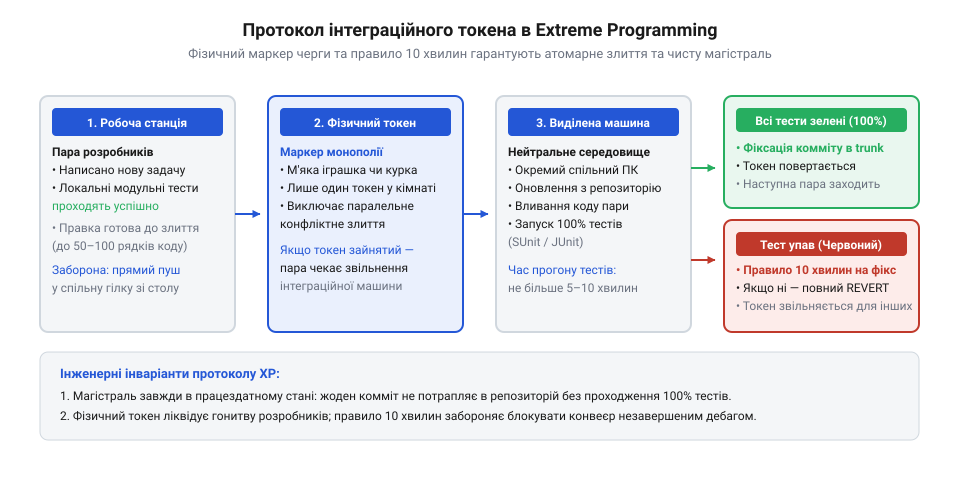
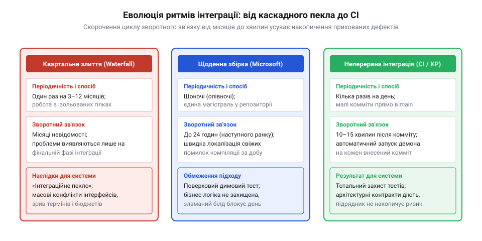
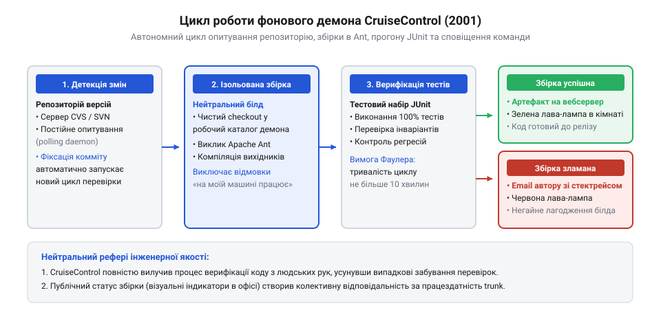
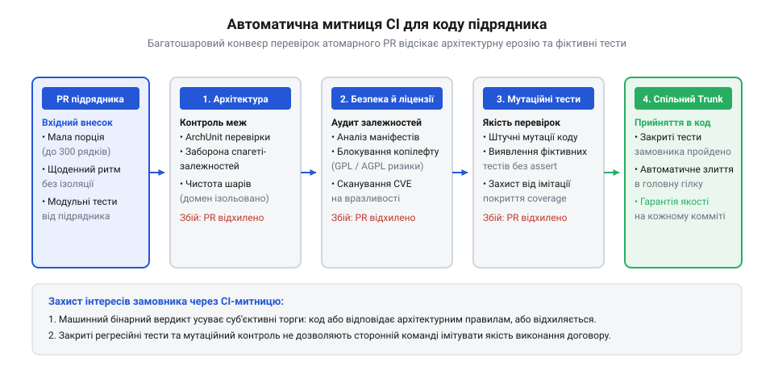
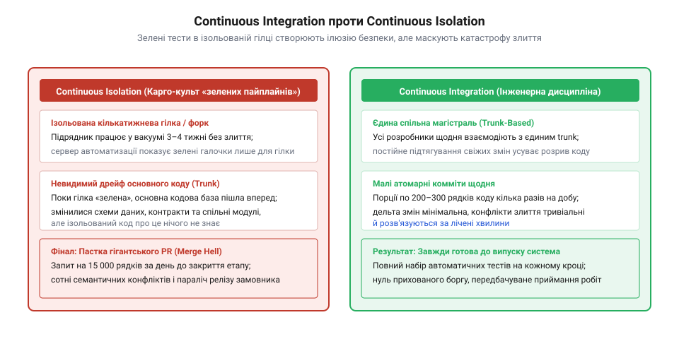

# Приймання чужої роботи

<preknowlist>
- [Код, який пишуть не твої люди](root:progarch/code-written-by-others) — розуміння відмінностей у мотивації зовнішньої команди, що спонукає підрядника уникати раннього показу коду й накопичувати зміни в ізоляції
- [Що має бути в інтерфейсі до підписання](root:progarch/interface-before-signing) — необхідність попередньої фіксації архітектурних меж і контрактів для побудови автоматизованих перевірок у CI
</preknowlist>

## Календарний глухий кут: фаза злиття та народження «інтеграційного пекла» (кінець 1980-х – початок 1990-х)

Наприкінці 1980-х років розробка комерційного та корпоративного програмного забезпечення підпорядковувалася суворій логіці каскадної моделі (англ. @@en|waterfall model@@) та військово-промислових стандартів на кшталт DOD-STD-2167A. Процес створення системи ділили на дискретні календарні фази: детальний збір вимог, проєктування архітектури на папері, кодування окремих модулів, фаза інтеграції, приймально-здавальні випробування та впровадження. Вважалося непорушною істиною, що складну систему можна декомпозувати на незалежні підсистеми, роздати технічні завдання ізольованим командам чи стороннім підрядникам, а за рік чи півтора просто зібрати готові компоненти докупи.

На етапі кодування розробники розходилися по своїх «куточках»: кожна група працювала у власному ізольованому робочому просторі або локальній копії кодової бази, використовуючи тогочасні системи контролю версій на зразок SCCS або RCS, які обслуговували окремі файли й взагалі не підтримували концепцію атомарних гілок проєкту. Протягом шести, дев'яти або дванадцяти місяців інженери писали тисячі рядків коду, орієнтуючись на товсті томи початкових специфікацій інтерфейсів.

Проте жива програма ніколи не залишається статичною. Стикаючись із непередбаченими технічними перешкодами, неточністю документації чи прихованими крайовими випадками, кожен розробник ухвалював локальні рішення: злегка змінював тип повертаного значення функції, додавав неявний параметр у спільний заголовковий файл, по-своєму трактував порядок очищення пам'яті чи закладав альтернативний формат серіалізації даних. У межах власного підмодуля код працював бездоганно: локальні тести проходили, екранні форми малювалися, алгоритми видавали результат. Але жодна інша команда не підозрювала про ці мікроскопічні мутації.

Катастрофа розгорталася тоді, коли календарний графік наказував зупинити кодування й розпочати заплановану «фазу інтеграції». Команди приносили дискети, магнітні стрічки чи мережеві дампи зі своїми напрацюваннями й уперше намагалися скомпілювати спільний білд.

У цей момент проєкт неминуче провалювався в інженерну прірву, яка отримала в індустрії стійку назву @@en|Integration Hell@@ — «інтеграційне пекло». Компілятори вибухали тисячами синтаксичних помилок і конфліктів перевизначення типів. Лінкери скаржилися на циклічні залежності та відсутні символи. Заголовкові файли розійшлися настільки далеко, що модулі говорили буквально різними мовами. Коли ж ціною безсонних ночей і грубого ламання коду програму врешті вдавалося скомпілювати, виявлялося, що вона падає під час запуску: пам'ять псувалася через розбіжності в розмірах структур, процеси блокували один одного в глухих кутах (англ. @@en|deadlocks@@), а підсистеми посилали одна одній структури даних у взаємно несумісних форматах.

Найстрашнішою рисою інтеграційного пекла була його фрактальна некерованість. Спроба розробника підсистеми A терміново виправити функцію, щоб задовольнити підсистему B, миттєво руйнувала контракт із підсистемою C. Інтеграція, на яку менеджмент оптимістично закладав два-три тижні, затягувалася на місяці виснажливого пожежогасіння. Графіки зривалися, релізи відкладалися, стосунки між відділами деградували до взаємних звинувачень, а бюджети танули в нескінченному ручному дебагінгу. Багато масштабних систем так і не вибралися з цього пекла, будучи закритими після витрати десятків мільйонів доларів.

Математична природа цієї кризи полягає в тому, що ентропія несумісності зростає не лінійно, а експоненційно до часу ізоляції. Якщо кілька незалежних модулів еволюціонують у вакуумі протягом місяців, кількість прихованих конфліктів інтерфейсів і розбіжностей у поведінці зростає лавиноподібно. Відкладання злиття на фінал проєкту є не що інше, як накопичення прихованого технічного ризику під високі відсотки.

*Крива ентропії інтеграції: вартість та кількість конфліктів при відкладеному злитті зростають експоненційно з часом ізоляції, тоді як часта інтеграція утримує складність на лінійному й передбачуваному рівні.*

Як показано в [Код, який пишуть не твої люди](root:progarch/code-written-by-others), ця проблема стає смертельною при взаємодії із залученими підрядниками. Якщо штатна команда ще може обмінятися новинами біля кавоварки, то зовнішній виконавець працює в повному інформаційному вакуумі. Отримуючи оплату за календарні етапи, підрядник природно зацікавлений приховувати свій код до останнього дня, щоби не нарватися на критику завчасно. У результаті замовник замість керованого продукту діставав монолітний архів із бомбою сповільненої дії всередині.

> 🔧 **Навіщо це.**
> Розуміння витоків «інтеграційного пекла» захищає архітектора від найнебезпечнішої ілюзії проєктного менеджменту: сприйняття інтеграції як календарної фази. Інтеграція — це не окремий етап у кінці шляху, а безперервний спосіб перевірки того, чи існує ваша система взагалі як єдине ціле.

## Перший крок Microsoft: Synch-and-Stabilize та щоденна збірка (середина 1990-х)

У першій половині 1990-х років компанія Microsoft зіткнулася з проблемою складності на масштабах, які раніше видавалися немислимими для індустрії персональних комп'ютерів. Флагманські продукти компанії — офісний пакет Microsoft Office, графічні додатки та особливо операційна система Windows NT, розробку якої очолив легендарний інженер Дейв Катлер (англ. Dave Cutler), — перетворилися на гігантські кодові бази обсягом у мільйони рядків на мовах C та C++. Над кожною системою одночасно працювали сотні програмістів, розділених на десятки функціональних груп.

Якби Microsoft намагалася розробляти Windows NT за класичною каскадною схемою з інтеграцією наприкінці річного циклу, операційна система ніколи б не побачила світ: лавина з тисяч несумісних правок у ядрі, драйверах, підсистемах пам'яті та мережевих протоколах поховала б реліз під тоннами невиправних помилок.

Інженерне керівництво компанії, зокрема Джим Маккарті (англ. Jim McCarthy, автор книги «Dynamics of Software Development», 1995), створило альтернативну парадигму розробки, відому як @@en|Synch-and-Stabilize@@ («синхронізація та стабілізація»). Її фундаментальні принципи згодом докладно описали дослідники Майкл Кусумано (Michael Cusumano) та Річард Селбі (Richard Selby) у дослідженні «Microsoft Secrets» (1995), а також Стів Макконнелл (Steve McConnell) у культовій праці «Rapid Development» (1996). Замість того, щоб чекати фіналу проєкту, Microsoft перетворила інтеграцію на щоденний метроном проєкту, запровадивши практику @@en|Daily Build and Smoke Test@@ («щоденне збирання та димове тестування»).

Механіка щоденного збирання спиралася на залізну інженерну дисципліну:
1. **Єдина магістраль коду:** Усі розробники підключалися до централізованого репозиторію системи контролю версій (спочатку власної внутрішньої системи SLM — @@en|Source Library Manager@@, а згодом Visual SourceSafe).
2. **Щоденний дедлайн синхронізації:** Кожен інженер зобов'язувався щодня оновити свій локальний робочий каталог свіжими правками колег, розв'язати локальні конфлікти та залити власний написаний код у спільну гілку до кінця робочого дня (зазвичай до 17:00 або 18:00).
3. **Нічна чиста збірка:** Опівночі виділений сервер або черговий інженер — «білд-майстер» (англ. @@en|build master@@) — запускав повне перекомпілювання всієї системи з нуля. Процес міг тривати від трьох до восьми годин.
4. **Димовий тест (Smoke Test):** Якщо компіляція та лінкування завершувалися успішно, на отримані бінарні файли нацьковували автоматизований набір перевірок, де застосовували [патерни димового тестування](root:sf-release/smoke-testing-patterns). Термін запозичили в апаратних інженерів, які, відремонтувавши плату, вперше вмикали живлення й дивилися, чи не піде з неї дим. У софті димовий тест перевіряв базову життєздатність: чи завантажується ядро операційної системи, чи запускається графічна оболонка, чи можна створити й зберегти текстовий документ без падіння процесу з @@en|General Protection Fault@@.

У цій моделі з'явилося поняття, що стало наріжним каменем інженерної культури, — «зламати збірку» (англ. @@en|breaking the build@@). Якщо чийсь денний комміт призводив до того, що нічна збірка падала з помилкою компілятора чи не проходила димовий тест, робота всієї команди наступного ранку опинялася під загрозою: сотні людей не могли оновити код.

За зламаний білд наставала сувора соціальна та професійна відповідальність. Винуватця публічно оголошували в ранковій розсилці; він був зобов'язаний негайно кинути всі поточні справи й сидіти поруч із білд-майстром, доки збірка не стане зеленою. У багатьох підрозділах побутували напівжартівливі покарання: автор зламаного білда мусив тримати на моніторі статуетку козла відпущення, носити смішний капелюх або купувати пончики для всієї команди на ранковому мітингу.

Прорив підходу полягав у тому, що інтервал між внесенням дефекту та його виявленням скоротився з місяців до двадцяти чотирьох годин. Якщо збірка падала в середу вранці, підозрюваними були лише ті зміни, які потрапили в репозиторій у вівторок, а не тисячі правок за минулий квартал. Локалізувати поломку ставало на порядки простіше.

Проте щоденна збірка Microsoft мала принципові обмеження, які не дозволяли їй стати повноцінним порятунком від архітектурної ентропії.

По-перше, димовий тест був занадто поверховим. Він перевіряв факт компіляції та базову працездатність каркаса, але не містив вичерпного захисту бізнес-інваріантів і тонких доменних правил. Якщо новий код містив тиху логічну помилку в обчисленні податків чи псував рідкісний крайовий випадок у роботі з файлами, димовий тест залишався спокійно зеленим.

По-друге, зворотний зв'язок усе ще залишався запізнілим. Якщо програміст ламав білд о 17:30, він дізнавався про це лише наступного ранку, коли нічний білд уже згорів, а його колеги прийшли на роботу й заблокувалися. Якщо ж за день було зроблено сто коммітів, білд-майстру все одно доводилося проводити нудне бінарне розслідування, щоби з'ясувати, чия саме зміна зруйнувала лінкер.

Як підкреслено в [Що має бути в інтерфейсі до підписання](root:progarch/interface-before-signing), успішна компіляція коду не означає дотримання архітектурного контракту. Щоденна збірка доводила, що модулі тримаються купи на рівні типів даних, але не давала жодної відповіді на питання, чи не зламано поведінкові зобов'язання компонентів. Індустрія потребувала радикальнішого кроку: переходу від добового ритму до безперервного циклу та зв'язування збірки з тотальним регресійним тестуванням.

> 🔧 **Навіщо це.**
> Щоденне збирання та димове тестування формують метроном проєкту. Навіть без складного тестового покриття регулярна добова збірка не дозволяє кодовій базі розпастися на несумісні шматки й перетворює примарний прогрес підрядника на фізично перевірюваний артефакт.

## Революція Extreme Programming: Кент Бек і народження Continuous Integration (1998–1999)

Попри успіх моделі щоденних збірок Microsoft, наприкінці 1990-х років індустрія відчула її стелю: добовий метроном виявився занадто повільним для складних динамічних систем, а димовий тест не рятував від регресій у бізнес-логіці. Справжня революція відбулася в автомобільній столиці США, Детройті, на сумнозвісному проєкті розрахунку заробітної плати C3 (англ. @@en|Chrysler Comprehensive Compensation@@). Проєкт, що мав замінити застарілу систему нарахування виплат для майже 90 тисяч працівників автогіганта, був близький до краху через заплутаність коду на мові Smalltalk та постійні конфлікти між розробниками.

У березні 1996 року для порятунку C3 корпорація Chrysler найняла як консультанта Кента Бека (англ. Kent Beck), до якого згодом приєдналися Ворд Каннінгем (Ward Cunningham) та Рон Джеффріс (Ron Jeffries). Бек запропонував парадоксальну інженерну філософію, яку пізніше виклав у книзі «Extreme Programming Explained» (1999): якщо якась інженерна практика дає користь, її треба «викрутити на максимум» (довести до екстремуму). Якщо тестування допомагає знаходити дефекти — тестувати треба щохвилини перед кожним рядком коду (так народилася розробка через тестування, TDD). Якщо щоденна інтеграція коду в Microsoft зменшила час пошуку багів до однієї доби — інтегрувати код треба не раз на добу, а безперервно, щоразу при завершенні будь-якої атомарної задачі.

Саме так народився канонічний термін і практика @@en|Continuous Integration@@ (CI) — «неперервна інтеграція». Бек висунув радикальну вимогу: розробники зобов'язані зливати свій код у спільну магістраль кілька разів на день — щогодини або щодві. Жодна правка не мала права «ночувати» в локальному робочому просторі розробника.

Головним і вирішальним нововведенням Extreme Programming, яке відрізняло CI від щоденних білдів Microsoft, став нерозривний зв'язок інтеграції з автоматизованими модульними тестами (англ. @@en|unit tests@@). Для мови Smalltalk Кент Бек створив перший фреймворк модульного тестування SUnit (який згодом разом з Еріхом Ґаммою адаптував для Java як всесвітньо відомий JUnit), започаткувавши [еволюцію фреймворків модульного тестування](root:sf-release/unit-testing-frameworks-evolution). Правило злиття стало абсолютним: комміт вважався дійсним не тоді, коли код просто скомпілювався без помилок синтаксису, а лише тоді, коли весь вичерпний набір тестів системи відпрацював зі 100% успіхом.

Механіка раннього CI в епоху до виникнення спеціалізованих хмарних серверів була напрочуд фізичною й дисциплінарною:
1. **Виділена машина інтеграції:** У кутку командної кімнати стояв окремий комп'ютер, з'єднаний із центральним сервером вихідного коду. Інтегрувати код на власній робочій станції заборонялося: збірка мала відбуватися на нейтральному, абсолютно чистому еталонному середовищі.
2. **Фізичний токен черги:** Щоб уникнути одночасного злиття різними парами розробників, команда використовувала відчутний предмет — наприклад, гумову курку чи м'яку іграшку. Пара розробників брала токен, підходила до інтеграційної машини, стягувала свіжі зміни з магістралі, вливала свій локальний код і запускала повний набір модульних тестів.
3. **Правило зелено-червоного:** Доки тести бігли (це займало від 5 до 10 хвилин), розробники стояли поруч і спостерігали. Якщо хоча б один тест падав «червоним», пара мала рівно десять хвилин на негайне виправлення. Якщо причину не вдавалося усунути миттєво, пара зобов'язана була виконати повний відкат (англ. @@en|revert@@) своїх змін до останнього стабільного стану, повернутися за свій стіл і віддати токен наступним колегам.

*Протокол інтеграційного токена: фізичний маркер черги біля виділеної машини гарантує послідовність злиття, а правило десяти хвилин забезпечує негайний відкат змін у разі падіння тестів.*

Цей підхід кардинально змінив психологію розробки. Страх перед злиттям (англ. @@en|merge anxiety@@), який паралізував інженерів попередньої епохи, зник: коли різниця між твоєю гілкою та магістраллю становить усього тридцять рядків коду, написаних за останні дві години, конфлікти злиття стають тривіальними й розв'язуються за лічені секунди. Але головне — кодова база в будь-яку секунду часу залишалася працездатною й верифікованою.

*Ритми злиття: класичне квартальне злиття призводить до експоненційного конфлікту інтерфейсів, нічний білд скорочує затримку до доби, а неперервна інтеграція під захистом тестів зводить розрив до мінімуму.*

Як зазначено в [Що має бути в інтерфейсі до підписання](root:progarch/interface-before-signing), саме наявність виконуваних тестів робить архітектурний контракт дієвим. Бек та його колеги довели: контракт має перевірятися машиною автоматично щоразу, коли в систему потрапляє бодай один новий символ.

> 🔧 **Навіщо це.**
> Неперервна інтеграція під захистом автоматизованих тестів перетворює кодову базу з темного складу на прозорий конвеєр. Зведення розміру дельти змін до мінімуму позбавляє команду ризику «незворотних помилок»: дефект виявляється в момент його появи, коли автор ще пам'ятає кожне написане слово.

## Мартін Фаулер, ThoughtWorks та перший демон CruiseControl (2000–2001)

Практика неперервної інтеграції в екстремальному програмуванні довела свою ефективність, але її перша ітерація містила очевидну організаційну ваду: вона трималася на фізичній дисципліні однієї невеликої кімнати. Модель з виділеною «інтеграційною машиною» та м'якою іграшкою замість електронного токена чудово працювала для згуртованої команди з шести-восьми розробників, які бачили один одного через стіл. Проте щойно проєкт розростався на кілька поверхів, розбивався на десятки людей або залучав розробників з інших міст чи зовнішніх підрядників, фізична черга руйнувалася. Хтось забував передати токен, хтось соромився затримувати колег і пропускав запуск повного набору тестів, а хтось у поспіху перед кінцем робочого дня вливав зміни прямо зі свого ноутбука за принципом «на моїй машині все працює».

Перехід CI від локального цехового звичаю до загальноіндустріального стандарту відбувся у 2000–2001 роках завдяки інженерам міжнародної консалтингової компанії ThoughtWorks (зокрема Мартіну Фаулеру, Martin Fowler, та Меттью Фойммелу, Matthew Foemmel). Працюючи над порятунком складних корпоративних систем у банківській сфері та лізингу, Фаулер і Фойммел усвідомили: щоби прибрати інтеграційні катастрофи, процес верифікації коду необхідно повністю вилучити з рук людини й передати автономній машині.

У 2000 році Мартін Фаулер опублікував програмну статтю «Continuous Integration», де вперше вивів і канонізував фундаментальні інженерні закони патерна:
1. **Єдине джерело правди:** Проєкт живе в єдиному централізованому репозиторії; усе необхідне для збирання — код, скрипти, схеми баз даних — зберігається в ньому.
2. **Повна автоматизація збірки:** Проєкт збирається однією командою консолі за допомогою інструментів автоматизації (на той час — GNU Make чи Apache Ant, що започаткувало перехід [від Make до сучасних систем збирання](root:sf-release/build-automation-evolution)). Ніяких ручних кліків в IDE чи ручного копіювання бібліотек.
3. **Самотестована збірка (Self-Testing Build):** Збірка вважається успішною лише тоді, коли компіляція супроводжується виконанням автоматичних тестів (JUnit).
4. **Щоденне злиття кожним розробником:** Кожен інженер щодня інтегрує свій доробок у спільну магістраль.
5. **Кожен комміт збирається на нейтральній машині:** Збірка запускається автоматично на ізольованому сервері після кожного внесення змін.
6. **Правило десяти хвилин:** Цикл збирання й базового тестування має тривати не більше десяти хвилин, щоби розробник отримував негайний зворотний зв'язок (англ. @@en|feedback loop@@) і не перемикав контекст.

Щоби втілити ці принципи в життя й позбутися потреби чергувати біля окремого комп'ютера, у 2001 році Меттью Фойммел, Пол Джуліус (Paul Julius) та їхні колеги з ThoughtWorks створили @@en|CruiseControl@@ — перший в історії відкритий демон неперервної інтеграції.

Програма, написана мовою Java, працювала як фонова служба (англ. @@en|daemon@@). Вона невпинно опитувала сервер системи контролю версій (CVS, а пізніше Subversion і Perforce). Щойно хтось із розробників надсилав комміт у магістраль, CruiseControl фіксував зміну, робив чистий витяг коду у свій ізольований каталог, викликав скрипт Apache Ant і запускав набір тестів JUnit. Якщо білд завершувався аварією, демон миттєво генерував поштове сповіщення автору з детальним журналом помилок компілятора чи впалих тестів. Якщо ж усе проходило успішно, скомпільований бінарний пакет викладався на внутрішній вебсервер.

*Цикл CruiseControl: фоновий демон виявляє комміт у репозиторії, ініціює збірку в Ant із запуском тестів JUnit і негайно сповіщає авторів про результат, ліквідуючи людський фактор.*

Саме в надрах ThoughtWorks народилася культура візуального оповіщення про статус кодової бази: до серверів CruiseControl підключали фізичні лава-лампи (англ. @@en|lava lamps@@) або пристрої Ambient Orb у центрі кімнати розробників. Зелене світло означало, що кодова база здорова й можна брати задачі в роботу; червоне сигналізувало про надзвичайну подію — зламану збірку, яку вся команда мусила полагодити перш ніж вносити новий код.

Головний концептуальний зсув, який здійснив CruiseControl, полягав у знищенні фрази «на моїй машині все працює». Будь-які локальні середовища оголошувалися невалідними: єдиним суддею працездатності архітектури ставав нейтральний інтеграційний сервер. Якщо код працював у розробника, але падав на сервері збірки — він вважався офіційно зламаним і підлягав негайному видаленню з магістралі.

Як показано в [Код, який пишуть не твої люди](root:progarch/code-written-by-others), ця нейтральність є наріжним каменем приймання зовнішнього коду. Замовник не зобов'язаний вірити запевненням підрядника про готовність модуля: автоматичний демон щоразу виступає об'єктивним рефері, позбавляючи стосунки між клієнтом і аутсорсером суб'єктивних суперечок і людського фактора.

> 🔧 **Навіщо це.**
> Сервер неперервної інтеграції знімає тягар перевірки з плечей інженерів і ліквідує людський фактор. Він перетворює архітектурну гігієну на неупереджений автоматичний конвеєр, де кожна зміна оцінюється за однаковими правилами на еталонному середовищі.

## CI як автоматична митниця при прийманні замовленого коду (2000-ні – сьогодення)

Коли розробку передають зовнішньому виконавцю, технічна проблема неперервної інтеграції негайно набуває гострого економічного та юридичного виміру. Підрядник і замовник мають принципово різну мотивацію: замовник прагне отримати довговічну систему з чистою архітектурою, тоді як аутсорсингова команда обмежена фіксованим бюджетом, термінами контрактних етапів і прагне якомога швидше здати формальний обсяг робіт. Якщо замовник не встановлює жорстких інженерних рамок, підрядник інстинктивно відтворює найгіршу модель кінця 1980-х років: створює приватне відгалуження або окремий форк репозиторію, зникає в ньому на місяць чи два, а за добу до календарної здачі етапу скидає замовнику «бомбу» з 15 000 рядків коду в одному гігантському запиті на злиття (англ. @@en|pull request bomb@@).

Для замовника такий хід стає інженерною пасткою заручника. Відхилити такий обсяг коду за день до дедлайну означає зірвати графік всього бізнесу, вступити в юридичний конфлікт і заморозити фінансування. Водночас прийняти його наосліп — означає власноруч інтегрувати в кодову базу міну сповільненої дії: зламані межі модулів, приховані витоки пам'яти, несумісні бібліотеки та спагеті-залежності, розгрібати які доведеться вже власним інженерам. Ручне рецензування (англ. @@en|code review@@) перед таким обсягом безсиле: жоден архітектор не здатен уважно перевірити десятки тисяч змінених рядків під тиском керівництва, яке вимагає негайно підписати акт приймання.

Єдиним порятунком від цього шантажу став перехід до моделі, де конвеєр неперервної інтеграції виконує роль безжальної автоматичної митниці на кордоні репозиторію замовника. Приймання коду перестає бути одноразовою подією наприкінці контракту й перетворюється на безперервний автоматизований догляд кожного мікроскопічного кроку виконавця.

Ця автоматична митниця спирається на чотири обов'язкові інженерні рубежі, які закладаються в контракт ще до початку робіт:

1. **Примусовий ритм малих порцій.** Замовник блокує можливість накопичувати код в ізоляції. Підрядник зобов'язаний зливати зміни щодня невеликими атомарними порціями (як правило, не більше 300–400 рядків коду за зміну). Якщо гілка підрядника відстає від головного стовбура або не надсилає змін понад добу, робота вважається такою, що відхилилася від контракту. Інтеграційне пекло ліквідується тим, що розбіжність між кодом підрядника та основною системою просто не встигає зрости.

2. **Автоматичний архітектурний лінтинг.** Як визначено в [Що має бути в інтерфейсі до підписання](root:progarch/interface-before-signing), архітектурні контракти та правила шарування фіксуються в коді у вигляді [архітектурних функцій відповідності](root:sf-apps/fitness-functions) (англ. @@en|architectural fitness functions@@) за допомогою інструментів на зразок ArchUnit чи dependency-cruiser. Конвеєр CI перевіряє граф імпортів під час кожного надсилання коду. Якщо виконавець вирішив скоротити собі шлях і викликав методи бази даних безпосередньо з шару відображення або зв'язав бізнес-домен із конкретним стороннім вебкаркасом, конвеєр миттєво ламає збірку. Архітектурна ерозія припиняється машиною без потреби вести емоційні суперечки з розробниками підрядника.

3. **Митний контроль зовнішніх залежностей.** Підрядники схильні розв'язувати дрібні задачі підключенням перших ліпших бібліотек із мережі. Конвеєр CI аналізує файли фіксації залежностей (маніфести та замки версій). Якщо сторонній комміт намагається додати несанкціонований пакунок, бібліотеку з вірусною копілефт-ліцензією чи залежність із відомими вразливостями безпеки, автоматика блокує внесення змін. Замовник захищає власний ланцюг постачання програмного забезпечення безпосередньо у шлюзі злиття.

4. **Мутаційне тестування проти імітації якості.** Зовнішні команди нерідко маніпулюють показником покриття тестами (англ. @@en|code coverage@@), пишучи фіктивні тести, які проганяють рядки коду без реальних перевірок (англ. @@en|assertions@@) або замінюють усю логіку спрощеними заглушками. Щоб виявити фальшивку, конвеєр застосовує [мутаційне тестування](root:sf-release/mutation-testing) (англ. @@en|mutation testing@@). Спеціальний інструмент умисно вносить мікроскопічні дефекти у скомпільований код підрядника — інвертує умовні переходи, змінює математичні знаки або прибирає виклики методів. Якщо набір тестів підрядника успішно проходить на умисно зіпсованому коді, митниця відхиляє роботу: тест, який не помітив диверсії, оголошується фіктивним.

Усі ці фільтри працюють на нейтральній інфраструктурі замовника, де на додачу автоматично запускаються його власні внутрішні регресійні тести, до коду яких підрядник не має доступу. Завдяки цьому CI перетворюється з суто програмістського механізму розробки на головний інструмент технічного аудиту й захисту інвестицій. Той, [Хто веде це потім](root:progarch/who-maintains-it-afterwards), отримує систему, яка пройшла крізь тисячі щоденних перевірок на міцність, а не кота в мішку, переданого в останню ніч перед закриттям договору.

*Автоматична митниця CI: кожен атомарний запит підрядника послідовно долає фільтри архітектурних інваріантів, перевірки ліцензій, мутаційних тестів та закритого регресійного набору замовника, гарантуючи цілісність системи.*

> 🔧 **Навіщо це.**
> Автоматична митниця на базі CI усуває суб'єктивність під час приймання робіт сторонніх розробників. Вона замінює нескінченні наради та взаємні звинувачення об'єктивним бінарним вердиктом машини, унеможливлюючи прихований саботаж архітектурних вимог і гарантуючи цілісність кодової бази замовника на кожному етапі співпраці.

## Карго-культ «зелених пайплайнів» і розвінчання інструментального міфу

У сучасній індустрії програмної інженерії майже неможливо знайти проєкт чи команду підрядників, які б не запевняли: «У нас налаштовано CI!». Зазвичай це підтверджують демонстрацією конфігураційного файла `.gitlab-ci.yml`, `.github/workflows` або Jenkinsfile у репозиторії та зеленими значками успішного проходження збірки поруч із назвою гілки. Проте за цим фасадом криється найпоширеніший карго-культ (англ. @@en|cargo cult@@) XXI століття: підміна змісту інженерної дисципліни наявністю серверного інструменту.

Головний міф сучасної розробки полягає в ототожненні неперервної інтеграції із запуском тестів на ізольованому відгалуженні. Якщо зовнішній підрядник або внутрішня команда працює в окремій гілці чи приватному форку впродовж кількох тижнів, а сервер автоматизації сумлінно компілює кожен їхній комміт і світить зеленим індикатором — це не має жодного стосунку до Continuous Integration. За визначенням, у цьому процесі відсутнє саме злиття (інтеграція).

Таку практику точніше називати «неперервною ізоляцією». Автоматичний сервер лише підтверджує, що код розробника не суперечить сам собі у вакуумі власної гілки. Тим часом головний стовбур системи пішов уперед на сотні змін, суміжні підсистеми змінили внутрішні стани, і щойно цю довгоживучу гілку спробують влити в магістраль, усі примари 1989 року — семантичні розбіжності, приховані конфлікти логіки та регресійний параліч — миттєво оживуть. Зелений статус у форку є психологічним заспокійливим, яке маскує накопичення інтеграційного боргу. Справжня інтеграція відбувається лише тоді, коли застосовується [розробка на основі магістралі](root:sf-release/branching-models) (англ. @@en|Trunk-Based Development@@) і код зливається в єдину спільну магістраль усіма учасниками щодня.

*Порівняння неперервної інтеграції та ізоляції: зелений статус у відокремленій гілці створює оманливе відчуття безпеки, тоді як справжній CI вимагає щоденного злиття в єдиний стовбур для ліквідації інтеграційного боргу.*

Друга популярна омана приписує винахід неперервної інтеграції руху DevOps та появі хмарних інструментів у 2010-х роках. Цей міф плутає причину й наслідок. Неперервна інтеграція народилася не з хмарних контейнерів, а була вистраждана наприкінці 1990-х років піонерами екстремального програмування як соціальна дисципліна боротьби з відкладеним злиттям. Хвиля DevOps у 2010-х лише розширила цей автоматизований цикл далі по конвеєру — у бік неперервного розгортання на серверах. Плутанина інструменту з методологією призводить до того, що команди витрачають місяці на складне конфігурування пайплайнів, забуваючи про головну інженерну вимогу: зливати зміни в спільний код якомога частіше.

Третій самообман — віра в «зелену компіляцію» без перевірки контрактів і архітектурних меж. Якщо конвеєр виконує лише базове синтаксичне збирання та десяток поверхових тестів, які перевіряють тривіальні гетери й сетери, зелений статус збірки не гарантує життєздатності системи. Такий конвеєр спокійно пропустить руйнування архітектурних шарів, появу циклічних залежностей та впровадження небезпечних сторонніх бібліотек. Приймати роботу підрядника, орієнтуючись виключно на зелений колір білда без аналізу того, які саме контрактні перевірки всередині нього закладено, — це прямий шлях до катастрофи в момент, коли настане [Передача, депонування, кінець контракту](root:progarch/handover-escrow-end-of-contract).

Тверезий критерій аудиту проєкту на наявність справжньої неперервної інтеграції не вимагає вивчення інтерфейсу CI-сервера. Достатньо поставити три контрольні запитання:
1. **Як часто код кожного розробника опиняється в спільній магістралі?** Якщо пауза між злиттями в основну гілку перевищує одну добу — неперервної інтеграції на проєкті немає, незалежно від потужності серверного кластера.
2. **Чи залишається головний стовбур працездатним і готовим до випуску після кожного злиття?** Якщо зламана збірка в магістралі висить годинами, а команда продовжує надсилати новий код — культура CI відсутня.
3. **Що саме верифікує конвеєр?** Якщо перевірки обмежуються компіляцією та фіктивним покриттям без тестування споживчих контрактів, архітектурних заборон і мутаційної стійкості — митниця є бутафорською.

Continuous Integration — це не програма, не сервіс за підпискою і не конфігураційний файл у корені репозиторію. Це насамперед організаційна та інженерна дисципліна спільної роботи над спільним кодом. Інструменти лише автоматизують виконання правил, але самі по собі не здатні врятувати архітектуру від ентропії, якщо розробники уникають щоденного злиття.

> 🔧 **Навіщо це.**
> Розуміння різниці між культом інструментів і реальною дисципліною інтеграції захищає замовника від фальшивих звітів підрядника. Аудит приймання коду має оцінювати не наявність зелених значків у приватному форку, а частоту злиття в спільну магістраль та повноту контрактних бар'єрів у конвеєрі.
