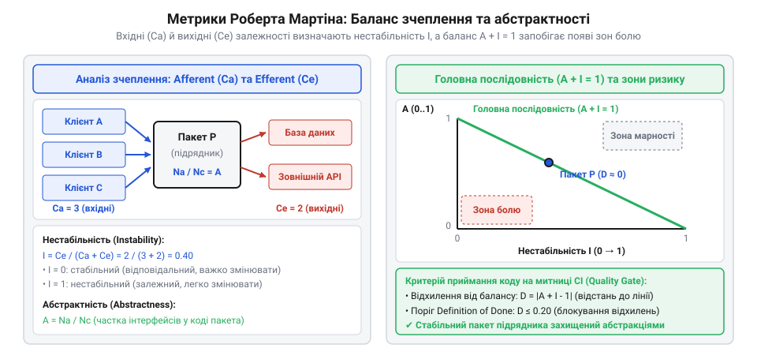
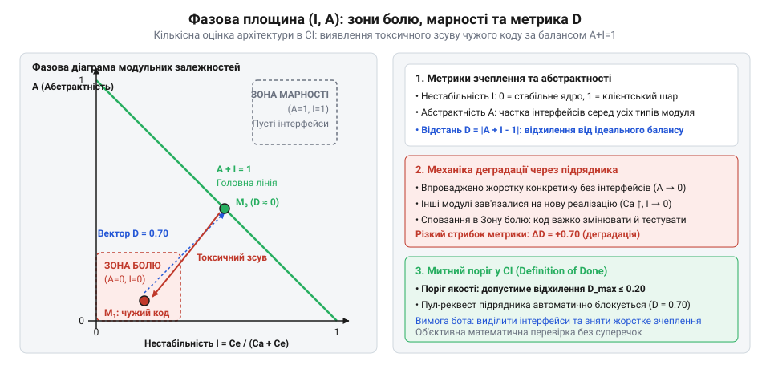
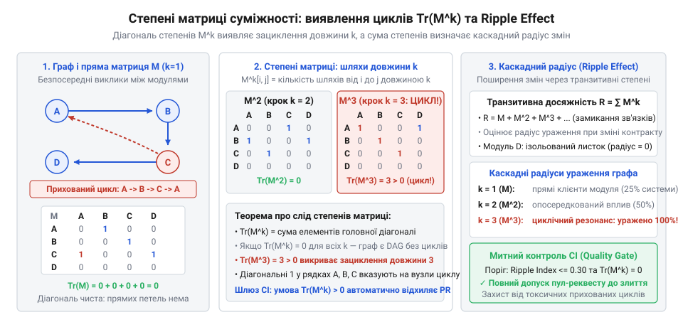

# Приймання чужої роботи

<preknowlist>
- [Код, який пишуть не твої люди](root:progarch/code-written-by-others) — розуміння мотиваційної асиметрії між зовнішнім підрядником і замовником та причин накопичення прихованого архітектурного боргу
- [Що має бути в інтерфейсі до підписання](root:progarch/interface-before-signing) — формалізація меж компонентів і контрактів взаємодії, відхилення від яких контролюється кількісними метриками
</preknowlist>

## Пастка суб'єктивного рев'ю: коли зелених тестів замало для приймання

Уяви класичну драму на етапі здачі робіт зовнішнім підрядником. Команда сторонньої розробки відкриває підсумковий пул-реквест: чотири тисячі рядків коду, тридцять нових класів, реалізована складна платіжна інтеграція. Автоматичний конвеєр збірки безтурботно світиться зеленим: юніт-тести проходять за секунди, формальне покриття рядків сягає 85%, лінтер стилю не видає жодного зауваження. Менеджмент уже готує фінансові акти виконаних робіт, а замовник очікує викатку функціоналу в продакшен найближчого понеділка.

Проте коли штатний архітектор заглядає всередину diff-зрізу, у нього холоне серце. Формально вимоги виконано, але ціною тотального руйнування модульних меж. Зовнішні інженери пішли шляхом найменшого опору: щоб швидше дотягнутися до потрібних даних, вони прокинули прямі виклики з нового контролера в низькорівневі сутності доменного ядра, створили кільцеву залежність між модулем рахунків і модулем сповіщень та прив'язали десяток внутрішніх сервісів до конкретного стороннього SDK.

Архітектор натискає «Reject» і залишає коментар: «Код занадто заплутаний, зв'язки розповзлися, так приймати не можна».

У цей момент спалахує виснажливий організаційний конфлікт, детально описаний у [Код, який пишуть не твої люди](root:progarch/code-written-by-others). Підрядник ображено апелює до контракту: «У технічному завданні не було заборони на виклик цього класу. Тести зелені? Зелені. Функціонал працює? Працює. Ваші претензії — це суб'єктивна вкусовщина й академічний снобізм». Менеджмент підтримує виконавця: на кону десятки тисяч доларів і дедлайн кварталу. Архітектор опиняється в ролі саботажника, який «гальмує бізнес через власні естетичні уподобання».

Головна причина цієї поразки — відсутність числового вимірювання. Поки інженер оперує метафорами («спагеті», «моноліт», «хрупкість»), будь-яка оцінка сприймається як суб'єктивна точка зору однієї людини проти іншої.

Ба більше: наївні автоматичні перевірки тут безсилі. Прості бінарні правила в лінтерах архітектури (накшталт «пакету A заборонено імпортувати пакет B») ловлять лише грубі, очевидні пробої меж. Але підрядник рідко діє так прямолінійно. Справжня ерозія архітектури відбувається через накопичення дрібних легальних зв'язків: кожен окремий імпорт формально дозволений, але разом вони збільшують взаємне зчеплення компонентів у геометричній прогресії, цементуючи кодову базу й перетворюючи будь-яку наступну зміну на мінне поле каскадних падінь.

Щоб позбутися психологічного шантажу й захистити систему, архітектурні межі потрібно озброїти математикою. Поняття зчеплення (@@en|coupling@@) та стійкості (від латинського @@la|stabilitas@@ — міцність, непорушність) мають перетворитися зі слів на об'єктивні числові координати. Якщо конвеєр CI спирається на суворий математичний апарат, пул-реквест підрядника відхиляє не суб'єктивний лід-розробник, а машина — із точним зазначенням чисел, формул і порушених порогових меж.

> 🔧 **Навіщо це.**
> Емоційні суперечки про архітектурну красу підрядник завжди виграє за допомогою бізнес-дедлайнів. Єдиний захист внутрішньої команди — винесення критеріїв приймання в числову площину, де замість образливого «ви написали поганий код» лунає безапеляційне «зчеплення модуля перевищило узгоджений контрактний поріг».

## Пакетні метрики Мартіна: баланс відповідальності, вразливості та абстрактності

Щоб замінити інтуїцію арифметикою, звернемося до математичного апарату, який у середині 1990-х років сформулював американський інженер Роберт Мартін (@@en|Robert C. Martin@@). Його ідея полягала в тому, щоб виміряти структурне здоров'я програмної системи, не аналізуючи алгоритмічну логіку окремих функцій, а розглядаючи систему як орієнтований граф залежностей `G = (V, E)`.

У цьому графі вершинами `V` є пакети (або збірки, модулі, простори імен), а дугами `E` — орієнтовані зв'язки між ними: напрямлена дуга `P₁ → P₂` означає, що принаймні один тип із пакета `P₁` звертається до типів, функцій чи змінних пакета `P₂`. Будь-яка зміна в `P₂` створює ризик регресії в `P₁`.

Для кожного пакета `P` усі дуги графа, що його торкаються, строго поділяються на два класи залежно від напрямку.

### Аферентне та еферентне зчеплення: вага та чутливість

Перша міра — **аферентне зчеплення** (від латинського @@la|afferens@@ — той, що приносить, спрямований досередини), яке позначають `Ca`. Це кількість зовнішніх пакетів системи, які залежать від нашого пакета `P`:

```
Ca = |{ P_ext ∈ V \ {P} : ∃ u ∈ P_ext, ∃ v ∈ P, (u → v) ∈ E }|
```

`Ca` вимірює **відповідальність** пакета. Що більше зовнішніх компонентів спираються на `P`, то вагомішим є пакет у загальній топології системи. Якщо `Ca = 20`, це означає: будь-яка необережна модифікація сигнатури публічного методу або структури даних у `P` здатна каскадно зламати двадцять інших підсистем. Пакет із високим `Ca` стає опорним фундаментом, який надзвичайно важко й ризиковано змінювати.

Друга міра — **еферентне зчеплення** (від латинського @@la|efferens@@ — той, що виносить, спрямований назовні), яке позначають `Ce`. Це кількість сторонніх пакетів, від яких залежить наш пакет `P`:

```
Ce = |{ P_ext ∈ V \ {P} : ∃ u ∈ P, ∃ v ∈ P_ext, (u → v) ∈ E }|
```

`Ce` вимірює **вразливість** пакета до зовнішніх збурень. Якщо `Ce = 15`, наш пакет спирається на п'ятнадцять сторонніх компонентів: зміна внутрішніх реалізацій, оновлення версій або аварія в будь-якому з них потенційно ламає сам `P`. Пакет із великим `Ce` подібний до крихкого даху, який трясеться від кожного подиху вітру.

### Коефіцієнт нестабільності: нормалізація балансу зв'язків

Абсолютні значення `Ca` та `Ce` дають відчуття масштабу, але не дозволяють порівнювати між собою великі підсистеми й компактні модулі. Мартін об'єднав їх у безрозмірний **коефіцієнт нестабільності** (@@en|instability@@) `I`:

```
        Ce
I = ──────────          I ∈ [0, 1]
     Ca + Ce
```

Знаменник `(Ca + Ce)` представляє повну кількість модульних зв'язків пакета зі світом. Чисельник виділяє частку саме вихідних залежностей. Тобто `I` відповідає на запитання: яка частка всіх зв'язків пакета — це його залежність від чужого коду, а не чужа залежність від нього?

Розгляньмо поведінку функції на граничних точках:

1. **Граничний випадок `I = 0` (максимальна стабільність):**
   ```
   Ce = 0, Ca > 0
   I = 0 / (Ca + 0) = 0.0      [пакет ні від кого не залежить]
   ```
   На цей пакет спирається безліч інших (`Ca > 0`), але сам він не кличе жодного зовнішнього модуля (`Ce = 0`). Його неможливо змінити «на ходу», бо за ним стоїть уся система. Він непорушний, як скеля.

2. **Граничний випадок `I = 1` (максимальна нестабільність):**
   ```
   Ca = 0, Ce > 0
   I = Ce / (0 + Ce) = 1.0     [на пакет ніхто не спирається]
   ```
   Від цього пакета не залежить жоден інший модуль системи (`Ca = 0`), але сам він кличе інші частини (`Ce > 0`). Його можна переписувати, видаляти або замінювати в будь-яку мить — жодна стороння підсистема цього навіть не помітить. Це вільний листок на дереві.

Нормування гарантує, що `I` завжди лежить у діапазоні від 0 до 1, усуваючи масштаб кодової бази й перетворюючи нестабільність на універсальну шкалу для автоматичних перевірок.

### Міра абстрактності: чим наповнений компонент

Проте сама лише стабільність `I = 0` приховує смертельну небезпеку: якщо модуль надзвичайно важко змінити, як адаптувати його до нових бізнес-вимог? Відповідь дає вимір його внутрішньої структури — **абстрактність** (@@en|abstractness@@) `A`.

Нехай у пакеті загалом оголошено `Nc` типів (класів, структур, інтерфейсів), із яких `Na` — це суто абстрактні типи (інтерфейси, протоколи та чисті віртуальні класи без реалізації). Абстрактність `A` визначається як частка контрактів:

```
        Na
A = ──────────          A ∈ [0, 1]
        Nc
```

- Якщо `A = 0`, пакет на 100% складається з конкретного виконавчого коду. Щоб змінити його поведінку, програміст змушений правити самі алгоритми всередині методів.
- Якщо `A = 1`, пакет містить виключно абстрактні декларації та інтерфейси без жодного рядка виконання. Це чистий контрактний шар відповідно до принципів, викладених у [Що має бути в інтерфейсі до підписання](root:progarch/interface-before-signing).


*Баланс залежностей пакета: вхідні стрілки Ca формують відповідальність і зменшують нестабільність I, вихідні Ce створюють залежність від чужого, а міра абстрактності A задає здатність змінюватися без порушення контрактів.*

### Анатомія диверсії підрядника у числах

Тепер покажемо, як саме за допомогою цих метрик викривається неякісний пул-реквест сторонньої команди.

Припустімо, у нашій системі є захищене доменне ядро `OrdersCore`. До появи підрядника воно мало такі характеристики:
- Загальна кількість типів: `Nc = 20`, із них інтерфейсів `Na = 4`.
- Вхідні залежності від інших наших підсистем: `Ca = 12`.
- Вихідні залежності: `Ce = 0` (ядро ні від кого не залежить).

Розрахуємо його базові показники:

```
A_core = Na / Nc
       = 4 / 20
       = 0.20                  [базова абстрактність ядра]

I_core = Ce / (Ca + Ce)
       = 0 / (12 + 0)
       = 0.00                  [ідеально стабільний моноліт]
```

Підрядник розробляв модуль інтеграції з логістичними кур'єрами `ContractorDelivery`. Щоб зекономити час і не розбиратися з ін'єкцією залежностей, сторонній розробник виконав дві токсичні дії:
1. Напряму імпортував внутрішні класи `OrdersCore` у шість своїх нових файлів.
2. Всередині доменного сервісу `OrdersCore` додав прямий статичний виклик свого допоміжного класу `ContractorDelivery.Notifier.send()`, а також підключив сторонню бібліотеку валідації адрес `ExternalGeoSDK`.

Погляньмо, що сталося з графом залежностей після застосування такого пул-реквесту:

```
Ca_new = 12 + 6 = 18           [зростання вхідних стрілок]
Ce_new = 0 + 2 = 2             [поява залежності від Delivery та GeoSDK]

I_new = Ce_new / (Ca_new + Ce_new)
      = 2 / (18 + 2)
      = 2 / 20
      = 0.10                   [руйнування нульової нестабільності]
```

На перший погляд, зміна показника `I` від `0.00` до `0.10` здається незначною. Але її інженерний наслідок катастрофічний: раніше автономне ядро тепер має `Ce = 2`. Якщо підрядник оновить свій кур'єрський модуль або стороння бібліотека геокодування впаде з помилкою формату, це безпосередньо зламає доменну логіку замовлень для всіх 18 підсистем компанії!

> 🔧 **Навіщо це.**
> Показники `Ca`, `Ce`, `I` та `A` дають автоматичному лінтеру точні числові аргументи. Замість тривалих дебатів про те, чому не можна робити виклик з ядра в кур'єрський сервіс, конвеєр CI фіксує порушення контракту дельти: `ΔCe > 0` для ядра зі статусом `I = 0` призводить до миттєвого блокування пул-реквесту підрядника.

## Головна послідовність та топологія зон архітектурного болю

Отримавши для кожного пакета два незалежні числа — коефіцієнт нестабільності `I` та міру абстрактності `A`, — ми опиняємося перед фундаментальним геометричним питанням: як ці координати мають співвідноситися в стійкій програмній системі?

Розгляньмо фазову площину `(I, A)`, де обидві осі обмежені діапазоном від 0 до 1. Будь-який модуль системи є точкою всередині одиничного квадрата `[0, 1] × [0, 1]`. Проте топологія цього простору вкрай неоднорідна: різні кути квадрата мають діаметрально протилежну інженерну природу.

### Чотири кути фазової площини: де ховається небезпека

Проаналізуймо чотири граничні стани компонента:

1. **Кут (I = 0, A = 0): стабільний і конкретний.**
   На цей пакет спирається половина системи (`Ca >> 0, Ce = 0 ⇒ I = 0`), тобто змінити його сигнатури майже неможливо без каскадного зламу залежних модулів. Водночас усередині нього немає інтерфейсів (`Na = 0 ⇒ A = 0`) — він цілком складається з жорсткої конкретної реалізації. Виникає безвихідний інженерний клінч: бізнес вимагає нових змін, але чіпати живий монолітний код смертельно небезпечно, оскільки на ньому тримається вся система. Роберт Мартін влучно назвав цей стан **зоною болю** (@@en|Zone of Pain@@). Сюди потрапляють роздуті внутрішні структури даних, синглтони та глобальні утиліти, від яких усі залежать, але які неможливо розширити поліморфно.

2. **Кут (I = 1, A = 1): нестабільний і абстрактний.**
   Від цього пакета не залежить жоден зовнішній модуль (`Ca = 0 ⇒ I = 1`), проте всередині нього знаходяться самі лише абстрактні декларації та інтерфейси (`Na = Nc ⇒ A = 1`), які ніхто в системі не реалізує й не викликає. Це абстракції заради абстракцій, підвішені в порожнечі. Такий стан названо **зоною марності** (@@en|Zone of Uselessness@@). Шкоди для продуктивності від нього немає, але він створює когнітивне сміття й ускладнює навігацію кодовою базою.

3. **Кут (I = 0, A = 1): стабільний і абстрактний.**
   На пакет спирається вся система (`I = 0`), але він побудований виключно з чистих інтерфейсів і контрактів (`A = 1`). Це ідеальний архітектурний фундамент: його легко тримати незмінним роками, а будь-яка нова бізнес-поведінка додається шляхом створення нових реалізацій на периферії без правки самого контракту.

4. **Кут (I = 1, A = 0): нестабільний і конкретний.**
   Пакет містить суто виконавчий код (`A = 0`), але від нього ніхто не залежить (`I = 1`). Це ідеальне архітектурне листя: конкретні адаптери зовнішніх API, консольні команди чи специфічні обробники подій. Їх можна переписувати чи видаляти за хвилину, не турбуючись про регресію інших модулів.

### Рівняння головної послідовності та нормована відстань D

Закономірність очевидна: що стабільніший модуль у системі, то більш абстрактним він зобов'язаний бути. Здорові компоненти системи природно групуються вздовж прямої, що з'єднує ідеальний фундамент `(0, 1)` та ідеальне листя `(1, 0)`.

За аналогією з астрофізичною діаграмою Герцшпрунга — Рассела, де більшість стабільних зірок групуються на певній смузі, цю діагональ назвали **головною послідовністю** (@@en|Main Sequence@@):

```
A + I = 1                        [рівняння головної послідовності]
```

Для кількісної оцінки відхилення конкретного модуля від ідеального балансу Мартін запропонував показник **нормованої відстані** `D`:

```
D = |A + I - 1|                  D ∈ [0, 1]
```

Фізичний зміст `D` полягає у вимірюванні перпендикулярної відстані від точки `(I, A)` до здорової діагоналі. Модуль усуває напрямок відхилення, однаково строго штрафуючи як сповзання в зону болю (`A + I < 1`), так і виліт у зону марності (`A + I > 1`):
- Якщо модуль лежить на головній послідовності (`A + I = 1`), то `D = |1 - 1| = 0.0` — архітектурний ідеал.
- У найгірших точках `(0, 0)` та `(1, 1)` показник сягає максимуму: `D = |0 - 1| = 1.0` або `D = |2 - 1| = 1.0`.


*Фазова площина (I, A): пряма A + I = 1 відображає збалансовані архітектурні стани, а вектор D фіксує відхилення в зону болю (надмірна жорсткість) або зону марності (порожні абстракції).*

### Динаміка зсуву при прийманні чужого коду

Коли зовнішній підрядник інтегрує нову функціональність, показник `D` слугує найчутливішим барометром архітектурної деградації.

Повернімося до нашого прикладу доменного ядра `OrdersCore`. До втручання підрядника його показники становили:
```
A = 0.20
I = 0.00
D_до = |0.20 + 0.00 - 1|
     = |-0.80| = 0.80            [значний архітектурний борг на старті]
```

Модуль уже перебував у небезпечній близькості до зони болю. Що робить підрядник? Додає 6 нових суто конкретних сервісів без жодного нового інтерфейсу (`Nc` зріс із 20 до 26, `Na` лишився 4) і підключає прямі залежності від 10 інших частин програми:
```
A_нова = 4 / 26 ≈ 0.154          [абстрактність впала через наплив бетону]
I_нова = 0.00                    [ядро лишилося високостабільним]

D_після = |0.154 + 0.00 - 1|
        = |-0.846| ≈ 0.846       [зсув глибше в зону болю]
```

Приріст відстані `ΔD = +0.046` доводить: чужий пул-реквест залив у критичне ядро додатковий бетон, зробивши модуль ще більш крихким.

> 🔧 **Навіщо це.**
> Показник `D` транслює складну топологію залежностей в одне скалярне число. Встановлення автоматичного бар'єра в CI — наприклад, «жоден модуль не може мати `D > 0.35`, а в межах пул-реквесту дельта `ΔD` для існуючих модулів не може перевищувати `0.02`» — перетворює архітектурну дисципліну на строгий інженерний гейт.

## Об'єктно-орієнтовані метрики Чидамбера — Кемерера: мікроструктурний контроль

Пакетні метрики Мартіна бездоганно діагностують макроструктуру системи, але вони сліпі до того, що відбувається всередині окремих класів. Підрядник може майстерно розкласти код по правильних пакетах, створивши бездоганний фасад із `D ≈ 0`, але всю брудну роботу зосередити в одному гігантському «класі-богу» (@@en|God Object@@) на 3000 рядків коду.

Щоб запобігти такій мікроархітектурній ерозії, застосовують об'єктно-орієнтований набір метрик Чидамбера — Кемерера (@@en|Chidamber & Kemerer metrics suite@@, CK), розроблений 1994 року. Розгляньмо три ключові показники цієї моделі, критичні під час аудиту чужого коду.

### Зчеплення між об'єктами (CBO)

Метрика **зчеплення між об'єктами** (@@en|Coupling Between Objects@@, `CBO`) підраховує кількість інших класів, із якими безпосередньо пов'язаний цільовий клас `C`. Зв'язок фіксується, якщо клас `C` викликає методи іншого класу, читає чи записує його поля, приймає його типи як параметри методів або наслідує його:

```
CBO(C) = |{ C_ext ∈ Classes ∖ {C} : Uses(C, C_ext) ∨ Uses(C_ext, C) }|
```

Математичний сенс `CBO` полягає у визначенні локального радіуса ураження: якщо `CBO(C) = 25`, то зміна сигнатур будь-якого з 25 сторонніх класів здатна зруйнувати клас `C`.

Емпіричні норми чистого коду вимагають, щоб для звичайних класів бізнес-логіки виконувалася нерівність `CBO ≤ 8..10`. Коли підрядник здає клас контролера чи обробника з `CBO = 34`, це математичний доказ того, що клас намертво припаяний до третини підсистем і не підлягає ізольованому тестуванню.

### Відгук на клас (RFC)

Метрика **відгуку на клас** (@@en|Response For a Class@@, `RFC`) оцінює потенційний комбінаторний простір виконання. Нехай `M(C)` — множина всіх методів, визначених у класі `C`, а `R(m)` — множина зовнішніх методів, які безпосередньо викликаються методом `m`.

Тоді множина відгуку класу `RS(C)` — це об'єднання внутрішніх методів та всіх зовнішніх методів, досяжних за один крок виклику:

```
RS(C) = M(C) ∪ ( ⋃[m ∈ M(C)] R(m) )
RFC(C) = |RS(C)|
```

Обчислимо `RFC` для конкретного підрядного класу `OrderCheckoutService`. Припустімо, клас містить 6 власних методів:
```
|M(C)| = 6                       [кількість власних методів]
```
Кожен власний метод звертається до зовнішніх репозиторіїв, брокерів та логерів. Нехай множина унікальних зовнішніх методів, які викликаються цими 6 функціями, становить 38 унікальних викликів:
```
|⋃ R(m)| = 38                    [унікальні зовнішні виклики]
```
Якщо внутрішні методи не кличуть один одного як зовнішні, то потужність множини відгуку дорівнює:
```
RFC = |M(C)| + |⋃ R(m)|
    = 6 + 38
    = 44                         [комбінаторний простір відгуку]
```

Чому це важливо? `RFC` прямо пропорційний складності тестування. Щоб протестувати поведінку екземпляра цього класу на граничних станах, тестувальник зобов'язаний налаштувати моки або проконтролювати стан для 44 різних методів. Значення `RFC > 50` сигналізує про критичну непідтримуваність коду.

### Брак зв'язності методів (LCOM)

Метрика **браку зв'язності методів** (@@en|Lack of Cohesion in Methods@@, `LCOM`) формалізує внутрішню анатомію класу: чи справді методи класу працюють над єдиною доменною задачею, чи клас штучно зліплений із непов'язаних фрагментів.

Ідея Чидамбера та Кемерера спирається на аналіз спільного доступу до полів екземпляра. Нехай клас має `m` методів `M = {m₁, m₂, ..., m_m}` та `a` полів `F = {f₁, f₂, ..., f_a}`. Для кожного методу `m_i` позначимо через `I(m_i) ⊆ F` множину полів, до яких звертається цей метод.

Розглянемо всі невпорядковані пари методів `(m_i, m_j)` для `i < j`. Загальна кількість таких пар дорівнює `m · (m - 1) / 2`. Розіб'ємо їх на дві множини:
- `P`: пари методів, які **не мають спільних полів** (`I(m_i) ∩ I(m_j) = ∅`).
- `Q`: пари методів, які **працюють хоча б з одним спільним полем** (`I(m_i) ∩ I(m_j) ≠ ∅`).

Класичне визначення `LCOM` за Чидамбером — Кемерером:

```
LCOM = |P| - |Q|,      якщо |P| > |Q|
     = 0,              якщо |P| ≤ |Q|
```

Якщо всі методи класу звертаються до спільного стану, множина `P` порожня (`|P| = 0`), і `LCOM = 0` — клас має ідеальну зв'язність (@@en|cohesion@@).

Але підрядники часто порушують принцип єдиної відповідальності, звалюючи в один утилітарний клас різнорідні процедури. Розгляньмо приклад: клас має 4 методи та 4 поля, де кожен метод працює виключно зі своїм полем:
```
I(m₁) = {f₁},  I(m₂) = {f₂},  I(m₃) = {f₃},  I(m₄) = {f₄}
```
Розрахуємо кількість пар:
```
Загальна кількість пар = 4 · 3 / 2 = 6
Жодна пара не перетинається: |P| = 6, |Q| = 0

LCOM = |P| - |Q|
     = 6 - 0
     = 6                         [повний розпад зв'язності]
```

Значення `LCOM = 6` безжально доводить: замість одного класу перед нами чотири незалежні функції, випадково зашиті під одну назву. Такий клас слід негайно декомпувати на чотири автономні структури згідно з контрактними домовленостями [Що має бути в інтерфейсі до підписання](root:progarch/interface-before-signing).

> 🔧 **Навіщо це.**
> Поєднання макроаналізу Мартіна з мікроконтролем Чидамбера — Кемерера усуває сліпі зони. Макроліміти не дозволяють заплутати міжмодульні зв'язки, а стелі `CBO ≤ 12`, `RFC ≤ 50` та `LCOM = 0` на рівні окремих файлів забороняють підряднику ховати технічний борг усередині локальних «класів-богів».

## Матричні моделі залежностей, степені суміжності та лавиноподібний ефект

Попередні метрики аналізували пакети та класи як ізольовані одиниці з їхнім найближчим оточенням. Але архітектурна ерозія рідко обмежується прямими зв'язками першого порядку. Головна загроза чужого коду полягає в прихованій транзитивності: модуль A залежить від B, B кличе C, а C непомітно зв'язується назад з A. Щоб охопити всю топологію системи єдиним математичним поглядом, граф залежностей представляють у вигляді матриці структури дизайну (@@en|Design Structure Matrix@@, DSM).

Нехай система налічує `N` модулів. Задамо квадратну матрицю суміжності `M` розміром `N × N`:

```
M_ij = 1,   якщо модуль i безпосередньо залежить від модуля j
     = 0,   інакше
```

Діагональні елементи за визначенням дорівнюють нулю (`M_ii = 0`), оскільки компонент не розглядається як залежний сам від себе.

### Степені матриці: алгебра непрямих шляхів

Фундаментальна властивість матриці суміжності розкривається при її піднесенні до степеня. Обчислимо квадрат матриці `M²`:

```
(M²)_ij = ∑[m=1 .. N] (M_im · M_mj)
```

Добуток `M_im · M_mj` дорівнює одиниці тоді й лише тоді, коли водночас існують зв'язки `i → m` та `m → j`. Таким чином, сума за всіма проміжними вузлами `m` дає точну кількість спрямованих шляхів довжини 2 між модулем `i` та модулем `j`!

За методом математичної індукції це правило узагальнюється на будь-який цілий степінь `k ≥ 1`:
Елемент `(M^k)_ij` у `k`-му степені матриці суміжності дорівнює точній кількості орієнтованих шляхів залежності довжини рівно `k` від модуля `i` до модуля `j`.

### Виявлення циклів через слід матриці

Спрямований цикл довжини `k` — це ланцюг залежностей, який виходить із модуля `i` і через `k` кроків повертається в той самий модуль `i`. В алгебричному записі це означає ненульовий діагональний елемент: `(M^k)_ii > 0`.

Сума всіх діагональних елементів квадратної матриці називається її слідом (@@en|Trace@@, `Tr`):

```
Tr(M^k) = ∑[i=1 .. N] (M^k)_ii
```

Звідси випливає строгий математичний критерій ациклічності графа:
Граф архітектури є строго спрямованим ациклічним графом (@@en|Directed Acyclic Graph@@, DAG) тоді й лише тоді, коли слід матриці суміжності дорівнює нулю для всіх степенів від 1 до `N`:

```
Tr(M^k) = 0   ∀ k ∈ [1 .. N]     [критерій повної відсутності циклів]
```

Якщо для деякого степеня `k` значення `Tr(M^k) > 0`, система містить щонайменше один токсичний цикл довжини `k`. На практиці для швидкої перевірки використовують алгоритм Тар'яна або топологічне сортування зі складністю `O(|V| + |E|)`, але матричне представлення дає наочну картину: степені матриці рахують точну кількість паразитарних маршрутів, показуючи щільність заплутування.


*Матриця залежностей та її степені: ненульова діагональ у степенях матриці викриває наявність циклів, а сумарне матричне замикання показує каскадний радіус поширення змін.*

### Транзитивне замикання та лавиноподібний ефект (Ripple Effect)

Щоб оцінити повний радіус руйнувань від зміни підрядника, необхідно знати матрицю транзитивної досяжності `R`. Вона показує, чи існує хоч якийсь шлях залежності між парою модулів незалежно від його довжини:

```
R = I_ident + M + M² + M³ + ... + Mⁿ⁻¹
```

де `I_ident` — одинична матриця розміром `N × N`. В ациклічній системі степінь `M^k` гарантовано обнуляється при `k ≥ N`, тому сума є скінченною.

Якщо ми введемо ймовірність `p` того, що зміна або баг у модулі `j` змусить переписати безпосередньо залежний від нього модуль `i` (`0 < p < 1`), то сумарний лавиноподібний ефект (@@en|Ripple Effect@@) описується рядом Неймана:

```
S = I_ident + p · M + (p · M)² + (p · M)³ + ...
  = (I_ident - p · M)⁻¹          [сума ряду при спектральному радіусі < 1]
```

Елемент `S_ij` матриці показує очікувану силу впливу компонента `j` на компонент `i`. Якщо підрядник додає модуль із високим вихідним зчепленням до ядра, значення `S` для суміжних підсистем стрибкоподібно зростає від 0.05 до 0.85, що означає 85% ймовірність каскадних відмов у наявній кодовій базі.

### Математичні пастки розрахунку метрик

Під час аналізу чужого коду архітектор мусить остерігатися трьох типових пасток вимірювання:

1. **Штучні інтерфейси-пустушки:**
   Підрядник, ознайомлений із правилом `A + I = 1`, може штучно завищити абстрактність `A`, створивши двадцять тривіальних інтерфейсів із єдиним методом-заглушкою, які не несуть доменної користі. Показник `A` стрибає вгору, маскуючи бетонну реалізацію. Захистом є зважування абстрактності за кількістю методів або вимоги до використання інтерфейсу різними реалізаціями.

2. **Нелінійність агрегації:**
   Усереднення показників `D` або `CBO` по всій системі приховує катастрофу. Якщо дев'ять модулів мають `D = 0.05`, а один новий модуль підрядника має `D = 0.95`, середнє арифметичне становитиме комфортні `0.14`. Метрики перевіряють за квантилями (наприклад, `p99` або максимум), а не за середнім.

3. **Комбінаторний вибух транзитивності:**
   У слабкоструктурованому коді за наявності циклів елементи `(M^k)_ij` експоненційно зростають із ростом `k`, перетворюючи локальну зміну рядка підрядником на неконтрольований системний шторм регресій.

> 🔧 **Навіщо це.**
> Матричні степені та ряд Неймана усувають ілюзію «ми змінили лише один файл». Вони математично обраховують повну зону ураження та доводять підряднику: навіть поодинокий несанкціонований імпорт поширює ризик відмови на 80% модулів системи через транзитивні шляхи.

## Автоматизовані порогові гейти в CI та контрактний Definition of Done

Завершальним етапом є інтеграція побудованого математичного апарату в щоденну інженерну практику — у конвеєр автоматичної митниці CI, описаний у [Приймання чужої роботи](root:progarch/accepting-contracted-work).

Щоб суб'єктивні претензії зникли назавжди, вимоги до коду формулюють у вигляді чотирьох числових архітектурних гейтів. Якщо хоча б одна умова порушена, білд у CI падає з червоним статусом, а злиття блокується на рівні інфраструктури.

### Чотири числові бар'єри митниці CI

```text
┌────────────────────────────────────────────────────────────────────────┐
│                   АВТОМАТИЧНА МИТНИЦЯ CI: АРХІТЕКТУРНІ ГЕЙТИ           │
├────────────────────────────────┬───────────────────────────────────────┤
│ Критерій верифікації           │ Математична умова проходження         │
├────────────────────────────────┼───────────────────────────────────────┤
│ 1. Повна відсутність циклів    │ Tr(M^k) = 0  ∀ k  (або |SCC| = 1)     │
│ 2. Відхилення від послідовності│ D_новий ≤ 0.30  і  ΔD_існуючий ≤ 0.02 │
│ 3. Ізоляція доменного ядра     │ ΔCe(Core) = 0   і  ΔCa(Core) ≤ 2      │
│ 4. Мікроструктура нових класів │ CBO ≤ 10,  RFC ≤ 40,  LCOM = 0        │
└────────────────────────────────┴───────────────────────────────────────┘
```

1. **Гейт 1: Абсолютна заборона циклів (Zero-Cycle Policy).**
   Жоден пул-реквест не приймається за наявності хоча б одного циклу залежностей будь-якої довжини. Якщо `Tr(M^k) > 0`, інструмент статичного аналізу виводить точний ланцюжок викликів `P₁ → P₂ → ... → P₁`, вимагаючи негайного розриву петлі через інверсію залежностей або винесення спільних інтерфейсів.

2. **Гейт 2: Коридор стійкості та абстрактності (Main Sequence Envelope).**
   Для кожного нового пакета підрядника діє жорстка стеля: `D ≤ 0.30`. Для наявних пакетів замовника, яких торкнувся пул-реквест, встановлюється ліміт дельти: `ΔD ≤ 0.02`. Якщо підрядник додає конкретику в стабільне ядро й зміщує його в зону болю (`ΔD > 0.02`), збірка зупиняється.

3. **Гейт 3: Ізоляція ядра та контроль вихідного зчеплення.**
   Для захищеного ядра системи встановлюється строга вимога: `ΔCe(Core) = 0`. Ядро ні за яких обставин не має права отримати вихідну залежність від коду підрядника. Для власного модуля підрядника обмежується вихідна вразливість: `Ce ≤ 6`.

4. **Гейт 4: Мікрорівневі обмеження класів (CK Thresholds).**
   Кожен новий клас у пулі перевіряється на відсутність локального гниття:
   ```
   CBO(C) ≤ 10                   [ліміт зовнішніх зв'язків класу]
   RFC(C) ≤ 40                   [ліміт комбінаторного відгуку]
   LCOM(C) = 0                   [вимога високої внутрішньої когезії]
   ```

### Диференціальний аналіз у CI: швидкість замість очікування

Розрахунок матриць для репозиторію на кілька мільйонів рядків коду може здатися ресурсомістким. Проте митниця CI виконує диференціальний аудит (@@en|differential PR audit@@):
1. За допомогою команди `git diff --name-only target...HEAD` виділяється множина безпосередньо змінених файлів `ΔFiles`.
2. Будується локальний підграф `G_sub`, що містить змінені файли та їхніх безпосередніх сусідів у радіусі двох переходів (`2 hops`).
3. Розрахунок `CBO`, `RFC` та `LCOM` виконується виключно над зміненими класами за лічені мілісекунди.
4. Перевірка матричних степенів `M^k` запускається над скороченою матрицею зв'язків змінених модулів, що займає менше 2 секунд у загальному пайплайні збірки.

### Фіксація у Definition of Done та договорі підряду

Математичні гейти набувають юридичної сили лише тоді, коли вони прямо зафіксовані в технічних додатках до контракту згідно з положеннями [Що має бути в інтерфейсі до підписання](root:progarch/interface-before-signing) та процедурами [Передача, депонування, кінець контракту](root:progarch/handover-escrow-end-of-contract).

Формулювання у розділі «Критерії готовності (Definition of Done)» договору має такий вигляд:
```text
«Сторони погоджуються, що єдиним об'єктивним критерієм технічного 
приймання програмного коду є успішне проходження автоматизованого конвеєра CI. 
Робота вважається неприйнятою, а зобов'язання Виконавця невиконаними, 
якщо автоматичний звіт фіксує порушення будь-якого з критеріїв:
1. Поява циклічних залежностей (Cycles > 0);
2. Зсув відстані модулів від головної послідовності ΔD > 0.02;
3. Збільшення еферентного зчеплення доменного ядра ΔCe(Core) > 0;
4. Перевищення показників зв'язування для нових класів: CBO > 10, RFC > 40.
У разі непроходження гейтів пул-реквест відхиляється автоматично без 
підписання проміжних чи фінальних актів здачі-приймання».
```

Такий підхід повністю захищає внутрішніх інженерів, які супроводжуватимуть продукт згідно з [Хто веде це потім](root:progarch/who-maintains-it-afterwards). Замість персонального конфлікту з підрядником технічний лід посилається на безпристрасний математичний звіт бота, перетворюючи архітектурну цілісність на гарантований контрактний факт.

> 🔧 **Навіщо це.**
> Чіткі числові пороги в Definition of Done захищають від менеджерського тиску «здаймо хоч як-небудь». Коли відхилення пул-реквесту підтверджене числовим порушенням узгоджених порогів, комерційний ризик неякісного коду повністю залишається на боці підрядника.
