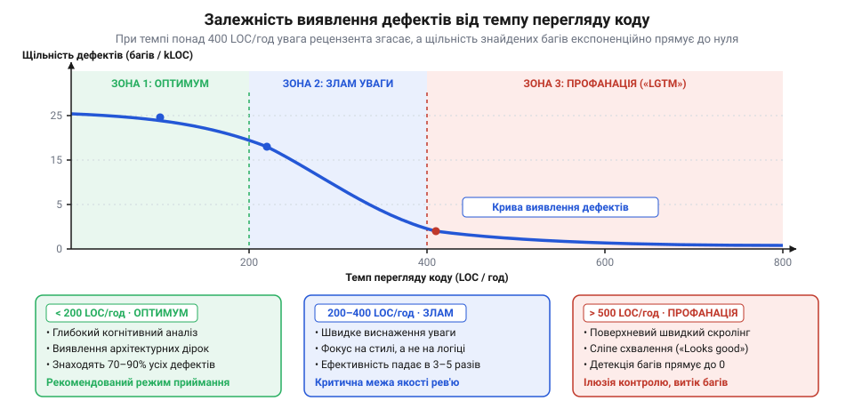
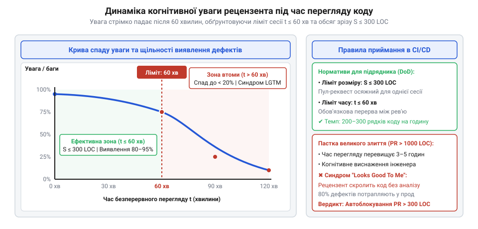
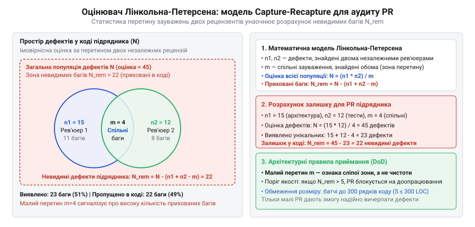

# Приймання чужої роботи

<preknowlist>
- [Що має бути в інтерфейсі до підписання](root:progarch/interface-before-signing) — попереднє визначення перевірюваних критеріїв готовності та правил приймання результатів у контракті
- [Хто веде це потім](root:progarch/who-maintains-it-afterwards) — розуміння ціни залишкових дефектів і тягаря супроводу неякісного коду внутрішньою командою після здачі проєкту
</preknowlist>

## Пастка мега-злиття та парадокс поверхневого схвалення

Кінець другого тижня замовного спринту: зовнішній підрядник здає результати етапу й надсилає пул-реквест на 2500 рядків коду, розподілених між чотирма десятками файлів. Архітектор або провідний інженер відкриває інтерфейс рецензування зі щирим наміром перевірити якість реалізації. Проте вже на другій сотні рядків настає когнітивне перевантаження: оперативна пам'ять людини здатна одночасно утримувати лише чотири-сім смислових блоків, тоді як монолітний diff вимагає тримати в голові складний граф взаємодії нових таблиць бази даних, граничних адаптерів, бізнес-правил та асинхронних викликів.

У цей момент спрацьовує психологічний закон тривіальності Паркінсона (@@en|bikeshedding@@). Рецензент мимоволі чіпляється за те, що не вимагає глибокого аналізу архітектури: перші 50 рядків дістають прискіпливі зауваження щодо назв змінних, форматування відступів і порядку імпортів. Але зі зростанням обсягу прочитаного когнітивний ресурс виснажується. Аналіз семантики станів і граничних умов непомітно підміняється швидким переглядом тексту по діагоналі.

На двохтисячному рядку втомлений рецензент бачить знайомі назви класів, переконується, що автоматичні тести в системі неперервної інтеграції зелені, залишає коментар «@@en|Looks Good To Me, LGTM@@» і натискає кнопку злиття.

Через два дні після викачування на продакшен стається масштабна відмова: прихований витік з'єднань з базою даних в обробнику рідкісної мережевої помилки на 1840-му рядку чужого коду повністю паралізував сервіс під час ранкового піка трафіку.

Природна реакція менеджменту полягає в пошуку винних: «рецензент поставився до перевірки недбало, наступного разу треба дивитися уважніше». Проте звинувачення окремої людини ігнорує фундаментальний факт: увага є вичерпним біологічним ресурсом зі строго обмеженою пропускною здатністю. Коли архітектура процесу дозволяє приймати [Код, який пишуть не твої люди](root:progarch/code-written-by-others) безперервними порціями по кілька тисяч рядків, пропуск системних аварій стає не прикрою випадковістю, а статистичною неминучістю.

> 🔧 **Навіщо це.**
> Помилка в коді під час перегляду пул-реквесту виправляється одним коментарем у системі контролю версій за дві хвилини. Той самий дефект на продакшені спричиняє нічну аварію, екстрений відкат релізу, ручне виправлення пошкоджених даних у базі та репутаційні втрати, вартість яких перевищує час якісної інспекції на кілька порядків.

## Емпірика та фізика перегляду: крива виявлення дефектів

Щоб вивести процес приймання з площини суб'єктивної інтуїції у вимірювану інженерну площину, введемо базові метрики процесу інспекції:

1. Обсяг перевірки `S` — чистий обсяг змінених або доданих рядків коду (@@en|Lines of Code, LOC@@), за винятком автозгенерованих файлів, конфігураційних зліпків та міграцій.
2. Чистий час інспекції `t` — астрономічний час (у годинах), витрачений рецензентом виключно на аналіз коду без перемикання на сторонні задачі.
3. Темп перегляду `v` — швидкість інспекції:

```
v = S / t                             [темп перегляду, LOC/год]
```

4. Кількість виявлених дефектів `D` — число знайдених під час перевірки реальних логічних, архітектурних або безпекових вад.
5. Щільність виявлення дефектів `ρ` (@@en|defect density@@) — питома кількість знайдених помилок, зведена до масштабу тисячі рядків коду:

```
ρ = D / (S / 1000)                    [щільність дефектів, дефектів/kLOC]
```

Масштабні емпіричні дослідження інженерних процесів (зокрема класичне дослідження компанії SmartBear на базі десятків тисяч рецензій у Cisco Systems) виявили виразну нелінійну залежність щільності знайдених дефектів `ρ` від темпу перегляду `v`.


*Зростання темпу перегляду понад 200–400 рядків на годину призводить до експоненційного колапсу щільності виявлення дефектів.*

На цій емпіричній кривій чітко виділяються три функціональні діапазони:

1. Зона якісної аналітики (`v < 200` LOC/год): рецензент встигає віртуально виконати код у голові, перевірити інваріанти, припустити позаштатні стани та відстежити життєвий цикл ресурсів. Щільність виявлення дефектів перебуває на максимальному плато.
2. Зона критичного перелому (`200 ≤ v ≤ 400` LOC/год): швидкість сканування очей починає випереджати темп побудови ментальної моделі програми. Відбувається різкий спад детекції глибоких архітектурних і конкурентних проблем; увага фіксує переважно поверхневі синтаксичні дефекти.
3. Зона профанації (`v > 500` LOC/год): щільність виявлення помилок асимптотично прямує до нуля. Перегляд перетворюється на механічне гортання сторінок, а ймовірність виявлення прихованого дефекту падає до випадкового збігу.

Математично ймовірність виявлення дефекту `P_d(v)` як функцію темпу інспекції `v` описують спадною експоненційною моделлю насичення:

```
P_d(v) = P₀ · e^(-v / v_c)
```

де `P₀` — гранична уважність рецензента за квазістатичного читання (`v → 0`), що залежить від його кваліфікації та знання домену, а `v_c` — критичний параметр насичення робочої пам'яті (емпірично `v_c ≈ 300` LOC/год).

Тоді очікувана щільність знайдених дефектів `ρ(v)` за наявності в коді підрядника об'єктивної щільності помилок `ρ_raw` визначається рівнянням:

```
ρ(v)
= ρ_raw · P_d(v)                      [дефекти, виявлені на одиницю обсягу]
= ρ_raw · P₀ · e^(-v / v_c)           [підстановка експоненційної моделі]
```

**Розрахунок деградації детекції дефектів при подвоєнні темпу.**
Розглянемо випадок, коли рецензент із базовою уважністю `P₀ = 0.85` та параметром `v_c = 300` LOC/год перевіряє код підрядника спочатку в ретельному темпі `v₁ = 150` LOC/год, а потім під тиском термінів форсує темп до `v₂ = 450` LOC/год.

Обчислимо ймовірність детекції для темпу `v₁ = 150` LOC/год:

```
P_d(150)
= 0.85 · e^(-150 / 300)               [підстановка значень]
= 0.85 · e^(-0.5)                     [обчислення показника]
= 0.85 · 0.6065                       [експонента]
≈ 0.516                               [імовірність 51.6%]
```

Тепер обчислимо ймовірність детекції для темпу `v₂ = 450` LOC/год:

```
P_d(450)
= 0.85 · e^(-450 / 300)               [підстановка значень]
= 0.85 · e^(-1.5)                     [обчислення показника]
= 0.85 · 0.2231                       [експонента]
≈ 0.190                               [імовірність 19.0%]
```

При збільшенні швидкості перегляду втричі (з 150 до 450 LOC/год) імовірність виявлення дефекту падає не на 30–40%, а у 2.7 раза: з 51.6% до 19.0%. Понад 80% закладених підрядником дефектів залишаються непоміченими й потрапляють у продакшен.

Саме тому вимоги до максимального розміру порції та темпу інспекції — це не рекомендація з комфорту роботи, а сувора інженерна вимога до надійності системи. Якщо [Що має бути в інтерфейсі до підписання](root:progarch/interface-before-signing) не обмежує розмір переданих зрізів коду, замовник власноруч створює умови, за яких технічний борг і аварії неминуче успадковують ті, [Хто веде це потім](root:progarch/who-maintains-it-afterwards).

> 🔧 **Навіщо це.**
> Експоненційний закон деградації уваги забороняє виділяти одну двогодинну нараду на вичитування тисячі рядків коду підрядника. Якщо перед командою лежить пул-реквест на 1200 LOC, інженерний розрахунок вимагає або декомпувати його на чотири окремі гілки по 300 LOC, або розбити інспекцію щонайменше на чотири роздільні сесії впродовж кількох днів.

## Часовий спад уваги та когнітивне виснаження: ліміт тривалості сесії

Знання критичного темпу перегляду підштовхує до наївного висновку: якщо висока швидкість руйнує якість перевірки, достатньо просто виділити більше часу. Здається, що замовник може посадити провідного архітектора на чотири години безперервної роботи, щоб той повільно й скрупульозно розібрав пул-реквест на 800 рядків із темпом 200 LOC/год.

Проте інженерна реальність спирається на фізіологію: людська увага не є постійним генератором стабільної потужності. Вона підпорядковується закону падіння пильності (@@en|vigilance decrement@@) та наростання розумової втоми (@@en|cognitive fatigue@@). Під час аналізу коду робоча пам'ять перебуває в стані безперервного напруження: їй доводиться утримувати стек викликів, типи даних, протоколи блокувань та можливі винятки. Уже через 45–60 хвилин безперервної концентрації настає виснаження виконавчого контролю мозку.

Динаміку спаду концентрації уваги рецензента в часі `t` (у хвилинах від початку сесії) описують фактором втоми `A(t)`:

```
A(t) = e^(-t / τ)                     [фактор концентрації уваги]
```

де `τ` — часова стала стійкої концентрації, яка для задач високої аналітичної складності становить близько `τ ≈ 50` хвилин. У перші пів години сесії фактор уваги близький до одиниці (`A ≈ 0.9–1.0`), проте після 60 хвилин безперервної роботи він стрімко деградує.


*Після 60 хвилин безперервної інспекції когнітивна втома обвалює увагу рецензента, зводячи ефективність пошуку дефектів до мінімуму.*

Нехай сесія перегляду триває `t` хвилин, за які рецензент перевіряє обсяг `S` рядків коду з номінальним темпом `v = S / (t / 60)`. Миттєва ймовірність виявлення дефекту на хвилині `u` визначається добутком базової чутливості до темпу `P_d(v)` та поточного фактора втоми `A(u)`:

```
p(u) = P_d(v) · A(u)                  [миттєва чутливість інспекції]
```

Інтегральна (середня за всю сесію) ефективність детекції дефектів `E(S, t)` обчислюється як інтеграл згортки темпу та спаду уваги, поділений на тривалість сесії `t`:

```
E(S, t)
= (1 / t) · ∫[0 .. t] P_d(v) · A(u) du
= (1 / t) · P_d(v) · ∫[0 .. t] e^(-u / τ) du           [підстановка A(u)]
= (1 / t) · P_d(v) · [-τ · e^(-u / τ)][0 .. t]         [інтегрування експоненти]
= (τ / t) · P_d(v) · (1 - e^(-t / τ))                  [аналітична формула ефективності]
```

Аналіз отриманого рівняння розкриває дві граничні поведінки:

1. За коротких сесій (`t ≪ τ`): розклад експоненти в ряд Тейлора `1 - e^(-t / τ) ≈ t / τ` дає `E(S, t) ≈ P_d(v)`. Рецензент працює на піку своїх можливостей без утрати якості.
2. За тривалих сесій (`t ≫ τ`): член `e^(-t / τ) → 0`, тому вираз перетворюється на `E(S, t) ≈ (τ / t) · P_d(v)`. Середня ефективність падає обернено пропорційно часу `1 / t`. Кожна наступна година сесії розмиває результат попередньої.

**Розрахунок інтегральної ефективності сесії: 45 хвилин проти 120 хвилин.**
Порівняємо два сценарії перевірки коду підрядника з однаковим базовим темпом `v = 200` LOC/год (для якого з моделі попереднього розділу `P_d(200) = 0.85 · e^(-200 / 300) ≈ 0.436`) за часової сталої уваги `τ = 50` хвилин.

Сценарій 1: Короткий сеанс тривалістю `t₁ = 45` хв:

```
E(S, 45)
= (50 / 45) · 0.436 · (1 - e^(-45 / 50))               [підстановка t₁ = 45 хв]
= 1.111 · 0.436 · (1 - e^(-0.90))                     [обчислення показника]
= 1.111 · 0.436 · (1 - 0.4066)                        [експонента від -0.90]
= 1.111 · 0.436 · 0.5934                              [різниця]
≈ 0.287                                               [інтегральна ймовірність 28.7%]
```

Миттєва увага рецензента наприкінці 45-ї хвилини становить:

```
A(45)
= e^(-45 / 50)
= e^(-0.90)
≈ 0.407                                               [40.7% від початкової уваги]
```

Сценарій 2: Неперервний двогодинний сеанс тривалістю `t₂ = 120` хв:

```
E(S, 120)
= (50 / 120) · 0.436 · (1 - e^(-120 / 50))             [підстановка t₂ = 120 хв]
= 0.417 · 0.436 · (1 - e^(-2.40))                     [обчислення показника]
= 0.417 · 0.436 · (1 - 0.0907)                        [експонента від -2.40]
= 0.417 · 0.436 · 0.9093                              [різниця]
≈ 0.165                                               [інтегральна ймовірність 16.5%]
```

Миттєва увага на 120-й хвилині становить:

```
A(120)
= e^(-120 / 50)
= e^(-2.40)
≈ 0.091                                               [лише 9.1% від початкової уваги]
```

Під час другої години марафону здатність людини помічати дефекти падає більш ніж у десять разів. Інтегральна результативність двогодинного перегляду знижується з 28.7% до 16.5%, перетворюючи другу годину на марну трату дорогого інженерного часу.

Звідси випливає фізичне обмеження на максимальний розмір одного зрізу коду `S_max`. Якщо гранична тривалість ефективної сесії становить `t_max ≤ 60` хв (1 година), а рекомендований темп для глибокої аналітики не має перевищувати `v_opt ≤ 300` LOC/год, то максимально допустимий обсяг одного пул-реквесту дорівнює:

```
S_max
= v_opt · t_max                                       [формула максимального батчу]
= 300 LOC/год · 1 год                                 [підстановка меж]
= 300 LOC                                             [граничний обсяг інспекції]
```

Пул-реквест, що містить понад 300 рядків коду, неможливо якісно перевірити за один сеанс. Архітектор або вимушений форсувати швидкість читання понад 300 LOC/год (потрапляючи в зону профанації з попереднього розділу), або змушений сидіти понад 60 хвилин (скочуючись у зону виснаження уваги). В обох випадках результат однаковий — масовий пропуск помилок.

Тому контрактні вимоги, описані в [Що має бути в інтерфейсі до підписання](root:progarch/interface-before-signing), повинні прямо забороняти монолітні здачі етапів робіт. Якщо підрядник накопичує код тижнями й віддає його одним пакетом, ті, [Хто веде це потім](root:progarch/who-maintains-it-afterwards), отримують міну сповільненої дії: пропущені через когнітивну втому дефекти неминуче вибухнуть на стадії експлуатації.

> 🔧 **Навіщо це.**
> Правило «не більше 60 хвилин і не більше 300 рядків на інспекцію» захищає бюджет проєкту. Якщо рецензент переглядає код підрядника другу годину поспіль, замовник сплачує заробітну плату за ілюзію контролю: людина дивиться в екран, але її мозок уже фізіологічно не здатний аналізувати архітектурні інваріанти.

## Економічний компроміс: баланс між вартістю затримки та ризиком пропущеного дефекту

Фізичне обмеження обсягу інспекції у 300 рядків, виведене з когнітивного виснаження уваги, підштовхує до спокусливого висновку: якщо малі порції гарантують максимальну концентрацію, чому б не довести поділ до крайньої межі? Чому інженерні команди не надсилають пул-реквести розміром у 5 чи 10 рядків коду?

Кожен такий мікро-зріз рецензент перевірив би за дві хвилини з майже стовідсотковою пильністю. Проте в реальній розробці спроба розбити функціональність на сотні мікроскопічних запитів паралізує роботу всієї команди. Причина криється в процесному терті: фіксованих транзакційних витратах (@@en|transaction costs@@) на оформлення кожного запиту, запуск конвеєрів та перемикання уваги людей.

З іншого боку, злиття коду величезними монолітами по 1000–2500 рядків зменшує кількість транзакцій, але провокує дві руйнівні сили: подовження черг та затримку поставки цінності бізнесу (@@en|Cost of Delay@@), а також катастрофічний ризик пропуску критичних дефектів на стадію експлуатації через описану вище профанацію перегляду.

Вибір розміру батчу коду `S` (@@en|batch size@@) — це класична оптимізаційна економічна задача. Інженер має спиратися не на смаки менеджерів чи особисті звички програмістів, а на математичний баланс трьох конкуруючих сил.

### Цільова функція сукупних втрат

Нехай `S` — розмір пул-реквесту в рядках зміненого або доданого коду (LOC). Сукупні очікувані економічні втрати на один прийнятий рядок коду `C_total(S)` можна формалізувати як суму трьох компонент:

```
C_total(S) = C_trans(S) + C_delay(S) + C_defect(S)
```

де:
- `C_trans(S)` — питомі транзакційні витрати на один рядок;
- `C_delay(S)` — питомі витрати на затримку поставки та перебування коду в черзі;
- `C_defect(S)` — питома очікувана вартість дефектів, пропущених на продакшен.

Розберемо аналітичну форму кожної з трьох сил.

**1. Транзакційні витрати перемикання контексту `C_trans(S)`.**
Кожен пул-реквест несе фіксовані накладні витрати `K_switch`, які виникають незалежно від того, змінено один рядок чи тисячу:
- створення гілки, оформлення опису змін та зв'язування із завданням у трекері;
- виділення ресурсів у хмарі та запуск конвеєра CI/CD (збирання контейнерів, завантаження залежностей, прогін лінтерів і тестового набору), що забирає 15–25 хвилин апаратного часу;
- переривання робочого потоку рецензента (@@en|context switching@@): за психологічними замірами, після відволікання людині потрібно 15–20 хвилин, щоб відновити стан глибокої зосередженості;
- вивантаження гілки на локальну машину, вичитування, написання зауважень, підтвердження та фінальне злиття гілок.

Якщо фіксовані витрати `K_switch` розподіляються на `S` рядків коду в батчі, то питомі транзакційні накладні витрати на одиницю коду становлять:

```
C_trans(S) = K_switch / S                 [питомі транзакційні витрати]
```

За малих обсягів `S` функція `C_trans(S)` демонструє гіперболічний вибух (`C_trans → ∞` при `S → 0`). Якщо функціональність на 1000 LOC розбити на 100 запитів по 10 рядків, команда заплатить фіксовану ціну `K_switch` сто разів, витративши сотні годин на очікування збірок та перемикання уваги замість створення системи. Зі збільшенням `S` транзакційні витрати монотонно спадають, оскільки зусилля амортизуються більшим корисним обсягом коду.

**2. Вартість затримки поставки за законом Літтла `C_delay(S)`.**
Чим більший батч, тим довше автор пише його до моменту відкриття запиту, і тим довше пул-реквест простоює в черзі на перевірку, оскільки рецензенту важко знайти великий вільний слот часу в робочому календарі.

Відповідно до теорії черг і закону Літтла (@@en|Little's Law@@), у будь-якій стабільній системі середня кількість незавершеної роботи `L` (@@en|Work in Progress@@, WIP) прямо пропорційна інтенсивності надходження нових завдань `λ` та середньому часу їх перебування в системі `W`:

```
L = λ · W                                 [закон Літтла]
```

Коли розмір батчу `S` подвоюється, час перебування коду в стані незавершеної роботи `W` зростає лінійно: довше триває написання, довше триває прогін тестів, довше триває аналіз коду колегами. Затримка релізу фічі заморожує бізнес-інвестиції та відтерміновує зворотний зв'язок від користувачів. Окрім того, чим довше живе ізольована гілка, тим більша ймовірність появи конфліктів злиття з основним стовбуром репозиторію.

За лінійного зростання часу очікування питома вартість затримки на одиницю коду `C_delay(S)` зростає прямо пропорційно розміру батчу:

```
C_delay(S) = c_delay · S                  [питома вартість затримки]
```

де `c_delay` — штрафний коефіцієнт втраченої вигоди та витрат на синхронізацію за один рядок незавершеної роботи.

**3. Вартість витоку прихованих дефектів `C_defect(S)`.**
Нехай вихідна якість роботи стороннього розробника характеризується базовою щільністю внесених дефектів `ρ_0` (кількість багів на один рядок коду).

Ймовірність виявлення дефекту під час рев'ю визначається функцією `P_d(S)`. Як показано в попередніх розділах, спроба перевірити великий батч `S` за стандартний сеанс неминуче форсує темп перегляду, спричиняючи експоненційний спад пильності:

```
P_d(S) = P_0 · e^(-S / S_c)               [ймовірність детекції дефекту]
```

де `P_0` — базова уважність рецензента за спокійного темпу, а `S_c ≈ 300` LOC — масштаб когнітивного насичення уваги.

Ймовірність того, що дефект пройде крізь фільтр інспекції непоміченим, дорівнює `1 - P_d(S)`. Тоді очікувана кількість невиявлених помилок на рядок коду становить `ρ_0 · (1 - P_d(S))`.

Виправлення дефекту, що витік на продакшен, коштує на порядки дорожче, ніж його усунення на етапі рев'ю (`C_prod ≫ C_review`): інцидент в експлуатації тягне за собою зупинку обслуговування користувачів, репутаційні ризики замовника, екстрені нічні чергування інженерів, випуск гарячих виправлень (@@en|hotfix@@) та відновлення цілісності даних.

Очікувана питома вартість дефектів на одиницю прийнятого коду становить:

```
C_defect(S)
= C_prod · ρ_0 · (1 - P_d(S))
= C_prod · ρ_0 · (1 - P_0 · e^(-S / S_c)) [очікувані втрати від дефектів на продакшені]
```

За малого обсягу (`S ≤ 200` LOC) увага рецензента перебуває на піку (`P_d(S) ≈ P_0`), тому витік дефектів лишається на низькому фоновому рівні. Проте коли розмір пул-реквесту перевищує `S_c`, функція `P_d(S)` обвалюється, ймовірність пропуску `1 - P_d(S)` наближається до 100%, і множення на гігантський коефіцієнт `C_prod` спричиняє різке зледеніння бюджету розробки.

### Геометрія компромісу: U-подібна крива витрат

Графічна інтерпретація показує, що сумарна цільова функція утворюється накладанням трьох кривих різної поведінки.


*Суперпозиція спадних транзакційних витрат, зростаючої вартості затримки та експоненційного ризику виробничих дефектів формує U-подібну криву з мінімумом сукупних втрат у діапазоні 200–400 LOC.*

Зліва домінує гіпербола транзакційного тертя `K_switch / S`: мікро-батчі душать розробку бюрократією. Справа домінує сума затримки черги та витоку аварій на продакшен: мега-батчі створюють затори та пропускають дорогі помилки. Між цими проваллями утворюється зона мінімальних сукупних втрат.

### Аналітичний мінімум цільової функції

Для знаходження оптимального розміру батчу `S*` візьмемо першу похідну функції `C_total(S)` за змінною `S`:

```
d C_total / dS
= d/dS [K_switch · S⁻¹] + d/dS [c_delay · S] + d/dS [C_prod · ρ_0 · (1 - P_0 · e^(-S / S_c))] [похідна суми]
= - K_switch / S² + c_delay + C_prod · ρ_0 · P_0 · (1 / S_c) · e^(-S / S_c)                    [диференціювання компонент]
```

Прирівняємо похідну до нуля для пошуку екстремуму:

```
d C_total / dS = 0
- K_switch / (S*)² + c_delay + (C_prod · ρ_0 · P_0 / S_c) · e^(-S* / S_c) = 0                 [умова оптимуму]
```

Перенесемо від'ємний член праворуч:

```
K_switch / (S*)² = c_delay + (C_prod · ρ_0 · P_0 / S_c) · e^(-S* / S_c)                        [рівновага граничних сил]
```

Отримане співвідношення демонструє точний економічний сенс: оптимальний розмір пул-реквесту `S*` досягається тоді, коли граничний виграш від зменшення транзакційних витрат (ліва частина) з точністю дорівнює сумі граничних збитків від затримки черги та ризику витоку багів у продакшен (права частина).

Рівняння є трансцендентним (містить одночасно степеневий та показниковий члени від `S*`), тому на практиці розв'язується чисельними методами. Проте для реалістичних інженерних параметрів розв'язок стійко утримується у вікні `200 ≤ S* ≤ 400 LOC`.

**Покроковий числовий приклад розрахунку вартості.**
Розглянемо комерційний проєкт приймання коду зовнішнього виконавця з такими емпіричними параметрами:
- `K_switch = 600` у.о. (вартість перемикання контексту двох сеньйор-архітекторів, оформлення звіту та 20 хвилин прогону пайплайну CI);
- `c_delay = 0.0015` у.о./(LOC · год) (коефіцієнт вартості затримки поставки фічі замовнику);
- `ρ_0 = 0.004` (початкова щільність: 4 дефекти на 1000 LOC коду підрядника);
- `C_prod = 3000` у.о. (вартість аварії на продакшені: діагностика, виправлення, втрата SLA);
- `P_0 = 0.85` (базова пильність за комфортної швидкості читання);
- `S_c = 300` LOC (масштаб насичення уваги).

Обчислимо сукупні витрати `C_total` для трьох інженерних стратегій:

Сценарій 1: Надмірне подрібнення (мікро-батч `S₁ = 30` LOC):

```
C_trans(30)
= 600 / 30
= 20.00 у.о./LOC                                                                             [транзакційні втрати]

C_delay(30)
= 0.0015 · 30
= 0.045 у.о./LOC                                                                             [втрати від затримки]

P_d(30)
= 0.85 · e^(-30 / 300)
= 0.85 · e^(-0.10)
= 0.85 · 0.9048
≈ 0.769                                                                                      [висока якість перегляду 76.9%]

C_defect(30)
= 3000 · 0.004 · (1 - 0.769)
= 12.0 · 0.231
≈ 2.77 у.о./LOC                                                                              [витрати на дефекти]

C_total(30)
= 20.00 + 0.045 + 2.77
= 22.82 у.о./LOC                                                                             [сумарні втрати на одиницю коду]
```

Транзакційні накладні витрати становлять 88% усіх втрат. Команда платить надмірну ціну за постійне переривання потоку роботи.

Сценарій 2: Мега-злиття в кінці спринту (`S₂ = 1200` LOC):

```
C_trans(1200)
= 600 / 1200
= 0.50 у.о./LOC                                                                              [транзакційні втрати]

C_delay(1200)
= 0.0015 · 1200
= 1.80 у.о./LOC                                                                              [втрати від затримки черги]

P_d(1200)
= 0.85 · e^(-1200 / 300)
= 0.85 · e^(-4.0)
= 0.85 · 0.0183
≈ 0.016                                                                                      [профанація перегляду 1.6%]

C_defect(1200)
= 3000 · 0.004 · (1 - 0.016)
= 12.0 · 0.984
≈ 11.81 у.о./LOC                                                                             [витрати на дефекти]

C_total(1200)
= 0.50 + 1.80 + 11.81
= 14.11 у.о./LOC                                                                             [сумарні втрати на одиницю коду]
```

Накладні витрати на процес мінімальні (0.50 у.о.), проте аварії на продакшені генерують 84% усіх збитків проєкту.

Сценарій 3: Оптимальний збалансований батч (`S* = 250` LOC):

```
C_trans(250)
= 600 / 250
= 2.40 у.о./LOC                                                                              [транзакційні втрати]

C_delay(250)
= 0.0015 · 250
= 0.375 у.о./LOC                                                                             [втрати від затримки]

P_d(250)
= 0.85 · e^(-250 / 300)
= 0.85 · e^(-0.833)
= 0.85 · 0.4347
≈ 0.369                                                                                      [контрольована якість 36.9%]

C_defect(250)
= 3000 · 0.004 · (1 - 0.369)
= 12.0 · 0.631
≈ 7.57 у.о./LOC                                                                              [витрати на дефекти]

C_total(250)
= 2.40 + 0.375 + 7.57
= 10.35 у.о./LOC                                                                             [мінімум сукупних втрат]
```

Порівняння результатів показує:
- Оптимальний батч у 250 LOC скорочує витрати на 55% порівняно з мікро-батчами (10.35 проти 22.82 у.о./LOC).
- Водночас він зменшує сукупні втрати на 27% порівняно з монолітним мега-злиттям (10.35 проти 14.11 у.о./LOC), надійно захищаючи систему від аварій на продакшені.

### Наслідки для контрактних правил приймання

Економічне моделювання дає архітектору строгий математичний інструмент управління підрядником. Коли замовник працює з темою [Код, який пишуть не твої люди](root:progarch/code-written-by-others), суб'єктивні заклики «писати охайніші зміни» не діють. Необхідно зафіксувати обмеження розміру батчу `200 ≤ S ≤ 400 LOC` безпосередньо в контрактних угодах, як того вимагає [Що має бути в інтерфейсі до підписання](root:progarch/interface-before-signing).

Такий ліміт гарантує, що розробка не потоне в нескінченних мікро-погодженнях, а ті, [Хто веде це потім](root:progarch/who-maintains-it-afterwards), не отримають токсичний спадок із десятків прихованих архітектурних мін, прикритих формальним схваленням великого диффу.

> 🔧 **Навіщо це.**
> Математична модель цільової функції витрат знімає вічний конфлікт між бізнесом та розробкою. Менеджери прагнуть рідкісних релізів заради економії на транзакціях, а інженери бояться складних конфліктів і прагнуть миттєвих злиттів. Формула доводить, що обидві крайнощі генерують прямі грошові збитки, і дає точний орієнтир для налаштування конвеєрів: від 200 до 400 рядків на один перегляд.

## Модель повторного відлову: оцінка залишкових дефектів

Уявіть ситуацію: архітектор отримує від підрядника пул-реквест на 250 рядків коду й проводить скрупульозну сорокап'ятихвилинну інспекцію. Він знаходить рівно 8 дефектів — незакриті з'єднання з базою, порушення валідації та відсутність обробки винятків.

Що насправді означає це число 8?

У більшості команд його тлумачать у два протилежні, але однаково хибні способи:
- Перший погляд: «Рецензент чудово попрацював, виловив 8 помилок, тепер код чистий і його можна зливати в головну гілку».
- Другий погляд: «8 помилок на 250 рядків — це жахливо, підрядник пише брак, роботу приймати не можна».

Обидва висновки позбавлені аналітичного сенсу, тому що в інспекції діє фундаментальна гносеологічна асиметрія: **знайдені дефекти очевидні, а залишкові — невидимі**. Знаючи лише число виявлених помилок `n = 8`, неможливо з'ясувати знаменник. Якщо загалом у цьому коді було 9 дефектів, то лишився лише один — і модуль практично готовий до експлуатації. Але якщо їх там було 80, то 72 критичні міни залишилися всередині. Одиночна інспекція принципово не здатна оцінити розмір прихованої частини айсберга.

### Метод повторного відлову в інженерії

Цю математичну проблему розв'язали в популяційній екології К. Петерсен (1896) та Ф. Лінкольн (1930) для оцінки чисельності тварин у дикій природі. Метод отримав назву повторного відлову (@@en|Capture-Recapture@@):
1. Першого дня виловлюють вибірку особин, мітять їх і відпускають назад у популяцію.
2. Другого дня проводять незалежний повторний вилов і рахують частку мічених особин у другій вибірці.
3. Якщо частка мічених у вибірці дорівнює їхній частці в усій популяції, то загальна кількість особин виводиться з простої пропорції.

У перегляді коду ця ідея працює так само елегантно. Нехай у модулі прихована невідома загальна кількість дефектів `N`. Замовник призначає двох рецензентів `R₁` та `R₂`, які перевіряють один і той самий пул-реквест строго **незалежно** (@@en|reviewer independence@@), не бачачи зауважень і оцінок один одного.

- Перший рецензент `R₁` знаходить множину дефектів `D₁` чисельністю `n₁ = |D₁|`.
- Другий рецензент `R₂` знаходить множину дефектів `D₂` чисельністю `n₂ = |D₂|`.
- Після зіставлення списків визначається спільна множина дефектів, помічених обома: `m = |D₁ ∩ D₂|`.


*Діаграма простору дефектів: спільний перетин m незалежних вибірок n₁ та n₂ дозволяє оцінити невидиму частку багів N_rem, що лишилися непоміченими обома рецензентами.*

### Виведення класичного оцінювача Лінкольна-Петерсена

Нехай кожна помилка виявляється першим рецензентом з імовірністю `p₁`, а другим — з імовірністю `p₂`. За припущення про статистичну незалежність перевірок, імовірність того, що конкретний дефект буде знайдено одночасно обома інженерами, дорівнює добутку їхніх імовірностей:

```
P(дефект ∈ D₁ ∩ D₂) = p₁ · p₂             [правило множення ймовірностей незалежних подій]
```

Оцінки індивідуальних імовірностей виявлення через емпіричні вибірки мають вигляд:

```
p₁ ≈ n₁ / N                               [емпірична частка першого рецензента]
p₂ ≈ n₂ / N                               [емпірична частка другого рецензента]
```

Тоді очікувана кількість спільних дефектів `E[m]` визначається як:

```
E[m]
= N · p₁ · p₂
= N · (n₁ / N) · (n₂ / N)                 [підстановка емпіричних імовірностей]
= (n₁ · n₂) / N                           [скорочення N]
```

Прирівнявши фактично зафіксовану кількість спільних зауважень `m` до її математичного сподівання, отримуємо класичний оцінювач Лінкольна-Петерсена (@@en|Lincoln-Petersen estimator@@) для повної кількості дефектів у коді `N̂_LP`:

```
m = (n₁ · n₂) / N̂_LP
N̂_LP = (n₁ · n₂) / m                      [оцінювач повної кількості дефектів]
```

Загальна кількість унікальних дефектів, уже знайдених обома колегами, обчислюється за правилом включень-виключень потужності об'єднання множин:

```
n_found = |D₁ ∪ D₂| = n₁ + n₂ - m         [фактично виявлені дефекти]
```

Тепер легко отримати головну практичну метрику — оцінку кількості залишкових невидимих дефектів `N̂_rem`, які все ще ховаються в коді:

```
N̂_rem
= N̂_LP - n_found
= (n₁ · n₂) / m - (n₁ + n₂ - m)           [підстановка формул]
= [(n₁ · n₂) - m · (n₁ + n₂) + m²] / m    [зведення до спільного знаменника]
= [(n₁ - m) · (n₂ - m)] / m               [факторизація залишку]
```

Зверніть увагу на структуру факторизованого чисельника `(n₁ - m) · (n₂ - m)`:
- `n₁ - m` — це кількість дефектів, які помітив виключно перший рецензент;
- `n₂ - m` — це кількість дефектів, які помітив виключно другий рецензент.

Якщо обидва рецензенти знайшли практично ті самі проблеми (`m ≈ n₁ ≈ n₂`), різниці прямують до нуля: `N̂_rem ≈ 0`. Це строге статистичне свідчення, що простір дефектів вичерпано. Якщо ж кожен інженер знайшов купу своїх унікальних помилок, а їхній спільний перетин `m` мізерний, чисельник великий, а знаменник малий — у коді лишилася величезна маса невидимих багів.

### Незміщений оцінювач Чепмена для малих вибірок

Оцінювач Лінкольна-Петерсена є асимптотично незміщеним при прямуванні вибірок до нескінченності. Проте в щоденній практиці код-рев'ю вибірки малі: кількість зауважень рідко перевищує 5–15 пунктів. На малих вибірках `N̂_LP` систематично завищує `N`. Окрім того, якщо рецензенти не знайшли жодного спільного дефекту (`m = 0`), формула призводить до забороненого ділення на нуль.

Для усунення цього зміщення Д. Чепмен (1951) вивів точний модифікований оцінювач для скінченних популяцій (@@en|Chapman estimator@@):

```
N̂_C = [((n₁ + 1) · (n₂ + 1)) / (m + 1)] - 1 [незміщений оцінювач Чепмена]
```

Оцінювач Чепмена гарантує повну відсутність систематичного зміщення, якщо сума виявлених дефектів перевищує розмір популяції (`n₁ + n₂ ≥ N`), і дає математично коректне значення навіть за нульового перетину `m = 0`.

Кількість залишкових дефектів за Чепменом становить:

```
N̂_rem = N̂_C - (n₁ + n₂ - m)              [залишкові дефекти за Чепменом]
```

Дисперсія оцінювача Чепмена (виведена Джорджем Себером у 1970 році) обчислюється аналітично:

```
Var_hat(N̂_C) = [((n₁ + 1) · (n₂ + 1) · (n₁ - m) · (n₂ - m)) / ((m + 1)² · (m + 2))] [дисперсія Чепмена]
```

Стандартна похибка оцінки дорівнює показнику кореня з дисперсії:

```
SE(N̂_C) = √Var_hat(N̂_C)                   [стандартна похибка оцінки]
```

Завдяки відомій дисперсії інженер може побудувати асимптотичний 95% довірчий інтервал (@@en|confidence interval@@):

```
CI_95% = [N̂_C - 1.96 · SE(N̂_C) .. N̂_C + 1.96 · SE(N̂_C)] [довірчі межі популяції]
```

Нижня межа інтервалу не може бути меншою за кількість уже фактично зафіксованих унікальних дефектів `n_found`, тому ліву межу відсікають порогом: `N_min = max(n_found, ⌈N̂_C - 1.96 · SE⌉)`.

### Крайові випадки та межі застосовності

1. **Повний нульовий перетин (`m = 0`).**
Якщо обидва рецензенти виявили помітну кількість зауважень (наприклад, `n₁ = 6`, `n₂ = 5`), але не зійшлися в жодному (`m = 0`), формула Чепмена дає:
```
N̂_C = (6 + 1) · (5 + 1) / 1 - 1 = 42 - 1 = 41 дефект.
```
Залишок становить `N̂_rem = 41 - 11 = 30` прихованих дефектів. Нульовий перетин при великих індивідуальних списках — це червона тривога: простір дефектів настільки неосяжний, що два фахівці зачепили абсолютно різні його пласти.

2. **Порушення незалежності перевірок.**
Якщо рецензенти обговорюють код у чаті перед рев'ю, або якщо `R₂` читає коментарі `R₁` на платформі GitHub до публікації власного вердикту, перевірки стають залежними (позитивно корельованими). Перетин `m` штучно завищується, знаменник роздувається, а оцінка `N̂` катастрофічно занижується, створюючи ілюзію ідеального коду. Незалежність має забезпечуватися процесно: інспекції проводяться наосліп.

3. **Гетерогенність дефектів (@@en|heterogeneity@@).**
Помилки в коді не однакові: одні лежать на поверхні (нестиковки відступів, синтаксичний шум), інші глибоко приховані (порушення моделі пам'яті, блокування транзакцій). Прості помилки помічають обоє (`p ≈ 0.95`), спотворюючи перетин `m`. Тому перед застосуванням формул Чепмена лінтерні зауваження безумовно відфільтровують: статистичному аналізу підлягають лише семантичні, логічні та архітектурні баги.

### Практичний числовий розрахунок на матеріалі проєкту

Розглянемо практичний приклад здачі модуля підрядником замовнику:
- Обсяг модуля: `S = 300` LOC;
- Рецензент 1 (внутрішній архітектор `R₁`) зафіксував: `n₁ = 8` логічних зауважень;
- Рецензент 2 (провідний розробник `R₂`) зафіксував: `n₂ = 6` зауважень;
- Спільних зауважень у їхніх списках виявилося: `m = 3`.

Проведемо повний статистичний розрахунок замовлення:

**1. Фактично знайдені унікальні дефекти:**
```
n_found
= n₁ + n₂ - m
= 8 + 6 - 3                               [підстановка спостережень]
= 11                                      [унікальні знайдені помилки]
```

**2. Оцінка повної кількості дефектів за Лінкольном-Петерсеном:**
```
N̂_LP
= (n₁ · n₂) / m
= (8 · 6) / 3                             [підстановка спостережень]
= 48 / 3
= 16.0                                    [асимптотична оцінка дефектів]
```

Залишкові дефекти за Лінкольном-Петерсеном:
```
N̂_rem(LP)
= 16 - 11
= 5.0                                     [очікувана кількість невидимих дефектів]
```

**3. Точна незміщена оцінка за Чепменом:**
```
N̂_C
= [((8 + 1) · (6 + 1)) / (3 + 1)] - 1     [формула Чепмена]
= [(9 · 7) / 4] - 1                       [обчислення добутку]
= (63 / 4) - 1
= 15.75 - 1
= 14.75 ≈ 15                              [незміщена оцінка дефектів]
```

Кількість невидимих дефектів за Чепменом:
```
N̂_rem(C)
= 14.75 - 11
= 3.75 ≈ 4                                [невидимі баги підрядника]
```

**4. Розрахунок дисперсії та стандартної похибки:**
```
Var_hat(N̂_C)
= [((8 + 1) · (6 + 1) · (8 - 3) · (6 - 3)) / ((3 + 1)² · (3 + 2))] [підстановка у формулу дисперсії]
= [(9 · 7 · 5 · 3) / (16 · 5)]                                      [обчислення різниць і степенів]
= [945 / 80]
= 11.8125                                                           [вибіркова дисперсія]

SE(N̂_C)
= √11.8125
≈ 3.44                                                              [стандартна похибка]
```

**5. Побудова 95% довірчого інтервалу:**
```
Половина інтервалу
= 1.96 · SE(N̂_C)
= 1.96 · 3.44
≈ 6.74                                    [межа довірчої похибки]

Нижня межа
= 14.75 - 6.74
= 8.01                                    [теоретична нижня межа]
→ корекція фактом: max(11, 8.01) = 11     [врахування знайдених дефектів]

Верхня межа
= 14.75 + 6.74
= 21.49 ≈ 22                              [верхня межа гіршого сценарію]

CI_95% = [11 .. 22]                       [інтервал загальної кількості багів]
```

**6. Оцінка залишкової щільності дефектів на тисячу рядків (kLOC):**
```
ρ̂_rem
= (N̂_rem / S) · 1000
= (3.75 / 300) · 1000
= 12.5 дефектів/kLOC                      [очікувана щільність прихованого браку]
```

Отримане значення `ρ̂_rem = 12.5` дефектів на 1000 рядків коду — надзвичайно небезпечний показник. Для промислових систем допустима щільність дефектів на стадії приймання зазвичай не перевищує 1.0–2.0 дефектів/kLOC. Незважаючи на те, що 11 виявлених помилок буде виправлено, у коді залишається близько 4 прихованих багів, один із яких із високою ймовірністю призведе до збою.

### Значення для передачі системи на підтримку

Оцінювач Чепмена позбавляє процедуру приймання суб'єктивності. Коли підрядник каже: «Ми виправили всі ваші зауваження, мерджте», замовник відповідає мовою статистики: перетин зауважень показав, що в модулі залишилося щонайменше 4 невидимі дефекти.

У процесі, що веде до розділу [Передача, депонування, кінець контракту](root:progarch/handover-escrow-end-of-contract), залишкові баги — це не абстракція: це прямі операційні витрати команди замовника, тобто тих, [Хто веде це потім](root:progarch/who-maintains-it-afterwards). Без об'єктивної метрики повторного відлову компанія приймає не готову систему, а приховані боргові зобов'язання. Контрактна фіксація цієї процедури в [Що має бути в інтерфейсі до підписання](root:progarch/interface-before-signing) перетворює рев'ю з формального ритуалу на інженерний бар'єр захисту якості.

> 🔧 **Навіщо це.**
> Метод повторного відлову дозволяє побачити те, чого не помітив жоден окремий фахівець. Порівнюючи лише число збігів у списках двох незалежних рецензентів, архітектор розраховує математичне сподівання кількості багів, які все ще лишаються в коді. Це дає замовнику числове право відхилити здачу етапу робіт навіть тоді, коли всі знайдені зауваження підрядник формально виправив.

## Математичні правила приймання: Definition of Done, гейти довіри та алгоритм рішень

Усі попередні моделі — крива виявлення помилок від темпу, часовий ліміт виснаження уваги, компроміс розміру батчу та оцінювач прихованих дефектів Чепмена — залишаються мертвою теорією, доки вони не зашиті в автоматизований конвеєр репозиторію.

Людські домовленості без програмного примусу не працюють. Під тиском дедлайнів підрядник обов'язково надішле пул-реквест на 2000 рядків в останній день спринту, а втомлений архітектор замовника піддасться спокусі поставити формальне схвалення. Щоб розірвати це коло, контрактні умови мають трансформуватися в трирівневу систему автоматичних інваріантів у Definition of Done (@@en|Definition of Done@@, DoD) та конфігураціях систем контролю версій.

### Трирівнева архітектура автоматизованих гейтів

Архітектурний контроль якості приймання стороннього коду організовується як каскад трьох послідовних бар'єрів (@@en|quality gates@@). Пул-реквест не може потрапити в основний стовбур системи, якщо не подолав кожен із них.

```
[ Пул-реквест підрядника ]
           │
           ▼
[ Гейт 1: Об'ємний ліміт у CI (S ≤ 400 LOC) ] ── (Ні) ──► [ Автоматичне відхилення PR ]
           │ (Так)
           ▼
[ Гейт 2: Подвійна сліпа інспекція (CODEOWNERS) ]
           │ (n₁ зауважень від R₁, n₂ зауважень від R₂)
           ▼
[ Гейт 3: Статистичний розрахунок Чепмена (Stop-the-line) ]
           ├─── (m = 0 при n₁, n₂ ≥ 5) ──────────────────► [ Блокування: аномалія простору дефектів ]
           ├─── (ρ̂_rem > θ_defect) ──────────────────────► [ Блокування: висока залишкова щільність ]
           │ (ρ̂_rem ≤ θ_defect і дефекти виправлені)
           ▼
[ Успішне злиття в main ]
```

Розглянемо реалізацію кожного гейта в інженерній інфраструктурі.

### Гейт 1: Синтаксично-об'ємний ліміт батчу

Перший гейт блокує пул-реквест ще до того, як рецензенти витратять бодай хвилину свого часу. Якщо розмір змін перевищує верхню межу ефективного когнітивного сприйняття, конвеєр CI негайно переводить перевірку в статус `failure`.

**Інваріант гейта:**
```
S_effective ≤ 400 LOC                     [порогове обмеження батчу]
```

Під час розрахунку `S_effective` враховується лише рукописний бізнес-код. Із підрахунку виключаються файли, які не створюють логічного навантаження на аналітичну пам'ять:
- автогенерований код (клієнти API, схеми Protobuf, міграції бази даних із детермінованими DDL-структурами);
- файли фіксації залежностей (`package-lock.json`, `poetry.lock`, `Cargo.lock`);
- статичні ресурси, тестові фікстури та знімки виводу.

Такі файли маркуються в репозиторії через атрибут `.gitattributes` як згенеровані (`linguist-generated=true`), а скрипт перевірки в GitHub Actions або GitLab CI автоматично відфільтровує їх:

```yaml
# .github/workflows/batch-limit-gate.yml
name: PR Batch Size Gate

on:
  pull_request:
    types: [opened, synchronize, reopened]

jobs:
  enforce-batch-limit:
    runs-on: ubuntu-latest
    steps:
      - name: Checkout repository
        uses: actions/checkout@v4
        with:
          fetch-depth: 0

      - name: Calculate effective LOC
        run: |
          # Обчислюємо змінені рядки за винятком згенерованих файлів і блокувань
          CHANGED_LOC=$(git diff --shortstat origin/${{ github.base_ref }}...HEAD \
            ':!*.lock' ':!*-lock.json' ':!*.generated.*' ':!migrations/*' \
            | awk '{print $4 + $6}')
          
          echo "Змінено ефективних рядків: ${CHANGED_LOC}"
          
          if [ "${CHANGED_LOC}" -gt 400 ]; then
            echo "ПОМИЛКА: Розмір PR (${CHANGED_LOC} LOC) перевищує когнітивний ліміт у 400 LOC."
            echo "Будь ласка, розбийте цей запит на менші ізольовані батчі відповідно до умов контракту."
            exit 1
          fi
```

Якщо підрядник передає задачу на 1200 рядків, він не має технічної змоги запросити рев'ю одним махом: система змушує його декомпозувати зміни на 3–4 логічні підзадачі.

### Гейт 2: Політика двох незалежних рецензентів у CODEOWNERS

Для коду сторонніх розробників та критичних архітектурних модулів встановлюється обов'язкове правило подвійної перевірки в файлі `.github/CODEOWNERS`:

```
# CODEOWNERS: сторонній код вимагає двох внутрішніх лідів
/src/contractor_modules/    @arch-lead-1 @arch-lead-2
/src/core/domain/           @domain-lead @security-lead
```

У налаштуваннях гілки (@@en|Branch Protection Rules@@) виставляються обов'язкові параметри:
- мінімальна кількість схвалень: `Require at least 2 approvals`;
- блокування злиття при наявності відхилень;
- обов'язкове скидання погоджень при додаванні нових комітів (`Dismiss stale pull request approvals when new commits are pushed`).

**Протокол незалежності (наосліп):**
Рецензенти проводять перегляд паралельно в режимі чернетки або спеціального бота приймання. Другий рецензент не повинен орієнтуватися на позначки першого, інакше порушується фундаментальне припущення статистичної незалежності вибірок.

### Гейт 3: Статистичний критерій зупинки лінії (Stop-the-line)

Після завершення обох переглядів система збирає зафіксовані зауваження:
- `n₁` — кількість валідних логічних зауважень від `R₁`;
- `n₂` — кількість валідних логічних зауважень від `R₂`;
- `m = |D₁ ∩ D₂|` — кількість зауважень, зафіксованих обома фахівцями.

На основі цих значень виконується розрахунок оцінювача Чепмена `N̂_C`, залишкових прихованих помилок `N̂_rem` та очікуваної щільності залишкових дефектів `ρ̂_rem`:

```
N̂_C = [((n₁ + 1) · (n₂ + 1)) / (m + 1)] - 1 [оцінювач Чепмена]
N̂_rem = N̂_C - (n₁ + n₂ - m)                [залишкові приховані дефекти]
ρ̂_rem = (N̂_rem / S) · 1000                  [щільність дефектів на kLOC]
```

**Критерії відхилення пул-реквесту:**

1. **Критерій аномального розходження:**
Якщо обидва інженери знайшли значну кількість проблем (`n₁ ≥ 5` і `n₂ ≥ 5`), але не зійшлися в жодному зауваженні (`m = 0`), код безумовно блокується. Нульовий перетин свідчить про гігантський нескоординований простір помилок.

2. **Критерій залишкової щільності:**
Якщо оцінена залишкова щільність `ρ̂_rem` перевищує контрактний поріг толерантності `θ_defect` (для промислового коду стандартне значення становить `θ_defect = 1.0` дефект на 1000 LOC):
```
ρ̂_rem > θ_defect                          [критерій блокування злиття]
```

Код повертається підряднику без злиття, навіть якщо підрядник зобов'язується виправити всі `n₁ + n₂ - m` знайдених зауважень. Повернення супроводжується обов'язковою вимогою: переписати вразливі ділянки та покрити контрактні інваріанти набором додаткових інтеграційних тестів.

### Програмна реалізація гейта рішень на Python

Скрипт перевірки інтегрується в пайплайн автоматичного контролю здачі робіт:

:::code math-code-review-defect-density/py/verify-acceptance-gate.py

### Юридичні та експлуатаційні наслідки

Контрактні відносини в моделі [Код, який пишуть не твої люди](root:progarch/code-written-by-others) часто руйнуються об суб'єктивні оцінки сторін. Виконавець переконаний, що виконав роботу в повному обсязі, а замовник незадоволений стабільністю.

Внесення числових інваріантів у розділ [Що має бути в інтерфейсі до підписання](root:progarch/interface-before-signing) переводить приймання у юридично бездоганну площину:
1. Заборона на здачу пул-реквестів понад 400 LOC формулюється як обов'язкова умова етапу робіт.
2. Непроходження гейта Чепмена (`ρ̂_rem > 1.0` або `m = 0` при `n₁, n₂ ≥ 5`) є юридичною підставою для затримки підписання акту здачі-приймання без нарахування пені замовнику.
3. До фінальної стадії в розділі [Передача, депонування, кінець контракту](root:progarch/handover-escrow-end-of-contract) допускається лише код із підтвердженим статистичним рівнем надійності.

Така дисципліна надійно захищає інженерів внутрішньої команди — тих, [Хто веде це потім](root:progarch/who-maintains-it-afterwards). Вони отримують не «кота в мішку» із сотнями невиявлених гонок потоків чи витоків ресурсів, а математично верифіковану кодову базу з контрольованим рівнем залишкових дефектів.

> 🔧 **Навіщо це.**
> Автоматизація правил приймання замінює психологічний тиск інженерним протоколом. Архітектору більше не потрібно сперечатися з менеджерами чи підрядником: якщо скрипт Чепмена показує залишок у 12 дефектів на тисячу рядків, пул-реквест блокується автоматично. Це єдиний спосіб утримати архітектурну цілісність системи під час масованого аутсорсингу розробки.
