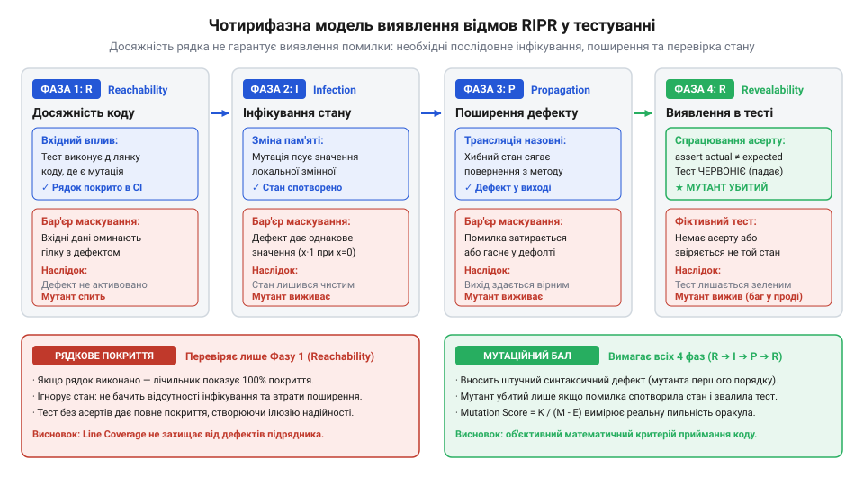
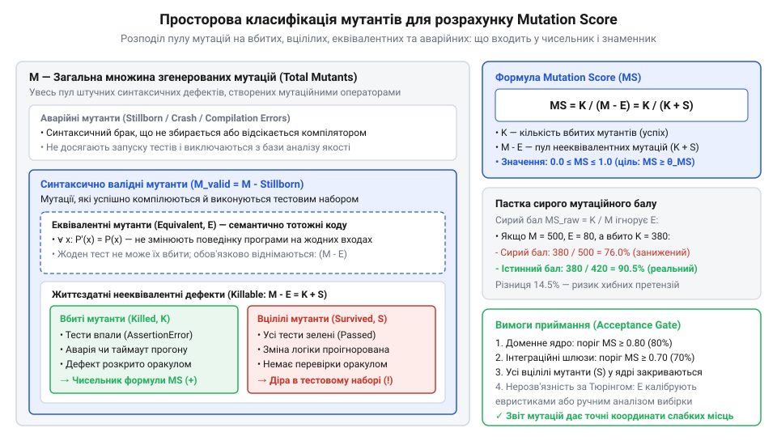
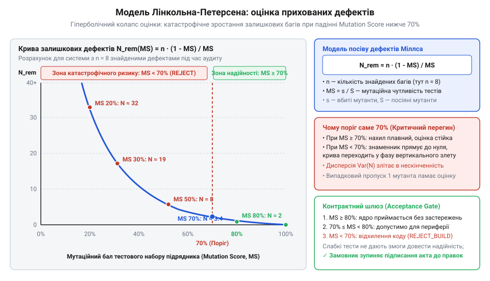
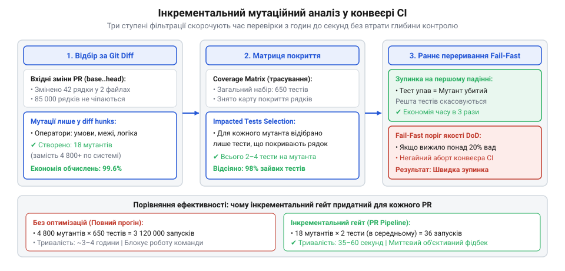

# Приймання чужої роботи

<preknowlist>
- [Код, який пишуть не твої люди](root:progarch/code-written-by-others) — розуміння різниці мотивацій підрядника і замовника та ризику оптимізації формального покриття замість реальної надійності
- [Що має бути в інтерфейсі до підписання](root:progarch/interface-before-signing) — формалізація технічних контрактів і критеріїв Definition of Done перед передачею задач у розробку
</preknowlist>

## Пастка «ідеального» покриття та розрив спостережуваності

Зовнішня команда підрядника урочисто передає фінальний реліз платіжного модуля розрахунку комісій та білінгу. Менеджмент задоволений: звіт системи статичного аналізу демонструє 94% рядкового покриття коду (@@en|line coverage@@; латинське *cooperire* — покривати повністю) та 88% покриття розгалужень. Усі тести в репозиторії бездоганно зелені. Проте на другий день після запуску на тестовому стенді система пропускає транзакцію з від'ємною сумою, некоректно округлює валютний курс для оптових клієнтів і списує комісію двічі при повторному запиті.

Ця криза розкриває головну інженерну ілюзію контрактної розробки: високий відсоток тестового покриття коду не гарантує якості його перевірки. Коли підряднику ставлять формальну вимогу в договорі — «покриття тестів не менше 85%» ([Код, який пишуть не твої люди](root:progarch/code-written-by-others)), найпростіший шлях виконати метрику — написати так звані тести без тверджень (@@en|assertionless tests@@). Такий тест викликає всі публічні методи класу, передаючи типові структури даних, чим примушує інтерпретатор чи віртуальну машину пройти через кожну строчку вихідного коду, але не містить жодного оператора `assert` або перевіряє лише відсутність винятку (`assertDoesNotThrow`). Інший поширений спосіб фальсифікації — тотальне підмінювання компонентів моками: бізнес-метод викликається в штучному ізольованому середовищі, де всі залежності повертають наперед заготовлені константи, а реальні доменні обмеження бази даних чи суміжних підсистем залишаються неперевіреними.

Щоб зрозуміти причину цієї сліпоти з математичної точки зору, звернімося до формальної моделі виникнення та виявлення програмних відмов RIPR (@@en|Reachability, Infection, Propagation, Revealability@@; англійське *reachability* — досяжність, *infection* — зараження, *propagation* — розповсюдження, *revealability* — виявлення). Згідно з моделлю RIPR, перетворення прихованого дефекту коду на виявлену тестом помилку є ланцюжком із чотирьох суворих послідовних подій:

1. **Досяжність (Reachability, `R`):** Вхідні дані тесту повинні змусити потік виконання дістатися конкретного рядка чи інструкції `L`, де міститься помилка або змінена логіка:

        E(L) = 1

2. **Зараження стану (Infection, `I`):** Виконання дефектної інструкції `L` зобов'язане перевести внутрішній стан програми `σ` (сукупність значень змінних, регістрів та вказівників у пам'яті) у некоректний стан, відмінний від еталонного:

        σ_mutated(t_L) ≠ σ_correct(t_L)

   Якщо при виконанні рядка зі спотвореною формулою вхідні дані були такими, що дефект не вплинув на обчислення (наприклад, множення на 1 замість піднесення до квадрата при аргументі `x = 1`), стан пам'яті залишається правильним, і зараження не відбувається.

3. **Розповсюдження (Propagation, `P`):** Заражений стан пам'яті повинен пройти крізь подальші операції та дійти до точки завершення підпрограми, вплинувши на результуюче значення, статус чи зовнішній стан сховища:

        σ_mutated(t_end) ≠ σ_correct(t_end)

   Якщо некоректне проміжне значення затирається наступним присвоєнням або поглинається умовою (наприклад, `Math.max(x, 100)`, де `x` було помилково обчислено як 5 замість 10), дефект маскується й безслідно зникає до виходу з методу.

4. **Виявлення оракулом (Revealability, `Rev`):** Тестовий оракул (твердження `assert`) зобов'язаний явно порівняти результуючий стан системи з очікуваним еталоном і зафіксувати розбіжність:

        Oracle(σ_mutated(t_end)) ≠ Oracle(σ_correct(t_end))

Повна ймовірність того, що наявний у коді дефект буде зафіксований тестовим набором `T`, є добутком умовних імовірностей проходження кожного бар'єра ланцюжка:

    P(Detect)
    = P(R) · P(I | R) · P(P | R ∧ I) · P(Rev | R ∧ I ∧ P)


*Чотирифазна модель виявлення відмов RIPR: традиційне покриття фіксує лише першу фазу досяжності коду, тоді як дефект виявляється тестовим оракулом лише за умови послідовного зараження стану, його розповсюдження до точок виходу та явного спостереження через твердження.*

З цієї формули стає очевидним математичний парадокс метрики покриття коду. Рядкове покриття вимірює виключно першу ймовірність: `Coverage = P(R)`. Воно перевіряє топологічний факт проходження потоку керування крізь інструкцію, але абсолютно ігнорує стан змінних після цього проходження, факт його донесення до виходу та наявність перевірки оракулом.

Якщо підрядник передав тести без перевірок (`P(Rev) = 0`), або тести перенасичені моками, що обривають ланцюг розповсюдження стану (`P(P) ≈ 0`), то підсумкова здатність тесту виявити реальний збій дорівнює нулю:

    P(Detect)
    = 1.0 · P(I | R) · 0 · 0
    = 0

Навіть маючи 100% покриття рядків, система залишається абсолютно беззахисною перед прихованими помилками. Пасивне спостереження за тим, які рядки виконувалися, не дає відповіді на головне питання архітектора: чи здатний наданий набір тестів відрізнити правильну поведінку програми від зламаної? Щоб виміряти це об'єктивно, потрібен інструмент активного збурення — навмисне внесення змін у код і перевірка реакції тестів.

> 🔧 **Навіщо це.** Аналіз ланцюжка RIPR захищає архітектора від сліпої віри в звіти CI підрядника. Він доводить, що вимога високого coverage у договорі без контролю оракулів лише заохочує створення фіктивних тестів, які збільшують час білду, але не ловлять жодної аварії.

## Формальний апарат мутаційного тестування та метрика Mutation Score

Щоб кількісно виміряти здатність тестового набору виявляти відхилення в логіці, застосовують мутаційне тестування (@@en|mutation testing@@; латинське *mutatio* — зміна, переміна). Замість пасивного підрахунку покритих рядків ми штучно генеруємо дефектні версії програми й перевіряємо, чи впаде бодай один тест на кожній зіпсованій версії.

Нехай `P` — оригінальна програма, передана підрядником, а `T = {t₁, t₂, ..., t_k}` — сукупність написаних ним тестів. Кожен тест `t_j ∈ T` повертає двійковий результат: `1` (успіх, тест зелений) або `0` (провал, спрацював assert чи сталася аварія). Для коректної програми всі тести за визначенням проходять:

    ∀ t_j ∈ T: t_j(P) = 1

Процес мутації полягає в систематичному обході абстрактного синтаксичного дерева (AST) програми `P` та застосуванні множини синтаксичних правил — операторів мутації (@@en|mutation operators@@). Кожен оператор вносить рівно одне мінімальне детерміноване спотворення в один вузол дерева, породжуючи програму-мутанта (@@en|mutant@@) `m_i`:

    M = {m₁, m₂, ..., m_N}

Типові оператори мутації моделюють найпоширеніші людські помилки розробників:
- **Заміна операторів порівняння (ROR, Relational Operator Replacement):** заміна `>` на `>=`, `==`, `!=`, `<`.
- **Заміна арифметичних операцій (AOR, Arithmetic Operator Replacement):** заміна `+` на `-`, `*`, `/`.
- **Зміна логічних зв'язок (COR, Conditional Operator Replacement):** інвертування умов, заміна `&&` на `||`.
- **Видалення викликів та інструкцій (SDL, Statement Deletion):** видалення рядка мутації балансу, скидання кешу або виклику аудиту.
- **Підміна констант і повертаємих значень:** заміна рядка на порожній, повернення `null` або `0` замість об'єкта.

Після генерації множини `M` кожен мутант `m_i` проганяється крізь тестовий набір `T`. За результатами виконання мутант потрапляє в один із трьох взаємовиключних станів:

1. **Убитий мутант (Killed, `M_killed`):** хоча б один тест із набору `T` завершився аварійно або провалив перевірку твердження. Це означає, що тести помітили внесену зміну й заблокували дефектний код:

        ∃ t_j ∈ T: t_j(m_i) = 0

2. **Вцілілий мутант (Survived, `M_survived`):** програму було спотворено, проте всі тести з набору `T` залишилися зеленими:

        ∀ t_j ∈ T: t_j(m_i) = 1

   Кожен вцілілий мутант є строгим математичним доказом наявності дірки в тестах: існує модифікація бізнес-логіки, яку тестовий оракул не здатний розпізнати.

3. **Таймаут або аварія середовища (Timed Out, `M_timeout`):** мутація призвела до нескінченного циклу або мертвого блокування, внаслідок чого виконання було примусово перервано сторожовим таймером (watchdog timer). Такий мутант зараховується як убитий, оскільки зміна поведінки програми є очевидною для зовнішнього спостерігача.

Крім того, частина згенерованих мутантів виявляється семантично невідрізнимими від оригіналу — це еквівалентні мутанти (`M_equiv`), які за будь-яких вхідних даних продукують той самий вихідний результат (наприклад, заміна циклу `while (x != 0)` на `while (x > 0)`, якщо значення `x` за інваріантом завжди невід'ємне). Жоден коректний тест не здатний убити еквівалентного мутанта, тому їх необхідно виключати зі знаменника.

Формально мутаційний бал (@@en|Mutation Score@@, `MS`) визначається як відношення кількості виявлених мутантів до загальної кількості життєздатних дефектів:

    MS
    = (|M_killed| + |M_timeout|) / (|M| - |M_equiv|)

Якщо кількість еквівалентних мутантів невідома або їхній ручний відбір не проводився, розраховують консервативну нижню межу — грубий мутаційний бал (Raw Mutation Score):

    MS_raw
    = (|M_killed| + |M_timeout|) / |M|

Оскільки `|M| - |M_equiv| ≤ |M|`, значення `MS_raw` завжди менше або дорівнює дійсному `MS`, надаючи гарантовану нижню оцінку стійкості тестів.


*Просторова діаграма множини мутантів: загальний пул згенерованих дефектних програм розпадається на виявлені дефекти, небезпечні вцілілі мутації та семантично еквівалентні варіанти коду, що формують знаменник метрики.*

Розглянемо практичний розрахунок на матеріалі приймання підрядного коду. Нехай зовнішня команда здала сервіс розрахунку податкових знижок із рядковим покриттям 92%. Інструмент мутаційного тестування згенерував `|M| = 600` мутантів першого порядку:
- Тестовий набір підрядника вбив `|M_killed| = 420` мутантів.
- Сторожовий таймер зупинив через зависання `|M_timeout| = 12` мутантів.
- Залишилися вцілілими `|M_survived| = 168` мутантів.
- Під час попереднього аналізу виявлено `|M_equiv| = 25` еквівалентних мутацій.

Обчислимо реальний мутаційний бал переданого модуля:

    MS
    = (|M_killed| + |M_timeout|) / (|M| - |M_equiv|)
    = (420 + 12) / (600 - 25)            [підстановка параметрів випробування]
    = 432 / 575                          [арифметичне спрощення чисельника й знаменника]
    ≈ 0.7513                             [ділення]
    ≈ 75.13%                             [переведення у відсотки]

Обчислимо також консервативну оцінку:

    MS_raw
    = (420 + 12) / 600                   [розрахунок без урахування еквівалентності]
    = 432 / 600                          [спрощення чисельника]
    = 0.7200                             [ділення]
    = 72.00%                             [переведення у відсотки]

Цей результат кардинально змінює сприйняття якості роботи: за декларованого рядкового покриття у 92% реальна спостережуваність дефектів становить лише близько 75%. Майже чверть усіх можливих синтаксичних збоїв (`168` мутантів) проходить крізь сито тестів підрядника абсолютно непоміченою. При цьому кожен уцілілий мутант точно вказує координати проблеми у вихідному коді: рядок, де операцію було змінено, та функціональний інваріант, для якого підрядник «забув» написати перевірку в блоці `assert` ([Що має бути в інтерфейсі до підписання](root:progarch/interface-before-signing)).

Проте у знаменнику формули розрахунку залишається величина `|M_equiv|`. Чому ми не можемо просто доручити машині автоматично знайти й видалити всі еквівалентні мутанти до початку тестування, і з якими фундаментальними обмеженнями теорії обчислень тут стикається архітектор?

## Проблема еквівалентних мутантів і межі обчислюваності

У формулі розрахунку мутаційного балу в знаменнику фігурує віднімання еквівалентних мутантів: `|M| - |M_equiv|`. Це віднімання є критично важливим, але саме воно приховує найглибшу теоретичну проблему мутаційного тестування.

Еквівалентним мутантом (@@en|equivalent mutant@@; латинське *aequivalens* — рівнозначний) називають таку синтаксично змінену програму `m_i`, яка для будь-якого допустимого вхідного вектора `x` із простору визначення `X` продукує результат, повністю ідентичний оригінальній програмі `P`:

    ∀ x ∈ X: m_i(x) = P(x)

Розглянемо типовий фрагмент коду вибору тарифної ставки:

```text
// Оригінальний код
int rate = (level > 0) ? baseRate : defaultRate;

// Мутований код (оператор ROR: > замінено на >=)
int rate = (level >= 0) ? baseRate : defaultRate;
```

Якщо за бізнес-інваріантом системи параметр `level` є строго додатним ідентифікатором облікового запису (`level ≥ 1`), умова `level == 0` не може бути досягнута за жодних обставин. Як наслідок, обидва вирази повертають однакове значення `baseRate` на всіх валідних входах. Попри зміну символу оператора в AST, поведінка методу не змінилася ані на йоту.

Оскільки семантика програми збережена, жоден коректний тест із набору `T` принципово не здатний провалитися на цьому мутанті. Еквівалентний мутант за визначенням залишається вцілілим (`m_i ∈ M_survived`), але не через слабкість чи неповноту тестових перевірок, а через неможливість зафіксувати відсутню різницю.

Природна інженерна реакція на цю проблему — автоматизувати фільтрацію: написати алгоритм, який перед запуском тестів відсіюватиме всі мутації, семантично тотожні оригіналу. Проте тут комп'ютерна наука стикається з фундаментальним бар'єром теорії обчислюваності.

Задача автоматичного виявлення еквівалентності двох довільних програм є алгоритмічно нерозв'язною (@@en|undecidable problem@@). Це прямий наслідок теореми Райса (@@en|Rice's theorem@@): будь-яка нетривіальна семантична властивість програм на Тюрінг-повній мові програмування не може бути перевірена універсальним алгоритмом. Доведення будується через редукцію до проблеми зупинки Тюрінга: якби існував алгоритм, здатний перевірити еквівалентність довільного мутанта `m` і програми `P`, ми могли б використати його для розв'язання проблеми зупинки довільної машини Тюрінга, що є неможливим. Жоден інструмент у світі не здатен гарантовано й автоматично знайти всі 100% еквівалентних мутацій у реальному проєкті.

Ця математична межа має прямий фінансовий та організаційний вплив на процедуру приймання робіт ([Передача, депонування, кінець контракту](root:progarch/handover-escrow-end-of-contract)). За емпіричними дослідженнями, у типових корпоративних системах частка еквівалентних мутантів становить від 10% до 25% від загального пулу згенерованих мутацій. Якщо архітектор не враховує цього фактора й оцінює підрядника виключно за грубим балом `MS_raw = |M_killed| / |M|`, виникає систематична похибка заниження оцінки:

    ΔMS
    = MS - MS_raw
    = (|M_killed| / (|M| - |M_equiv|)) - (|M_killed| / |M|)
    = |M_killed| · (1 / (|M| - |M_equiv|) - 1 / |M|)
    = (|M_killed| · |M_equiv|) / (|M| · (|M| - |M_equiv|))

Розглянемо сценарій: підрядник написав бездоганний набір тестів, що вбиває всі реально можливі дефекти. Із загальної кількості `|M| = 1000` мутантів інструмент згенерував `|M_equiv| = 200` еквівалентних мутацій. Тести вбили всі `800` нееквівалентних мутантів (`|M_killed| = 800`).

Обчислимо реальний та грубий показники:

    MS
    = 800 / (1000 - 200)                 [підстановка нееквівалентного пулу]
    = 800 / 800                          [спрощення знаменника]
    = 1.00                               [ідеальна якість: 100%]

    MS_raw
    = 800 / 1000                         [грубий розрахунок без вирахування еквівалентності]
    = 0.80                               [занижена оцінка: 80%]

Архітектор, не обізнаний із проблемою еквівалентності, бачить у звіті 80%, оголошує тести підрядника недостатніми й відхиляє етап робіт, вимагаючи «вбити решту 200 мутантів». Зовнішні інженери опиняються перед нездійсненним завданням: вони змушені писати фіктивні тести з неприродними даними, намагаючись вбити код, який убити математично неможливо.

Щоб розірвати це коло без необхідності ручного аналізу тисяч мутантів, на практиці застосовують метод статистичного вибіркового оцінювання (@@en|statistical sampling@@). З множини всіх уцілілих мутантів `M_survived` випадковим чином відбирають репрезентативну вибірку розміром `k` (зазвичай `k = 40..60` мутантів). Інженер замовника разом із лідом підрядника вручну інспектують ці `k` випадків і визначають кількість дійсно еквівалентних мутацій `e`.

Частка еквівалентних мутантів серед уцілілих оцінюється як:

    p_equiv = e / k

Тоді скоригований мутаційний бал дорівнює:

    MS_adj
    = |M_killed| / (|M| - p_equiv · |M_survived|)

Такий підхід переводить суб'єктивну суперечку в площину математичної статистики з контрольованою похибкою вибірки, даючи об'єктивне число для підписання акту приймання.

> 🔧 **Навіщо це.** Розуміння нерозв'язності проблеми еквівалентних мутантів рятує проєкт від безплідних конфліктів. Воно дозволяє встановити реалістичні пороги Definition of Done і відокремити реальні дефекти тестів від семантичного шуму самої мови програмування.

## Комбінаторний вибух, мутанти першого порядку та ефект зв'язування

Навіть якщо проблему еквівалентності статистично згладжено, перед впровадженням мутаційного аудиту постає інша загроза — комбінаторний вибух простору дефектів.

Нехай кодова база прийнятого модуля містить `N` операторів та виразів у синтаксичному дереві. Мутанти першого порядку (@@en|First-Order Mutants@@, FOM) утворюються внесенням рівно одного синтаксичного спотворення в одну точку програми. Кількість таких мутантів зростає лінійно зі збільшенням розміру кодової бази:

    |M_FOM| = O(N)

Для типового мікросервісу на 20 000 рядків коду кількість мутантів першого порядку становить від 40 000 до 80 000. Якщо запуск повного набору тестів триває 500 мілісекунд, послідовне виконання аналізу вимагатиме:

    T_total
    = 60000 · 0.5 с                      [множення кількості на час прогону]
    = 30000 с                            [час у секундах]
    ≈ 8.3 години                         [час у годинах]

Вісім годин на перевірку одного пул-реквесту — неприйнятна затримка для конвеєра CI. Але реальність іще складніша: критичні баги в реальних системах рідко бувають простими описками в одному рядку. Найчастіше катастрофічний збій виникає через складну взаємодію двох або більше помилок у різних частинах алгоритму.

Такі дефекти моделюються мутантами вищого порядку (@@en|Higher-Order Mutants@@, HOM), у яких одночасно змінено `k` різних інструкцій. Кількість мутантів порядку `k` визначається числом комбінацій:

    |M_HOM(k)|
    = C(N, k)
    = N! / (k! · (N - k)!)
    = O(N^k)

Уже для подвійних мутацій (`k = 2`) при `N = 10000` простір можливих дефектів налічує близько 50 мільйонів варіантів. Перевірити такий масив прямим перебором не здатні навіть потужні хмарні кластери.

Чи маємо ми право обмежитися лише найпростішими мутантами першого порядку? Чи не пропустимо ми складні, замасковані аварії, зосередившись на примітивних однорядкових замінах операторів?

Відповідь дають два фундаментальні математичні й емпіричні стовпи теорії мутаційного тестування:

1. **Гіпотеза компетентного програміста (@@en|Competent Programmer Hypothesis@@):** Розробники (зокрема кваліфіковані інженери підрядника) створюють код, семантично дуже близький до коректного. Вони помиляються не у фундаментальній логіці обчислень, а в деталях реалізації: крайових умовах, знаках рівності, скиданні прапорців чи ініціалізації лічильників. Отже, простір реальних помилок сконцентрований у безпосередній синтаксичній околиці коректної програми, яка моделюється саме мутантами першого порядку.

2. **Ефект зв'язування (@@en|Coupling Effect@@, ДеМілло, Ліптон, Сейвард):** Комплексні помилки вищого порядку тісно зв'язані з простими помилками першого порядку. Тестовий набір, здатний виявити всі прості мутації, із надзвичайно високою ймовірністю (емпірично понад 99.5%) виявляє й усі складні мутації вищих порядків.

Математична інтуїція ефекту зв'язування розкривається через аналіз розповсюдження помилок. Нехай мутант другого порядку `m_12` утворений двома дефектами в рядках `L₁` та `L₂`. Щоб цей мутант вижив і не був помічений тестами, він повинен одночасно обійти всі тести, написані для перевірки `L₁`, та всі тести для `L₂`. 

Існує лише два взаємовиключні сценарії:
- **Незалежний вияв:** Якщо дефекти лежать у різних гілках або зачіпають незв'язані змінні, будь-який тест, що вбивав мутант `m₁` або мутант `m₂`, гарантовано вб'є й комбінований мутант `m_12`. Ймовірність виживання подвійного мутанта є меншою за ймовірність виживання одинарного:

        P(Survive m_12) ≤ P(Survive m₁) · P(Survive m₂)

- **Взаємне маскування (фатальний збіг):** Мутація в `L₂` нейтралізує спотворення, викликане в `L₁` (наприклад, перша мутація додає 1, а друга віднімає 1). Імовірність такого точного алгебричного компенсування на всьому просторі тестових входів настільки мізерна, що становить частки відсотка.

Отже, складні мутанти не стійкіші за прості — навпаки, вони набагато вразливіші перед тестовими перевірками, бо спотворюють поведінку системи відразу в кількох вимірах. Це дає строге теоретичне обґрунтування: для повної оцінки адекватності тестів достатньо аналізувати виключно мутанти першого порядку (`|M_FOM|`).

Щоб оптимізувати час прогону навіть мутацій першого порядку в CI, застосовують дві техніки скорочення простору:

1. **Селективні оператори мутації (Selective Mutation):** Математичні дослідження Оффутта довели, що з 22 класичних операторів мутації достатньо залишити лише 5 ключових (оператори заміни операцій ROR, AOR, LCR, UOI та ABS). Цей «достатній базис» скорочує кількість генерованих мутантів на 70–80%, зберігаючи точність оцінки якості тестів на рівні 99%.
2. **Випадкове семплювання (Mutant Sampling):** Замість усіх мутантів випадково відбирається фіксована частка `α` (наприклад, `α = 0.2`, тобто 20% мутантів). Згідно з центральною граничною теоремою, вибірковий мутаційний бал є незміщеною оцінкою генерального балу з дисперсією:

        Var(MS_sample) = (MS · (1 - MS)) / n_sample

При вибірці розміром `n_sample = 500` мутантів стандартна похибка не перевищує `√((0.25) / 500) ≈ 0.022` (2.2%), що забезпечує достатню точність для автоматичного CI-гейту за лічені хвилини.

> 🔧 **Навіщо це.** Ефект зв'язування та селективні оператори перетворюють мутаційне тестування з академічної теорії на практичний інженерний інструмент. Вони дозволяють перевіряти код підрядника за розумний час без закупівлі гігантських обчислювальних потужностей.

## Оцінка залишкових дефектів за моделлю Лінкольна-Петерсена

Зовнішній підрядник демонструє звіт мутаційного тестування: мутаційний бал платіжного шлюзу становить `MS = 80%`. Із 500 згенерованих нееквівалентних мутантів тести виявили та вбили 400. Менеджмент замовника бачить високий відсоток і готується підписати акт приймання робіт ([Передача, депонування, кінець контракту](root:progarch/handover-escrow-end-of-contract)). Проте перед головним архітектором постає фундаментальне інженерне питання: що саме означають ці 80% для реальної експлуатації?

Мутаційний бал є відносною мірою чутливості тестів до штучних збурень. Сам по собі відсоток не відповідає на головне питання бізнесу: скільки справжніх, небезпечних дефектів залишилося непоміченими в переданому коді? Якщо підрядник допустив 10 помилок, то 20% пропуску означають 2 приховані дефекти. Якщо ж архітектура містить 100 прихованих збоїв, система вийде в прод із 20 мінами уповільненої дії. Щоб перетворити відносний бал на абсолютну оцінку ризику, необхідний математичний міст між штучними мутаціями та реальними багами.

Таким мостом є модель біологічного оцінювання популяцій з повторним захопленням — модель Лінкольна-Петерсена (@@en|Lincoln-Petersen capture-recapture model@@; латинське *captura* — ловити, захоплювати). Її розробили данський гідробіолог Карл Петерсен у 1896 році для вивчення популяції риб та американський біолог Фредерік Лінкольн у 1930 році для підрахунку диких птахів.

Уявімо озеро, де живе невідома кількість риб `N`. Біолог не може виловити все озеро, але може зробити два кроки:
1. Спіймати вибірку з `M` риб, позначити кожну незмивною міткою та відпустити назад у водойму.
2. Дати рибам час рівномірно перемішатися, після чого виловити другу вибірку розміром `C` і підрахувати, скільки з них виявилися міченими — `m`.

Якщо мічені особини розподілилися однорідно, а ймовірність вилову однакова для будь-якої риби, то частка мічених особин у другій вибірці дорівнює частці всієї міченої популяції в озері:

    m / C = M / N

Звідси загальна популяція озера оцінюється однозначно:

    N̂ = (M · C) / m

У програмній інженерії та аудиті коду ([Код, який пишуть не твої люди](root:progarch/code-written-by-others)) ця модель розгортається з математичною симетрією:
- Невідома популяція риб `N` — це загальна кількість реальних дефектів `D`, яких припустився підрядник у розробленому кодовому модулі.
- Перша мічена вибірка `M` — це пул штучно внесених нами мутантів (`M` штучних дефектів, положення яких нам точно відоме).
- Другий вилов здійснює тестовий набір `T`: він знаходить `d` реальних дефектів (баги, виявлені тестами або приймальним аудитом) та одночасно вбиває `m` мутантів (`m = |M_killed|`).

Спираючись на гіпотезу компетентного програміста та ефект зв'язування, ми стверджуємо: прості синтаксичні дефекти мають подібний розподіл спостережуваності, що й типові помилки людини. Отже, ймовірність того, що тести зловлять штучного мутанта, є спроможним наближенням імовірності виявлення реального дефекту. Частка вбитих мутантів `m / M` — це і є наш мутаційний бал `MS`.

Складаємо рівняння рівності пропорцій виявлення:

    d / D
    = m / M                  [гіпотеза однакової ймовірності виявлення]
    = MS                     [визначення мутаційного балу]

Звідси виводимо статистичну оцінку загальної кількості дефектів `D̂`:

    D̂
    = d · (M / m)            [вираження невідомого розміру популяції D]
    = d / MS                 [підстановка мутаційного балу MS = m / M]

Знаючи оцінку загальної кількості помилок `D̂` та фактичну кількість уже виявлених дефектів `d`, ми отримуємо формулу очікуваної кількості залишкових прихованих дефектів `D̂_residual`, які залишаються в системі після завершення приймального тестування:

    D̂_residual
    = D̂ - d                  [визначення залишкових дефектів]
    = d / MS - d             [підстановка оцінки Лінкольна-Петерсена]
    = d · (1 / MS - 1)       [винесення d за дужки]
    = d · ((1 - MS) / MS)    [зведення дробів до спільного знаменника]

**Умова розрахунку:**
Під час вхідного аудиту переданого підрядником сервісу авторизації тести виявили `d = 14` реальних дефектів (пропуски перевірки ролей, хибні статуси токенів). Конвеєр мутаційного тестування згенерував пул із `M = 400` нееквівалентних мутантів, з яких тестовий набір знищив `m = 320`. Розрахуємо очікувану кількість прихованих помилок у коді.

    MS
    = 320 / 400              [відношення вбитих мутантів до загалу]
    = 0.80                   [мутаційний бал 80%]

    D̂
    = 14 / 0.80              [оцінка загальної кількості помилок]
    = 17.5                   [усього дефектів у коді підрядника]

    D̂_residual
    = 17.5 - 14              [віднімання знайдених дефектів]
    = 3.5 ≈ 4                [очікувана кількість непомічених багів]

Якщо ж підрядник здав код із тим самим числом знайдених помилок `d = 14`, але з мутаційним балом `MS = 0.50` (тести вбили лише 200 мутантів із 400):

    D̂_residual
    = 14 · (1 / 0.50 - 1)    [розрахунок залишкових дефектів]
    = 14 · (2.0 - 1)         [обчислення множника ризику]
    = 14                     [у коді ховається ще стільки ж непомічених багів]

Звернімо увагу на математичну структуру коефіцієнта `f(MS) = (1 - MS) / MS`. Це не лінійна функція, а спадна гіпербола. Знайдемо її похідну за мутаційним балом:

    d(D̂_residual) / d(MS)
    = d / d(MS) [d · (1 / MS - 1)]
    = -d / (MS)²             [похідна оберненої функції]

Знак мінус показує, що зі зростанням мутаційного балу залишкові дефекти зменшуються, але знаменник `(MS)²` розкриває критичний закон: темп зростання пропущених дефектів обернено пропорційний квадрату мутаційного балу.


*Залежність очікуваної кількості залишкових дефектів D̂_residual від мутаційного балу MS: при падінні показника нижче 70% кількість прихованих помилок зростає за гіперболою, тоді як у діапазоні 80–90% спостерігається зона насичення з мінімальним залишковим ризиком.*

На графіку чітко простежуються три характерні інженерні зони:
1. **Зона катастрофічного зриву (`MS < 70%`):** Гіпербола стрімко злітає вгору. Падіння бала з 70% до 50% подвоює кількість прихованих багів, а при `MS < 40%` система стає практично некерованою. Навіть якщо тести здаються зеленими, у системі лишається в рази більше дефектів, ніж було знайдено.
2. **Зона збалансованого контролю (`70% ≤ MS < 85%`):** Крива проходить точку зламу («коліно» функції). Тут кожен відсоток приросту мутаційного балу істотно скорочує прихований брак, а залишкова кількість дефектів стабілізується на рівні 20–30% від виявлених.
3. **Зона асимптотичного насичення (`MS ≥ 85%`):** Крива притискається до нуля. Подальше збільшення чутливості тестів із 85% до 95% вимагає колосальних інженерних витрат на покриття рідкісних крайових станів, даючи незначний виграш у надійності (зниження ризику менш ніж на 0.5 дефекту).

На практиці обсяг вибірки виявлених багів `d` на етапі приймання може бути невеликим (наприклад, `d < 10`). Класична оцінка Лінкольна-Петерсена для малих вибірок має систематичний зсув у бік переоцінки популяції. Щоб усунути цей зсув, застосовують модифікацію Дугласа Чепмена (@@en|Chapman estimator@@, 1951 рік), яка забезпечує незсувну оцінку:

    D̂_Chapman = [((M + 1) · (d + 1)) / (m + 1)] - 1

Якщо у нашому прикладі тести виявили лише `d = 4` дефекти, а мутатор зафіксував `M = 100` мутантів, із яких знищено `m = 80`, то розрахунок за Чепменом дає:

    D̂_Chapman
    = [((100 + 1) · (4 + 1)) / (80 + 1)] - 1
    = [(101 · 5) / 81] - 1
    = [505 / 81] - 1
    = 6.23 - 1
    = 5.23 ≈ 5 дефектів

Очікувана кількість залишкових помилок становить `5.23 - 4 = 1.23` дефекти.

> 🔧 **Навіщо це.** Модель Лінкольна-Петерсена переводить розмову з підрядником із площини абстрактних відсотків («ми покрили код на 90%») у площину твердої статистики надійності: скільки конкретно невідомих дефектів замовник отримає у свій репозиторій за поточного рівня пильності тестів.

## Контрактні пороги, інкрементальний аналіз та захист конвеєра CI

Отримавши математичний апарат розрахунку залишкових дефектів, архітектор стикається з практичним бар'єром впровадження: повний мутаційний аналіз усієї системи потребує велетенських обчислювальних ресурсів. Якщо проект налічує `|M| = 3000` мутантів, а повний тестовий набір виконується за `T_test = 5` секунд, наївний послідовний перезапуск тестів забере понад 4 години:

    T_total
    = |M| · T_test           [добуток кількості мутантів на час тестів]
    = 3000 · 5 c
    = 15000 c = 4.17 години  [неприпустимий час очікування в CI]

Заблокувати конвеєр автоматичного розгортання ([Що має бути в інтерфейсі до підписання](root:progarch/interface-before-signing)) на чотири години для кожного коміту підрядника — означає паралізувати процес розробки. З іншого боку, повна відмова від мутаційного гейта призводить до потрапляння в продакшен прихованого браку.

Щоб знайти інженерний оптимум, формалізуємо функцію сукупних витрат на верифікацію коду:

    Cost_total = Cost_compute(T_mutation) + Cost_incident(D̂_residual)

Де `Cost_compute` — вартість процесорного часу в конвеєрі CI, а `Cost_incident` — фінансові та репутаційні збитки бізнесу від пропущених дефектів.

Ціна інциденту радикально різниться залежно від того, де саме виникає збій. Помилка у формулі нарахування відсотків або списання коштів у доменному ядрі призводить до фінансових втрат і регуляторних штрафів. Помилка в HTTP-контролері чи адаптері форматування дати у звіті викликає локальну косметичну незручність, яку легко виправити швидким патчем.

Звідси випливає принцип архітектурно диференційованих порогових критеріїв мутаційного балу:

1. **Доменне ядро та транзакційні сервіси (`MS ≥ 85%`):**
   Шар чистої бізнес-логіки не містить викликів мережі, баз даних чи файлової системи. Модульні тести виконуються в пам'яті за частки мілісекунди. Завдяки високій швидкості виконання тестів обчислювальна вартість аналізу `Cost_compute` є мінімальною, тоді як вартість пропущеного дефекту `Cost_incident` — гранично висока. Тут вимагається безкомпромісний поріг `MS ≥ 85%`, що гарантує перебування в зоні асимптотичного насичення моделі Лінкольна-Петерсена з практично нульовим рівнем залишкових дефектів.

2. **Шар прикладних сценаріїв та оркестрації (`MS ≥ 80%`):**
   Сервіси застосунку координують взаємодію між доменом та портами інфраструктури, керуючи транзакційними межами. Для них встановлюється збалансований поріг `MS ≥ 80%`.

3. **Адаптери інфраструктури та представлення (`MS ≥ 70%`):**
   Контролери, клієнти сторонніх API, SQL-репозиторії та мапери містять значну частку шаблонного коду (@@en|boilerplate@@; англійське *boiler* — паровий котел, *plate* — пластина) та взаємодіють із повільними вводами-виводами (I/O). Тестування цього шару вимагає контейнерів або складних дублерів, через що `T_test` зростає на порядки. Водночас вимога покривати мутації в автозгенерованих серіалізаторах чи тривіальних адаптерах породжує велику кількість еквівалентних мутантів. Для цього шару встановлюється помірний поріг `MS ≥ 70%`. Опускатися нижче 70% заборонено, оскільки саме тут починається гіперболічний зрив за моделлю Лінкольна-Петерсена.

Щоб скоротити час виконання аналізу в щоденному конвеєрі до прийнятних 3–7 хвилин, застосовують інкрементальне мутаційне тестування на рівні пул-реквесту (@@en|PR-level incremental mutation testing@@). Воно спирається на три оптимізаційні алгоритми:

По-перше, обмеження простору мутацій виключно зміненими рядками коду (Delta Mutation). Замість обходу всього репозиторію AST-аналізатор вибирає тільки вузли, що входять у диференціал версій між поточною гілкою та цільовою базою (`Git Diff`):

    M_PR = {m_i ∈ M | Line(m_i) ∈ Diff(PR)}

Якщо в репозиторії на 100 000 рядків пул-реквест змінює лише 80 рядків, потужність множини мутантів зменшується з тисяч до кількох десятків: `|M_PR| ≪ |M|` (зазвичай від 15 до 60 мутантів).

По-друге, вибірковий запуск тестів за матрицею покриття на основі аналізу впливу тестів (Test Selection via Coverage Matrix). Для кожного мутанта `m_i ∈ M_PR` немає потреби запускати весь набір `T`. Система запускає лише ту підмножину тестів `T_covering(m_i)`, яка фізично виконує модифікований рядок `Line(m_i)`:

    T_covering(m_i) = {t_j ∈ T | E(t_j, Line(m_i)) = 1}

По-третє, переривання перевірки за першим падінням (Fail-Fast / Bail Mode). Щойно перший із запущених тестів сигналізує про падіння оракула, мутант вважається вбитим, а виконання решти тестів негайно припиняється. Завдяки цьому середнє число тестів, запущених на одного мутанта, становить `k_stop ≈ 1.3..1.8` замість повного набору.

Підсумковий час інкрементальної перевірки в CI становить:

    T_PR = ∑_{i=1}^{|M_PR|} [k_stop(i) · t_test]

Для 30 мутантів і середнього часу виконання цільового тесту в 0.1 секунди сумарний час перевірки становить менше 10 секунд, що дає змогу інтегрувати строгий мутаційний бар'єр безпосередньо в статус-чек кожного запиту на злиття коду.


*Схема інкрементального мутаційного аналізу в PR: відбір мутантів за Git-дифом, фільтрація тестів матрицею покриття та раннє переривання fail-fast скорочують час верифікації з кількох годин до лічених секунд.*

Щоб захистити проект від недобросовісного виконання умов контракту, вимоги мутаційного тестування мають бути чітко зафіксовані в договорі та метричних критеріях Definition of Done ([Що має бути в інтерфейсі до підписання](root:progarch/interface-before-signing)). Типовий розділ технічних вимог до приймання формулюється так:

1. **Недостатність пасивного покриття:** Рядкове покриття (`Line Coverage ≥ 80%`) є необхідною попередньою умовою для запуску приймання, але не є критерієм його успішності.
2. **Мутаційні пороги за архітектурними шарами:** Будь-який компонент приймається за умови досягнення мінімального балу мутаційної адекватності:
   - Модулі доменного ядра та бізнес-правил: `MS_domain ≥ 85%`.
   - Застосунок та оркестрація: `MS_app ≥ 80%`.
   - Адаптери інфраструктури: `MS_infra ≥ 70%`.
3. **Автоматизований гейт конвеєра CI:** Кожен пул-реквест у репозиторій підлягає обов'язковій інкрементальній мутаційній перевірці. Якщо на змінених рядках `MS_PR` опускається нижче встановленого порогу шару, злиття гілки автоматично блокується.
4. **Недійсність тестів без тверджень:** Набори тестів, що демонструють проходження рядків коду, але не вбивають жодної синтаксичної мутації першого порядку у відповідному модулі, визнаються дефектними та підлягають поверненню підряднику на доопрацювання без додаткової оплати.
5. **Контроль залишкових ризиків:** Під час фінального релізу розраховується оцінка залишкових дефектів за формулою Чепмена `D̂_Chapman`. Якщо розрахункова кількість прихованих помилок у доменному ядрі перевищує узгоджену квоту якості (наприклад, `D̂_residual > 1`), етап вважається незавершеним, а оплата затримується до усунення вразливих зон.

Такий підхід позбавляє інженерну команду від необхідності вести суб'єктивні суперечки щодо якості зданої роботи та захищає систему від накопичення прихованого технічного боргу ([Хто веде це потім](root:progarch/who-maintains-it-afterwards)).

> 🔧 **Навіщо це.** Впровадження диференційованих мутаційних порогів та інкрементального аналізу в CI перетворює математичний апарат тестування на автоматизований контрактний щит. Він зупиняє фіктивні тести ще на етапі пул-реквесту підрядника, не сповільнюючи конвеєр розгортання та гарантуючи надійність архітектурного ядра.
