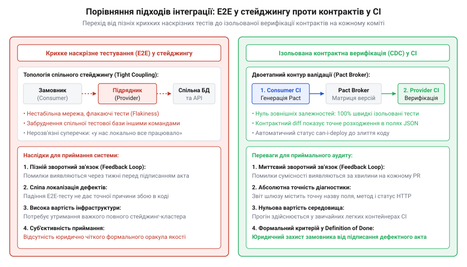
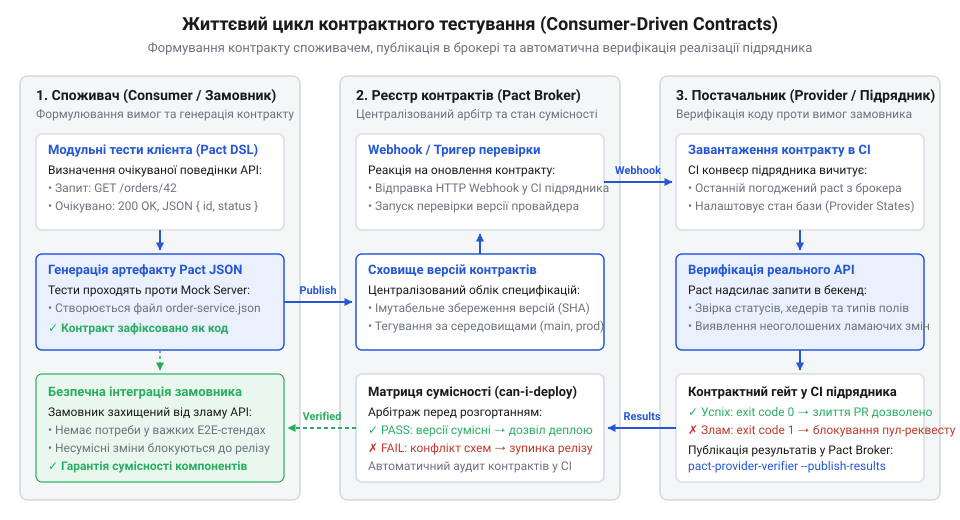
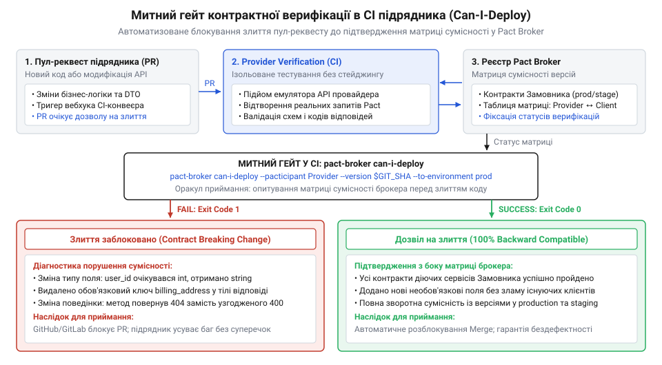

# Приймання чужої роботи

<preknowlist>
- [Код, який пишуть не твої люди](root:progarch/code-written-by-others) — розуміння розходження інтересів замовника та підрядника, ризиків прихованих дефектів та необхідності об'єктивних інженерних бар'єрів
- [Що має бути в інтерфейсі до підписання](root:progarch/interface-before-signing) — формалізація меж компонентів, форматів обміну даними та контрактних зобов'язань перед передачею в розробку
</preknowlist>

## Пастка зелених тестів та глухий кут приймання на стейджингу

Підрядник здає замовлений мікросервіс і надає фінальний звіт: у його репозиторії всі юніт-тести зелені, локальні виклики через консольний клієнт повертають очікуваний код `200 OK`, а розробники виконавця вимагають підписання акта виконаних робіт. Проте щойно цей компонент підключають до внутрішнього шлюзу замовника чи порталу послуг, транзакції починають масово завершуватися аваріями. Юніт-тести підрядника перевіряли винятково внутрішню логіку його власного коду проти його ж власних ізольованих припущень. Розробник, який писав контролер, сам створив для нього тестові дублери, сам визначив структуру відповіді й сам переконався, що його код не падає у створеному ним же штучному світі.

Коли дві команди працюють по різні боки комерційного договору ([Код, який пишуть не твої люди](root:progarch/code-written-by-others)), найнебезпечніші дефекти виникають не в складних математичних алгоритмах, а на швах взаємодії. Це ледь помітні розходження схеми та протоколу, які легко проходять крізь ізольовані модульні перевірки:

1. **Дрейф типів даних.** Клієнт замовника очікує числове значення фінансової суми (`amount: 1500.50`), тоді як бекенд підрядника серіалізує його рядком (`"amount": "1500.50"`) або передає ціле число копійок замість десяткового дробу. Строго типізований десеріалізатор клієнта зазнає краху.
2. **Мовчазне опущення або перейменування полів.** Під час оптимізації бази даних підрядник перейменував поле `amount` на `total_sum`, або вирішив не включати поле `status` у скорочену відповідь списку. Власний тест підрядника адаптовано під нову назву, але клієнт замовника раптово отримує `undefined` або `null` і аварійно зупиняє бізнес-процес.
3. **Розходження в семантиці статусів та помилок.** У разі відсутності сутності клієнт очікує стандартний статус `404 Not Found` із тілом `{"error": "..."}`. Натомість підрядник повертає `200 OK` із вкладеним технічним повідомленням про помилку в JSON, або взагалі повертає необроблений HTML-стектрейс помилки `500 Internal Server Error`, ламаючи клієнтський обробник винятків.

Природна реакція інженерного менеджменту на такі збої — вимога розгорнути спільний тестовий стенд (@@en|staging environment@@) і проганяти наскрізні сценарії (@@en|End-to-End@@, E2E). Проте для приймання робіт від підрядника класичний стейджинг перетворюється на некеровану пастку.

По-перше, спільний стейджинг надзвичайно крихкий: сторонні платіжні шлюзи у пісочницях періодично збоять, спільна тестова база даних швидко засмічується неконсистентними записами кількох паралельних команд, а сертифікати й мережеві доступи регулярно протухають. По-друге, зворотний зв'язок від таких тестів затримується на години або й дні: важкий набір тестів неможливо запускати на кожен коміт чи пул-реквест у репозиторії виконавця.

По-третє, і це головне під час взаємодії із зовнішнім виконавцем, наскрізний стейджинг позбавляє можливості точно локалізувати винного в аварії. Коли падає наскрізний сценарій, починаються нескінченні міжособистісні суперечки: виконавець стверджує, що в нього все працює і проблема в нестабільності тестової інфраструктури замовника, а замовник звинувачує підрядника в наданні неякісного продукту. Акт приймання зависає, довіра руйнується, а технічні дефекти потопають у бюрократичному листуванні.


*Контраст між крихким пізнім наскрізним тестуванням (E2E) у спільному стейджингу та ранньою ізольованою верифікацією споживацьких контрактів у CI: контрактний підхід переносить виявлення несумісності інтерфейсів безпосередньо в конвеєр підрядника.*

Розв'язанням цієї кризи є перенесення інтеграційної перевірки вліво (@@en|shift-left@@) за допомогою споживацького контрактного тестування (@@en|Consumer-Driven Contract Testing@@, CDCT; від латинського *contractus* — договір, взаємна домовленість). Контрактне тестування розриває хибне коло між модульним та наскрізним підходами:

- **Модульні тести (Unit Tests)** — швидкі та повністю ізольовані, але перевіряють лише внутрішні гіпотези розробника і не гарантують сумісності на межі.
- **Наскрізні тести (End-to-End)** — реалістичні, але повільні, недетерміновані й вимагають підняття всієї інфраструктури, що унеможливлює їхнє використання як митного бар'єра під час кожного пул-реквесту підрядника.
- **Контрактні тести (Contract Tests)** — виконуються повністю автономно без запуску зовнішніх систем, але водночас гарантують стовідсоткову сумісність форматів, статусів і схем передачі даних між замовником і виконавцем.

> 🔧 **Навіщо це.**
> Контрактне тестування перетворює суб'єктивний конфлікт приймання («на нашому стенді все працювало, це зламався ваш стейджинг») на автоматизований машинний вердикт. Якщо пул-реквест виконавця змінює бодай один тип поля чи статус відповіді всупереч вимогам замовника, конвеєр CI підрядника падає з точним зазначенням порушеного рядка контракту задовго до спроби інтеграції на боці замовника.

## Анатомія виконуваного контракту: від розмитого Swagger до структури Pact

Коли архітектори фіксують межі взаємодії до підписання договору ([Що має бути в інтерфейсі до підписання](root:progarch/interface-before-signing)), найчастіше вони погоджують текстовий документ специфікації OpenAPI (Swagger). Проте статичний Swagger не захищає від інтеграційних аварій під час реального приймання коду.

Головна вада традиційного підходу полягає в тому, що специфікація OpenAPI майже завжди орієнтована на постачальника (@@en|Provider-Driven@@): вона описує все те, що сервер *здатен* віддати, а не те, що клієнту *насправді потрібно*. Підрядники нерідко створюють файл OpenAPI на початку проєкту і забувають про нього, або генерують його автоматично за анотаціями фреймворку вже після написання коду. У результаті документація швидко дрейфує окремо від реальної поведінки ендпоїнтів. Якщо підрядник додає до API тридцять нових допоміжних полів, клієнт замовника про них не знає; якщо ж підрядник випадково змінює одне критичне поле, документація Swagger не містить механізму, який би автоматично заборонив злиття такого коду.

Концепція споживацьких контрактів (@@en|Consumer-Driven Contracts@@) перевертає цю піраміду. Контракт складає або записує саме **споживач** (замовник послуги). Замовник точно документує лише ті виклики, які він дійсно здійснює, і лише ті поля у відповідях, без яких його система не може функціонувати.

Це спирається на базовий архітектурний принцип толерантного читача (@@en|Tolerant Reader@@; див. [Патерн толерантного читача (Tolerant Reader)](root:sf-apps/tolerant-reader-pattern)): споживач очікує наявність суворо визначених обов'язкових полів і коректність їхніх типів, але свідомо ігнорує будь-які додаткові поля, які провайдер повертає для інших сервісів. Завдяки цьому підрядник має право безпечно розширювати сервіс (адитивні зміни), не ризикуючи зламати приймальний шлюз замовника.

Виконуваний артефакт контракту (найчастіше формалізований за стандартом Pact у вигляді JSON-файлу) містить чітко структурований набір атрибутів:

1. **Ідентифікатори сторін (`consumer`, `provider`).** Однозначні імена систем у реєстрі контрактів (наприклад, замовник `BillingService` та підрядник `OrdersProvider`).
2. **Масив взаємодій (`interactions`).** Кожен елемент масиву описує окремий атомарний інтеграційний сценарій і складається з чотирьох компонентів:
   - `description` — людськозрозумілий опис сценарію (наприклад, «Запит на створення нового замовлення на послугу»);
   - `providerState` — назва передумовного стану сервера підрядника, яку верифікатор налаштовує перед відправкою запиту (наприклад, «замовлення ord-101 існує в системі підрядника»);
   - `request` — точний HTTP-метод (`GET`, `POST`), відносний шлях, обов'язкові заголовки та тіло запиту;
   - `response` — очікуваний HTTP-статус (`200`, `201`, `404`), заголовки та схема корисного навантаження.

Принциповою вимогою до контрактного зіставлення є відмова від жорсткого посимвольного порівняння значень (@@en|Exact Matching@@) на користь структурного зіставлення типів (@@en|Type Matching@@). Якщо контракт вимагатиме, щоб поле `acceptedAt` містило точний рядок `"2026-09-09T00:00:00.000Z"`, тест провайдера провалиться на будь-якому живому сервері, де дата генерується динамічно. Тому рушій валідації звіряє тип: значення має бути рядком валідного формату, ідентифікатор — рядком, а ціна — позитивним числом.


*Життєвий цикл споживацького контрактного тестування: запуск споживчих тестів проти локального мок-сервера генерує JSON-артефакт контракту, який згодом верифікується провайдером для перевірки відповідності.*

Розгляньмо, як формалізується структура контракту та рекурсивний алгоритм толерантного зіставлення в кодовій базі проєкту:

:::tabs
@tab TypeScript
:::code proj-contract-testing-verification/ts/src/contract.ts

@tab Go
:::code proj-contract-testing-verification/go/contract.go
:::

Зверніть увагу на функцію зіставлення корисного навантаження (`matchPayload` у TypeScript та `MatchJSON` у Go). Вона рекурсивно проходить по дереву очікуваного контракту:
- Якщо очікується об'єкт, алгоритм перевіряє наявність кожного ключа у фактичній відповіді провайдера. Якщо обов'язкове поле відсутнє, фіксується точна помилка невідповідності.
- Якщо типи полів не збігаються (наприклад, очікувався тип `number`, а провайдер надіслав `string`), валідатор фіксує порушення контракту.
- Будь-які надлишкові поля у відповіді провайдера, яких немає в контракті замовника, вважаються безпечним неламайним розширенням і повністю ігноруються.

> 🔧 **Навіщо це.**
> Застосування структурного зіставлення типів (Type Matching) та принципу толерантного читача звільняє підрядника від болісної прив'язки до недетермінованих даних (динамічних часових міток, згенерованих базою первинних ключів), водночас даючи замовнику залізобетонну гарантію, що жоден обов'язковий атрибут не змінить тип і не зникне з протоколу.

## Споживчий тестовий контур: як клієнтський код породжує контракт

Намагання написати виконуваний контракт вручну у текстовому редакторі — найкоротший шлях до повернення тієї самої кризи документації, яку ми спостерігали у випадку зі Swagger. Людський фактор неминуче призводить до помилок: розробник замовника може припуститися одруківки в назві поля, забути обов'язковий заголовок чи задекларувати тип, який реальний клієнтський код насправді не підтримує. 

Золоте правило споживацького контрактного тестування стверджує: **контракт ніколи не пишеться руками — він завжди є побічним продуктом успішного виконання модульних тестів реального клієнта**.

Для цього на боці замовника створюється спеціальний тестовий контур, центральною фігурою якого є клієнтський адаптер (`ContractorClient` у TypeScript або `ConsumerClient` у Go). Цей адаптер інкапсулює реальну бізнес-логіку формування мережевих викликів: серіалізацію параметрів, встановлення авторизаційних заголовків та мапінг сирих JSON-відповідей у типізовані доменні структури.

Архітектура споживчого тестування розгортається у три послідовні фази:

1. **Реєстрація очікувань на мок-сервері.** Перед кожним тестовим сценарієм у пам'яті підіймається локальний HTTP-сервер (`ConsumerMockServer` або `httptest.Server`). Тест реєструє очікувану взаємодію: необхідний передумовний стан сервера підрядника (`providerState`), параметри запиту (`request`) та відповідь, яку мок зобов'язаний повернути (`response`).
2. **Виконання реального виклику через клієнтський адаптер.** Тест викликає метод клієнта, спрямовуючи його базовий URL на адресу локального мок-сервера. Якщо клієнт припустився помилки (наприклад, послав інший HTTP-метод, помилився у структурі тіла або не передав обов'язковий заголовок), мок повертає помилку `501 Not Implemented`, і тест падає. Якщо ж запит сформовано коректно, мок віддає зафіксовану відповідь, а клієнтський адаптер намагається її розпарсити.
3. **Захист від фіктивних очікувань та емісія контракту.** Якщо адаптер замовника успішно транслював отриману відповідь у свої доменні об'єкти без падінь і викидання помилок типізації, сценарій вважається підтвердженим. Тільки після того, як усі зареєстровані взаємодії були реально викликані й перевірені клієнтом, тестовий контур автоматично скидає валідний артефакт контракту на диск.

Такий підхід забезпечує критичний інваріант: у контракт не може потрапити жодне поле, запит чи статус, які не були перевірені живим кодом клієнта. Це унеможливлює ситуацію, коли замовник вимагає від підрядника підтримки штучних або застарілих вимог.

Погляньмо на реалізацію клієнтського адаптера та тестового набору споживача:

:::tabs
@tab TypeScript (Клієнт)
:::code proj-contract-testing-verification/ts/src/client.ts

@tab TypeScript (Споживчі тести)
:::code proj-contract-testing-verification/ts/src/consumer-suite.ts

@tab Go (Клієнт)
:::code proj-contract-testing-verification/go/consumer.go

@tab Go (Споживчі тести)
:::code proj-contract-testing-verification/go/consumer_test.go
:::

Зверніть увагу на сценарій тестування помилки `404 Not Found` у файлі `consumer-suite.ts`. Споживчий контракт тестує не лише «ідеальні шляхи» (@@en|happy paths@@), а й точні негативні реакції. Замовник фіксує передумову «акт робіт 999 відсутній у реєстрі», формує запит і вимагає повернення статусу `404` із чітким тілом повідомлення. Якщо клієнтський код ловить цю ситуацію і коректно генерує доменний виняток `DeliverableNotFoundError`, контракт набуває юридичної сили: підрядник більше не має права замість `404` повернути тихий порожній масив чи статус `500`.

> 🔧 **Навіщо це.**
> Автоматична генерація контракту клієнтськими тестами перетворює інтеграційну документацію на синхронний відбиток коду замовника. Щойно аналітики або розробники замовника змінюють логіку обробки полів у своєму репозиторії, прогін їхніх локальних тестів миттєво генерує оновлений контракт, сигналізуючи про зміну вимог ще до того, як код підрядника потрапить у реліз.

## Верифікатор провайдера та митний бар'єр у CI підрядника

Після того як споживчі тести згенерували незмінний JSON-артефакт контракту, настає етап приймання: цей артефакт переноситься у конвеєр підрядника як автоматичний митний бар'єр (@@en|Acceptance Gate@@). 

Ключова перевага контрактної верифікації полягає в тому, що виконавцю не потрібно розгортати в себе складну екосистему сервісів замовника чи підключатися до захищених контурів компанії. Замість цього запускається автономний рушій верифікації провайдера (@@en|Provider Verification Harness@@), який емулює реального замовника на основі зафіксованих у контракті запитів.

Верифікатор провайдера виконує строгий алгоритм:

1. **Запуск тестового екземпляра сервісу підрядника.** У межах контейнера CI підіймається чистий екземпляр реального сервісу підрядника (`ProviderService` або `ProviderServer`).
2. **Ініціалізація стану провайдера (Provider States).** Для кожної взаємодії з контракту верифікатор аналізує поле `providerState`. Щоб тест був детермінованим, сервіс повинен перебувати у строго визначеному контексті. Верифікатор викликає зареєстрований обробник стану (через внутрішній виклик або тестовий ендпоїнт `POST /_provider_state`), який наповнює сховище необхідними записами (наприклад, створює акт з ID `101` зі статусом `SUBMITTED`) або очищає базу.
3. **Відтворення запиту.** Верифікатор формує точну копію HTTP-запиту, зафіксованого клієнтом, і спрямовує її на живий ендпоїнт підрядника.
4. **Порівняння та вердикт.** Верифікатор порівнює повернутий сервісом HTTP-статус, заголовки та структуру корисного навантаження через алгоритм толерантного зіставлення (`matchPayload` / `MatchJSON`). Якщо бодай одне обов'язкове поле відсутнє або має невідповідний тип, верифікатор фіксує порушення з точним описом розбіжності.

Розгляньмо реалізацію серверної частини та рушія верифікації:

:::tabs
@tab TypeScript (Сервіс провайдера)
:::code proj-contract-testing-verification/ts/src/provider-service.ts

@tab TypeScript (Верифікатор)
:::code proj-contract-testing-verification/ts/src/provider-verifier.ts

@tab Go (Сервіс провайдера)
:::code proj-contract-testing-verification/go/provider.go

@tab Go (Верифікатор та запуск)
:::code proj-contract-testing-verification/go/verifier.go
:::code proj-contract-testing-verification/go/main.go
:::

У файлі `main.go` наочно продемонстровано реакцію приймального гейта на дві різні версії сервісу підрядника. Коли підрядник надав версію `v1.1-defective`, де самовільно змінив статус створення замовлення з `201 Created` на `200 OK`, перейменував поле `amount` на `total_sum` та опустив поле `status` у відповіді на читання, верифікатор миттєво відхилив результат:

```
──────────────────────────────────────────────────────────────────────
Контракт: BillingService -> OrdersProvider (версія: 1.0.0)
Всього взаємодій: 2 | Успішно: 0 | Помилок: 2
──────────────────────────────────────────────────────────────────────
  1. [x] ВІДХИЛЕНО: Створення нового замовлення на послугу
     Передумова (State): сховище замовлень готове до запису
     ! Порушення: HTTP-статус: очікувалось 201, отримано 200
     ! Порушення: поле 'amount': обов'язкове поле відсутнє у відповіді провайдера
  2. [x] ВІДХИЛЕНО: Отримання деталей замовлення за ідентифікатором ord-101
     Передумова (State): замовлення ord-101 існує в системі підрядника
     ! Порушення: поле 'status': обов'язкове поле відсутнє у відповіді провайдера
──────────────────────────────────────────────────────────────────────
  ВЕРДИКТ CI QUALITY GATE: ЗБІРКУ ЗАБЛОКОВАНО!
```

Такий детальний звіт усуває будь-яку невизначеність: підрядник не може апелювати до проблем середовища, адже помилка зафіксована на його власному тестовому стенді в ізольованому прогоні.

Фінальним етапом автоматизації є інтеграція контракту в Definition of Done та процедуру неперервної доставки через інструмент перевірки матриці сумісності `can-i-deploy` (див. [Матриця сумісності та брокер контрактів Pact Broker](root:sf-release/pact-broker-matrix)).


*Схема митного гейту в CI підрядника: перевірка сумісності (Can-I-Deploy) через реєстр контрактів перед дозволом на злиття пул-реквесту та розгортанням у продуктивне середовище.*

Під час створення пул-реквесту в репозиторії підрядника конвеєр CI автоматично витягує з центрального брокера актуальну версію контракту замовника. Якщо верифікація проходить успішно, брокер фіксує зелений матричний зв'язок між хешем коміту підрядника та версією клієнта замовника. Команда `can-i-deploy` дає зелене світло на злиття коду ([Передача, депонування, кінець контракту](root:progarch/handover-escrow-end-of-contract)). Якщо ж виявлено розбіжність, злиття гілки фізично блокується, унеможливлюючи появу несумісного коду в основній гілці проєкту.

> 🔧 **Навіщо це.**
> Механізм `can-i-deploy` у CI підрядника повністю усуває необхідність тривалого ручного регресійного тестування перед кожним релізом. Замовник отримує залізобетонну гарантію: якщо пул-реквест успішно влито в головну гілку, новий сервіс підрядника гарантовано сумісний з усіма активними споживачами й може бути безпечно розгорнутий на продакшені без зупинки системи ([Хто веде це потім](root:progarch/who-maintains-it-afterwards)).

## Стани провайдера (Provider States) та перевірка граничних сценаріїв

Перевірка простих статичних запитів — це лише перший крок контрактного тестування. У реальних бізнес-системах поведінка ендпоїнта майже завжди залежить від попереднього контексту: чи існує запитувана сутність у базі даних, який поточний статус замовлення, чи не вичерпано ліміт балансу користувача.

Якщо спробувати тестувати такі сценарії на статичному дампі бази даних, інженерний контур швидко перетворюється на джерело недетермінованих помилок (@@en|flaky tests@@). Перший тест змінить статус замовлення, а другий тест, який розраховував на початковий стан, провалиться через порушення послідовності. До того ж такі тести неможливо виконувати паралельно у багатопотоковому конвеєрі CI.

Для розв'язання цієї проблеми специфікація контрактів запроваджує механізм [станів провайдера](root:sf-release/contract-testing) (@@en|Provider States@@).

Ідея полягає в декларативній фіксації передумови: споживач у контракті явно називає стан, за якого взаємодія має сенс. Наприклад:
- `providerState: "акт робіт 101 передано підрядником на рецензування"`
- `providerState: "акт робіт 999 відсутній у реєстрі"`
- `providerState: "сховище замовлень готове до запису"`

На боці підрядника верифікатор реєструє функції-обробники станів (@@en|State Handlers@@). Перш ніж надіслати тестовий HTTP-запит до сервісу, рушій верифікації звертається до відповідного обробника. Цей обробник швидко наповнює сховище потрібною фікстурою, скидає таблицю або налаштовує прапорці в пам'яті.

Погляньмо, як це реалізовано в коді сервісу підрядника та верифікатора:

:::tabs
@tab TypeScript (Обробка станів у сервісі)
:::code proj-contract-testing-verification/ts/src/provider-service.ts

@tab TypeScript (Виклик станів у верифікаторі)
:::code proj-contract-testing-verification/ts/src/provider-verifier.ts

@tab Go (Обробка станів у сервері)
:::code proj-contract-testing-verification/go/provider.go

@tab Go (Реєстрація станів у верифікаторі)
:::code proj-contract-testing-verification/go/verifier.go
:::

У файлі `provider-service.ts` сервіс підрядника надає спеціальний діагностичний ендпоїнт `POST /_provider_state`, який використовується винятково під час контрактного прогону в тестовому оточенні. Коли верифікатор готується перевірити сценарій затвердження акта (POST `/deliverables/101/accept`), він надсилає команду ініціалізації стану. Сервіс підрядника створює запис з ідентифікатором `101` та статусом `SUBMITTED`. Відтак бізнес-запит клієнта виконується на гарантовано детермінованих даних.

Особливе місце в контрактному тестуванні посідає верифікація негативних сценаріїв та граничних умов. У взаємодії з підрядниками найпоширенішим джерелом аварій є нестійка обробка помилок: сервіс повертає статус `200 OK` із технічним повідомленням про збій у тілі, або «випльовує» сирий HTML-стектрейс бази даних під кодом `500 Internal Server Error`.

Контрактне тестування фіксує точні правила відхилення некоректних операцій:
1. **Валідація вхідних даних (HTTP 400).** Якщо споживач надіслав запит із порожнім іменем або некоректною сумою, провайдер зобов'язаний повернути статус `400 Bad Request` зі структурованим JSON-описом помилки (див. [Стандартизація помилок HTTP API за RFC 7807](root:sf-apps/rfc-7807-problem-details)).
2. **Відсутність ресурсу (HTTP 404).** Коли верифікується стан `акт робіт 999 відсутній у реєстрі`, обробник гарантує відсутність такого ID, а тест перевіряє, що сервер відповів саме статусом `404 Not Found` з обов'язковим JSON-полем помилки.

> 🔧 **Навіщо це.**
> Механізм станів провайдера ізолює тести від накопичуваного стану бази даних. Замість важкого підняття статичних реляційних бекапів розробник підрядника описує компактні й точні функції ініціалізації, завдяки чому сотні інтеграційних перевірок проходять за лічені секунди, не конфліктуючи між собою.

## Митний бар'єр у CI та автоматизоване приймання за Definition of Done

Коли споживчі тести генерують контракти, а верифікатор провайдера підтверджує їхнє виконання, виникає потреба об'єднати ці компоненти в автоматизовану систему приймання ([Передача, депонування, кінець контракту](root:progarch/handover-escrow-end-of-contract)). Якщо контракт зберігається лише локально на машині розробника, він втрачає свою силу як інженерний закон.

Повноцінний контур контрактного приймання спирається на централізований брокер контрактів (@@en|Contract Broker@@, наприклад Pact Broker) та вбудовування перевірки сумісності в Definition of Done замовника й виконавця.

Життєвий цикл автоматичного приймання складається з чотирьох кроків:

1. **Публікація контракту замовником.** Під час складання нового релізу порталу або внутрішніх служб замовника його пайплайн CI запускає набір споживчих тестів. Згенерований файл контракту автоматично публікується в брокері та позначається тегом версії (наприклад, `consumer-v1.0.0` або `branch:main`).
2. **Запуск верифікації на пул-реквесті підрядника.** Коли команда підрядника надсилає новий пул-реквест у свій репозиторій ([Код, який пишуть не твої люди](root:progarch/code-written-by-others)), конвеєр CI підрядника завантажує з брокера всі активні контракти замовника, що стосуються цього сервісу.
3. **Автоматична перевірка сумісності.** Верифікатор підіймає локальний сервіс підрядника, послідовно виконує всі взаємодії для кожного стану провайдера й публікує результат перевірки назад у брокер контрактів.
4. **Команда `can-i-deploy` як блокувальний гейт.** Спеціальна утиліта аналізує матрицю сумісності: чи підтверджена сумісність саме цього коміту підрядника з версією замовника, яка зараз розгорнута в продуктивному або стейджинговому середовищі. Якщо сумісність доведено, білд отримує статус «зелений». Якщо знайдено хоча б одне порушення, злиття гілки фізично блокується.

Розгляньмо, як цей вердикт формується та виводиться на практиці в демонстраційній програмі нашого проєкту:

:::tabs
@tab Go (Контролер якості приймання)
:::code proj-contract-testing-verification/go/main.go
:::

У функції `main` наочно продемонстровано два протилежні результати проходження приймального гейта:

- **Спроба 1: Приймання дефектної версії (`v1.1-defective`).** Сервіс підрядника випадково змінив код успішного створення на `200` замість `201`, перейменував поле `amount` на `total_sum` та видалив обов'язкове поле `status` з деталей замовлення. Верифікатор зафіксував порушення схеми за обома взаємодіями. Вердикт CI: **ЗБІРКУ ЗАБЛОКОВАНО**. Пул-реквест підрядника автоматично відхиляється платформою контролю версій, а розробники виконавця отримують вичерпний звіт із зазначенням конкретних імен полів та статусів.
- **Спроба 2: Приймання сумісної версії (`v1.2-compliant`).** Після виправлення помилок підрядник оновив код сервісу. Усі дві взаємодії пройшли успішно, статус-коди та типи полів збіглися з очікуваннями клієнта замовника. Вердикт CI: **РОБОТУ ПІДРЯДНИКА УСПІШНО ПРИЙНЯТО**. Пул-реквест отримує дозвіл на злиття.

Вбудовування цього механізму в організаційний процес трансформує відносини із зовнішнім постачальником. У договір на розробку та в інженерний регламент Definition of Done вноситься однозначне формулювання:

> **Пункт регламенту приймання:**
> Жоден пул-реквест зовнішнього виконавця не вважається завершеним, і жоден етап робіт не підлягає підписанню в акті приймання-передачі, якщо в реєстрі контрактів для цільового релізного коміту статус команди `can-i-deploy` не є позитивним відносно всіх зафіксованих споживацьких контрактів замовника.

Такий інженерний бар'єр назавжди знімає проблему «суб'єктивного показу», коли підрядник демонструє роботу системи на власному ноутбуці за спеціально підібраним безпомилковим сценарієм. Код або відповідає контракту, або ні — і це рішення приймає безпристрасний конвеєр неперервної інтеграції. 

Ба більше, коли контракт закінчується і підрядник передає систему замовнику ([Хто веде це потім](root:progarch/who-maintains-it-afterwards)), у розпорядженні команди супроводу залишається повна колекція актуальних виконуваних контрактів. Будь-які майбутні доопрацювання штатними інженерами будуть захищені тією самою автоматичною контрактною страховкою, гарантуючи довговічність та стабільність прийнятого програмного продукту.

> 🔧 **Навіщо це.**
> Інтеграція `can-i-deploy` у Definition of Done робить процес приймання прозорим, вимірюваним і математично доведеним. Вона позбавляє замовника ризику раптових аварій на продакшені після фінального розрахунку з підрядником, захищаючи інвестиції компанії в замовлений програмний код.
