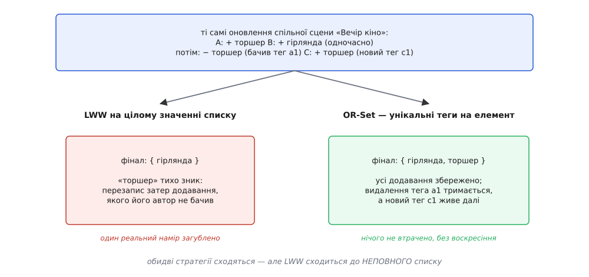

# ⚙️ Три реєстри під одним іспитом: LWW, двійники й OR-Set на тесті сходження

Стратегії на папері переконливі, але папір бреше легше за код. Тому зберемо три з них поруч — **LWW-реєстр**, **двійники** й **OR-Set** — кожну зі своєю функцією `merge()`, і поставимо їм спільний, навмисно недоброзичливий іспит. Візьмемо кілька однакових оновлень спільного списку, доставимо їх трьом «репліках» у **випадкових порядках і з повторами** й ствердимо, що фінальний стан скрізь один і той самий. А тоді придивимося до того, що цей іспит **не** ловить — бо саме там і криється найкорисніший урок.

Приклад беремо з дому Digital Homes, де він живий щодня. Є спільна сцена «Вечір кіно» — набір світильників, які вмикаються одним дотиком. Одна людина з підвалу додає в сцену торшер, друга тієї ж миті з тераси додає гірлянду; жоден телефон не бачив чужої зміни. Згодом хтось торшер із сцени прибирає, а ще згодом інша людина, не знаючи про це, вертає торшер назад. Чотири оновлення, три офлайн-пристрої — і питання, на яке має відповісти `merge()`: що опиниться в сцені, коли все нарешті зійдеться?

## Чому взагалі можна перевіряти злиття тестом

Секрет — у формі `merge()`. Якщо злиття поводиться як **з'єднання в напівґратці** (англ. *semilattice join*) — бере два стани й повертає їхню найменшу спільну верхню межу — і має три властивості, то підсумок не залежить ні від маршруту, ні від повторів:

```
комутативність:   merge(a, b) = merge(b, a)          → порядок двох не важить
асоціативність:   merge(merge(a, b), c) = merge(a, merge(b, c))   → групування не важить
ідемпотентність:  merge(a, a) = a                    → повтор нічого не додає
```

Разом ці три означають рівно те, що нам треба: хоч у якому порядку [мережа перемішає й продублює](root:progarch/duplicates-and-reorder) оновлення, кожна репліка згорне їх в один і той самий стан. Звідси й форма іспиту. Тасуємо оновлення — перевіряємо комутативність. Дублюємо навмання — перевіряємо ідемпотентність. Згортаємо їх зліва по одному, але щоразу з іншим порядком — щоразу інакше розставляючи дужки, тобто зачіпаючи й асоціативність. Якщо після сотень таких доставлень усі репліки сіли на **один** стан — три закони тримаються не лише на папері.

## Три реєстри, три злиття

Кожен реєстр — це пара «стан + `merge()`». Реалізуймо їх так, щоб різниця в поведінці випливала прямо з коду, а не зі слів про нього.

**LWW-реєстр** тримає **все значення списку** одним куснем разом із міткою часу й ідентифікатором вузла. Злиття — одне порівняння: перемагає більша мітка, а за рівних міток — стабільний тайбрейк за вузлом (без нього дві репліки могли б обрати різних переможців і розійтися назавжди).

:::tabs
```ts
// ── 1. LWW-реєстр: усе значення списку + мітка часу й вузол ──
type LWW = { val: Set<string>; ts: number; node: string };

function lwwMerge(a: LWW | null, b: LWW | null): LWW | null {
  if (!a || !b) return a ?? b;
  if (a.ts !== b.ts) return a.ts > b.ts ? a : b;   // новіша мітка перемагає
  return a.node >= b.node ? a : b;                 // рівні мітки — стабільний тайбрейк
}
```
```py
# ── 1. LWW-реєстр: усе значення списку + мітка часу й вузол ──
def lww_merge(a, b):
    if a is None: return b
    if b is None: return a
    if a["ts"] != b["ts"]:
        return a if a["ts"] > b["ts"] else b        # новіша мітка перемагає
    return a if a["node"] >= b["node"] else b        # рівні мітки — стабільний тайбрейк
```
:::

**Двійники** нічого не викидають: побачивши дві розбіжні версії, репліка тримає **обидві** поруч. Щоб відрізнити справді одночасні версії від тих, де одна написана поверх іншої, кожна версія носить **версійний вектор** — лічильник на вузол, з якого видно, чи «нащадок» одна версія іншій. Злиття бере об'єднання всіх версій і викидає ті, що їх хтось **строго домінує**; незалежні виживають обидві — як двійники, які вже зводить застосунок.

> 🔧 **Навіщо це.** Версійний вектор тут — не прикраса, а єдиний спосіб чесно сказати «ці дві версії одночасні». Механіку [векторних годинників](root:sf-distributed/vector-clocks) курс формалізує окремо; тут досить, що `dominates(x, y)` відповідає «x бачив усе, що y, і ще щось».

:::tabs
:::code proj-merge-convergence/ts/try-reiestry-try-zlyttia.ts
:::code proj-merge-convergence/py/try-reiestry-try-zlyttia.py
:::

**OR-Set** (англ. *observed-remove set*) — найтонший із трьох, бо ховає всю розумність у теги. Кожне додавання елемента дістає **унікальний тег**; видалення знімає лише **ті теги, які репліка справді бачила**. Елемент живий, поки має бодай один доданий і ще не знятий тег. Злиття — поелементне об'єднання доданих тегів і об'єднання знятих. Ось чому паралельне додавання переживає видалення: воно кладе **новий** тег, якого видалення не бачило й зняти не могло, — і це не воскресіння, а чесно новий запис.

:::tabs
:::code proj-merge-convergence/ts/try-reiestry-try-zlyttia-2.ts
:::code proj-merge-convergence/py/try-reiestry-try-zlyttia-2.py
:::

## Ті самі оновлення — трьома мовами реєстрів

Тепер запишемо сценарій «Вечір кіно» **як стани-дельти** для кожного реєстру. Кожне оновлення — це маленький стан, який репліка вливає в себе злиттям; тег `a1`/`b1`/`c1` — унікальний ідентифікатор конкретного запису.

:::tabs
:::code proj-merge-convergence/ts/ti-sami-onovlennia-troma.ts
:::code proj-merge-convergence/py/ti-sami-onovlennia-troma.py
:::

Зверни увагу на асиметрію вже тут. LWW змушений кодувати «додавання» як **знімок усього списку** — бо іншого місця, крім цілого значення, у нього немає; тож знімок A несе лише те, що A бачив. OR-Set натомість кодує кожну дію окремо, за її власним тегом. Ця різниця в записі й вирішить фінал ще до того, як спрацює хоч одне злиття.

## Іспит на сходження

Харнес доставляє одні й ті самі фрагменти багатьом «репліках», щоразу в новому випадковому порядку й із випадковими повторами, і рахує, **скільки різних фінальних станів** вийшло. Один стан на всі репліки — сходження тримається; більше одного — десь злиття не є справжнім join.

:::tabs
:::code proj-merge-convergence/ts/ispyt-na-skhodzhennia.ts
:::code proj-merge-convergence/py/ispyt-na-skhodzhennia.py
:::

Усі три `assert` проходять. І це перший, оманливо-заспокійливий результат: **кожен** з трьох реєстрів сходиться. Хоч як тасуй і дублюй — LWW щоразу дає той самий стан, двійники той самий, OR-Set той самий. Якби ми зупинилися тут і повісили зелену галочку «репліки узгоджені», ми б проґавили головне.

## Що іспит проґавив

Додаймо один рядок — подивімося не на **кількість** станів, а на їхній **вміст**:

:::tabs
```ts
const lww = lwwFrags.reduce(lwwMerge, null as LWW | null);
const sib = sibFrags.reduce(sibMerge, [] as Version[]);
const or  = orFrags.reduce(orMerge, { add: {}, rem: {} } as ORSet);

console.log("LWW      →", [...(lww?.val ?? [])]);   // [ 'гірлянда' ]        ← торшер зник
console.log("двійники →", sib.map((v) => v.list));  // [ ['торшер'], ['гірлянда'] ]
console.log("OR-Set   →", [...orValue(or)]);        // [ 'торшер', 'гірлянда' ]
```
```py
from functools import reduce
lww = reduce(lww_merge, lww_frags, None)
sib = reduce(sib_merge, sib_frags, [])
orr = reduce(or_merge, or_frags, {"add": {}, "rem": {}})

print("LWW      →", sorted(lww["val"]))            # ['гірлянда']            ← торшер зник
print("двійники →", [v["list"] for v in sib])      # [['торшер'], ['гірлянда']]
print("OR-Set   →", sorted(or_value(orr)))         # ['гірлянда', 'торшер']
```
:::

```
LWW      →  { гірлянда }              ← «торшер» тихо загублено
двійники →  { торшер } | { гірлянда }  ← обидва збережено, зводить застосунок
OR-Set   →  { гірлянда, торшер }      ← усе збережено, видалення без воскресіння
```

Ось де три однаково-«зелені» реєстри розходяться в тому, що для сцени по-справжньому важить. **LWW** зійшовся бездоганно — на списку, з якого зник торшер: два одночасні знімки затерли один одного, і додавання, якого переможець не бачив, випарувалося без сліду. **Двійники** зберегли обидві версії й чесно віддали їх нагору — жодної втрати, але ціною того, що зводити мусить хтось вище. **OR-Set** сам дав те, чого чекала людина: торшер із тегом `a1` знято, а торшер із новим тегом `c1` живий, тож у сцені є і гірлянда, і торшер — і видалення при цьому не воскресло.



*Однакові входи, різні підсумки. Обидві стратегії сходяться — але сходяться до різного, і тест на однаковість станів цієї різниці не бачить.*

Звідси головна думка розбору, і вона незручна: **сходження — не те саме, що коректність.** Тест на сходження перевіряє лише, що репліки згодні **між собою**, а не що вони згодні на **правильному**. Зелений результат тут необхідний, але не достатній: окремо треба стверджувати, що фінал зберігає те, що семантика цих даних вимагає зберегти. Саме тому вибір реєстру — це не «який алгоритм правильніший», а «що для цієї сцени означає не втратити нічого».

## Складність і пастки

Код короткий, але кожен реєстр приховує рахунок, який проступає лише під навантаженням.

**Тумбстоуни OR-Set ростуть і не чистяться наївно.** Знятий тег не можна просто забути: якщо викинути `rem`-запис про `a1`, то будь-яка репліка, що досі несе доданий `a1`, при наступному злитті поверне торшер — рівно те воскресіння, якого OR-Set і уникає. Тому набір знятих тегів лише росте, і це прямий податок на пам'ять. У проді його підрізають узгодженням: тег, знятий і **побачений усіма** репліками, більше не потрібен нікому й безпечно збирається — але це окрема, обережна процедура, а не `delete` під час звичайного злиття.

**Двійники плодяться, поки їх не зводять.** `merge` за побудовою не дає версіям зникнути — схлопнути набір може лише новий запис, чий версійний вектор домінує всіх наявних. Якщо застосунок не зводить двійники активно, репліка тягне дедалі ширше віяло версій, а сам версійний вектор росте з кількістю вузлів, що колись писали. Двійники купують «жодної тихої втрати» ціною складнішого читання й цього необмеженого росту.

**LWW сходиться впевнено й до неправди.** Тайбрейк за вузлом гарантує, що всі репліки оберуть **того самого** переможця, — але «переможець» означає «більша мітка часу», а мітки дає настінний годинник, який дрейфує й стрибає. Загублений запис міг бути насправді пізнішим — LWW цього не знає й знати не може. Для одного скалярного поля, де «новіше = правда», це прийнятно; для списку, де кожне додавання окреме, LWW структурно неспроможний, бо тримає ціле значення там, де треба зберігати елементи нарізно.

**Уся коректність OR-Set висить на унікальності тегів.** Тег мусить бути справді неповторним — зазвичай пара `(вузол, локальний-лічильник)` або UUID, — і його **ніколи** не переприсвоюють. Досить двом незалежним додаванням випадково поділити тег — і правило «знімаю лише бачене» ламається: видалення одного зачепить інше. Тег породжується локально, монотонно, і в цьому вся його сила.

І остання, тонша пастка — у самій постановці іспиту. Ми доставляли **стани-дельти** й зливали їх, тобто будували стан-базовані (англ. *state-based*) реєстри, де ідемпотентність вбудована й повтор нешкідливий за визначенням. Операційний (англ. *op-based*) варіант доставляв би самі операції («додай торшер»), і тоді ідемпотентність із безкоштовної стає **вимогою до транспорту**: та сама операція, [доставлена двічі](root:progarch/duplicates-and-reorder), не сміє спрацювати двічі. Вибираючи між двома стилями, ти насправді вибираєш, **де** платити за повтори — у структурі даних чи в каналі доставлення.
