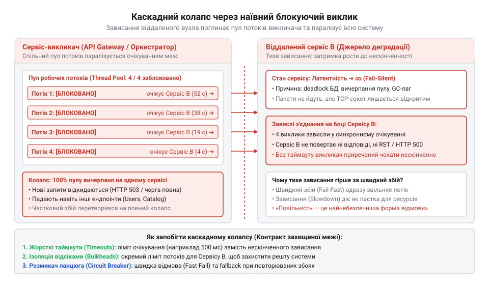
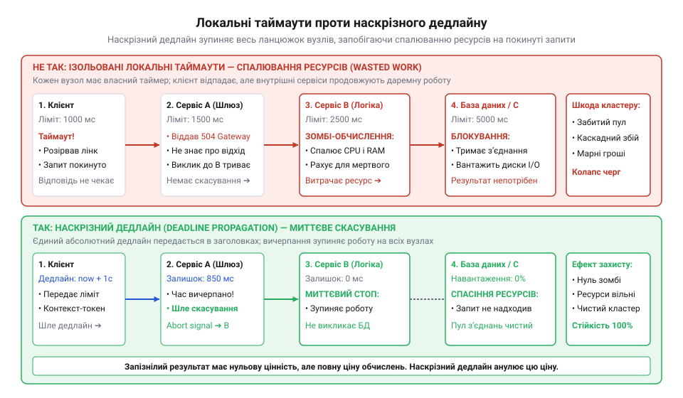
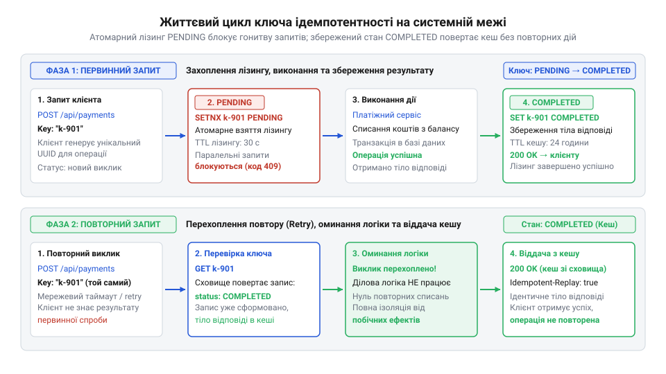
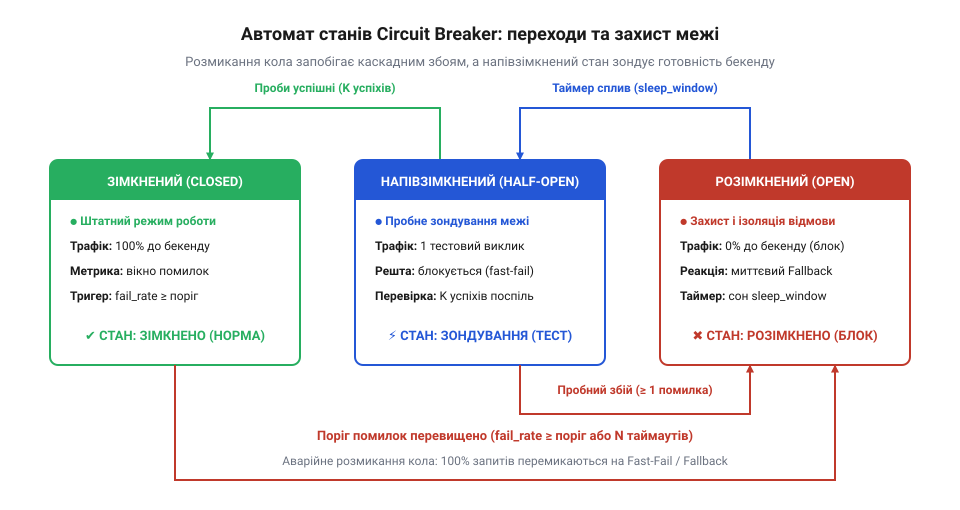
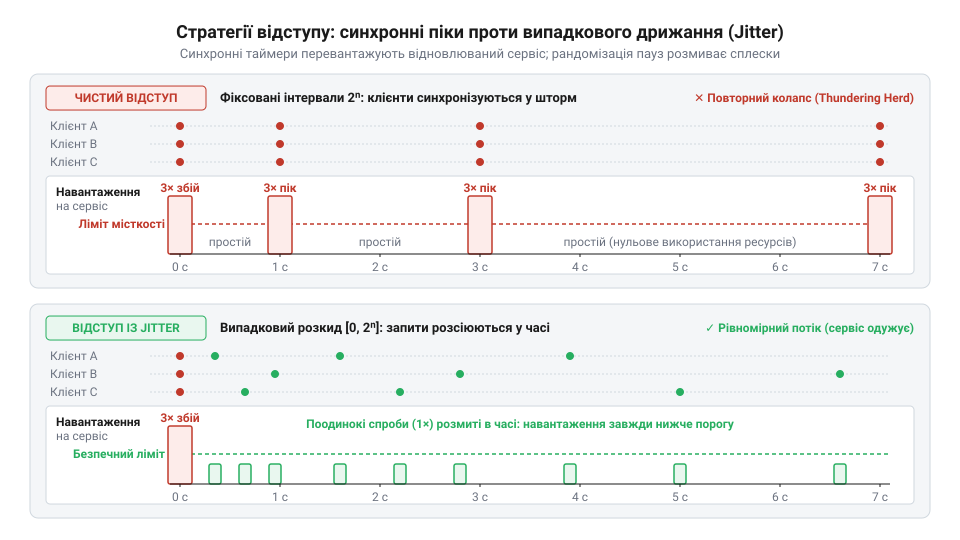
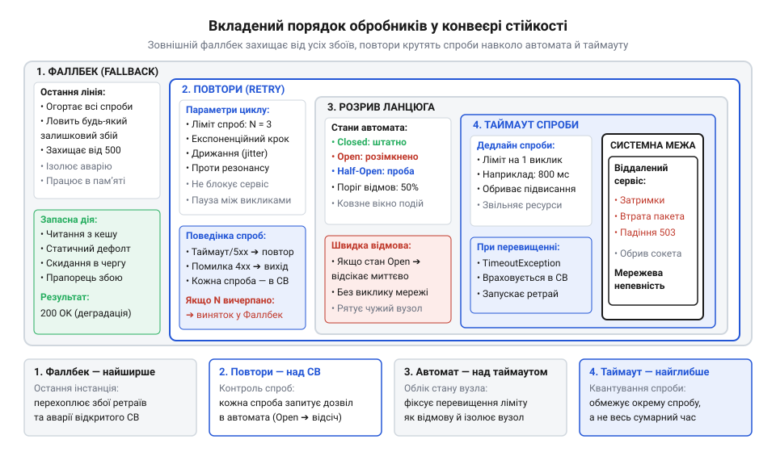
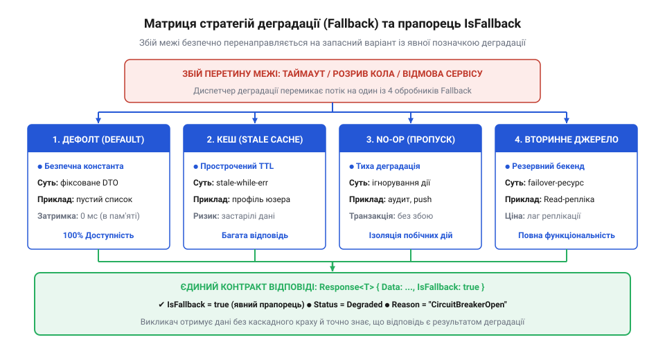
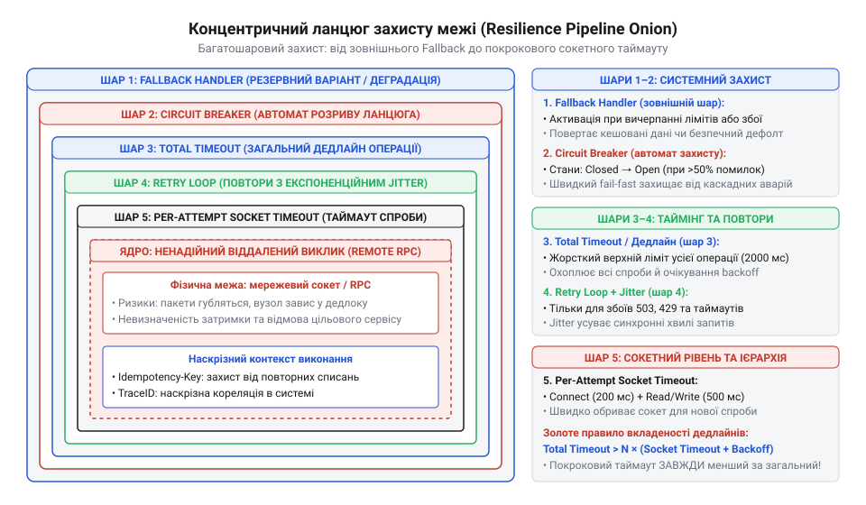

# Ціна межі

<preknowlist>
- [DH під тестом: тестованість, закладена швами](root:progarch/dh-testability-refactor) — проєктування швів та ізоляція компонентів під час тестування
- [Рефакторинг безпечно](root:progarch/refactoring-safe) — збереження поведінки системи та перевірка контрактів взаємодії при зміні коду
</preknowlist>

## Анатомія каскадного колапсу: коли наївний виклик руйнує систему

Уявімо типовий сервіс замовлень, розгорнутий у виробничому середовищі. Для обробки вхідних веб-запитів сервер виділяє фіксований пул із двохсот робочих потоків. Коли надходить запит на створення замовлення, обробник виконує звичайний прямий виклик функції: звертається через мережу до віддаленої служби резервування складу. У штатному режимі віддалена служба відповідає за п'ятнадцять-двадцять мілісекунд; потік швидко звільняється й повертається в пул, а система легко утримує навантаження в сотні операцій щосекунди.

Аварія починається непомітно. На сервері складу зависає транзакція бази даних або починається тривала зупинка прибирання сміття (англ. @@en|stop-the-world garbage collection@@). Сервер не впав остаточно — він не розриває TCP-з'єднання негайним пакетом скидання, а продовжує приймати пакети й мовчить, утримуючи відкриті з'єднання. На кожен вхідний запит служба замовлень сумлінно відправляє мережевий запит і блокує свій потік на очікуванні відповіді.

Потік клієнтських запитів не зупиняється: користувачі оформлюють замовлення зі швидкістю п'ятдесят операцій на секунду. Перші п'ятдесят запитів блокують п'ятдесят потоків. Через дві секунди зайнято сто потоків. Рівно через чотири секунди всі двісті робочих потоків служби замовлень вичерпано до останнього — вони мертво висять у стані очікування введення-виведення.

З цього моменту служба замовлень паралізована. Наступний клієнтський запит потрапляє в чергу очікування сокета операційної системи й зависає. Що гірше — паралізуються абсолютно всі операції вузла. Користувач, який хоче просто переглянути статичну сторінку профілю, отримати залишок бонусів або перевірити публічний каталог, дістає помилку таймауту. Навіть системний зонд перевірки працездатності (англ. @@en|liveness probe@@) не може достукатися до процесу, тому оркестратор вважає вузол мертвим і починає гарячково перезавантажувати контейнери, лише посилюючи чергу запитів.

Далі хвиля котиться вгору системною ієрархією. Шлюз API (англ. @@en|API Gateway@@) та суміжні сервіси, які викликали службу замовлень, також не отримують відповіді, блокують власні пули потоків і вичерпують з'єднання. Локальна затримка однієї внутрішньої підсистеми складу спричинила лавиноподібний [каскадний збій](root:sf-distributed/cascading-failures), що поклав весь цифровий бізнес — механіку блокування пулів та ізоляцію ресурсів за патерном Bulkhead докладно розглянуто у [Вичерпання пулу потоків та ізоляція відсіків](root:sf-distributed/thread-pool-exhaustion).


*Каскадний колапс: блокування робочих потоків викликача через повільну відповідь залежного сервісу паралізує незалежні операції та обвалює суміжні системи.*

Першопричина цієї катастрофи криється в оманливій природі синтаксису мов програмування. Запис виклику віддаленого сервісу `inventoryService.reserve(items)` зовні нічим не відрізняється від звернення до локального методу в пам'яті процесора. Це хрестоматійна пастка уявного розмиття меж (англ. @@en|location transparency fallacy@@). Локальний виклик функції гарантує детермінізм: він займає наносекунди, виконується в єдиному адресному просторі процесу й закінчується або поверненням значення, або детермінованим винятком. Мережевий виклик підпорядковується законам фізики та топології: пакети затримуються комутаторами, губляться в маршрутизаторах, а віддалена машина може зависнути, вимкнутися чи впасти в нескінченний цикл.

Наївна спроба вирішити проблему хаотичним розставлянням блоків `try-catch` та індивідуальних локальних таймаутів прямо в доменній бізнес-логіці лише створює ілюзію безпеки. Транспортні та часові налаштування змішуються з правилами бізнесу, розмиваючи архітектурні шви. Якщо кожен метод самотужки вирішує, скільки чекати й коли повторювати спробу, система отримує суперечливу поведінку: окремі запити чекають вічно, а інші — нескінченними повторами добивають напівживий сервіс.

> 🔧 **Навіщо це.**
> Відокремлення механік стійкості від бізнес-коду усуває дублювання транспортної логіки та запобігає витоку інфраструктурних деталей у доменну модель. Коли кожен розробник намагається самотужки налаштувати таймаути й повторні спроби, система отримує суперечливі конфігурації: одні виклики чекають вічно й вичерпують ресурси, інші — нескінченно бомбардують збійний сервіс повторами. Єдиний контракт стійкості перетворює стихійну боротьбу з ненадійністю мережі на централізовану, тестовану та передбачувану системну політику.

Щоб запобігти вичерпанню спільних ресурсів, архітектура має відокремити зміст дії від умов її виконання. Будь-який виклик через ненадійну межу повинен здійснюватися виключно крізь стандартизовану обгортку виклику (англ. @@en|resilience call wrapper@@), яка бере на себе контроль часу, керування потоком і обробку відмов.

## Базовий контракт обгортки виклику: контекст, дедлайни та типізовані помилки

Обгортка виклику розв'язує фундаментальну задачу: вона перетворює ненадійний, потенційно нескінченний за часом міжсистемний перехід на контрольовану операцію з гарантованими межами поведінки. Щоб доменна логіка не залежала від низькорівневих мережевих сокетів, архітектура вводить поліморфний інтерфейс виконавця викликів `CallExecutor` (або `ResilientCall`).

Головний обов'язок виконавця — інкапсулювати не *те*, що робить операція, а *як* вона виконується в часі й просторі ненадійної межі. Доменний клієнт передає у виконавця дві сутності: контекст виконання з системними обмеженнями та саму дію у вигляді функціонального делегата. Натомість виконавець гарантує повернення типізованого результату без пробивання стека викликів необробленими аваріями.

### Чому типізований результат, а не винятки

У наївних реалізаціях мережеві помилки часто викидають через мовні винятки (англ. @@en|exceptions@@). Це антипатерн на системних межах. Виняток у мові програмування призначений для сигналізації про порушення інваріанта програми або фатальний збій (наприклад, розіменування нульового вказівника чи вихід за межі масиву). Натомість для віддаленого виклику затримка мережі, обрив сокета, код помилки 503 чи спрацьовування захисного ліміту — це не баг у програмі, а штатний, щоденний фізичний факт функціонування розподіленого середовища.

Коли ненадійний виклик повертає типізований об'єкт `Result<T, BoundaryError>`, контракт змушує викликача на рівні системи типів явно розглянути обидва сценарії — успіх або відмову:

```text
Result<T, BoundaryError>
├── Success(Value: T)
└── Failure(Error: BoundaryError)
```

Такий підхід унеможливлює випадкове ігнорування збою й забезпечує детермінований потік керування, де кожна помилка межі має стандартизовану категорію.

### Дедлайни проти локальних таймаутів

Найпоширеніша помилка при роботі з ненадійними межами — використання локальних відносних таймаутів (англ. @@en|timeout@@, від @@en|time out@@ — вичерпання відведеного часу).

Уявімо розподілений ланцюжок із трьох сервісів: клієнт викликає сервіс A, той звертається до сервісу B, а B надсилає запит до бази даних C. Нехай кожен сервіс незалежно сконфігурував собі локальний таймаут у 5 секунд. Якщо сервіс B зависає, сервіс A чекає його відповіді повні 5 секунд. Проте браузер або мобільний застосунок користувача мав власний клієнтський ліміт очікування в 3 секунди: користувач розірвав з'єднання й закрив вкладку вже через 3 секунди після початку операції. Сервіси A і B продовжують виконувати важку роботу ще дві секунди, навантажуючи диски й пам'ять, хоча результат уже нікому не потрібен у природі. Це явище марнотратної роботи (англ. @@en|wasted work@@).

Розв'язком є наскрізний дедлайн (англ. @@en|deadline@@, від @@en|dead line@@ — крайня часова межа, буквально «мертва лінія») — абсолютна часова позначка за шкалою UTC, після якої запит втрачає сенс для всієї розподіленої системи.

Різницю між локальними таймаутами та наскрізним дедлайном демонструє розрахунок тривалості марнотратної роботи:

```text
Клієнтський ліміт очікування (t_client): 3 с
Локальний таймаут Сервісу А (t_A):        5 с
Локальний таймаут Сервісу B (t_B):        5 с
Час зависання бази даних:                 8 с

При локальних таймаутах:
Час виконання ланцюжка = min(t_A, час_зависання) = 5 с
Час марнотратної роботи = 5 с - 3 с = 2 с  [сервери марно витрачають ресурси]

При наскрізному дедлайні:
Дедлайн транзакції D = T₀ + 3 с
Час відсікання = 3 с                      [усі сервери миттєво обривають роботу]
Час марнотратної роботи = 0 с              [жодного марного спалювання ресурсів]
```


*Порівняння поведінки ланцюжка: незалежні локальні таймаути призводять до накопичення марнотратної роботи (wasted work) після відходу клієнта, тоді як наскрізний дедлайн миттєво зупиняє виконання на всіх вузлах системи.*``

Дедлайн обчислюється один раз на вході в систему (наприклад, на шлюзі API: `Deadline = Now() + Budget`) і передається через контекст крізь усі внутрішні мережеві стрибки. Кожна обгортка `CallExecutor` перед здійсненням виклику перевіряє залишок часу:

```text
Залишок часу = Deadline - Now()
```

Якщо `Залишок часу <= 0`, виконавець навіть не відкриває мережевий сокет і миттєво повертає помилку `BoundaryStatus.DeadlineExceeded`. Якщо залишок позитивний, цей час стає верхньою межею сокетного таймауту для поточного відрізка.

> 🔧 **Навіщо це.**
> Наскрізний дедлайн унеможливлює «зомбі-запити» — виклики, які продовжують навантажувати диски, бази даних та пули з'єднань після того, як ініціатор операції вже розірвав з'єднання або повідомив користувача про помилку. Передача абсолютної часової позначки замість локальних інтервалів синхронізує рішення про припинення роботи між усіма незалежними мікросервісами в системі.

### Маркери наскрізного трасування

Щоб аварію на межі можна було діагностувати серед мільйонів транзакцій, контекст виклику зобов'язаний нести маркери розподіленого трасування (англ. @@en|distributed tracing@@):

1. **TraceId** — глобальний унікальний ідентифікатор транзакції, незмінний від моменту входу запиту в систему до останнього внутрішнього мікросервісу.
2. **SpanId** — унікальний ідентифікатор конкретного відрізка роботи (поточного виклику через межу).
3. **ParentSpanId** — ідентифікатор батьківського відрізка, що дозволяє деревам моніторингу реконструювати точну топологію викликів.

Обгортка `CallExecutor` автоматично інжектує ці ідентифікатори у вихідні мережеві заголовки (наприклад, стандарт `traceparent` за специфікацією W3C Trace Context) і записує їх у кожну подію діагностики.

### Специфікація інтерфейсу обгортки виклику

Нижче наведено повну специфікацію типів даних, статусів та інтерфейсу базової обгортки для роботи через ненадійні системні межі:

| Поле / Тип | Опис та семантика |
| :--- | :--- |
| `CallContext` | Незмінний контекст виконання: несе `Deadline` (UTC), `CancellationToken`, `TraceId`, `SpanId` та метадані (`Baggage`). |
| `BoundaryStatus` | Перелік кодів завершення: `Success`, `DeadlineExceeded`, `Cancelled`, `ExecutionFailed`, `CircuitOpen`, `RateLimited`. |
| `BoundaryError` | Структура відмови: статус `Code`, текстове пояснення `Message`, тривалість спроби `Duration`, ознака `IsTransient` та причина `Cause`. |
| `Result<T, BoundaryError>` | Контейнер завершення операції: містить або успішне значення `Value`, або типізовану помилку `Error`. |
| `CallExecutor` | Інтерфейс із методом `Execute<T>(Context, Action) -> Result<T, BoundaryError>`. |

#### Інваріанти базової обгортки

1. **Інваріант вичерпаного дедлайну**: якщо `Context.IsExpired()` повертає `true` до виклику дії, виконавець гарантує, що цільова дія ніколи не буде викликана.
2. **Інваріант локалізації аварій**: будь-яка неперехоплена паніка або системний виняток усередині цільової дії перехоплюється обгорткою та повертається як `BoundaryStatus.ExecutionFailed`. Жоден необроблений збій не виходить за межі обгортки.
3. **Інваріант прокидання контексту**: цільова дія зобов'язана приймати дочірній контекст виклику для передачі скасування у вкладені операції введення-виведення.
4. **Тестованість через шви**: інтерфейс `CallExecutor` слугує архітектурним швом, що дозволяє ізольовано тестувати поведінку системи при таймаутах і збоях без реальних мережевих з'єднань, реалізуючи принцип [тестованість, закладена швами](root:progarch/dh-testability-refactor).

Нижче наведено виробничу реалізацію базового контракту `CallExecutor` та моделі контексту мовами Go та C#:

:::tabs
:::code api-boundary-resilience-contract/go/boundarystatus.go
```csharp
using System;
using System.Diagnostics;
using System.Threading;
using System.Threading.Tasks;

namespace BoundaryResilience;

public enum BoundaryStatus
{
    Success,
    DeadlineExceeded,
    Cancelled,
    ExecutionFailed
}

public sealed record BoundaryError(
    BoundaryStatus Code,
    string Message,
    TimeSpan Duration,
    bool IsTransient,
    Exception? Cause
);

public readonly struct Result<T>
{
    public bool IsSuccess { get; }
    public T? Value { get; }
    public BoundaryError? Error { get; }

    private Result(T value)
    {
        IsSuccess = true;
        Value = value;
        Error = null;
    }

    private Result(BoundaryError error)
    {
        IsSuccess = false;
        Value = default;
        Error = error;
    }

    public static Result<T> Ok(T value) => new(value);
    public static Result<T> Fail(BoundaryError error) => new(error);
}

public sealed record CallContext(
    DateTimeOffset DeadlineUtc,
    CancellationToken CancellationToken,
    string TraceId,
    string SpanId
)
{
    public TimeSpan RemainingTime => DeadlineUtc - DateTimeOffset.UtcNow;
    public bool IsExpired => RemainingTime <= TimeSpan.Zero;
}

public interface ICallExecutor
{
    Task<Result<T>> ExecuteAsync<T>(
        CallContext context,
        Func<CancellationToken, Task<T>> action
    );
}

public sealed class ResilientCallExecutor : ICallExecutor
{
    public async Task<Result<T>> ExecuteAsync<T>(
        CallContext context,
        Func<CancellationToken, Task<T>> action
    )
    {
        var sw = Stopwatch.StartNew();

        // Інваріант 1: перевірка дедлайну до старту операції
        if (context.IsExpired || context.CancellationToken.IsCancellationRequested)
        {
            var code = context.IsExpired ? BoundaryStatus.DeadlineExceeded : BoundaryStatus.Cancelled;
            return Result<T>.Fail(new BoundaryError(
                code,
                "Дедлайн або скасування спрацювали до запуску операції",
                sw.Elapsed,
                IsTransient: false,
                Cause: null
            ));
        }

        // Формуємо спільне джерело скасування, обмежене залишком часу до дедлайну
        using var timeoutCts = new CancellationTokenSource(context.RemainingTime);
        using var linkedCts = CancellationTokenSource.CreateLinkedTokenSource(
            context.CancellationToken,
            timeoutCts.Token
        );

        try
        {
            // Виконання доменної дії з передачею пов'язаного маркера скасування
            var result = await action(linkedCts.Token).ConfigureAwait(false);
            return Result<T>.Ok(result);
        }
        catch (OperationCanceledException ex)
        {
            var isTimeout = timeoutCts.IsCancellationRequested && !context.CancellationToken.IsCancellationRequested;
            return Result<T>.Fail(new BoundaryError(
                isTimeout ? BoundaryStatus.DeadlineExceeded : BoundaryStatus.Cancelled,
                isTimeout ? "Перевищено дедлайн виконання виклику" : "Виклик скасовано клієнтом",
                sw.Elapsed,
                IsTransient: true,
                Cause: ex
            ));
        }
        catch (Exception ex)
        {
            // Інваріант 2: жоден виняток не пробиває межу обгортки
            return Result<T>.Fail(new BoundaryError(
                BoundaryStatus.ExecutionFailed,
                "Аварійний збій під час виконання дії",
                sw.Elapsed,
                IsTransient: true,
                Cause: ex
            ));
        }
    }
}
```
:::

## Гарантія ідемпотентності на межі: запобігання дублюванню операцій

У розділі 2 ми розібрали, як обгортка виклику контролює дедлайни й повертає типізовану помилку замість винятків. Проте робота в розподіленому середовищі створює на межі фундаментальну невизначеність: що відбувається, коли клієнт отримує помилку `BoundaryStatus.DeadlineExceeded` або обрив з'єднання?

Уявімо клієнта, який надіслав до платіжного шлюзу запит на списання ста гривень. Запит успішно пройшов мережу, сервер списав кошти з картки й сформував підтвердження. Але саме в момент відправки відповіді кабель зв'язку зазнав короткочасного збою, або час відповіді перевищив дедлайн клієнта на п'ять мілісекунд. Клієнтська обгортка фіксує таймаут. Чи списалися гроші?

Клієнт опиняється перед нерозв'язною дилемою:
1. Якщо сервер не отримав запит, повторний виклик необхідний, інакше замовлення не буде оплачено.
2. Якщо сервер уже виконав списання, звичайний повтор спише гроші вдруге, створивши подвійне списання.

У класичній теорії систем це відомо як проблема узгодження в ненадійному каналі. Клієнт на межі ніколи не може достеменно знати, на якому саме етапі обірвався зв'язок: до виконання операції сервером чи після нього. Тому будь-яка політика повторних спроб без суворих гарантій ідемпотентності є руйнівною для операцій зі зміною стану.

### Природа ідемпотентності: безпечні та мутуючі виклики

Ідемпотентність (від латинського @@la|idem@@ — той самий, та @@la|potens@@ — здатний, сильний) — це властивість операції гарантувати однаковий підсумковий стан системи незалежно від того, викликана вона один раз чи десять разів поспіль із тими самими параметрами:

```text
f(f(x)) = f(x)
```

Операції читання (`GET`, перевірка балансу чи запит наявності товару) є природно ідемпотентними: повторний виклик не змінює стан сховища. Натомість мутуючі виклики (`POST`, створення транзакції, відправлення повідомлення) без спеціального захисту неідемпотентні: кожен виклик створює новий запис або модифікує баланс.

### Проєктування контракту ключів ідемпотентності

Щоб зробити мутуючий виклик безпечним для автоматичних повторів, архітектура вводить контракт ключів ідемпотентності (англ. @@en|idempotency key@@).

Ключ ідемпотентності — це унікальний сурогатний маркер, який викликач генерує для кожної логічної бізнес-дії та передає в метаданих контексту виклику (наприклад, у HTTP-заголовку `Idempotency-Key`).

```text
Клієнт                                      Межа сервера / Сховище дедуплікації
  │                                                         │
  ├─── 1. Виклик: Action + Key: "pay_9874a" ───────────────>│ Перевірка ключа: немає в базі
  │                                                         │ Створення запису [Key, PENDING]
  │                                                         │ Виконання списання в БД
  │    [Мережевий обрив відповіді / Таймаут]                │ Оновлення запису [Key, COMPLETED, Рез]
  │                                                         │
  ├─── 2. Повтор: Action + Key: "pay_9874a" ───────────────>│ Перевірка ключа: знайдено COMPLETED!
  │                                                         │ Дія НЕ виконується повторно!
  │<── 3. Повернення збереженого результату ────────────────┤ Миттєва віддача оригінальної відповіді
```

Існує дві стратегії формування ключа:
1. **Випадковий UUID v4**: генерується клієнтом один раз на початку бізнес-наміру й зберігається в локальному стані транзакції.
2. **Детермінований криптографічний хеш**: обчислюється як хеш від незмінних бізнес-параметрів операції:

```text
Ключ = SHA256(КлієнтId + НомерЗамовлення + Сума + Валюта)
```

Детермінований ключ захищає від дублювання, навіть якщо клієнтський процес повністю впав і перезавантажився: повторний запуск того самого замовлення автоматично дасть ідентичний ключ.

### Стани запису дедуплікації на стороні приймача

Серверний бік контракту вимагає наявності [розподіленого сховища дедуплікації](root:sf-distributed/distributed-idempotency-store) (швидкої бази даних або кешу з підтримкою атомарних операцій):

| Стан запису | Семантика на межі | Дія при отриманні повторного запиту |
| :--- | :--- | :--- |
| `PENDING` | Перший запит прийнято, він зараз виконується у фоні. Запис захищено лізингом (часовим блокуванням). | Сервер повертає клієнту код `409 Conflict` або призупиняє обробку до зняття блокування, запобігаючи одночасній конкурентній гонитві. |
| `COMPLETED` | Запит успішно виконано, відповідь серіалізовано в тіло запису. | Сервер не викликає доменну дію, а миттєво віддає збережену копію попередньої відповіді з тим самим статусом. |
| `FAILED` | Попередня спроба завершилася помилкою валідації або відхилена доменною логікою. | Сервер повертає зафіксовану помилку, не дозволяючи виконати невалідну дію з тим самим ключем повторно. |

Вікно дедуплікації (час життя запису, TTL) встановлюється з урахуванням бізнес-правил: типово від двадцяти чотирьох годин до кількох діб. Після завершення вікна ключ вважається застарілим і видаляється.


*Життєвий цикл ключа ідемпотентності: стан PENDING із часовим лізингом запобігає гонитві паралельних запитів, а збереження фінального стану (COMPLETED) гарантує повернення ідентичної відповіді при повторних викликах.*

> 🔧 **Навіщо це.**
> Контракт ідемпотентності перетворює ненадійний розподілений канал на семантику «виконати рівно один раз» (англ. @@en|effectively-once processing@@). Без ключів ідемпотентності жодна система не має права застосовувати автоматичні повторні спроби (retries) на мутуючих запитах, оскільки будь-який мережевий збій неминуче призведе до спотворення даних або фінансових втрат.

## Автомат розриву ланцюга (Circuit Breaker): контракти станів та логіка переходів

Ключі ідемпотентності гарантують безпеку повторних спроб для бізнес-даних. Проте самі по собі вони не рятують систему від фізичного перевантаження. Якщо віддалена служба деградувала — наприклад, її база даних заблокована чи процесор перевантажений на сто відсотків, — надсилання навіть повністю ідемпотентних запитів і повторів лише добиває збійний вузол.

Щоб запобігти виснаженню клієнтських потоків і дати серверу час на відновлення, на межі встановлюють автомат захисту — розривач ланцюга (англ. @@en|circuit breaker@@). Ця метафора походить з електротехніки: автоматичний вимикач миттєво розмикає електричне коло, коли струм перевищує безпечний рівень, запобігаючи перегріву проводки та пожежі. У програмній архітектурі розривач ланцюга відстежує частку помилок і припиняє надсилання запитів до вузла, який зазнав лиха.


*Автомат станів Circuit Breaker: динаміка переходів між нормальним режимом (Closed), аварійним відсіканням (Open) та тестовим зондуванням (Half-Open).*

### Три стани автомата та умови переходів

Автомат розриву функціонує за строгим скінченним автоматом станів (англ. @@en|finite state machine@@):

1. **Замкнено (Closed)**:
   - Штатний режим. Усі вхідні виклики безперешкодно пропускаються до цільового сервісу.
   - Обгортка реєструє результат кожного завершеного виклику (успіх або відмова) у ковзному вікні статистики.
   - **Умова переходу в Open**: якщо за ковзне вікно виконано мінімальну кількість викликів `N_min` і частка невдалих викликів перевищує поріг `P_fail` (наприклад, 50%), ланцюг негайно розмикається.

2. **Розімкнено (Open)**:
   - Аварійний режим швидкого відсікання (англ. @@en|fail-fast@@).
   - Обгортка миттєво відхиляє будь-який виклик із помилкою `BoundaryStatus.CircuitOpen` за частки мікросекунди. Жоден мережевий пакет не відправляється назовні, жоден робочий потік клієнта не зависає в очікуванні.
   - Цільовий сервіс отримує нульове вхідне навантаження, завдяки чому може звільнити черги, перезавантажити пули чи завершити важкі транзакції.
   - **Умова переходу в Half-Open**: коли спливає налаштований таймер спокою (англ. @@en|sleep window@@, наприклад, 30 секунд), автомат автоматично перемикається в режим зондування.

3. **Напіврозімкнено (Half-Open)**:
   - Режим тестового зондування (англ. @@en|probe testing@@).
   - Автомат дозволяє виконати строго обмежену кількість пробних запитів `M_probe` (наприклад, 3-5 запитів). Усі паралельні запити понад цей ліміт продовжують миттєво відхилятися з кодом `CircuitOpen`.
   - **Умова повернення в Closed**: якщо всі пробні запити завершилися успішно, автомат вважає, що віддалений сервіс відновився, очищає статистику помилок і замикає ланцюг.
   - **Умова повернення в Open**: якщо бодай один пробний виклик зазнає невдачі, автомат негайно повертається в стан `Open` на новий інтервал сну, захищаючи сервер від передчасного напливу навантаження.

### Математика порогів та ковзного вікна

Оцінка частки помилок здійснюється на основі [ковзного вікна](root:sf-release/sliding-window-metrics) (англ. @@en|sliding window@@). Використовують дві моделі вікна:
- **Кількісне вікно (Count-based)**: зберігає результати останніх `N` запитів (наприклад, останніх 100 викликів) у кільцевому буфері.
- **Часове вікно (Time-based)**: підраховує статистику за останні `T` секунд (наприклад, останні 60 секунд, розбиті на бакети по 1 секунді).

Математичний контракт розриву формулюється системою умов:

```text
Всього викликів у вікні: N_total = N_success + N_failed
Частка невдач:           FailureRate = N_failed / N_total

Ланцюг розмикається (Closed -> Open), коли:
(N_total >= MinimumThroughput) AND (FailureRate >= FailureRateThreshold)
```

Вимога `N_total >= MinimumThroughput` є критично важливою. Без мінімального порогу обсягу (наприклад, `MinimumThroughput = 20`) перший же невдалий виклик на порожній системі дав би частку невдач `1 / 1 = 100%` і миттєво розімкнув би справний сервіс.

> 🔧 **Навіщо це.**
> Circuit Breaker перетворює тривалі затримки вмираючого сервісу на миттєві локальні помилки клієнта. Замість того, щоб тисячі потоків чекали сокетних таймаутів по п'ять секунд і обвалювали систему викликача, розривач відповідає за 0.1 мілісекунди. Це зберігає ресурси клієнта й дає збійному сервісу простір для самовідновлення без повного відключення дата-центру.

### Реалізація автомата Circuit Breaker

Нижче наведено потокобезпечну реалізацію автомата розриву ланцюга мовами Go та C#:

:::tabs
:::code api-boundary-resilience-contract/go/circuitstate.go
```csharp
using System;
using System.Threading;

namespace BoundaryResilience;

public enum CircuitState
{
    Closed,
    Open,
    HalfOpen
}

public sealed class CircuitBreakerConfig
{
    public double FailureRateThreshold { get; init; } = 0.5;
    public int MinimumThroughput { get; init; } = 20;
    public TimeSpan SleepWindow { get; init; } = TimeSpan.FromSeconds(30);
    public int HalfOpenProbeLimit { get; init; } = 3;
}

public sealed class CircuitBreaker
{
    private readonly CircuitBreakerConfig _cfg;
    private readonly object _syncRoot = new();

    private CircuitState _state = CircuitState.Closed;
    private DateTimeOffset _openedAtUtc;
    private int _totalRequests;
    private int _failedRequests;
    private int _halfOpenProbes;
    private int _halfOpenPassed;

    public CircuitBreaker(CircuitBreakerConfig config)
    {
        _cfg = config;
    }

    public CircuitState State
    {
        get
        {
            lock (_syncRoot)
            {
                if (_state == CircuitState.Open && DateTimeOffset.UtcNow - _openedAtUtc >= _cfg.SleepWindow)
                {
                    _state = CircuitState.HalfOpen;
                    _halfOpenProbes = 0;
                    _halfOpenPassed = 0;
                }
                return _state;
            }
        }
    }

    public bool AllowExecution()
    {
        lock (_syncRoot)
        {
            var st = State;
            if (st == CircuitState.Closed) return true;
            if (st == CircuitState.Open) return false;

            // Half-Open: пропускаємо лише лімітовану кількість тестових проб
            if (_halfOpenProbes < _cfg.HalfOpenProbeLimit)
            {
                _halfOpenProbes++;
                return true;
            }
            return false;
        }
    }

    public void RecordResult(bool isSuccess)
    {
        lock (_syncRoot)
        {
            if (_state == CircuitState.HalfOpen)
            {
                if (!isSuccess)
                {
                    // Найменший збій у тестовому режимі миттєво відкидає автомат назад у Open
                    _state = CircuitState.Open;
                    _openedAtUtc = DateTimeOffset.UtcNow;
                    return;
                }

                _halfOpenPassed++;
                if (_halfOpenPassed >= _cfg.HalfOpenProbeLimit)
                {
                    // Усі зонди пройшли успішно — відновлюємо штатне замикання
                    _state = CircuitState.Closed;
                    _totalRequests = 0;
                    _failedRequests = 0;
                }
                return;
            }

            if (_state == CircuitState.Closed)
            {
                _totalRequests++;
                if (!isSuccess)
                {
                    _failedRequests++;
                }

                if (_totalRequests >= _cfg.MinimumThroughput)
                {
                    var rate = (double)_failedRequests / _totalRequests;
                    if (rate >= _cfg.FailureRateThreshold)
                    {
                        _state = CircuitState.Open;
                        _openedAtUtc = DateTimeOffset.UtcNow;
                    }
                }
            }
        }
    }

    public T Execute<T>(Func<T> action)
    {
        if (!AllowExecution())
        {
            throw new InvalidOperationException("CIRCUIT_OPEN: виклик заблоковано автоматом розриву ланцюга");
        }

        try
        {
            var result = action();
            RecordResult(isSuccess: true);
            return result;
        }
        catch (Exception)
        {
            RecordResult(isSuccess: false);
            throw;
        }
    }
}
```
:::

## Політика повторних спроб та алгоритми відступу з випадковим дрижанням

Коли віддалений сервіс відчуває короткочасне перевантаження, кілька тисяч клієнтів одночасно отримують помилку з'єднання або таймаут. Найпростіша реакція клієнтської програми — негайно повторити запит або зачекати фіксовані 100 мілісекунд. Проте якщо тисяча клієнтів зіткнулася зі збоєм в одну й ту саму мілісекунду, всі вони синхронно повернуться рівно через 100 мілісекунд. Замість випадкового й розрідженого потоку викликів виникає резонансна ударна хвиля — «громовий шторм» або навала натовпу: @@en|thundering herd@@ (англ. *thundering herd* — череда, що гримить копитами). Сервіс, який тільки-но намагався звільнити ресурси й відновитися, отримує новий узгоджений залп запитів, що в кілька разів перевищує його максимальну пропускну здатність, і знову падає. Система входить у нескінченний автоколивний цикл руйнування.

Щоб дати залежному компоненту час на вивільнення пам'яті, перезапуск робочих процесів або очищення черг, пауза між повторними спробами має прогресивно зростати: @@en|exponential backoff@@ (експоненційний відступ, від лат. *exponere* — виставляти напоказ, відступати). З кожною наступною невдачею інтервал очікування подвоюється:

    t[i] = min(t_max, t_base · 2ⁱ)

де `i` — порядковий номер спроби (`i = 0, 1, 2, ...`), `t_base` — початкова тривалість затримки, а `t_max` — верхня стеля очікування, яка не дозволяє інтервалу розростатися до нескінченності.

Проте чистий експоненційний відступ сам по собі не рятує від резонансу. Якщо тисяча клієнтів впала одночасно в момент часу `t₀`, то за формулою чистого експоненційного відступу всі вони разом повторять запит о `t₀ + 100` мс, потім разом — о `t₀ + 300` мс, а далі разом — о `t₀ + 700` мс. Хвилі розходяться далі в часі, але всередині кожної хвилі всі клієнти залишаються суворо синхронізованими. Пікова амплітуда кожної атаки не зменшується — вона б'є по сервісу з тією самою руйнівною силою.

Щоб зруйнувати фазову синхронізацію клієнтів і розсіяти виклики вздовж усієї осі часу, до інтервалу вносять випадкову величину — @@en|jitter@@ (випадкове дрижання, від англ. *jitter* — нервове тремтіння, флуктуація). Випадковий шум перетворює синхронні гармоніки на плавний пуассонівський потік.

Виділяють три базові алгоритми внесення випадковості:

1. **Повне дрижання (Full Jitter).** Інтервал обирається випадково з рівномірного розподілу між нулем та експоненційною стелею:

    t_sleep = random(0, min(t_max, t_base · 2ⁱ))

Цей підхід максимально розмиває навантаження: математичне сподівання затримки дорівнює половині експоненційного максимуму. Недолік — інколи випадкове число випадає близьким до нуля, що спричиняє передчасний повтор.

2. **Рівне дрижання (Equal Jitter).** Інтервал розбивається на фіксовану базову частину та випадкову складову:

    t_half  = min(t_max, t_base · 2ⁱ) ÷ 2
    t_sleep = t_half + random(0, t_half)

Тут клієнт завжди дає сервісу гарантований мінімальний час на перепочинок (`t_half`), а випадкова складова усуває резонанс між конкуруючими клієнтами.

3. **Декорельоване дрижання (Decorrelated Jitter).** Затримка наступної спроби розраховується не від номера спроби `i`, а на основі фактичної тривалості попередньої паузи:

    t_sleep = min(t_max, random(t_base, t_prev · 3))

Цей підхід реалізує випадкове блукання з експоненційним математичним зростанням. Він повністю розриває кореляцію клієнтів з будь-яким глобальним таймером і демонструє найвищу стабільність за високої конкуренції.

**Розрахунок інтервалів на прикладі.** Нехай базова затримка `t_base = 100` мс, максимальна стеля `t_max = 1600` мс. Для перших чотирьох спроб розрахунок діапазонів паузи виглядає так:

    Спроба 0 (i = 0):
      Експонента: min(1600, 100 · 2⁰) = 100 мс
      Full Jitter:  random(0, 100)        → [0 .. 100] мс
      Equal Jitter: 50 + random(0, 50)    → [50 .. 100] мс
      Decorrelated (t_prev = 100): random(100, 300) → [100 .. 300] мс

    Спроба 1 (i = 1):
      Експонента: min(1600, 100 · 2¹) = 200 мс
      Full Jitter:  random(0, 200)        → [0 .. 200] мс
      Equal Jitter: 100 + random(0, 100)  → [100 .. 200] мс
      Decorrelated (нехай t_prev = 200): random(100, 600) → [100 .. 600] мс

    Спроба 2 (i = 2):
      Експонента: min(1600, 100 · 2²) = 400 мс
      Full Jitter:  random(0, 400)        → [0 .. 400] мс
      Equal Jitter: 200 + random(0, 200)  → [200 .. 400] мс
      Decorrelated (нехай t_prev = 350): random(100, 1050) → [100 .. 1050] мс

    Спроба 3 (i = 3):
      Експонента: min(1600, 100 · 2³) = 800 мс
      Full Jitter:  random(0, 800)        → [0 .. 800] мс
      Equal Jitter: 400 + random(0, 400)  → [400 .. 800] мс
      Decorrelated (нехай t_prev = 700): min(1600, random(100, 2100)) → [100 .. 1600] мс

Навіть якщо тисяча клієнтів впала в один момент, розкид значень у діапазоні розмиває сумарний трафік у рівномірну смугу, не створюючи пікових навантажень на сервіс.


*Порівняння стратегій повторних спроб: фіксовані інтервали й чистий експоненційний відступ утворюють нищівні синхронні хвилі запитів, тоді як додавання випадкового шуму (Jitter) розсіює повтори вздовж осі часу й захищає відновлюваний сервіс від повторного колапсу.*

Повторні спроби збільшують сумарний трафік у системі. Якщо сервіс деградував через вичерпання процесорних ресурсів, безконтрольні повтори клієнтів остаточно доб'ють його. Тому контракт межі завжди обмежує граничну кількість спроб (зазвичай від 2 до 4) і вводить поняття бюджету повторів (Retry Budget): частка повторних запитів не повинна перевищувати 10–20% від загального потоку викликів клієнта. Якщо цей ліміт вичерпано, нові збої негайно передаються вище без повторів.

Нижче наведено специфікацію інтерфейсу розрахунку затримок та програмну реалізацію стратегій відступу:

```csharp
using System;

namespace Architecture.Resilience.Backoff;

/// <summary>
/// Стратегія розрахунку паузи між повторними спробами.
/// </summary>
public interface IBackoffStrategy
{
    /// <summary>
    /// Розраховує тривалість паузи перед наступною спробою.
    /// </summary>
    /// <param name="attempt">Порядковий номер спроби (0, 1, 2...).</param>
    /// <param name="previousDelay">Тривалість паузи на попередньому кроці.</param>
    /// <returns>Інтервал часу для очікування.</returns>
    TimeSpan CalculateDelay(int attempt, TimeSpan previousDelay);
}

/// <summary>
/// Конфігураційні параметри для алгоритмів відступу.
/// </summary>
public sealed record BackoffOptions
{
    public TimeSpan BaseDelay { get; init; } = TimeSpan.FromMilliseconds(100);
    public TimeSpan MaxDelay { get; init; } = TimeSpan.FromSeconds(2);
    public int MaxRetries { get; init; } = 3;
}

/// <summary>
/// Реалізація експоненційного відступу з повним дрижанням (Full Jitter).
/// </summary>
public sealed class FullJitterBackoffStrategy : IBackoffStrategy
{
    private readonly BackoffOptions _options;
    private readonly Random _random;

    public FullJitterBackoffStrategy(BackoffOptions options, int? seed = null)
    {
        _options = options ?? throw new ArgumentNullException(nameof(options));
        _random = seed.HasValue ? new Random(seed.Value) : Random.Shared;
    }

    public TimeSpan CalculateDelay(int attempt, TimeSpan previousDelay)
    {
        // t_exp = min(t_max, t_base * 2^attempt)
        double maxMilliseconds = Math.Min(
            _options.MaxDelay.TotalMilliseconds,
            _options.BaseDelay.TotalMilliseconds * Math.Pow(2, attempt));

        // t_sleep = random(0, t_exp)
        double jitteredMilliseconds = _random.NextDouble() * maxMilliseconds;
        return TimeSpan.FromMilliseconds(jitteredMilliseconds);
    }
}

/// <summary>
/// Реалізація експоненційного відступу з рівним дрижанням (Equal Jitter).
/// </summary>
public sealed class EqualJitterBackoffStrategy : IBackoffStrategy
{
    private readonly BackoffOptions _options;
    private readonly Random _random;

    public EqualJitterBackoffStrategy(BackoffOptions options, int? seed = null)
    {
        _options = options ?? throw new ArgumentNullException(nameof(options));
        _random = seed.HasValue ? new Random(seed.Value) : Random.Shared;
    }

    public TimeSpan CalculateDelay(int attempt, TimeSpan previousDelay)
    {
        double ceilingMilliseconds = Math.Min(
            _options.MaxDelay.TotalMilliseconds,
            _options.BaseDelay.TotalMilliseconds * Math.Pow(2, attempt));

        // Гарантована половина затримки
        double half = ceilingMilliseconds / 2.0;

        // t_sleep = half + random(0, half)
        double sleep = half + (_random.NextDouble() * half);
        return TimeSpan.FromMilliseconds(sleep);
    }
}

/// <summary>
/// Реалізація відступу з декорельованим дрижанням (Decorrelated Jitter).
/// </summary>
public sealed class DecorrelatedJitterBackoffStrategy : IBackoffStrategy
{
    private readonly BackoffOptions _options;
    private readonly Random _random;

    public DecorrelatedJitterBackoffStrategy(BackoffOptions options, int? seed = null)
    {
        _options = options ?? throw new ArgumentNullException(nameof(options));
        _random = seed.HasValue ? new Random(seed.Value) : Random.Shared;
    }

    public TimeSpan CalculateDelay(int attempt, TimeSpan previousDelay)
    {
        double baseMs = _options.BaseDelay.TotalMilliseconds;
        double prevMs = previousDelay.TotalMilliseconds > 0 ? previousDelay.TotalMilliseconds : baseMs;

        // Діапазон від baseMs до prevMs * 3
        double maxRange = prevMs * 3.0;
        double randomDelay = baseMs + (_random.NextDouble() * Math.Max(0, maxRange - baseMs));

        // Обмеження стелею MaxDelay
        double sleep = Math.Min(_options.MaxDelay.TotalMilliseconds, randomDelay);
        return TimeSpan.FromMilliseconds(sleep);
    }
}
```

> 🔧 **Навіщо це.**
> Архітектор повинен пам'ятати: будь-яка фіксована затримка повтору в розподіленій системі — це міна сповільненої дії. Додавання алгоритму Full або Decorrelated Jitter у клієнтський адаптер коштує три рядки коду, проте повністю ліквідує гармонійний резонанс і захищає відмовостійкий контур від самопідтримуваного каскадного колапсу під час масових збоїв.

## Класифікація відмов та стандартизовані статуси межі

Якщо клієнтська програма наосліп направляє в конвеєр повторів кожну помилку, вона створює важкий архітектурний дефект. Уявімо, що клієнт передав невалідний ідентифікатор користувача або прострочений токен доступу. Сервер повертає помилку `HTTP 400 Bad Request` або `HTTP 401 Unauthorized`. Повторювати цей виклик тричі з експоненційним відступом абсолютно безглуздо: параметри запиту не зміняться, а токен сам по собі не стане дійсним. Клієнт лише марно витрачає мережеві з'єднання, блокує власні робочі потоки, навантажує сервер перевірками приреченого запиту й додає кілька секунд штучної затримки користувачеві. Якщо ж операція була неідемпотентною (наприклад, списання коштів чи зменшення залишку на складі), повторний виклик після часткового збою може незворотно пошкодити дані системи.

Тому контракт межі зобов'язаний класифікувати кожен збій ще до прийняття рішення про повтор. Усі відмови поділяються на два несумісні класи:

1. **Тимчасові відмови (@@en|transient fault@@, від лат. *transire* — переходити, минати).** Збої, зумовлені перехідними процесами в середовищі або короткочасним дефіцитом пропускної здатності. Їхня головна ознака — відсутність дефекту в самому запиті: причина збою з високою ймовірністю зникне за кілька мілісекунд чи секунд. До тимчасових відмов належать:
- розрив TCP-з'єднання на рівні сокету (скидання `TCP RST`, тимчасова втрата пакетів у комутаторі);
- вичерпання локального або віддаленого таймауту очікування відповіді (`HTTP 504 Gateway Timeout`);
- сигнали тимчасового перевантаження віддаленого вузла (`HTTP 503 Service Unavailable`, `HTTP 502 Bad Gateway`);
- спрацювання обмежувача частоти запитів (`HTTP 429 Too Many Requests`) за наявності часу скидання ліміту;
- взаємні блокування транзакцій у базі даних (deadlock victim), де скасування та повтор транзакції гарантовано розв'язують конфлікт.

*Правило межі:* тимчасові відмови підлягають повторенню відповідно до налаштованої політики відступу.

2. **Постійні відмови (@@en|permanent fault@@, від лат. *permanere* — залишатися, тривати).** Збої, спричинені семантичною некоректністю запиту, порушенням доменних правил або несумісністю контрактів. Їхня головна ознака — детермінована повторюваність: за незмінних вхідних даних результат повтору гарантовано буде ідентичним. До постійних відмов належать:
- помилки валідації вхідного DTO (`HTTP 400 Bad Request`, `HTTP 422 Unprocessable Entity`);
- відсутність автентифікації чи недостатність прав доступу (`HTTP 401 Unauthorized`, `HTTP 403 Forbidden`);
- відсутність запитуваного ресурсу (`HTTP 404 Not Found`, `HTTP 410 Gone`);
- порушення бізнес-інваріантів («баланс рахунку вичерпано», «товар знято з виробництва»);
- несумісність версій схем серіалізації або синтаксичні помилки розбору JSON/Protobuf.

*Правило межі:* постійні відмови ніколи не повторюються. Вони негайно повертаються викликачу для обробки на бізнес-рівні.

За принципом інкапсуляції та приховування інформації за Парнасом, низькорівневі технічні винятки протоколів (`SocketException`, `HttpRequestException`, винятки SQL-драйвера) не повинні протікати крізь межу в бізнес-домен. Контракт межі має нормалізувати результат у строго типізований об'єкт статусу: `BoundaryStatus`.

Структура `BoundaryStatus` стандартизує такі характеристики результату:
- `IsSuccess` — прапорець успішного завершення операції.
- `FailureReason` — перелік причин збою: `None` (успіх), `Timeout` (вичерпано дедлайн), `CircuitOpen` (ланцюг розімкнено автоматом захисту; детальніше стани автомату розкрито у [circuit-breaker-state-machine](root:sf-distributed/circuit-breaker-pattern)), `RateLimited` (перевищено квоту викликів), `TransientNetwork` (збій зв'язку або код 503), `PermanentProtocol` (помилка клієнта 4xx), `DegradedFallback` (виконано запасний сценарій).
- `IsTransient` — однозначна вказівка викликачу, чи має сенс повторювати операцію пізніше.
- `RetryAfter` — рекомендована сервером тривалість паузи перед наступною спробою (якщо передана у відповіді).
- `CorrelationId` — наскрізний ідентифікатор трасування, що передається крізь усі розподілені межі (механіку прокидання контексту описано у [distributed-tracing-context-propagation](root:sf-release/distributed-tracing)).
- `AttemptsTaken` — кількість фактично здійснених спроб.
- `TotalDuration` — сумарний час перебування запиту в конвеєрі межі.

Коли всі повторні спроби вичерпано, або коли автомат розриву ланцюга перебуває у стані `Open`, межа не повинна аварійно обривати роботу викликача. Вона активує обробник запасного варіанта — @@en|fallback@@ (запасний варіант, від англ. *fall back* — відступати на заздалегідь підготовлені позиції). 

Залежно від бізнес-вимог застосовують такі тактики Fallback:
1. **Застарілий кеш (Stale Cache).** Повернення попередньо збереженої копії даних (наприклад, каталогу категорій чи курсу валют за попередню годину), якщо свіжі дані недоступні.
2. **Безпечне значення за замовчуванням (Default Fallback).** Повернення порожнього списку або нейтрального об'єкта (наприклад, порожній список персональних рекомендацій: сторінка товару завантажується успішно, навіть якщо рекомендаційний сервіс впав).
3. **Асинхронна буферизація (Queued Fallback).** Збереження команди в локальну чергу на диску (патерн Outbox) для гарантованої доставки після відновлення зв'язку з використанням ключів ідемпотентності, описаних у [idempotency-keys-distributed-systems](root:progarch/dedup-boundary).
4. **Контрольована деградація (Graceful Degradation).** Повернення типізованого результату зі статусом `DegradedFallback`, що дозволяє інтерфейсу коректно повідомити користувача про обмеження функціональності без виникнення критичної помилки.

Порядок проходження та взаємодію всіх елементів захисту ілюструє схема наскрізного конвеєра:


*Наскрізний конвеєр перетину межі: глобальний дедлайн охоплює цикл повторних спроб, кожна окрема спроба проходить перевірку автоматом Circuit Breaker та локальний таймаут, помилки класифікуються на тимчасові та постійні, а вичерпання спроб перемикає виконання на обробник Fallback.*

Нижче наведено специфікацію типізованого контракту межі та реалізацію захищеної обгортки виклику:

```csharp
using System;
using System.Threading;
using System.Threading.Tasks;
using Architecture.Resilience.Backoff;

namespace Architecture.Resilience.Boundary;

/// <summary>
/// Стандартизовані категорії причин відмови на системній межі.
/// </summary>
public enum BoundaryFailureReason
{
    None = 0,
    Timeout,
    CircuitOpen,
    RateLimited,
    TransientNetwork,
    PermanentProtocol,
    DegradedFallback,
    InternalFault
}

/// <summary>
/// Кодований статус перетину межі.
/// </summary>
public readonly record struct BoundaryStatus
{
    public bool IsSuccess { get; init; }
    public BoundaryFailureReason FailureReason { get; init; }
    public bool IsTransient { get; init; }
    public TimeSpan? RetryAfter { get; init; }
    public string CorrelationId { get; init; }
    public int AttemptsTaken { get; init; }
    public TimeSpan TotalDuration { get; init; }
    public string? DiagnosticMessage { get; init; }

    public static BoundaryStatus Success(string correlationId, int attempts, TimeSpan duration) =>
        new()
        {
            IsSuccess = true,
            FailureReason = BoundaryFailureReason.None,
            IsTransient = false,
            CorrelationId = correlationId,
            AttemptsTaken = attempts,
            TotalDuration = duration
        };

    public static BoundaryStatus Failure(
        BoundaryFailureReason reason,
        bool isTransient,
        string correlationId,
        int attempts,
        TimeSpan duration,
        string? message = null,
        TimeSpan? retryAfter = null) =>
        new()
        {
            IsSuccess = false,
            FailureReason = reason,
            IsTransient = isTransient,
            CorrelationId = correlationId,
            AttemptsTaken = attempts,
            TotalDuration = duration,
            DiagnosticMessage = message,
            RetryAfter = retryAfter
        };
}

/// <summary>
/// Контейнер результату перетину межі зі значенням або деградованою відповіддю.
/// </summary>
public readonly struct BoundaryResult<T>
{
    public BoundaryStatus Status { get; }
    public T? Value { get; }

    public BoundaryResult(BoundaryStatus status, T? value = default)
    {
        Status = status;
        Value = value;
    }

    public static BoundaryResult<T> Success(T value, string correlationId, int attempts, TimeSpan duration) =>
        new(BoundaryStatus.Success(correlationId, attempts, duration), value);

    public static BoundaryResult<T> Failure(
        BoundaryFailureReason reason,
        bool isTransient,
        string correlationId,
        int attempts,
        TimeSpan duration,
        string? message = null,
        TimeSpan? retryAfter = null) =>
        new(BoundaryStatus.Failure(reason, isTransient, correlationId, attempts, duration, message, retryAfter));

    public static BoundaryResult<T> Fallback(
        T fallbackValue,
        string correlationId,
        int attempts,
        TimeSpan duration,
        string message) =>
        new(BoundaryStatus.Failure(
            BoundaryFailureReason.DegradedFallback,
            isTransient: false,
            correlationId,
            attempts,
            duration,
            message), fallbackValue);
}

/// <summary>
/// Спрощений інтерфейс автомата розриву ланцюга (Circuit Breaker).
/// </summary>
public interface ICircuitBreaker
{
    bool CanExecute();
    void RecordSuccess();
    void RecordFailure();
}

/// <summary>
/// Обгортка виклику для захищеного перетину ненадійної системної межі.
/// </summary>
public sealed class ResilientBoundaryInvoker
{
    private readonly IBackoffStrategy _backoff;
    private readonly ICircuitBreaker _circuitBreaker;
    private readonly int _maxAttempts;

    public ResilientBoundaryInvoker(IBackoffStrategy backoff, ICircuitBreaker circuitBreaker, int maxAttempts = 3)
    {
        _backoff = backoff ?? throw new ArgumentNullException(nameof(backoff));
        _circuitBreaker = circuitBreaker ?? throw new ArgumentNullException(nameof(circuitBreaker));
        _maxAttempts = Math.Max(1, maxAttempts);
    }

    /// <summary>
    /// Виконує операцію через межу з контролем дедлайну, повторами, автоматом захисту та фаллбеком.
    /// </summary>
    public async Task<BoundaryResult<T>> InvokeAsync<T>(
        Func<CancellationToken, Task<T>> operation,
        string correlationId,
        Func<BoundaryStatus, CancellationToken, Task<T>>? fallbackHandler,
        CancellationToken cancellationToken)
    {
        DateTime startUtc = DateTime.UtcNow;
        TimeSpan lastDelay = TimeSpan.Zero;
        int attempt = 0;

        while (attempt < _maxAttempts)
        {
            attempt++;

            // 1. Перевірка дедлайну виклику
            if (cancellationToken.IsCancellationRequested)
            {
                var timeoutStatus = BoundaryStatus.Failure(
                    BoundaryFailureReason.Timeout,
                    isTransient: true,
                    correlationId,
                    attempt,
                    DateTime.UtcNow - startUtc,
                    "Операцію скасовано через вичерпання дедлайну.");

                return await HandleFallbackOrReturnFailure(timeoutStatus, fallbackHandler, correlationId, attempt, startUtc, cancellationToken);
            }

            // 2. Перевірка автомата розриву ланцюга
            if (!_circuitBreaker.CanExecute())
            {
                var circuitStatus = BoundaryStatus.Failure(
                    BoundaryFailureReason.CircuitOpen,
                    isTransient: true,
                    correlationId,
                    attempt,
                    DateTime.UtcNow - startUtc,
                    "Автомат розриву ланцюга розімкнено (Circuit Open). Запит відхилено.");

                return await HandleFallbackOrReturnFailure(circuitStatus, fallbackHandler, correlationId, attempt, startUtc, cancellationToken);
            }

            try
            {
                // 3. Виконання операції
                T result = await operation(cancellationToken).ConfigureAwait(false);
                _circuitBreaker.RecordSuccess();

                return BoundaryResult<T>.Success(result, correlationId, attempt, DateTime.UtcNow - startUtc);
            }
            catch (OperationCanceledException) when (cancellationToken.IsCancellationRequested)
            {
                _circuitBreaker.RecordFailure();
                var status = BoundaryStatus.Failure(
                    BoundaryFailureReason.Timeout,
                    isTransient: true,
                    correlationId,
                    attempt,
                    DateTime.UtcNow - startUtc,
                    "Виклик обірвано за таймаутом.");

                return await HandleFallbackOrReturnFailure(status, fallbackHandler, correlationId, attempt, startUtc, cancellationToken);
            }
            catch (Exception ex)
            {
                _circuitBreaker.RecordFailure();

                // 4. Класифікація відмови
                var (isTransient, reason, retryAfter) = ClassifyException(ex);

                // Якщо відмова постійна — негайно виходимо без повторів
                if (!isTransient)
                {
                    var permanentStatus = BoundaryStatus.Failure(
                        reason,
                        isTransient: false,
                        correlationId,
                        attempt,
                        DateTime.UtcNow - startUtc,
                        ex.Message,
                        retryAfter);

                    return await HandleFallbackOrReturnFailure(permanentStatus, fallbackHandler, correlationId, attempt, startUtc, cancellationToken);
                }

                // Якщо це була остання дозволена спроба — виходимо до фаллбека
                if (attempt >= _maxAttempts)
                {
                    var exhaustedStatus = BoundaryStatus.Failure(
                        reason,
                        isTransient: true,
                        correlationId,
                        attempt,
                        DateTime.UtcNow - startUtc,
                        $"Вичерпано всі {_maxAttempts} спроби. Остання помилка: {ex.Message}",
                        retryAfter);

                    return await HandleFallbackOrReturnFailure(exhaustedStatus, fallbackHandler, correlationId, attempt, startUtc, cancellationToken);
                }

                // 5. Розрахунок паузи за алгоритмом відступу з дрижанням
                lastDelay = retryAfter ?? _backoff.CalculateDelay(attempt - 1, lastDelay);
                await Task.Delay(lastDelay, cancellationToken).ConfigureAwait(false);
            }
        }

        var finalStatus = BoundaryStatus.Failure(
            BoundaryFailureReason.InternalFault,
            isTransient: false,
            correlationId,
            attempt,
            DateTime.UtcNow - startUtc,
            "Вичерпано ліміт конвеєра спроб.");

        return await HandleFallbackOrReturnFailure(finalStatus, fallbackHandler, correlationId, attempt, startUtc, cancellationToken);
    }

    private static (bool IsTransient, BoundaryFailureReason Reason, TimeSpan? RetryAfter) ClassifyException(Exception ex)
    {
        // Умовна класифікація на основі типу винятку
        return ex switch
        {
            TimeoutException => (true, BoundaryFailureReason.Timeout, null),
            System.IO.IOException => (true, BoundaryFailureReason.TransientNetwork, null),
            ArgumentException or FormatException => (false, BoundaryFailureReason.PermanentProtocol, null),
            _ => (true, BoundaryFailureReason.TransientNetwork, null)
        };
    }

    private static async Task<BoundaryResult<T>> HandleFallbackOrReturnFailure<T>(
        BoundaryStatus status,
        Func<BoundaryStatus, CancellationToken, Task<T>>? fallbackHandler,
        string correlationId,
        int attempt,
        DateTime startUtc,
        CancellationToken cancellationToken)
    {
        if (fallbackHandler != null)
        {
            try
            {
                T fallbackValue = await fallbackHandler(status, cancellationToken).ConfigureAwait(false);
                return BoundaryResult<T>.Fallback(
                    fallbackValue,
                    correlationId,
                    attempt,
                    DateTime.UtcNow - startUtc,
                    $"Застосовано запасний сценарій (Fallback) через відмову: {status.FailureReason}");
            }
            catch (Exception fallbackEx)
            {
                return BoundaryResult<T>.Failure(
                    BoundaryFailureReason.InternalFault,
                    isTransient: false,
                    correlationId,
                    attempt,
                    DateTime.UtcNow - startUtc,
                    $"Збій обробника Fallback: {fallbackEx.Message}");
            }
        }

        return new BoundaryResult<T>(status);
    }
}
```

> 🔧 **Навіщо це.**
> Класифікація відмов і стандартизація через `BoundaryStatus` формують герметичний шов системи. Бізнес-домен ніколи не повинен знати про коди сокетів чи нюанси мережевих бібліотек: він отримує суворий контракт, де чорним по білому сказано, чи є помилка постійною, чи безпечно її повторити й чи активовано деградований запасний сценарій.

## Патерн деградації та запасний обробник (Fallback Handler)

Коли системна межа відмовляє — чи то через вичерпання дедлайну, чи через розімкнений автомат @@en|circuit breaker@@, чи через мережевий обрив — наївний клієнтський код викидає виняток і припиняє роботу. У розподіленій системі такий підхід є руйнівним: збій одного другорядного периферійного сервісу (наприклад, стороннього провайдера погоди або вуличного датчика освітленості в Digital Home) призводить до аварійного завершення всього сценарію користувача. Замість того щоб увімкнути світло й замкнути двері, система видає фатальну помилку 500, бо не змогла отримати прогноз температури.

Патерн деградації (лат. *degradatio* — зниження ступеня, занепад; англ. @@en|fallback@@ — запасний варіант, відступ) формулює контракт контрольованого пом'якшення наслідків збою: якщо первинний виклик через межу неможливий, клієнтський адаптер виконує резервну дію, яка зберігає загальну працездатність програми ціною тимчасового зменшення функціональності чи свіжості даних.

### Стратегії резервної поведінки

Залежно від бізнес-семантики операції запасний обробник реалізує одну з чотирьох канонічних стратегій:

1. **Статичне значення за замовчуванням (Default Value)**. Повертається заздалегідь визначена безпечна константа. Наприклад, якщо сервіс персоналізації недоступний, користувачеві віддається стандартний перелік популярних пристроїв; якщо недоступний датчик присутності — вважається, що кімната порожня.
2. **Застарілий кеш (Stale Cache)**. Клієнт повертає попереднє успішне значення з локальної пам'яті або дискового сховища за стратегією [кешування із застарілим читанням](root:sf-web/stale-while-revalidate), навіть якщо його час життя (TTL) формально сплив. Застарілі на десять хвилин вимірювання температури у вітальні несуть незрівнянно вищу практичну цінність, ніж аварійний екран із повідомленням про таймаут сокета.
3. **Безпечне ігнорування (Fail-Silent / No-Op)**. Якщо операція є необов'язковим побічним ефектом (надсилання аналітичних подій, журналювання дій чи оновлення фонової статистики лічильників), обробник перехоплює відмову й повертає викликачу статус успішного завершення, запобігаючи зупинці основного бізнес-процесу.
4. **Резервний постачальник (Secondary Source)**. Запит автоматично перенаправляється на альтернативний транспорт або інший контур живлення даних (наприклад, перемикання з основного хмарного сервісу сповіщень на локальний резервний GSM-шлюз).


*Стратегії резервної поведінки: залежно від типу операції збійний виклик перемикається на константу за замовчуванням, застарілий кеш, безпечне ігнорування або резервного постачальника з фіксацією ознаки IsFallback.*

### Специфікація контракту та інтерфейс результату

Головна небезпека недбалої реалізації патерну @@en|fallback@@ полягає в замаскованому спотворенні реальності: якщо викликач отримує запасні дані, не підозрюючи про це, бізнес-логіка може прийняти катастрофічно хибне рішення. Контракт стійкої межі вимагає, щоб будь-який результат явно декларував своє походження через обгортку метаданих:

:::tabs
:::code api-boundary-resilience-contract/go/boundarystatus.go
:::code api-boundary-resilience-contract/ts/fallbackhandler.ts
:::

Прапорець `IsFallback` дає інтерфейсу змогу позначити стан у користувацькому інтерфейсі (наприклад, підсвітити показник температури сірим кольором або вивести піктограму «дані з кешу»), тоді як підсистема аудиту фіксує факт нештатного виконання.

> 🔧 **Навіщо це.**
> Запасний обробник перетворює раптову аварію віддаленої межі на керовану бізнес-деградацію. Замість повного колапсу користувацького сценарію система утримує критичні функції, ізолюючи збої окремих компонентів.

Під час модульного тестування за патерном, описаним у [DH під тестом: тестованість, закладена швами](root:progarch/dh-testability-refactor), шлюз замінюють дублером, що імітує різні статуси відмов межі, перевіряючи коректність реакції запасного обробника без підняття справжньої мережевої інфраструктури.

### Антипатерни використання фаллбеків

Застосування запасних обробників вимагає жорсткої інженерної дисципліни. Практика знає три типові помилки, що перетворюють інструмент захисту на міну сповільненої дії:

- **Приховування критичних збоїв (Silent Failure Anti-Pattern)**. Якщо фаллбек просто повертає фіктивні дані й не генерує системної телеметрії (метрик та алертів), аварія віддаленого сервісу залишається невидимою для команди експлуатації. Моніторинг показує стовідсотковий успіх, доки бізнес накопичує незворотні збитки.
- **Оманливі нулі у фінансових та керуючих операціях**. Повернення нуля чи порожнього значення за замовчуванням у сценаріях списання коштів чи керування замками безпеки є неприпустимим: нульовий баланс змушує клієнта панікувати, а мовчазне ігнорування команди «замкнути вхідні двері» ставить під загрозу фізичну безпеку об'єкта. Для таких операцій деградація заборонена — виклик має падати явно й швидко.
- **Важкий fallback-контур**. Запасний обробник, який у разі збою зовнішнього виклику намагається підняти резервні дані шляхом важкого синхронного запиту до перевантаженої реляційної бази даних, лише прискорює загальний колапс вузла. Фаллбек зобов'язаний бути обчислювально дешевим і локальним.

## Композиція механізмів у єдиний виконуваний ланцюг стійкості

Окремо взяті механізми захисту — часовий ліміт, повторні спроби з випадковим дрижанням (jitter), автомат розриву ланцюга та запасний обробник — не гарантують надійності, якщо вони скомпоновані у випадковому порядку. Невірне взаємне розташування шарів створює небезпечні системні аномалії:
- Якщо цикл повторних спроб (@@en|retry@@) розмістити зовні автомату розриву ланцюга (@@en|circuit breaker@@), кожна відмова тригеритиме нову серію спроб у сервіс, що лежить, утримуючи потік клієнта заблокованим і позбавляючи сенсу ідею миттєвого скидання запитів (fail-fast).
- Якщо таймаут визначено лише глобально навколо всього ланцюга, одна зависла спроба спалить увесь спільний бюджет часу, позбавивши клієнта шансу спробувати інший вузол чи перейти на запасний варіант.

### Канонічний порядок шарів захисту

Надійна композиція (лат. *compositio* — складання, поєднання) будується за принципом вкладених концентричних кілець, де кожен шар відповідає за власну фізичну зону відповідальності:

```
Клієнтський виклик
  ↓
[ 1. Fallback Wrapper ]                 ← Перехоплює будь-яку фінальну невдачу внутрішніх шарів
    ↓
  [ 2. Circuit Breaker ]                ← Миттєво відхиляє запити, якщо віддалений сервіс у відмові
      ↓
    [ 3. Overall Timeout ]              ← Жорсткий дедлайн на всю сукупність дій
        ↓
      [ 4. Retry Loop + Jitter ]        ← Цикл повторень тимчасових помилок із експоненційним відступом
          ↓
        [ 5. Per-Attempt Timeout ]      ← Ліміт часу на один конкретний мережевий запит
            ↓
          ( Транспортний виклик через межу: HTTP / gRPC / IPC )
```

1. **Зовнішній шар (Fallback Wrapper)**: стоїть найпершим у ланцюжку. Він перехоплює відмови, що виринули з глибини (розрив ланцюга, вичерпання ретраїв чи загальний таймаут), і перемикає клієнта на запасний сценарій.
2. **Автомат розриву ланцюга (Circuit Breaker)**: оцінює здоров'я межі до початку спроб. Якщо ланцюг перебуває в стані `OPEN`, він миттєво повертає помилку `StatusCircuitOpen`, не навантажуючи мережу й даючи збійному сервісу час на відновлення.
3. **Загальний таймаут (Overall Timeout)**: встановлює верхню межу очікування для всієї операції (наприклад, 2.5 секунди), не дозволяючи каскаду повторних спроб блокувати ресурси понад допустимий бюджет затримки.
4. **Цикл повторних спроб з дрижанням (Retry Loop with Jitter)**: обробляє виключно транзитні, короткочасні збої (мережеві скидання з'єднань, статус 503). Застосовує дев'ятиразовий експоненційний відступ із псевдовипадковим дрижанням для розсіювання навантаження в часі.
5. **Поспробний таймаут (Per-Attempt Timeout)**: контролює час життя окремого сокета (наприклад, 500 мс), обриваючи завислі з'єднання задовго до вичерпання загального бюджету.


*Концентрична організація ланцюга стійкості: строга черговість вкладених шарів захисту забезпечує повноцінне перехоплення помилок, ізоляцію збійних сервісів та безпечні повторні спроби без виснаження ресурсів.*

### Специфікація декларативного Fluent API

Щоб виключити ручне дублювання нетривіальної логіки обгортання навколо кожного виклику, контракт оформлюють у вигляді декларативного будівельника (Fluent API). Розробник конфігурує політику стійкості, а рушій будує готовий незмінний виконавець:

:::tabs
:::code api-boundary-resilience-contract/go/policybuilder.go
:::code api-boundary-resilience-contract/ts/policybuilder.ts
:::

### Спостережуваність і телеметрія ланцюга

Контракт захищеної межі не вважається повним без системного експорту телеметрії (грецьк. @@grc|τῆλε@@ — далеко, та @@grc|μέτρον@@ — вимірювання). Кожен виклик формує стандартизований набір міток для систем моніторингу:
- `boundary_requests_total{service="device_registry", status="SUCCESS|TIMEOUT|CIRCUIT_OPEN|FALLBACK_APPLIED"}` — лічильник викликів за кінцевими статусами.
- `boundary_request_duration_seconds{service="device_registry", is_fallback="true|false"}` — гістограма розподілу затримок перетину межі.
- `boundary_circuit_breaker_state{service="device_registry"}` — калібрувальний показник поточного стану автомата (`0 = CLOSED`, `1 = HALF_OPEN`, `2 = OPEN`).

> 🔧 **Навіщо це.**
> Декларативний ланцюг стійкості усуває небезпечну самодіяльність: замість написання хаотичних циклів ретраїв навколо кожного виклику сокета інженер отримує стандартизований, математично перевірений та повністю спостережуваний контракт перетину ненадійних системних меж.

Впровадження такого контракту навколо старих нестійких викликів виконують поступово за кроками безпечного переходу, розглянутими у [Рефакторинг безпечно](root:progarch/refactoring-safe), що гарантує збереження поведінки системи без внесення регресій у робочий код.
