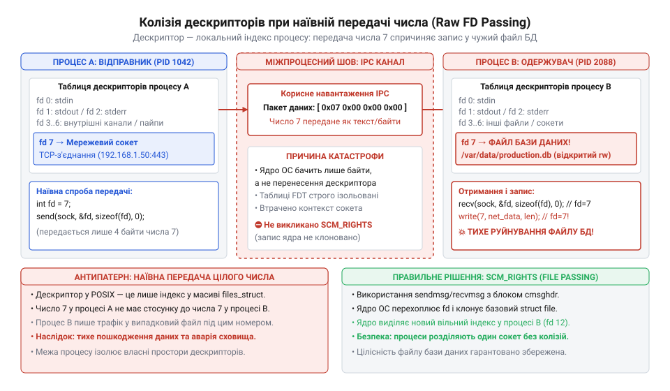
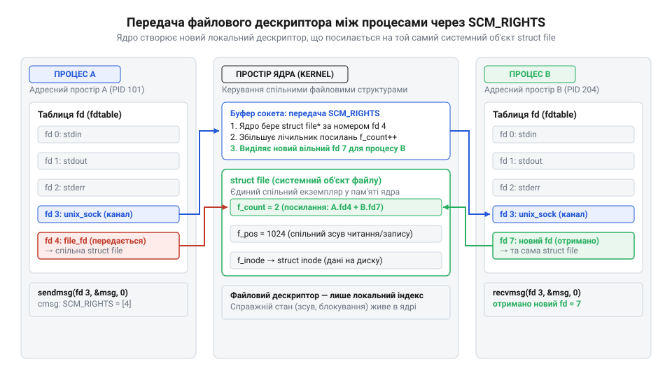
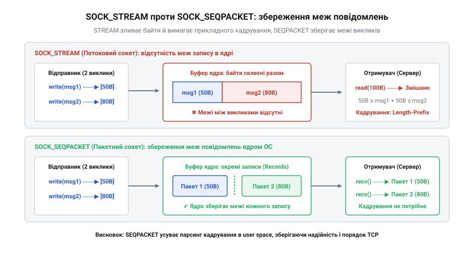
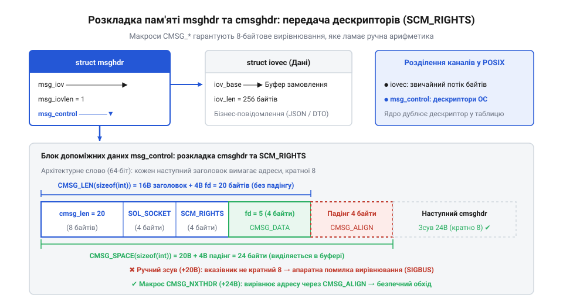
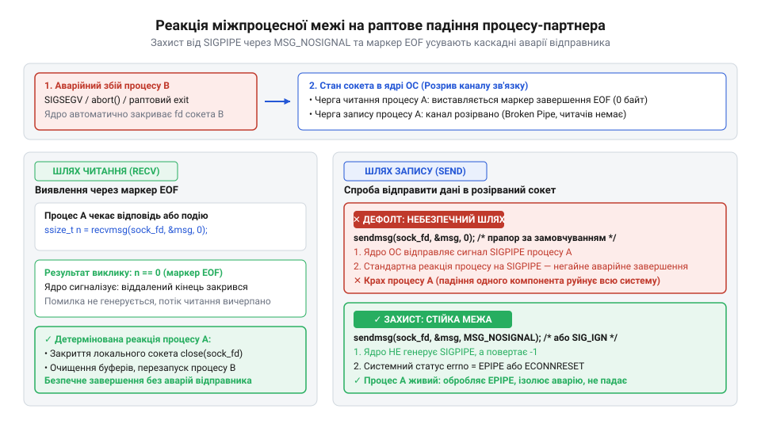

# Ціна межі

<preknowlist>
- [DH під тестом: тестованість, закладена швами](root:progarch/dh-testability-refactor) — концепція виділення інтерфейсних швів для можливості підміни транспортного каналу між процесами без зміни бізнес-логіки
- [Рефакторинг безпечно](root:progarch/refactoring-safe) — збереження інваріантів та поведінки системи під час безпечної декомпозиції монолітного коду на окремі процеси
</preknowlist>

## Де ламається звичайна ізоляція: пастка передачі числових дескрипторів

Уяви архітектуру мережевого шлюзу або веб-сервера. Щоб відкрити сокет (від англ. *socket* — роз'єм, гніздо) на привілейованому порту 443 (HTTPS) або прочитати закриті ключі шифрування, програма під час старту мусить отримати права суперкористувача (`root`). Але якщо залишити цей самий процес обробляти вхідні запити з відкритого інтернету, будь-яка помилка у парсингу заголовків чи переповнення буфера віддасть зловмиснику повний контроль над операційною системою.

Безпечна інженерна відповідь на цю загрозу відома — це [розділення привілеїв](root:sf-security/privilege-separation) (@@en|privilege separation@@). Система розділяється на два незалежні процеси:
1. Привілейований майстер-процес: запускається від імені `root`, прив'язує сокет до порту, відкриває конфіденційні ресурси і більше не торкається незахищеного коду;
2. Ізольований робочий процес (воркер): скидає всі привілеї до мінімального користувача `nobody`, блокується в пісочниці й займається виключно парсингом та бізнес-логікою.

І саме тут конструкція раптово ламається. Майстер прийняв вхідне з'єднання від клієнта через системний виклик `accept()` і тепер мусить передати його воркеру. Якщо звернутися до стандартних засобів міжпроцесної взаємодії (анонімні канали `pipe`, черги повідомлень, спільна пам'ять), виявиться, що всі вони спроєктовані виключно для пересилання сирих байтів.

Майстер опиняється перед вибором із двох тупикових шляхів:
- Працювати «проксі-ретранслятором»: вичитувати трафік із мережевого сокета у свою пам'ять і перекладати його в `pipe` воркеру, а відповідь воркера повертати назад у мережу. У цьому разі майстер спалює процесорні такти на марне подвійне копіювання даних, стає вузьким місцем для всієї системи та зберігає вразливість до атак на вичерпання ресурсів.
- Спробувати передати воркеру «ідентифікатор» відкритого сокета — звичайне число файлового дескриптора: `int client_fd = 7`.

Спроба передати дескриптор як ціле число приречена на негайну аварію. Дескриптор файлу (від лат. *descriptor* — описувач, той, хто фіксує ознаки) у системній моделі POSIX — це не адреса в спільній пам'яті й не глобальний вказівник. Це всього лише локальний порядковий індекс у внутрішній таблиці дескрипторів конкретного процесу. 

Коли процес-майстер надсилає воркеру число `7`, в адресному просторі воркера число `7` означає зовсім інше:
- Якщо слот `7` у воркера порожній, будь-яка спроба прочитати з нього (`read(7, ...)`) миттєво поверне системну помилку `EBADF` (недійсний файловий дескриптор);
- Якщо ж слот `7` у воркера вже відкритий під інший ресурс — наприклад, файл локального журналу помилок чи дескриптор з'єднання з базою даних, — воркер почне писати клієнтські HTTP-пакети просто всередину чужого файлу, непомітно руйнуючи цілісність системи.


*Колізія дескрипторів при наївній передачі цілого числа: індекс 7 у процесі B належить файлу бази даних, тому прямий запис у такий дескриптор руйнує дані іншого процесу.*

> 🔧 **Навіщо це.**
> Архітектурна межа ізоляції процесів захищає пам'ять, але створює бар'єр для передачі відкритих ресурсів. Передати через межу сирі байти даних легко; передати право володіння відкритим каналом зв'язку без участі ядра операційної системи — фізично неможливо.

Звичайні засоби користувацького простору не здатні розв'язати цю проблему: жоден процес не має прямого доступу до таблиць дескрипторів своїх сусідів. Щоб делегувати сокет робочому процесу без надання йому привілеїв `root`, потрібен особливий низькорівневий міст, який змусить саме ядро операційної системи скопіювати системне посилання на відкритий файл у таблицю іншого процесу.

## Архітектура анонімного каналу: socketpair і механіка передачі дескрипторів у ядрі

Найпростішим способом зв'язати споріднені процеси є виклик `pipe()`. Але класичний пайп — односпрямований: один його кінець назавжди закріплений на запис, а інший — на читання. Організація двостороннього обміну вимагає створення двох незалежних пайпів, а головне — стандартний пайп узагалі не підтримує протоколів передачі системних метаданих.

Для побудови повноцінної межі в POSIX передбачено системний виклик `socketpair()`. Він створює пару нерозривно з'єднаних між собою сокетів у домені локальної взаємодії `AF_UNIX` (або `AF_LOCAL`). Цей канал має дві принципові властивості:
1. Повнодуплексність (@@en|full-duplex@@): обидва кінці є абсолютно симетричними — кожен дескриптор дозволяє як записувати дані, так і читати їх;
2. Повна анонімність: з'єднання існує виключно в оперативній пам'яті ядра й не потребує створення файлів на диску, захищаючи систему від колізій імен у файловій системі та атак через тимчасові каталоги.

Щоб зрозуміти, як цей канал переносить дескриптори, необхідно зазирнути в трирівневу модель управління ресурсами в ядрі операційної системи:

1. Локальна таблиця процесу (`struct files_struct`): масив у просторі конкретного процесу, де індексами є числа `0, 1, 2, 3...`. Кожен запис містить лише вказівник на загальносистемний файловий об'єкт.
2. Системна таблиця відкритих файлів ядра (`struct file`): спільний для всієї ОС список відкритих сутностей. Саме тут зберігаються поточне зміщення у файлі (offset), прапорці доступу (`O_RDWR`, `O_NONBLOCK`) та критично важливий лічильник активних посилань (`f_count`).
3. Фізичний ресурс ядра: структура сокета (`struct socket`) або інода файлової системи (`struct inode`), що безпосередньо керує мережевими буферами або дисковими блоками.

Коли процес передає звичайні дані, ядро копіює байти з буфера користувача в буфер сокета. Але разом із корисним навантаженням протокол доменних сокетів дозволяє передавати допоміжні керувальні повідомлення (@@en|ancillary data@@). Якщо встановити тип повідомлення `SCM_RIGHTS` (Socket-level Control Message: Rights), ядро розпізнає в переданих байтах масив числових дескрипторів відправника і бере керування на себе.


*Передача дескриптора через SCM_RIGHTS: ядро знаходить вільний слот у таблиці процесу-отримувача, збільшує лічильник посилань f_count системного об'єкта file і повертає новий локальний дескриптор.*

Механіка передачі дескриптора розгортається у чотири послідовні кроки:
1. Під час виклику `sendmsg` ядро зчитує масив чисел із керуючого буфера відправника (процесу A).
2. Для кожного переданого дескриптора ядро заглядає в таблицю дескрипторів процесу A, знаходить відповідну системну структуру `struct file` і атомарно збільшує її лічильник посилань: `f_count = f_count + 1`.
3. Коли процес-отримувач (процес B) викликає `recvmsg`, ядро сканує локальну таблицю процесу B, знаходить у ній найменший вільний цілочисельний індекс (наприклад, `4`) і записує туди покажчик на ту саму `struct file`.
4. Ядро повертає нове число `4` процесу B у його керуючому буфері.

У результаті процес A міг відправити дескриптор `7`, а процес B отримав дескриптор `4`. Їхні числові значення не мають жодного значення: обидва дескриптори вказують на єдиний системний об'єкт `struct file` у ядрі.

> 🔧 **Навіщо це.**
> Завдяки `SCM_RIGHTS` досягається повне делегування без копіювання даних (@@en|zero-copy delegation@@). Майстер-процес може одразу закрити свій дескриптор через `close(7)`: лічильник `f_count` зменшиться з 2 до 1, але сокет залишиться відкритим. Ізольований воркер самостійно обслуговує TCP-трафік на повній швидкості, а операційна система гарантує, що ресурс буде звільнено рівно тоді, коли останній процес завершить роботу або закриє свій дескриптор.

## Створення анонімного каналу: socketpair, типи сокетів та атомарні прапорці

Для побудови локальної міжпроцесної межі стандарт POSIX надає системний виклик `socketpair()`. Його призначення — за одну операцію створити пару з'єднаних між собою анонімних дескрипторів без звернення до файлової системи та без виходу в мережевий стек:

```c
int socketpair(int domain, int type, int protocol, int sv[2]);
```

Параметри виклику мають сувору системну семантику:
- `domain`: сімейство протоколів. Для каналів усередині однієї операційної системи завжди вказується `AF_UNIX` (синонім `AF_LOCAL`). Спроба вказати інше сімейство призведе до помилки `EAFNOSUPPORT`.
- `protocol`: конкретний підпротокол сімейства. Для `AF_UNIX` завжди передається `0`, оскільки домен UNIX не має альтернативних транспортних протоколів.
- `sv[2]`: масив із двох цілих чисел, куди ядро записує пару виділених дескрипторів (`sv[0]` і `sv[1]`). З'єднання є цілком симетричним: будь-які байти, записані в `sv[0]`, стають доступними для читання з `sv[1]`, і навпаки.

### Вибір поведінки транспорту: потік чи збереження меж повідомлень

Ключовим рішенням при створенні каналу є вибір аргументу `type`. Домен `AF_UNIX` підтримує два принципово різні типи передачі даних:

1. `SOCK_STREAM` (потоковий сокет): організує неперервний потік байтів без жодного збереження меж окремих викликів запису. Якщо відправник виконав три послідовні виклики запису по 100 байтів, отримувач може забрати всі 300 байтів за один виклик `read()`, або навпаки — зчитувати їх шматками по 10 байтів залежно від стану буферів ядра. Щоб розрізняти команди, розробник змушений самостійно впроваджувати прикладний протокол кадрування (@@en|framing@@): передавати префікси довжини повідомлення або символи-роздільники.
2. `SOCK_SEQPACKET` (послідовні пакети): поєднує надійність потокового каналу з атомарною доставкою повідомлень. Канал залишається повнодуплексним, гарантує строгий порядок доставки та контроль помилок, але жорстко зберігає межі записів. Кожен окремий виклик запису (`write` чи `sendmsg`) утворює рівно одне дискретне повідомлення. Отримувач за один виклик `read` чи `recvmsg` забирає рівно те повідомлення, яке було надіслано. Якщо наданий користувачем буфер виявиться меншим за розмір надісланого пакета, ядро запише стільки, скільки помістилося, а залишок пакета буде скинуто з виставленням прапорця `MSG_TRUNC`.


*Різниця між SOCK_STREAM та SOCK_SEQPACKET: потоковий режим зливає байти в суцільний потік, тоді як пакетний режим зберігає межі кожного повідомлення на рівні ядра.*

> 🔧 **Навіщо це.**
> Для внутрішніх архітектурних меж типу «керуючий процес — воркер» тип `SOCK_SEQPACKET` є беззаперечним фаворитом. Він повністю усуває складний і вразливий код розбору меж пакетів у пам'яті: кожна команда або передача дескриптора приходить окремим детермінованим блоком.

### Атомарні прапорці: захист від гонитви та неблокуючий режим

У багатопотокових програмах виклик `socketpair()` без спеціальних прапорців породжує приховану вразливість витоку ресурсів. Якщо один потік програми викликає `socketpair()`, а інший потік у цей самий момент викликає `fork()` і завантажує зовнішній бінарний файл через `execve()`, щойно створені дескриптори за замовчуванням залишаються відкритими й успадковуються чужим процесом.

Щоб запобігти стану гонитви (@@en|race condition@@), стандарт POSIX дозволяє об'єднувати базовий тип сокета з бітовими прапорцями створення за допомогою побітового АБО (`|`):

| Прапорець | Призначення | Архітектурний наслідок |
| :--- | :--- | :--- |
| `SOCK_CLOEXEC` | Встановлює прапорець `FD_CLOEXEC` (закриття при виклику `exec`) атомарно в мить створення дескриптора. | Унеможливлює витік дескриптора в сторонні програми, запущені паралельними потоками. |
| `SOCK_NONBLOCK` | Встановлює прапорець `O_NONBLOCK` на обидва створені дескриптори без виклику `fcntl`. | Звільняє від виконання двох додаткових системних викликів `fcntl()` і від гонитви блокування. |

Якщо системний виклик завершується успішно, функція повертає `0`. У разі збою повертається `-1`, а змінна `errno` містить код причини:
- `EMFILE`: процес вичерпав ліміт одночасно відкритих файлових дескрипторів (`RLIMIT_NOFILE`);
- `ENFILE`: досягнуто загальносистемного ліміту відкритих файлів у ядрі ОС;
- `EAFNOSUPPORT`: сімейство адрес `AF_UNIX` не підтримується платформою;
- `EFAULT`: вказівник `sv` веде до недосяжної пам'яті процесу.

:::tabs
```c
#define _GNU_SOURCE
#include <sys/socket.h>
#include <stdio.h>
#include <unistd.h>
#include <errno.h>

int create_ipc_channel(int fds[2]) {
    // Створюємо повнодуплексний пакетний канал з атомарним захистом від витоку в exec
    if (socketpair(AF_UNIX, SOCK_SEQPACKET | SOCK_CLOEXEC, 0, fds) == -1) {
        perror("Не вдалося створити socketpair");
        return -1;
    }
    return 0;
}
```
```cpp
#include <sys/socket.h>
#include <unistd.h>
#include <array>
#include <system_error>

std::array<int, 2> create_ipc_channel() {
    std::array<int, 2> fds{};
    // Створюємо повнодуплексний пакетний канал у C++ з генерацією винятку при помилці
    if (::socketpair(AF_UNIX, SOCK_SEQPACKET | SOCK_CLOEXEC, 0, fds.data()) == -1) {
        throw std::system_error(errno, std::generic_category(), "socketpair failed");
    }
    return fds;
}
```
:::

## Анатомія розширеного повідомлення: msghdr, вектори iovec та вирівнювання cmsghdr

Звичайні системні виклики `read()` та `write()` оперують виключно єдиним безперервним фрагментом пам'яті користувача: вони приймають лише вказівник на буфер і його розмір. Для передачі файлових дескрипторів або перевірки системних статусів каналу вони непридатні: ядро не має куди помістити керуючі структури.

Для розширеної взаємодії POSIX надає системні виклики `sendmsg()` та `recvmsg()`. Усі їхні параметри упаковуються в уніфіковану структуру `msghdr` (@@en|message header@@):

```c
struct msghdr {
    void         *msg_name;       // Мережева адреса (для з'єднаних AF_UNIX — NULL)
    socklen_t     msg_namelen;    // Розмір адреси (для AF_UNIX — 0)
    struct iovec *msg_iov;        // Вказівник на масив векторів розсіяного читання/запису
    size_t        msg_iovlen;     // Кількість векторів у msg_iov
    void         *msg_control;    // Вказівник на буфер керуючих повідомлень (ancillary data)
    size_t        msg_controllen; // Довжина буфера msg_control
    int           msg_flags;      // Прапорці отриманого повідомлення (заповнюються ядром)
};
```

Структура `iovec` реалізує механізм [розсіяного введення-виведення](root:sys-unix/scatter-gather-io) (@@en|scatter-gather I/O@@): вона містить адресу окремого буфера `iov_base` та його довжину `iov_len`. Це дозволяє передавати складні составні повідомлення (наприклад, заголовок команди з одного місця пам'яті й корисні дані з іншого) за один системний виклик без їх попереднього склеювання.

> ⚠️ **Критичний інваріант POSIX.**
> Під час передачі дескрипторів масив `msg_iov` обов'язково повинен містити щонайменше один вектор із довжиною щонайменше в один байт. Якщо надіслати керуюче повідомлення з нульовим обсягом даних у `iovec`, ядро Linux скине керуючі метадані, а виклик `recvmsg()` на іншому боці поверне 0 (що сприймається програмами як штатне закриття з'єднання). Передача хоча б одного байта «корисного вантажу» є обов'язковою умовою доставки системних метаданих.

### Керуючий буфер cmsghdr та апаратне вирівнювання

Поле `msg_control` вказує на сирий масив байтів, у якому розміщуються службові блоки ядра — структури `cmsghdr` (@@en|control message header@@) разом із корисними системними даними:

```c
struct cmsghdr {
    size_t cmsg_len;   // Повна довжина: заголовок + дані (без кінцевого вирівнювання)
    int    cmsg_level; // Рівень підсистеми (SOL_SOCKET для операцій із сокетом)
    int    cmsg_type;  // Тип повідомлення (SCM_RIGHTS для передачі дескрипторів)
    // Одразу за цим полем у пам'яті розташовуються корисні байти (наприклад, int fd)
};
```

Головна пастка під час роботи з `cmsghdr` — апаратне вирівнювання пам'яті (@@en|memory alignment@@). Сучасні 64-розрядні процесори вимагають, щоб структури ядра та дескриптори починалися за адресами, кратними 4 або 8 байтам. Якщо обчислювати адресу даних чи наступного заголовка через звичайне додавання `sizeof(struct cmsghdr)`, виникає зміщення на непарну адресу. Це спричиняє або суттєве падіння швидкодії через подвійне читання шини пам'яті, або негайну аварійну зупинку процесу апаратним винятком невірного вирівнювання (`SIGBUS`).


*Розмітка пам'яті керуючого повідомлення: макроси CMSG_SPACE та CMSG_LEN автоматично додають байти заповнення для збереження апаратного вирівнювання платформи.*

Щоб гарантувати абсолютну переносність між різними архітектурами процесорів, стандарт POSIX забороняє пряму адресну арифметику та зобов'язує використовувати спеціальні службові макроси:

| Макрос | Що приймає | Що повертає | Призначення |
| :--- | :--- | :--- | :--- |
| `CMSG_SPACE(len)` | Розмір корисних даних у байтах | Повний обсяг пам'яті з урахуванням вирівнювання | Використовується виключно для виділення розміру буфера `msg_control`. |
| `CMSG_LEN(len)` | Розмір корисних даних у байтах | Довжину заголовка плюс розмір даних | Записується в поле `cmsg_len` керуючого блоку. |
| `CMSG_FIRSTHDR(msg)` | Вказівник на `struct msghdr` | Вказівник на перший `struct cmsghdr` або `NULL` | Безпечний доступ до початку ланцюжка керуючих блоків. |
| `CMSG_NXTHDR(msg, cmsg)` | Вказівники на `msghdr` та поточний `cmsghdr` | Вказівник на наступний `cmsghdr` або `NULL` | Безпечний перехід до наступного блоку з урахуванням вирівнювання. |
| `CMSG_DATA(cmsg)` | Вказівник на `struct cmsghdr` | Вказівник `unsigned char *` на початок корисних даних | Доступ до переданого масиву дескрипторів. |

> 🔧 **Навіщо це.**
> Відмінність між `CMSG_SPACE` та `CMSG_LEN` фундаментальна: `CMSG_SPACE` враховує кінцеві байти заповнення (@@en|padding@@), необхідні для того, щоб наступний блок ліг на вирівняну межу пам'яті. Якщо виділити буфер через `CMSG_LEN`, ядро розпізнає нестачу пам'яті для вирівнювання й обірве передачу з помилкою.

Для гарантування правильного вирівнювання самого вихідного буфера в автоматичній пам'яті (на стеку) його огортають в об'єднання `union` разом із структурою `struct cmsghdr`:

:::tabs
:::code api-posix-cross-process-channel/c/iovec.c
:::code api-posix-cross-process-channel/cpp/alignedcontrolstorage.cpp
:::

## Передача дескрипторів через SCM_RIGHTS: протокол відправки та прийому

Коли пару анонімних сокетів створено, а керуючий буфер пам'яті розмічено, можна переходити до безпосереднього делегування системних ресурсів. Протокол передачі дескрипторів у POSIX базується на узгодженій роботі системних викликів `sendmsg()` та `recvmsg()` з використанням рівня протоколу `SOL_SOCKET` та типу повідомлення `SCM_RIGHTS`.

### Налаштування відправника: від пакування до системного виклику

Щоб передати файловий дескриптор, процес-відправник конструює керуючий заголовок `cmsghdr`:
1. Встановлює `cmsg_level = SOL_SOCKET`, повідомляючи ядру, що метадані призначені для базового сокетного шару;
2. Встановлює `cmsg_type = SCM_RIGHTS` (@@en|Socket-level Control Message: Rights@@), що ініціює системну процедуру копіювання файлового посилання;
3. Встановлює поле `cmsg_len = CMSG_LEN(sizeof(int))`;
4. Записує дескриптор у пам'ять за вказівником, отриманим через макрос `CMSG_DATA()`.

Разом із керуючим повідомленням обов'язково передається вектор корисних даних `struct iovec` щонайменше на один байт (наприклад, маркер типу операції або байт підтвердження), оскільки без нього ядро POSIX відкине системні метадані.

Після заповнення структури `msghdr` викликається системний виклик `sendmsg()`. У разі успіху функція повертає кількість відправлених байтів корисного навантаження (а не кількість переданих дескрипторів!).

```c
ssize_t bytes_sent = sendmsg(channel_fd, &msg, 0);
```

### Передача володіння: чому відправник мусить викликати close()

Одразу після того, як виклик `sendmsg()` повернув успішний статус, процес-відправник зазвичай викликає `close()` для переданого дескриптора.

Це фундаментальне правило передачі володіння (@@en|ownership transfer@@):
- Під час виконання `sendmsg` ядро вже збільшило лічильник `f_count` системного об'єкта `struct file` на 1, утримуючи файл відкритим у сокетному буфері польоту;
- Закриваючи свій локальний дескриптор, відправник зменшує лічильник посилань на 1 і видаляє запис зі своєї таблиці дескрипторів;
- Коли отримувач викличе `recvmsg()`, у його таблиці з'явиться новий локальний дескриптор, що посилається на той самий об'єкт ядра.

Якщо відправник забуде закрити свій дескриптор, у системі утвориться спільне володіння ресурсом: відправник зможе випадково записати дані в сокет або закрити його в невідповідний момент, зруйнувавши стан отримувача.

> 🔧 **Навіщо це.**
> Закриття вихідного дескриптора реалізує семантику переміщення (move semantics) на рівні операційної системи. Ресурс повністю мігрує в інший адресний простір: отримувач стає єдиним законним власником і бере на себе відповідальність за звільнення файлу або закриття мережевого з'єднання.

### Налаштування отримувача та пастка MSG_CTRUNC

Процес-отримувач формує аналогічну структуру `msghdr`, надаючи ядру буфер `msg_control` розміром не менше `CMSG_SPACE(sizeof(int))` та буфер `iovec` для зчитування байта супровідних даних.

Після повернення з `recvmsg()` виникає найнебезпечніша точка відмови — можливе обрізання метаданих:

> ⚠️ **Смертельна пастка MSG_CTRUNC.**
> Якщо розмір буфера `msg_control`, виділеного отримувачем, виявиться недостатнім для розміщення всіх надісланих дескрипторів і заголовків (наприклад, через невірний розрахунок макросу `CMSG_SPACE`), ядро ОС виставить у полі `msg.msg_flags` прапорець `MSG_CTRUNC` (@@en|Control Truncated@@).
> У цьому разі ядро скидає зайві дескриптори. Але оскільки ядро вже створило відповідні системні посилання, відкинуті дескриптори стають недосяжними для користувацького простору й «зависають» у системі мертвим вантажем, викликаючи прихований витік ресурсів. Отримувач ЗАВЖДИ зобов'язаний перевіряти стан прапорця `MSG_CTRUNC` перед тим, як вважати передачу успішною.

Після перевірки прапорця `MSG_CTRUNC` отримувач знаходить перший блок керування через макрос `CMSG_FIRSTHDR(&msg)`, переконується, що `cmsg_level == SOL_SOCKET` та `cmsg_type == SCM_RIGHTS`, і витягує новий файловий дескриптор через `CMSG_DATA()`.

### Еталонна реалізація функцій передачі та прийому

Нижче наведено закінчені, переносні функції передачі та приймання дескриптора, захищені від стану гонитви та витоку ресурсів.

:::tabs
:::code api-posix-cross-process-channel/c/msghdr.c
:::code api-posix-cross-process-channel/cpp/msghdr.cpp
:::

## Керування часом і неблокуючий ввід-вивід: MSG_DONTWAIT, O_NONBLOCK та сокетні таймаути

За замовчуванням дескриптори, створені викликом `socketpair()`, працюють у блокуючому режимі. У простій однопотоковій системі це створює критичну вразливість: якщо процес-отримувач зависає в нескінченному циклі, блокується на замку або переповнює внутрішній буфер ядра, черговий виклик `sendmsg()` у процесі-відправнику зупиняє його на невизначений час. Один непрацездатний або скомпрометований воркер миттєво паралізує роботу привілейованого майстра.

Для встановлення жорстких часових меж POSIX пропонує три взаємодоповнюючі рівні захисту:

### 1. Разовий неблокуючий прапорець MSG_DONTWAIT

Прапорець `MSG_DONTWAIT` передається безпосередньо як четвертий аргумент функцій `sendmsg()` або `recvmsg()`. Він діє строго в межах одного системного виклику:
- Якщо в буфері сокета є місце для відправки або готові байти для читання — виклик виконується штатно;
- Якщо буфер сокета заповнений (при відправці) або порожній (при читанні) — виклик негайно переривається, повертає `-1`, а змінна `errno` встановлюється в `EAGAIN` (або `EWOULDBLOCK`).

Цей прапорець незамінний у сценаріях, коли сокет у цілому має залишатися блокуючим, але окремі службові повідомлення чи перевірки черги не повинні затримувати виконання.

### 2. Постійний неблокуючий режим O_NONBLOCK

Якщо дескриптор використовується в подієвих циклах (@@en|event loops@@) на базі системних мультиплексорів (`epoll`, `kqueue`), сокет переводять у перманентний неблокуючий режим:
- Атомарно при створенні: передачею прапорця `SOCK_NONBLOCK` у виклик `socketpair()`;
- Динамічно під час роботи: через виклик `fcntl()` із прапорцем `O_NONBLOCK`.

У цьому режимі будь-які операції над сокетом ніколи не блокують потік. Якщо ядро не здатне негайно завершити операцію, воно миттєво повертає статус `EAGAIN`.

### 3. Детерміновані таймаути: SO_RCVTIMEO та SO_SNDTIMEO

Для синхронних систем, де розробник не хоче ускладнювати архітектуру подієвими циклами, найефективнішим інструментом є налаштування сокетних таймаутів через `setsockopt()`:
- `SO_SNDTIMEO`: максимальний час очікування вільного місця в буфері відправника;
- `SO_RCVTIMEO`: максимальний час очікування надходження даних або дескриптора від отримувача.

Обидві опції приймають структуру `struct timeval`, що задає інтервал із точністю до мікросекунд:

```c
struct timeval {
    time_t      tv_sec;  // секунди
    suseconds_t tv_usec; // мікросекунди
};
```

Коли встановлено таймаут, операція блокує потік лише на зазначений час. Якщо партнер не відповів до закінчення ліміту, виклик переривається з кодом `EAGAIN` (або `EWOULDBLOCK`).

| Механізм | Область дії | Поведінка при неготовності | Основний сценарій |
| :--- | :--- | :--- | :--- |
| `MSG_DONTWAIT` | Один системний виклик | Миттєве повернення `EAGAIN` | Асинхронні перевірки черги в блокуючих потоках |
| `O_NONBLOCK` | Увесь дескриптор назавжди | Миттєве повернення `EAGAIN` | Мультиплексори подій (`epoll`, `kqueue`) |
| `SO_RCVTIMEO` / `SO_SNDTIMEO` | Увесь дескриптор до скидання | Очікування до ліміту, потім `EAGAIN` | Захист синхронних сервісів від зависання партнерів |

> 🔧 **Навіщо це.**
> Архітектурна ізоляція втрачає сенс, якщо падіння швидкодії одного процесу призводить до нескінченного простою іншого. Таймаути на міжпроцесній межі гарантують інваріант контрольованого часу відгуку: викликач завжди повертає контроль, навіть якщо партнер повністю завис або зазнав атаки типу відмови в обслуговуванні.

:::tabs
:::code api-posix-cross-process-channel/c/timeval.c
:::code api-posix-cross-process-channel/cpp/timeval.cpp
:::

## Сигнатури аварій і відмов: розрив зв'язку, нейтралізація SIGPIPE та обробка помилок

Міжпроцесний канал розгортається між незалежними адресними просторами, тому найголовніша вимога до архітектора — знати точну системну реакцію на раптову загибель сусіднього процесу (аварійне завершення через збій сегментації `SIGSEGV`, перевищення пам'яті `OOM-killer` або примусове вбивство `SIGKILL`).

### Смертельна пастка сигналу SIGPIPE

Найнебезпечніша деталь стандарту POSIX при роботі з сокетами — це сигнал `SIGPIPE` (@@en|broken pipe signal@@):
1. Процес B аварійно падає. Операційна система автоматично закриває всі відкриті дескриптори цього процесу, включаючи його кінець анонімного сокета;
2. Процес A ще не знає про загибель сусіда й намагається надіслати черговий дескриптор або пакет даних за допомогою системного виклику запису;
3. Ядро ОС бачить, що на протилежному кінці немає читача. Замість того, щоб просто повернути код помилки, ядро за замовчуванням надсилає процесу A асинхронний сигнал `SIGPIPE`;
4. Оскільки стандартна системна дія для сигналу `SIGPIPE` — це **негайне аварійне завершення програми** (terminate), процес A гине слідом за процесом B без створення звіту про помилку та без виклику обробників завершення!

Ця поведінка повністю ламає задуману ізоляцію: збій в ненадійному дочірньому воркері моментально вбиває головний майстер-сервер.


*Обробка аварійного обриву каналу: використання MSG_NOSIGNAL перетворює смертельний сигнал SIGPIPE на керовану системну помилку EPIPE.*

Щоб канал залишався надійним, сигнал `SIGPIPE` необхідно нейтралізувати. Існує два правильні способи:
- Локальний прапорець `MSG_NOSIGNAL`: передається у виклики `send()` або `sendmsg()`. Цей прапорець інструктує ядро: «не генерувати сигнал `SIGPIPE`, якщо канал закрито, а повернути `-1` і записати помилку `EPIPE` в `errno`». Це найбезпечніший і потокобезпечний метод;
- Глобальне маскування сигналу: на старті програми встановити дію `signal(SIGPIPE, SIG_IGN)`. У цьому разі операційна система ігноруватиме сигнал `SIGPIPE` для всього процесу, і всі операції запису в розірваний канал будуть повертати помилку `EPIPE`.

### Системні коди помилок та інваріанти закриття

Коли сигнал нейтралізовано, обробка аварійних станів зводиться до аналізу повернених значень системних викликів `sendmsg()` та `recvmsg()`:

| Результат / Код | Коли виникає | Як трактувати | Необхідна реакція |
| :--- | :--- | :--- | :--- |
| `recvmsg() == 0` | Партнер штатно закрив свій кінець сокета через `close()` або завершився | Маркер кінця файлу (EOF) | Закрити свій дескриптор каналу, вивільнити ресурси. |
| `EPIPE` | Спроба відправити дані або дескриптор у сокет, протилежний кінець якого вже закрито | Розірваний канал (Broken Pipe) | Зафіксувати смерть партнера, перезапустити воркер. |
| `ECONNRESET` | З'єднання було примусово скинуто ядром або сокет закрито за наявності незчитаних даних | Аварійний скид зв'язку | Негайне закриття каналу та очищення незавершених задач. |
| `EAGAIN` / `EWOULDBLOCK` | Буфер порожній (при читанні), буфер повний (при записі) або сплив таймаут | Тимчасова неготовність ресурсу | Повторити спробу пізніше або зареєструвати подію в мультиплексорі. |
| `EINTR` | Системний виклик було перервано доставкою зовнішнього сигналу ОС | Переривання сигналом | Повторити виклик у циклі (`retry`). |

> 🔧 **Навіщо це.**
> Архітектурний [шаблон захисних відсіків](root:progarch/bulkhead-pattern) (@@en|bulkheading@@) вимагає, щоб будь-яка відмова на межі компонента детерміновано трансформувалася в зрозумілий статус помилки. Завдяки комбінації `MSG_NOSIGNAL` та вичитуванню EOF сервер надійно розпізнає аварію робочого процесу, закриває дефектний сокет і перезапускає нащадка без жодного ризику для стабільності всієї системи.

:::tabs
:::code api-posix-cross-process-channel/c/safe-channel-write.c
:::code api-posix-cross-process-channel/cpp/safe-channel-write.cpp
:::
