# Ціна межі

<preknowlist>
- [DH під тестом: тестованість, закладена швами](root:progarch/dh-testability-refactor) — концепція виділення швів (seams) у системі Digital Home для ізоляції компонентів та підміни залежностей дублерами, що формує вихідні точки для фізичного перекроювання меж
</preknowlist>

## Ілюзія паперової межі: аварія рознесеного моноліту

У першій версії системи розумного дому Digital Home автоматизація освітлення працювала бездоганно. Людина ступала в коридор — датчик руху фіксував подію, рушій правил миттєво оцінював умову, а контролер пристроїв подавав команду реле світильника. Від моменту спрацьовування апаратного переривання на платі до спалаху лампи минало близько 5 мікросекунд (мкс). Усі ці компоненти жили всередині одного монолітного процесу: обмін інформацією зводився до передачі вказівника на об'єкт події через регістри процесора та виклику функції за відомою адресою в спільній пам'яті. Зміна стану була захищена звичайною синхронізацією в пам'яті: якщо перевірка інваріантів давала збій, операція переривалася винятком до появи побічних ефектів, залишаючи дім у цілісному й передбачуваному стані.

Проблеми почалися, коли інженерна команда вирішила провести архітектурну модернізацію. Мотивація виглядала бездоганно: модуль правил автоматизації та контролер пристроїв змінювалися з різною швидкістю. Розробники прагнули незалежного розгортання, ізоляції кодових баз та автономного масштабування. На архітектурній діаграмі провели тонку штрихову лінію, розділивши монолітний процес на два незалежні сервіси, які спілкуються через мережу за допомогою HTTP та JSON. Це здавалося суто організаційною межею (від праслов'янського *medja — рубіж, спільна границя). Але коли оновлену систему вивели в дослідну експлуатацію в тестовому будинку, вона зазнала катастрофічного колапсу за трьома критичними осями.

Першим ударом став стрибок латентності (лат. @@en|latens@@ — прихований, невидимий). Час реакції світильника на рух зріс із 5 мікросекунд до 70 мілісекунд (мс) — уповільнення у 14 000 разів. Для людини затримка в 5 мікросекунд сприймається як миттєва, тоді як 70 мілісекунд — це відчутна фізична пауза. Мешканець робив крок у коридор, опинявся в суцільній темряві, встигав засумніватися у справності вимикача, і лише тоді лампа клацала. Те, що в спільній пам'яті коштувало запису адреси повернення в стек, тепер вимагало серіалізації (лат. @@en|series@@ — ряд, послідовність) об'єкта події в текстовий рядок JSON, виділення динамічної пам'яті під буфери, копіювання байтів у сокет операційної системи, проходження мережевого стека, комутації пакетів через віртуальний мережевий міст, розбору тексту в сервісі правил, виконання логіки та симетричного зворотного шляху до контролера реле.

Другим ударом стало руйнування транзакційної атомарності (грец. @@en|atomos@@ — неподільний). Щовечора в домі виконувався комплексний сценарій: плавно ввімкнути тепле світло у вітальні, опустити жалюзі на вікнах, перевести термостат у нічний режим 20 °C і замкнути електромагнітний замок вхідних дверей. У моноліті цей сценарій виконувався як єдина послідовна операція. Якщо замок повідомляв про заклинювання, внутрішній механізм транзакції переривав виконання, а блок компенсації повертав світло й жалюзі у вихідний стан. Після винесення контролера в окремий сервіс під час одного з вечірніх запусків стався короткочасний мережевий збій на виклику до термостата. Запит завис на дві секунди за таймаутом сокета, після чого рушій сценаріїв упав із винятком. Результат виявився небезпечним: світло увімкнулося, жалюзі закрилися, термостат залишився в денному режимі, а вхідні двері так і не замкнулися. Система намертво зависла в частково виконаному, неузгодженому стані.

Третім ударом стало виснаження обчислювальних ресурсів. За помірного навантаження всього в 100 подій на секунду від усіх датчиків будинку завантаження центрального процесора (CPU) підскочило з майже непомітних 4% до загрозливих 90%. При цьому власне бізнес-логіка — обчислення простої умови `рух == true AND освітленість < 20 lux` — забирала мізерні частки процесорного такту. Понад 85% процесорного часу марнувалося на паразитну роботу: безупинний маршалінг (англ. @@en|marshalling@@ — упорядкування, розміщення) даних, парсинг JSON, виділення сотень тисяч дрібних об'єктів рядків у купі та вимушені паузи збирача сміття, підсилені сотнями системних викликів і перемикань контексту ядра на секунду.

Ця аварія оголила фундаментальну пастку проєктування — ілюзію «паперової межі» (англ. @@en|paper boundary@@). Архітектору легко провести олівцем лінію на діаграмі компонентів, вважаючи її невагомою абстракцією. Проте для апаратного забезпечення жодної паперової межі не існує. Будь-який розріз системи по живому розсікає спільний адресний простір, руйнує апаратні гарантії цілісності й автоматично обкладає кожен виклик обов'язковим інженерним збором — потрійним податком архітектурної межі:
1. **Фізичний податок:** прямі накладні витрати на копіювання пам'яті, маршалінг типів у плоскі байти, передачу через мережеві буфери, конкуренцію за сокети та базову латентність середовища передачі.
2. **Семантичний податок:** неминуча втрата прямих інваріантів типів компілятора, руйнування транзакційної атомарності в пам'яті, вимушене розщеплення доменної моделі на DTO та шари трансформації, виникнення проміжних неузгоджених станів (докладніше це розглядає [Декомпозиція транзакційних меж](root:progarch/transaction-boundary-is-aggregate-boundary)).
3. **Податок надійності:** поява часткових відмов і перехід від детермінованого бінарного результату (успіх або виняток) до тризначної логіки віддаленого виклику (успіх, явна помилка або стан невідомості через таймаут), що робить обов'язковими ідемпотентність (лат. @@en|idem@@ — той самий і @@en|potens@@ — здатний), дедлайни та складні протоколи розподіленої компенсації.

Команда Digital Home не була першою, хто потрапив у цю пастку. Вся індустрія програмної інженерії 1990-х років пройшла через болісний урок [краху концепції «прозорого віддаленого виклику»](root:progarch/cost-of-a-boundary/hist-transparent-rpc-illusion.md) — розподілених об'єктних технологій CORBA, DCOM та Java RMI, які намагалися переконати розробників, що мережевий виклик методу можна зробити синтаксично й семантично невідрізним від виклику звичайної функції в пам'яті. Реальність довела протилежне: спроба замаскувати фізичну межу не скасовує її ціни, а лише позбавляє інженера контролю над надійністю системи. Раніше в моноліті компоненти були акуратно розділені внутрішніми [швами](root:progarch/dh-testability-refactor), але механічний перетин цих швів мережевим кабелем перетворив логічну модульність на фізичну катастрофу.

> 🔧 **Навіщо це.** Тверезий розрахунок потрійного податку межі ще на етапі ескізного проєктування рятує систему від необґрунтованого розпилу: він дозволяє вчасно зупинитися і зберегти тісно пов'язані компоненти в межах одного процесу під захистом спільних типів та інваріантів пам'яті.

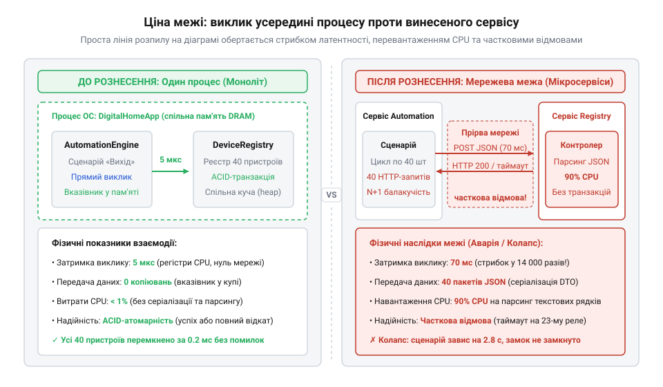
*Архітектурна схема системи Digital Home до і після рознесення компонентів: ліворуч виклик усередині моноліту (спільна пам'ять, затримка 5 мкс, транзакція ACID), праворуч винесений сервіс (виклики через мережу, затримка 70 мс, 90% CPU на серіалізацію JSON, часткове виконання сценарію з зависанням); читач бачить прірву між простотою лінії на діаграмі та її руйнівними фізичними наслідками в реальній системі.*

Контраст між локальною гарантією та мережевим розривом наочно демонструє реалізація сценарію автоматизації:

:::code cost-of-a-boundary-d/ts/inprocesscoordinator.ts

У монолітному варіанті помилка на третьому кроці залишається внутрішньою проблемою єдиного процесу: якщо виникає збій, стан сутностей у пам'яті відомий із точністю до байта. У розподіленому варіанті виняток таймауту не дає жодної інформації про реальний стан термостата: запит міг потонути в буфері відправника, міг бути успішно виконаний пристроєм якраз перед падінням з'єднання, або зависнути в черзі обробки. Перетин фізичної межі позбавив систему детермінізму, перетворивши звичайний виклик функції на задачу розподіленої координації.

## Драбина ізоляції: що фізично відбувається під час перетину межі

Щоб зрозуміти причину такої катастрофічної деградації, необхідно спуститися на рівень апаратної реальності комп'ютера. В архітектурі систем поняття «ізоляція» ніколи не буває абстрактним прапорцем у конфігурації. Будь-яке підвищення рівня ізоляції — це фізичне розведення компонентів у просторі виконання. Що далі ми розносимо компоненти, щоб захистити їх від взаємного впливу чи збоїв пам'яті, то більше апаратних оптимізацій процесора ми втрачаємо, і то вищу ціну передачі сигналу змушені сплачувати.

Фізичні накладні витрати взаємодії підпорядковуються суворій градації, яку можна уявити як драбину ізоляції з п'яти послідовних щаблів.

### 1. Прямий виклик монолітної функції (direct call)

Це найпростіша й найдешевша взаємодія двох компонентів, що існують у спільній одиниці компіляції чи статичній бібліотеці.

Коли функція `A` викликає функцію `B`, процесор діє за двійковим інтерфейсом прикладних програм (англ. @@en|Application Binary Interface@@, ABI): аргументи завантажуються безпосередньо в апаратні регістри процесора, інструкція `call` записує адресу повернення у верхівку стека (у кеші L1) та перемикає покажчик інструкцій, а результат повертається через регістр інструкцією `ret`.

Головна перевага цього щабля — прозорість для оптимізатора компілятора. Бачачи обидві сторони виклику, компілятор виконує інлайнінг (англ. @@en|inlining@@ — підстановка тіла функції): виклик як такий узагалі зникає з машинного коду, змінні залишаються в регістрах, а спільні підвирази видаляються.

*Ціна перетину:* 0.3–1.5 наносекунди (нс) (1–3 такти процесора на частоті 3–4 ГГц). При підстановці коду — 0 нс.

### 2. Поліморфний виклик через інтерфейс або vtable (dynamic dispatch)

Якщо компоненти розведені за логічний інтерфейс мови програмування (наприклад, віртуальні методи в C++ чи інтерфейси в Go, TypeScript та Java), тип адресата стає відомим лише під час виконання. Це вимагає механізму динамічної диспетчеризації (англ. @@en|dynamic dispatch@@, від фр. @@fr|dépêcher@@ — швидко відправляти).

Замість прямого стрибка процесор змушений виконати непрямий перехід (англ. @@en|indirect call@@):
- Прочитати покажчик на екземпляр об'єкта.
- Розіменувати прихований вказівник на таблицю методів (`vptr` -> `vtable`).
- Додати фіксоване зміщення методу й прочитати кінцеву адресу функції з пам'яті.
- Виконати перехід за обчисленою адресою: `call [rax + offset]`.

Тут виникають три приховані апаратні витрати:
1. **Звернення до пам'яті:** якщо таблиця методів або код цільової функції вимиті з кешу L1, процесор витрачає додаткові такти на читання з L2/L3 (від 4 до 15 нс).
2. **Промах передбачувача переходів:** процесор використовує буфер цілей переходів (Branch Target Buffer, BTB) для передбачення адрес непрямих стрибків. Якщо в точці виклику типи об'єктів постійно чергуються (поліморфний стан виклику), блок передбачення помиляється. Процесор змушений повністю скинути конвеєр команд (pipeline flush), втрачаючи від 15 до 20 тактів.
3. **Блокування інлайнінгу:** компілятор не знає точного коду реалізації під час збірки, тому позбавлений можливості оптимізувати виклик через підстановку.

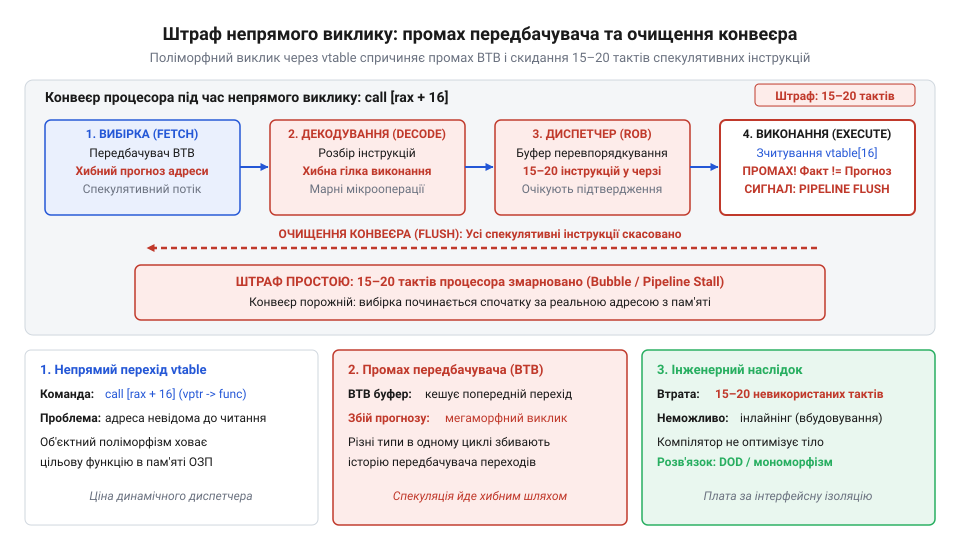
*Схема конвеєра команд процесора при промаху передбачувача переходів (BTB) під час поліморфного виклику; читач бачить штраф у 15-20 тактів через очищення конвеєра при непрямому переході.*

*Ціна перетину:* 1.5–5 наносекунд. Це все ще наносекундний діапазон, але вже в 3–10 разів дорожче за прямий виклик.

### 3. Межа потоків у межах одного процесу (thread boundary)

Коли для паралелізму або неблокуючого виконання компоненти розносять по різних потоках ОС, виклик перестає бути синхронним переходом за адресою. Потік-відправник кладе завдання в чергу або кільцевий буфер (англ. @@en|ring buffer@@), а потік-одержувач вичитує його для обробки.

Обидва потоки ділять єдиний адресний простір, але стикаються з фізикою багатоядерних процесорів:
- **Бар'єри пам'яті та когерентність кешів:** дані, записані ядром CPU 1, спочатку потрапляють у його локальний кеш L1/L2. Щоб ядро CPU 2 побачило ці зміни, апаратний протокол когерентності (наприклад, MESI) змушений інвалідувати рядки кешу іншого ядра. Безперервний перезапис спільних покажчиків черги призводить до явища «дрижання рядків кешу» (англ. @@en|cache-line bouncing@@), коли ядра витрачають час на узгодження шини замість корисної роботи.
- **Синхронізація та перемикання потоків:** якщо черга використовує м'ютекси або атомарні змінні з очікуванням, за високої конкуренції потік блокується. Операційна система переводить потік у стан сну за допомогою системного виклику `futex`, що тягне за собою збереження регістрів та перемикання контексту потоку.
- **Затримка планувальника:** після появи нового повідомлення в черзі операційна система повинна розбудити потік-одержувач, поставити його в чергу готовності до виконання ядра (runqueue) і виділити йому квант процесорного часу.

*Ціна перетину:* від 50 наносекунд (для lock-free буферів на сусідніх ядрах одного кристала) до 1.5–5 мікросекунд (за наявності блокувань м'ютексів та втручання планувальника ОС).

### 4. Межа процесів в одній ОС (process boundary / IPC)

Щоб захистити компоненти від взаємних падінь або ізолювати їх за правами доступу, їх запускають у різних процесах однієї операційної системи. Між ними виростає апаратна стіна: віртуальні адресні простори процесу `A` і процесу `B` повністю ізольовані за допомогою блоку керування пам'яттю (Memory Management Unit, MMU) процесора. Пряме розіменування вказівника між процесами неможливе — воно викличе апаратне переривання порушення захисту пам'яті (`SIGSEGV`).

Взаємодія відбувається через канали міжпроцесного зв'язку (Inter-Process Communication, IPC): Unix domain sockets, канали `pipe` чи черги повідомлень.

Фізична анатомія одного міжпроцесного виклику розгортається так:
1. **Системний виклик (syscall):** процес `A` записує байти команди в буфер і виконує інструкцію `syscall`, змінюючи режим виконання процесора з користувацького простору (Ring 3) на простір ядра (Ring 0).
2. **Копіювання в пам'ять ядра:** операційна система виділяє буфер у просторі ядра (`sk_buff` або буфер каналу) і копіює туди дані з пам'яті користувача процесу `A`.
3. **Перемикання контексту процесу:** планувальник ОС зупиняє процес `A`, зберігає стан його регістрів і завантажує керуючий регістр процесора `CR3` (на архітектурі x86_64) базовою адресою нової таблиці сторінок пам'яті процесу `B`.
4. **Скидання TLB (Translation Lookaside Buffer):** перезапис регістру `CR3` призводить до інвалідації буфера трансляції сторінок TLB — апаратного кешу перекладу віртуальних адрес у фізичні. Коли процес `B` прокидається, кожен його доступ до власних змінних викликає промахи TLB, змушуючи апаратний обхідник таблиць сторінок (page table walker) робити дорогі запити до оперативної пам'яті (додатково на багатоядерних системах виникає затримка міжпроцесорних переривань, яку детально вивчає [Скидання TLB у багатоядерних системах](root:hw-arch/tlb-shootdown-multicore)).
5. **Зворотне копіювання:** процес `B` викликає `read()` або `recvmsg()`, і ядро копіює дані зі свого проміжного буфера в користувацьку пам'ять процесу `B`.

*Ціна перетину:* 5–25 мікросекунд. Це стрибок на 4 порядки величини порівняно з викликом функції.

Ця фізика тривалий час була каменем спотикання для мікроядерних операційних систем. На початку 1990-х років мікроядро Mach витрачало на один раунд IPC понад 100 мікросекунд через громіздкі абстракції повідомлень ядра та багаторазові перемикання контексту. Це спричинило знамениту дискусію між Ендрю Таненбаумом та Лінусом Торвальдсом у 1992 році й породило міф, що межа процесів принципово непридатна для модульної побудови високопродуктивних систем. Проте в середині 1990-х років Йохен Літке створив мікроядро L4, довівши протилежне: якщо радикально спростити IPC, передавати короткі повідомлення виключно в регістрах CPU без виходу в пам'ять і не зачіпати зайві таблиці сторінок, вартість міжпроцесного виклику можна збити до часток мікросекунди. Детальніше цей інженерний прорив описує [Історія боротьби за зниження вартості перетину межі процесів](root:progarch/cost-of-a-boundary/hist-microkernel-ipc-evolution.md). Навіть у сучасних системах POSIX оптимізація IPC вимагає прямої роботи з дескрипторами та нульовим копіюванням, про що свідчить специфікація [низькорівнева міжпроцесна взаємодія в POSIX](root:progarch/cost-of-a-boundary/api-posix-cross-process-channel.md).

### 5. Межа мережі (network RPC)

Вершина драбини — компоненти, розділені фізичною відстанню, мережевими картами або віртуальними мережами гіпервізора. Тут зникає спільний кристал процесора, спільний планувальник ОС та спільна шина оперативної пам'яті.

Повний шлях проходження мережевого виклику (наприклад, HTTP/JSON або gRPC) вимагає таких кроків:
1. **Обхід графа об'єктів і серіалізація:** об'єкти з динамічної пам'яті обходяться рекурсивно, їхні поля конвертуються в лінійну послідовність байтів (текстовий JSON чи бінарний Protobuf). Це породжує мільйони алокацій дрібних рядків і фрагментів буферів, створюючи колосальний тиск на збирач сміття.
2. **Мережевий стек ядра:** сформований буфер передається в сокет ОС, де ядро пакує його в сегменти TCP, розраховує контрольні суми, огортає в пакети IP і кадри Ethernet.
3. **Апаратна черга NIC та фізична передача:** кадри копіюються через прямий доступ до пам'яті (DMA) у кільце передачі мережевої карти (TX ring buffer), звідки у вигляді електричних або оптичних сигналів ідуть через комутатори, маршрутизатори та патч-корди.
4. **Час кругового обігу сигналу (RTT):** фізична затримка поширення сигналу й комутації пакетів становить від 0.2–0.5 мс у межах однієї стійки датацентру до 1–2 мс між зонами доступності хмари та 30–100 мс через глобальний Інтернет.
5. **Зворотний конвеєр приймача:** мережева карта генерує апаратне переривання, ядро збирає TCP-потік зі зміщенням ковзного вікна, будить процес приймача, системний виклик читає байти, а парсер відновлює граф об'єктів у купі мови програмування.

*Ціна перетину:* 0.5–2 мілісекунди (для високооптимізованого бінарного RPC у локальній мережі) і 50–150 мілісекунд (для HTTP/JSON викликів між серверами або хмарними регіонами).

Контраст між першими щаблями драбини наочно видно на рівні інструкцій асемблера:

```asm
; 1. Прямий виклик монолітної функції (0.5 нс)
mov rdi, rbx            ; Перший аргумент кладемо в регістр
call apply_rule         ; Прямий перехід за адресою, підготовленою лінкером

; 2. Поліморфний виклик через vtable (3 нс)
mov rax, [rdi]          ; Зчитуємо вказівник на таблицю vtable з тіла об'єкта
call [rax + 24]         ; Непрямий перехід: адреса визначається в пам'яті на льоту

; 3. Міжпроцесний системний виклик IPC (10 мкс)
mov rax, 1              ; Номер системного виклику sys_write
mov rdi, r12            ; Дескриптор локального сокета IPC
syscall                 ; Апаратне перемикання Ring 3 -> Ring 0, робота ядра
```

### Зведена драбина ізоляції

Співвідношення між щаблями ізоляції та їхніми фізичними механізмами зведено в таблицю:

| Рівень ізоляції | Механізм передачі даних | Основні апаратні накладні витрати | Типова латентність | Відносне уповільнення |
| :--- | :--- | :--- | :--- | :--- |
| **Прямий монолітний виклик** | Регістри CPU, верхівка стек-фрейму | Немає (доступний повний інлайнінг коду) | 0.3–1.5 нс | **1×** (базовий рівень) |
| **Поліморфний виклик (vtable)** | Вказівник на таблицю методів, непрямий виклик | Промахи BTB (скидання конвеєра), читання кешу L1/L2, втрата інлайнінгу | 1.5–5 нс | **3–5×** |
| **Межа потоків (черга повідомлень)** | Спільна пам'ять, атомарні черги, бар'єри пам'яті | Дрижання кеш-ліній (протокол MESI), блокування, планувальник ОС | 50 нс – 3 мкс | **100–3 000×** |
| **Межа процесів (локальний IPC)** | Системні виклики ядра, Unix domain sockets, канали | Перемикання Ring 3 → Ring 0, скидання TLB (зміна `CR3`), подвійне копіювання буферів | 5–25 мкс | **10 000–50 000×** |
| **Межа мережі (розподілений RPC)** | Мережевий стек TCP/IP, DMA мережевої карти, комутатори | Маршалінг/парсинг у купі, RTT передачі сигналу, втрати й повтори пакетів | 0.5–70 мс | **1 000 000–70 000 000×** |

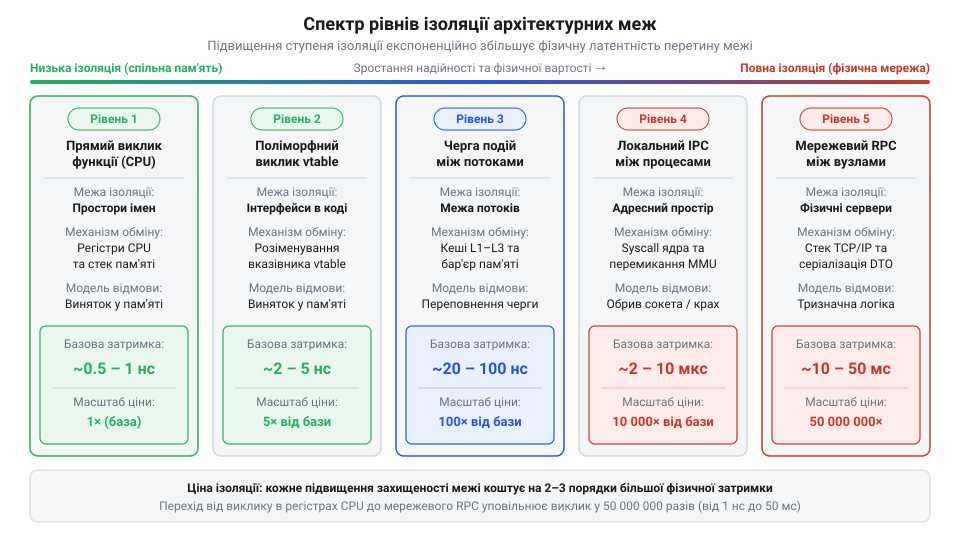
*Спектр рівнів ізоляції архітектурних меж (прямий виклик функції → поліморфний виклик через vtable → черга повідомлень між потоками → локальний IPC-сокет між процесами → мережевий RPC); для кожного рівня показано механізм передачі (регістри CPU, бар'єр пам'яті кешів L1-L3, системний виклик зі зміною контексту ядра, мережевий стек ОС) та порядок затримки (частки наносекунд, десятки наносекунд, мікросекунди, мілісекунди); читач бачить експоненційне зростання базової вартості перетину при підвищенні ізоляції.*

Практичне зіставлення цих показників на живому залізі реалізує [Бенчмарк-стенд для практичного вимірювання потрійного податку](root:progarch/cost-of-a-boundary/proj-boundary-cost-benchmarking.md), де одна й та сама бізнес-операція валідації та оновлення стану виконується почергово на кожному щаблі драбини.

> 🔧 **Навіщо це.** Драбина ізоляції замінює догматичне протиставлення «моноліт проти мікросервісів» точним інженерним вибором: архітектор призначає кожній межі системи найдешевший фізичний щабель, який ще задовольняє вимогу надійності. Якщо модулю потрібен захист від блокування циклу подій — достатньо межі потоків (наносекунди); якщо потрібен захист від краху пам'яті через сторонній закритий C-драйвер — достатньо межі процесів на одній машині (мікросекунди); і лише тоді, коли компоненти вимагають незалежного масштабування заліза або фізичного територіального рознесення, сплачують мілісекундну ціну мережі.

## Фізичний податок межі: серіалізація, копіювання пам'яті та системні виклики

У межах одного процесу передача даних між двома модулями практично безкоштовна. Коли функція викликає іншу функцію й передає аргументом об'єкт, компілятор записує 64-бітний вказівник у регістр процесора (наприклад, `rdi` в архітектурі x86-64). Ця операція триває одну машинну інструкцію — приблизно 0.5 наносекунди. Самі дані залишаються на місці: викликана функція звертається до тих самих байтів у кеші процесора L1 або оперативній пам'яті.

Щойно ми розносимо ці модулі в різні процеси операційної системи або на різні фізичні сервери, 64-бітний вказівник миттєво втрачає будь-який зміст. В іншому адресному просторі ця адреса вказує або в порожнечу, спричиняючи аварійну зупинку (сигнал `SIGSEGV`), або на зовсім чужі байти. Апаратний блок керування пам'яттю (англ. @@en|Memory Management Unit@@, MMU) процесора та операційна система захищають адресні простори ізольованими таблицями сторінок.

Щоб передати інформацію через цей розрив, систему змушують демонтувати живий граф об'єктів на байтові потоки й зібрати його заново на іншому боці. Виникає багатоетапний фізичний конвеєр, кожен крок якого спалює такти процесора та пам'ять.

### Анатомія конвеєра: куди зникає час процесора

Захищена межа вимагає послідовного виконання дев'яти операцій, жодна з яких не виконує корисної бізнес-роботи:

1. **Глибокий обхід графа об'єктів.** Об'єкт у пам'яті рідко є суцільним блоком байтів. Це дерево або мережа вказівників: сутність замовлення посилається на масив позицій, кожна позиція — на рядок назви товару, об'єкт ціни, довідник валют та перелік податків. Програма мусить рекурсивно обійти весь цей граф, відстежуючи циклічні посилання та розіменовуючи вказівники.
2. **Алокація проміжних буферів.** Щоб скласти байти докупи, менеджер пам'яті має виділити динамічний буфер (`malloc` або новий об'єкт у купі). Це створює навантаження на системний алокатор, спричиняє фрагментацію пам'яті та змушує збирач сміття (англ. @@en|Garbage Collector@@, GC) частіше зупиняти застосунок для очищення тимчасових структур.
3. **Серіалізація та маршалінг.**
   (лат. *series* — ряд, послідовність; англ. @@en|marshalling@@ — упорядкування, збирання).
   Процес перетворення внутрішніх структур у лінійний потік байтів. Якщо обрано текстовий формат (JSON або XML), процесор витрачає час на конвертацію чисел із плаваючою комою в рядки ASCII, екранування лапок і перевірку символів UTF-8. Якщо обрано бінарний формат (Protocol Buffers, FlatBuffers), процесор запаковує змінні довжини (varint) і додає службові теги полів.
4. **Перемикання контексту ядра (syscall).** Щоб передати дані системі, процес робить системний виклик (`write`, `send` або `sendmsg`). Відбувається перехід із простору користувача (Ring 3) у простір ядра (Ring 0). Процесор зберігає регістри завдання, перемикає стек на системний і виконує перевірку прав доступу.
5. **Копіювання пам'яті в буфер ядра.** Ядро операційної системи не може довіряти буферу користувача (він може бути змінений або звільнений у наступну мить). Тому ядро копіює серіалізований масив байтів зі сторінки пам'яті процесора у свій внутрішній буфер сокета (наприклад, структуру `sk_buff` в Linux).
6. **Транспортування через стек IPC або TCP/IP.** Ядро обробляє протокол: обчислює контрольні суми, розраховує розмір вікна ковзання, формує мережеві пакети або ставить повідомлення в чергу сокета домену Unix.
7. **Системний виклик читання та друге копіювання.** Процес-одержувач прокидається від сну за подією введення-виведення (`epoll`), перемикає контекст у ядро та робить системний виклик `read` або `recvmsg`. Ядро копіює байти зі свого буфера сокета в буфер пам'яті одержувача. Це вже друге фізичне копіювання тих самих байтів.
8. **Десеріалізація та відновлення об'єктів.**
   (англ. @@en|unmarshalling@@ — розпакування).
   Одержувач аналізує потік байтів, перевіряє межі пакетів, виділяє в купі десятки нових дрібних блоків пам'яті під кожен елемент і зв'язує їх новими 64-бітними вказівниками.
9. **Навантаження на збирач сміття.** Обидва буфери (буфер серіалізації у відправника та вхідний буфер у приймача) стають сміттям одразу після завершення операції. Якщо за секунду проходять тисячі викликів, алокатор і збирач сміття починають спалювати значну частку бюджету процесора лише на утилізацію тимчасових об'єктів.

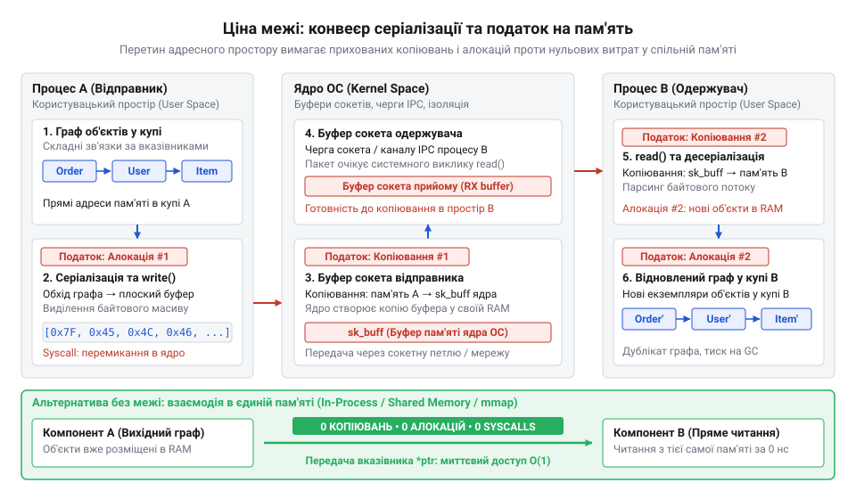
*Конвеєр проходження даних через межу адресних просторів демонструє приховані алокації та копіювання пам'яті крізь буфери ядра, яких немає при роботі у спільній купі за вказівником.*

### Математичний розрахунок фізичних витрат

Зіставимо реальні витрати ресурсів на передачу одного агрегата стану (наприклад, пакета з 50 показників датчиків у системі Digital Home) всередині монолітного коду проти виклику через межу процесів:

**1. Локальний виклик у пам'яті:**
- Операція: запис адреси в регістр CPU (`mov rax, rdi`).
- Виділення пам'яті: 0 байтів, 0 алокацій.
- Час виконання: ~0.5–1.0 нс (1 такт процесора).

**2. Міжпроцесний виклик (IPC / Unix Domain Socket, формат JSON):**
- Рекурсивний обхід 50 об'єктів і генерація рядка JSON: ~12.0 мкс (12 000 нс), виділення ~8 КБ тимчасової пам'яті (14 алокацій).
- Системний виклик `write` і копіювання в буфер ядра: ~1.5 мкс.
- Перемикання контексту ядра (Ring 3 → Ring 0 → Ring 3) та витіснення кешу інструкцій: ~2.5 мкс.
- Системний виклик `read` і копіювання з ядра в користувацький буфер: ~1.5 мкс.
- Парсинг JSON, валідація синтаксису, виділення 50 окремих структур у купі одержувача: ~18.0 мкс, ~52 алокації.

Розрахуємо сумарний час процесора на операцію:

```
T_local   ≈ 0.001 мкс
T_ipc_cpu = 12.0 + 1.5 + 2.5 + 1.5 + 18.0
          = 35.5 мкс

T_ipc_cpu / T_local = 35.5 / 0.001
                    = 35 500
```

Процесор витрачає у 35 500 разів більше часу на фізичне транспортування даних, ніж на сам доступ до них. Навіть перехід на ефективний бінарний формат Protocol Buffers знижує час серіалізації та парсингу приблизно до 4.0 мкс, залишаючи загальну затримку на рівні ~9.5 мкс — що все одно майже в 10 000 разів перевищує пряму передачу за вказівником.

Практичні вимірювання затримок і розподілу навантаження на процесор для різних форматів наведено у проєкті [Бенчмарк вартості меж](root:progarch/cost-of-a-boundary/proj-boundary-cost-benchmarking.md).

### Урок мікроядер: від краху Mach до прориву L4

Історія архітектури операційних систем містить повчальний прецедент боротьби з фізичним податком межі адресних просторів.

Наприкінці 1980-х років дослідники університету Карнегі — Меллона розробили мікроядро Mach. Ідея полягала в максимальній ізоляції: файлова система, мережевий стек, драйвери та диспетчер процесів виносилися в окремі процеси користувача. Ядро залишалося мінімальним і забезпечувало лише планування потоків та передачу повідомлень між процесами (англ. @@en|Inter-Process Communication@@, IPC).

Але Mach зазнав комерційного розчарування. Час відгуку системи був неприпустимо високим, а затримка одного IPC-виклику сягала 100–120 мікросекунд. Будь-яка проста операція (наприклад, читання байта з диска) вимагала десятка послідовних перемикань контексту між процесом користувача, сервером файлової системи, сервером драйвера та ядром. Кожне повідомлення копіювалося крізь черги ядра, а процесор постійно скидав буфер асоціативної трансляції адрес (англ. @@en|Translation Lookaside Buffer@@, TLB) через зміну кореневих таблиць сторінок пам'яті.

Це породило стійкий міф про те, що мікроядерна архітектура принципово неефективна. У знаменитій дискусії 1992 року між Ендрю Таненбаумом і Лінусом Торвальдсом творець Linux спирався саме на досвід Mach, стверджуючи, що монолітне ядро — єдиний спосіб уникнути катастрофічних накладних витрат на перетин меж.

У середині 1990-х німецький інформатик Йохен Літке (Jochen Liedtke) спростував цей міф, створивши мікроядро L4. Літке довів, що висока вартість Mach була наслідком поганої реалізації, а не самої концепції ізоляції. Він сформулював фундаментальне правило: у мікроядро включається лише те, винесення чого за межі ядра унеможливить функціонування системи.

Літке радикально переробив фізику перетину межі:
1. **Передача через регістри CPU.** Якщо повідомлення коротке (до 8 машинних слів), воно не записується в пам'ять і не копіюється в буфери ядра. Аргументи завантажуються прямо в регістри загального призначення процесора і залишаються там під час перемикання потоків.
2. **Спільне перемикання контексту.** Замість двох повних контекстних переходів (відправник → ядро → одержувач), ядро L4 передавало квант часу процесора одержувачу прямо під час системного виклику (техніка direct switch).
3. **Збереження записів TLB.** Завдяки використанню апаратних тегів просторів пам'яті процесора (ASID/PCID) система уникала повного скидання кешу віртуальних адрес при кожному виклику.

Результат був сенсаційним: вартість IPC у мікроядрі L4 впала зі 100 мкс до 1.5–2.0 мкс на тому самому обладнанні (Intel 486). Літке досяг непоборної фізичної межі апаратного захисту процесора — вартості зміни привілеїв виконання.

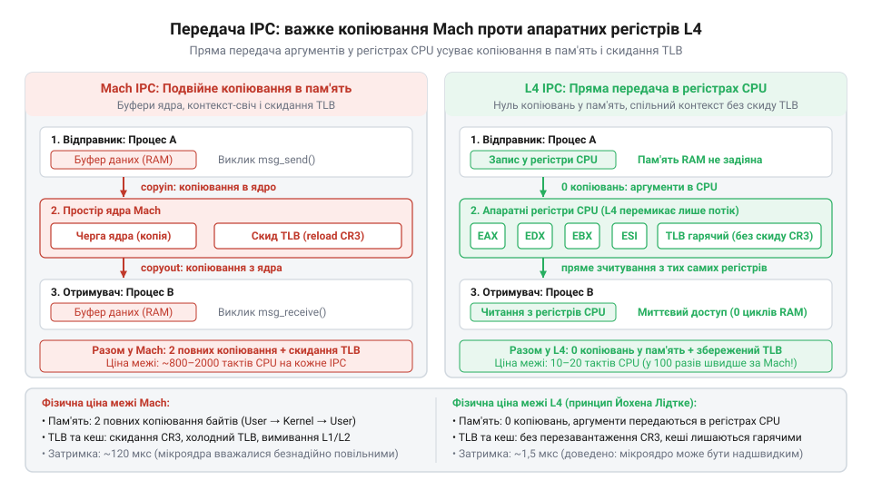
*Порівняння механізмів передачі даних у Mach та L4: проміжне копіювання через буфери ядра зі скиданням TLB проти прямої передачі аргументів у регістрах CPU без виходу з адресного простору; читач бачить фізичну різницю між копіюванням у пам'ять і прямою передачею в регістрах.*

Детальний аналіз експериментів Літке та архітектури сучасного верифікованого мікроядра seL4 викладено у вставці [Еволюція мікроядерного IPC](root:progarch/cost-of-a-boundary/hist-microkernel-ipc-evolution.md).

### Низькорівневі прийоми подолання копіювання

Коли інженер змушений провести межу між процесами задля надійності чи безпеки, стандартний потік байтів через TCP або pipe стає вузьким місцем. Щоб обійти фізичний податок копіювання, використовують спеціалізовані системні механізми:

1. **Локальні пари сокетів (`socketpair`).** Замість встановлення мережевого TCP-з'єднання через локальну петлю (loopback 127.0.0.1), процеси створюють зв'язану пару анонімних сокетів домену Unix (`AF_UNIX`). Це вимикає всю мережеву маршрутизацію, обчислення контрольних сум і фрагментацію пакетів, зменшуючи затримку в 3–5 разів.
2. **Передача дескрипторів файлів (`SCM_RIGHTS`).** Якщо процесу `A` потрібно передати процесу `B` великий масив даних (наприклад, кадр із відеокамери або гігабайтний лог), неприпустимо передавати його байт за байтом через сокет. Замість цього процес `A` створює анонімний файл у пам'яті (`memfd_create` в Linux), записує дані туди, а через сокет передає лише числовий файловий дескриптор за допомогою допоміжного повідомлення `SCM_RIGHTS` у системному виклику `sendmsg`. Ядро дублює запис у таблиці дескрипторів процесу `B`. Процес `B` отримує дескриптор і відображає сторінки пам'яті у свій адресний простір. Обсяг переданих через сокет даних становить лише кілька байтів службового заголовка.
3. **Спільна пам'ять (shared memory) з нульовим копіюванням.** Найшвидший спосіб IPC: обидва процеси підключають один фізичний сегмент оперативної пам'яті (`shm_open` та `mmap`). Дані взагалі не залишають оперативної пам'яті: один процес записує структури безпосередньо за адресою, другий — читає їх звідти ж. Координація виконується через атомарні змінні або системні виклики швидких блокувань користувацького простору (Linux `futex`), повністю оминаючи ядро в штатному режимі.

При звичайному потоковому обміні через сокети чи канали ядро забезпечує ізоляцію подвійним копіюванням сторінок пам'яті. Системний виклик `write` копіює байти з простору користувача у внутрішній буфер ядра (`sk_buff`), а виклик `read` — з ядра в буфер одержувача. Для великих масивів це призводить до насичення шини оперативної пам'яті та вимивання робочих даних із процесорних кешів L2/L3 (забруднення кешу, англ. @@en|cache pollution@@).

Механізми [нульового копіювання та спільної пам'яті](root:sf-os/zero-copy-memory-sharing) докорінно змінюють фізику взаємодії. Замість перекачування сторінок крізь пам'ять ядра процес створює анонімний файл (`memfd_create`) і передає через сокет лише 4-байтний дескриптор у керуючому повідомленні `SCM_RIGHTS`. Одержувач монтує цей дескриптор через `mmap`. Фізичні сторінки пам'яті (кадри RAM) залишаються нерухомими: ядро лише додає нові записи у віртуальну таблицю сторінок (англ. @@en|Page Table Entry@@, PTE) одержувача. Завдяки цьому вартість передачі даних стає строго константною O(1) незалежно від розміру масиву даних.

Специфікацію структур `msghdr`, алгоритм розмітки буфера `CMSG_SPACE` та низькорівневе заповнення заголовків `cmsghdr` наведено в описі [Низькорівневий міжпроцесний канал POSIX](root:progarch/cost-of-a-boundary/api-posix-cross-process-channel.md).

> 🔧 **Навіщо це.**
> Під час профілювання навантажених розподілених систем за допомогою інструментів аналізу ядра (Linux `perf`, `bpftrace`, вогневі графіки CPU Flame Graphs) розробники часто помічають, що від 60% до 85% процесорного часу займає не логіка розрахунків, а виклики `malloc`, `free`, `protobuf::Serialize`, `json::parse` та копіювання пам'яті `__copy_to_user`.
> 
> Розуміння природи фізичного податку захищає від критичної помилки: спроби рознести на мікросервіси алгоритмічно пов'язані модулі з високою частотою обміну. Якщо два компоненти обмінюються тисячами складних повідомлень на секунду, їхній поділ на рівні процесів вимагатиме або заміни протоколу на спільну пам'ять (що різко ускладнює систему), або неминуче призведе до перевантаження процесорів транзитними байтами.

---

## Семантичний податок межі: інваріанти типів, втрата атомарності та DTO

Фізичний податок межі можна виміряти в наносекундах і частково компенсувати швидшим залізом, бінарними протоколами чи спільною пам'яттю. Семантичний податок межі — принципово інший: його неможливо вилікувати збільшенням потужності процесорів.

Щойно ми перетинаємо межу адресного простору, ми втрачаємо гарантії компілятора та середовища виконання мови програмування.

### Руйнування інваріантів типів

У монолітному застосунку типи мови гарантують цілісність стану: конструктор доменної сутності перевіряє бізнес-правила один раз під час створення, унеможливлюючи появу невалідного об'єкта в пам'яті. У системі Digital Home внутрішній модуль приймає об'єкт уставки за посиланням і впевнений у його валідності без повторних перевірок — інваріант гарантує компілятор.

Розрізання адресного простору руйнує цю безпеку. Мережевий потік або черга повідомлень не знають доменних типів і оперують лише сирими байтами. Компілятор безсилий за межами процесу, тому бізнес-сутності не можуть напряму перетинати кордон. Це змушує вибудовувати проміжні захисні шари:
1. **Об'єкти передачі даних (DTO)** (англ. @@en|Data Transfer Object@@ — об'єкт передачі даних) — структурно плоскі класи без бізнес-поведінки, які слугують буфером прийому сирих мережевих даних.
2. **Податок на ручну валідацію** — примусова програмна перевірка полів у рантаймі: те, що компілятор робив безкоштовно на етапі компіляції, тепер спалює цикли процесора на кожен вхідний запит.
3. **Антикорупційний шар (Anti-Corruption Layer)** (лат. *corruptio* — псування; англ. @@en|Anti-Corruption Layer@@, ACL) — шар трансляторів і маперів, який переводить зовнішні DTO у внутрішні доменні сутності й ізолює моделі від взаємного викривлення. Докладніше цей патерн розглянуто в темі [Антикорупційний шар](root:sf-apps/anti-corruption-layer).

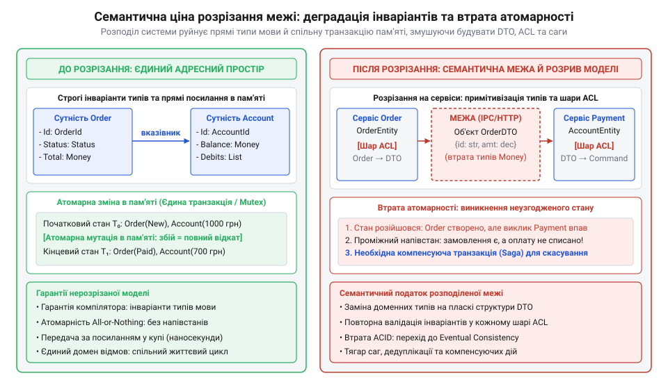
*Порівняння моделей до і після розрізання: монолітний адресний простір забезпечує строгі інваріанти мови та атомарні транзакції в пам'яті, тоді як розподілена межа вимагає DTO, антикорупційних шарів і переходу до слабкої узгодженості.*

### Втрата атомарності пам'яті (ACID)

Найважча семантична втрата при перетині межі — руйнування атомарності операцій.

(лат. *atomus* від грец. ἄтоμος — неподільний; англ. @@en|atomicity@@).

Розглянемо базовий сценарій у розумному будинку: увімкнення опалення бойлера при обмеженому енергетичному ліміті будинку:
1. Модуль енергетики перевіряє ліміт і резервує 3 кВт потужності.
2. Модуль реле вмикає нагрівальний елемент бойлера.

У монолітному застосунку зі спільною базою даних або спільними структурами пам'яті ця операція захищена класичною транзакцією:
- Обидві дії виконуються всередині блоку `transaction.begin()` ... `transaction.commit()`.
- Якщо реле несправне або повернуло помилку, транзакція відкочується назад (rollback).
- Жоден інший потік чи користувач ніколи не побачить проміжного невалідного стану: не може статися так, що потужність зарезервована, а бойлер вимкнений. Система має абсолютні гарантії атомарності та ізольованості (властивості ACID).

Щойно ми виносимо сервіс енергетики та сервіс реле в окремі процеси чи мікросервіси через мережу, єдина транзакція розривається назавжди:
- Виклик 1: HTTP POST на `/power-grid/reserve` (успішно: 3 кВт зарезервовано).
- Виклик 2: HTTP POST на `/devices/boiler/switch-on` (аварія: таймаут мережі, відмова живлення або паніка процесу).

Система миттєво зависає в невалідному, семантично розірваному стані. 3 кВт електричної потужності зарезервовано й заблоковано для решти приладів у будинку, але бойлер так і не увімкнувся. Автоматичного відкату в пам'яті не існує — процес енергетики не знає, що сталося з процесом керування пристроєм.

### Пастка розподілених транзакцій (2PC)

Перша інтуїтивна спроба інженерів повернути атомарність за межею — протокол двофазної фіксації (англ. @@en|two-phase commit@@, 2PC):
1. Координатор надсилає всім учасникам запит `Prepare`: кожен сервіс блокує локальні ресурси й обіцяє зафіксувати транзакцію.
2. Якщо всі відповіли згодою, координатор надсилає команду `Commit`.

Але в розподілених системах протокол 2PC виявляється надзвичайно крихким і дорогим:
- Усі учасники тримають монопольні блокування баз даних протягом усього часу мережевого обміну. Час утримання блокування зростає з мікросекунд до сотень мілісекунд (латентність мережі).
- Якщо координатор зависне після фази `Prepare`, усі сервіси-учасники залишаються заблокованими невизначено довго, паралізуючи систему.
- За теоремою CAP, у разі будь-якого мережевого розриву розподілена транзакція мусить або заблокувати систему (втрата доступності), або порушити строгу узгодженість.

### Перехід до слабкої узгодженості та саг

Реальність перетину межі змушує відмовитися від транзакційної атомарності на користь слабкої узгодженості в кінцевому підсумку (англ. @@en|eventual consistency@@).

Єдину транзакцію замінюють [патерном Сага](root:sf-distributed/saga-pattern) (давньоісл. *saga* — оповідь): ланцюжком окремих локальних транзакцій, де кожен крок фіксує свій стан незалежно. Якщо будь-який наступний крок ламається, система запускає послідовність **компенсуючих транзакцій** (англ. @@en|compensating transactions@@).

Головний семантичний розрив, із яким зобов'язаний змиритися архітектор: **компенсація не є відкатом (rollback)**.
- Відкат у базі даних повертає дані так, ніби змін ніколи не відбувалося.
- Компенсація — це нова бізнес-дія, яка намагається пом'якшити наслідки частково виконаної роботи. Якщо ви надіслали користувачеві SMS-повідомлення чи відкрили фізичний електромагнітний замок дверей, це неможливо «відкотити». Фізична дія вже відбулася у реальному світі. Компенсація може лише закрити замок назад або надіслати друге повідомлення з вибаченнями.
- Протягом часу між аварією та успішним виконанням компенсації вся система перебуває в семантично неузгодженому стані, і цей стан бачать інші користувачі та сусідні модулі.

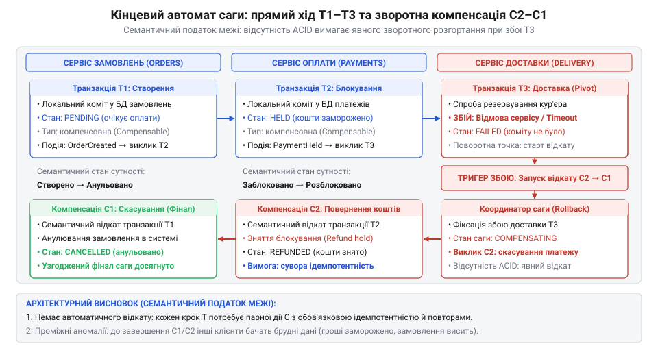
*Кінцевий автомат розподіленої саги: прямий ланцюжок транзакцій T1-T2 та зворотне розгортання компенсуючих дій C2-C1 у разі збою на кроці T3; читач бачить механіку повернення системи до узгодженого стану при відсутності ACID.*

Методологію правильного визначення меж бізнес-транзакцій та ізоляції агрегатів описано в розділі [Декомпозиція транзакційних меж](root:progarch/transaction-boundary-is-aggregate-boundary), а гарантовану публікацію подій через межу сервісів за допомогою атомарного збереження повідомлення в спільній базі даних забезпечує [шаблон Transactional Outbox](root:sf-distributed/outbox-pattern).

Нижче показано, як виглядає одна й та сама бізнес-операція до і після розрізання: від простої транзакції в пам'яті до багатоетапної обробки DTO, валідації та саги з компенсуючими викликами.

:::tabs

:::code cost-of-a-boundary-d/go/activateheaterrequestdto.go

:::code cost-of-a-boundary-d/ts/validationerror.ts

:::

> 🔧 **Навіщо це.**
> Перш ніж провести архітектурну межу між сутностями чи модулями, архітектор зобов'язаний поставити одне запитання бізнесу: «Чи припустимо, щоб ці дві сутності перебували в неузгодженому стані протягом 500 мілісекунд, 5 секунд або години?»
> 
> Якщо відповідь категоричне «ні» (наприклад, зняття коштів і зарахування на баланс, або блокування аварійного клапана й подача тиску), розносити ці компоненти в різні мікросервіси чи процеси — груба архітектурна помилка. Інваріанти, які вимагають абсолютної синхронної узгодженості, повинні завжди жити всередині одного процесу й однієї транзакційної межі бази даних.

## Податок надійності: природа часткових відмов, тризначна логіка виклику та крах ілюзії прозорого RPC

Усередині одного процесу виклик функції має абсолютну детермінованість (лат. @@la|determinare@@ — визначати, обмежувати). Коли модуль автоматизації системи Digital Home звертається до термостата через звичайний виклик методу в пам'яті, можливі лише два наслідки: або стек виконання повертає значення (чи контрольований виняток), або операційна система аварійно зупиняє весь процес через вичерпання ресурсів чи апаратний збій. У моноліті клієнт і сервер пов'язані спільною долею (англ. @@en|fate sharing@@). Доки процес живий, стан пам'яті відомий; якщо ж процес загинув, разом із ним гине й той код, який очікував на результат. У системі ніколи не залишається живого спостерігача, підвішеного в стані невідомості.

Рознесення компонентів за межу процесу, контейнера або фізичного вузла руйнує цю спільність долі. Виникає фундаментальне явище розподілених систем: часткова відмова (англ. @@en|partial failure@@, лат. @@la|pars@@ — частина). Сервіс термостата може зависнути під час апаратного опитування шини, впасти через нестачу пам'яті або бути відрізаним мережевим маршрутизатором, тоді як викликаючий клієнт продовжує повноцінно працювати. Система більше не вмирає вся разом — вона розпадається на ізольовані частини, які бачать стан одна одної лише крізь вузьку щілину ненадійного каналу зв'язку.

Ця розірваність змінює саму математичну логіку взаємодії. Локальний виклик підпорядкований двійковій логіці: результат або є успіхом (`SUCCESS`), або завершується явною помилкою (`FAILURE`). Перетин архітектурної межі вводить нездоланний третій стан: невизначеність (`INDETERMINATE`, лат. @@la|indeterminatus@@ — невизначений, неокреслений).

Уявімо, що кліматичний контролер надсилає команду сервоприводу клапана опалення: `open_valve(valve_id, flow_rate)`. Запит іде в мережевий сокет. Минає 500 мілісекунд, спрацьовує таймаут сокета, і клієнт фіксує помилку `TimeoutException`. Що відбулося насправді?

1. Запит було втрачено дорогою до приводу (пакет відкинув перевантажений комутатор): клапан не отримав команду, теплоносій перекритий.
2. Запит дійшов до приводу, двигун почав обертати шток клапана, але в цей момент зникло живлення контролера: клапан завмер у напіввідкритому аварійному стані.
3. Привод успішно відкрив клапан і відправив назад мережевий пакет підтвердження «OK», але зворотний пакет застряг у буфері або був відкинутий через пошкодження контрольної суми: клапан повністю відкритий, але клієнт про це не знає.

Для клієнта всі три ситуації абсолютно невідрізні: він бачить лише порожнечу в сокеті та вичерпаний ліміт очікування. Відповідь не надійшла, і клієнт принципово позбавлений знання про те, чи мутував стан системи за межею. Якщо програма наївно спробує повторити виклик (англ. @@en|retry@@), вона ризикує спричинити гідроудар або спалити електродвигун повторним пуском.

Корінь інженерних помилок на цій межі криється в спокусі зробити віддаленість непомітною. У 1984 році Ендрю Біррелл (Andrew Birrell) та Брюс Нельсон (Bruce Nelson) запропонували концепцію віддаленого виклику процедур (англ. @@en|Remote Procedure Call@@, RPC), маючи на меті надати мережевому запиту синтаксичного вигляду звичайного виклику функції в мові програмування.

В індустрії 1990-х років ця ідея вилилася в епоху розподілених об'єктів — платформи CORBA, Microsoft DCOM та Java RMI. Вони автоматично генерували клієнтські проксі (англ. @@en|stubs@@), які маскували сокети й маршалінг під методи звичайних об'єктів. Розробник викликав `lock.engage()` так, ніби замок жив у сусідній комірці пам'яті.

Ілюзія єдиного простору завершилася концептуальним крахом. У 1994 році Джим Волдо (Jim Waldo), Джефф Вайант (Geoff Wyant), Енн Воллах (Ann Wollrath) та Семюел Кендалл (Samuel C. Kendall) опублікували фундаментальний маніфест «Замітка про розподілені обчислення» (англ. @@en|A Note on Distributed Computing@@). Автори аргументували, що локальні та віддалені обчислення розділені не просто різницею в мілісекундах затримки, а чотирма непереборними прірвами: різними адресними просторами, різними моделями доступу до пам'яті, недетермінованістю часу відповіді та неминучістю часткових відмов. Спроба приховати мережу за прозорим інтерфейсом не усуває ці відмінності, а позбавляє розробника єдиного, що могло б врятувати систему, — явної обробки ненадійності. Пітер Дойч (L. Peter Deutsch) узагальнив цей урок у знаменитих «Хибах розподілених обчислень» (англ. @@en|Fallacies of Distributed Computing@@), першою з яких є оманлива віра в надійність мережі. Детальний аналіз цієї еволюції наведено у [вставці hist-transparent-rpc-illusion](root:progarch/cost-of-a-boundary/hist-transparent-rpc-illusion.md).

Мережеву межу не можна ховати: її слід проєктувати відкрито як контракт із середовищем, де будь-яка операція може розчинитися в невизначеності.

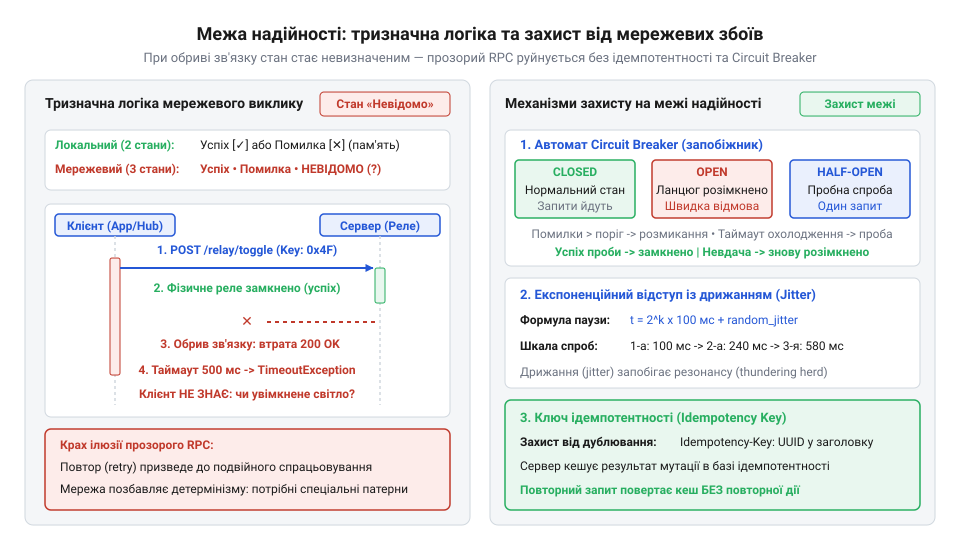
*На діаграмі зображено три результати віддаленого виклику (успіх, помилка та невизначеність через втрату зворотного повідомлення), захист вузла автоматом розриву ланцюга Circuit Breaker та знешкодження дублікатів повторних запитів за допомогою ключа ідемпотентності.*

Щоб система зберігала працездатність в умовах тризначної логіки, архітектурний контракт перетину межі повинен спиратися на чотири обов'язкові механізми стійкості:

1. **Бюджетування дедлайнів (англ. @@en|deadline budgeting@@)**.
   Статичні локальні таймаути на кожному щаблі системи — джерело прихованих каскадних аварій. Якщо шлюз чекає відповіді 5 секунд, сервіс автоматизації чекає 5 секунд, а контролер приводу ще 5 секунд, користувач чекатиме 15 секунд лише для того, щоб дізнатися про збій. Замість відносних таймаутів вводиться абсолютний дедлайн (`deadline = now() + timeout`), який передається в метаданих кожного мережевого запиту. Кожен проміжний компонент вираховує залишок часу: якщо до дедлайну залишилося 10 мс, а середня тривалість операції становить 40 мс, компонент навіть не намагається надсилати запит далі, а негайно повертає помилку вичерпання дедлайну (англ. @@en|deadline exceeded@@). Це запобігає марній роботі системи над запитами, на результат яких уже ніхто не чекає.

2. **Абсолютна ідемпотентність (лат. @@la|idem@@ — той самий, @@la|potentia@@ — дія, сила)**.
   Опинившись у стані невизначеності, клієнт зобов'язаний повторити спробу, інакше дія залишиться невиконаною. Щоб повторний виклик не призвів до дублювання мутацій, операція на стороні сервера мусить бути ідемпотентною: багаторазове виконання з тими самими параметрами дає точно такий самий результат і стан системи, як і одноразове:
   ```text
   f(f(x)) = f(x)
   ```
   Для операцій читання ідемпотентність є природною. Для операцій зі зміною стану вона забезпечується ключами ідемпотентності (англ. @@en|idempotency key@@). Клієнт генерує унікальний ідентифікатор бізнес-наміру (наприклад, UUIDv4) на рівні самої операції й передає його в заголовку кожного повтору. Сервер атомарно зберігає стан виконання за цим ключем: якщо запит із таким ключем уже завершено, сервер негайно повертає збережений результат першого виклику без повторного виконання побічних ефектів.

3. **Автомат розриву ланцюга (англ. @@en|Circuit Breaker@@)**.
   Коли віддалений сервіс починає захлинатися, клієнти продовжують накопичувати запити й блокувати потоки очікуванням таймаутів. Пули потоків вичерпуються, спричиняючи каскадний колапс усієї платформи. Автомат [Circuit Breaker](root:sf-distributed/circuit-breaker-pattern) розриває ланцюг за аналогією до електричного запобіжника. Він працює в трьох станах:
   - `CLOSED` (замкнений): виклики проходять у штатному режимі. Якщо відсоток помилок у ковзному часовому вікні перевищує встановлений поріг (наприклад, понад 50% невдач із 20 запитів), автомат перемикається в стан `OPEN`.
   - `OPEN` (розімкнений): усі запити миттєво відхиляються на стороні клієнта без жодної спроби встановити мережеве з'єднання (англ. @@en|fast fail@@). Це дає збійному сервісу час на перезавантаження й очищення черг. Вмикається таймер очікування відновлення (англ. @@en|reset timeout@@).
   - `HALF_OPEN` (напіврозімкнений): після закінчення таймера автомат пропускає обмежену кількість пробних запитів. Якщо вони завершуються успішно — ланцюг замикається назад (`CLOSED`), якщо ж пробний запит зазнає невдачі — автомат знову переходить у стан `OPEN`.

4. **Експоненційний відступ із дрижанням (англ. @@en|exponential backoff with jitter@@, лат. @@la|exponere@@ — показувати, виставляти)**.
   Якщо сотні датчиків чи фонових завдань одночасно зафіксують мережевий збій і всі повторять виклик рівно через 1 секунду, їхні синхронні пакети породять новий ударний сплеск — бурю повторів (англ. @@en|retry storm@@), яка остаточно доб'є сервер, що тільки-но намагався відновитися. Експоненційний відступ нарощує паузу між спробами в геометричній прогресії:
   ```text
   t[retry] = min(t[max], t[base] · 2^attempt)
   ```
   А щоб розсіяти синхронність клієнтських хвиль, до паузи додається дрижання (англ. @@en|jitter@@) — випадкове зміщення. За стратегії повного дрижання (англ. @@en|Full Jitter@@) фактичний час очікування вибирається випадково з інтервалу від 0 до розрахованого `t[retry]`. Це перетворює імпульсне навантаження на рівномірний, плавний потік.

Специфікацію інтерфейсу цього контракту наведено у [вставці api-boundary-resilience-contract](root:progarch/cost-of-a-boundary/api-boundary-resilience-contract.md). Наступний приклад демонструє програмну реалізацію повного контуру стійкості:

:::code cost-of-a-boundary-d/py/callstatus.py

> 🔧 **Навіщо це.**
> У продакшені відсутність тризначної логіки та ключів ідемпотентності призводить до найважчих фінансових та фізичних аварій: від дублювання грошових переказів під час перезавантаження шлюзу до спалених сервоприводів та вичерпаних пулів з'єднань. Архітектор, який розуміє податок надійності, ніколи не сприймає віддалений виклик як функцію: він проєктує його як кінцевий автомат захисту від невизначеності.

## Каскадне множення: хвостова затримка та деградація доступності в топологіях викликів

Коли архітектори проєктують розподілену систему або розносять модулі на окремі мікросервіси, легко потрапити в когнітивну пастку: якщо кожен окремий сервіс демонструє високу доступність у 99.9% («три дев'ятки») і середній час відповіді всього 10 мілісекунд, здається, що вся система працюватиме швидко й надійно.

Проте в реальності бізнес-запит користувача рідко обмежується одним перетином межі. Він розгортається в глибину через послідовні ланцюжки залежностей (`A → B → C → D`) або віялово розгалужується (англ. @@en|fan-out@@, віялове розходження), коли один шлюз-координатор паралельно опитує десятки компонентів. Розглянемо сценарій побудови панелі приладів Digital Home: щоб показати стан помешкання на екрані планшета, шлюз повинен синхронно отримати відповіді від контролера освітлення, модуля опалення, групи замків, лічильника електроенергії, метеостанції та кількох датчиків руху.

На стику цих багатьох меж вмикаються суворі закони теорії ймовірностей, які нещадно множать затримки й знецінюють доступність системи.

Розглянемо систему, що для виконання комплексної операції синхронно викликає `k` незалежних компонентів, кожен із яких характеризується ймовірністю безвідмовної роботи `A[i]`. Оскільки для успішного результату потрібна безпомилкова робота всіх компонентів без винятку, сумарна доступність системи `A[sys]` дорівнює добутку доступностей кожної окремої ланки:

```text
A[sys] = A₁ · A₂ · ... · Aₖ
       = ∏ A[i]
```

Простежимо, що відбувається з надійністю навіть за ідеальної незалежності збоїв:

**Умова: ланцюг із k = 10 синхронно пов'язаних компонентів із доступністю A[i] = 0.999 (99.9%) кожен**
```text
A[sys] = 0.999¹⁰
       ≈ 0.990045              [піднесення ймовірності 0.999 до степеня 10]
       ≈ 99.0%
```

Результат показує втрату цілого порядку надійності: система з десяти компонентів класу «три дев'ятки» скотилася до класу «дві дев'ятки» (99.0%). Переведемо це в час річного простою (із розрахунку 8760 годин на рік):
- Окремий сервіс із доступністю 99.9% простоює лише:
  ```text
  8760 · (1 - 0.999) = 8.76 годин/рік
  ```
- Система з 10 таких сервісів простоює вже:
  ```text
  8760 · (1 - 0.990) = 87.6 годин/рік
  ```

Користувачі стикаються з більш ніж 3.6 доби сумарного даунтайму на рік замість кількох годин. А якщо топологія виклику налічує `k = 50` сервісів (що є звичною картиною для великих корпоративних платформ), доступність падає до катастрофічного рівня:

**Умова: топологія з k = 50 сервісів із доступністю A[i] = 0.999 кожен**
```text
A[sys] = 0.999⁵⁰
       ≈ 0.9512                [піднесення ймовірності до степеня 50]
       ≈ 95.1%
```

Доступність 95.1% означає майже 18 діб відмов на рік. Архітектура перетворюється на так званий розподілений моноліт (англ. @@en|distributed monolith@@), який втратив швидкість і транзакційну простоту моноліту, але водночас став крихким від кожної прокладеної мережевої межі.

Ще руйнівніше поводяться часові характеристики системи. В аналізі мережевих затримок середнє арифметичне значення є абсолютно оманливою метрикою. Розподіл часу відгуку в розподілених системах ніколи не буває симетричним нормальним розподілом Гауса: він завжди має важкий, асиметричний правий хвіст.

Цей хвіст описується перцентилями (лат. @@la|per centum@@ — на сотню):
- `p99` — це часовий поріг, у який вкладається 99% усіх запитів, і лише 1% запитів триває довше. Цей 1% виникає через мікропаузи збирача сміття (GC), мережеві колізії, витіснення потоків ядром ОС або скидання буферів на диск.
- Для окремого сервісу показник `p99 = 100` мс за середнього часу 10 мс вважається нормальним інженерним результатом: 99 із 100 запитів пролітають миттєво.

Але що відбувається, коли координатор робить паралельне віялове розгалуження (fan-out) на `k` вузлів і змушений чекати завершення найповільнішого з них? Загальний час виконання визначається максимумом:
```text
T[sys] = max(T₁, T₂, ..., Tₖ)
```

Запит системи вкладеться в час `t` тоді й тільки тоді, коли ВСІ `k` компонентів завершать роботу за час, менший або рівний `t`. Позначивши функцію розподілу ймовірностей затримки окремого вузла через `F[i](t) = P(T[i] ≤ t)`, запишемо ймовірність швидкого виконання всього запиту:

```text
P(T[sys] ≤ t) = P(T₁ ≤ t ∧ T₂ ≤ t ∧ ... ∧ Tₖ ≤ t)
              = P(T₁ ≤ t) · P(T₂ ≤ t) · ... · P(Tₖ ≤ t)   [за умови статистичної незалежності затримок]
              = F₁(t) · F₂(t) · ... · Fₖ(t)              [підстановка функцій розподілу]
              = ∏ F[i](t)
```

Якщо всі `k` викликаних сервісів мають однаковий розподіл затримок `F(t)`, то загальна ймовірність успіху становить `(F(t))^k`. Відповідно, імовірність того, що користувач спіткнеться об хвостову затримку хоча б одного компонента (тобто час відповіді перевищить `t`), дорівнює ймовірності протилежної події:

```text
P(T[sys] > t) = 1 - P(T[sys] ≤ t)
              = 1 - (F(t))^k
```

Порахуємо цю ймовірність на конкретних числах:

**Умова: віялове розгалуження на k = 10 вузлів при F(100 мс) = 0.99 (p99 = 100 мс)**
```text
P(T[sys] > 100 мс) = 1 - 0.99¹⁰
                   = 1 - 0.904382                       [обчислення 0.99 у 10 степені]
                   ≈ 0.0956                             [або 9.56%]
```

Майже 10% усіх користувацьких запитів наштовхуються на хвостову затримку в 100 мс! А тепер поглянемо на систему з сотнею паралельних залежностей:

**Умова: віялове розгалуження на k = 100 вузлів при F(100 мс) = 0.99**
```text
P(T[sys] > 100 мс) = 1 - 0.99¹⁰⁰
                   = 1 - 0.366032                       [обчислення 0.99 у 100 степені]
                   ≈ 0.6340                             [або 63.4%]
```

Понад 63% комплексних запитів гарантовано потрапляють у хвіст найгіршої затримки. Найгірший перцентиль окремого компонента стає типовою нормою для більшості користувачів системи. Детальне математичне виведення цієї залежності наведено у [вставці math-tail-latency-boundary-amplification](root:progarch/cost-of-a-boundary/math-tail-latency-boundary-amplification.md).

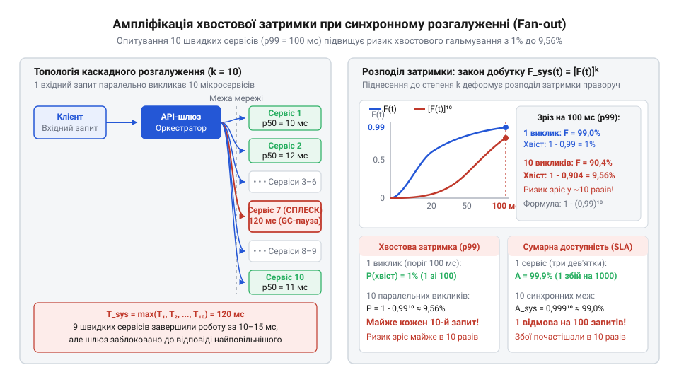
*Схема ілюструє віяловий запит до десяти незалежних сервісів через архітектурні межі та криву падіння загальної швидкодії системи: ймовірність зіткнення з хвостовою затримкою p99 зростає майже вдесятеро порівняно з одиночним викликом.*

Для подолання ефекту каскадного множення затримок та деградації доступності архітектура вимагає чотирьох інженерних рішень:

1. **Запити з підстраховкою (англ. @@en|hedged requests@@)**.
   Джефф Дін (Jeff Dean) та Луїс Андре Баррозо (Luiz André Barroso) у фундаментальній роботі «The Tail at Scale» (2013) описали тактику, що зрізає хвіст розподілу: клієнт надсилає запит до першої репліки компонента. Якщо відповідь не повернулася за час, що відповідає медіані або 95-му перцентилю (наприклад, за 20 мс), клієнт, не скасовуючи перший запит, паралельно надсилає підстрахований запит до іншої репліки з тим самим ключем ідемпотентності. Щойно будь-яка з реплік повертає результат, повільніший виклик скасовується. Оскільки ймовірність того, що дві незалежні репліки одночасно потраплять у найгірший 1% затримок, становить мізерні `0.01 · 0.01 = 0.0001` (0.01%), [патерн запитів із підстраховкою](root:sf-distributed/hedged-requests) знищує сплески затримок ціною всього 5% додаткового мережевого навантаження.

2. **Ізоляція відсіків (англ. @@en|bulkhead@@)**.
   Запозичений із кораблебудування принцип герметичних перебірок судна: затоплення одного відсіку не повинно тягнути корабель на дно. На програмному рівні [патерн ізоляції відсіків](root:sf-distributed/bulkhead-isolation) вимагає виділення окремих пулів потоків, семафорів та лімітів пам'яті для кожної зовнішньої межі. Якщо сервіс відеокамер зависне й вичерпає свій ліміт з'єднань, він зупинить лише роботу власного відсіку, але не зможе заблокувати критичні потоки опитування датчиків пожежної безпеки та замків.

3. **Обмеження синхронної глибини викликів та асинхронна агрегація**.
   Синхронний ланцюг завглибшки понад 2 рівні (`Клієнт → Агрегатор → Листок`) є неприпустимим архітектурним антипатерном. Якщо бізнес-сценарій вимагає агрегації даних із десятків джерел, синхронний fan-out замінюють фоновою подієвою моделлю: сервіси асинхронно публікують зміни стану в шину повідомлень, а сервіс читання безперервно будує матеріалізоване подання (англ. @@en|materialized view@@) у власній локальній пам'яті. У момент надходження запиту користувача система читає вже сформовану відповідь локально за 1 мс без жодного мережевого перетину в реальному часі. Детальніше цей підхід розкривають [Агрегація балакучих інтерфейсів](root:sf-apps/chatty-interface-aggregation) та [Декомпозиція транзакційних меж](root:progarch/transaction-boundary-is-aggregate-boundary).

4. **Ліквідація штучних меж**.
   Якщо група мікросервісів не може функціонувати без постійного синхронного опитування один одного та вимагає розподілених блокувань, архітектурну межу між ними проведено штучно. Єдине надійне вирішення проблеми — об'єднати ці компоненти назад у спільний адресний простір моноліту за [лініями природного розлому системи](root:sf-apps/domain-cleavage-lines). Локальний виклик функції через регістри або стек процесора повертає надійність до 100%, а затримку — до наносекунд.

Практичну реалізацію підстрахованого виклику (hedged request) для боротьби з хвостовою затримкою наведено в наступному асинхронному прикладі:

:::code cost-of-a-boundary-d/py/hedged-call.py

> 🔧 **Навіщо це.**
> Розрахунок деградації доступності `A_sys = ∏ A_i` та множення затримок `P = 1 - (1-p)^k` — головна інженерна зброя проти сліпого дроблення систем на десятки дрібних мікросервісів. Формули неспростовно доводять: синхронний fan-out глибше двох рівнів перетворює систему на нестабільний розподілений моноліт, змушуючи архітектора своєчасно обирати асинхронну агрегацію або злиття компонентів назад у моноліт.

## Механіка «долини ціни»: баланс між стіною латентності та стіною пропускної здатності

У системі автоматизації Digital Home сотні пристроїв щомиті фіксують стан середовища: датчики температури, приводи термостатів, лічильники струму, сенсори руху та витоку води. Доки всі ці компоненти працювали всередині єдиного процесу моноліту, зчитування температури зводилося до простого розіменування вказівника чи виклику методу в спільній пам'яті — операції, що займала частки мікросекунди. Проте щойно ми розрізаємо систему архітектурною межею та виносимо збір телеметрії в окремий фоновий демон чи сервіс, кожне значення мусить подолати повноцінний бар'єр ізоляції.

Якщо адаптер датчика надсилає кожне окреме вимірювання одразу в момент надходження, система миттєво втрачає працездатність. Навіть на одній фізичній машині передача через міжпроцесний канал (@@en|IPC@@, сокет домену Unix) вимагає системного виклику, перемикання контексту ядра, копіювання байтів між просторами пам'яті та планування черги процесів. Якщо ж межа пролягає через локальну мережу, до цих витрат додається повний час кругового обігу сигналу (@@en|round-trip time@@, RTT). Інтерфейс стає патологічно балакучим (@@en|chatty interface@@), про що детальніше йдеться в розділі [Агрегація балакучих інтерфейсів](root:sf-apps/chatty-interface-aggregation).

Причина провалу криється у фіксованому миті, який стягує межа за кожен перетин. Архітектурному бар'єру байдуже, скільки корисних даних ви передаєте: чотири байти температури чи чотири кілобайти масиву. Фіксована затримка перетину `T_fixed` — системний виклик, переривання, мережеві заголовки та очікування відповіді — сплачується повністю за кожен пакет. Коли контролер намагається відправити 1 000 показників на секунду поодинці, а `T_fixed` становить лише 2 мілісекунди, системі для послідовного надсилання знадобилося б 2 секунди астрономічного часу на кожну секунду реальних подій. Канал простоює напівпорожнім, тоді як процесор випалює всі ресурси на перемикання контексту й очікування на межі. Цей бар'єр, де продуктивність розбивається об нездоланну суму фіксованих затримок поодиноких викликів, називають **стіною латентності** (лат. @@la|latens@@ — прихований, невидимий).

Природна реакція інженера на стіну латентності — згрупувати виклики в пакунки (давньофр. @@fr|paquet@@ — в'язка, англ. @@en|batch@@). Але спроба розв'язати проблему максимальним накопиченням породжує протилежну крайність. Якщо система чекає накопичення десятків тисяч подій або запитує весь стан будинку єдиним масивним блоком, вона на повній швидкості врізається у **стіну пропускної здатності** (англ. @@en|bandwidth wall@@).

Стіна пропускної здатності виникає через поєднання чотирьох фізичних факторів:
1. **Надвибірка** (англ. @@en|overfetching@@). Прагнення агрегувати дані спонукає створювати універсальні громіздкі запити, де разом із необхідною поточною температурою через межу передаються конфігурація обладнання, версії прошивок, журнали калібрування та повні метадані. Корисне навантаження становить лічені відсотки від переданого обсягу.
2. **Вичерпання буферів і деградація пам'яті** (англ. @@en|buffer bloat@@). Серіалізація велетенського графа об'єктів вимагає виділення неперервних масивів у купі, витісняє гарячі дані з процесорного кешу L3 та провокує зупинки світу (@@en|stop-the-world@@) збирачем сміття.
3. **Катастрофічне повторне пересилання**. Мережева межа за своєю природою схильна до часткових відмов і втрат пакетів. Якщо в пакунку з 10 000 елементів через таймаут губиться один фрагмент, повторно передавати доводиться всі 10 000 записів, що лавиноподібно перевантажує транспортний канал.
4. **Блокування голови черги** (англ. @@en|head-of-line blocking@@). Показник датчика задимлення чи витоку газу, поставлений першим у велетенський пакунок, мусить чекати заповнення всього обсягу, втрачаючи актуальність для контуру безпеки.

Інженерна ціна перетину межі підпорядковується математичній моделі, що поєднує фіксовані й змінні витрати. Загальний час передачі пакунка з `N` елементів описується формулою:

`T(N) = T_fixed + α · N`

де `T_fixed` — незмінна затримка ініціалізації виклику та подолання межі, а `α` (альфа) — питомий час обробки та серіалізації (лат. @@la|series@@ — ряд, послідовність) одного елемента в ідеальних умовах.

Проте справжнім мірилом ефективності є питомий час, витрачений на доставку однієї корисної одиниці інформації:

`C_unit(N) = T(N) / N = T_fixed / N + α`

Якби система залишалася ідеальною, питома вартість монотонно спадала б із ростом `N`, асимптотично наближаючись до `α`. Але в реальному комп'ютері при зростанні `N` неминуче вмикаються штрафи стіни пропускної здатності: конкуренція за пам'ять, паузи виділення буферів та ризики повторних пересилань. У формальній моделі цей нелінійний опір виражається додаванням штрафного коефіцієнта `β` (бета):

`C_unit(N) = T_fixed / N + α + β · N`

Цей вираз формує U-подібну криву. Зліва, при малих `N`, домінує дріб `T_fixed / N` — це підйом стіни латентності, де кожен елемент змушений самотужки оплачувати повний перетин межі. Справа, при надмірно великих `N`, домінує доданок `β · N` — це підйом стіни пропускної здатності. Між цими двома стінами утворюється полога западина з мінімальними питомими витратами — **долина ціни**.

Щоб знайти оптимальний розмір пакунка `N*`, який мінімізує витрати ресурсів на одиницю даних, знайдемо точку екстремуму функції через її першу похідну за розміром пакунка:

```
d C_unit(N) / d N
= d/dN (T_fixed · N⁻¹ + α + β · N)     [диференціювання компонентів витрат]
= - T_fixed · N⁻² + β                  [похідна степеневої функції]
= 0                                    [умова екстремуму]
```

Розв'яжемо рівняння відносно `N`:

```
T_fixed / N² = β                       [перенесення від'ємного доданка]
N² = T_fixed / β                       [множення на N² та ділення на β]
N* = √(T_fixed / β)                    [добування квадратного кореня]
```

Оскільки друга похідна `d²C_unit(N)/dN² = 2 · T_fixed · N⁻³ > 0` строго додатна для всіх `N > 0`, цільова функція є строго опуклою, а знайдена точка `N*` — точкою глобального мінімуму витрат.

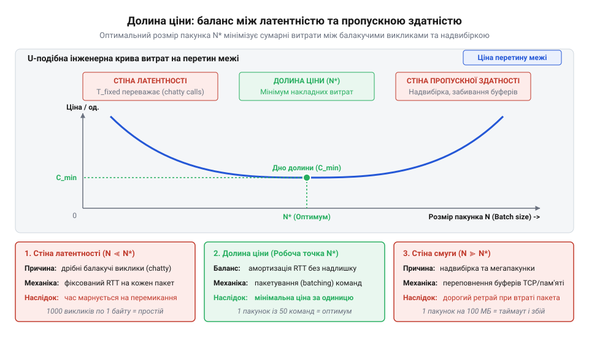
*U-подібна крива питомих витрат на один елемент: ліворуч крива стрімко злітає біля стіни латентності через неамортизований час виклику T_fixed, праворуч піднімається біля стіни пропускної здатності через накладні витрати буферизації β · N, а дно долини визначає оптимальну точку N\*.*

Розглянемо числовий приклад розрахунку робочої точки для шлюзу телеметрії системи Digital Home.

**Розрахунок робочої точки для каналу телеметрії Digital Home**
Умови вимірювання на стенді:
- Фіксована затримка виклику через локальний сокет домену Unix: `T_fixed = 2.0` мс (2 000 мкс);
- Базовий час упаковки одного вимірювання температури: `α = 0.005` мс (5 мкс);
- Коефіцієнт зростання витрат буферизації та навантаження на пам'ять: `β = 0.00008` мс (0.08 мкс).

Покроковий розрахунок оптимального розміру партії `N*`:

```
N*
= √(2.0 / 0.00008)                     [підстановка параметрів стенду]
= √25000                               [ділення під знаком кореня]
≈ 158.11                               [обчислення кореня]
≈ 158                                  [округлення до найближчого цілого]
```

Зіставимо питомі витрати на обробку одного вимірювання `C_unit` у трьох характерних режимах роботи системи:

1. Режим поодиноких викликів (`N = 1`, зона стіни латентності):
```
C_unit(1)
= 2.0 / 1 + 0.005 + 0.00008 · 1
= 2.0 + 0.005 + 0.00008
= 2.00508 мс                           [домінує T_fixed, 99.7% часу змарновано на межу]
```

2. Режим перевантаженого пакунка (`N = 1000`, зона стіни пропускної здатності):
```
C_unit(1000)
= 2.0 / 1000 + 0.005 + 0.00008 · 1000
= 0.002 + 0.005 + 0.08
= 0.08700 мс                           [домінує штраф пам'яті та ризиків затримки]
```

3. Режим долини ціни в точці мінімуму (`N = 158`):
```
C_unit(158)
= 2.0 / 158 + 0.005 + 0.00008 · 158
≈ 0.01266 + 0.005 + 0.01264
≈ 0.03030 мс                           [збалансована амортизація без перевантаження]
```

Практичний висновок: утримання розміру пакунка всередині долини ціни (`N* = 158`) скорочує питомий час доставки кожного елемента в 66 разів порівняно з поодинокими викликами (`2.005` мс проти `0.030` мс) і майже втричі порівняно з надмірно роздутим пакунком (`0.087` мс проти `0.030` мс).

Повний математичний апарат моделі з урахуванням стохастичного розподілу мережевих помилок каналу наведено у дослідженні [math-cost-valley-batching-model](root:progarch/cost-of-a-boundary/math-cost-valley-batching-model.md).

> 🔧 **Навіщо це.**
> Конфігураційні параметри розміру партій (`batch_size`) та інтервалів скидання буферів у драйверах баз даних, чергах повідомлень та клієнтських RPC-адаптерах часто виставляють навмання, копіюючи типові «100» чи «500». Модель долини ціни замінює ворожіння інженерним розрахунком: визначивши `T_fixed` каналу та оцінивши поведінку системи під навантаженням, архітектор налаштовує розмір партії так, щоб система не згоряла від перемикання контекстів при високій балакучості й не захлиналася від вичерпання буферів та пауз збирача сміття при великих пакунках.

## Інженерні тактики в долині ціни: адаптивне пакетування, проєкції полів та буферизація

Формула оптимального пакунка `N* = √(T_fixed / β)` дає точне математичне значення для стаціонарного потоку з постійною інтенсивністю. Проте в реальних системах інтенсивність подій постійно коливається. Уночі датчики Digital Home можуть генерувати лише кілька показників на хвилину. Якщо клієнтський адаптер сліпо чекатиме наповнення пакунка до `N* = 158`, сигнал про зміну температури затримається на десятки хвилин, порушуючи вимоги до керованості контуру опалення. Навпаки, під час ранкового увімкнення сценаріїв сотні пристроїв генерують шквал запитів, і фіксований буфер переповниться за мілісекунди.

Щоб утримувати систему на дні долини ціни за будь-якого навантаження, статичну конфігурацію замінюють динамічними програмними тактиками: адаптивним мікропакетуванням, проєкціями полів та контролем зворотного тиску.

### Адаптивне мікропакетування з подвійним порогом

Адаптивне мікропакетування (грец. @@grc|mikros@@ — малий та старофр. @@fr|paquet@@ — пакунок, англ. @@en|micro-batching@@) балансує між двома вимогами: необхідністю зібрати достатньо елементів для амортизації `T_fixed` (захист від стіни латентності) та неприпустимістю перевищення граничного часу доставки (захист від втрати свіжості даних).

Клієнтський шлюз на межі керує чергою буферизації за допомогою двох одночасних тригерів:
1. **Поріг розміру** (`N_batch`). Якщо кількість накопичених у черзі елементів досягає максимального розміру пакунка, черга негайно скидається у вихідний канал, не чекаючи таймера.
2. **Поріг часу очікування** (`T_wait`). Щойно в порожню чергу потрапляє перший елемент, зводиться таймер дедлайну. Якщо таймер спливає раніше, ніж черга наповниться до `N_batch`, усі накопичені елементи негайно відправляються через межу, хай навіть їх усього два чи три.

Умова відправлення пакунка має диз'юнктивний вигляд:

`Скидання = (count ≥ N_batch) ∨ (t_current - t_first ≥ T_wait)`

Цей подвійний автомат адаптується до навантаження самостійно: при високій частоті подій система автоматично працює за порогом розміру, забезпечуючи максимальну пропускну здатність без затримок таймера; при низькій інтенсивності система перемикається на поріг часу, гарантуючи, що жодна подія не зависне в пам'яті довше, ніж на `T_wait`.

### Вибіркова проєкція полів проти стіни пропускної здатності

Навіть за оптимального `N*` система може впертися в стіну пропускної здатності через надвибірку (@@en|overfetching@@). У системі Digital Home сутність датчика містить десятки службових полів (прошивка, батарея, Wi-Fi) на 1.5 КБ, хоча для опалення потрібні лише ідентифікатор і температура (8 байтів). Це роздуває `α` у 200 разів.

Вибіркова проєкція полів (лат. @@la|projectio@@ — креслення, англ. @@en|field masking@@) замінює низькорівневі бітові маски декларативним контрактом (`FieldMask`), див. [Вибіркова проєкція полів контракту](root:sf-apps/sparse-fieldsets-projection): клієнт вказує потрібні поля, а серіалізатор відсікає решту. Зниження `α` розширює долину ціни, зсуваючи стіну пропускної здатності праворуч.

### Реактивний зворотний тиск і згортання стану

Якщо вхідний потік подій тривалий час перевищує максимальну пропускну здатність межі, буфер мікропакетування ризикує розростися до повного вичерпання оперативної пам'яті (@@en|Out-Of-Memory@@, OOM). Захист пам'яті вимагає трьох взаємопов'язаних інженерних тактик:

1. **Обмежена ємність черги та призупинення джерела** (англ. @@en|backpressure@@). Черга буфера має жорстку верхню межу (@@en|high watermark@@). Коли ліміт вичерпано, шлюз блокує потік відправника або сигналізує про перевантаження, сповільнюючи надходження нових подій, як описано в темі [Механізми реактивного зворотного тиску](root:sf-distributed/backpressure-end-to-end).
2. **Згортання стану** (лат. @@la|conflare@@ — зливати разом, виплавляти, англ. @@en|conflation@@). Для телеметричних даних типу «поточний стан» (температура, положення реле, статус замка) проміжні значення не мають цінності, якщо нове вимірювання надійшло до того, як старе встигли відправити. Якщо для датчика з ідентифікатором `sensor_id` у черзі вже лежить запис, шлюз просто оновлює його значення на місці, не збільшуючи кількість елементів у пакунку. Це утримує обсяг черги обмеженим навіть за шторму подій.
3. **Вибіркове скидання за пріоритетом** (англ. @@en|load shedding@@). Якщо черга все ж переповнюється, другорядні діагностичні повідомлення (наприклад, регулярні звіти про силу радіосигналу) негайно відкидаються, звільняючи місце для критичних сигналів тривоги та безпеки.

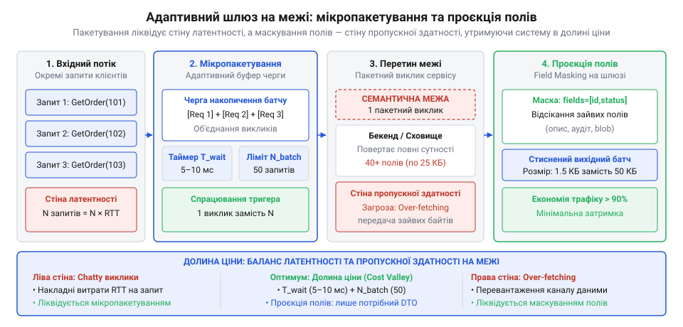
*Архітектурна схема адаптивного шлюзу на межі: вхідний потік окремих запитів накопичується у черзі адаптивного мікропакетування з таймером T_wait та лімітом N_batch, а вихідний потік звужується через проєкцію полів, що відсікає надлишкові дані перед відправленням.*

Практичну архітектуру такого шлюзу разом із навантажувальними тестами наведено у проєкті [proj-adaptive-cost-valley-gateway](root:progarch/cost-of-a-boundary/proj-adaptive-cost-valley-gateway.md).

> 🔧 **Навіщо це.**
> Поєднання мікропакетування з проєкцією полів та зворотним тиском перетворює ненадійний і мінливий потік викликів на стабільний конвеєр із прогнозованою латентністю. У розподілених системах це єдиний спосіб захистити внутрішні сервіси від каскадних відмов, спричинених штормами запитів, зберігаючи при цьому гарантований час реакції на критичні події.

### Реалізація адаптивного мікропакетувальника

Нижче наведено реалізацію адаптивного шлюзу зі скиданням за подвійним тригером, зворотним тиском (backpressure), згортанням стану (conflation) та контрактом `FieldMask`. Застосовано обмін буферів (buffer swap): фоновий потік підміняє буфер і відправляє дані без блокування головного м'ютекса.

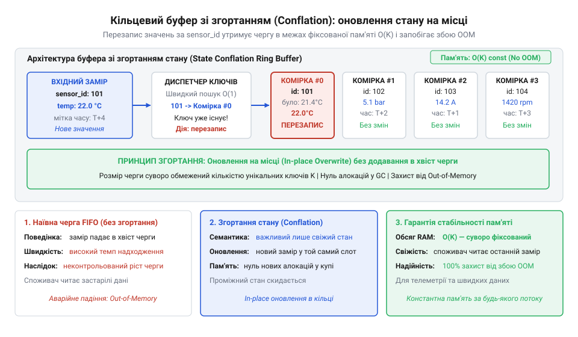
*Схема оновлення стану в кільцевому буфері зі згортанням (conflation): повторний прихід вимірювання для наявного sensor_id перезаписує комірку на місці, утримуючи чергу в межах константного розміру пам'яті; читач бачить внутрішню механіку запобігання вичерпанню оперативної пам'яті.*

:::tabs

:::code cost-of-a-boundary-d/c/timespec.c

:::code cost-of-a-boundary-d/cpp/sensorreading.cpp

:::

## Природні розломи проти штучних порогів: критерії виправданості архітектурної межі

Коли систему розсікають на окремі процеси чи сервіси, кожна взаємодія через новоутворену межу починає обкладатися потрійним інженерним податком: фізичним, семантичним і податком надійності. Наносекундні виклики функцій перетворюються на мілісекундне очікування мережевих пакетів, прямі типи мови деградують до сирих байтів у DTO, а транзакційна неподільність у спільній пам'яті розпадається на часткові відмови, таймаути та розподілені саги. Якщо перетин межі коштує настільки дорого, чому архітектори взагалі наважуються її проводити?

Межа ніколи не буває безплатною декорацією чи самоціллю. Вона є захисним муром, який купують за високу ціну. Якщо цей мур не стримує руйнівних сил, здатних знищити всю систему, він перетворюється на штучний поріг — архітектурну самострільну рану, що споживає ресурси процесора та робочий час інженерів без жодної віддачі. Щоб межа окупилася, лінія розрізу повинна проходити не там, де її зручно намалювати на дошці, а вздовж об'єктивних [ліній природного розлому системи](root:sf-apps/domain-cleavage-lines) (від англ. @@en|natural cleavage lines@@ — геологічний термін на позначення площин кристалічної ґратки, за якими мінерал розколюється з найменшим опором під дією зовнішніх напружень).

Природний розлом виникає там, де дві частини системи підпорядковуються фундаментально різним силам. Існує чотири головні фактори, що роблять фізичне розведення компонентів за сувору межу виправданою інвестицією:

1. **Різниця темпу та життєвого циклу змін.** Якщо дві підсистеми змінюються з різною швидкістю і з різних бізнес-причин, об'єднання їх в одну одиницю розгортання зв'язує їх штучною залежністю. Цю силу формулюють два споріднені принципи: принцип спільного закриття (від англ. @@en|Common Closure Principle@@, лат. @@la|claudere@@ — закривати, замикати; класи, що змінюються разом, належать одному компоненту) та принцип спільного повторного використання (від англ. @@en|Common Reuse Principle@@, лат. @@la|re-@@ — знову + @@la|uti@@ — вживати; компоненти не повинні змушувати клієнтів залежати від того, чим вони не користуються). У системі Digital Home ядро автоматизації клімату та охорони змінюється вкрай рідко: його правила безпеки перевірені часом і вимагають тривалого регресійного аудиту перед кожним релізом. Натомість експериментальні віджети мобільного інтерфейсу та алгоритми аналізу споживання електроенергії для маркетингових звітів оновлюються кілька разів на тиждень. Якщо тримати їх у спільному бінарному пакунку, кожна косметична правка інтерфейсу змусить перезбирати, тестувати й перезапускати критичне ядро охорони. Межа ізолює стабільне ядро від волатильності периферії. Але якщо два модулі завжди змінюються синхронно в кожному завданні (наприклад, модуль створення замовлення та валідатор замовлення), розведення їх за мережеву межу б'є по обох принципах: потрійний податок сплачується, а незалежності релізів немає.

2. **Асиметрія обчислювальних ресурсів і профілів масштабування.** Програмні модулі мають несумісні апетити до апаратного забезпечення. Вхідний шлюз збору телеметрії Digital Home обслуговує десятки тисяч одночасних з'єднань від сенсорів: він обмежений виключно операціями вводу-виводу (від англ. @@en|I/O-bound@@), працює на неблокуючих подієвих циклах і потребує мінімуму пам'яті на сокет. Натомість підсистема розпізнавання облич на камерах спостереження та просторової оптимізації мікроклімату жорстко навантажує обчислювальні ядра процесора (від англ. @@en|CPU-bound@@) або графічні прискорювачі та виділяє гігабайти оперативної пам'яті під матричні моделі. Якщо помістити їх в один адресний простір, сплеск аналітичного розрахунку здатний викликати тривалу зупинку збирача сміття або вичерпати всі потоки процесора, заморозивши реакцію системи на датчики диму чи витоку газу. Проведення межі процесів або контейнерів дозволяє призначити їм різні ліміти пам'яті, ізолювати ядра процесора і масштабувати їх незалежно на різному залізі.

3. **Ізоляція крахів і рівні довіри.** Не весь код системи однаково надійний. У Digital Home ядро автоматизації взаємодіє з сотнями сторонніх драйверів для розумних пристроїв: лампочок китайських виробників, пропрієтарних контролерів теплої підлоги та закритих бібліотек протоколів через USB чи Bluetooth. Багато з цих бібліотек написані на низькорівневих мовах без контролю пам'яті, містять витоки дескрипторів сокетів або можуть аварійно завершитися через помилку сегментації (від англ. @@en|segmentation fault@@). У монолітному процесі єдине звернення за нульовим вказівником у коді розумного чайника миттєво знищує весь застосунок: гасне світло, вимикається охорона, зупиняється котел. Винесення сторонніх драйверів за межу процесу утворює пісочницю (від англ. @@en|sandbox@@) та реалізує ізоляцію крахів (від англ. @@en|fault isolation@@, лат. @@la|fallere@@ — помилятися, хибити). Якщо драйвер падає, операційна система знищує лише його ізольований процес; головне ядро фіксує розрив каналу, переводить пристрій у безпечний режим, інформує користувача і перезапускає дочірній процес. Тут податок на міжпроцесну взаємодію є виправданою платою за живучість системи.

4. **Організаційні межі володіння та закон Конвея.** Архітектура системи відтворює комунікаційну структуру організації (закон Конвея, від англ. @@en|Conway's Law@@, Мелвін Конвей, 1967 рік; див. [організаційні межі та командну динаміку](root:sf-apps/conways-law)). Робота кількох автономних команд над монолітом породжує конфлікти злиття, черги регресійного тестування та взаємні блокування релізів. Фізична межа з публічним API створює суверенний простір володіння: команда отримує власний конвеєр збірки, графік викатки та повну відповідальність за свою підсистему. Навпаки, нарізання сервісів у тісній команді з кількох інженерів обертається марнуванням часу на узгодження контрактів між самими собою.

Повним антиподом природних розломів є штучні пороги (від англ. @@en|artificial boundaries@@). Вони виникають тоді, коли систему розрізають під впливом сліпого копіювання шаблонів або моди на мікросервіси без реальної потреби в ізоляції.

Найпоширеніша форма штучного порога — технічне горизонтальне розрізання коду. Це спроба рознести контролери вхідного API, бізнес-сервіси та репозиторії бази даних в окремі незалежні процеси чи мікросервіси. Кожна бізнес-вимога (наприклад, додати нове поле «пріоритет сповіщення») неминуче вимагає одночасної зміни контролера, бізнес-сервісу та шару збереження даних. Вони мають однаковий темп змін, спільну причину змін і нульову незалежність відмов: якщо падає шар даних, бізнес-сервіс та контролер втрачають працездатність. Розрізання між ними обкладає потрійним податком кожен запит користувача, багаторазово збільшує затримку, вимагає DTO-трансляторів на кожному кроці, але не дає жодної вигоди ізоляції.

Друга небезпечна форма — [декомпозиція транзакційних меж](root:progarch/transaction-boundary-is-aggregate-boundary) (від лат. @@la|transactio@@ — завершення справи, доведення до кінця). Вона стається, коли єдиний цілісний бізнес-агрегат із жорстким правилом негайної узгодженості розрізають на два сервіси заради красивої діаграми (наприклад, сервіс обліку пристроїв та сервіс лімітів підключень). Якщо система не має права зареєструвати датчик без негайного блокування слота підписки, локальна транзакція в спільній пам'яті чи базі даних перетворюється на розподілену сагу. Будь-який мережевий збій посеред процесу залишає дані в суперечливому стані, вимагає складних компенсуючих транзакцій і ручного розбору інцидентів. Якщо бізнес-правило вимагає суворої неподільності (ACID), компоненти зобов'язані перебувати по один бік архітектурної межі.

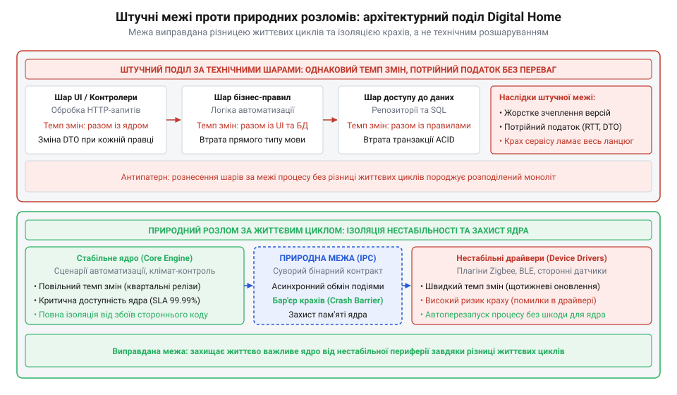
*Зіставлення архітектурних конфігурацій Digital Home: штучний поділ за технічними шарами накладає потрійний податок без ізоляції відмов, тоді як винесення нестабільних сторонніх драйверів у пісочницю захищає монолітне ядро автоматизації від аварійного завершення.*

На схемі наочно видно фундаментальну різницю: верхній варіант вимагає послідовного подолання двох високовартісних меж для кожного клієнтського запиту, водночас падіння будь-якого вузла паралізує всю функціональність. Нижній варіант утримує повний бізнес-цикл у високопродуктивному ядрі зі швидкістю виклику за частки наносекунд, а межею відгороджує лише ту зону, де існує об'єктивна загроза цілісності процесу.

> 🔧 **Навіщо це.**
> Архітектор стикається з постійним тиском: бізнес вимагає нових фіч швидше, а розробники пропонують розпиляти систему на мікросервіси за технічними ознаками, сподіваючись на магічне прискорення. Розуміння природних розломів дає строгий математичний та інженерний інструмент захисту системи від саморуйнування: кожна пропозиція розрізання тестується на відповідність фізичним силам, а не суб'єктивним уподобанням.

Щоб оцінити будь-яку запропоновану чи наявну межу в системі, інженер має провести аудит за діагностичним чеклистом. Кожен пункт оцінює конкретну фізичну або організаційну силу:

1. **Темп і причини змін (CCP).** Чи змінюються компоненти по обидва боки межі з різних приводів? Якщо будь-яка зміна бізнес-логіки вимагає координованого оновлення коду в обох модулях і спільного релізу — межа штучна. Її слід ліквідувати.
2. **Транзакційна атомарність.** Чи вимагає предметна область абсолютної узгодженості між станами обох компонентів у реальному часі? Якщо розрив межі змушує впроваджувати двофазні коміти чи розподілені блокування заради простого інваріанта — межа проведена прямо по живому серцю бізнес-домену.
3. **Асиметрія відмов і рівень довіри.** Чи здатний компонент А продовжувати виконувати корисну роботу для користувача, якщо компонент Б аварійно впаде або перестане відповідати? Якщо падіння Б гарантовано зупиняє А — ви не отримали ізоляції відмов, а лише розмазали точку відмови по мережі.
4. **Асиметрія ресурсів.** Чи потребує один із компонентів радикально іншого обладнання (наприклад, специфічного співвідношення пам'яті до процесора, GPU для обчислень, десятків тисяч тривалих з'єднань)? Якщо їхні профілі навантаження схожі — вигода від окремого розгортання прагне до нуля.
5. **Балакучість комунікації.** Скільки викликів генерує одна операція користувача через запропоновану межу? Якщо взаємодія вимагає десятків синхронних звернень туди-назад за секунду, система неминуче розіб'ється об стіну латентності. Межа вимагає [агрегації балакучих інтерфейсів](root:sf-apps/chatty-interface-aggregation) або повернення в спільну пам'ять.
6. **Командна автономія.** Чи розробляють ці модулі різні команди людей, які мають власні дорожні карти релізів? Якщо обидва модулі пише й деплоїть одна й та сама людина, витрати на узгодження міжсервісних контрактів не мають сенсу.

Інженерний баланс доцільності межі можна звести до простого правила виправданості:

```
Баланс_доцільності
= Вигода_ізоляції - (Податок_фізичний + Податок_семантичний + Податок_надійності)   [баланс вартості]
> 0                                                                                 [умова виправданості межі]
```

Якщо різниця менша або дорівнює нулю, межа є штучним бар'єром. Залишати її в системі — це свідомо сплачувати потрійний податок за ілюзію архітектурної зрілості.

## Перекроювання системи: інженерія злиття, розрізання та еволюції меж

Архітектурна межа не є сакральною непорушною догмою. Те, що було геніальним рішенням під час запуску системи для двох розробників і ста користувачів, стає вузьким місцем при зростанні до мільйона запитів; і навпаки, розгалужена мережа з двадцяти мікросервісів, побудована «на виріст», перетворюється на тягар, коли з'ясовується, що бізнес стабілізувався на значно менших обсягах. Зрілість архітектора визначається не тим, наскільки ідеально він вгадав структуру системи в перший день, а тим, чи спроможна система до безпечного перекроювання (від англ. @@en|repartitioning@@) меж без зупинки виробничої експлуатації та без руйнування бізнес-інваріантів.

Перекроювання меж відбувається у двох протилежних напрямках: злиття надмірно подрібнених компонентів назад у модульний моноліт для знищення потрійного податку та розрізання монолітного коду за новими природними розломами, коли навантаження чи ризики перевищують можливості єдиного процесу.

### Безпечне злиття компонентів у модульний моноліт

Коли команда виявляє, що 80% затримки в системі створює мережевий транспорт між дрібними мікросервісами, а процесори зайняті виключно парсингом JSON та виділенням тимчасової пам'яті під DTO, природним інженерним кроком є згортання сервісів назад у спільний адресний простір.

Головне правило злиття: **ліквідація процесної межі не означає змішування коду в кашу**. Доменні кордони модулів мусять залишатися непорушними. Вони спираються на [шви в коді](root:progarch/dh-testability-refactor) (від англ. @@en|seam@@ — швейний шов, стик деталей; місце в програмі, де можна змінити поведінку без редагування самого коду). Злиття прибирає лише транспортування та серіалізацію, замінюючи віддалений мережевий RPC на локальний виклик інтерфейсу мови програмування в межах модульного моноліту (від лат. @@la|modulus@@ — міра, зразок та грец. @@el|monolithos@@: @@el|monos@@ — один + @@el|lithos@@ — камінь).

Злиття послідовно ліквідує потрійний податок: сокети, серіалізація та контекстні перемикання поступаються передачі вказівників у регістрах процесора з поверненням наносекундної затримки; DTO-мапери — строгим типам мови з контролем компілятора; а розподілені саги, черги доставки та Circuit Breaker — локальним ACID-транзакціям у спільній пам'яті.

Демонтаж транспортного шару фіксує послідовність інженерних дій:

```
Крок 1 (Контракт) : Клієнт ──> [Інтерфейсний шов] ──> Мережевий адаптер ──> RPC
Крок 2 (Провайдер): Створення локального адаптера поруч із мережевим
Крок 3 (Артефакт) : Підключення коду сервісу як бібліотеки до моноліту
Крок 4 (Ін'єкція) : DI перемикає шов на локальний виклик у пам'яті
Крок 5 (Зачистка) : Демонтаж контролерів, DTO та деплой-маніфестів
```

### Безпечне розрізання моноліту: розсування за нову межу

Протилежний процес — винесення перевантаженого або нестабільного компонента з моноліту за межу процесу чи мережі. Такий рефакторинг несе колосальні ризики часткових відмов, падіння продуктивності та розсинхронізації даних, тому він ніколи не робиться одномоментним перемиканням («великим вибухом»).

Для безпечного розрізання використовують сукупність практик [безпечного рефакторингу](root:progarch/refactoring-safe), ізоляцію через [антикорупційний шар](root:sf-apps/anti-corruption-layer) (від англ. @@en|Anti-Corruption Layer@@, ACL, лат. @@la|corruptio@@ — псування, спотворення) та протокол еволюційної міграції трафіку.

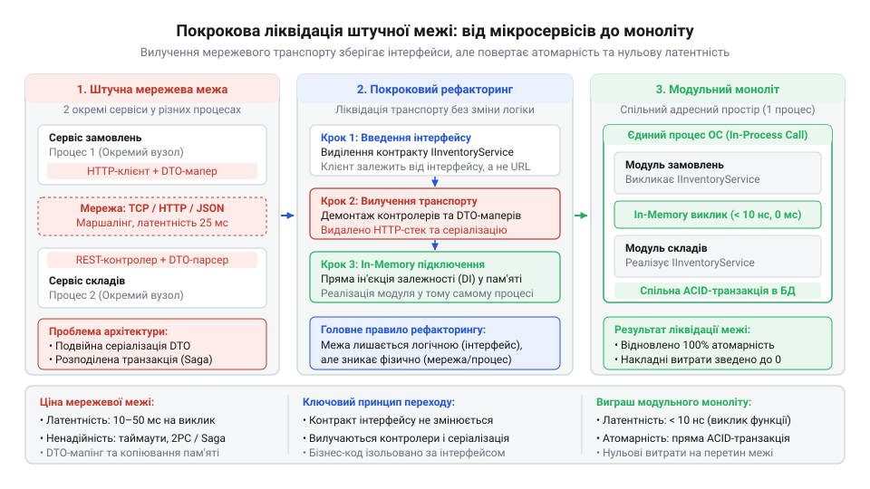
*Еволюційне перекроювання архітектурної межі: збереження чистого інтерфейсного шва дозволяє замінити мережевий транспорт, DTO та розподілені саги на прямий виклик у пам'яті та транзакційну атомарність без зміни бізнес-логіки системи.*

Послідовність розрізання системи спирається на три послідовні фази:

1. **Виділення шва та заміна глобального стану.** Спочатку всередині моноліту компонент повністю відрізають від прямого доступу до чужих таблиць бази даних і статичних змінних пам'яті. Усі залежності передаються виключно через аргументи методів інтерфейсу.
2. **Тіньовий подвійний запуск (@@en|Dual-run@@ або @@en|Shadow execution@@).** Створюється новий окремий віддалений сервіс. У моноліт вбудовується диспетчер, який реалізує цільовий інтерфейс. Отримуючи запит, диспетчер викликає старий локальний код і негайно повертає відповідь клієнту, але одночасно в фоновому потоці асинхронно відправляє копію запиту на новий віддалений сервіс. Диспетчер порівнює результати виконання обох гілок, збирає метрики латентності віддаленого виклику та фіксує будь-які розбіжності даних у логах. Реальні користувачі не відчувають жодного ризику: помилка нового сервісу не впливає на відповідь.
3. **Канаркова міграція трафіку (@@en|Canary release@@, за традицією шахтарів перевіряти повітря канарками).** Коли відсоток розбіжностей у режимі тіньового запуску стає рівним нулю, диспетчер перемикається в режим канарки: 1% реальних запитів починає направлятися до нового віддаленого сервісу як до основного джерела істини. Якщо на віддаленій межі спрацьовує таймаут або розрив ланцюга Circuit Breaker, запит прозоро підхоплюється локальною реалізацією. Відсоток трафіку поступово нарощують: 5%, 25%, 50% і 100%. Лише після тривалої стабільної роботи на повному навантаженні локальний код компонента видаляється з моноліту.

Наступний приклад реалізує універсальний диспетчер перекроювання межі. Він підтримує обидва напрямки руху: дозволяє безпечно злити або розрізати компоненти через режими прямої локальної роботи, тіньового дублювання та канаркового перемикання з аварійним поверненням на локальний шлях.

:::tabs

:::code cost-of-a-boundary-d/cpp/devicestate.cpp

:::code cost-of-a-boundary-d/go/devicestate.go

:::

> 🔧 **Навіщо це.**
> Патерн еволюційного диспетчера усуває найбільший архітектурний страх — незворотність рішень. Наявність абстрактного шва та диспетчера дозволяє команді експериментувати з межами на основі реальних вимірювань виробничого навантаження: якщо винесений сервіс не виправдав очікувань, його повернення назад у моноліт здійснюється зміною одного прапорця конфігурації без переписування коду клієнтів.

### Підсумок: межа як динамічний інструмент

Архітектурна межа не є священним монументом, спорудженим раз і назавжди. Вона є регульованим клапаном, який інженер відкриває чи закриває відповідно до зміни вимог системи. 

Будь-яка система розпочинає свій життєвий шлях як модульний моноліт із чистими інтерфейсними швами всередині спільної пам'яті. Це забезпечує максимальну швидкість розробки, нульовий фізичний податок і строгі транзакційні інваріанти на етапі, коли бізнес шукає свій продукт. Коли ж окремий модуль доходить до лінії природного розлому — стикається з катастрофічною асиметрією навантаження, вимагає ізоляції небезпечних сторонніх крахів або переходить у володіння іншої команди — його висувають за межу процесу за допомогою тіньового запуску та канаркової міграції. 

Якщо ж з часом з'ясовується, що винесений сервіс породив штучний поріг і змушує систему тонути в затримках та розподілених транзакціях, інженер не тримається за догму. Він демонтує транспортний шар, повертає модуль назад у спільний адресний простір, ліквідує потрійний податок і відновлює локальну транзакційність. Справжнє мистецтво архітектури полягає не в кількості збудованих мурів, а в здатності безпомилково визначати, де мур захищає життя системи, а де він краде її ресурси.
