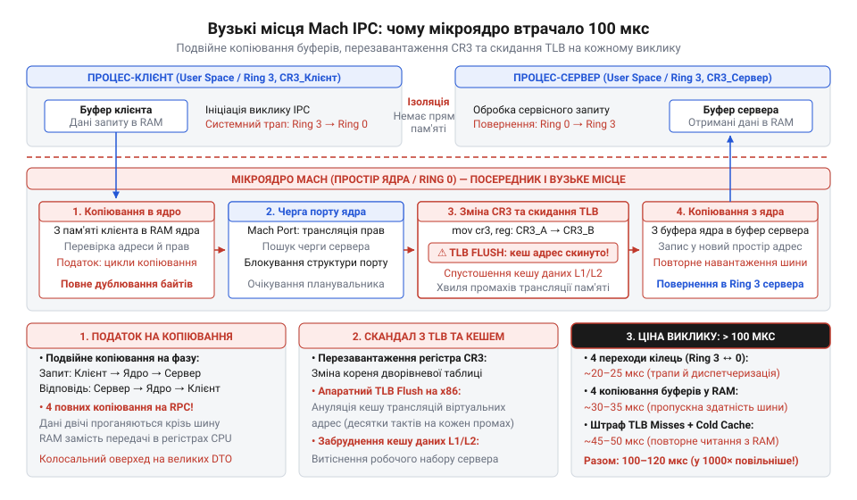
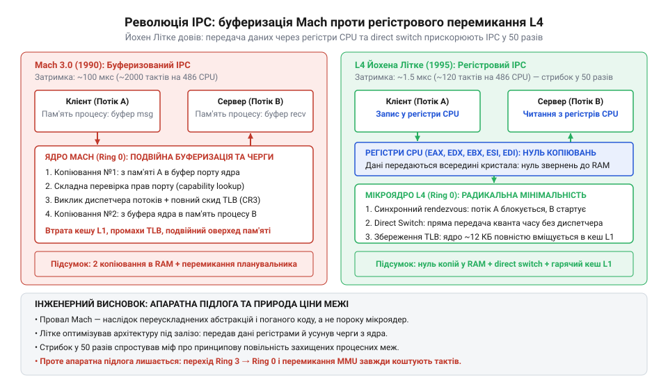
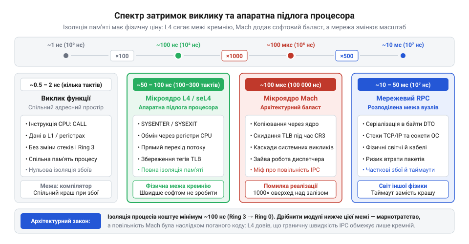

# Ціна межі

## Криза монолітів кінця 1980-х і народження Mach: як шляхетна ідея ізоляції розбилася об накладні витрати

Наприкінці 1980-х років розробники операційних систем зіткнулися з кризою надійності: класичні монолітні ядра (від грецького *μονόλιθος*, де *μόνος* — один, єдиний, а *λίθος* — камінь), такі як BSD Unix та AT&T System V, стрімко розросталися. У моноліті весь системний код — планувальник потоків, віртуальна пам'ять, мережеві стеки, файлові системи й насамперед драйвери периферійних пристроїв — виконувався в єдиному адресному просторі з найвищими привілеями процесора (у нульовому кільці захисту, Ring 0). Це створювало системну вразливість: будь-яке розіменування нульового вказівника, помилка на одиницю в буфері мережевої карти чи апаратний збій у сторонньому драйвері принтера пошкоджували структури ядра й миттєво обвалювали всю операційну систему в @@en|kernel panic@@. З появою сотень нових контролерів і плат розширення утримувати стабільність ядра ставало дедалі важче.

Інженерна відповідь видавалася очевидною й елегантною: якщо помилки в периферійних компонентах убивають систему, ці компоненти слід позбавити привілеїв і відокремити фізичною межею. Файлові системи, мережеві протоколи й драйвери треба винести з пам'яті ядра в окремі ізольовані процеси простору користувача (Ring 3; детальніше механізм апаратних кілець розкрито в [Апаратні кільця захисту процесора](root:hw-arch/protection-rings)). Саме ядро має стати крихітним — мікроядром (від грецького *μικρός* — малий та латинського *nucleus* — ядро), відповідальним лише за мінімальний базис: низькорівневе керування віртуальною пам'яттю, планування потоків та засіб зв'язку між процесами. Якщо драйвер файлової системи аварійно завершить роботу, система вціліє: мікроядро просто перезапустить збійний процес, а користувач навіть не помітить падіння.

Цю ідею втілили дослідники Університету Карнегі — Меллона (CMU), які під керівництвом Річарда Рашида (Richard Rashid) та Аві Теваняна (Avie Tevanian) створили мікроядро Mach як спадкоємця експериментальної системи Accent. Mach запропонував абстракцію портів — захищених черг повідомлень у ядрі, через які процеси мали спілкуватися за допомогою міжпроцесної взаємодії (@@en|Inter-Process Communication, IPC@@, від латинського *inter* — між та *processus* — просування вперед). Архітектура обіцяла небачену модульність, взаємозамінність компонентів і бездоганну відмовостійкість.

Проте шляхетний задум розбився об фізику процесора. У монолітному ядрі виклик файлової системи — це звичайний внутрішній виклик функції за адресою вказівника: регістри процесора передають аргументи, стек зберігає адресу повернення, а виконання займає частки наносекунди. У Mach наївна реалізація IPC перетворила найпростішу взаємодію на багатоетапну важку процедуру.

Коли клієнтський процес хотів надіслати повідомлення серверу, він не міг звернутися до нього безпосередньо через ізоляцію віртуальної пам'яті. Відбувався такий ланцюг подій:
1. Клієнт виконував системний виклик, перемикаючи процесор із простору користувача в режим ядра (перехід Ring 3 → Ring 0).
2. Ядро виділяло проміжний буфер (від давньофранцузького *buffe* — поштовх або англійського @@en|buffer@@ — пом'якшувач ударів) у власній оперативній пам'яті.
3. Дані повідомлення копіювалися з адресного простору клієнта в буфер ядра.
4. Ядро розбирало заголовок, перевіряло права доступу до порту призначення й ставило повідомлення в чергу.
5. Планувальник ядра блокував потік клієнта, знаходив потік сервера-одержувача й ініціював перемикання контексту (від латинського *contextus* — тісне сплетіння, зв'язок).
6. Перемикання на інший адресний простір вимагало перезапису керівного регістра таблиць сторінок процесора (наприклад, регістра `CR3` в архітектурі x86). Запис нового значення в `CR3` призводив до апаратного скидання буфера асоціативної трансляції (@@en|Translation Lookaside Buffer, TLB@@, від латинського *translatio* — перенесення; див. [Буфер асоціативної трансляції TLB](root:sys-unix/translation-lookaside-buffer)) — надшвидкого апаратного кешу перекладу віртуальних адрес у фізичні.
7. Процесор перемикався назад у простір користувача (Ring 0 → Ring 3) для запуску сервера.
8. Ядро копіювало повідомлення з буфера ядра в адресний простір сервера (друге глибоке копіювання пам'яті).

Наслідки скидання TLB та спустошення кешів процесора (L1 і L2) виявилися нищівними. Коли сервер прокидався, кожне його звернення до власного коду чи даних спричиняло апаратний промах TLB: замість миттєвого читання адреси процесор був змушений за кожним разом проходити багаторівневі таблиці сторінок в основній пам'яті RAM.

Ситуацію погіршувала природна балакучість мікроядерної системи (@@en|chatty interface@@). У моноліті читання байта з диска — це один системний виклик `read()`, усередині якого ядро напряму викликає код віртуальної файлової системи, драйвера диска та диспетчера буферів. У Mach ці компоненти були окремими серверами. Щоб виконати одне читання, клієнт надсилав IPC серверу віртуальної файлової системи (VFS); VFS надсилав IPC службі авторизації; потім надсилав IPC драйверу конкретної файлової системи; той через черговий IPC звертався до драйвера дискового контролера; контролер відповідав назад через ланцюжок повідомлень. Одне логічне читання розпадалося на 8–12 окремих IPC-викликів.

На типових процесорах кінця 1980-х і початку 1990-х років (наприклад, Intel 80486 із частотою 25–33 МГц) один двосторонній виклик IPC у Mach займав понад 100 мікросекунд (близько 2500–3000 тактів CPU). Помножені на десяток проміжних переходів, накладні витрати на перетин меж сягали мілісекунди. Система витрачала до 80 % процесорного часу не на корисну роботу, а на перемикання таблиць сторінок, копіювання байтів туди й назад крізь ядро та очікування вихолощених кешів.

*Схема проходження запиту в Mach через ядро та сервери: каскад системних викликів, подвійне копіювання повідомлень через буфери ядра та скидання TLB під час перезапису CR3 перетворюють ізоляцію компонентів на непереборне гальмо продуктивності.*

## 1992 рік і дебати Таненбаума — Торвальдса: народження догми про «нежиттєздатність мікроядер»

Провал Mach на практиці не забарився. Комерційні спроби побудувати повноцінні операційні системи на його базі зіткнулися з непереборними проблемами продуктивності. Проєкт OSF/1 консорціуму Open Software Foundation зазнавав нищівної критики за повільність; компанія NeXT у системі NeXTSTEP (де провідним архітектором став той самий Аві Теванян) була змушена відмовитися від чистого мікроядра й повернути сервери BSD назад у ядро, створивши гібридну архітектуру; амбітний проєкт Workplace OS від IBM зазнав краху.

В інженерній спільноті наростало розчарування. А 29 січня 1992 року в телеконференції Usenet `comp.os.minix` спалахнула дискусія, яка закарбувала це протистояння в історії комп'ютерних наук.

Професор Амстердамського вільного університету Ендрю Таненбаум (Andrew Tanenbaum), автор навчальної операційної системи MINIX, опублікував допис із промовистим заголовком: *«LINUX is obsolete»* («Linux застарів»). Таненбаум атакував щойно створене монолітне ядро, яке 22-річний фінський студент Гельсінського університету Лінус Торвальдс (Linus Torvalds) виклав у вільний доступ наприкінці 1991 року.

Аргументація Таненбаума ґрунтувалася на академічній теорії модульності:
«Створювати монолітне ядро у 1991 році — фундаментальна помилка. Писати моноліт сьогодні — все одно що повертатися в 1970-ті роки. Моноліти не мають модульності, вони не переносні й схильні до крахів. Мікроядра — це сучасний, перевірений і єдино правильний шлях побудови операційних систем майбутнього».

Відповідь Торвальдса була вкрай різкою й гранично прагматичною. Лінус зізнався, що якби мікроядерний проєкт GNU Hurd (який якраз розроблявся на базі Mach) був готовий навесні 1991 року, він узагалі не починав би писати власне ядро. Але Hurd загруз у проблемах, а Mach показав свою практичну безпорадність:
«Мікроядра можуть бути скільки завгодно привабливими в теорії, але Mach на практиці — це повільний, неповороткий монстр. Якщо архітектура вбиває продуктивність, її теоретична краса нічого не варта. Операційну систему пишуть для реального заліза, а монолітне ядро виконує системні виклики на порядки швидше за будь-який мікроядерний IPC».

У цій суперечці зіткнулися дві інженерні філософії: чистота архітектурного розподілу відповідальностей проти безжальної швидкодії на реальному кремнії. Оскільки Linux згодом продемонстрував надзвичайну швидкість і завоював сервери по всьому світу, а мікроядерні проєкти першого покоління або згорнулися, або пішли на гібридні компроміси, індустрія зробила поспішний і далекосяжний висновок.

Народжена в цих дебатах догма стверджувала: *«Мікроядра принципово нежиттєздатні, бо сам поділ на ізольовані адресні простори вимагає непомірних накладних витрат»*. Протягом майже двох десятиліть інженери сприймали повільність IPC як фундаментальний фізичний закон природи комп'ютерів.

Проте це був самообман. У цій догмі фатально сплутали дві принципово різні речі: фундаментальну ціну апаратної ізоляції та невдалі інженерні рішення конкретного ядра Mach. Повільність Mach полягала не в тому, що процесор не здатний швидко передавати дані між адресною пам'яттю, а в тому, що ядро Mach робило занадто багато зайвої роботи: виділяло пам'ять, парсило дескриптори прав, двічі копіювало кожен байт через ядро й нехтувало роботою апаратного кешу. Потрібен був принципово інший погляд на залізо, щоб розбити цей міф.

> 🔧 **Навіщо це.**
> Історія провалу Mach та суперечки Таненбаума й Торвальдса — це класичне застереження для системного архітектора. Вона показує дві небезпечні крайнощі проектування меж:
> 1. **Дрібна нарізка без урахування ціни фізичного переходу.** Коли компоненти системи розносять по окремих процесах чи мікросервісах, керуючись лише абстрактною красою ізоляції, система гине під тягарем балакучих комунікацій (@@en|chatty interface@@). Фізична межа ніколи не буває безкоштовною: кожен перетин вимагає зміни контексту, серіалізації даних і скидання кешів. Якщо частота взаємодій висока, а обсяг корисної роботи на один виклик мізерний, накладні витрати перекриють будь-яку вигоду від модульності.
> 2. **Сплутування поганої реалізації з хибністю принципу.** Коли невдало спроектована система демонструє низьку продуктивність, розробники часто звинувачують саму концепцію (ізоляцію, контракти, асинхронність), а не конкретні механізми (проміжну буферизацію, зайві копіювання, невідповідність апаратній моделі). Архітектор має розрізняти непереборну апаратну підлогу фізичного середовища та випадкові накладні витрати власного коду.

## 1993–1995 роки: прорив Йохена Літке та народження L4

Після публічних дебатів 1992 року інженерна спільнота майже одностайно погодилася з вердиктом Лінуса Торвальдса: ізоляція системних компонентів у просторі користувача коштує занадто дорого, а тому мікроядра приречені залишатися академічною забавкою. Проте один німецький дослідник відмовився приймати догму на віру.

Йохен Літке (Jochen Liedtke), співробітник Німецького національного дослідного центру інформаційних технологій (GMD) у Санкт-Августіні, поставив просте, але фундаментальне запитання: яка частка з тих 100 мікросекунд затримки Mach зумовлена неминучою фізикою кремнієвого процесора, а яка — лише недбалим кодом і надлишковими абстракціями операційної системи?

У 1993–1995 роках Літке опублікував низку революційних праць, кульмінацією яких стала доповідь на престижній конференції SOSP 1995 року. Літке продемонстрував, що катастрофічна повільність Mach не мала жодного стосунку до самої ідеї мікроядер. Mach виявився повільним тому, що намагався бути універсальним об'єктно-орієнтованим комбайном із важкими абстракціями портів, списків прав доступу та складної багатошарової буферизації.

Щоб повернути мікроядрам життєздатність, Літке сформулював [Принцип мінімальності Літке](root:sf-os/microkernel) (від латинського *minimus* — найменший):
> Концепція має право на існування всередині мікроядра лише тоді, коли її винесення за межі ядра — тобто дозвіл конкуруючих реалізацій у просторі користувача — унеможливить виконання базової функціональності системи.

Усе інше — політики розподілу пам'яті, драйвери, пейджинг, файлові системи й навіть права доступу — повинно жити поза ядром. Мікроядро має робити лише три базові речі: надавати низькорівневі адресні простори, нитки виконання та засіб швидкого зв'язку між ними.

Керуючись цим принципом, Літке з нуля спроєктував і написав мікроядро L4 (його перша версія для максимальної швидкості була створена повністю на асемблері x86). Щоб усунути накладні витрати на межах компонентів, Літке впровадив три революційні інженерні техніки.

### 1. Передача повідомлень через регістри процесора (@@en|Register-based IPC@@)
Аналіз реального системного трафіку показав, що понад 80 % усіх повідомлень між процесами є короткими: запит на читання блока, передача дескриптора файла, перевірка статусу чи повернення коду помилки. Це структури розміром від кількох байтів до пари десятків байтів.

Mach обробляв кожне повідомлення за загальною схемою: виділяв пам'ять під буфер у просторі ядра, копіював дані з клієнта в ядро, а з ядра — у сервер. Літке запитав: навіщо взагалі звертатися до повільної оперативної пам'яті RAM, якщо сучасний процесор уже має надшвидкі апаратні регістри (від середньовічного латинського *registrum*, від *regerere* — вносити, записувати)?

В L4 короткі повідомлення передавалися безпосередньо через регістри загального призначення CPU (на архітектурі x86 — через `eax`, `edx`, `ebx`, `esi`, `edi`). Клієнт клав аргументи виклику в регістри й виконував системну інструкцію переходу в ядро. Ядро змінювало контекст адресного простору, але не чіпало вміст цих регістрів. Коли сервер прокидався, аргументи вже лежали в його регістрах. Кількість копіювань пам'яті скоротилася з двох до абсолютного нуля: дані взагалі не торкалися шини пам'яті.

### 2. Пряме передавання кванта часу (@@en|Direct process switch@@)
У класичних ОС міжпроцесний зв'язок розглядався як дві незалежні події для планувальника: відправник засинає (потік блокується, зберігається в чергу очікування), ядро запускає повний цикл планування з переглядом списку готових ниток, обирає одержувача, завантажує його стан і дає йому новий квант часу (від латинського *quantum* — скільки).

Літке зрозумів причинну природу синхронного RPC: коли клієнт викликає сервер, клієнт не може працювати далі без відповіді, а сервер не має іншої роботи, крім як обслужити цей клієнтський запит. Фактично це один безперервний потік виконання, який просто тимчасово змінює свій адресний простір.

L4 реалізував [Пряме передавання кванта часу (direct switch)](root:sf-os/direct-process-switch): потік-відправник безпосередньо передає свій залишок процесорного часу потоку-одержувачу. Ядро взагалі не звертається до черг планувальника: воно просто змінює вказівник на поточну нитку й перемикає адресний простір. Коли сервер завершує обробку й повертає відповідь через IPC, квант часу повертається клієнту. Планувальник ядра усувається з критичного шляху комунікації.

### 3. Захист буфера TLB від скидання
Як було показано на прикладі Mach, найбільшим вбивцею продуктивності при перемиканні процесів було скидання буфера асоціативної трансляції TLB через перезапис керівного регістра `CR3`. Кожен скинутий запис TLB змушував процесор витрачати десятки тактів на прохід таблиць сторінок у пам'яті.

Літке запропонував два підходи:
- На процесорних архітектурах із підтримкою апаратних тегів адресних просторів (@@en|Tagged TLB@@, таких як ARM, MIPS, а пізніше й x86 з розширенням PCID) кожен запис у TLB позначається числовим ідентифікатором простору (@@en|Address Space Identifier, ASID@@). У такому разі ядро L4 взагалі не скидало TLB при перемиканні процесів: записи клієнта й сервера мирно співіснували в апаратному кеші, не заважаючи одне одному.
- На 32-розрядних процесорах Intel 486 та Pentium, де тегів ASID ще не було, Літке реалізував геніальний трюк із сегментною моделлю x86. Він ділив загальний 4-гігабайтний адресний простір на сегменти (від латинського *segmentum* — відрізок, шматок), використовуючи селектори (від латинського *selector* — той, що вибирає) та регістри лімітів у системних таблицях GDT/LDT. Дрібні сервери розміщувалися в різних сегментах, але ділили між собою спільний каталог таблиць сторінок. Перемикання між ними вимагало лише зміни сегментних регістрів, а не запису в `CR3`. Кеш TLB залишався повністю заповненим гарячими записами.

*Порівняльна схема передачі повідомлень: проміжна буферизація та важкий планувальник Mach проти прямої передачі даних у регістрах CPU та передавання кванта часу (direct switch) у L4, що скоротило час виклику у 50 разів.*

Результат приголомшив усю комп'ютерну індустрію. На тому самому скромному процесорі Intel 486 із частотою 33 МГц, де ядро Mach витрачало на один IPC понад 100 мікросекунд, мікроядро L4 виконувало повний двосторонній цикл передачі повідомлення всього за **1.5–2.2 мікросекунди** (близько 120–150 тактів CPU).

Це було прискорення у понад 50 разів на абсолютно ідентичному апаратному забезпеченні. Йохен Літке одним інженерним ударом зруйнував десятилітній забобон: довів, що плата за перетин межі процесу в попередніх системах була породжена не фізичним законом ізоляції, а програмною недбалістю розробників, які звели важку фортецю на місці простої хвіртки.

## Еволюція до математичного доведення: seL4 та верифікована безпека

Після того як архітектура L4 переконливо спростувала міф про неминучу повільність мікроядер, школа L4 зіткнулася з новим викликом. Радикальна оптимізація на асемблері x86 зробила перші ядра L4 надзвичайно швидкими, але водночас вкрай складними для портування на інші процесорні архітектури та важкими для підтримки. Крім того, виникло фундаментальне питання довіри: якщо ми передаємо крихітному ядру абсолютну владу над ізоляцією процесів у критичних системах (в авіації, медичному обладнанні чи автомобільних контролерах), як гарантувати, що в самому ядрі немає прихованих дефектів або вразливостей?

У класичних монолітних ядрах обсяг коду вимірюється десятками мільйонів рядків. Перевірити таку масу коду на відсутність помилок неможливо: звичайне тестування показує лише наявність багів у протестованих сценаріях, але ніколи не доводить їхньої повної відсутності. Однак мікроядро, очищене за принципом мінімальності Літке, займає лише 8 000 – 10 000 рядків коду. Такий компактний обсяг уперше в історії комп'ютерних наук відкрив можливість повного математичного доведення коректності коду.

На початку 2000-х років дослідницька група в австралійській національній лабораторії NICTA (National ICT Australia) та Університеті Нового Південного Уельсу під керівництвом Ґернота Гайзера (Gernot Heiser) та Кевіна Елфінстона (Kevin Elphinstone), об'єднавши зусилля з фахівцями з формальних методів на чолі з Ґервіном Кляйном (Gerwin Klein), розпочала розробку мікроядра нового покоління — seL4 (@@en|secure embedded L4@@). Їхньою амбітною метою було створення мікроядра, чия надійність гарантується не емпіричними тестами, а формальним математичним доведенням.

У 2009 році команда seL4 здійснила історичний прорив: seL4 стало першим у світі мікроядром загального призначення, чия реалізація на мові C була повністю й механічно верифікована (від латинського *verus* — істинний та *facere* — робити) за допомогою інтерактивного довідника теорем Isabelle/HOL. Математичне доведення встановило строгу еквівалентність між формальною математичною специфікацією (від латинського *species* — вид, образ та *facere* — робити) та виконуваним C-кодом. Це дало формальну гарантію: у ядрі seL4 математично неможливі переповнення буферів, помилки розіменування нульових вказівників, витоки пам'яті чи несанкціоноване підвищення привілеїв.

Щоб зробити ядро математично передбачуваним і надійним, розробники seL4 реалізували дві ключові інновації:
1. **Строга мандатна модель безпеки (@@en|capability-based security@@).** Будь-яка дія в системі — надсилання повідомлення через точку з'єднання (endpoint), створення нитки, перемикання адресного простору чи доступ до порту пристрою — вимагає явного, непідробного мандата (від латинського *mandatum* — наказ, доручення; див. [Мандатна модель безпеки capabilities](root:sf-security/capability-based-security)). Ядро більше не містить неявних глобальних правил доступу: якщо процес не тримає мандат у своїй захищеній таблиці, операція відхиляється на рівні апаратної перевірки.
2. **Повне делегування пам'яті простору користувача.** У традиційних операційних системах ядро динамічно виділяє пам'ять під власні структури через внутрішній диспетчер (`kmalloc`). Якщо системна пам'ять вичерпується, ядро опиняється в стані паніки. Творці seL4 усунули динамічний розподіл пам'яті з ядра взагалі: після завантаження системи вся фізична пам'ять передається кореневим процесам користувача у вигляді нетипізованих мандатів (`Untyped Memory`). Коли сервер створює нову нитку чи кінцеву точку зв'язку, він зобов'язаний виділити під неї власну пам'ять і передати ядру. Це зробило ядро захищеним від атак на вичерпання ресурсів.

Найважливіше те, що математична верифікація не знищила продуктивність. Завдяки дотриманню архітектурних заповітів Літке (регістровий IPC, пряме перемикання контексту без затримки в чергах планувальника), швидкість передачі повідомлень у seL4 на сучасних процесорах ARM та x86 збереглася на рівні 100–200 наносекунд. seL4 довела: екстремальна безпека та мінімальна ціна перетину межі не суперечать одна одній, а навпаки, випливають із радикального мінімалізму.

## Апаратна підлога процесора: уроки еволюції мікроядер для архітектури систем

Тридцятирічна еволюція мікроядерного IPC — від 100 мікросекунд у Mach до сотні наносекунд у L4 та seL4 — дає системному інженеру найцінніший практичний урок: вона точно окреслює межу, де закінчується оптимізація алгоритмів і починається нездоланна фізика заліза.

Йохен Літке та розробники seL4 усунули з критичного шляху комунікації майже весь програмний баласт:
- жодного проміжного буфера та жодного копіювання байтів у пам'яті;
- жодного звернення до черг планувальника при синхронному виклику;
- збереження кешу TLB завдяки апаратним тегам адресних просторів (ASID).

Здавалося б, якщо програмні витрати зведено до нуля, чи можна зробити перетин межі процесу настільки ж дешевим, як звичайний виклик підпрограми? Відповідь негативна. Навіть найідеальніший асемблерний код упирається в апаратну підлогу процесора (@@en|hardware floor@@; див. [Апаратна підлога затримки виклику](root:hw-arch/hardware-floor-latency)).

Коли потік виконання перетинає процесну межу між двома адресною просторами, кремнієвий процесор зобов'язаний виконати послідовність апаратних дій:
1. **Перемикання кілець захисту (Ring 3 → Ring 0).** Інструкція переходу в режим ядра (`SYSCALL` на x86 або `SVC` на ARM) змушує процесор скинути конвеєр спекулятивного виконання, змінити біти привілеїв, перевірити дескриптори та перемкнути покажчик стека з користувацького на системний.
2. **Збереження архітектурного стану.** Процесор повинен зафіксувати лічильник команд `RIP`, регістр прапорців `RFLAGS` та критичні службові регістри.
3. **Апаратна зміна адресного простору.** Навіть за підтримки тегів ASID блок керування пам'яттю (MMU) повинен змінити кореневий покажчик таблиць трансляції й оновити внутрішній стан кешів адрес.
4. **Зворотний перехід у режим користувача (Ring 0 → Ring 3).** Інструкція повернення (`SYSRET` або `ERET`) повторно перебудовує конвеєр та повертає процесор у стан з обмеженими правами.

Жодна програмна техніка не здатна обійти цей кремнієвий протокол: процесор фізично витрачає цикли тактового генератора на скидання конвеєра, синхронізацію регістрів та зміну рівнів захисту. На сучасних багатоядерних процесорах із частотою 3–4 ГГц цей незнищенний апаратний мінімум забирає від 50 до 100 наносекунд (близько 150–300 тактів CPU).

*Діаграма спектра затримок виклику: від часток наносекунди для внутрішнього виклику функції до незнищенної апаратної підлоги L4 (50–100 нс), провалу Mach (100 мкс) та мережевих RPC (мілісекунди), що демонструє фізичну межу заліза.*

Якщо вишикувати різні форми взаємодії компонентів за шкалою затримок, ми побачимо колосальний розрив між архітектурними рівнями:
- **Виклик функції за вказівником у спільній пам'яті:** близько 0.5–1 нс (1–2 такти процесора). Дані лежать у найближчому кеші L1, конвеєр передбачає перехід, перемикання кілець відсутнє.
- **Апаратна підлога L4 / seL4 IPC:** 50–100 нс (150–300 тактів). Це у 100 разів довше за прямий виклик функції.
- **Неоптимізований IPC першого покоління (Mach):** близько 100 000 нс (100 мкс). Це у 100 000 разів повільніше за функцію через програмні помилки проєктування.
- **Мережевий RPC у розподілених системах (REST / gRPC через локальну мережу):** 1–50 мс (1 000 000 – 50 000 000 нс). Це розрив у сім порядків порівняно з викликом у пам'яті.

> 🔧 **Навіщо це.**
> Знання апаратної підлоги процесора дає архітектору інженерну лінійку для вибору типу межі:
> 1. **Межа модуля в пам'яті (пакет, клас, інтерфейс)** коштує частки наносекунди. Її можна робити дрібнозернистою й викликати мільйони разів на секунду без відчутних накладних витрат.
> 2. **Межа процесу (мікроядерний IPC, окремий процес ОС)** захищає від збоїв пам'яті та підвищує надійність, але стягує фізичний податок у 50–100 наносекунд. Інтерфейс вимагає грубозернистості (@@en|chunky interface@@) або використання спільної пам'яті (@@en|shared memory@@).
> 3. **Межа мережі (мікросервіс, HTTP, gRPC)** забезпечує автономність розгортання та горизонтальне масштабування, але коштує мілісекунди. Вона вимагає обов'язкового пакетування даних, асинхронності та категоричної мінімізації кількості запитів.

Головний урок трьох десятиліть еволюції мікроядер полягає в тому, що **фізична межа між компонентами завжди платна.** Розподіл системи на ізольовані частини — це потужний інструмент боротьби зі складністю та збоями, але за нього завжди доводиться розплачуватися тактами процесора. Архітектор, який розуміє природу апаратної підлоги, ніколи не піддасться спокусі бездумно нарізати систему на мікроскопічні балакучі сервіси, а проведе межу рівно там, де захист компонентів дійсно виправдовує фізичну ціну переходу.
