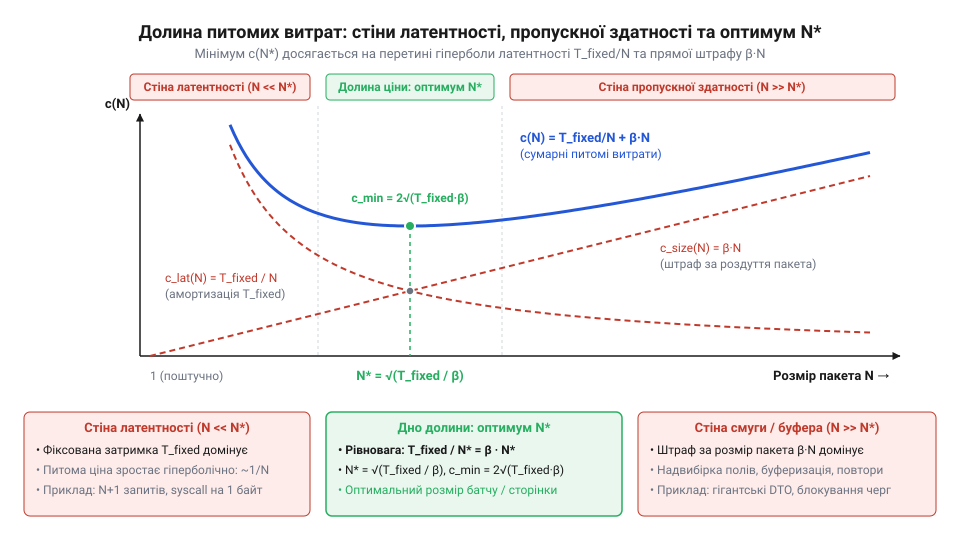
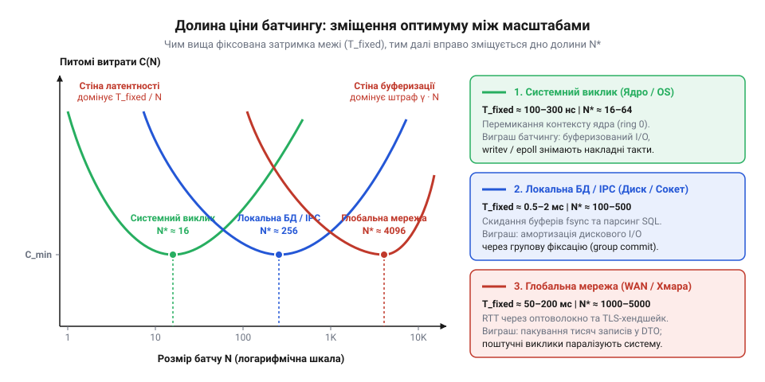

# Ціна межі

## Інженерна дилема: дві крайнощі перетину межі

Уявіть сервіс, що фіксує події телеметрії та має записати десять тисяч записів на диск або надіслати їх віддаленій базі даних. Найпростіший шлях у коді — відкрити цикл і викликати операцію збереження для кожного запису окремо:

```csharp
// Поштучна відправка: поріг перетинається 10 000 разів
foreach (var record in records)
{
    await client.SendAsync(record);
}
```

Така наївна реалізація миттєво обвалює продуктивність системи. Причина полягає не у складності обробки самих даних, а у вартості кожного окремого перетину межі (англ. @@en|overhead@@, накладні витрати). Якщо межею є ядро операційної системи, процесор змушений на кожну операцію перемикати контекст між простором користувача та ядром, зберігати регістри та перевіряти таблиці пам'яті. Якщо межею є мережевий сокет, кожен запис обростає заголовками TCP/IP, кадром TLS-шифрування та очікуванням підтвердження передачі. У результаті процесор витрачає 99% часу не на корисну роботу, а на обслуговування самого факту переходу. Пропускна здатність падає в сотні разів. Цей режим роботи називають стіною латентності (англ. @@en|latency wall@@, від лат. *latens* — прихований, невидимий): дрібнозернисті запити розбиваються об фіксовану затримку каналу.

Природна реакція розробника на стіну латентності — пакетування (англ. @@en|batching@@): якщо перетин межі дорогий, треба перетинати її якомога рідше, збираючи всі дані в один гігантський пакунок. Проте спроба передати всі десять тисяч записів одним масивом натикається на протилежний бар'єр.

По-перше, виникає затримка накопичення: найперший запис не може відправитися, доки в буфер пам'яті не надійде останній, що призводить до катастрофічного зростання часу очікування для клієнтів (англ. @@en|tail latency@@). По-друге, пакунок колосального обсягу вимагає виділення великих неперервних буферів пам'яті для серіалізації (лат. *series* — ряд, послідовність), перевантажуючи збирач сміття та провокуючи зупинки програми. По-третє, великі пакунки стають крихкими: втрата чи пошкодження кількох байтів у мережі призводить до повторного пересилання десятків мегабайтів. Нарешті, надмірне укрупнення часто веде до надвибірки (англ. @@en|over-fetching@@), коли разом із потрібними полями транзитом передаються тонни супутнього баласту. Цю небезпеку називають стіною пропускної здатності (англ. @@en|bandwidth wall@@).

Ціна перетину межі не є монотонно спадною лінією, де більший пакунок завжди вигідніший. Вона утворює інженерну долину ціни (англ. @@en|cost valley@@): ліворуч височіє стіна латентності від поштучних викликів, праворуч — стіна пропускної здатності від надмірного розміру порції, а між ними лежить дно долини, де сумарні витрати системи сягають мінімуму.


*U-подібна долина питомих витрат: гіперболічна стіна латентності ліворуч урівноважується штрафом за надмірний розмір пакунка праворуч, утворюючи точку оптимуму N\*.*

## Декомпозиція часу переходу: фіксований поріг та лінійна передача

Щоб знайти точне дно долини ціни, необхідно формалізувати, з чого саме складається час перетину межі. Розглянемо передачу пакунка розміром `N` елементів.

Загальний час `T(N)`, необхідний для доставки `N` елементів крізь межу, в базовому наближенні описується лінійним рівнянням:

    T(N) = T_fixed + α · N

Цей вираз чітко розмежовує два принципово різні фізичні процеси:

1. `T_fixed` — фіксована латентність ініціалізації переходу (англ. @@en|fixed overhead@@). Це плата за сам факт перетину межі, яка не залежить від кількості переданих даних `N`. Вона сплачується однаково як за один елемент, так і за десять тисяч:
   - Для системного виклику ядра ОС — це апаратне переривання, зміна рівня привілеїв процесора з Ring 3 на Ring 0, збереження регістрів і перемикання таблиць сторінок пам'яті.
   - Для локального IPC чи сокета операційної системи — це витрати на перемикання контексту та планування потоку-отримувача.
   - Для мережевого виклику (RPC / HTTP) — це тривалість подвійного пробігу сигналу лінією зв'язку (англ. @@en|Round-Trip Time@@, RTT), формування заголовків транспортних пакетів і синхронізація протоколу.

2. `α` (альфа) — питомий маржинальний час на один елемент (англ. @@en|marginal cost@@, від лат. *margo* — край, межа). Це додатковий час, який система витрачає на кожен новий елемент, доданий до пакунка. Він складається з часу серіалізації об'єкта в байти `t_ser` та часу фізичної передачі цих байтів крізь канал `t_wire`:

    α = t_ser + S_item / B

де `S_item` — розмір одного серіалізованого елемента в байтах, а `B` — пропускна здатність каналу зв'язку (байтів за секунду).

> 🔧 **Навіщо це.**
> Розкладання часу перетину межі на фіксовану константу T_fixed та лінійний коефіцієнт α дозволяє точно визначити природу вузького місця системи. Якщо вимірювання показують, що T_fixed складає 95% тривалості операції, будь-яка оптимізація алгоритму серіалізації окремих полів чи спроби зменшити розмір класу не дадуть відчутного ефекту: системі допоможе лише збільшення розміру пакунка N. Навпаки, коли частка α · N домінує, канал уже заповнений корисними даними, і подальше збільшення батчу лише погіршить затримку відгуку без приросту пропускної здатності.

Проілюструємо роботу лінійної моделі конкретним інженерним розрахунком. Припустимо, сервіс виконує запити до бази даних через локальну мережу з фіксованою затримкою звернення `T_fixed = 10` мс (0.010 с), а питомий час обробки та пересилання одного рядка становить `α = 0.05` мс (0.00005 с). Необхідно передати 1000 записів.

**Варіант 1: поштучна передача (N = 1)**

Час одного запиту:

    T(1)
    = 10 + 0.05 · 1                  [підстановка у формулу T(N)]
    = 10.05 мс                      [обчислення суми]

Сумарний час передачі 1000 записів:

    T_total
    = 1000 · 10.05 мс                [1000 послідовних викликів]
    = 10050 мс ≈ 10.05 с             [підсумок у секундах]

**Варіант 2: пакетна передача одним викликом (N = 1000)**

Сумарний час одного пакунка:

    T(1000)
    = 10 + 0.05 · 1000               [підстановка у формулу T(N)]
    = 10 + 50                        [множення питомого часу]
    = 60 мс = 0.06 с                 [обчислення суми]

Різниця між 10.05 секунди та 0.06 секунди демонструє прискорення у 167 разів при абсолютно незмінному обсязі корисних даних. Цей колосальний виграш виникає виключно завдяки тому, що фіксований податок `T_fixed` сплачується один раз замість тисячі. Проте саме цей приголомшливий результат породжує небезпечну ілюзію, що розмір `N` можна нарощувати нескінченно — ілюзію, яку розвіює аналіз питомої вартості.

## Питомі витрати та глухий кут наївної моделі

Щоб порівнювати ефективність обробки при різних розмірах пакунка, загального часу `T(N)` недостатньо: передача ста елементів завжди триватиме довше, ніж одного. Архітектурно важливо інше — скільки часу система витрачає на доставку одного корисного елемента.

Цей показник визначає питома вартість (англ. @@en|amortized cost@@, амортизовані витрати, від лат. *admortire* — погашати, знецінювати), яка дорівнює відношенню сумарного часу до кількості елементів:

    c(N)
    = T(N) / N                       [означення питомої вартості]
    = (T_fixed + α · N) / N          [підстановка базової моделі T(N)]
    = T_fixed / N + α                [почленне ділення]

Отримане рівняння розкриває внутрішню математичну механіку межі:

    c(N) = T_fixed / N + α

При мінімальному розмірі пакунка `N = 1` вся фіксована латентність лягає на єдиний елемент:

    c(1) = T_fixed + α

Якщо `T_fixed = 10` мс, а `α = 0.05` мс, то питома ціна одного запису складає `10.05` мс. У цьому стані фіксований бар'єр перевищує корисну роботу у двісті разів. Це і є аналітичний вираз стіни латентності: член `T_fixed / N` має форму рівнобічної гіперболи (грец. *hyperbole* — перебільшення) і в околі одиниці сягає свого максимуму.

Зі зростанням `N` дріб `T_fixed / N` швидко прямує до нуля. Поведінка системи на нескінченності визначається границею:

    lim_{N → ∞} c(N)
    = lim_{N → ∞} (T_fixed / N + α)
    = 0 + α                          [границя спадної гіперболи]
    = α

Якщо дослідити першу похідну функції `c(N)` за аргументом `N`:

    c'(N)
    = d/dN (T_fixed · N⁻¹ + α)
    = -T_fixed · N⁻²                 [правило диференціювання степеневої функції]
    = -T_fixed / N²

Оскільки `T_fixed > 0` та `N > 0`, значення похідної `c'(N)` є строго від'ємним для будь-якого `N`. Функція монотонно спадає на всій області визначення.

Звідси виникає парадокс і глухий кут наївної лінійної моделі. Формула стверджує: чим більший пакунок ми збираємо, тим менші питомі витрати; найвигідніший розмір пакунка досягається при `N → ∞`. Наївна математика підштовхує інженера накопичувати батчі доти, доки не вичерпається оперативна пам'ять, встановлювати розмір сторінки у вибірці бази даних на мільйон рядків чи надсилати весь масив даних одним гігантським HTTP-запитом.

Проте будь-яка реальна система, налаштована за наївною моделлю, неминуче зазнає краху. Потоки блокуються в очікуванні заповнення буфера, збирач сміття зупиняє процес для очищення гігабайтних масивів, а поодинокі збої мережі змушують пересилати колосальні обсяги даних наново. Лінійна модель правильно описує ліву стіну латентності, але абсолютно сліпа до правої стіни — стіни пропускної здатності.

## Формалізація правої стіни: надвибірка, затримка накопичення та квадратичний штраф

Щоб модель відповідала дійсності, необхідно формалізувати сили, які карають систему за надмірне укрупнення пакунка. У реальному середовищі діють три фізичні фактори деградації:

1. **Затримка накопичення (буферизація):** дані надходять у систему потоком з інтенсивністю `λ` (елементів за секунду, лат. *accumulare* — нагромаджувати). Щоб зібрати батч розміром `N`, перший елемент змушений очікувати в пам'яті середній час `t_wait = N / (2 · λ)`. При `N = 1` очікування відсутнє; при `N = 10 000` затримка стає неприпустимою для чутливих до відгуку систем.
2. **Тиск на пам'ять та алокації:** створення великих неперервних структур для серіалізації спричиняє витіснення процесорного кешу (лат. *evictio* — виселення) та зростання навантаження на збирач сміття, який змушений переміщувати важкі об'єкти між поколіннями пам'яті.
3. **Надвибірка та ризик ретрансмісії:** чим більший пакунок запитує клієнт (наприклад, сторінку у 5000 записів), тим вища ймовірність, що більшість цих даних ніколи не будуть використані (англ. @@en|over-fetching@@), або що помилка в одному байті вимагатиме повторного передавання всього багатомегабайтного кадру.

У сумарному часі роботи системи `T(N)` ці фактори проявляються як додатковий штраф, що зростає надлінійно — пропорційно квадрату розміру пакунка:

    T_penalty(N) = β · N²

де `β` (бета) — коефіцієнт деградації розміру (англ. @@en|degradation coefficient@@). Він має розмірність часу на квадрат елемента і фіксує чутливість конкретної архітектури до роздування пакунків.

Враховуючи штраф за розмір, повний час операції набуває квадратичної форми:

    T(N) = T_fixed + α · N + β · N²

Тепер знайдемо оновлену функцію питомих витрат на одиницю корисних даних `c(N)`:

    c(N)
    = T(N) / N                       [ділення загального часу на N]
    = (T_fixed + α · N + β · N²) / N [підстановка розширеної моделі]
    = T_fixed / N + α + β · N        [почленне спрощення]

Ми отримали повне аналітичне рівняння долини ціни:

    c(N) = T_fixed / N + α + β · N

Функція складається з трьох доданків із чітким фізичним змістом:

- `T_fixed / N` — гіпербола латентності, що спадає при зростанні `N` і формує ліву стіну долини.
- `α` — базовий поріг передачі одного елемента, що задає теоретичний нижній рівень витрат.
- `β · N` — лінійний штраф розміру, що нестримно зростає при збільшенні `N` і зводить праву стіну долини.

> 🔧 **Навіщо це.**
> Значення коефіцієнта β пояснює, чому не існує «абсолютно безкоштовного батчингу». У кожній системі затримка накопичення буфера та витрати на серіалізацію великих структур діють як прихований податок на розмір. Якщо архітектор налаштовує розмір сторінки в базі даних або буфер черги повідомлень, спираючись лише на пропускну здатність каналу (α) і забуваючи про внутрішній оверхед пам'яті (β), система неминуче перетне дно долини та потрапить у зону високих затримок і нестабільності пам'яті.

Проілюструємо, як штраф `β · N` розвертає поведінку системи. Нехай у попередньому прикладі `T_fixed = 10` мс, `α = 0.05` мс, а коефіцієнт деградації становить `β = 0.001` мс на елемент.

**При N = 1 (поштучна передача):**

    c(1)
    = 10 / 1 + 0.05 + 0.001 · 1      [підстановка у формулу c(N)]
    = 10 + 0.05 + 0.001
    = 10.051 мс                      [домінує латентність T_fixed]

**При N = 100 (помірний батч):**

    c(100)
    = 10 / 100 + 0.05 + 0.001 · 100  [підстановка у формулу c(N)]
    = 0.10 + 0.05 + 0.10
    = 0.25 мс                        [витрати впали у 40 разів]

**При N = 1000 (надмірний пакунок):**

    c(1000)
    = 10 / 1000 + 0.05 + 0.001 · 1000 [підстановка у формулу c(N)]
    = 0.01 + 0.05 + 1.00
    = 1.06 мс                        [домінує штраф β · N]

Якщо при переході від `N = 1` до `N = 100` питома вартість впала з 10.05 мс до 0.25 мс завдяки амортизації `T_fixed`, то при подальшому зростанні до `N = 1000` вартість знову зросла у чотири рази — до 1.06 мс, оскільки член `β · N = 1.00` мс повністю перекрив виграш від батчингу. Система опинилася на правому схилі долини ціни.

## Аналітичний вивід оптимального пакунка N* та теорема рівноваги

Маючи повну функцію питомих витрат `c(N) = T_fixed / N + α + β · N`, ми можемо перейти від емпіричного підбору до точного аналітичного розрахунку екстремуму (лат. *extremum* — крайній). Наша мета — знайти таке значення `N*`, при якому питома вартість обслуговування досягає абсолютного мінімуму.

З курсу математичного аналізу відомо, що гладка функція досягає локального екстремуму в точці, де її перша похідна дорівнює нулю. Виконаємо диференціювання (лат. *differentia* — різниця) функції `c(N)` за розміром пакунка `N`:

    c'(N)
    = d/dN (T_fixed · N⁻¹ + α + β · N)
    = -T_fixed · N⁻² + 0 + β         [диференціювання кожного доданка]
    = -T_fixed / N² + β              [зведення до зручного дробу]

Прирівняємо першу похідну до нуля, щоб знайти стаціонарну точку:

    -T_fixed / N² + β = 0
    β = T_fixed / N²                 [перенесення доданка]
    N² · β = T_fixed                 [множення обох частин на N²]
    N² = T_fixed / β                 [ділення на β]
    N* = √(T_fixed / β)              [взяття квадратного кореня при N > 0]

Перевіримо, чи дійсно знайдена точка є точкою мінімуму, дослідивши знак другої похідної:

    c''(N)
    = d/dN (-T_fixed · N⁻² + β)
    = 2 · T_fixed · N⁻³ + 0          [диференціювання степеневої функції]
    = 2 · T_fixed / N³

Оскільки як фіксована латентність `T_fixed`, так і розмір пакунка `N` завжди додатні (`T_fixed > 0`, `N > 0`), друга похідна `c''(N)` є строго більшою за нуль на всій додатній півосі. Це гарантує, що функція є строго опуклою (лат. *convexus* — вигнутий, опуклий), а знайдена точка `N*` — єдиним глобальним мінімумом питомих витрат.

Підставивши знайдений оптимум `N*` назад у формулу, ми відкриваємо фундаментальний принцип — **теорему інженерної рівноваги** (лат. *aequilibrium* — рівна вага). Обчислимо значення двох конкуруючих доданків у точці мінімуму:

Питома частка фіксованої латентності:

    T_fixed / N*
    = T_fixed / √(T_fixed / β)       [підстановка N*]
    = √(T_fixed² / (T_fixed / β))    [внесення під корінь]
    = √(T_fixed · β)                 [скорочення T_fixed]

Питома частка штрафу за розмір:

    β · N*
    = β · √(T_fixed / β)             [підстановка N*]
    = √(β² · T_fixed / β)            [внесення під корінь]
    = √(T_fixed · β)                 [скорочення β]

Обидва доданки виявилися абсолютно рівними:

    T_fixed / N* = β · N* = √(T_fixed · β)

У точці оптимального пакунка `N*` питомі витрати на подолання фіксованої латентності точно дорівнюють питомим втратам від деградації розміру пакунка. Дно долини ціни досягається не тоді, коли латентність повністю знищена, а тоді, коли плата за латентність зрівнюється з платою за розмір.

Мінімальна досяжна питома вартість перетину межі становить:

    c(N*)
    = T_fixed / N* + α + β · N*      [підстановка N*]
    = √(T_fixed · β) + α + √(T_fixed · β)
    = α + 2 · √(T_fixed · β)

Будь-який відхил від `N*` ліворуч викликає перевитрати через домінування стіни латентності, а будь-який відхил праворуч — перевитрати через стіну пропускної здатності.

## Інженерний розрахунок для різних архітектурних масштабів

Формула `N* = √(T_fixed / β)` доводить, що універсального «найкращого» розміру батчу чи сторінки в комп'ютерній інженерії не існує. Оптимум визначається виключно співвідношенням фіксованого податку межі до коефіцієнта її перевантаження.

Порівняємо три характерні архітектурні масштаби, з якими щодня працює розробник:

1. **Межа ядра операційної системи (системні виклики через `io_uring`):**
   - Фіксований поріг: перемикання контексту Ring 3 → Ring 0 займає близько `T_fixed = 100` нс (`10⁻⁷` с).
   - Коефіцієнт деградації: визначається витісненням кешу L1 і становить приблизно `β = 0.1` нс на операцію (`10⁻¹⁰` с).
   - Оптимальний розмір черги:

    N* = √(100 / 0.1) = √1000 ≈ 32 операції

   Саме цим пояснюється стандартний вибір глибини черги відправки (submission queue) у 32–64 слоти в ядрі Linux: менше значення недовантажує ядро, більше — вимиває процесорний кеш.

2. **Межа локальної бази даних (JDBC/ORM `fetchSize`):**
   - Фіксований поріг: RTT локальної мережі датацентру та парсинг SQL-запиту займають `T_fixed = 1` мс (`0.001` с).
   - Коефіцієнт деградації: утримання курсору та виділення пам'яті під DTO дають `β = 0.0001` мс на рядок (`10⁻⁷` с).
   - Оптимальний розмір сторінки:

    N* = √(1 / 0.0001) = √10000 = 100 рядків

   Ось чому в більшості клієнтів СУБД (PostgreSQL, Oracle) розмір порції вибірки за замовчуванням зафіксовано на рівні 50–100 рядків: це точка найменшої сумарної затримки.

3. **Межа глобальної мережі (міжсервісний REST/gRPC API через WAN):**
   - Фіксований поріг: міжконтинентальний RTT, проходження шлюзів і TLS-хендшейк вимагають `T_fixed = 50` мс (`0.05` с).
   - Коефіцієнт деградації: відносно низький затримковий штраф фонової обробки `β = 0.00005` мс на об'єкт (`5 · 10⁻⁸` с).
   - Оптимальний пакунок синхронізації:

    N* = √(50 / 0.00005) = √1000000 = 1000 об'єктів


*Зсув оптимального пакунка між масштабами: зі зростанням фіксованої латентності T_fixed дно долини зсувається вправо — від десятків викликів у ядрі до тисяч об'єктів у глобальній мережі.*

> 🔧 **Навіщо це.**
> Знання аналітичної формули дозволяє виконувати аналіз чутливості (англ. @@en|sensitivity analysis@@) системи до змін середовища. Оскільки оптимальний розмір пакунка залежить від квадратного кореня відношення, він володіє високою природною стійкістю. Якщо затримка мережі `T_fixed` раптово зростає вчетверо (наприклад, через аварійне перемикання на резервний датацентр), оптимальний розмір пакунка `N*` повинен зрости лише вдвічі (`√4 = 2`). І навпаки: якщо розмір об'єкта подвоївся, збільшивши `β` у два рази, розмір батчу слід зменшити лише в `√2 ≈ 1.41` раза. Замість хаотичного підбору навмання архітектор дістає точний компас для масштабування буферів під будь-які зміни навантаження.
