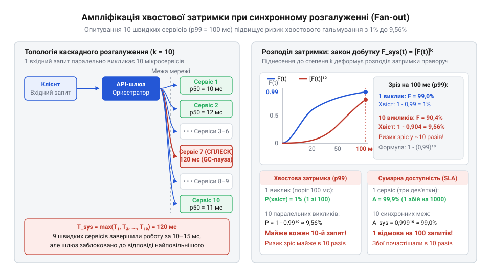
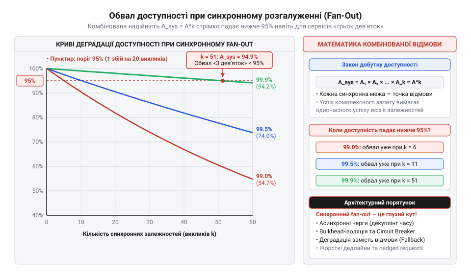
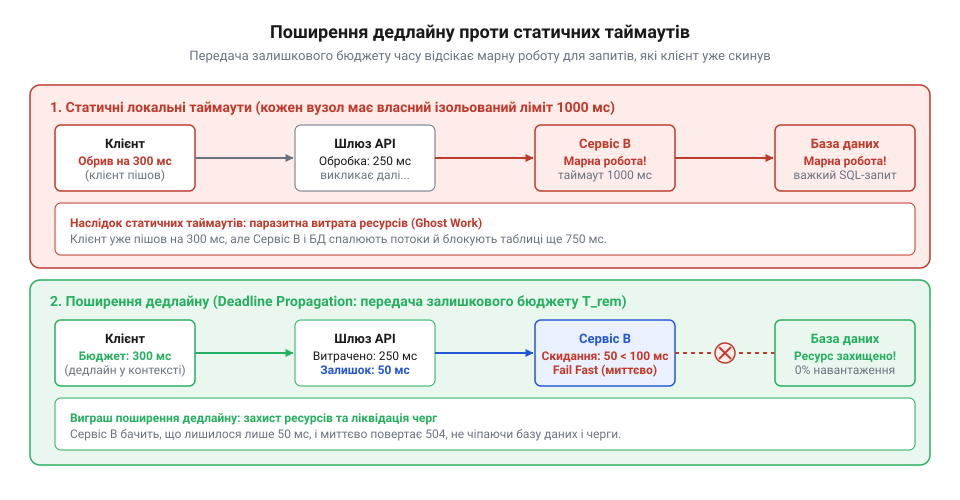

# Ціна межі

## Ілюзія швидких компонентів: пастка синхронного розгалуження

При переході від монолітної структури до розподілених модулів чи мікросервісів інженери часто спираються на оманливу інтуїцію. Архітектура ділиться на чіткі ізольовані контексти: сервіс кліматичного контролю, підсистема датчиків безпеки, модуль розумного освітлення, трекер енергоспоживання. Кожен сервіс проєктується окремо й демонструє чудові показники швидкодії на синтетичних тестах: медіанний час відгуку (медіана — від лат. *medianus* — середній; 50-й перцентиль, `p50`) становить лише 10 мілісекунд, а так званий хвостовий 99-й перцентиль (перцентиль — від лат. *per centum* — на сотню, `p99`) надійно вкладається у 100 мілісекунд. На папері система виглядає надзвичайно стрімкою: 99 звернень із кожної сотні завершуються практично непомітно для людського ока.

Справжня проблема виникає тоді, коли користувач відкриває головний екран панелі керування будинком Digital Homes. Щоб сформувати зведену картину житла, веб-шлюз API застосовує патерн розгалуження (@@en|fan-out@@; розгалуження — термін запозичено з цифрової схемотехніки, де він позначає кількість логічних входів, керованих одним виходом; топологія — від грец. *topos* — місце, та *logos* — вчення). Шлюз паралельно надсилає синхронні (від грец. *syn* — разом, та *chronos* — час) виклики до `k = 20` або `k = 50` незалежних мікросервісів і збирає їхні результати в один підсумковий об'єкт DTO.

У цей момент система зазнає колапсу. Замість очікуваного відгуку за 10–20 мілісекунд мобільний застосунок регулярно зависає на кілька секунд, екран зустрічає користувача порожніми блоками або зривається з помилкою вичерпання ліміту очікування шлюзу (HTTP 504 Gateway Timeout). Розробники відкривають графіки окремих сервісів і не бачать аномалій: кожен компонент продовжує справно звітувати про медіану в 10 мс і стабільний `p99` у 100 мс.

Парадокс криється у фундаментальній невідповідності між середньостатистичною поведінкою окремого вузла та системною затримкою агрегованого виклику. Латентність (від лат. *latens* — прихований, невидимий; затримка між надсиланням запиту та отриманням результату) складеної операції в синхронній топології диктується не типовими швидкими відповідями, а найповільнішим учасником обміну. Шлюз не має права завершити формування звіту, поки не повернеться останній пакет даних.

Якщо кожен окремий сервіс має лише 1% повільних відповідей, людська інтуїція підказує, що й уся система стикатиметься із затримкою лише в 1% випадків. Проте теорія ймовірностей свідчить про протилежне: чим ширшим є віяло синхронного перетину меж, тим вища ймовірність того, що бодай один компонент спіткнеться об локальний сплеск затримки й змусить чекати всю систему. Цей феномен називається посиленням хвоста затримки (@@en|tail latency@@), і без точного математичного апарату його неможливо передбачити чи усунути.

> 🔧 **Навіщо це.**
> Уявлення про те, що паралельне виконання нівелює час очікування, є однією з найруйнівніших ілюзій мікросервісної архітектури. Розуміння природи синхронного розгалуження захищає команду від побудови «розподіленого моноліту», де незалежні сервіси формально відокремлені мережею, але під час кожного запиту зв'язуються в тугий вузол взаємних блокувань і множення затримок.

## Імовірнісна модель розгалуження: розподіл екстремальних значень

Щоб перейти від якісного здивування до кількісного розрахунку, формалізуємо процес синхронного розгалуження мовою математичної статистики. Розглянемо архітектурний вузол, який під час обробки вхідного запиту паралельно звертається через мережеві межі до `k` незалежних компонентів.

Позначимо час очікування відповіді від `i`-го компонента через випадкову величину `Tᵢ`, де `i ∈ {1, 2, ..., k}`. Кожна випадкова величина описується своєю кумулятивною функцією розподілу ймовірностей (@@en|cumulative distribution function@@, CDF; кумулятивний — від лат. *cumulare* — накопичувати):

```
Fᵢ(t) = P(Tᵢ ≤ t)
```

Функція `Fᵢ(t)` визначає ймовірність того, що `i`-й компонент поверне результат не пізніше моменту часу `t`. Відповідно, ймовірність затримки понад час `t` становить `1 - Fᵢ(t)`.

Оскільки клієнтський запит чекає на прибуття абсолютно всіх відповідей, підсумкова тривалість роботи системи `T_sys` є точною випадковою величиною максимуму:

```
T_sys = max(T₁, T₂, ..., Tₖ)
```

Система завершить свою роботу за час, менший або рівний `t`, тоді й лише тоді, коли кожен без винятку з `k` компонентів вкладеться у часовий поріг `t`. Подія `T_sys ≤ t` еквівалентна логічному перетину `k` незалежних подій:

```
(T_sys ≤ t) ⇔ (T₁ ≤ t ∧ T₂ ≤ t ∧ ... ∧ Tₖ ≤ t)
```

Припустимо, що затримки компонентів є взаємно незалежними випадковими величинами (вихідні запити обробляються окремими фізичними вузлами без спільного ресурсу блокування). За правилом множення ймовірностей для незалежних подій, кумулятивна функція розподілу часу виконання системи набуває вигляду добутку:

```
P(T_sys ≤ t)
= P(T₁ ≤ t ∧ T₂ ≤ t ∧ ... ∧ Tₖ ≤ t)   [одночасне завершення всіх викликів]
= ∏_{i=1}ᵏ P(Tᵢ ≤ t)                  [правило добутку для незалежних подій]
= ∏_{i=1}ᵏ Fᵢ(t)                      [підстановка індивідуальних функцій розподілу]
```

Якщо всі `k` компонентів належать до однорідного пулу сервісів або мають ідентичні профілі латентності `F₁(t) = F₂(t) = ... = Fₖ(t) = F(t)`, розподіл підсумкового часу відгуку системи спрощується до чистого піднесення у степінь:

```
F_sys(t)
= [F(t)]ᵏ                             [піднесення функції розподілу до степеня k]
```


*Крива кумулятивної функції розподілу часу відгуку: піднесення F(t) до степеня k деформує криву, зміщуючи 99-й перцентиль далеко праворуч у зону екстремальних затримок.*

Ця проста степенева залежність викриває жорстоку асиметрію. Розглянемо квантиль (від лат. *quantus* — скільки, якого розміру) або перцентиль системи рівня `q ∈ (0, 1)`. Час `t_q`, який гарантує успішне виконання всієї системи з імовірністю `q`, визначається рівнянням:

```
F_sys(t_q) = q
[F(t_q)]ᵏ = q
F(t_q)
= q^(1/k)                             [знаходження необхідної надійності компонента]
```

Оскільки число `q < 1`, піднесення його до дробового степеня `1/k` (де `k ≥ 1`) різко наближає результат до одиниці. Розрахуємо, якої надійності вимагає система з віялом `k = 50` викликів для забезпечення системного 99-го перцентиля (`q = 0.99`):

```
F(t_p99)
= 0.99^(1/50)                         [підстановка значень q = 0.99 та k = 50]
= 0.99^0.02
≈ 0.9998 (99.98%)                     [розрахунок необхідного квантиля компонента]
```

Отриманий результат вражає: щоб уся система вкладалася у свій 99-й перцентиль, кожен окремий мікросервіс у цей самий проміжок часу зобов'язаний демонструвати надійність 99.98% (майже чотири дев'ятки). Час, який для системи є звичайною межею p99, для окремого компонента відповідає глибокій хвостовій зоні рідкісних аномалій.

> 🔧 **Навіщо це.**
> Математична формула `F_sys(t) = [F(t)]ᵏ` переводить розмову про затримки з площини суб'єктивних надій у площину суворої аналітики. Вона доводить, що вимога системного SLA не може бути задоволена простим вибором компонентів із таким самим номінальним SLA: кожен додатковий синхронний виклик через межу процесу експоненційно підвищує вимоги до надійності кожного окремого вузла.

## Механіка посилення хвоста: як рідкісний викид стає нормою

Степенева залежність функції розподілу `F_sys(t) = [F(t)]ᵏ` приховує математичну закономірність, яка на практиці обертається повною деградацією користувацького досвіду. Щоб усвідомити масштаб цієї катастрофи, подивимося на процес не з погляду успішного вкладання в час, а з погляду ймовірності зіткнення з повільною відповіддю.

Нехай кожен окремий сервіс має фіксований 99-й перцентиль затримки `t_p99` (наприклад, 100 мілісекунд). За означенням квантиля, імовірність того, що одиничний виклик вкладеться у цей поріг, становить `F(t_p99) = 0.99`, а ймовірність потрапити в повільний хвіст дорівнює лише одному відсотку: `1 - F(t_p99) = 0.01`. Здається, що один випадок на сотню — це зневажливо мала величина, якою можна знехтувати під час повсякденної експлуатації.

Проте для комплексного клієнтського запиту, що розгалужується на `k` паралельних викликів, уся система затримається понад час `t_p99`, якщо **бодай один** із `k` сервісів перевищить цей поріг. Обчислимо ймовірність виникнення хвостової затримки системи `P_tail`:

```
P_tail
= P(T_sys > t_p99)                    [імовірність перевищення порогу системою]
= 1 - P(T_sys ≤ t_p99)                [перехід до протилежної події]
= 1 - [F(t_p99)]ᵏ                    [закон добутку для k незалежних сервісів]
= 1 - 0.99ᵏ                          [підстановка значення 99-го перцентиля]
```

Простежимо, як змінюється величина `P_tail` зі зростанням ширини розгалуження `k`:

- При `k = 1` (одиночний виклик): `P_tail = 1 - 0.99¹ = 0.01 (1%)`. Повільним є лише 1 запит зі 100.
- При `k = 10` (невеликий шлюз): `P_tail = 1 - 0.99¹⁰ ≈ 1 - 0.904 = 0.096 (9.6%)`. Уже майже кожен десятий запит користувача стикається із затримкою.
- При `k = 50` (типова агрегація панелі керування Digital Homes): `P_tail = 1 - 0.99⁵⁰ ≈ 1 - 0.605 = 0.395 (39.5%)`. Майже 40% усіх користувацьких запитів зазнають хвостового гальмування.
- При `k = 100` (розгалужена мікросервісна мережа): `P_tail = 1 - 0.99¹⁰⁰ ≈ 1 - 0.366 = 0.634 (63.4%)`. Майже дві третини запитів спотикаються об хвіст.

Цей процес називається ампліфікацією або посиленням хвоста затримки (@@en|tail latency amplification@@; ампліфікація — від лат. *amplificatio* — розширення, посилення). Подія, яка для одиничного компонента є рідкісною аномалією (1 збій на 100 викликів), у системі з великим розгалуженням перетворюється на звичайний, домінуючий стан речей. Користувач не сприймає систему як «сукупність швидких мікросервісів»; він бачить додаток, який гальмує у більшості звернень.

Причини появи локальних хвостових викидів мають об'єктивну фізичну природу, спільну для сучасних операційних систем та віртуалізованих середовищ:

1. **Паузи збирача сміття (GC pauses).** Сучасні керовані платформи (Java, .NET, Go) періодично призупиняють виконання потоків програми для впорядкування пам'яті (паузи `stop-the-world`). Навіть якщо пауза триває лише 50–100 мілісекунд і трапляється раз на кілька хвилин, для 50 паралельно опитуваних сервісів імовірність того, що хоча б один із них у цей момент очищує пам'ять, наближається до невідворотності.
2. **Втрата пакетів і таймаути повторного передавання (TCP RTO).** У перевантажених комутаторах дата-центрів виникають мікросплески трафіку, які переповнюють буфери мережевих карт. Втрата пакета змушує стек TCP чекати таймера ретрансмісії (@@en|retransmission timeout@@, RTO; від лат. *transmissio* — пересилання). За замовчуванням мінімальний поріг RTO в ядрі Linux становить 200 мілісекунд, що миттєво катапультує виклик у глибокий хвіст затримки.
3. **Конкуренція за спільні ресурси та «галасливі сусіди» (noisy neighbors).** Фонове скидання брудних сторінок пам'яті на диск (`fsync`), перемикання контексту ядра та конкуренція за кеш процесора L3 у хмарних контейнерах спричиняють короткочасні сплески виконання інструкцій.

Усі ці мікроскопічні затримки на рівні окремого вузла безпечно тонуть у медіані. Проте синхронний перетин багатьох меж немов пилосос збирає всі ці рідкісні флуктуації з усієї системи в один клієнтський запит.

> 🔧 **Навіщо це.**
> Розуміння ампліфікації хвоста позбавляє команду від наївних спроб вирішити проблему швидкодії мікросервісів оптимізацією середнього часу відгуку. Прискорювати швидкі запити (зменшувати медіану з 10 до 5 мс) у топологіях розгалуження практично марно: підсумковий час усе одно визначить найгірший виклик із хвоста, тому всі зусилля мають спрямовуватися на зрізання хвостових перцентилів (p99 та p99.9).

## Мультиплікативний колапс доступності: ціна надійності меж

Поряд із руйнуванням часових бюджетів синхронне розгалуження завдає нищівного удару по загальній доступності системи (доступність — від праслов. *stǫpati — ступати, доходити). Архітектори нерідко вважають, що коли кожен сервіс у хмарі має сертифікований рівень доступності за угодою про рівень обслуговування (@@en|Service Level Agreement@@, SLA; угода — від праслов. *goditi — ладнати, підходити) у 99.9% («три дев'ятки»), то й уся система гарантовано працює надійно. Це ще одна математична ілюзія.

Формалізуємо поняття доступності для композитного запиту. Позначимо через `Aᵢ` доступність `i`-го компонента системи, тобто ймовірність того, що він опрацює надісланий запит успішно (поверне валідний результат без системної паніки, внутрішньої помилки сервера чи розриву з'єднання):

```
Aᵢ = P(успіх_i)
```

Якщо для побудови фінальної відповіді потрібні дані від усіх `k` сервісів без винятку (жорстке зв'язування, де відсутність температури, статусу замка чи показників лічильника вважається зривом операції), то комплексний запит вважається успішним лише за умови бездоганного спрацьовування кожного учасника:

```
(успіх_sys) ⇔ (успіх₁ ∧ успіх₂ ∧ ... ∧ успіхₖ)
```

За припущення, що відмови окремих компонентів є статистично незалежними подіями (збої спричиняються локальними помилками пам'яті, дефектами коду чи перезавантаженнями вузлів), системна доступність `A_sys` підпорядковується правилу множення ймовірностей:

```
A_sys
= P(успіх₁ ∧ успіх₂ ∧ ... ∧ успіхₖ)   [умова безвідмовного виконання всього запиту]
= ∏_{i=1}ᵏ P(успіх_i)                 [правило множення для незалежних подій]
= ∏_{i=1}ᵏ Aᵢ                        [підстановка доступностей окремих меж]
```

Для однорідної системи, де кожен компонент гарантує однаковий рівень доступності `A`, формула вироджується у степеневий спад:

```
A_sys
= Aᵏ                                 [степеневий закон комбінованої доступності]
```


*Криві комбінованої доступності системи залежно від ширини розгалуження k: експоненційний колапс надійності при синхронному об'єднанні компонентів із показниками 99.9%, 99.5% та 99%.*

Проведемо розрахунок системної доступності для інженерного стандарту «трьох дев'яток» (`A = 0.999`, що допускає лише 1 відмову на 1000 запитів):

- При `k = 1` (прямий виклик): `A_sys = 0.999¹ = 0.999 (99.9%)`. Помилкою завершується 1 запит із 1000.
- При `k = 10` (невелике розгалуження): `A_sys = 0.999¹⁰ ≈ 0.990 (99.0%)`. Доступність падає на цілий порядок: тепер падає вже 10 запитів із 1000 (1%).
- При `k = 50` (повноцінний екран панелі керування): `A_sys = 0.999⁵⁰ ≈ 0.951 (95.1%)`. Система втрачає доступність на 5%: кожен двадцятий запит користувача завершується збоєм.
- При `k = 100` (велика сервісна топологія): `A_sys = 0.999¹⁰⁰ ≈ 0.905 (90.5%)`. Падає майже кожен десятий запит користувача.

Якщо ж окремі сервіси мають доступність на рівні «двох дев'яток» (`A = 0.99`, допустимо 1% помилок), то вже при `k = 50` комбінована доступність становить `0.99⁵⁰ ≈ 0.605` (60.5%). Це означає, що система перебуває в стані відмови майже для половини користувацьких звернень, хоча кожен окремий розробник гордо звітує про 99% успішних відповідей свого сервісу.

Таке катастрофічне просідання називається мультиплікативним колапсом доступності (мультиплікативний — від лат. *multiplicare* — множити; колапс — від лат. *collapsus* — спадання, руйнування). Синхронне перетинання великої кількості меж процесів чи мережі експоненційно помножує нестійкість. Надійна система не може бути побудована як просте синхронне віяло навіть із дуже надійних блоків.

> 🔧 **Навіщо це.**
> Математичний розрахунок комбінованої доступності доводить неможливість побудови масштабованих систем на суворому синхронному об'єднанні залежностей. Якщо кожен сервіс є обов'язковим для формування відповіді, загальна надійність завжди буде суттєво гіршою за надійність найгіршого з компонентів. Це вимагає від архітектора обов'язкового запровадження тактик відмовостійкості: виділення необов'язкових гілок виклику, повернення збережених у кеші даних при збої та часткової деградації функціональності.

## Бюджетування затримок і поширення дедлайнів

Усвідомлення математичної неминучості хвостових затримок змушує архітектора відмовитися від наївного очікування відповідей «до переможного кінця». Якщо не встановити жорстких просторово-часових рамок, синхронне віяло перетворюється на чорну діру, яка затягує ресурси всієї інфраструктури. Інженерною відповіддю на цю загрозу є бюджетування затримки (@@en|latency budget@@; бюджет — від старофр. *bougette* — шкіряний мішок, гаманець) та механізм наскрізного поширення дедлайнів.

Будь-який користувацький сценарій має гранично допустимий час виконання `T_budget`, зафіксований у бізнес-вимогах (наприклад, мобільна панель Digital Homes мусить змалювати віджет за 500 мілісекунд). Якщо обробка запиту складається з послідовного ланцюжка з `m` стадій, на одній із яких відбувається паралельне розгалуження до `k` незалежних сервісів, загальний час виконання виражається композицією суми та максимуму:

```
T_total
= T_seq + T_parallel                  [декомпозиція критичного шляху запиту]
= ∑_{j=1}ᵐ t_j + max(T₁, T₂, ..., Tₖ) [сума послідовних кроків та максимум паралельного віяла]
≤ T_budget                            [фундаментальне обмеження наскрізного бюджету]
```

Традиційний підхід до контролю цього обмеження спирається на локальні статичні таймаути (статичний — від грец. *statikos* — той, що стоїть нерухомо). Кожен розробник виставляє таймаут для свого клієнта навмання: веб-шлюз чекає сервіс клімату 1 секунду, сервіс клімату чекає драйвер термостата 1 секунду, а той чекає відповіді від бази даних ще 1 секунду. Така конфігурація є катастрофічним архітектурним антипатерном.

Якщо база даних підвисає, клієнт на веб-шлюзі чекає 1 секунду, вичерпує ліміт і повертає користувачеві помилку HTTP 504. Проте проміжні сервіси нічого про це не знають! Сервіс клімату продовжує тримати потік і чекати термостат, термостат чекає базу даних, а база сумлінно витрачає цикли процесора та пам'ять на виконання важкого SQL-запиту. Клієнт уже закрив вкладку або натиснув кнопку оновлення, але система продовжує спалювати ресурси на виконання мертвої, приреченої роботи (@@en|doomed work@@). За напливу користувачів такі «забуті» запити миттєво забивають пули потоків сервісів і провокують каскадний колапс усієї платформи.


*Порівняння двох підходів до таймаутів: каскадне вичерпання ресурсів при незалежних локальних таймаутах зверху проти миттєвого відсікання безнадійних викликів механізмом поширення дедлайну знизу.*

Математично коректним розв'язком є наскрізне поширення дедлайнів (@@en|deadline propagation@@; дедлайн — від англ. *deadline* — лінія, за яку не можна переходити). Замість передавання відносних таймаутів шлюз під час створення запиту фіксує єдину абсолютну точку часу на осі координат:

```
T_deadline
= t_start + T_budget                  [фіксація абсолютної часової межі]
```

Ця мітка `T_deadline` пакується в метадані запиту (наприклад, у заголовок `grpc-timeout` у протоколі gRPC або HTTP-заголовок `Request-Timeout`) і подорожує разом із викликом крізь усі архітектурні межі. Кожен проміжний вузол системи перед початком будь-якої операції чи відправленням запиту далі розраховує залишковий бюджет часу `t_remain`:

```
t_remain
= T_deadline - t_now                  [розрахунок залишку життєвого циклу запиту]
```

Якщо `t_remain ≤ 0`, запит автоматично вважається простроченим. Вузол негайно перериває обробку, скасовує заплановані звернення до баз даних і повертає статус помилки скасування (`Canceled` або `DeadlineExceeded`). Безнадійна робота не виконується жодної мілісекунди.

> 🔧 **Навіщо це.**
> Поширення дедлайнів перетворює систему таймаутів із хаотичного набору ізольованих затримок на координований захисний екран. Воно запобігає «зомбі-запитам», гарантує, що час реакції системи ніколи не перевищить бюджет `T_budget`, і захищає внутрішні рівні архітектури від перевантаження в моменти зовнішніх збоїв.

## Архітектурні запобіжники: геджування, відсіки та асинхронний злам

Хоча поширення дедлайнів захищає інфраструктуру від перевантаження, саме по собі воно не вирішує головної проблеми: відсікання запитів за таймаутом лише перетворює затримки на системні збої, знижуючи показник комбінованої доступності `A_sys`. Щоб розірвати прокляття формул `[F(t)]ᵏ` та `Aᵏ`, необхідні конструктивні архітектурні патерни пом'якшення.

### 1. Геджування дубльованими запитами (Hedged Requests)

Фундаментальний прорив у боротьбі з хвостовими затримками описали Джеффрі Дін та Луїс Андре Баррозо у праці «The Tail at Scale» (2013). Замість очікування, поки єдиний запит спіткнеться об локальний сплеск затримки, клієнт застосовує патерн геджування (геджування — від англ. *hedge* — захисна огорожа, страхування ризику):

1. Клієнт надсилає запит до першої репліки сервісу.
2. Якщо відповідь не надійшла протягом очікуваного часу 95-го перцентиля `t_p95` (наприклад, за 20 мс), клієнт, не розриваючи першого з'єднання, паралельно відправляє точно такий самий дубльований запит до іншої репліки цього ж сервісу.
3. Щойно надходить перша успішна відповідь від будь-якої з двох реплік, вона негайно повертається клієнту, а другий виклик миттєво скасовується (патерн зв'язаних запитів, @@en|tied requests@@).

Математична перевага геджування полягає в тому, що воно створює мінімальне навантаження на систему при гігантському скороченні хвоста. Оскільки поріг `t_p95` перевищують лише 5% викликів, додатковий потік дубльованих запитів збільшує навантаження на кластер лише на 5%:

```
Навантаження_додаткове
= 1 - F(t_p95)
= 1 - 0.95
= 0.05 (5%)                           [лише 5% запитів генерують копію]
```

При цьому ймовірність того, що **обидві** незалежні репліки одночасно зазнають аномальної затримки понад `t_p99`, дорівнює добутку їхніх індивідуальних імовірностей:

```
P(обидва > t_p99)
= P(T₁ > t_p99) · P(T₂ > t_p99)       [правило множення для незалежних реплік]
= 0.01 · 0.01
= 0.0001 (0.01%)                      [імовірність хвостового збою падає у 100 разів]
```

Геджування зрізає хвіст затримки практично до плоского вигляду ціною мізерного 5%-го надлишку обчислювальних ресурсів.

### 2. Ізоляція відсіками (Bulkhead)

Назва патерну запозичена з морського суднобудування (@@en|bulkhead@@ — герметична водонепроникна перебірка, яка запобігає затопленню всього корабля при пробоїні одного відсіку). В архітектурі програмних систем перебірки реалізуються через поділ спільних пулів потоків і з'єднань на незалежні квоти для кожної міжмодульної межі.

Якщо сервіс моніторингу погоди починає зависати через аварію на зовнішньому метеорологічному шлюзі, його виділений пул у 10 потоків швидко вичерпується. Проте це жодним чином не впливає на паралельні пули термостата, освітлення чи охоронної сигналізації: решта 190 потоків шлюзу продовжують обслуговувати критичні функції будинку.

### 3. Керована деградація (Graceful Degradation)

У топологіях розгалуження архітектор зобов'язаний розділяти залежності на **жорсткі** (критичні для виконання бізнес-операції) та **м'які** (декоративні або другорядні; деградація — від лат. *degradatio* — зниження ступеня, занепад):

- Якщо зривається виклик до сервісу автентифікації чи стану охоронного замка — це жорстка відмова, операція мусить бути скасована.
- Якщо за відведений дедлайн не відповів сервіс прогнозу погоди чи персоналізованих рекомендацій — це м'яка залежність. Шлюз відкидає повільний виклик і віддає користувачеві знімок із порожнім віджетом погоди або останніми збереженими даними з локального кешу.

Математично це повертає формулі доступності високі показники. Якщо з `k = 50` викликів жорсткими є лише `m = 3` критичні сервіси, системна доступність визначається не степенем 50, а степенем 3:

```
A_effective
= Aᵐ                                  [доступність обмежується лише жорсткими залежностями]
= 0.999³
≈ 0.997 (99.7%)                       [проти 95.1% при повному синхронному віялі]
```

### 4. Асинхронний злам: усунення межі з критичного шляху

Найрадикальніший і найефективніший спосіб знизити ціну межі — перестати перетинати її синхронно в момент приходу користувача (асинхронний — від грец. *a-* — заперечення, *syn* — разом, та *chronos* — час).

Замість того щоб під час кожного запиту до панелі Digital Homes синхронно опитувати 50 мікросервісів через HTTP чи gRPC, архітектура переводиться на подієву основу (@@en|event-driven architecture@@):

1. Кожен датчик, термостат і замок асинхронно публікує події про зміну свого стану у фоновий журнал подій або шину повідомлень.
2. Спеціальний сервіс зведених представлень слухає ці події та завчасно формує актуальний матеріалізований знімок (матеріалізоване представлення в патерні CQRS).
3. Коли користувач відкриває застосунок, шлюз робить **рівно один** локальний виклик до кешу або бази зрізів (`k = 1`).

Математичні формули деградації миттєво згортаються: замість `[F(t)]⁵⁰` система повертається до простого `F(t)`, а замість `A⁵⁰` — до надійного `A`. Ціна межі не зникає, але вона виноситься з критичного шляху виконання і сплачується у фоновому режимі, роблячи користувацький інтерфейс невразливим до хвостових викидів окремих підсистем.

> 🔧 **Навіщо це.**
> Архітектурні запобіжники перетворюють ймовірнісні закони природи зі смертельного вироку на контрольований інженерний компроміс. Геджування зрізає хвіст затримок ціною невеликого навантаження, перебірки та деградація рятують доступність при локальних аваріях, а асинхронний злам дозволяє масштабувати систему на сотні компонентів, не сплачуючи податок на синхронний перетин меж.
