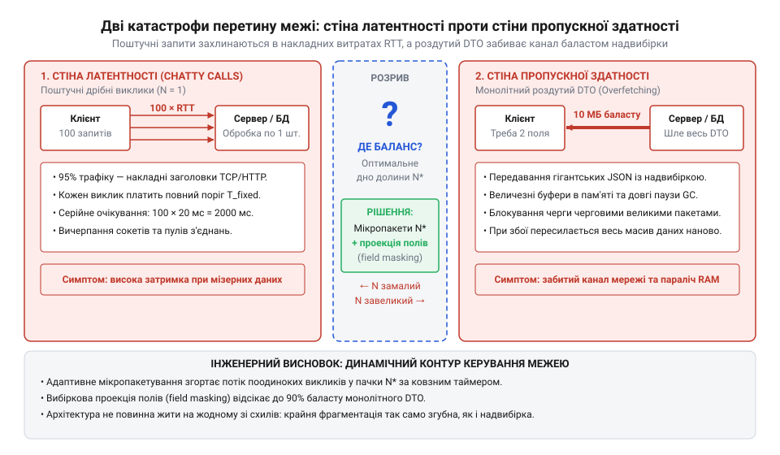
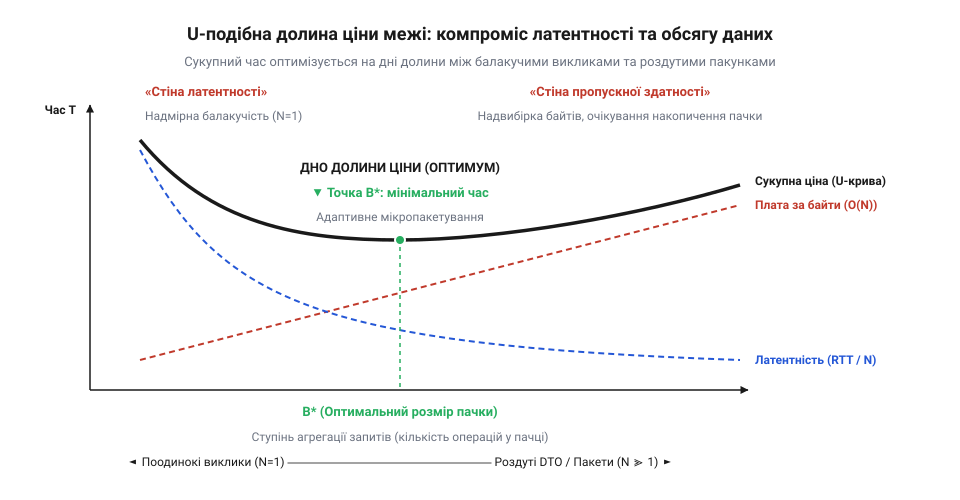
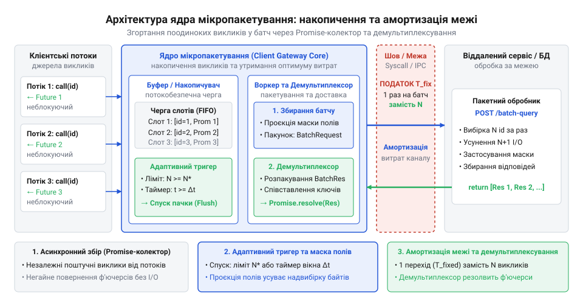
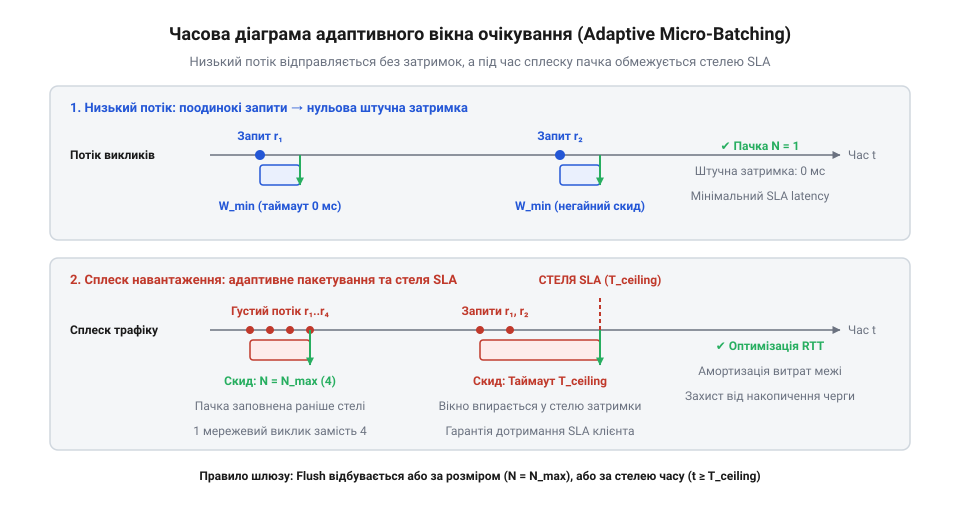
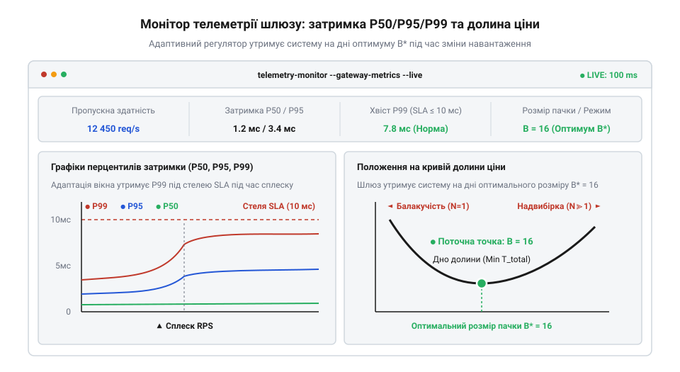
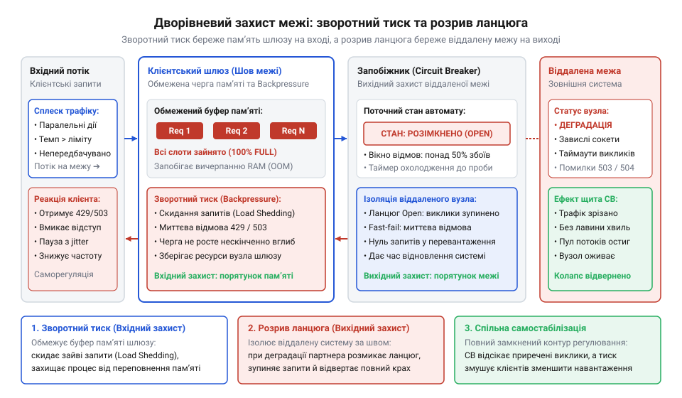

# Ціна межі

<preknowlist>
- [DH під тестом: тестованість, закладена швами](root:progarch/dh-testability-refactor) — Як проєктувати шви (seams) у точках перетину меж для підміни реального транспорту керованими тестовими дублерами із затримками.
</preknowlist>

## Зіткнення з двома стінами: чому статичні шлюзи ламаються на реальному трафіку

Поділ монолітної системи на незалежні компоненти або винесення підсистеми за міжпроцесний шов починається з оманливого відчуття легкості. На комп'ютері розробника чи в ізольованому модульному тесті звернення до інтерфейсу відбувається в спільній пам'яті й триває долі мікросекунди. Але щойно сервіси розносять по різних процесах, віртуальних машинах чи регіонах хмари, кожен вихід за межі середовища виконання починає обкладатися відчутним фізичним податком. Криза розгортається типово: сторінці профілю користувача або аналітичній панелі потрібно відобразити список із сотні сутностей. Бізнес-код запускає звичний цикл і на кожній ітерації викликає метод клієнтського адаптера, відправляючи сотню окремих дрібних запитів до віддаленого сервісу.

У цей момент система врізається в першу катастрофу — «стіну латентності». Навіть якщо віддалений сервіс опрацьовує запит у пам'яті за мікросекунди, кожен окремий перетин межі змушений платити повну вартість затримки кругового обігу сигналу (RTT, від англ. @@en|Round-Trip Time@@). До неї додаються накладні витрати мережевого стека: захоплення вільного з'єднання з пулу, формування й серіалізація службових заголовків, перемикання контексту в ядрі операційної системи та очікування у чергах сокетів. Навіть скромна затримка в 5–10 мілісекунд на один мережевий стрибок при послідовному виконанні сотні запитів перетворюється на пів секунди або й секунду порожнього очікування для кінцевого користувача. У висококонкурентному середовищі, де за пул сокетів змагаються сотні клієнтських потоків, 99-й перцентиль затримки (P99, від англ. @@en|percentile@@, утвореного від лат. *per centum* — на сотню) стрімко зростає до десятків секунд. Система паралізована не складністю розрахунків, а надмірною балакучістю: переважна частина часу витрачається на сам факт переходу через шов, а не на передавання корисних даних.

> 🔧 **Навіщо це.** Розуміння природи стіни латентності захищає архітектуру від непродуманого дроблення систем. Перш ніж виносити модуль в окремий сервіс, необхідно порахувати кратність викликів на одну бізнес-транзакцію: якщо операція породжує потік поодиноких мережевих запитів ([проблема N+1](root:sf-data/n-plus-one-problem)), жодне горизонтальне масштабування серверів не здатне подолати швидкість світла в оптичному волокні.

Перша інтуїтивна відповідь інженера на стіну латентності — скоротити кількість викликів до мінімуму. Виникає бажання вирішити проблему радикально: спроєктувати єдиний монолітний об'єкт передавання даних (DTO, від англ. @@en|Data Transfer Object@@), куди зашити всі відомі атрибути сутності. Замість сотні дрібних запитів клієнт надсилає один-єдиний важкий виклик і отримує масив повних записів. На локальному тесті латентність падає майже до одиничного виклику, і рішення здається тріумфом.

Проте за реальної інтенсивності навантаження система негайно розбивається об протилежну перепону — «стіну пропускної здатності». Коли сервіс повертає роздутий DTO на кожен запит, у мережевий канал потрапляє колосальний обсяг непотрібних байтів. Мобільному віджету потрібні лише `id` та `name`, але сервер щоразу вичитує з бази, упаковує й серіалізує десятки зайвих полів: історію входів, повні матриці дозволів, технічні конфігурації та системні метадані. Це явище називають надвибіркою (@@en|over-fetching@@, від англ. *over* — понад міру та *fetch* — діставати). Коли інтенсивність трафіку досягає тисяч запитів на секунду, надвибірка миттєво утилізує смугу пропускання мережевих інтерфейсів, перевантажує процесори серіалізацією JSON або Protobuf, провокує вибухове виділення пам'яті та довгі паузи збирача сміття. Система знову деградує, але тепер не через очікування сигналу, а через перевантаження каналу надлишковою масою даних.


*Дві катастрофи перетину межі: за наївного поодинокого надсилання накладні витрати викликів створюють стіну латентності, а спроба передати все монолітним об'єктом впирається у стіну пропускної здатності через надвибірку; система потребує шлюзу, здатного балансувати між обома крайнощами.*

Спроба приборкати ці дві крайнощі статичними налаштуваннями клієнтського шлюзу завжди завершується глухим кутом. Розробники часто намагаються знайти компроміс вручну, фіксуючи в коді жорсткі константи: наприклад, «чекати рівно 20 мілісекунд і відправляти пачку» або «накопичувати рівно 50 запитів». Обидва варіанти виявляються безпорадними перед мінливим трафіком:

1. **Фіксований таймер накопичення.** За спокійного, розрідженого трафіку поодинокий запит користувача змушений штучно чекати повні 20 мілісекунд у порожньому накопичувачі, марно сподіваючись на сусідів, яких немає. Користувач отримує затримку відгуку на рівному місці, коли система взагалі не завантажена.
2. **Фіксований поріг розміру пачки.** Під час раптового сплеску трафіку ліміт у 50 елементів переповнюється за долі мілісекунди, черга в пам'яті шлюзу неконтрольовано зростає, а віддалений сервіс починає захлинатися від велетенських пакетів, які провокують таймаути.

Реальний трафік ніколи не буває стаціонарним: він складається з глибоких пауз і лавиноподібних сплесків. Статичні конфігурації розраховані на середнє навантаження, якого в природі не існує. Отже, долати ціну межі жорстко зашитими константами неможливо.

Звідси постає інженерна вимога: шлюз на архітектурній межі не може залишатися пасивним провідником. Він має стати адаптивним регулятором, здатним у реальному часі оцінювати щільність вхідного потоку, автоматично згортати поодинокі виклики в мікропакети без штучних затримок у моменти затишшя та відсікати зайві байти через адресну проєкцію полів. Щоб побудувати такий контур, спершу необхідно зрозуміти фізичну природу межі та вивести її математичну функцію вартості.

## Фізика межі та математика долини ціни: цільова функція вартості перетину

Будь-який перетин архітектурного шва — системний виклик операційної системи, передавання даних між процесами через сокет чи мережевий запит до віддаленої хмари — вимірюється в одиницях витраченого часу. Щоб цим часом керувати, його необхідно розділити на складові. Загальна тривалість передавання та обробки порції даних через межу складається з двох величин: фіксованого податку на сам факт виклику та змінного податку на обсяг корисного навантаження.

Фіксований податок `T_base` сплачується за факт відкриття та здійснення транзакції через кордон незалежно від того, чи передається один байт, чи мегабайт. Він охоплює фізичну затримку поширення сигналу лінією зв'язку (RTT), час проходження протокольних стеків, захоплення буферів сокета та диспетчеризацію обробника. Змінний податок визначається пропускною здатністю каналу `W` (байт/мс) і витратами на серіалізацію: передавання корисного навантаження розміром `P` байтів додає затримку `P / W` або `P · c`, де `c = 1 / W` — коефіцієнт питомого опору каналу в мілісекундах на байт.

Припустимо, клієнтська підсистема має виконати `N` незалежних бізнес-запитів. Якщо шлюз об'єднує їх у пакети розміром `B` елементів (ступінь агрегації), кількість фактичних перетинів межі скорочується до `N / B`. Кожен елемент має середній розмір корисного навантаження `S` байтів, тому розмір пачки становить `B · S` байтів.

Транспортний час перетину межі для одного сформованого пакета розміром `B` описується лінійною залежністю:

```
T_batch(B) = T_base + B · S · c
```

Проте з погляду окремого запиту, який надходить до шлюзу в довільний момент часу, підсумкова затримка складається не лише з транспортування пакета, але й із часу очікування в буфері накопичувача `T_wait`. Якщо вхідний потік запитів надходить із середньою інтенсивністю `λ` (запитів за мілісекунду), середній інтервал між послідовними надходженнями становить `1 / λ`. Для накопичення пачки з `B` запитів перший запит чекає `(B - 1) / λ` мілісекунд, а останній — нуль. Середнє очікування довільного запиту в черзі буфера становить:

```
T_wait(B) = (B - 1) / (2 · λ)
```

Тепер об'єднаємо накладні витрати на один запит у єдину цільову функцію середньої затримки `Cost(B)`, яку сплачує бізнес-операція за ступеня агрегації `B`:

```
Cost(B) = (T_base / B) + S · c + (B - 1) / (2 · λ)
```

> 🔧 **Навіщо це.** Цільова функція перетворює інтуїтивні здогадки про «правильний розмір пакета» на чітку інженерну формулу. Вона доводить, що ізольована оптимізація лише мережевої затримки чи лише часу очікування в буфері є хибною: глобальний мінімум існує тільки для їхньої взаємної рівноваги.

Проаналізуємо поведінку функції `Cost(B)` при зміні ступеня агрегації `B`:

1. За `B = 1` (поодинокі виклики без пакетування) час очікування в буфері `(B - 1) / (2 · λ)` дорівнює нулю, але доданок `T_base / B` досягає максимального значення `T_base`. Ми впираємося в ліву стіну латентності: кожен запит одноосібно оплачує повний RTT.
2. При поступовому збільшенні `B` доданок `T_base / B` стрімко спадає за гіперболою. Фіксований податок за перетин межі справедливо розподіляється між усіма запитами пачки.
3. Водночас доданок `B / (2 · λ)` лінійно зростає: що більшу пачку ми намагаємося зібрати, то довше перші запити простоюють у накопичувачі в очікуванні решти. За великих значень `B` цей час очікування починає домінувати, і система врізається в праву стіну штучної затримки.

Сума спадної гіперболи `T_base / B` та зростаючої прямої `B / (2 · λ)` формує строго опуклу немонотонну криву — «долину ціни» (Cost Valley). На дні цієї долини розташований абсолютний мінімум, де гранична економія від скорочення кількості мережевих переходів зрівнюється з платою за час очікування в черзі.

Знайдемо математичний оптимум `B*`, узявши першу похідну функції `Cost(B)` за змінною `B` та прирівнявши її до нуля:

```
d/dB Cost(B)
= d/dB [ T_base · B⁻¹ + B · (1 / (2 · λ)) + S · c - 1 / (2 · λ) ]
= -T_base / B² + 1 / (2 · λ)                                      [похідна степеневої та лінійної функцій]

-T_base / (B*)² + 1 / (2 · λ) = 0                                 [умова екстремуму функції]
T_base / (B*)² = 1 / (2 · λ)                                      [перенесення лінійного доданка]
(B*)² = 2 · λ · T_base                                            [множення на знаменники]
B* = √( 2 · λ · T_base )                                          [добування квадратного кореня]
```


*Графік долини ціни: суцільна лінія показує результуючу затримку як суму спадної вартості викликів і зростаючої плати за розмір пакунка; дно долини визначає точку математичного оптимуму.*

Отримана формула відкриває фундаментальний інженерний висновок: оптимальний розмір пакета `B*` не є константою. Він динамічно масштабується пропорційно кореню квадратному від поточної інтенсивності вхідного потоку `λ` та базової затримки межі `T_base`.

Проілюструємо це на розрахунку для хмарного сервісу:
- Базова затримка віддаленої межі: `T_base = 15` мс (міжсервісний RTT з урахуванням шифрування).
- За спокійного потоку надходить `λ = 0.2` запитів/мс (200 RPS):
```
B* = √( 2 · 0.2 · 15 ) = √6 ≈ 2.45 → 2 або 3 запити
```
- Під час пікового сплеску навантаження інтенсивність зростає до `λ = 5` запитів/мс (5000 RPS):
```
B* = √( 2 · 5 · 15 ) = √150 ≈ 12.2 → 12 запитів
```

Якщо шлюз зафіксує розмір пакета рівним 12 назавжди, у моменти затишшя кожен запит чекатиме закриття вікна в середньому `(12 - 1) / (2 · 0.2) = 27.5` мс, що майже вдвічі перевищує власний RTT межі. Якщо ж зафіксувати поріг на рівні 2, під час сплеску система згенерує 2500 окремих мережевих пакетів на секунду замість 417, перевантаживши канал дублюванням заголовків.

Для експериментальної верифікації цієї моделі спроєктуємо тестовий стенд із програмною емуляцією віддаленої межі (mock boundary). За принципом тестовності через шви (root:progarch/dh-testability-refactor) ми підміняємо реальний мережевий транспорт дублером, здатним контрольовано змінювати RTT та коефіцієнт питомого опору каналу:

:::code proj-adaptive-cost-valley-gateway/ts/src/types.ts 15-22

Симулятор інкапсулює репозиторій сутностей і точно розраховує час відповіді як суму фіксованої бази та штрафу за розмір серіалізованого тіла:

:::code proj-adaptive-cost-valley-gateway/ts/src/boundary-simulator.ts 8-65

Зверніть увагу на параметр `fields` у сигнатурі методу `fetchBatch`: якщо клієнтський запит містить маску необхідних атрибутів (патерн Sparse Fieldsets, root:sf-apps/sparse-fieldsets), симулятор виключає надлишкові поля ще до серіалізації. Завдяки цьому обсяг переданого корисного навантаження `payloadBytes` зменшується в кілька разів, що знижує змінний податок на байти, зсуває праву стіну пропускної здатності праворуч і робить дно долини ціни істотно глибшим.

Маючи точну математичну модель і контрольований тестовий полігон, ми готові перейти до реалізації ядра шлюзу, здатного автоматично відстежувати зміну `λ` і безперервно утримувати систему на дні долини ціни.

## Вибіркова проєкція полів (Field Masking): усунення надвибірки та захист від стіни пропускної здатності

Математична модель долини ціни показала, що змінна частина витрат на перетин межі пропорційна розміру корисного навантаження: `B · S · c`. Навіть якщо шлюз ідеально розрахував ступінь агрегації `B`, середня маса однієї сутності `S` залишається нещадним лінійним множником. Якщо кожна сутність важить кілька кілобайтів через десятки другорядних атрибутів, історію входів і вкладені конфігурації, будь-який пакет перетворюється на важкий моноліт. Він перевантажує мережеві буфери, сповільнює серіалізацію та створює пікове навантаження на збирач сміття.

У традиційній архітектурі з цією проблемою борються двома крайнощами. Перша — створення окремого спеціалізованого DTO під кожен екран чи бізнес-сценарій: `UserProfileSummaryDTO`, `UserTableItemDTO`, `UserBillingDTO`. Це породжує комбінаторний вибух класів: контракт роздувається, код сервера переповнюється однотипними маперами, а найменша зміна в моделі даних змушує правити десятки споріднених структур. Друга крайність — повернення єдиного універсального DTO на всі випадки життя, що повертає систему прямо до стіни пропускної здатності через надвибірку.

Архітектурний вихід із цього глухого кута полягає у переході від жорстких структур до динамічної проєкції: клієнтський контракт має дозволяти викликачу явно оголошувати маску полів (від фр. @@en|masque@@ — прикриття, фільтр та англ. @@en|Field Mask@@ або @@en|Sparse Fieldsets@@, де англ. *sparse* — розріджений, несуцільний). Замість фіксації форми відповіді на етапі компіляції викликач запитує лише ті атрибути сутності, які потрібні поточному кроку обчислень — саме за цим принципом працюють [селективні запити GraphQL](root:progarch/graphql-selective-queries) для усунення надвибірки.


*Схема вибіркової проєкції полів: сервер відсікає непотрібні поля до серіалізації на основі клієнтської маски, що кардинально зменшує розмір корисного навантаження в мережевому каналі.*

> 🔧 **Навіщо це.** Маски полів перетворюють клієнтський шлюз на активний фільтр трафіку. Вони дозволяють мобільним клієнтам, фоновим воркерам та аналітичним підсистемам використовувати єдиний контракт і спільний конвеєр доступу до даних, отримуючи рівно ту частку байтів, за яку вони готові платити затримкою каналу.

Реалізація вибіркової проєкції у клієнтському шлюзі ставить перед архітектором важливу інженерну задачу: як поєднати індивідуальні вимоги десятків паралельних споживачів в єдиний пакетний виклик через межу?

Припустимо, у межах поточного вікна накопичення три незалежні компоненти запитали одного й того самого користувача з ідентифікатором `#42`:
- Компонент навігаційної панелі просить поля `name` та `role`;
- Служба сповіщень просить поля `name`, `email` та `department`;
- Віджет аудиту безпеки просить поля `name`, `status` та `permissions`.

Клієнтський шлюз вирішує цю задачу у три послідовні кроки:

1. **Дедуплікація ідентифікаторів.** Шлюз виявляє, що запити стосуються одного `id`, тому в мережевий пакет потрапляє лише один екземпляр `#42`.
2. **Об'єднання масок (Union of Masks).** Шлюз обчислює теоретико-множинне об'єднання (операція `∪`) усіх запитаних полів для кожної сутності. Для користувача `#42` формується агрегована маска: `{'name', 'role', 'email', 'department', 'status', 'permissions'}`. Якщо хоча б один клієнт не передав маску (запросив повний об'єкт), шлюз безпечно відмовляється від фільтрації цього запису та просить повне тіло.
3. **Індивідуальна зворотна проєкція.** Після повернення компактної відповіді від віддаленого сервісу шлюз не віддає об'єднаний результат усім викликачам наосліп. Він виконує персональну проєкцію: компонент навігації отримує об'єкт виключно з полями `name` і `role`, а служба сповіщень — лише зі своїми трьома полями. Це гарантує суворе дотримання принципу розділення інтерфейсів (ISP) та інкапсуляції: компоненти не зав'язуються на дані, які їм не належать.

У нашому проєкті цей алгоритм реалізовано у класі `FieldMaskProjector`:

:::code proj-adaptive-cost-valley-gateway/ts/src/data-loader-gateway.ts 18-55

Критично важливо, щоб фільтрація за маскою відбувалася на стороні постачальника даних **до** етапу серіалізації, а не на клієнті після отримання повного пакета. Якщо сервер серіалізує всі поля, відправляє їх мережею, а клієнт просто відкидає зайві ключі з отриманого JSON — захисту від стіни пропускної здатності не відбувається: мережевий дріт і парсер уже сплатили повний штраф за байтовий обсяг.

Погляньмо, як наш симулятор віддаленої межі застосовує маску безпосередньо у сховищі:

:::code proj-adaptive-cost-valley-gateway/ts/src/boundary-simulator.ts 22-47

Розглянемо числовий вимір ефективності цього захисного контуру на основі тестового набору даних. У сховищі симулятора повний запис користувача містить одинадцять складних полів, включно з масивами прав, історією входів та вкладеними об'єктами конфігурацій:

:::code proj-adaptive-cost-valley-gateway/ts/src/boundary-simulator.ts 73-94

У серіалізованому форматі JSON повний запис однієї такої сутності займає в середньому 380 байтів. Якщо клієнтський код виконує сплеск із 35 паралельних звернень без фільтрації полів, сумарний розмір корисного навантаження становить:

```
Payload_full = 35 × 380 байтів = 13 300 байтів ≈ 13.0 КБ
```

Коли ж компоненти використовують адреси масок полів, шлюз виконує дедуплікацію (35 звернень згортаються до 15 унікальних ID) та відсікає надлишкові поля. Середній розмір спроєктованого запису скорочується до 70 байтів. Сукупний розмір пакета становить:

```
Payload_projected = 15 × 70 байтів = 1 050 байтів ≈ 1.0 КБ
```

Завдяки комбінації дедуплікації та масок полів обсяг переданих через мережу даних зменшився у **12.7 раза** (з 13.0 КБ до 1.0 КБ). За інтенсивності навантаження у 5000 запитів на секунду це означає різницю між прокачуванням 1.9 МБ/с (15.2 Мбіт/с чистого корисного навантаження без урахування транспортних заголовків) та скромними 150 КБ/с (1.2 Мбіт/с).

Вибіркова проєкція полів зрізає праву стіну пропускної здатності: крива вартості перетину межі стає пологішою праворуч, а дно долини ціни суттєво розширюється. Проте сама по собі проєкція не рятує від лівої стіни латентності, якщо запити продовжують летіти поодинці. У наступному розділі ми побудуємо другий захисний контур — механізм асинхронного мікропакетування на базі патерну DataLoader, що ліквідує накладні витрати кругового обігу.

## Черга накопичення та ядро мікропакетування (Micro-Batching)

Вибіркова проєкція полів, налаштована в попередньому розділі, усунула зайві байти, але не ліквідувала катастрофу багатьох перетинів. Якщо п'ятдесят незалежних компонентів інтерфейсу або фонових завдань генерують п'ятдесят окремих викликів до віддаленої межі, кожен із них змушений самотужки сплачувати повну затримку кругового обігу `T_base`. Послідовне виконання таких запитів затримує роботу системи на сотні мілісекунд, розбиваючи продуктивність об ліву стіну латентності.

Вимагати від розробників бізнес-логіки самостійно групувати дані у масиви — це тупиковий шлях. Доменний шар втрачає інкапсуляцію: компонент картки товару має знати лише свій ідентифікатор і не повинен координуватися з сусідніми віджетами кошика чи коментарів заради створення спільного пакетного виклику. Проблема N+1 має вирішуватися на інфраструктурному рівні, непомітно для викликача.

Розв'язанням цієї суперечності є техніка асинхронного мікропакетування (від грец. *mikros* — малий та англ. *batch* — пачка; @@en|micro-batching@@) на базі [патерну DataLoader](root:sf-data/data-loader-pattern). Ідея полягає у створенні прозорого клієнтського шлюзу: для бізнес-коду виклик методу `gateway.load(id)` виглядає як звичайний поодинокий асинхронний запит, але замість негайного виходу в мережу шлюз перехоплює його, реєструє у внутрішньому накопичувачі та повертає очікувач результату — об'єкт Promise.


*Архітектура ядра мікропакетування: поодинокі клієнтські виклики реєструються в черзі з поверненням Promise-очікувачів; диспетчер формує єдиний пакет через межу та демультиплексує відповіді.*

> 🔧 **Навіщо це.** Патерн мікропакетування на рівні клієнтського шлюзу ліквідує проблему N+1 у корені без зміни інтерфейсів бізнес-логіки. Клієнтські компоненти залишаються слабозв'язаними й простими, тоді як шлюз бере на себе всю складність координації I/O та ущільнення мережевого потоку.

Серцем архітектури є черга накопичення `pendingQueue`. Кожен вхідний виклик реєструється як дескриптор відкладеної операції:

:::code proj-adaptive-cost-valley-gateway/ts/src/types.ts 7-13

Дескриптор фіксує не лише цільовий ідентифікатор і маску полів, але й час потрапляння в чергу `enqueueTimeMs` для моніторингу затримок, а також функції `resolve` і `reject`. Це дозволяє утримувати клієнтський потік у стані асинхронного очікування до моменту, поки пакет не буде виконано через межу.

Розглянемо реалізацію методу `load` у клієнтському шлюзі:

:::code proj-adaptive-cost-valley-gateway/ts/src/data-loader-gateway.ts 89-113

Робота черги керується двома взаємодоповнювальними тригерами:

1. **Тригер місткості (Fast-Flush).** Якщо черга досягає максимального конфігураційного розміру `maxBatchSize`, шлюз не чекає завершення таймера, а негайно ініціює відправку пакета. Це запобігає переповненню оперативної пам'яті під час раптових лавинних сплесків.
2. **Тригер часу.** Якщо черга містить менше елементів, ніж граничний поріг, шлюз планує асинхронне спрацьовування таймера на тривалість поточного вікна накопичення.

Коли спрацьовує будь-який із тригерів, викликається метод `flushImmediate()`, який атомарно відокремлює накопичені елементи від вхідної черги та запускає конвеєр обробки пакета:

:::code proj-adaptive-cost-valley-gateway/ts/src/data-loader-gateway.ts 119-135

Атомарне обнулення `this.pendingQueue = []` перед початком асинхронного I/O є критично важливим інваріантом: нові клієнтські запити, що надходять під час виконання мережевого виклику поточного пакета, негайно формують наступну пачку, не блокуючись і не спотворюючи стан поточної операції.

Фінальний етап роботи ядра — демультиплексування (від лат. *de-* — розділення, *multi-* — багато, *plex* — сплетіння; @@en|demultiplexing@@) результатів у методі `processBatch`:

:::code proj-adaptive-cost-valley-gateway/ts/src/data-loader-gateway.ts 137-192

Шлюз вилучає унікальні ідентифікатори, викликає віддалений сервіс через єдиний груповий запит, а після повернення масиву сутностей знаходить результат для кожного очікувача в `batch`, накладає індивідуальну маску полів через `FieldMaskProjector.project` і пробуджує відповідний Promise викликом `req.resolve(projected)`. Якщо ж віддалена межа повернула системну помилку чи відмовила за таймаутом, блок `catch` гарантує, що жоден очікувач не зависне в пам'яті: шлюз відхиляє всі проміси пачки через `req.reject(err)`.

Завдяки цьому ядру потік із десятків окремих звернень перетворюється на один оптимізований мережевий перехід. Проте постає наступне запитання: якою має бути тривалість вікна очікування таймера? Фіксований час повертає нас до проблеми розсинхронізації зі швидкістю надходження трафіку. Для завершення конвеєра нам потрібен адаптивний механізм керування часом.

## Адаптивне вікно очікування: динамічне підстроювання під темп надходження

Статичний таймер накопичення приречений на деградацію за будь-якої зміни характеру навантаження. Якщо зашити в конфігурацію фіксовану затримку у 20 мілісекунд, то в період нічного затишшя самотній користувач чекатиме відповіді 20 мс додатково до мережевого RTT лише тому, що шлюз сподівається на сусідів, яких немає. Під час денного піку, навпаки, за ті самі 20 мілісекунд можуть надійти сотні запитів, що призведе до гігантських пачок, перевантаження сокетів і зростання затримки обробки на стороні сервера.

Оптимальне вікно очікування `W` є динамічною величиною. Воно має безперервно підлаштовуватися під поточну інтенсивність вхідного потоку `λ`, маневруючи між двома полюсами:
- **При розрідженому потоці (низький RPS)** — вікно автоматично скорочується до технологічного мінімуму `minWindowMs` (1–2 мс або один тік циклу подій), забезпечуючи миттєвий відгук поодиноким запитам.
- **При щільному потоці (сплески навантаження)** — вікно плавно розширюється, дозволяючи зібрати цільовий пакет `targetBatchSize` без зайвого дроблення викликів.
- **При перевантаженні** — спрацьовує жорсткий запобіжник максимальної затримки (@@en|latency ceiling@@, від лат. *latens* — прихований та англ. *ceiling* — стеля), який гарантує, що час накопичення ніколи не перевищить ліміт угоди про рівень послуг (SLA, від англ. @@en|Service Level Agreement@@).


*Часова діаграма адаптивного вікна: за рідкісних викликів вікно мінімальне (швидкий відгук), за напливу запитів вікно розширюється для агрегації, а стеля затримки гарантує дотримання SLA.*

> 🔧 **Навіщо це.** Адаптивне вікно накопичення дозволяє системі автоматично триматися дна долини ціни в реальному часі. Інженеру більше не потрібно вручну вгадувати тайм-аути під час релізів чи налаштовувати окремі конфігурації для дня та ночі: регулятор самостійно відчуває щільність потоку.

Для оцінки темпу надходження запитів без збереження важкої історії в пам'яті використовується алгоритм [експоненційно зваженого ковзного середнього](root:progarch/ewma-traffic-smoothing) (EWMA, від англ. @@en|Exponentially Weighted Moving Average@@). Замість обчислення ковзного вікна за масивом міток часу шлюз оновлює оцінку інтервалу між послідовними запитами рекурентно на кожному новому зверненні:

```
Δ = t_now - t_last
EWMA_t = α · Δ + (1 - α) · EWMA_{t-1}
```

Коефіцієнт згладжування `α` (smoothing factor, наприклад `0.25`) визначає інерційність регулятора: більше значення змушує шлюз блискавично реагувати на раптові сплески, а менше — захищає від випадкових одиничних флуктуацій.

Реалізацію цього алгоритму інкапсульовано у класі `AdaptiveBatchTimer`:

:::code proj-adaptive-cost-valley-gateway/ts/src/adaptive-batcher.ts 11-45

Коли новий запит потрапляє до шлюзу, метод `recordArrival()` фіксує часовий інтервал `Δ`, оновлює середнє значення `ewmaIntervalMs` та перераховує розрахункове вікно очікування `recalculateWindow()`:

:::code proj-adaptive-cost-valley-gateway/ts/src/adaptive-batcher.ts 67-88

Логіка перерахунку спирається на оціночний час заповнення цільової пачки:
```
estimatedTimeToFill = ewmaIntervalMs · targetBatchSize
```
Розрахункове вікно встановлюється як половина цього інтервалу (евристика оптимального наповнення) і жорстко обмежується діапазоном `[minWindowMs, maxWindowMs]`:
```
W_bounded = max(minWindowMs, min(maxWindowMs, estimatedTimeToFill · 0.5))
```

Поруч із прогнозуванням за вхідним інтервалом адаптивний таймер використовує контур зворотного зв'язку за фактичними результатами відправки пакета. У методі `adjustAfterBatch` шлюз аналізує реальний розмір відправленої пачки:

:::code proj-adaptive-cost-valley-gateway/ts/src/adaptive-batcher.ts 47-65

Якщо фактичний розмір пакета досяг або перевищив `targetBatchSize`, це свідчить про високу щільність потоку: шлюз зменшує вікно на 15% (`currentWindowMs * 0.85`), прискорюючи видачу відповідей користувачам. Якщо ж потік надходить часто (`ewmaIntervalMs < 10` мс), але пачка виявилася замалою (менше половини від цільової), таймер збільшує вікно на 15% (`currentWindowMs * 1.15`), даючи потоку додатковий шанс згрупуватися.

У результаті клієнтський шлюз отримує поведінку саморегулівної пружини:
1. За поодиноких рідкісних запитів інтервал `ewmaIntervalMs` зростає, але штучна затримка стримується порогом `minWindowMs`, тому одиночні клієнти не відчувають простою.
2. При раптовому стрибку навантаження серія частих викликів миттєво збиває `ewmaIntervalMs`, таймер розширює вікно до оптимального розміру збору, а у випадку пікового насичення спрацьовує швидке скидання `fast-flush` за досягненням `maxBatchSize`.
3. За будь-яких умов жоден запит не може провести в черзі більше ніж `maxWindowMs` (latency ceiling), що унеможливлює порушення клієнтських таймаутів.

Поєднавши вибіркову проєкцію полів, асинхронну чергу мікропакетування та адаптивний таймер з EWMA-регулятором, ми створили цілісний адаптивний шлюз. У наступному розділі ми зберемо повний демонстраційний стенд, проведемо навантажувальні експерименти та на живому дашборді метрик наочно перевіримо, як контур утримує робочу точку системи на дні долини ціни.

## Замкнений контур зворотного зв'язку: утримання дна долини ціни

Окремо взяті інструменти оптимізації — вибіркова проєкція полів і черга мікропакетування — самі по собі є розімкненими механізмами (@@en|open-loop system@@, розімкнена система). Вони сумлінно виконують закладені правила, але не знають, що насправді відбувається за межею. Якщо віддалений сервіс раптово зазнає перевантаження бази даних і його базова затримка `T_base` зростає з 15 до 100 мілісекунд, оптимальна точка долини ціни `B* = √(2 · λ · T_base)` миттєво зміщується праворуч: для амортизації такого дорогого перетину потрібна значно більша агрегація. Навпаки, якщо мережевий канал зазнає деградації і питомий опір `c` підскакує вгору, великі пакети починають захлинатися в сокетах.

Розімкнений шлюз у таких умовах сліпий: він продовжує надсилати пакети зі старими параметрами, заганяючи систему або на крутий лівий схил латентності, або на правий схил черги й перевантаження. Щоб утримувати робочу точку на дні долини ціни під час неминучих збурень реального середовища, шлюз має бути замкненим контуром регулювання зі зворотним зв'язком (від лат. *regulare* — спрямовувати за правилом; @@en|closed-loop controller@@).


*Схема замкненого контуру регулятора: телеметрія затримок та черги повертається у контролер, який коригує вікно таймера й поріг агрегації для утримання дна долини ціни.*

> 🔧 **Навіщо це.** Замкнений контур зворотного зв'язку перетворює клієнтський шлюз на самонавчальну адаптивну систему. Він забезпечує архітектурну стійкість: коли бекенд або мережа деградують, клієнтський шлюз автоматично пом'якшує тиск на межу, запобігаючи каскадним відмовам і перевантаженню інфраструктури.

Архітектура замкненого контуру складається з трьох ключових блоків:

1. **Датчик телеметрії (Sensor).** Механізм вимірювання, що фіксує параметри кожного транзитного пакета: фактичний час виконання запиту через межу `boundaryLatencyMs`, час очікування запитів у буфері накопичувача `windowDelayMs`, переданий обсяг байтів `payloadBytes` та глибину вхідної черги.
2. **Контролер долини ціни (Cost Valley Controller).** Аналітичний модуль, який зіставляє виміряні метрики з цільовими порогами SLA та оцінює напрямок дрейфу системи на кривій вартості.
3. **Виконавчий орган (Actuator).** Керуючі параметри конвеєра: динамічне вікно очікування `currentWindowMs`, поріг негайного скидання `maxBatchSize` та режим фільтрації масок полів.

Для динамічного пошуку та утримання оптимуму контролер спирається на евристику адаптивної корекції, споріднену з [алгоритмом AIMD](root:sf-distributed/aimd-congestion-control) (адитивне збільшення, мультиплікативне зменшення; від англ. @@en|Additive Increase Multiplicative Decrease@@):

- **Адитивне розширення (дослідження дна):** Поки затримка межі `boundaryLatencyMs` залишається низькою, а пакети успішно підтверджуються в межах цільового SLA, контролер дозволяє вікну накопичення плавно зростати відповідно до поточного темпу EWMA. Система обережно накопичує більші пачки, заощаджуючи мережеві виклики.
- **Мультиплікативне згортання (реакція на опір):** Якщо фактичний розмір пакета досягає цільового обсягу `targetBatchSize`, затримка черги стає відчутною. Контролер мультиплікативно скорочує вікно на фіксований коефіцієнт (наприклад, множенням на `0.85`), негайно скидаючи накопичені дані для зменшення затримки відгуку користувачам.
- **Градієнтне балансування:** Якщо розмір пакета виявляється замалим при високій частоті надходження (`ewmaIntervalMs < 10` мс), контролер констатує, що система зсунулася вліво (недовикористання агрегації), і збільшує вікно на коефіцієнт `1.15`, стимулюючи укрупнення пачки.

Погляньмо, як цей зворотний зв'язок реалізовано у взаємодії компонентів нашого шлюзу. У методі `processBatch` класу `DataLoaderGateway` шлюз безпосередньо після завершення мережевого виклику формує зліпок метрик і передає сигнал регулювання таймеру:

:::code proj-adaptive-cost-valley-gateway/ts/src/data-loader-gateway.ts 168-186

Отримавши фактичний розмір відправленої пачки `batch.length`, метод `adjustAfterBatch` миттєво адаптує положення робочої точки:

:::code proj-adaptive-cost-valley-gateway/ts/src/adaptive-batcher.ts 47-65

Одночасно об'єкт `MetricsCollector` накопичує повну хронологію пакетів, що дозволяє не лише реагувати на поодинокі події, але й агрегувати довгострокову статистику: відсоток ліквідації проблеми N+1, середній розмір пачки та сумарно заощаджені мілісекунди накладних витрат.

Завдяки замкненому контуру контролер безперервно відстежує мінімум U-подібної кривої:
- Якщо вхідний потік падає, вікно скорочується, захищаючи користувача від простою в буфері.
- Якщо навантаження зростає, вікно розширюється, формуючи пачки оптимального розміру та нейтралізуючи стіну латентності.
- Якщо віддалена межа починає сповільнюватися, контролер обмежує розмір порцій, не даючи буферам роздутися понад ліміт `maxBatchSize`.

Тепер система володіє повним математичним і керуючим апаратом адаптивного шлюзу. У наступному розділі ми зберемо всі компоненти в єдиний виконуваний демонстраційний стенд, проведемо серію навантажувальних тестів з імітацією різнорідного трафіку та перевіримо показники ефективності конвеєра на живому термінальному дашборді.

## Навантажувальний стенд і візуалізатор метрик у реальному часі

Коли архітектурний шлюз спроєктовано та втілено в коді, постає питання інженерної довіри: як переконатися, що механізм адаптивного вікна дійсно утримує систему на дні долини витрат під час справжнього мережевого шторму, а не просто додає непередбачувані затримки до кожного виклику? Теоретичні викладки про оптимізацію розбиваються об реальну нерівномірність виробничого навантаження: тривалі спокійні періоди раптово чергуються з вибуховими сплесками (bursts), а компоненти графічного інтерфейсу чи фонові обробники одночасно запитують сутності з різними наборами атрибутів. Щоб перевірити реакцію регулятора, потрібен контрольований навантажувальний стенд і візуалізатор телеметрії в реальному часі, здатний відстежувати міграцію робочої точки між обома схилами U-подібної кривої.

Навантажувальний стенд симулює два показові виробничі сценарії. Перший сценарій моделює типовий паралельний рендеринг складної вебсторінки або формування аналітичного звіту: десятки незалежних компонентів одночасно породжують запити на отримання сутностей. При цьому виклики містять повторювані ідентифікатори та розбіжні маски полів (Sparse Fieldsets), випробовуючи здатність шлюзу ліквідувати проблему N+1, провести дедуплікацію запитів і об'єднати вимоги до проєкції даних.

:::code proj-adaptive-cost-valley-gateway/ts/src/index.ts 42-66

У цьому сценарії 35 конкурентних викликів потрапляють у шлюз практично в один момент часу. Якби кожен виклик перетинав міжсервісну межу самостійно, система здійснила б 35 послідовних або паралельних операцій, кожна з яких сплатила б щонайменше 15 мс базової затримки межі. У сумі це спричинило б понад 525 мс сукупних накладних витрат каналу. Натомість Promise-колектор шлюзу перехоплює потік, динамічний таймер фіксує скорочення інтервалу між викликами, а ліміт максимального розміру пачки запускає негайне відправлення. У результаті 35 клієнтських операцій згортаються у лічені перетини межі, дублікати ID усуваються, а віддалений симулятор повертає рівно ті поля, які були замовлені.

Для кількісної оцінки отриманого виграшу клас `MetricsCollector` безперервно акумулює хронологію пакетів і порівнює фактичні витрати конвеєра з гіпотетичним сценарієм відсутності пакетування.

:::code proj-adaptive-cost-valley-gateway/ts/src/metrics.ts 28-74

Агрегатор розраховує ключові показники ефективності: загальну кількість заощаджених мережевих дій, коефіцієнт скорочення викликів у відсотках та оціночний чистий виграш у мілісекундах. Це дозволяє команді оперувати не інтуїтивними здогадками, а точними цифрами зниження транзитного навантаження.

Другий симуляційний сценарій перевіряє поведінку адаптивного регулятора при зміні динаміки потоку — перехід від спокійного стану до коротких сплесків і назад. Головна небезпека наївного пакетування полягає в тому, що поодинокий запит у період низької активності «зависає» в очікуванні компаньйонів, сплачуючи повну тривалість таймера. Адаптивний шлюз розв'язує цю дилему динамічним вікном.

:::code proj-adaptive-cost-valley-gateway/ts/src/index.ts 72-96

Коли надходить поодинокий запит після паузи, експоненційно зважене ковзне середнє інтервалу надходження тримає вікно на конфігураційному мінімумі (2 мс), завдяки чому клієнт майже не відчуває штучного простою. Коли ж слідом надходить міні-сплеск із 6 викликів, регулятор миттєво адаптується до зростання частоти, групує виклики в єдиний батч і запобігає перевантаженню віддаленого сервісу.

Для наочного спостереження за цими фазами розроблено термінальний дашборд. Він малює хронологічну таблицю кожного сформованого пакета із зазначенням затримок і байтів, а також графічну шкалу скорочення звернень.

:::code proj-adaptive-cost-valley-gateway/ts/src/dashboard.ts 19-63


*Екран термінального монітора телеметрії: робоча точка динамічно маневрує вздовж U-подібної кривої вартості межі, фіксуючи стабілізацію перцентилів затримки P50/P95/P99 та ліквідацію надлишкового трафіку.*

Під час безперервної роботи візуалізатор відображає розподіл перцентилів затримки: медіану P50, стабільний рівень P95 та хвіст P99. Наочна динамічна діаграма долини ціни на моніторі фіксує головний результат: завдяки взаємодії адаптивного вікна та проєкції полів система не звалюється ані в ліву «стіну латентності» дрібних запитів, ані в праву «стіну пропускної здатності» роздутих пакунків.

> 🔧 **Навіщо це.**
> Навантажувальний стенд і вбудований термінальний дашборд дають інженерові засіб об'єктивного контролю ціни межі безпосередньо в середовищі розробки. Замість вгадування параметрів таймера та лімітів черги розробник бачить реакцію системи на реальні сплески трафіку під час інтеграційних тестів [DH під тестом: тестованість, закладена швами](root:progarch/dh-testability-refactor) та приймає рішення на основі виміряних перцентилів.

## Виробничі обмеження, зворотний тиск (Backpressure) та деградація

У контрольованих тестах механізм мікропакетування демонструє майже ідеальну ефективність: затримки зменшуються, трафік стискається, а N+1 запити ліквідуються. Проте справжнє виробниче середовище неминуче випробовує шлюз позаштатними збоями та аномальними перевантаженнями. Що відбудеться, якщо віддалений сервіс за межею раптово сповільниться вдесятеро або повністю припинить відповідати? Клієнтські виклики продовжуватимуть надходити, Promise-колектор почне безконтрольно накопичувати незавершені об'єкти в пам'яті, і невдовзі процес впаде через аварійне вичерпання пам'яті (Out of Memory). Без надійних контурів самозахисту шлюз перетворюється з інструменту оптимізації на найнебезпечнішу точку відмови всієї системи.

Першим рубежем захисту від вичерпання ресурсів є перетворення необмеженого буфера накопичувача на строго обмежену чергу фіксованої ємності. Коли буфер досягає критичної межі, шлюз зобов'язаний застосувати **зворотний тиск** (@@en|backpressure@@, від англ. *back* — назад та *pressure* — тиск). Механізм зворотного тиску полягає в тому, що перевантажений компонент передає сигнал опору вище за ланцюгом викликів, сповіщаючи джерела запитів про неможливість приймати трафік із поточною швидкістю.

Якщо джерело не здатне сповільнити генерацію трафіку, шлюз переходить до тактики скидання навантаження (@@en|load shedding@@, від англ. *load* — навантаження та *shed* — скидати, позбуватися) за принципом швидкої відмови (@@en|fast-fail@@, від англ. *fast* — швидкий та *fail* — зазнавати невдачі). Замість постановки нових елементів у чергу, де вони все одно приречені на вичерпання клієнтського таймауту, шлюз негайно відхиляє виклик, повертаючи помилку переповнення або відповідний статускод (наприклад, HTTP 429 Too Many Requests). Це рятує внутрішню пам'ять і дозволяє конвеєру зосередитися на успішному випуску вже прийнятих пакетів.

Якщо ж віддалена межа деградує глобально — сервіс повертає помилки або зависає на кожному пакеті, — продовження регулярного бомбардування його навіть скомпільованими батчами лише посилює аварію. Для ізоляції таких системних збоїв шлюз інтегрують із патерном **запобіжник** (@@en|Circuit Breaker@@, від англ. *circuit* — електричне коло, контур та *break* — розривати; [root:progarch/circuit-breaker-pattern]).

Запобіжник контролює потік викликів через три класичні стани:
1. **Замкнений (Closed):** у штатному режимі всі сформовані пакети безперешкодно надсилаються через межу, а лічильник помилок скидається.
2. **Розімкнений (Open):** якщо відсоток збоїв або таймаутів перевищує аварійний поріг за ковзне вікно часу, запобіжник розриває контур. Будь-які спроби відправити батч через межу негайно блокуються всередині шлюзу, захищаючи віддалену систему від лавинного перевантаження.
3. **Напіврозімкнений (Half-Open):** після завершення періоду очікування шлюз пропускає єдиний пробний мікропакет. У разі успіху контур повертається в стан Closed; якщо ж спроба провалюється, таймер ізоляції перезапускається.


*Багаторівневий контур стабільності шлюзу: обмежена черга накопичувача відсікає надлишковий потік зворотним тиском (load shedding), а запобіжник Circuit Breaker розмикає коло при деградації віддаленого сервісу, рятуючи систему від каскадного падіння.*

Окрему складність на виробництві становлять повторні спроби (retries) пакетних запитів. Коли через мережевий збій чи таймаут втрачається зв'язок під час отримання відповіді на батч, шлюз не знає, чи віддалений сервіс устиг обробити зміни. Сліпий повтор пачки, яка містить операції мутації, спричинить небезпечне дублювання бізнес-транзакцій. Для безпечного повторення пакетів межа вимагає використання **ідемпотентних ключів** (@@en|idempotency keys@@, від латинського *idem* — той самий та *potens* — здатний, могутній) для кожної атомарної дії всередині батчу, що дозволяє віддаленій стороні дедуплікувати повторно надіслані команди.

У прагненні оптимізувати кожен мікросекундний інтервал інженер ризикує створити надлишкову випадкову складність (@@en|accidental complexity@@, від латинського *accidentalis* — випадковий, несуттєвий; [Рефакторинг безпечно](root:progarch/refactoring-safe)). Побудова шлюзу адаптивного пакетування та фільтрації виправдана не в кожній системі. Для зваженого вибору архітектор спирається на чіткий чекліст.

**Коли адаптивний шлюз є доречним і окупається:**
- *Висока вартість перетину межі:* базова затримка RTT перевищує 10–15 мс (міжсервісні мережеві виклики через HTTP/gRPC, міжрегіональні канали, доступ до повільних баз даних).
- *Щільний паралельний потік запитів:* інтенсивність становить сотні чи тисячі операцій на секунду, що забезпечує швидке наповнення пачок без потреби у великому вікні очікування.
- *Невідповідність моделей гранулярності:* бізнес-код або графічні компоненти природно оперують одиничними сутностями (N+1 проблема в GraphQL-резолверах чи контролерах), тоді як транспорт вимагає пакетної обробки.
- *Значний обсяг надвибірки:* структури даних бекенду містять десятки полів, але окремим споживачам потрібна лише мала їх частка (маскування полів скорочує розмір корисного навантаження на 60–90%).

**Коли шлюз перетворюється на шкідливий оверінжиніринг:**
- *Низьколатентна або локальна межа:* якщо перетин займає частки мілісекунди (внутрішньопроцесні модулі, IPC через UNIX-сокети з RTT < 0.1 мс), накопичувальне вікно лише додасть штучної затримки без жодного виграшу в пропускній здатності.
- *Рідкісний поодинокий трафік:* при навантаженні в кілька запитів на хвилину таймер постійно досягатиме ліміту, відправляючи пакети розміром в один елемент і лише погіршуючи відгук.
- *Критичні обмеження реального часу:* якщо SLA жорстко лімітує затримку P99 величиною менше 1 мс, будь-яка затримка накопичення у черзі є неприпустимою.
- *Вимога абсолютної лінеаризовності:* коли кожна операція повинна бути синхронно зафіксована віддаленим сховищем без будь-якої черги чи проміжної буферизації.

> 🔧 **Навіщо це.**
> Розуміння виробничих обмежень позбавляє архітектуру наївності. Адаптивний шлюз є потужним інструментом приборкання ціни межі, але його захисні механізми — зворотний тиск, Circuit Breaker та ідемпотентність повторів — є обов'язковою платою за живучість у реальному середовищі, а чекліст критеріїв запобігає появі зайвої випадкової складності там, де межа є дешевою від природи.
