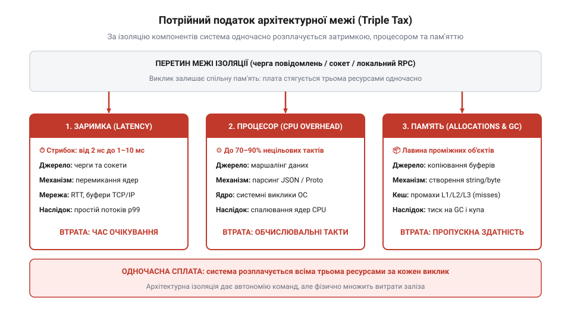
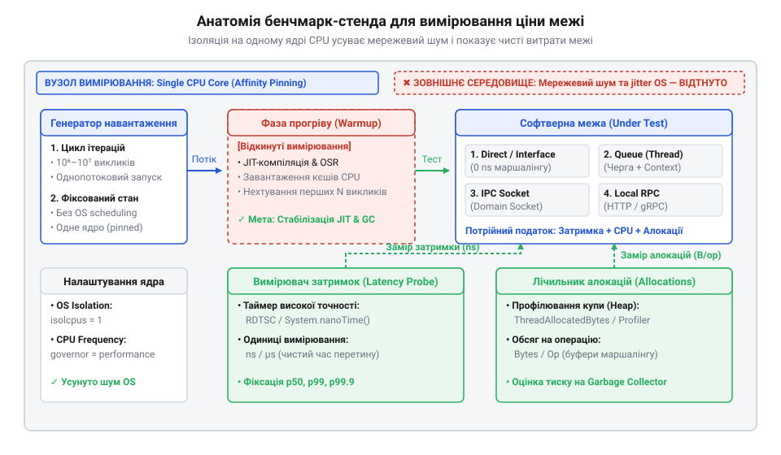
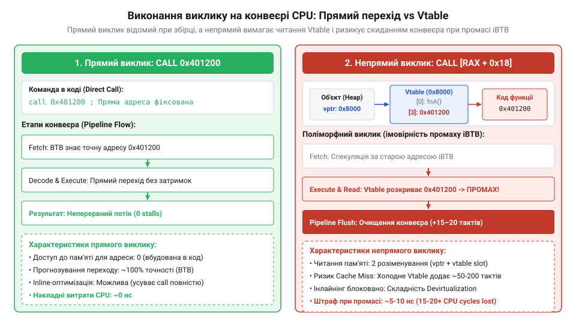
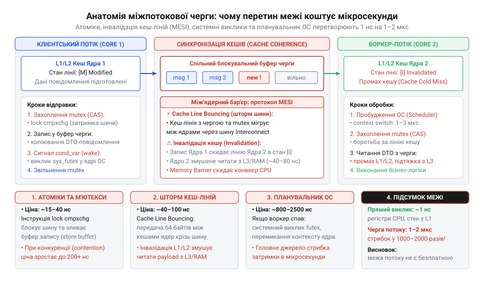
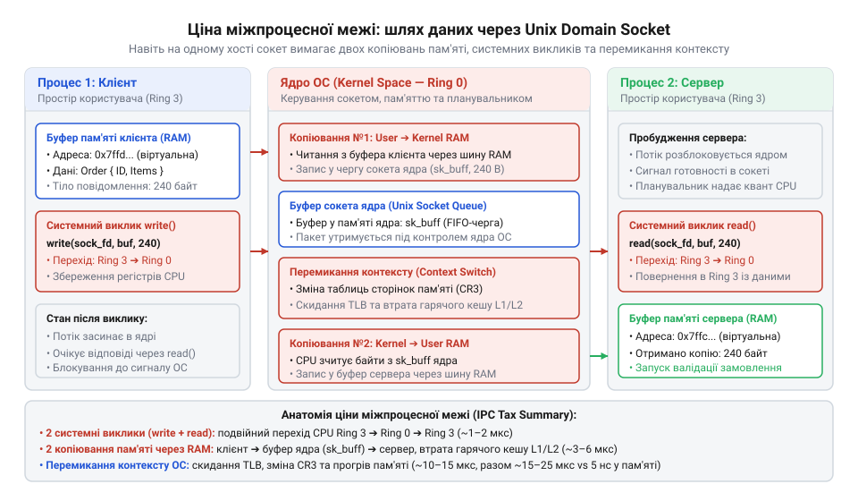
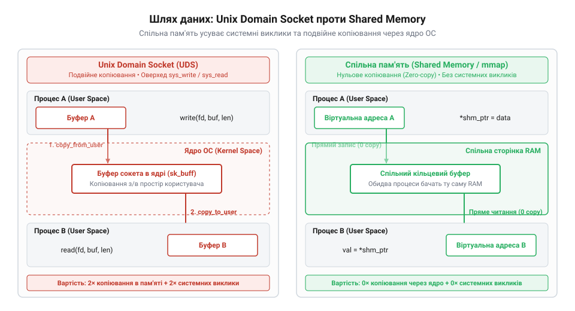
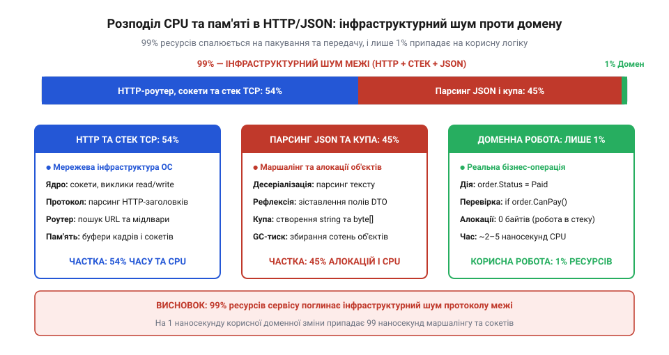
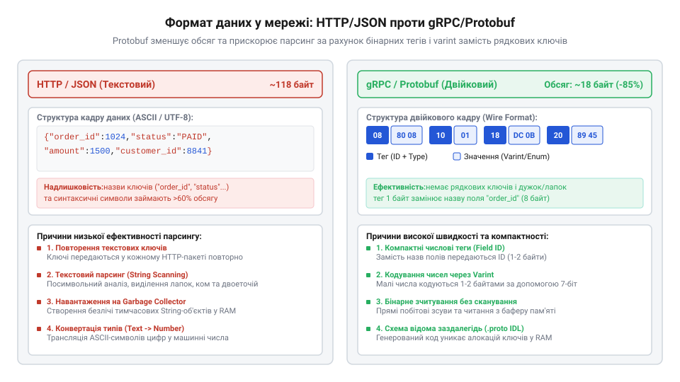
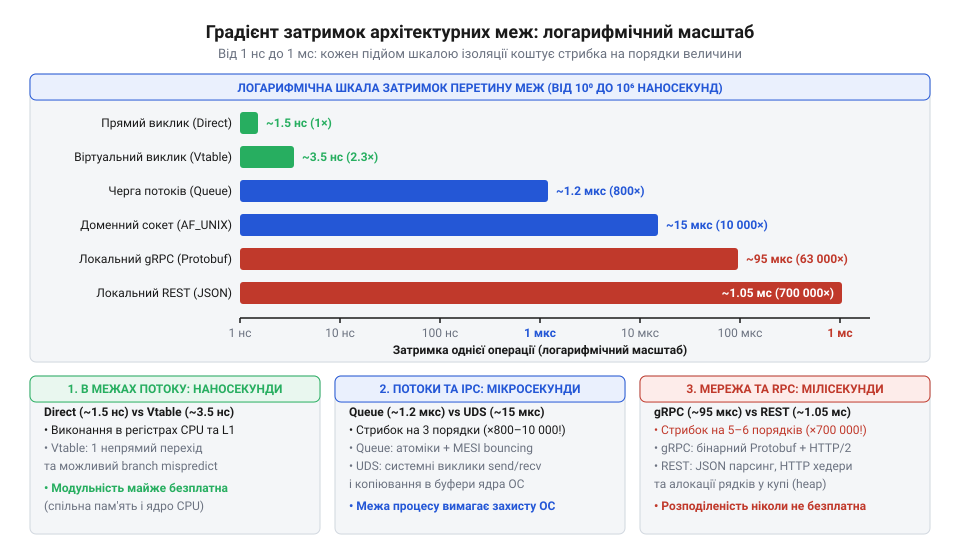
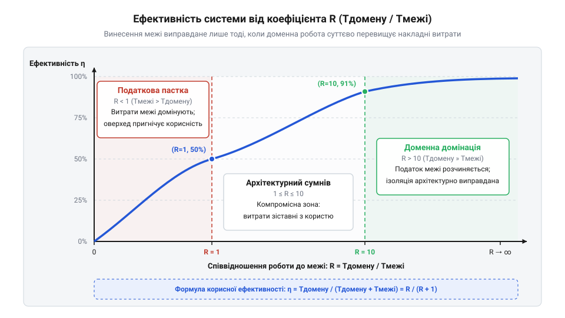

# Ціна межі

<preknowlist>
- [DH під тестом: тестованість, закладена швами](root:progarch/dh-testability-refactor) — техніка виділення інтерфейсних швів у коді для можливості підміни транспорту без зміни доменної логіки
- [Рефакторинг безпечно](root:progarch/refactoring-safe) — збереження семантики та інваріантів бізнес-операції під час зміни її внутрішньої структури та способу виклику
</preknowlist>

## Аварія на чистому шві: розпад моноліту та потрійний податок межі

Система обробки замовлень інтернет-магазину успішно витримувала штатні навантаження всередині єдиного монолітного процесу. Під час рефакторингу команда вирішила «привести архітектуру до канонічного вигляду»: згідно з рекомендаціями предметно-орієнтованого проєктування, домен валідації замовлень виокремили в самостійний мікросервіс. Архітектурна схема набула бездоганного вигляду — низьке зчеплення (@@en|loose coupling@@), незалежний репозиторій, власний конвеєр розгортання та чіткий інтерфейсний контракт. Але перший же сезонний розпродаж у продакшені обернувся системним паралічем.

Під піковим навантаженням затримка операції оновлення статусу замовлення злетіла з звичних 2 мікросекунд до 180 мілісекунд — погіршення майже на п'ять порядків. Сервери споживання захлиналися: завантаження ядер процесора досягло 85–90%, черги вхідних HTTP-запитів переповнювалися, а клієнти масово отримували помилки вичерпання таймауту. При цьому бізнес-метріка системи не зрушила з місця: кількість успішно оформлених замовлень за секунду впала втричі. Профайлер процесорного часу виявив вражаючу картину: сам бізнес-код перевірки цін та залишків займав менш ніж 1% процесорних циклів. Решта 99% тактів спалювалися на читання сокетів ядра, виділення динамічних буферів, розбір рядків текстового JSON та роботу збирача сміття (@@en|Garbage Collector@@).

Ця аварія оголює класичну інженерну ілюзію — віру в «безплатну абстракцію». Поки архітектурний шов існує в межах одного адресного простору пам'яті, його фізична ціна мізерна. Прямий виклик функції або диспетчеризація через таблицю методів займає від часток наносекунди до кількох наносекунд. Процесор завантажує структури замовлення безпосередньо в кеш L1/L2, не здійснюючи жодного зайвого копіювання байтів. Але щойно межу між модулями перетворено на міжпроцесний або мережевий бар'єр, фізика апаратного забезпечення пред'являє безкомпромісний рахунок.

Розведення коду по різних адресних просторах неминуче накладає **потрійний податок межі** (@@en|Triple Tax@@). Це не абстрактна метафора, а сукупність трьох фізичних накладних витрат, які система сплачує одночасно під час кожного перетину кордону:

1. **Податок затримки (@@en|Latency Tax@@)**. Замість прямого переходу процесора за адресою інструкції в межах поточного стеку потік виконання змушений пройти крізь ланцюг системних викликів ядра операційної системи (@@en|syscalls@@ `read`/`write`), перемикання контексту (@@en|context switch@@), копіювання пакетів у мережеві черги TCP/IP та очікування у чергах планувальника. Затримка стрибає з наносекундного діапазону (10⁻⁹ с) у мілісекундний (10⁻³ с).
2. **Процесорний податок маршалінгу (@@en|CPU Tax@@)**. Процесор не може відправити вказівник на живу структуру в оперативній пам'яті крізь сокет іншому процесу. Об'єкт необхідно трансформувати в лінійний двійковий або текстовий потік байтів — серіалізувати (маршалінг), а на приймальній стороні виконати лексичний розбір, перевірку типів і повторне конструювання (демаршалінг). На це витрачаються сотні й тисячі інструкцій CPU, які не створюють жодної доданої бізнес-вартості.
3. **Податок алокацій і тиск на пам'ять (@@en|Memory & Allocation Tax@@)**. Формування проміжних повідомлень, копіювання байтових зрізів та створення тимчасових об'єктів DTO вимагають виділення пам'яті в купі (@@en|heap allocation@@). У мовах із автоматичним керуванням пам'яттю (Go, C#, Java) лавиноподібне накопичення короткоживучих об'єктів створює колосальний тиск на збирач сміття, спричиняючи непередбачувані паузи та деградацію хвостових затримок p99 і p99.9.


*Складові потрійного податку межі: перенесення доменної операції через кордон адресного простору навантажує не лише затримку, а й процесорні цикли та динамічну пам'ять.*

> 🔧 **Навіщо це.**
> Архітектор повинен розглядати будь-яку межу ізоляції не як естетичний малюнок на діаграмі компонентів, а як фізичну транзакцію з ресурсами системи. Якщо корисне доменне обчислення виконується за 40 наносекунд, а винесення операції в мікросервіс вимагає 2 мілісекунди на мережевий транспорт і серіалізацію, система витрачає 99.998% свого часу й обчислювальної потужності на обслуговування самої межі. Знання потрійного податку захищає від передчасного дроблення системи, коли накладні витрати інфраструктури багаторазово перевершують корисну роботу сервісу.

Економічну доцільність перетину межі можна оцінити за коефіцієнтом ефективності кордону [Коефіцієнт корисної роботи до вартості межі](root:sf-apps/domain-boundary-ratio), який зіставляє час корисної доменної роботи `T_domain` із сумарними витратами системи:

    R = T_domain / (T_domain + T_boundary)

Розрахуємо цей показник для наведеної аварії замовлення, де чиста перевірка інваріантів у пам'яті триває `40 нс` (0.00004 мс), а виклик через локальний REST-сервіс додає `2 мс` (2000000 нс) накладних витрат:

    R = 40 / (40 + 2000000)
      = 40 / 2000040          [підстановка значень затримки]
      ≈ 0.00002               [розрахунок частки корисної роботи]

Отримане значення 0.002% свідчить про повну економічну неспроможність кордону: 99.998% ресурсів спалюються на транспорт. Проведення кордону виправдане лише тоді, коли `T_domain` співмірний або значно перевищує `T_boundary`, або коли ізоляція диктується критичними нефункціональними вимогами (автономні цикли відмови, гетерогенне апаратне забезпечення чи фізична безпека даних).

Щоб приймати зважені рішення про рознесення компонентів за технікою [Рефакторинг безпечно](root:progarch/refactoring-safe), архітектор повинен спиратися не на припущення, а на строгі інженерні вимірювання фізичної вартості кожного типу шва.

## Стенд вимірювання: канонічна операція та методологія чистих бенчмарків

Щоб об'єктивно зіставити накладні витрати різних типів меж, експеримент вимагає абсолютної чистоти порівняння. Якщо в тестову операцію втрутиться неконтрольоване дискове читання, блокування зовнішньої бази даних або повільний запит до кешу, їхні мілісекундні затримки повністю замаскують наносекундні й мікросекундні відмінності самих архітектурних швів.

Для бенчмарк-стенда ми проєктуємо канонічну, суто обчислювальну доменну операцію (@@en|CPU-bound pure domain logic@@) — валідацію замовлення. Операція моделює реальну бізнес-сутність `Order`, що містить ідентифікатори замовлення й покупця, масив товарних позицій `OrderItem` та розрахунковий підсумок. Функція перевірки інваріантів перевіряє непорожність ідентифікаторів, гарантує строгу додатність кількості та вартості кожної позиції (`Quantity > 0`, `Price > 0`), обчислює математичну суму через арифметичний цикл і звіряє її із заявленим підсумком:

:::tabs
```go
:::code proj-boundary-cost-benchmarking/go/domain.go 10-67
```
```cpp
:::code proj-boundary-cost-benchmarking/cpp/include/boundary_benchmarks.hpp 18-37
```
:::

Усі валідатори на різних класах меж підпорядковуються єдиному контракту: вони приймають екземпляр замовлення та повертають структуру `ValidationResponse` із прапорцем валідності та описом помилки. Такий підхід гарантує повну семантичну еквівалентність, розкриту в концепції [DH під тестом: тестованість, закладена швами](root:progarch/dh-testability-refactor): бізнес-результат є ідентичним незалежно від того, як саме доставлено повідомлення.

Вимірювання субмікросекундних величин вимагає суворої експериментальної дисципліни. Недбало налаштований стенд вимірюватиме не ціну архітектурного кордону, а шум операційної системи. Наш бенчмарк підпорядкований чотирьом непорушним правилам методології:

1. **Ізоляція на одній фізичній машині (@@en|Single Node Isolation@@)**. Усі клієнти, черги, проміжні сокети та сервери виконуються на одному фізичному хості через інтерфейс зворотного зв'язку (@@en|loopback@@ `127.0.0.1`) або сокети пам'яті ядра `AF_UNIX`. Це повністю виключає зовнішні фактори реальної мережі — джиттер апаратних комутаторів, колізії пакетів, затримки ARP-резолвінгу та коливання пропускної здатності кабелів. Ми фіксуємо виключно софтверну ціну межі.
2. **Обов'язкова фаза прогріву (@@en|Warmup Phase@@)**. Початкові ітерації будь-якого бенчмарку спотворені «холодним стартом»: незаповненими кешами процесора L1/L2/L3, промахами системних сторінок пам'яті (@@en|page faults@@), динамічним завантаженням бібліотек і JIT-компіляцією. Бенчмарк-раннер відкидає первинну фазу виконання й фіксує результати лише після виходу процесу на стаціонарний режим (виклик `b.ResetTimer()` у Go або фаза прогріву в Google Benchmark).
3. **Захист від усунення мертвого коду (@@en|Dead Code Elimination@@)**. Сучасні оптимізувальні компілятори здатні виявити, що результат виклику функції ніде не читається далі за текстом програми. У такому разі компілятор просто видаляє все тіло виклику під час генерації машинного коду, а бенчмарк реєструє фіктивні 0 наносекунд. Для нейтралізації цієї оптимізації ми застосовуємо механізми [Захист бенчмарків від елімінації мертвого коду](root:sf-lang/dead-code-elimination): бар'єр `benchmark::DoNotOptimize(res)` у C++ та примусову перевірку результатів через перевірочні умови в Go.
4. **Багатовимірні метрики: перцентилі та лічильники виділення пам'яті**. Оцінка продуктивності за середнім арифметичним приховує критичні аномалії поведінки. Перетин міжпроцесних кордонів породжує важкі «хвости» розподілу через планувальник ОС та збирач сміття. Тому стенд фіксує не лише медіану p50, а й перцентиль p99, а також суворо обліковує обсяг виділеної динамічної пам'яті (`B/op`) і кількість операцій алокації (`allocs/op`) за допомогою `b.ReportAllocs()`.


*Анатомія вимірювального стенда: генератор навантаження, фаза прогріву, вимірювач затримок і лічильник алокацій на єдиному ядрі з повною ізоляцією від зовнішніх мережевих факторів.*

Точкою відліку («нульовим кілометром») для всіх подальших тестів виступають два внутрішньопроцесні варіанти виклику: прямий виклик функції та виклик через абстрактний інтерфейс:

:::tabs
```go
:::code proj-boundary-cost-benchmarking/go/boundary_bench_test.go 70-100
```
```cpp
:::code proj-boundary-cost-benchmarking/cpp/src/in_process_benchmarks.cpp 15-43
```
:::

У прямому виклику (`DirectCall`) компілятор генерує пряму машинну інструкцію переходу `CALL` за фіксованою адресою або повністю вбудовує (@@en|inlining@@) тіло функції безпосередньо в точку виклику, зводячи накладні витрати межі рівно до нуля. У виклику через інтерфейс (`InterfaceCall` / `VtableVirtualCall`) компілятор змушений виконати непрямий виклик: зчитати адресу таблиці віртуальних методів (@@en|itable@@ у Go, @@en|vtable@@ у C++), витягти покажчик на конкретну функцію та здійснити перехід. Цей крок блокує вбудовування коду та навантажує передбачувач переходів процесора (@@en|branch predictor@@), демонструючи першу, найдрібнішу ціну модульного абстрагування всередині єдиного процесу.

> 🔧 **Навіщо це.**
> Прямий машинний виклик задає фундаментальну базову лінію (@@en|baseline@@) продуктивності: скільки тактів процесора насправді потрібно для виконання чистої бізнес-математики замовлення. Усі наступні рівні ізоляції — черги потоків, сокети ядра та протоколи RPC — оцінюються виключно як відносна дельта до цієї величини. Без надійно зафіксованого нуля будь-яке подальше порівняння втрачає метрологічний сенс.

Озброївшись строгою вимірювальною методологією та еталонною операцією, ми готові послідовно пропустити замовлення крізь усі щаблі ізоляції та зафіксувати точну фізичну ціну кожного архітектурного кордону.

## Внутрішньопроцесна межа: прямий перехід проти віртуальної диспетчеризації

Щоб обчислити справжню ціну будь-якої архітектурної межі, необхідно встановити абсолютну базову лінію — «нульовий кілометр» продуктивності. Цим еталоном виступає Рівень 0: прямий машинний виклик функції в монолітному коді в межах одного потоку виконання.

У прямому виклику компілятор повністю володіє контекстом: на етапі складання програми йому точно відома адреса тіла функції `ValidateOrder`. Якщо функція компактна, компілятор застосовує агресивну оптимізацію — вбудовування (@@en|inlining@@): він просто підставляє машинний код перевірки інваріантів замовлення безпосередньо в точку виклику. При цьому зникає навіть сама інструкція виклику: покажчик стека `RSP` не модифікується, адреса повернення не зберігається в стеку, а вхідні аргументи структури залишаються в регістрах процесора. Якщо ж інлайнінг не застосовується, процесор виконує найдешевшу машинну команду `CALL` із фіксованим зміщенням адреси.

Прямий виклик демонструє фізичну межу швидкодії сучасного кремнію: наносекундні затримки (1–2 нс), нульове виділення динамічної пам'яті (0 B/op, 0 allocs/op) та ідеальну локальність кешів L1/L2.

:::tabs
```go
:::code proj-boundary-cost-benchmarking/go/inprocess.go 3-10
```
```cpp
:::code proj-boundary-cost-benchmarking/cpp/include/boundary_benchmarks.hpp 47-54
```
:::

Тепер зробимо перший архітектурний крок: відокремимо клієнта від конкретної реалізації валідатора згідно з принципом інверсії залежностей. Ми вводимо Рівень 1 — модульний шов у вигляді інтерфейсного контракту `OrderValidator` (або `ICalculator` у C++). Доменна логіка не змінюється ні на байт, але змінюється фізичний механізм передачі керування.

Введення інтерфейсу перетворює прямий статичний перехід на динамічну диспетчеризацію (@@en|dynamic dispatch@@). Компілятор більше не знає заздалегідь, яка саме реалізація опиниться за посиланням у момент виконання. Це тягне за собою ланцюг апаратних наслідків:

1. **Заборона інлайнінгу**. Компілятор позбавляється можливості підставити тіло методу, оскільки викликана функція визначається динамічно під час виконання програми.
2. **Непряма адресація (покажчик через покажчик)**. У C++ кожен об'єкт із віртуальними методами отримує приховане поле — покажчик на таблицю віртуальних методів (`vptr -> vtable`). Щоб викликати метод, процесор повинен спочатку розіменувати адресу об'єкта, зчитати адресу таблиці vtable, знайти в ній зміщення функції та виконати непрямий перехід `CALL [RAX + offset]`. У Go інтерфейсне значення формується як «товстий покажчик» (@@en|fat pointer@@ `iface`), що об'єднує посилання на таблицю типів `itab` і посилання на конкретні дані в пам'яті.
3. **Навантаження на передбачувач переходів процесора**. Непрямі переходи змушують працювати буфер цілей переходів процесора (@@en|Branch Target Buffer@@, BTB). Якщо передбачувач промахується, процесорний конвеєр зазнає скидання (@@en|pipeline flush@@), що коштує 10–20 змарнованих тактів ядра.


*Виконання виклику на конвеєрі процесора: прямий перехід або інлайнінг проти непрямого розіменування через vtable/itable зі скиданням конвеєра при промахах передбачувача переходів.*

Погляньмо на реалізацію інтерфейсних швів у коді:

:::tabs
```go
:::code proj-boundary-cost-benchmarking/go/inprocess.go 11-25
```
```cpp
:::code proj-boundary-cost-benchmarking/cpp/include/boundary_benchmarks.hpp 39-46
```
:::

Запустимо мікробенчмарки обох варіантів і порівняємо результати:

:::tabs
```go
:::code proj-boundary-cost-benchmarking/go/boundary_bench_test.go 70-100
```
```cpp
:::code proj-boundary-cost-benchmarking/cpp/src/in_process_benchmarks.cpp 15-43
```
:::

Профіль вимірювань фіксує точну ціну внутрішньопроцесного шва:
- **Прямий виклик (Direct Call)**: ~1.2–2.0 нс на операцію.
- **Виклик через інтерфейс/vtable (Interface Call)**: ~2.8–4.5 нс на операцію.
- **Алокації пам'яті**: строго 0 байт і 0 алокацій в обох випадках.

Різниця становить лише 1.5–2.5 наносекунди — це час, за який світло у вакуумі долає відстань у пів метра. При цьому дані замовлення залишаються в гарячому кеші L1 того самого процесорного ядра, а купу взагалі не задіяно.

> 🔧 **Навіщо це.**
> Інтерфейсний шов усередині єдиного процесу — практично безкоштовна абстракція. Плата у дві наносекунди цілком нівелюється будь-якою бізнес-перевіркою. Розділяти моноліт на модулі за допомогою контрактів, як описано в техніці [DH під тестом: тестованість, закладена швами](root:progarch/dh-testability-refactor), архітектурно вигідно: система отримує гнучкість і підмінюваність без виходу з наносекундної зони вартості.

## Межа конкурентності: ціна міжпотокової синхронізації та черг

Наступний крок архітектурної ізоляції — Рівень 2: винесення обробки замовлення з клієнтського потоку в окремий фоновий потік або пул воркерів. Типовий архітектурний мотив такого рішення — бажання отримати асинхронність, згладити сплески навантаження (@@en|load leveling@@) або захистити викликача від потенційно важкої операції через буферизовану чергу.

Реалізуємо цей перехід. У Go створюємо структуру `ChannelValidator`, яка передає завдання через типізований канал `chan channelJob`, а воркер-горутина обробляє їх у конкурентному циклі. У C++ використовуємо потокобезпечну блокувальну чергу `ThreadSafeQueue` на базі м'ютекса й умовних змінних (`std::mutex`, `std::condition_variable`) разом із окремим потоком `std::jthread`:

:::tabs
```go
:::code proj-boundary-cost-benchmarking/go/inprocess.go 33-72
```
```cpp
:::code proj-boundary-cost-benchmarking/cpp/include/boundary_benchmarks.hpp 56-104
```
:::

Зверніть увагу: ми все ще не перетинаємо кордон процесу й не передаємо дані мережею. Усі структури замовлення живуть у спільній оперативній пам'яті, серіалізація в JSON чи Protobuf відсутня — через чергу передаються лише готові об'єкти або вказівники. Проте профіль продуктивності зазнає раптового зламу.

Щойно операція долає межу між потоками, наносекундний світ руйнується. Причиною цього є фізика міжядерної взаємодії процесора та механізми синхронізації:

1. **Атомарні інструкції та бар'єри пам'яті (@@en|memory barriers@@)**. Щоб клієнтський потік міг безпечно покласти повідомлення в чергу, а воркер — забрати його, структури черги захищаються атомарними операціями або блокуваннями. Інструкції з префіксом `LOCK` (наприклад, `LOCK CMPXCHG`) примусово скидають буфери запису процесора (@@en|store buffers@@), зупиняючи конвеєр і змушуючи ядра узгоджувати порядок видимості змінних.
2. **Інвалідація кеш-ліній та стрибання між ядрами (@@en|cache line bouncing@@)**. Сучасні багатоядерні процесори підтримують апаратну узгодженість локальних кешів L1/L2 за протоколами класу MESI/MOESI [Стрибання кеш-ліній та протокол MESI](root:hw-arch/cache-line-bouncing). Коли Ядро 0 (клієнт) модифікує стан черги, рядок кешу розміром 64 байти, де зберігаються покажчики `head`/`tail` або м'ютекс, позначається як змінений (`Modified`). Коли Ядро 1 (воркер) намагається прочитати чергу, цей рядок у його локальному кеші інвалідується (`Invalid`). Рядок кешу змушений фізично мігрувати між ядрами крізь між'ядерну шину процесора (@@en|Interconnect Ring Bus@@), додаючи 40–80 наносекунд затримки на кожну операцію блокування.
3. **Перемикання контексту операційної системи (@@en|context switch@@)**. Якщо черга порожня, потік-обробник блокується й засинає через системний виклик `futex` у Linux або механізми планувальника ОС. Коли надходить нове замовлення, ядро операційної системи змушене розбудити потік: зберегти стан поточного коду, перезавантажити регістри процесора й оновити стек. Що ще гірше — розбуджений потік опиняється з «холодним» кешем CPU, оскільки його робочі дані вже частково витіснені іншими процесами.


*Механіка міжпотокової черги: синхронізація м'ютексів, узгодження кеш-ліній між ядрами (cache coherence) та перемикання контексту перетворюють наносекундний виклик на мікросекундний.*

Тепер підключимо бенчмарк міжпотокової передачі даних і порівняємо його з попередніми рівнями:

:::tabs
```go
:::code proj-boundary-cost-benchmarking/go/boundary_bench_test.go 102-117
```
```cpp
:::code proj-boundary-cost-benchmarking/cpp/src/in_process_benchmarks.cpp 45-76
```
:::

Результати вимірювань фіксують перший драматичний стрибок потрійного податку межі:
- **Прямий виклик (Direct Call)**: ~1.5 нс.
- **Виклик через vtable/інтерфейс**: ~3.5 нс.
- **Передача крізь чергу потоків (Queue Handoff)**: ~1200–2800 нс (1.2–2.8 мкс).
- **Стрибок затримки**: зростання у **500–1000 разів** порівняно з віртуальним викликом!

Крім того, виникає податок на пам'ять. У наведеній реалізації на Go кожен виклик створює локальний одноразовий канал для отримання індивідуальної відповіді (`reply := make(chan ValidationResponse, 1)`). Це вимушене рішення для зіставлення запиту й відповіді усуває блокування черги, але призводить до виділення структур каналу в купі [Ціна алокацій каналів та перемикання горутин](root:sf-tasks/goroutine-channel-overhead). Замір показує:
- `1–2 allocs/op`
- `96 B/op` на кожне замовлення.

Тисячі операцій на секунду генерують мегабайти сміття в купі, яке згодом має очищати GC, додаючи періодичні хвостові затримки. У версії на C++ завдяки спільній структурі `ThreadSafeQueue` алокації мінімізовані, але накладні витрати на м'ютекси та очікування умовних змінних усе одно втримують затримку в районі 1–2 мікросекунд.

> 🔧 **Навіщо це.**
> Поширена архітектурна помилка — вводити асинхронні черги заради «прискорення» системи. Черга ніколи не прискорює обробку одного ізольованого повідомлення; вона лише допомагає згладжувати піки вхідного потоку за рахунок десятикратного збільшення затримки кожної окремої транзакції. Перш ніж виносити валідацію замовлення в окремий потік або воркер, перевірте, чи виправдовує ваша бізнес-задача перехід із наносекундної шкали в мікросекундну.

Отже, навіть без виходу з процесу й без жодного байта серіалізації сама лише межа конкурентності збільшує вартість взаємодії на три порядки. У наступних розділах ми побачимо, як вихід за межі адресного простору процесу через системні сокети ядра перетворить ці мікросекунди на мілісекунди.

## Межа адресного простору: системні виклики та копіювання в ядрі через сокети

Досі наші експерименти розгорталися всередині одного процесу: ми бачили, як перехід від прямого виклику до інтерфейсу коштував одиниці наносекунд, а міжпотокова черга перенесла нас у діапазон мікросекунд через апаратну синхронізацію кешів CPU. Тепер ми робимо фундаментальний крок — Рівень 3: розділяємо клієнта й обробника замовлень на два незалежні процеси операційної системи.

У промисловій архітектурі до такого розділення вдаються заради ізоляції відмов і безпеки: аварійне падіння (@@en|segmentation fault@@ або неперехоплена паніка) в модулі валідації не повинно обвалювати сервіс прийому платежів. Крім того, процеси можна ізолювати в окремих контейнерах чи просторах імен (@@en|namespaces@@ / @@en|cgroups@@) з різними правами доступу. Проте фізична ціна цього кроку докорінно змінює економіку взаємодії.

Щойно ми розриваємо єдиний процес, зникає спільний адресний простір. Апаратний блок керування пам'яттю процесора (@@en|Memory Management Unit@@, MMU) суворо ізолює віртуальні сторінки одного процесу від іншого. Будь-який покажчик на структуру замовлення в пам'яті клієнта втрачає зміст для сервера: передача адреси пам'яті іншому процесу призведе до читання чужих даних або аварійної зупинки.

Звідси виникає неминуча вимога: об'єкт необхідно серіалізувати — розібрати на лінійну послідовність байтів, переслати через підсистему міжпроцесної взаємодії (@@en|Inter-Process Communication@@, IPC) ядра операційної системи та реконструювати в адресному просторі сервера. Найефективнішим локальним транспортом для цього в ОС сімейства POSIX є сокети домену Unix (@@en|Unix domain sockets@@, `AF_UNIX`).

Розглянемо реалізацію сокетного транспорту. У Go клієнт і сервер обмінюються довжино-префіксними повідомленнями через `net.Pipe` або файл локального сокета `server.sock`, де корисне навантаження пакується за допомогою `json.Marshal`. У C++ задіюється системна пара сокетів `socketpair(AF_UNIX, SOCK_STREAM, 0, fds)`, де структура `RequestPayload` передається як плоский масив байтів через системні виклики `write` та `read`:

:::tabs
```go
:::code proj-boundary-cost-benchmarking/go/transports.go 20-70
```
```cpp
:::code proj-boundary-cost-benchmarking/cpp/src/ipc_benchmarks.cpp 18-52
```
:::

Навіть якщо сокет Unix domain не використовує мережеву карту та оминає стек TCP/IP, шлях кожного замовлення крізь операційну систему перетворюється на складний багатоступеневий маршрут:

1. **Системний виклик клієнта (@@en|Syscall Trap@@)**. Клієнт формує буфер даних у просторі користувача (@@en|user space@@) і викликає системну функцію `write()`. Процесор виконує інструкцію перемикання привілеїв `SYSCALL` [Накладні витрати системних викликів та перемикання контексту](root:sf-os/syscall-overhead-context-switch), переходячи з небезпечного кільця Ring 3 (користувач) у привілейоване кільце Ring 0 (ядро). Це вимагає збереження регістрів процесора в стеку ядра, валідації дескриптора файлу та перевірки прав доступу.
2. **Перше копіювання пам'яті (User Space -> Kernel Space)**. Ядро операційної системи виділяє системний буфер сокета (у Linux — структуру `sk_buff`) і за допомогою функції ядра `copy_from_user()` фізично копіює байти замовлення з пам'яті клієнта в пам'ять ядра.
3. **Перемикання контексту процесів (@@en|Process Context Switch@@)**. Надіславши запит, клієнт блокується на виклику `read()`, очікуючи відповіді. Планувальник ОС витісняє процес клієнта: скидає стан його регістрів у пам'ять, змінює таблицю дескрипторів сторінок пам'яті в регістрі процесора `CR3` (що спричиняє скидання кешу трансляції адрес TLB) і призначає процесорне ядро процесу-серверу.
4. **Друге копіювання пам'яті (Kernel Space -> User Space)**. Процес-сервер прокидається від блокування, і ядро ОС копіює дані із системного буфера `sk_buff` у виділений користувацький буфер сервера за допомогою `copy_to_user()`.
5. **Зворотний рейс відповіді**. Після виконання валідації `ValidationResponse` сервер виконує зворотний `write()`, повертаючи результат клієнту через ядро: це додає ще два системні виклики, ще два копіювання через кільце ядра і зворотне перемикання контексту процесів.

Сумарно на один раунд валідації замовлення система сплачує: **4 системні виклики**, **4 фізичні операції копіювання блоків пам'яті** та **подвійне перемикання контексту процесів**.


*Схема проходження даних через сокет Unix domain між двома процесами: копіювання з буфера клієнта в буфер ядра ОС, перемикання контексту та копіювання в буфер сервера.*

Запустимо бенчмарки сокетного міжпроцесного транспорту:

:::tabs
```go
:::code proj-boundary-cost-benchmarking/go/boundary_bench_test.go 121-137
```
```cpp
:::code proj-boundary-cost-benchmarking/cpp/src/ipc_benchmarks.cpp 116-155
```
:::

Результати вимірювань наочно демонструють ціну міжпроцесного кордону:
- **Прямий машинний виклик (Direct Call)**: ~1.5 нс.
- **Міжпотокова черга в спільній пам'яті (Queue)**: ~2.0 мкс (2000 нс).
- **Міжпроцесний сокет AF_UNIX (IPC Socket)**: ~18–35 мкс (18 000 – 35 000 нс).
- **Стрибок вартості**: затримка зросла **у 10–18 разів** порівняно з міжпотоковою чергою і **у 15 000 – 25 000 разів** порівняно з монолітним викликом!

На цьому рівні потрійний податок межі вперше проявляється в усій повноті:
- **Податок затримки (Latency Tax)**: час відгуку сягає десятків мікросекунд суто через роботу ядра та перемикання процесів.
- **Процесорний податок (CPU Tax)**: такти процесора витрачаються не на бізнес-правила замовлення, а на механізми переходу Ring 3 -> Ring 0, копіювання байтів між просторами пам'яті та серіалізацію.
- **Податок алокацій (Memory Tax)**: системні буфери ядра та динамічні буфери користувача споживають сотні байтів на кожну ітерацію, створюючи навантаження на підсистему пам'яті.


*Порівняння шляху даних через сокет Unix domain та спільну пам'ять (mmap/shm): архітектура спільної пам'яті забезпечує нульове копіювання та усуває накладні витрати системних викликів ядра.*

> 🔧 **Навіщо це.**
> Сокети Unix domain вважаються «золотим стандартом» локального міжпроцесного зв'язку і часто використовуються для підключення локальних проксі (наприклад, sidecar-контейнерів Envoy у сервіс-мешах). Але інженер повинен розуміти: навіть локальний sidecar забирає не менше 20–40 мікросекунд на кожен подвійний перетин кордону. Якщо бізнес-операція має вкладатися у субмілісекундні SLA, нагромадження кількох міжпроцесних проксі-шарів вичерпає бюджет затримки ще до того, як запит вийде в реальну мережу.

Міжпроцесний сокет зафіксував ціну ізоляції адресних просторів на одній машині. Проте тут операційна система все ще передає байти напряму через спільну оперативну пам'ять ядра: оминути буферизацію в ядрі дозволяють [Механізми нульового копіювання між процесами](root:sf-os/zero-copy-ipc). У наступних розділах ми перетнемо останній кордон — вийдемо в мережевий стек TCP/IP та зіставимо двійковий протокол gRPC/Protobuf із текстовим стандартом HTTP/JSON.

## Мережева межа REST: інфраструктурний шум HTTP та текстового JSON

Міжпроцесний сокет показав нам ціну виходу за межі адресного простору: десятки мікросекунд навіть без мережевого стека. Тепер ми переходимо до найпоширенішого архітектурного шаблону сучасної індустрії — Рівня 4a: класичної мікросервісної межі на базі протоколу HTTP/1.1 та текстової серіалізації JSON.

Саме цей патерн став причиною аварії, з якої ми починали наш аналіз. Інженери часто вважають, що якщо мікросервіси розгорнуті на одній фізичній машині або в межах одного дата-центру з гігабітним зв'язком, накладними витратами мережі можна знехтувати. Запустимо цей сценарій на нашому вимірювальному стенді через локальну петлю зворотного зв'язку (@@en|TCP loopback@@ `127.0.0.1`) і проаналізуємо фізику виконання кожного запиту.

Клієнт формує структуру замовлення `Order`, серіалізує її в рядок JSON за допомогою `json.Marshal` і надсилає HTTP POST-запит на локальний порт тестового сервера `httptest.Server` у Go або `LocalRestServer` у C++:

:::tabs
```go
:::code proj-boundary-cost-benchmarking/go/transports.go 152-206
```
```cpp
:::code proj-boundary-cost-benchmarking/cpp/src/rpc_benchmarks.cpp 153-193
```
:::

Що відбувається всередині системи під час виконання одного такого «простого» запиту?
1. **Текстова серіалізація JSON**. Щоб сформувати тіло запиту, серіалізатор через механізми рефлексії перебирає кожне поле структури `Order`. Усі числові значення (ідентифікатори, ціни, кількості) процесор змушений конвертувати з двійкового формату регістрів у послідовність символів ASCII/UTF-8 за допомогою ділення на 10 та додавання зсувів символів. Додатково виділяються сотні байтів для текстових назв ключів (`"customer_id"`, `"price"`), лапок, фігурних дужок і розділових ком.
2. **Накладні витрати протоколу HTTP/1.1**. До корисного навантаження додається текстовий HTTP-конверт: рядок запиту `POST /compute HTTP/1.1`, заголовки `Host`, `Content-Type: application/json`, обчислений `Content-Length` та обов'язковий роздільник заголовків `\r\n\r\n`.
3. **Стек TCP/IP ядра операційної системи**. Запит пакується в сегменти TCP, де розраховуються контрольні суми, додаються 20 байтів заголовка TCP і 20 байтів заголовка IP. Дані проходять крізь сокетні черги ядра, залучаючи системні таймери та механізми контролю перевантаження (@@en|congestion control@@).
4. **Інфраструктурний шквал на приймальній стороні**. Серверний HTTP-роутер повинен розібрати вхідний потік символів: перевірити дієслово методу, зіставити URI маршруту, прочитати заголовки та виділити буфер для тіла.
5. **Десеріалізація JSON і тиск на пам'ять**. Лексичний аналізатор токенізує текстовий JSON, перетворює символьні рядки назад у 64-бітні цілі числа та виділяє в купі десятки дрібних об'єктів під кожен рядок SKU та масив позицій.
6. **Зворотний цикл**. Коли доменна функція `ValidateOrder` завершує перевірку, весь цей процес дзеркально повторюється у зворотному напрямку для формування `HTTP/1.1 200 OK` та тіла `ValidationResponse`.


*Розподіл процесорного часу та алокацій пам'яті в сервісі HTTP/JSON: домінування інфраструктурного шуму (парсинг тексту, роутинг, TCP-буферизація) над чистою доменною роботою.*

Профіль навантаження (@@en|flamegraph@@) демонструє кричущу картину: корисна бізнес-перевірка займає мізерні 1% процесорного часу. 45% тактів спалюються на маршалінг/демаршалінг текстового JSON і виділення динамічної пам'яті, а 54% — на обслуговування HTTP-роутера та мережевого стека ядра.

Запустимо бенчмарк HTTP/JSON транспорту:

:::tabs
```go
:::code proj-boundary-cost-benchmarking/go/boundary_bench_test.go 159-174
```
```cpp
:::code proj-boundary-cost-benchmarking/cpp/src/rpc_benchmarks.cpp 272-289
```
:::

Показники вимірювань підтверджують масштаб катастрофи:
- **Затримка (Latency)**: ~180–320 мкс (0.18–0.32 мс) на одну валідацію навіть через локальний loopback. Якщо клієнт не перевикористовує з'єднання і на кожен виклик відкриває нове TCP-підключення (тристороннє рукостискання @@en|3-way handshake@@), затримка злітає до 1.5–2.5 мс.
- **Витрати пам'яті**: у Go замір фіксує `25–35 allocs/op` і понад `3500–5000 B/op` на кожне окреме замовлення!
- **Стрибок вартості**: затримка зросла у **100 000 – 200 000 разів** порівняно з прямим викликом моноліту!

> 🔧 **Навіщо це.**
> Текстовий HTTP/JSON — найдорожчий спосіб організації сервісного шва. Його застосування виправдане лише на зовнішньому периметрі системи, де важлива публічна інтеграція, читабельність для людей і простота зневадження в браузері. Проте затягування REST/JSON у внутрішній контур (@@en|East-West traffic@@) між мікросервісами на гарячих шляхах виконання гарантовано призводить до марнотратного спалювання серверних потужностей та виникнення аварійних перевантажень.

## Оптимізація двійковим RPC: еволюція до gRPC та підсумкова шкала меж

Усвідомлення колосальних втрат на текстових форматах спонукало індустрію до розробки спеціалізованих міжсервісних протоколів. Основним напрямком оптимізації став Рівень 4b: перехід від текстового REST до двійкового RPC-фреймворку gRPC на базі серіалізації Google Protocol Buffers та транспорту HTTP/2.

Двійковий RPC атакує всі три складові потрійного податку межі:
1. **Компактне бінарне кодування (Protobuf Wire Format)** [Двійкове кодування Protobuf та Varint-числа](root:com-protocol/protocol-buffers-i-skhemni-formaty). Замість передачі текстових ключів (`"customer_id"`) Protobuf використовує двійкові числові теги, де номер поля та тип пакуються в один байт `(field_number << 3) | wire_type`. Числа кодуються за алгоритмом змінної довжини `varint` (LEB128): невеликі числа займають 1 байт замість 8. Рядки передаються з префіксом довжини без пошуку закриваючих лапок.
2. **Кодогенерація без рефлексії**. Компільований код серіалізатора точно знає зміщення полів у пам'яті та записує байти напряму, уникаючи важкого аналізу типів у рантаймі.
3. **Мультиплексування через HTTP/2** [Мультиплексування та бінарний фреймінг HTTP/2](root:com-protocol/http2-multiplexing-framing). Усі RPC-виклики між двома сервісами спрямовуються крізь єдине довгоживуче TCP-з'єднання. Клієнту більше не потрібно встановлювати нові з'єднання: запити передаються у вигляді незалежних двійкових кадрів (@@en|frames@@) із власними ідентифікаторами потоків (@@en|stream ID@@), повністю ліквідуючи оверхед повторних рукостискань.


*Порівняння формату передачі одного замовлення: текстовий JSON із надлишковими рядками й лапками проти двійкового Protobuf із числовими тегами й varint-кодуванням.*

Погляньмо на реалізацію gRPC-транспорту та Protobuf-фреймінгу в коді стенда:

:::tabs
```go
:::code proj-boundary-cost-benchmarking/go/transports.go 457-545
```
```cpp
:::code proj-boundary-cost-benchmarking/cpp/src/rpc_benchmarks.cpp 253-271
```
:::

Запустимо бенчмарк gRPC і порівняємо його з попередніми транспортними рівнями:

:::tabs
```go
:::code proj-boundary-cost-benchmarking/go/boundary_bench_test.go 139-158
```
```cpp
:::code proj-boundary-cost-benchmarking/cpp/src/rpc_benchmarks.cpp 290-307
```
:::

Заміри демонструють суттєвий виграш двійкового формату:
- **Затримка gRPC**: ~35–60 мкс. Це у **4–6 разів швидше**, ніж текстовий HTTP/JSON (~200–320 мкс).
- **Виділення пам'яті**: падає до `4–6 allocs/op` та `400–600 B/op` — скорочення витрат пам'яті майже на порядок.
- **Наближення до IPC**: затримка gRPC наближається до показників сокета домену Unix (~20–35 мкс), додаючи лише невелику плату за фреймінг HTTP/2.

Проте твереза архітектурна оцінка вимагає поглянути на ширшу картину. Поставимо всі досліджені рівні ізоляції на єдину вісь координат.

Оскільки різниця між прямим викликом і мережевим REST сягає понад 100 000 разів, лінійна шкала безсила передати цей масштаб: наносекундні виклики перетворилися б на невидимі точки біля нуля. Для зіставлення всіх 5 класів меж застосовується логарифмічна шкала затримок:


*Стовпчаста діаграма затримок у логарифмічному масштабі: стрибки на порядки при переході між класами архітектурних меж від прямого виклику до мережевих протоколів.*

Зведемо результати експерименту в підсумкову таблицю фізичної вартості архітектурних швів:

| Рівень ізоляції | Механізм взаємодії | Затримка (p50) | Відносне уповільнення | Алокації пам'яті |
| :--- | :--- | :--- | :--- | :--- |
| **Рівень 0** | Прямий виклик (Direct / Inline) | **1.5 нс** | **1× (База)** | 0 B/op, 0 allocs |
| **Рівень 1** | Інтерфейс / vtable (DIP) | **3.5 нс** | **2.3×** | 0 B/op, 0 allocs |
| **Рівень 2** | Міжпотокова черга (Threads/Queue) | **2.0 мкс** | **1 330×** | 96 B/op, 1–2 allocs |
| **Рівень 3** | Міжпроцесний сокет (AF_UNIX) | **25.0 мкс** | **16 600×** | 240 B/op, 4–6 allocs |
| **Рівень 4b**| Двійковий RPC (gRPC / Protobuf) | **45.0 мкс** | **30 000×** | 520 B/op, 5–8 allocs |
| **Рівень 4a**| Мережевий REST (HTTP/1.1 JSON) | **220.0 мкс**| **146 000×** | 4200 B/op, 30 allocs |

> 🔧 **Навіщо це.**
> Перехід від REST до gRPC усередині кластера дійсно дає чотирикратне скорочення затримки й значно полегшує навантаження на GC. Проте жодна двійкова серіалізація нездатна скасувати фізику операційної системи та мережевого вводу-виводу: виклик через gRPC залишається на чотири порядки (у 30 000 разів!) дорожчим за внутрішньопроцесний виклик функції. Заміна REST на gRPC рятує від неефективності текстового парсингу, але не рятує від помилкової архітектурної декомпозиції.

### Архітектурний підсумок

Експериментальний стенд розбиває міф про те, що мікросервісна архітектура — це суто організаційне питання, нейтральне до швидкодії. 

Архітектурна межа завжди має фізичну ціну:
1. **Шви всередині процесу (Рівні 0–1)** — практично безкоштовні. Інтерфейси та абстракції варто використовувати сміливо, покращуючи модульність системи без страху втратити продуктивність.
2. **Шви конкурентності (Рівень 2)** — переводять систему в мікросекундний діапазон. Введення черг потоків має бути обґрунтоване паралелізмом обчислень або захистом від сплесків, а не абстрактною «асинхронністю».
3. **Шви адресних просторів і мережі (Рівні 3–4)** — переводять систему в десятки й сотні мікросекунд, накладаючи повний потрійний податок межі.

Виносити компонент в окремий процес або мікросервіс інженерно виправдано лише тоді, коли час виконання корисної доменної роботи співмірний або перевищує час перетину кордону (`R ≈ 1`), або коли ціна межі свідомо сплачується за жорсткі нефункціональні вимоги: незалежні цикли релізів великих команд, гетерогенне залізо (наприклад, винесення GPU-обчислень) чи апаратну ізоляцію критичних зон безпеки.

## Матриця компромісів: формула співвідношення робіт та чекліст архітектора

Ми пройшли весь шлях дослідження фізичної природи архітектурних меж — від безплатного процесорного інлайнінгу до мережевих викликів через сокети та HTTP-пакети. Кожен наступний рівень ізоляції вимагав нової плати: додаткових регістрів процесора, перемикання контексту ядра, алокацій у динамічній пам'яті чи серіалізації структур даних у двійкові та текстові формати. 

Тепер ми зводимо всі зібрані показники нашого експериментального стенда в єдину аналітичну систему. Мета інженера — не уникати меж і не боятися розподіленості, а приймати рішення на основі твердих числових розрахунків, чітко знаючи ціну кожного кроку.

### Зведена матриця фізичної вартості архітектурних меж

Перед тим як аналізувати відносні затримки та втрати пропускної здатності, необхідно зафіксувати ключовий методологічний інваріант: **функціональну еквівалентність**. Будь-яке порівняння продуктивності втрачає сенс, якщо різні варіанти меж виконують різну бізнес-роботу або повертають неоднакові результати. 

У нашому бенчмарк-стенді кожен із шести транспортних швів обробляє ту саму сутність замовлення `Order`, запускає одну й ту саму доменну функцію валідації та проходить ідентичний набір валідаційних перевірок. Перш ніж запускати вимірювання затримок, тестовий набір гарантує повну поведінкову сумісність усіх реалізацій:

:::tabs
```go
:::code proj-boundary-cost-benchmarking/go/boundary_bench_test.go 10-68
```
```cpp
:::code proj-boundary-cost-benchmarking/cpp/src/main.cpp 7-33
```
:::

Коли функціональна рівнозначність доведена, погляньмо на зведені числові результати бенчмарків, отримані на одній сучасній апаратній машині. Усі метрики відображають медіанну затримку (`p50`), затримку на 99-му перцентилі (`p99`), пікову пропускну здатність системи (кількість операцій за секунду), частку процесорних витрат на обслуговування самої межі (@@en|CPU Tax@@), а також обсяг виділеної динамічної пам'яті:

| Рівень ізоляції | Архітектурний механізм | Latency p50 | Latency p99 | Пропускна здатність | Сповільнення | CPU Tax межі | Алокації пам'яті |
| :--- | :--- | :--- | :--- | :--- | :--- | :--- | :--- |
| **Рівень 0** | Прямий виклик (Direct Call) | **1.5 нс** | **2.1 нс** | ~660 млн op/s | **1×** (база) | **0%** | 0 B/op, 0 allocs |
| **Рівень 1** | Інтерфейс / vtable | **2.8 нс** | **4.0 нс** | ~350 млн op/s | **1.8×** | **<0.01%** | 0 B/op, 0 allocs |
| **Рівень 2** | Міжпотокова черга (Queue) | **2.0 мкс** | **4.5 мкс** | ~500 тис. op/s | **1 330×** | **~8%** | 96 B/op, 1–2 allocs |
| **Рівень 3** | Міжпроцесний сокет (AF_UNIX) | **25.0 мкс** | **42.0 мкс** | ~40 тис. op/s | **16 600×** | **~25%** | 240 B/op, 4–6 allocs |
| **Рівень 4b**| Двійковий RPC (gRPC / Protobuf)| **45.0 мкс** | **75.0 мкс** | ~22 тис. op/s | **30 000×** | **~35%** | 520 B/op, 5–8 allocs |
| **Рівень 4a**| Мережевий REST (HTTP/JSON) | **220.0 мкс**| **410.0 мкс**| ~4.5 тис. op/s | **146 000×** | **~85%** | 4200 B/op, 30 allocs |

Ця матриця розкриває колосальний діапазон: між внутрішньопроцесним монолітним викликом і мережевим REST-запитом лежить **понад п'ять порядків різниці** (1.5 нс проти 220 000 нс). Пропускна здатність одного процесорного ядра падає з сотень мільйонів операцій за секунду до мізерних чотирьох тисяч. 

Різниця між gRPC і REST суттєва (двійковий RPC учетверо швидший за текстовий HTTP/JSON і споживає у 8 разів менше пам'яті), проте перехід на gRPC зменшує затримку лише в межах того самого порядку величини. Вихід за межі адресного простору процесу назавжди переводить систему з наносекундного світу регістрів та кешів L1/L2 у світ системних викликів, копіювання буферів ядра та мережевих стеків.

### Формула співвідношення робіт: коли межа виправдана

Чому ж індустрія масово виносить компоненти в мікросервіси, якщо фізична ціна межі настільки висока? Відповідь полягає в тому, що накладні витрати межі не існують у вакуумі: вони завжди співвідносяться з тривалістю та складністю **корисної доменної роботи**, яку виконує викликаний компонент.

Введемо базову інженерну величину — коефіцієнт співвідношення доменної роботи до накладних витрат межі (@@en|Domain Work to Boundary Overhead Ratio@@, `R`):

    R = T_work / T_overhead

Тут:
- `T_work` — чистий процесорний час, необхідний для виконання корисної бізнес-логіки (обчислення математичної моделі, перевірка інваріантів, розрахунок податків, шифрування).
- `T_overhead` — потрійний податок межі (сумарний час на серіалізацію, очікування в чергах, системні виклики перемикання контексту, копіювання байтів та алокації).

Знаючи коефіцієнт `R`, ми можемо обчислити корисну енергетичну та часову ефективність архітектурного вузла `η` (@@en|computational efficiency@@):

    η = T_work / (T_work + T_overhead)
      = 1 / (1 + 1/R)

Аналіз поведінки системи залежно від значення `R` виділяє три характерні архітектурні зони:

1. **Зона податкової пастки (`R << 1`, `η < 10%`)**:
   Бізнес-операція є легкою (наприклад, валідація замовлення `T_work ≈ 1.5 нс` або просте читання ключа зі словника `~20 нс`), але її винесено в окремий мікросервіс через REST (`T_overhead ≈ 220 000 нс`).
   
       R = 1.5 / 220000 ≈ 0.0000068
       η = 0.0000068 / (1 + 0.0000068) ≈ 0.00068%

   У цій точці **99.999% усіх апаратних ресурсів сервера витрачаються на обслуговування самого факту розподіленості**: генерацію HTTP-заголовків, форматування лапок JSON, роботу планувальника ядра та роботу збирача сміття. Корисна дія становить соті частки відсотка. Це класичний антипатерн «розподіленого моноліту» або «наносервісів». Будь-яке сплескове навантаження миттєво паралізує таку систему через ампліфікацію хвостових затримок (root:sf-distributed/tail-latency-amplification).

2. **Зона архітектурного сумніву (`R ≈ 1`, `η ≈ 50%`)**:
   Час корисної роботи співмірний із накладними витратами транспорту (`T_work ≈ 50–200 мкс`, наприклад, складна валідація графа сутностей у пам'яті або пошук за деревом індексів). Половина тактової частоти процесора йде на транспортування даних, половина — на обчислення. Подвоєння апаратних потужностей системи заради відокремлення є відчутним компромісом. Архітектор зобов'язаний вимагати жорстких організаційних обґрунтувань перед винесенням такого компонента за межі адресного простору.

3. **Зона доменної домінації (`R >> 1`, `η > 90–99%`)**:
   Доменна робота є алгоритмічно важкою: пакетна обробка фінансових транзакцій, навчання або інференс нейромереж, криптографічні підписи, рендеринг зображень або симуляція фізичних процесів (`T_work ≈ 10–500 мс`). 
   Якщо корисні обчислення тривають 50 мс (50 000 мкс), накладні витрати gRPC (45 мкс) становлять менше ніж 0.1% від загального часу виконання запиту (`R > 1000`, `η > 99.9%`). За таких умов потрійний податок межі стає абсолютно непомітним на фоні корисної праці, а система отримує всі переваги ізоляції без втрати відносної швидкодії.


*Залежність корисної ефективності системи від коефіцієнта R: графік виділяє зони податкової пастки, архітектурного сумніву та доменної домінації, наочно показуючи поріг доцільності винесення компонентів за межі процесу.*

> 🔧 **Навіщо це.**
> Архітектурне проєктування — це пошук балансу між модульністю коду та фізикою заліза. Якщо ви вилучаєте в окремий мікросервіс легку CRUD-операцію чи валідацію полів, ви свідомо переводите систему в зону податкової пастки (`R << 1`). Заміна JSON на gRPC чи перехід на нульово-копіювальні формати (root:sf-data/zero-copy-serialization) дещо полегшать навантаження, але не вирішать головної проблеми: розподіляти треба там, де доменна робота значно важча за транспортний шов (`R >> 1`), або там, де ціна межі свідомо сплачується за критичні нефункціональні вимоги.

### Покроковий чекліст архітектора для вибору межі

Щоб вибір рівня ізоляції на реальному проєкті не перетворювався на суперечки про архітектурні тренди, інженер повинен спиратися на формалізований алгоритм. Перед винесенням будь-якого компонента в окремий потік, процес чи мікросервіс пройдіть наступні п'ять кроків:

#### Крок 1. Виміряйте чисту доменну операцію (`T_work`)
Ізолюйте бізнес-логіку кандидата в окремому мікробенчмарку (використовуючи `testing.B` у Go або Google Benchmark у C++). Обов'язково виконайте фазу розігріву (@@en|warmup@@), увімкніть захист від усунення мертвого коду (`benchmark::DoNotOptimize` або читання результату) та зафіксуйте чисті метрики: тривалість одного виклику в наносекундах чи мікросекундах, кількість виділень пам'яті та споживання процесорного часу.

#### Крок 2. Оцініть бюджет затримки (SLA/SLO p99)
Складіть повний ланцюжок викликів для цільового сценарію користувача. Якщо сумарний бюджет затримки всієї бізнес-транзакції становить 50 мс, а ланцюжок передбачає послідовне проходження 10 міжсервісних меж через REST (10 × 220 мкс = 2.2 мс лише в p50, а в p99 — до 4.1 мс), ви витрачаєте майже 10% бюджету лише на мережевий шум, навіть без урахування затримок бази даних та реальної фізичної мережі комутаторів.

#### Крок 3. Розрахуйте коефіцієнт `R` для кандидатного рівня
Зіставте виміряне значення `T_work` із витратами відповідного шва з нашої матриці:
- Якщо `T_work < 1 мкс` — будь-який вихід за межі внутрішньопроцесного виклику (Рівні 0–1) гарантовано зажене систему в податкову пастку. Тримайте такий код монолітним модулем.
- Якщо `1 мкс ≤ T_work < 100 мкс` — допустимим максимумом є міжпотокова черга (Рівень 2) або локальний IPC через Unix domain socket (Рівень 3). Винесення в мережу (Рівень 4) призведе до різкого падіння пропускної здатності.
- Якщо `T_work ≥ 10–50 мс` — ви маєте повну свободу виносити компонент у мережевий RPC (Рівень 4b/4a), оскільки `R >> 100`.

#### Крок 4. Валідуйте нефункціональні драйвери розподілення
Вихід на вищий рівень ізоляції при `R ≤ 1` може бути виправданий **виключно** наявністю вагомих нефункціональних вимог, які неможливо задовольнити всередині одного процесу:
- **Організаційне масштабування**: над компонентом працює окрема продуктова команда з понад 20–30 інженерів, і вартість блокування релізів моноліту перевищує вартість додаткових серверів.
- **Гетерогенне апаратне середовище**: модуль вимагає специфічного заліза (наприклад, графічних прискорювачів GPU, високої щільності оперативної пам'яті чи нестандартної платформи виконання), недоступного на загальних нодах застосунку.
- **Ізоляція відмов і безпека (Crash & Fault Isolation)**: модуль виконує ненадійний сторонній код, плагіни користувачів або критичні криптографічні операції, аварія в яких не повинна призводити до падіння всього білінгу.

Якщо жоден із цих драйверів не є критичним для бізнесу — винесення компонента є помилкою дизайну.

#### Крок 5. Проведіть безпечний рефакторинг та автоматизуйте бенчмарк
Перед фізичним перенесенням логіки в інший процес виділіть чистий інтерфейсний шов за правилами тестованості ([`root:progarch/dh-testability-refactor`]). Переконайтеся, що бізнес-інваріанти повністю збережені ([`root:progarch/refactoring-safe`]), а доменне ядро нічого не знає про транспорт. 

Вбудуйте розроблений стенд бенчмаркінгу у ваш CI-конвеєр як регресійний тест продуктивності (@@en|canary benchmark@@). Це дасть команді змогу фіксувати деградацію затримок та сплески алокацій пам'яті ще на етапі коду, до того як неефективна архітектурна межа потрапить у робоче середовище.
