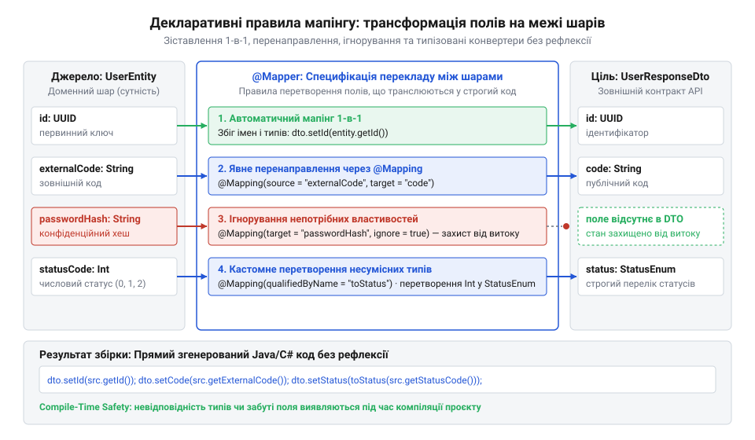
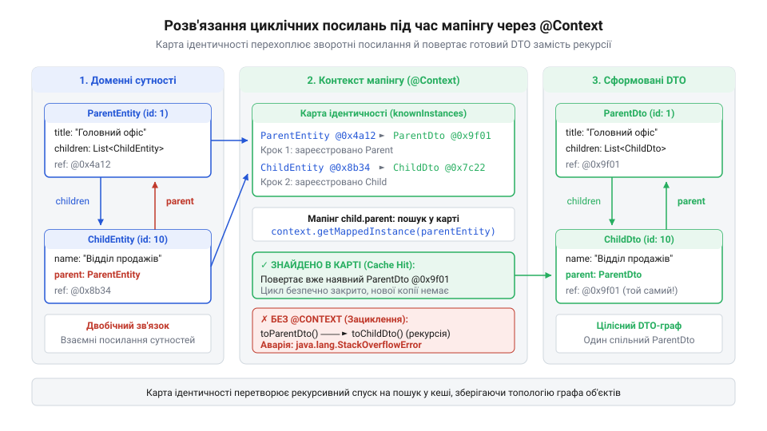

# Ціна мапінгу між шарами

<preknowlist>
- [Протікання шару](root:progarch/layer-leakage) — Розуміння небезпеки прямого прокидання ORM-сутностей у зовнішні шари та чому різна динаміка змін вимагає окремих моделей DTO.
- [Шар, що лише передає далі](root:progarch/pass-through-layer) — Розуміння хвильового ефекту змін і навантаження на пам'ять під час багаторазового транзитного копіювання даних.
</preknowlist>

## Пастка ручного копіювання та приховані витрати динамічної рефлексії

У системах із чітким розділенням архітектурних меж різні рівні програми оперують власними моделями даних. Контролер веб-API приймає вхідні запити й формує відповіді за допомогою об'єктів передавання даних (англ. @@en|Data Transfer Object@@, DTO). Доменний шар інкапсулює бізнес-правила у вигляді багатих агрегатів, де внутрішній стан захищений від некоректних змін. Шар персистентності взаємодіє з реляційними таблицями через спеціалізовані сутності збереження. Оскільки пряме використання сутності бази даних у відповідях API спричиняє [протікання шару](root:progarch/layer-leakage) та змішує різні цикли змін, виникає неминуча потреба транслювати дані з однієї форми в іншу на кожній архітектурній межі.

Найпростіший шлях розв'язання цієї задачі — написання ручних методів-конвертерів:

```text
dto.roomId = entity.roomId;
dto.targetTemperature = entity.targetTemperature;
dto.currentTemperature = entity.currentTemperature;
dto.isActive = entity.isActive;
```

Коли сервіс містить лише дві сутності, ручне перекладання полів здається безпечним і тривіальним. Проте з розвитком платформи розумного дому Digital Homes кількість сутностей, команд та DTO стрімко зростає до сотень. Кожна операція створення кімнати, реєстрації датчика температури, налаштування графіка опалення чи зняття телеметрії вимагає власного набору класів. У результаті інженери витрачають третину робочого часу на написання та оновлення одноманітного коду копіювання значень з об'єкта в об'єкт. Створюється [шар, що лише передає далі](root:progarch/pass-through-layer), який не містить жодної бізнес-логіки, але вимагає постійної синхронізації сигнатур і генерує тисячі рядків рутинного шаблонного тексту.

Головна небезпека ручного перекладання полягає в людському чиннику та мовчазних помилках. Уявімо, що інженер розширює сутність термостата новим полем заряду батареї `batteryLevel`. Він додає відповідне поле до схеми бази даних і в клас `ThermostatResponseDto`. Проте в методі ручного мапінгу розробник випадково пропускає рядок присвоєння значення:

```text
dto.setBatteryLevel(entity.getBatteryLevel()); // Пропущено під час рефакторингу!
```

Компілятор не бачить у цьому жодної проблеми: обидва класи синтаксично коректні, виклики існують, типи збігаються. Звичайні модульні тести, які лише перевіряють, що об'єкт відповіді не дорівнює нулю, успішно проходять. Дефект потрапляє у робоче середовище: мобільний застосунок користувача отримує порожнє або нульове значення заряду батареї, вважає пристрій розрядженим і надсилає помилкове аварійне сповіщення. Пошук таких пропущених полів у сотнях ручних перекладачів перетворюється на виснажливе розслідування інцидентів.

У прагненні позбутися рутинного коду команди нерідко звертаються до бібліотек динамічної рефлексії (від латинського @@la|reflectere@@ — повертати назад, відбивати), таких як класичний AutoMapper або ModelMapper. На перший погляд, це виглядає ідеальним порятунком: замість десятків рядків присвоєння розробник пише єдиний виклик `mapper.map(entity, ThermostatResponseDto.class)`. Бібліотека бере на себе пошук однойменних полів та копіювання значень.

Проте плата за таку зручність виявляється нищівною для системної швидкодії:
1. **Інспекція метаданих під час виконання**: Для кожного перетворення об'єкта рефлексивний рушій змушений динамічно перевіряти типи полів у пам'яті процесу, читати внутрішні таблиці класів, викликати методи доступу через непряму адресацію та упаковувати примітивні типи (англ. @@en|boxing@@, від англ. @@en|box@@ — коробка).
2. **Падіння пропускної здатності**: Швидкість рефлексивного мапінгу в 20–50 разів нижча за прямі присвоєння полів. В інтенсивних сценаріях читання телеметрії обробка мапінгу здатна поглинати до 50–70% усього процесорного часу мікросервісу.
3. **Вимивання кешу процесора та навантаження на пам'ять**: Непередбачувані переходи по структурах метаданих призводять до постійних промахів у L1/L2 кешах процесора. Ба більше, динамічні мапери створюють лавину тимчасових службових об'єктів у купі, що змушує збирач сміття регулярно зупиняти потоки виконання застосунку, спричиняючи різкі сплески латентності на 99-му перцентилі (p99).
4. **Перенесення помилок у період виконання**: Якщо поля перейменовано або типи даних не зіставляються автоматично, рефлексивний мапер не попередить про це під час збірки проєкту — сервіс вибухне винятком безпосередньо в момент обробки реального запиту користувача в бою.

Перед архітектором постає жорстка дилема: ручний код є швидким і контрольованим, але надзвичайно трудомістким і вразливим до пропусків полів; динамічна рефлексія позбавляє від рутини, але руйнує продуктивність і безпеку типів. Необхідний третій шлях: перекладач має бути декларативним у коді, але процедурним і строгим у машинному виконанні.

> 🔧 **Навіщо це.**
> Розуміння ціни ручного та динамічного мапінгу захищає архітектуру від двох крайнощів: виснажливої підтримки тисяч рядків крихкого шаблонного коду та катастрофічної деградації продуктивності веб-сервісів під високим навантаженням.

## Архітектура компіляційного мапера: від декларативного контракту до плоского коду

Розв'язанням дилеми між лаконічністю опису та швидкістю виконання є перенесення генерації коду на етап компіляції (від латинського @@la|compilare@@ — збирати докупи, накопичувати). Цю концепцію реалізують сучасні декларативні генератори: MapStruct у світі Java та Mapperly у платформі .NET / C#.

Замість написання процедурного коду копіювання чи реєстрації рантайм-конфігурацій інженер створює лише абстрактний інтерфейс перетворення з декларативними анотаціями (від латинського @@la|declarare@@ — заявляти, проголошувати). Усе інше виконує компілятор за чітко визначеним конвеєром.


*Схема компіляційного конвеєра: перетворення декларативного контракту мапера в оптимізований процедурний вихідний код безпосередньо під час складання артефакту.*

Механізм роботи кодогенератора розгортається у чотири послідовні фази:
1. **Синтаксичний розбір (AST-аналіз)**: Компілятор читає вихідний код проєкту та будує абстрактне синтаксичне дерево (англ. @@en|Abstract Syntax Tree@@, від грецького @@gr|syntaxis@@ — спільне впорядкування).
2. **Перехоплення процесором анотацій**: Плагін кодогенератора (Java Annotation Processor за стандартом JSR-269 або Roslyn Source Generator у .NET) перехоплює класи та інтерфейси, позначені анотацією `@Mapper` чи `[Mapper]`.
3. **Зіставлення графів типів**: Генератор досліджує тип джерела та тип призначення. Він аналізує сигнатури гетерів і сетерів, знаходить поля зі збіжними іменами та типами, перевіряє явні правила зіставлення `@Mapping` і формує дерево викликів.
4. **Синтез процедурного коду**: До того, як завершиться етап компіляції, генератор записує на диск повноцінний файл вихідного коду (наприклад, `ThermostatMapperImpl.java` або парціальний клас у C#) і компілює його у фінальний байткод разом з рештою програми.

Нижче наведено практичний приклад: розробник пише лише чистий контракт інтерфейсу, а компілятор самостійно генерує процедурну реалізацію з перевірками на `null`.

:::tabs
:::code api-declarative-mapper-interface/java/thermostatmapperimpl.java
```csharp
// Контракт мапера мовою C# (.NET), який пише розробник
namespace DigitalHomes.Climate.Mappers;

using DigitalHomes.Climate.Dtos;
using DigitalHomes.Climate.Entities;
using Riok.Mapperly.Abstractions;

[Mapper]
public static partial class ThermostatMapper
{
    [MapProperty(nameof(ThermostatEntity.RoomIdentifier), nameof(ThermostatResponseDto.RoomId))]
    [MapProperty(nameof(ThermostatEntity.TargetTempCelsius), nameof(ThermostatResponseDto.TargetTemperature))]
    public static partial ThermostatResponseDto ToResponseDto(ThermostatEntity entity);
}

// Процедурний парціальний клас, який згенерував Roslyn Source Generator під час збірки
namespace DigitalHomes.Climate.Mappers;

using DigitalHomes.Climate.Dtos;
using DigitalHomes.Climate.Entities;

public static partial class ThermostatMapper
{
    public static partial ThermostatResponseDto ToResponseDto(ThermostatEntity entity)
    {
        if (entity == null)
        {
            return null!;
        }

        var dto = new ThermostatResponseDto
        {
            RoomId = entity.RoomIdentifier,
            TargetTemperature = entity.TargetTempCelsius,
            CurrentTemperature = entity.CurrentTemperature,
            IsActive = entity.IsActive
        };

        return dto;
    }
}
```
:::

Така архітектура забезпечує фундаментальні інженерні гарантії:
1. **Абсолютна безпека на етапі компіляції**: Якщо поле `RoomIdentifier` у сутності буде перейменовано на `ZoneId`, а анотація `@Mapping` в інтерфейсі залишиться старою, збірка проєкту негайно зупиниться з точною помилкою: `Unknown property "roomIdentifier" in source class`. Жодна невідповідність імен чи несумісність типів не здатна проникнути в робоче середовище непоміченою.
2. **Абстракція з нульовою вартістю (Zero-Cost Abstraction)**: Згенерований код містить виключно прямі виклики інструкцій доступу до полів. За швидкодією та споживанням пам'яті він повністю еквівалентний бездоганному ручному коду: відсутні метадані, немає динамічного виділення пам'яті для рефлексивних дескрипторів, а JIT-компілятор процесора легко оптимізує та вбудовує (англ. @@en|inline@@) такі методи безпосередньо в машинний код.
3. **Повна прозорість та легкість налагодження**: Згенеровані вихідні файли фізично доступні в каталозі збірки (`target/generated-sources` або `obj/Generated`). Інженер може відкрити їх у середовищі розробки, переглянути кожне присвоєння і встановити точку зупинки (англ. @@en|breakpoint@@) під час відлагодження програми точно так само, як у звичайному коді.

> 🔧 **Навіщо це.**
> Компіляційний мапер поєднує строгість та безпеку ручного коду з лаконічністю декларативного стилю. Він усуває рутинне написання сотень конвертерів і водночас захищає продакшн від прихованих збоїв та просідання швидкодії.

## Декларація контракту мапера: налаштування @Mapper та політики безпеки меж

У попередньому розділі ми з'ясували, що компіляційний мапер транслює декларативний інтерфейс у звичайні процедурні інструкції копіювання полів під час збірки проєкту. Проте оголошення мапера не зводиться лише до переліку сигнатур методів. Анотація `@Mapper` у Java (MapStruct) або `[Mapper]` у C# (Mapperly) виступає архітектурним маніфестом межі: вона визначає життєвий цикл перекладача, спосіб інтеграції з контейнером інверсії керування та, що найважливіше, суворість контролю за цілісністю даних.

Перший аспект конфігурації (від латинського @@la|configurare@@ — надавати форму, упорядковувати) стосується життєвого циклу екземпляра мапера та впровадження залежностей. За замовчуванням генератори створюють екземпляр мапера без стану, доступний через статичну фабрику:

```java
ThermostatMapper INSTANCE = Mappers.getMapper(ThermostatMapper.class);
```

У монолітних або автономних утилітах такий підхід є достатнім. Проте в сучасних корпоративних системах, де мапери часто потребують додаткових інфраструктурних сервісів (наприклад, форматування валют, шифрування ідентифікаторів чи виклику доменних фабрик), перекладач сам повинен бути керованим компонентом. За допомогою параметра `componentModel = "spring"` (або `"cdi"` у середовищі Jakarta EE) генератор додає до згенерованого класу анотацію `@Component`. Це дозволяє передавати мапер у сервіси через конструктор разом із рештою компонентів, зберігаючи повну прозорість дерева залежностей і полегшуючи модульне тестування за допомогою мок-об'єктів.

Головний наріжний камінь архітектурної надійності — політика (від грецького @@gr|politike@@ — діяльність, спосіб урядування) обробки незіставлених полів. За замовчуванням генератори налаштовані ліберально: якщо в об'єкті джерела або цілі є поля, для яких не знайдено прямої пари за іменем, генератор мовчки ігнорує їх (`ReportingPolicy.IGNORE`) або виводить непомітне попередження в лог збірки (`WARN`).

Така поведінка за замовчуванням повертає систему до найгірших вад ручного коду: якщо інженер додав до доменного агрегату поле ліміту споживання енергії `powerLimitWatts`, але забув додати його до вихідного DTO або налаштувати правило конвертації, збірка проєкту завершиться успішно. У робочому середовищі нове поле буде мовчки відкинуто, що спричинить приховану втрату даних.

Щоб запобігти цьому, на кожній архітектурній межі запроваджують безкомпромісну політику валідації схеми:

```text
unmappedTargetPolicy = ReportingPolicy.ERROR
unmappedSourcePolicy = ReportingPolicy.ERROR
```

Коли встановлено `ReportingPolicy.ERROR`, компілятор перевіряє кожне окреме поле цільового об'єкта. Якщо в цілі є бодай одна властивість, для якої не вказано джерело і яку явно не позначено як проігноровану, процес компіляції негайно аварійно переривається. Це позбавляє розробника можливості зробити випадковий пропуск: будь-яка зміна схеми джерела або цілі вимагає свідомого оновлення контракту мапера.

:::tabs
:::code api-declarative-mapper-interface/java/snippet-2.java
```csharp
// Конфігурація суворого мапера для .NET Core (Mapperly)
namespace DigitalHomes.Climate.Mappers;

using DigitalHomes.Climate.Dtos;
using DigitalHomes.Climate.Entities;
using Riok.Mapperly.Abstractions;

[Mapper(
    RequiredMappingStrategy = RequiredMappingStrategy.All,
    UnmappedTargetBehavior = CompilationBehavior.Error
)]
public static partial class ThermostatMapper
{
    [MapProperty(nameof(ThermostatEntity.RoomIdentifier), nameof(ThermostatResponseDto.RoomId))]
    [MapProperty(nameof(ThermostatEntity.TargetTempCelsius), nameof(ThermostatResponseDto.TargetTemperature))]
    [MapperIgnoreTarget(nameof(ThermostatResponseDto.InternalRevision))] // Явне виключення з мапінгу
    public static partial ThermostatResponseDto ToDto(ThermostatEntity entity);
}
```
:::

Додатково `@Mapper` контролює стратегію обробки порожніх посилань (англ. @@en|null handling@@). За допомогою `nullValueMappingStrategy = NullValueMappingStrategy.RETURN_NULL` або `RETURN_DEFAULT` архітектор визначає, що повертатиме метод у разі отримання `null`: порожнє посилання чи порожній об'єкт із дефолтними значеннями списків та примітивів, що дозволяє усунути ризик виникнення `NullPointerException` на стику шарів.

> 🔧 **Навіщо це.**
> Встановлення `unmappedTargetPolicy = ReportingPolicy.ERROR` перетворює компілятор на непохитного охоронця архітектурного шва: будь-яке нове поле вимагає явної уваги інженера, унеможливлюючи випуск версій із випадково втраченими даними.

## Точкове зіставлення полів через @Mapping: трансформація графів і розв'язання невідповідностей

У реальних проєктах моделі сусідніх шарів рідко бувають дзеркальними копіями. Доменні агрегати використовують виразні імена бізнес-понять (`targetTempCelsius`, `operatingSchedule`), шар бази даних тяжіє до оптимізованих реляційних колонок (`temp_c`, `schedule_json`), а зовнішні API вимагають лаконічних імен у стилі camelCase (`targetTemperature`, `schedule`). Коли імена, структури чи типи полів не збігаються, автоматичного зв'язування за назвами недостатньо — у гру вступає точкова трансформація (від латинського @@la|transformare@@ — перетворювати, змінювати форму).


*Схема правил декларативного зіставлення: пряме копіювання однойменних полів, явне перенаправлення, виключення небажаних властивостей та виклик кастомних перетворювачів типів.*

Для кожного методу інтерфейсу розробник може задати ланцюжок анотацій `@Mapping` (або `[MapProperty]`), що описують відхилення від прямого копіювання.

### Перейменування та заглиблення у вкладені структури

Базове призначення анотації — вказати, з якого поля джерела (`source`) брати дані для цільового поля (`target`):

```java
@Mapping(source = "roomIdentifier", target = "roomId")
```

Генератор підтримує навігацію крізь вкладені об'єкти за допомогою крапкової нотації. Якщо сутність містить об'єкт значення `LocationInfo`, а клієнтський DTO плаский, розробник може зв'язати глибоке поле безпосередньо:

```java
@Mapping(source = "installationLocation.floorNumber", target = "floor")
```

Компілятор самостійно згенерує безпечний ланцюжок перевірок: він перевірить на `null` спершу сутність, потім `installationLocation`, і лише за умови наявності обох витягне `floorNumber`. Якщо проміжний об'єкт відсутній, цільове поле `floor` безпечно отримає дефолтне значення без падіння процесу.

### Явне ігнорування та значення за замовчуванням

Коли увімкнено політику `ReportingPolicy.ERROR`, будь-яке цільове поле без джерела спричиняє збій збірки. Якщо поле свідомо не повинно заповнюватися мапером (наприклад, обчислюваний статус або технічний лічильник), його обов'язково маркують через `ignore = true`:

```java
@Mapping(target = "internalRevision", ignore = true)
```

Це слугує явною документацією наміру в коді: поле не «забули», його пропуск санкціонований архітектурою.

Для випадків, коли джерело може містити `null`, передбачено параметри значення за замовчуванням:
- `defaultValue = "ECO"`: якщо поле джерела `null`, у ціль запишеться статичний літерал.
- `defaultExpression = "java(java.time.Instant.now())"`: динамічний вираз, який компілятор вставить у блок `else`, якщо джерело порожнє.

### Кастомні методи та кваліфікатори

Коли типи полів принципово несумісні (наприклад, температура в сутності зберігається як десяткове число `double` у градусах Цельсія, а зовнішній API міжнародного клієнта вимагає цілого значення у Фаренгейтах), механічного копіювання недостатньо.

Для розв'язання цієї проблеми використовують кастомні методи-конвертери, позначені кваліфікатором (від латинського @@la|qualis@@ — який за якістю, та @@la|facere@@ — робити):

:::tabs
:::code api-declarative-mapper-interface/java/celsiustofahrenheit.java
```csharp
// Мапер зі спеціалізованими конвертерами мовою C# (Mapperly)
namespace DigitalHomes.Climate.Mappers;

using System;
using DigitalHomes.Climate.Dtos;
using DigitalHomes.Climate.Entities;
using Riok.Mapperly.Abstractions;

[Mapper(UnmappedTargetBehavior = CompilationBehavior.Error)]
public static partial class ThermostatDetailMapper
{
    [MapProperty(nameof(ThermostatEntity.RoomIdentifier), nameof(ThermostatResponseDto.RoomId))]
    [MapProperty(nameof(ThermostatEntity.TargetTempCelsius), nameof(ThermostatResponseDto.TargetTemperatureFahrenheit), Use = nameof(CelsiusToFahrenheit))]
    [MapperIgnoreTarget(nameof(ThermostatResponseDto.FirmwareRevision))]
    public static partial ThermostatResponseDto ToDto(ThermostatEntity entity);

    private static int CelsiusToFahrenheit(double celsius)
    {
        return (int)Math.Round(celsius * 1.8 + 32);
    }
}
```
:::

Під час аналізу анотації `@Mapping` генератор бачить параметр `qualifiedByName = "celsiusToFahrenheit"`, знаходить відповідний метод в інтерфейсі й замість простого присвоєння генерує прямий виклик:

```text
dto.setTargetTemperatureFahrenheit(celsiusToFahrenheit(entity.getTargetTempCelsius()));
```

### Модифікація існуючого об'єкта через @MappingTarget

Мапінг не завжди означає створення нового екземпляра в купі. Під час операцій оновлення (`PUT` або `PATCH` запити) необхідно перенести нові значення з DTO у вже існуючий доменний агрегат або сутність БД, яка вже перебуває в сесії ORM.

Для цього використовують анотацію цільового параметра `@MappingTarget`:

```java
void updateEntityFromDto(UpdateThermostatDto dto, @MappingTarget ThermostatEntity entity);
```

Генератор не створює об'єкт через оператор `new`. Замість цього він бере готовий екземпляр `entity` і послідовно викликає його сетери, передаючи поля з `dto`. Це запобігає виділенню зайвої пам'яті та зберігає ідентичність екземпляра для системи відстеження змін у базі даних.

> 🔧 **Навіщо це.**
> Анотація `@Mapping` дозволяє розвести моделі суміжних шарів у просторі імен і структурі: кожен шар розвиває свою схему даних так, як зручно йому, а декларативний інтерфейс бере на себе складну конвертацію без сповільнення роботи програми.

## Мапінг колекцій, вкладених об'єктів та робота з наявними екземплярами (@MappingTarget)

Коли межу між шарами перетинає не пласка структура зі скалярними значеннями, а розгалужений граф — агрегат замовлення з переліком позицій, даними клієнта та прив'язкою до складу, — ручне перекладання перетворюється на громіздкий код перевірок і циклів. Рушій компіляційного мапінгу розв'язує це через автоматичне виведення правил: якщо в контракті мапера оголошено перетворення одиничного елемента (наприклад, `OrderItem` у `OrderItemDto`), компілятор самостійно генерує код трансформації для контейнерів цих типів — `List`, `Set` або масивів. Під час збірки проєкту генератор розгортає мапінг списку в прямий ітерований цикл, у якому для кожного елемента викликається відповідний скалярний перетворювач.

Однак на практиці вкладені колекції містять крайові стани, головний з яких — відсутність значення. Якщо вхідний список дорівнює `null`, повернення `null` у доменну модель або у зовнішній шар змушує клієнтський код на кожному кроці розставляти захисні перевірки. Щоб захистити архітектурні межі від поширення порожніх покажчиків, генератори надають декларативні політики поведінки:

1. **Стратегія мапінгу значень за замовчуванням** (`NullValueMappingStrategy.RETURN_DEFAULT`) — у разі зустрічі з `null`-колекцією генератор повертає новий порожній контейнер (`Collections.emptyList()` або порожній `List<T>`), гарантуючи безпечну ітерацію без ризику падіння через `NullPointerException`.
2. **Стратегія ігнорування властивостей** (`NullValuePropertyMappingStrategy.IGNORE`) — визначає, як поводитися з окремими полями під час операцій часткового оновлення. Якщо властивість у вхідному DTO не передано (`null`), цільове поле об'єкта не затирається, зберігаючи свій попередній стан.

### Оновлення за місцем (@MappingTarget) та зменшення навантаження на збирач сміття

У сервісах, які обробляють великі потоки запитів на зміну стану (операції `PUT` або `PATCH`), традиційне створення нового екземпляра сутності на кожен запит викликає явище @@en|allocation churn@@ (від лат. *allocatio* — розміщення та англ. *churn* — збивання, колотіння) — надмірне захаращення купи (@@en|heap@@) короткими за життєвим циклом об'єктами. Якщо система містить [шар, що лише передає далі](root:progarch/pass-through-layer), множинне дублювання структур багаторазово підсилює навантаження на процесор і змушує збирач сміття частіше зупиняти робочі потоки для очищення пам'яті. До того ж об'єктно-реляційні мапери (ORM) відстежують стан сутності за її конкретним екземпляром у сесії; створення нового об'єкта замість модифікації наявного руйнує контекст відстеження змін і призводить до [протікання шару](root:progarch/layer-leakage).

Для розв'язання цієї проблеми компіляційні генератори надають механізм мутації за місцем (від лат. *mutatio* — зміна). Анотація `@MappingTarget` (у Java/MapStruct) або передача наявного цільового екземпляра як другого аргументу методу оновлення (у C#/Mapperly) вказує генератору не виділяти пам'ять через оператор `new`, а напряму модифікувати поля переданого об'єкта:

```
[Вхідний DTO запиту] ──> [Компіляційний мапер] ──> [Модифікація полів наявного об'єкта в пам'яті]
                              (без виділення new TTarget())
```

> 🔧 **Навіщо це.**
> Мутація за місцем через `@MappingTarget` усуває витрати на постійне виділення та збирання пам'яті під час масових оновлень, а також зберігає цілісність сесії ORM, де заміна посилання на сутність призвела б до зайвих запитів у базу даних або втрати кешу ідентичності.

### Розв'язання циклічних посилань через контекст мапінгу

Складні доменні моделі часто мають взаємні циклічні зв'язки: замовлення `Order` агрегує позиції `OrderItem`, а кожна позиція зберігає зворотне посилання на своє батьківське замовлення. Прямий обхід такого дерева спричиняє нескінченну рекурсію: мапер намагається перетворити батьківський об'єкт, для цього створює дочірній, який знову викликає мапінг батьківського. Це неминуче завершується аварійним переповненням стека викликів (@@en|stack overflow@@).

Щоб розірвати цикл без порушення форми графа, використовують карту ідентичності (від лат. *identitas* — тотожність) — @@en|identity map@@, яка передається через контекст мапінгу (`@Context`). Працює це як засіб запам'ятовування (мемоізації) екземплярів: перед початком перетворення об'єкта генератор реєструє його в контексті за посиланням; коли дочірній елемент намагається змапити зворотне посилання, контекст повертає вже створений цільовий екземпляр замість рекурсивного виклику.


*Схема розв'язання циклічних графів: збереження створених DTO в контекстній карті ідентичності для уникнення нескінченної рекурсії та переповнення стека.*

Реалізація мапінгу колекцій, оновлення екземплярів та запобігання циклам у декларативних маперах виглядає так:

:::tabs
:::code api-declarative-mapper-interface/java/cycleavoidingmappingcontext.java
```csharp
using System;
using System.Collections.Generic;
using Riok.Mapperly.Abstractions;

namespace DigitalHomes.Order.Adapter.Mapping;

// Контекст відстеження екземплярів для розриву взаємних посилань
public class MappingContext
{
    private readonly Dictionary<object, object> _references = new(ReferenceEqualityComparer.Instance);

    public bool TryGet<TSource, TTarget>(TSource source, out TTarget? target)
        where TSource : notnull
    {
        if (_references.TryGetValue(source, out var mapped) && mapped is TTarget casted)
        {
            target = casted;
            return true;
        }
        target = default;
        return false;
    }

    public void Track<TSource, TTarget>(TSource source, TTarget target)
        where TSource : notnull
        where TTarget : notnull
    {
        _references[source] = target;
    }
}

[Mapper]
public partial class OrderMapper
{
    // Компілятор автоматично генерує перетворення списку на базі ToItemDto
    public partial List<OrderItemDto> ToItemDtoList(List<OrderItem> items, MappingContext context);

    // Мапінг графа з розривом циклічної рекурсії через перевірку наявності в контексті
    public OrderDto ToDto(Order order, MappingContext context)
    {
        if (context.TryGet<Order, OrderDto>(order, out var existing))
        {
            return existing!;
        }

        var dto = new OrderDto
        {
            Id = order.Id,
            CreatedAt = order.CreatedAt
        };
        context.Track(order, dto);

        dto.Items = ToItemDtoList(order.Items, context);
        return dto;
    }

    public OrderItemDto ToItemDto(OrderItem item, MappingContext context)
    {
        if (context.TryGet<OrderItem, OrderItemDto>(item, out var existing))
        {
            return existing!;
        }

        var dto = new OrderItemDto
        {
            Id = item.Id,
            Price = item.Price
        };
        context.Track(item, dto);

        dto.Order = ToDto(item.Order, context);
        return dto;
    }

    // Оновлення наявного екземпляра за місцем (in-place) без алокації нової сутності
    [MapperIgnoreTarget(nameof(Order.Id))]
    [MapperIgnoreTarget(nameof(Order.Items))]
    public partial void UpdateEntityFromPatch(OrderPatchRequest request, Order target);
}
```
:::

## Захист доменних інваріантів: хуки життєвого циклу (@BeforeMapping, @AfterMapping) та фабрики сутностей

Коли дані перетинають архітектурну межу й надходять із зовнішнього шару, завдання мапера — перекласти вхідний DTO у доменну модель. Проте типова спокуса під час налаштування автоматичної генерації полягає у відкритті всіх полів сутності через публічні сетери та створенні порожнього конструктора без аргументів. Такий підхід повністю нівелює інкапсуляцію (від грец. *en-* — в та лат. *capsula* — скринька): доменний клас деградує до анемічної моделі даних (@@en|anemic domain model@@), у якій будь-який сторонній код може перевести об'єкт у некоректний стан в обхід бізнес-правил. Якщо конструктор не контролює повноту та валідність своїх аргументів, виникає [протікання шару](root:progarch/layer-leakage): усередину бізнес-логіки просочуються напівпорожні або взаємно суперечливі структури.

Справжня багата доменна модель (@@en|rich domain model@@) вимагає, щоб об'єкт у будь-який момент часу задовольняв свої інваріанти (від лат. *invarians* — незмінний) — обов'язкові правила цілісності, порушення яких неприпустиме. Для підтримки закритого стану сучасні компіляційні мапери вміють працювати з інкапсульованими сутностями через параметризовані конструктори, [шаблон проектування Builder](root:sf-apps/builder) або фабричні методи (`@ObjectFactory`). Компілятор аналізує імена й типи полів у DTO, зіставляє їх із параметрами конструктора та генерує прямий виклик створення об'єкта лише тоді, коли всі необхідні залежності зібрано, не вимагаючи наявності публічних мутаторів.

Коли створення агрегата потребує складної перевірки сукупності полів або попередньої нормалізації даних, у контракті мапера застосовують хуки життєвого циклу:

- `@BeforeMapping` — виконується до початку генерації коду перенесення властивостей. Тут здійснюють первинну фільтрацію вхідних значень, нормалізацію рядків (наприклад, очищення номерів телефонів чи видалення зайвих пробілів) або перевірку наявності прав доступу в контексті безпеки.
- `@AfterMapping` — викликається безпосередньо після того, як усі поля екземпляра заповнено. Це ідеальне місце для виклику внутрішнього методу валідації агрегата (`apartment.validateInvariants()`). Якщо виявлено логічну суперечність (наприклад, порогова температура сигналізації вища за критичну температуру датчика), мапер негайно генерує доменний виняток, відсікаючи невалідний стан ще на межі адаптера.

> 🔧 **Навіщо це.**
> Хуки життєвого циклу та фабричні методи гарантують строгу інкапсуляцію доменного ядра: мапер не змушує відкривати приватні сетери, а об'єкти з порушеними інваріантами відсікаються безпосередньо в момент перетину архітектурної межі до того, як вони потраплять у доменні сервіси.

:::tabs
:::code api-declarative-mapper-interface/java/apartment.java
```csharp
using System;
using Riok.Mapperly.Abstractions;

namespace DigitalHomes.Order.Adapter.Mapping;

// Доменний агрегат з інкапсульованим станом і захистом інваріантів
public class Apartment
{
    public string Number { get; }
    public double TotalArea { get; }
    public double LivingArea { get; }

    public Apartment(string number, double totalArea, double livingArea)
    {
        Number = number;
        TotalArea = totalArea;
        LivingArea = livingArea;
        ValidateInvariants();
    }

    public void ValidateInvariants()
    {
        if (TotalArea <= 0)
        {
            throw new ArgumentException("Загальна площа повинна бути додатною");
        }
        if (LivingArea > TotalArea)
        {
            throw new InvalidOperationException("Житлова площа не може перевищувати загальну");
        }
    }
}

public record ApartmentCreateRequest(string Number, double TotalArea, double LivingArea);

[Mapper]
public partial class ApartmentDomainMapper
{
    // Компілятор зіставляє поля record з параметрами конструктора Apartment
    public partial Apartment ToDomain(ApartmentCreateRequest request);

    // Додатковий метод трансформації з виконанням доменних перевірок
    public Apartment MapAndValidate(ApartmentCreateRequest request)
    {
        if (string.IsNullOrWhiteSpace(request.Number))
        {
            throw new ArgumentException("Номер квартири є обов'язковим");
        }

        var apartment = ToDomain(request);
        apartment.ValidateInvariants();
        return apartment;
    }
}
```
:::

## Керування контекстом і циклічними залежностями: параметр @Context для безпечного обходу графів

У реальних доменних моделях сутності рідко існують ізольовано одна від одної. Зв'язки між агрегатами часто є двонаправленими: агрегат квартири `Apartment` агрегує список підключених датчиків `Sensor`, а кожен датчик зберігає зворотне посилання на квартиру, у якій він встановлений. Коли постає потреба перекласти такий взаємопов'язаний граф у зовнішні DTO, наївний рекурсивний обхід потрапляє у пастку нескінченної рекурсії (від лат. *re-* — назад та *currere* — бігти): мапер квартири трансформує датчики, а кожен датчик у списку знову ініціює мапінг свого батьківського об'єкта. Потік викликів швидко вичерпує ліміт фреймів пам'яті, що призводить до фатального переповнення стека (@@en|stack overflow@@) та аварійного завершення процесу.

Для розриву таких циклів компіляційні генератори використовують механізм прокидання контексту через анотацію `@Context`. Через параметр контракту крізь увесь ланцюжок викликів передається допоміжний об'єкт із [картою ідентичності](root:sf-data/identity-map) (@@en|identity map@@, від лат. *identitas* — тотожність). Вона фіксує відповідність між вихідними сутностями та вже створеними DTO за посиланням на екземпляр (`IdentityHashMap` у Java або словник на основі `ReferenceEqualityComparer` у .NET).

Згенерований компілятором код взаємодіє з контекстом за таким алгоритмом:

1. Перед виділенням пам'яті під новий екземпляр DTO мапер запитує контекст: чи існує вже готова копія для цього вихідного об'єкта?
2. Якщо об'єкт знайдено в карті ідентичності, генератор негайно повертає наявне посилання, зупиняючи подальший рекурсивний спуск.
3. Якщо об'єкт обробляється вперше, генератор створює цільовий DTO, одразу реєструє його в контексті за посиланням на вихідну сутність і лише після цього переходить до трансформації дочірніх зв'язків.
4. Коли дочірній датчик починає мапити поле `apartment`, переданий контекст повертає вже зареєстрований кореневий `ApartmentDto`. Граф замикається природно, а рекурсивне розгортання зупиняється без порушення структури даних.

> 🔧 **Навіщо це.**
> Передача контексту мапінгу дозволяє безпечно перекладати складні графи даних зі взаємними посиланнями між сутностями, зберігаючи реляційні зв'язки в моделі DTO та усуваючи загрозу аварійної зупинки сервісу через переповнення стека.

:::tabs
:::code api-declarative-mapper-interface/java/cycleavoidingmappingcontext.java
```csharp
using System;
using System.Collections.Generic;
using Riok.Mapperly.Abstractions;

namespace DigitalHomes.Order.Adapter.Mapping;

// Контекст розв'язання циклічних посилань для C#
public class MappingContext
{
    private readonly Dictionary<object, object> _instances = new(ReferenceEqualityComparer.Instance);

    public bool TryGet<TSource, TTarget>(TSource source, out TTarget? target)
        where TSource : notnull
    {
        if (_instances.TryGetValue(source, out var mapped) && mapped is TTarget casted)
        {
            target = casted;
            return true;
        }
        target = default;
        return false;
    }

    public void Register<TSource, TTarget>(TSource source, TTarget target)
        where TSource : notnull
        where TTarget : notnull
    {
        _instances[source] = target;
    }
}

[Mapper]
public partial class SmartHomeGraphMapper
{
    public partial List<SensorDto> ToDtoList(List<Sensor> sensors, MappingContext context);

    // Ручна реалізація вузлових методів з перевіркою контексту зупинки циклів
    public ApartmentDto ToDto(Apartment apartment, MappingContext context)
    {
        if (context.TryGet<Apartment, ApartmentDto>(apartment, out var existing))
        {
            return existing!;
        }

        var dto = new ApartmentDto { Number = apartment.Number };
        context.Register(apartment, dto);

        dto.Sensors = ToDtoList(apartment.Sensors, context);
        return dto;
    }

    public SensorDto ToDto(Sensor sensor, MappingContext context)
    {
        if (context.TryGet<Sensor, SensorDto>(sensor, out var existing))
        {
            return existing!;
        }

        var dto = new SensorDto { Id = sensor.Id, Type = sensor.Type };
        context.Register(sensor, dto);

        dto.Apartment = ToDto(sensor.Apartment, context);
        return dto;
    }
}
```
:::
