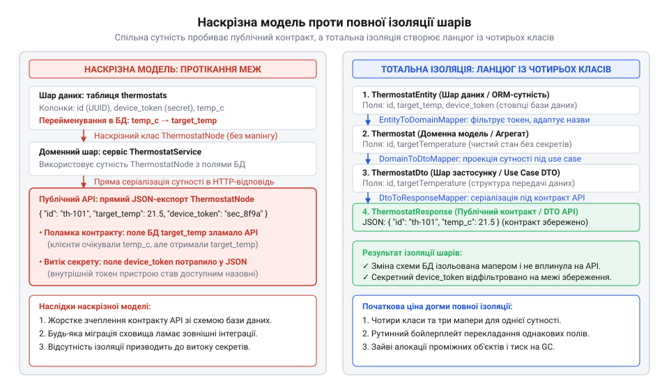
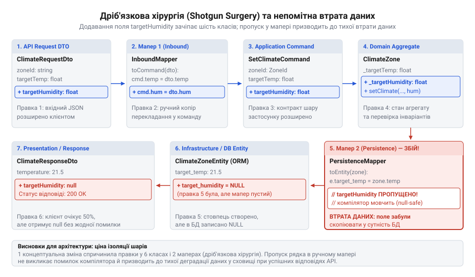
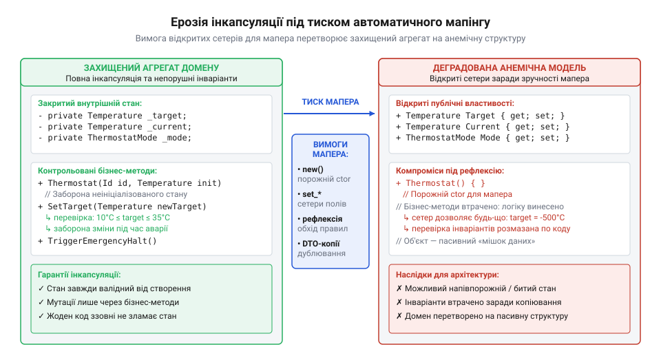
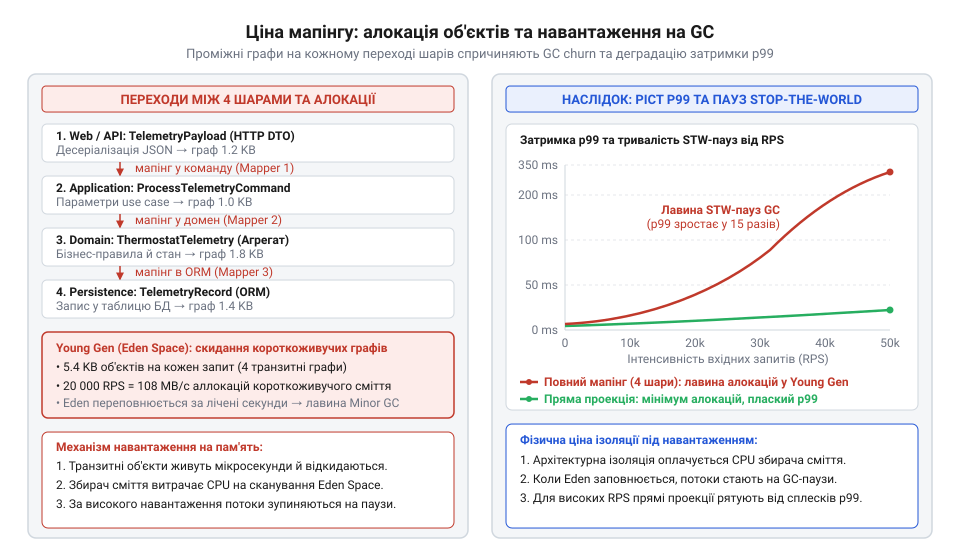
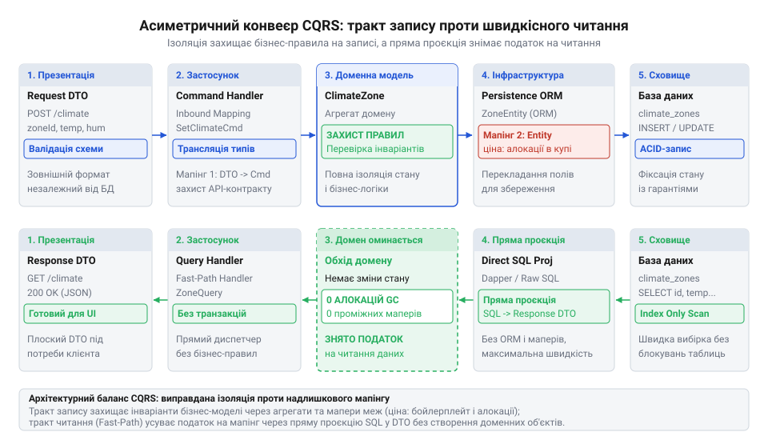
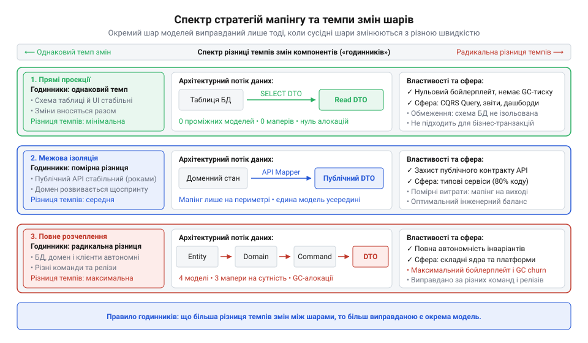
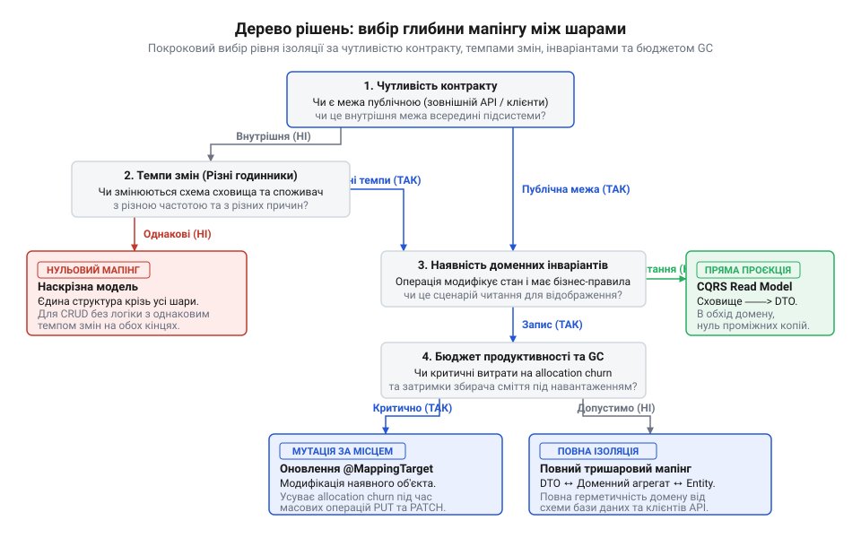

# Ціна мапінгу між шарами

<preknowlist>
- [Протікання шару](root:progarch/layer-leakage) — як саме типи та деталі реалізації бази даних чи транспортного протоколу просочуються крізь абстракції у сусідні шари за відсутності ізолюючого перетворення даних
- [Шар, що лише передає далі](root:progarch/pass-through-layer) — механізм виникнення транзитних шарів, які не виконують власної бізнес-логіки, а лише механічно перекладають однакові дані між ідентичними за структурою класами
</preknowlist>

## Спільна модель крізь усі шари: аварія в Digital Homes

Розробка нового функціоналу зазвичай починається з бажання уникнути зайвої роботи. Коли в системі керування мікрокліматом Digital Homes знадобилося надати користувачам мобільного застосунку доступ до термостатів, розробник обрав найкоротший шлях. У базі даних уже існувала таблиця `thermostats`, яку описував клас об'єктно-реляційного відображення `ThermostatNode`. Модель містила ідентифікатор, назву кімнати, поточну та цільову температури. Щоб відобразити дані на екрані смартфона, веб-контролер просто звернувся до бази даних через репозиторій і повернув отриману сутність безпосередньо у форматі JSON. Для оновлення цільової температури той самий контролер прийняв тіло HTTP-запиту в цей же клас `ThermostatNode` і передав його на збереження.

Код виглядав лаконічним, читабельним і повністю позбавленим проміжних перекладань:

```csharp
using System;
using System.ComponentModel.DataAnnotations;
using System.ComponentModel.DataAnnotations.Schema;
using System.Threading.Tasks;
using Microsoft.AspNetCore.Mvc;
using Microsoft.EntityFrameworkCore;

namespace DigitalHomes.HardwareGateway.Storage
{
    [Table("thermostats")]
    public class ThermostatNode
    {
        [Key]
        [Column("id")]
        public Guid Id { get; set; }

        [Column("device_serial")]
        public string DeviceSerial { get; set; } = string.Empty;

        [Column("room_name")]
        public string RoomName { get; set; } = string.Empty;

        [Column("current_temperature")]
        public double CurrentTemperature { get; set; }

        [Column("target_temperature")]
        public double TargetTemperature { get; set; }

        // Секретний криптографічний токен для автентифікації шлюзу в локальній радіомережі
        [Column("gateway_access_token")]
        public string GatewayAccessToken { get; set; } = string.Empty;

        // Системний прапорець: блокування прошивки вузла від перезапису стороннім кодом
        [Column("is_firmware_locked")]
        public bool IsFirmwareLocked { get; set; }

        // Мережевий прапорець: чи виконує вузол роль головного координатора домашньої мережі
        [Column("is_master_device")]
        public bool IsMasterDevice { get; set; }
    }
}
```

Контролер не містив жодного рядка коду трансформації:

```csharp
namespace DigitalHomes.HardwareGateway.Controllers
{
    [ApiController]
    [Route("api/thermostats")]
    public class ThermostatsController : ControllerBase
    {
        private readonly GatewayDbContext _database;

        public ThermostatsController(GatewayDbContext database)
        {
            _database = database;
        }

        [HttpGet("{id:guid}")]
        public async Task<ActionResult<ThermostatNode>> GetThermostat(Guid id)
        {
            var node = await _database.Thermostats.FindAsync(id);
            if (node is null)
            {
                return NotFound();
            }

            // Сутність бази даних безпосередньо серіалізується у відкриту HTTP-відповідь:
            // внутрішній токен доступу GatewayAccessToken потрапляє в публічний JSON
            return Ok(node);
        }

        [HttpPut("{id:guid}")]
        public async Task<IActionResult> UpdateThermostat(Guid id, [FromBody] ThermostatNode incoming)
        {
            var node = await _database.Thermostats.FindAsync(id);
            if (node is null)
            {
                return NotFound();
            }

            // Небезпечне зв'язування стану: фреймворк автоматично переносить усі поля
            // вхідного JSON у сутність бази даних без фільтрації прав доступу
            _database.Entry(node).CurrentValues.SetValues(incoming);
            await _database.SaveChangesAsync();

            return NoContent();
        }
    }
}
```

Економія рядків трималася рівно до моменту введення системи в промислову експлуатацію, після чого вибухнули три взаємопов'язані аварії.

Перша аварія стосувалася безпеки даних. Під час аудиту мережевого трафіку з'ясувалося, що під час запиту стану кімнати будь-який користувач мобільного застосунку отримував у тілі відповіді поле `"gatewayAccessToken": "zg_sec_99a8b1c4e20f"`. Це внутрішній криптографічний токен, призначений виключно для захищеного зв'язку між контролером мікроклімату та фізичним шлюзом по протоколу Zigbee. Отримавши цей ключ, сторонній пристрій у тій самій локальній мережі міг надсилати команди радіомодулю безпосередньо в обхід будь-якої авторизації. Відсутність межі між схемою бази даних і контрактом API призвела до [протікання деталей реалізації крізь абстракцію](root:progarch/layer-leakage).

Друга аварія зруйнувала роботу мобільних клієнтів після планового технічного обслуговування бази даних. Адміністратор баз даних виконав оптимізацію схеми: перейменував колонку `target_temperature` на `setpoint_temp`, узгодивши назви полів із корпоративним стандартом збереження. Розробник змінив назву властивості у класі `ThermostatNode`, переконався, що тести доступу до бази даних проходять успішно, і розгорнув нову версію бекенду. Тієї ж миті сотні тисяч мобільних застосунків у будинках клієнтів почали аварійно завершувати роботу під час запуску. Клієнтські парсери очікували в JSON ключ `"targetTemperature"`, але отримали `"setpointTemp"`, через що виникала критична помилка десеріалізації. Зміна технічної назви колонки у сховищі автоматично зламала зовнішній публічний контракт, оскільки структура даних була спільною.

Третя аварія дозволила зловмисникам перехопити керування вузлами. Зловмисник відправив стандартний HTTP-запит `PUT /api/thermostats/{id}` для зміни бажаної температури, додавши до корисного навантаження системні прапорці:

```json
{
  "targetTemperature": 24.5,
  "isMasterDevice": true,
  "isFirmwareLocked": false
}
```

Веб-фреймворк виконав десеріалізацію вхідного JSON безпосередньо в екземпляр `ThermostatNode`, а виклик `SetValues` сліпо скопіював усі наявні значення в рядок бази даних. Пристрій, що мав бути звичайним датчиком у спальні, став координатором усієї mesh-мережі з вимкненим захистом прошивки. Цей тип архітектурної вразливості називають надлишковим призначенням або масовим призначенням (від англ. @@en|mass assignment@@ або @@en|over-posting@@, від англ. *over-* — понад міру та *post* — надсилати). Коли модель прийому даних збігається з моделлю збереження, зовнішній клієнт дістає несанкціоновану можливість записувати службові поля системи. Докладний механізм небезпеки розглядається у темі [вразливість масового призначення](root:sf-security/mass-assignment-vulnerability).

У відповідь на інциденти команда архітекторів сформулювала категоричне правило: жодна структура даних не має права перетинати межі свого шару. Було проголошено догму тотальної ізоляції:
1. Транспортний шар API зобов'язаний мати виділені об'єкти передавання даних (від англ. @@en|Data Transfer Object@@, DTO): запит `UpdateThermostatRequest` і відповідь `ThermostatResponse`.
2. Шар застосунку мусить приймати суворо типізовану команду `SetThermostatParametersCommand`.
3. Доменний шар має оперувати ізольованим агрегатом `Thermostat`.
4. Шар інфраструктури та доступу до даних повинен використовувати незалежну сутність `ThermostatDbEntity`.

Між кожною парою сусідніх моделей з'явилися обов'язкові функції перетворення — мапінг (від англ. @@en|mapping@@, від пізньолат. *mappa* — полотно, креслення місцевості).


*Ліворуч: наскрізне використання моделі ThermostatNode через усі шари з протіканням перейменування колонки БД у публічний JSON та витоком секретного токена. Праворуч: розділення на окремі моделі з маперами на кожній межі, що зупиняє протікання, але створює ланцюг із чотирьох класів для однієї сутності.*

> 🔧 **Навіщо це.**
> Ізоляція моделей захищає зовнішні публічні контракти від технічного рефакторингу бази даних, гарантує незмінність форматів серіалізації для клієнтів і унеможливлює перезапис системних полів через відкриті веб-інтерфейси.

Перехід до повної ізоляції шарів спирався на класичну ідею об'єктів передавання даних. Проте сам шаблон DTO первинно виник у розподілених обчислювальних середовищах для розв'язання геть іншої задачі: скорочення кількості мережевих звернень між віддаленими машинами. Як показано в матеріалі про [еволюцію DTO від віддалених викликів до внутрішньопроцесного коду](root:progarch/cost-of-layer-mapping/hist-dto-remote-to-inprocess.md), механічне перенесення цієї практики всередину єдиного процесу без урахування контексту створило підґрунтя для нових архітектурних складнощів.

## Зворотний бік тотальної ізоляції: лавина бойлерплейту та дробові зміни

Впровадження виділених моделей на кожній межі негайно ліквідувало загрози витоку токенів та масового призначення. Клієнтські контракти стабілізувалися: зміна назв колонок у SQL-схемі тепер зупинялася на рівні інфраструктурного репозиторію й не доходила до мобільних застосунків. Однак розробники зіткнулися зі зворотним боком повної ізоляції, щойно від бізнесу надійшла перша нова вимога.

Користувачам знадобилося регулювати не лише температуру, а й вологість у приміщенні. Для підтримки цієї функції до кліматичної зони потрібно було додати одне бізнес-поле: цільову вологість `targetHumidity`.

В архітектурі зі спільною моделлю така модифікація вимагала б додати одне поле до класу й одну колонку до таблиці. В умовах тотальної ізоляції додавання одного параметра спричинило ланцюгову реакцію по всій системі — ефект «дробового хірургічного втручання» (від англ. @@en|shotgun surgery@@ — хірургічне втручання після влучання шроту). Зміна однієї бізнес-вимоги змусила синхронно модифікувати шість незалежних класів і щонайменше чотири функції перетворення між ними:

1. `UpdateThermostatRequest` у транспортному шарі — для прийому значення з JSON.
2. `SetThermostatParametersCommand` у шарі застосунку — для передачі наміру вглиб системи.
3. `Thermostat` у доменному шарі — для перевірки допустимого діапазону (від 20% до 80%) і зміни стану агрегату.
4. `ThermostatDbEntity` у шарі збереження — для фіксації нового значення в реляційній таблиці.
5. `ThermostatResponse` у шарі представлення — для повернення збереженого налаштування мобільному клієнту.
6. Міграцію бази даних — для створення колонки `target_humidity`.


*Каскадний вплив додавання одного поля targetHumidity на шість класів у системі Digital Homes: ланцюгова реакція змін і місце непомітної втрати даних через пропуск поля в одному з маперів.*

Класи та структури даних наповнилися майже ідентичними рядками:

```csharp
namespace DigitalHomes.HardwareGateway.Contracts
{
    public sealed class UpdateThermostatRequest
    {
        public double TargetTemperature { get; set; }
        public double? TargetHumidity { get; set; }
    }

    public sealed class ThermostatResponse
    {
        public Guid Id { get; set; }
        public string RoomName { get; set; } = string.Empty;
        public double CurrentTemperature { get; set; }
        public double TargetTemperature { get; set; }
        public double? TargetHumidity { get; set; }
    }

    public sealed class SetThermostatParametersCommand
    {
        public Guid Id { get; }
        public double TargetTemperature { get; }
        public double? TargetHumidity { get; }

        public SetThermostatParametersCommand(Guid id, double targetTemperature, double? targetHumidity)
        {
            Id = id;
            TargetTemperature = targetTemperature;
            TargetHumidity = targetHumidity;
        }
    }
}
```

Доменний агрегат містить власну бізнес-логіку та захищає інваріанти (від лат. *invarians* — незмінний):

```csharp
namespace DigitalHomes.HardwareGateway.Domain
{
    public class Thermostat
    {
        public Guid Id { get; }
        public string RoomName { get; private set; }
        public double CurrentTemperature { get; private set; }
        public double TargetTemperature { get; private set; }
        public double? TargetHumidity { get; private set; }

        public Thermostat(
            Guid id,
            string roomName,
            double currentTemperature,
            double targetTemperature,
            double? targetHumidity)
        {
            Id = id;
            RoomName = roomName;
            CurrentTemperature = currentTemperature;
            SetTargetTemperature(targetTemperature);
            SetTargetHumidity(targetHumidity);
        }

        public void SetTargetTemperature(double temperature)
        {
            if (temperature is < 10.0 or > 35.0)
            {
                throw new ArgumentOutOfRangeException(
                    nameof(temperature),
                    "Цільова температура мусить перебувати в межах від 10.0 до 35.0 градусів."
                );
            }
            TargetTemperature = temperature;
        }

        public void SetTargetHumidity(double? humidity)
        {
            if (humidity.HasValue && humidity.Value is < 20.0 or > 80.0)
            {
                throw new ArgumentOutOfRangeException(
                    nameof(humidity),
                    "Цільова вологість мусить перебувати в межах від 20% до 80%."
                );
            }
            TargetHumidity = humidity;
        }
    }
}
```

Шар збереження повторює ті самі властивості, але розмічені атрибутами бази даних:

```csharp
namespace DigitalHomes.HardwareGateway.Storage
{
    [Table("thermostats")]
    public class ThermostatDbEntity
    {
        [Key]
        [Column("id")]
        public Guid Id { get; set; }

        [Column("room_name")]
        public string RoomName { get; set; } = string.Empty;

        [Column("current_temperature")]
        public double CurrentTemperature { get; set; }

        [Column("target_temperature")]
        public double TargetTemperature { get; set; }

        [Column("target_humidity")]
        public double? TargetHumidity { get; set; }

        [Column("updated_at_utc")]
        public DateTime UpdatedAtUtc { get; set; }
    }
}
```

Між цими класами виникла маса шаблонного коду (від англ. @@en|boilerplate@@ — котельне залізо, сталевий лист для парового котла), де єдиною задачею є механічне присвоювання `a.x = b.x`. Коли між шарами немає різниці в семантиці, утворюються [транзитні шари, що лише передають дані далі](root:progarch/pass-through-layer). Кодова база розростається сотнями рядків, які не несуть бізнес-цінності, але вимагають постійної синхронізації. Детальніший опис явища каскадних змін наведено у темі [дробове хірургічне втручання](root:sf-apps/shotgun-surgery).

Найбільша загроза такого обсягу рутинного коду полягає не в затраченому часі, а в неминучості людської помилки. Коли розробник змушений вручну прописувати десятки полів у кількох перетворювачах, одне з присвоювань випадково губиться:

```csharp
namespace DigitalHomes.HardwareGateway.Mapping
{
    public static class ThermostatMapper
    {
        public static SetThermostatParametersCommand ToCommand(
            Guid id,
            UpdateThermostatRequest request)
        {
            return new SetThermostatParametersCommand(
                id,
                request.TargetTemperature,
                request.TargetHumidity
            );
        }

        public static void UpdateDbEntityFromAggregate(
            Thermostat aggregate,
            ThermostatDbEntity entity)
        {
            entity.RoomName = aggregate.RoomName;
            entity.CurrentTemperature = aggregate.CurrentTemperature;
            entity.TargetTemperature = aggregate.TargetTemperature;

            // КРИТИЧНА ПОМИЛКА: Пропущено присвоєння вологості:
            // entity.TargetHumidity = aggregate.TargetHumidity;
            //
            // Компілятор мовчить: властивість TargetHumidity визначена в обох класах,
            // але відсутність виклику не є синтаксичною помилкою.
            // Під час збереження база даних отримає NULL або збереже старе значення.

            entity.UpdatedAtUtc = DateTime.UtcNow;
        }

        public static ThermostatResponse ToResponse(Thermostat aggregate)
        {
            return new ThermostatResponse
            {
                Id = aggregate.Id,
                RoomName = aggregate.RoomName,
                CurrentTemperature = aggregate.CurrentTemperature,
                TargetTemperature = aggregate.TargetTemperature,
                TargetHumidity = aggregate.TargetHumidity
            };
        }
    }
}
```

Ця помилка компілюється без жодного попередження. Статичний аналізатор бачить повністю валідний код: тип `ThermostatDbEntity` має властивість `TargetHumidity`, яка допускає значення `null`. Під час виконання запиту розробник бачить, що контролер повернув статус 200 OK. Але в базі даних вологість тихо занулюється. Користувач задає в мобільному застосунку вологість 50%, натискає кнопку збереження, бачить повідомлення про успіх, але зволожувач у кімнаті не вмикається. Під час перезавантаження екрана щойно введене значення зникає, оскільки з бази даних знову приходить порожнє поле.

Втрата даних під час перетворень між структурами має математичну природу. У термінах теорії категорій будь-який мапінг є морфізмом між типами-добутками. Якщо відображення опускає частину проекцій, воно перестає бути оборотним ізоморфізмом, перетворюючись на звужувальну неповну проекцію. Формальний опис цього механізму подано у вставці про [морфізми перетворень схем даних](root:progarch/cost-of-layer-mapping/math-schema-mapping-morphisms.md).

Щоб уникнути мовчазної втрати полів, індустрія виробила механізми декларативної перевірки на етапі компіляції. Інтерфейси кодогенераторів, розглянуті у вставці про [декларативні компіляційні генератори мапінгу](root:progarch/cost-of-layer-mapping/api-declarative-mapper-interface.md), дозволяють примусово зупиняти збірку проєкту, якщо хоча б одне поле джерела не має відповідника в цільовому класі.

> 🔧 **Навіщо це.**
> Усвідомлення вартості повного мапінгу захищає архітектуру від догматизму. Механічне множення DTO на кожній межі створює податок на швидкість розробки та підвищує ризик втрати даних, якщо трансляція виконується вручну без інструментів контролю відповідності полів.

Так система Digital Homes опинилася між двома протилежними крайнощами. З одного боку — наскрізна спільна модель, яка призводить до витоку секретів, ламких зовнішніх контрактів та вразливості масового призначення. З іншого боку — тотальна ізоляція, що паралізує розвиток системи лавиною бойлерплейту, дробовими хірургічними правками та прихованими помилками десинхронізації. Прагматична архітектура полягає у відмові від обох крайнощів на користь зваженого вибору глибини перетворення під реальні потреби кожної межі.

## Анатомія руйнування інкапсуляції домену

Коли втома від ручного перекладання десятків полів між моделями сягає межі, команда майже завжди звертається до автоматизації. Здається природним підключити бібліотеку автоперекладання на базі рефлексії або кодогенератор: розробник оголошує тип джерела й тип приймача, а інструмент автоматично зіставляє однакові імена властивостей і копіює значення. Але на цьому кроці виникає фундаментальний конфлікт між механікою автокопіювання та суттю доменного шару. Інструмент автоматичного мапінгу нічого не знає про бізнес-правила системи. Щоби створити цільовий об'єкт і записати в нього дані, механізму потрібен прямий технічний доступ до кожного поля.

Інкапсуляція в доменній моделі існує не для приховування полів заради естетики, а для гарантії узгодженості стану: об'єкт у жодну мить свого існування не може опинитися в некоректному або суперечливому стані. Усі зміни відбуваються виключно через методи, які контролюють інваріанти (лат. *invarians* — незмінний; бізнес-правило або логічне обмеження, яке система зобов'язана підтримувати істинним протягом усього життєвого циклу сутності).

Розглянемо доменний агрегат термостата розумного будинку в системі Digital Homes. Його призначення — не просто зберігати числа, а гарантувати фізичну безпеку та коректність роботи кліматичного контуру. Агрегат має забезпечувати два непорушні інваріанти:
1. Цільова температура не може виходити за межі безпечного фізичного діапазону від 10.0°C до 32.0°C.
2. В екологічному режимі (@@en|Eco@@) цільова температура не може перевищувати 19.0°C; перехід у режим або зміна уставки мають взаємно узгоджуватися.

У захищеній об'єктній моделі ці правила закладено в саму конструкцію типу. Конструктор оголошено приватним, фабричний метод перевіряє початкові параметри, властивості відкриті лише для читання, а зміна стану можлива виключно через бізнес-методи:

```csharp
public sealed class Thermostat
{
    public DeviceId Id { get; }
    public decimal TargetTemperature { get; private set; }
    public ThermostatMode Mode { get; private set; }
    private readonly List<ScheduleRule> _schedule = new();

    public IReadOnlyCollection<ScheduleRule> Schedule => _schedule.AsReadOnly();

    private Thermostat(DeviceId id, decimal initialTarget, ThermostatMode mode)
    {
        Id = id;
        TargetTemperature = initialTarget;
        Mode = mode;
    }

    public static Result<Thermostat> Create(DeviceId id, decimal initialTarget, ThermostatMode mode)
    {
        if (initialTarget < 10.0m || initialTarget > 32.0m)
            return Result.Failure<Thermostat>("Температура поза межами 10..32°C");

        if (mode == ThermostatMode.Eco && initialTarget > 19.0m)
            return Result.Failure<Thermostat>("В режимі Eco температура не може бути вищою за 19°C");

        return Result.Success(new Thermostat(id, initialTarget, mode));
    }

    public Result SetTargetTemperature(decimal newTarget)
    {
        if (newTarget < 10.0m || newTarget > 32.0m)
            return Result.Failure("Температура поза межами 10..32°C");

        if (Mode == ThermostatMode.Eco && newTarget > 19.0m)
            return Result.Failure("В режимі Eco температура не може бути вищою за 19°C");

        TargetTemperature = newTarget;
        return Result.Success();
    }

    public Result ChangeMode(ThermostatMode newMode)
    {
        if (newMode == ThermostatMode.Eco && TargetTemperature > 19.0m)
            return Result.Failure("Неможливо увімкнути Eco: поточна уставка вища за 19°C");

        Mode = newMode;
        return Result.Success();
    }

    public Result AddScheduleRule(ScheduleRule rule)
    {
        if (_schedule.Any(r => r.OverlapsWith(rule)))
            return Result.Failure("Правило перекривається з наявним розкладом");

        _schedule.Add(rule);
        return Result.Success();
    }
}
```

Зіткнення з автоперекладачем починається з першої спроби передати дані з мережевого DTO в доменний агрегат. Інструмент видає помилку: тип не має публічного конструктора без параметрів. Рефлексивний мапер не знає, які аргументи передати у фабричний метод `Create`, і не вміє обробляти об'єкт результату `Result`. Щоби змусити мапер працювати, розробник іде на перший компроміс: додає публічний порожній конструктор `public Thermostat() { }`. Цієї миті перший рубіж захисту зникає: будь-який компонент системи тепер може створити екземпляр термостата з нульовою температурою та порожнім режимом в обхід фабричного методу.

Далі мапер намагається записати цільову температуру й режим із вхідного DTO. Властивості `TargetTemperature` та `Mode` мають приватні сетери. Мапер зупиняється з новою помилкою. Розробник іде на другий компроміс: змінює `private set` на `public set`.

Щойно сетери стають публічними, інваріант взаємної узгодженості перестає діяти. Автоперекладач або зовнішній клієнт викликає сетери по черзі:

```csharp
// Мапер або зовнішній сервіс заповнює поля поетапно
thermostat.Mode = ThermostatMode.Eco;
thermostat.TargetTemperature = 26.5m; // Інваріант зламано без винятків
```

Кожен сетер виконується ізольовано й не має контексту загальної операції. Термостат опиняється в некоректному стані: увімкнено екологічний режим, але температура налаштована на 26.5°C. Жодної помилки не виникає, адже перевірка правила містилася в бізнес-методі `ChangeMode`, який мапер оминув.

Третьою жертвою стають колекції. Термостат містить список інтервалів розкладу, де жоден інтервал не повинен перекриватися з іншим. У захищеному агрегаті колекція інкапсульована: назовні повертається доступна лише для читання обгортка, а додавання елементів регулюється методом `AddScheduleRule`. Проте автоперекладач вимагає відкриту мутабельну колекцію з публічним гетером і сетером: `public List<ScheduleRule> Schedule { get; set; } = new();`. Тепер зовнішній код може викликати `Schedule.Clear()` або вставити перекриті часові проміжки безпосередньо в список.

В об'єкта більше не залишилося механізмів самозахисту:

```csharp
// Деградована модель: порожній мішок для даних під вимоги мапера
public class Thermostat
{
    public DeviceId Id { get; set; }
    public decimal TargetTemperature { get; set; }
    public ThermostatMode Mode { get; set; }
    public List<ScheduleRule> Schedule { get; set; } = new();

    public Thermostat() { } // Потрібен маперу для інстанціації
}
```

Доменний агрегат перетворився на структуру для утримання даних. Цей стан виродження називають @@en|anemic domain model@@ (лат. *anaemia* — знекровленість, від грец. *αν-* — без та *αἷμα* — кров; стан знекровленої моделі, позбавленої власної поведінки та здатності захищати інваріанти; детальніше див. [анемічна модель домену](root:sf-apps/anemic-domain-model)).


*Порівняння захищеного агрегату термостата з приватними полями та бізнес-методами проти деградованої моделі з відкритими сетерами й публічним порожнім конструктором для мапера; видно, як прагнення автоматичного копіювання полів перетворює багатий домен на анемічну структуру.*

Куди діваються бізнес-правила? Вони не зникають, а вимушено витісняються назовні: у сервіси застосунку, валідатори або специфічні хуки автоперекладачів. Замість єдиного місця всередині агрегату логіка валідації розпорошується по всьому коду.

Виникає архітектурний парадокс. Окремий доменний шар впроваджували заради того, щоб ізолювати бізнес-правила від деталей збереження й контрактів API. Але заради зручності перекладання даних доменну модель позбавили інкапсуляції. Система сплачує повну ціну шарування — підтримує дубльовані класи, плодить транзитний код і витрачає процесорний час на мапінг, — проте втрачає головну перевагу чистого домену: гарантовану цілісність даних. Це наочний прояв того, як вимоги інструментів перетворення породжують [протікання шару](root:progarch/layer-leakage) та перетворюють домен на [шар, що лише передає далі](root:progarch/pass-through-layer).

Історично патерн DTO з'явився для міжпроцесних викликів у розподілених системах, де зменшення кількості мережевих звернень виправдовувало будь-який бойлерплейт; перенесення цієї практики всередину єдиного процесу під прапором чистої архітектури породило хвилю автоперекладачів і масову деградацію доменних моделей ([історія переходу DTO від мережевих фасадів до внутрішньопроцесного бойлерплейту](root:progarch/cost-of-layer-mapping/hist-dto-remote-to-inprocess.md)).

Захистити інкапсуляцію без деградації агрегатів дозволяють два підходи. Перший — передача стану через ізольовані структури збереження або [шаблон «Знімок»](root:sf-apps/memento-pattern), де агрегат самостійно вивантажує й відновлює свій внутрішній стан без відкриття сетерів ([збереження інкапсуляції агрегатів при мапінгу](root:progarch/cost-of-layer-mapping/proj-encapsulation-preserving-mapper.md)). Другий — перехід до компіляційних генераторів мапінгу, які вміють зв'язувати поля безпосередньо з аргументами конструкторів і фабричних методів ([декларативний інтерфейс кодогенератора мапінгу](root:progarch/cost-of-layer-mapping/api-declarative-mapper-interface.md)).

> 🔧 **Навіщо це.**
> Розуміння механізму ерозії інкапсуляції захищає систему від фальшивої чистої архітектури. Якщо заради зручності бібліотеки мапінгу доменні сутності отримують відкриті сетери й порожні конструктори, доменний шар перетворюється на фікцію. Архітектор мусить або захищати інваріанти через спеціалізовані патерни мапінгу, або чесно визнати відсутність складної доменної логіки й відмовитися від зайвого проміжного шару моделей.

## Аналіз рантайм-витрат: навантаження на пам'ять та збирач сміття

Архітектурні схеми привчають сприймати межі між шарами як безкоштовні абстракції. Стрілка між контролером, сервісом і репозиторієм на діаграмі не коштує ані мікросекунди процесорного часу, ані байта оперативної пам'яті. Проте у середовищі виконання кожна така стрілка — це конкретна операція виділення пам'яті в купі (@@en|heap allocation@@) та створення нового графа об'єктів. Коли система обробляє кілька запитів на хвилину, ці накладні витрати губляться у фоновому шумі. Але коли сервіс телеметрії Digital Homes приймає десятки тисяч повідомлень на секунду від кліматичних датчиків, термостатів і лічильників, мапінг перестає бути суто архітектурною абстракцією і перетворюється на апаратне вузьке місце.

Розглянемо шлях одного повідомлення телеметрії, що надходить у систему через протокол HTTP або MQTT. Повідомлення проходить через чотиришаровий контур обробки:
1. Транспортний шар десеріалізує вхідний JSON-пакет у мережевий об'єкт `TelemetryIngestDto`. Разом із кореневим об'єктом створюються вкладені сутності: рядок ідентифікатора пристрою, мітка часу, масив числових показників.
2. На межі застосунку мапер транслює DTO в об'єкт команди `RecordTelemetryCommand`. Хоча поля команди повторюють DTO, правила шарування вимагають окремого типу. У купі виділяється новий об'єкт.
3. Обробник команди в доменному шарі створює екземпляр доменної сутності `TelemetrySnapshot` та оновлює стан агрегату. Для представлення вимірювань виділяються об'єкти-значення.
4. Репозиторій перед відправленням у базу даних перекладає стан агрегату в модель збереження ORM — `TelemetryRecordEntity`. Знову виділяється пам'ять під сутність, її зовнішні ключі та мапінгові структури відстеження змін.
5. На виході контролер створює `TelemetryAckDto` для формування відповіді клієнту.

Одне вхідне вимірювання породжує ланцюг із чотирьох-п'яти окремих об'єктних графів, які дублюють один і той самий набір даних. Ці екземпляри існують лічені мікросекунди — рівно стільки, скільки триває синхронний виклик або крок асинхронного конвеєра. Щойно дані перекладено в наступну модель, попередня стає непотрібною. У пам'яті виникає інтенсивний потік короткоживучого сміття — @@en|allocation churn@@ (англ. *churn* — збивання, бурління; стан, за якого система виділяє та викидає великий обсяг тимчасової пам'яті за одиницю часу).

```csharp
// Каскадне створення проміжних об'єктів під час обробки одного запиту
[HttpPost("telemetry")]
public async Task<IActionResult> IngestTelemetry([FromBody] TelemetryIngestDto dto)
{
    // Алокація 1: вхідний DTO вже в купі після десеріалізації

    // Алокація 2: мапінг у команду застосунку
    var command = new RecordTelemetryCommand(dto.DeviceId, dto.Timestamp, dto.Temperature, dto.Humidity);

    // Алокація 3: мапінг у доменну сутність всередині обробника
    var snapshot = TelemetrySnapshot.Create(command.DeviceId, command.Timestamp, command.Temperature, command.Humidity);

    // Алокація 4: мапінг у модель збереження репозиторію
    var entity = new TelemetryRecordEntity
    {
        DeviceId = snapshot.DeviceId.Value,
        RecordedAt = snapshot.Timestamp,
        TemperatureValue = snapshot.Temperature.Celsius,
        HumidityValue = snapshot.Humidity.Percentage
    };

    await _repository.SaveAsync(entity);

    // Алокація 5: мапінг у DTO відповіді
    return Ok(new TelemetryAckDto(dto.DeviceId, "Recorded"));
}
```

Сучасні керовані платформи (.NET CLR, JVM) керують пам'яттю за допомогою механізму, відомого як [поколіннєве збирання сміття](root:sf-lang/garbage-collection) (лат. *generatio* — народження, покоління; стратегія очищення пам'яті, що спирається на емпіричний факт: більшість створених об'єктів гинуть невдовзі після виділення). Пам'ять купи розділено на покоління. Усі нові об'єкти виділяються у молодшому поколінні — @@en|Young Generation@@ (Gen 0 у середовищі .NET, простір Eden у JVM). Виділення пам'яті тут дешеве: покажчик вільного місця просто зміщується на потрібну кількість байтів.

Проте обсяг молодшого покоління обмежений (зазвичай від десятків до кількох сотень мегабайтів). Щойно вільний простір вичерпується, середовище виконання ініціює мале збирання сміття (Minor GC). Щоби перевірити, які об'єкти ще використовуються, збирач сміття призупиняє виконання потоків застосунку — це зупинка світу, @@en|Stop-the-World@@ (англ. *stop the world* — зупинити світ, скорочено STW).

Поки об'єкти живуть лише всередині одного методу, збирання сміття проходить швидко (за 1–3 мілісекунди). Але за інтенсивності в тисячі запитів на секунду молодше покоління переповнюється миттєво. Збирач сміття починає спрацьовувати щосекунди.

Ситуація різко ускладнюється в асинхронних конвеєрах. Коли метод телеметрії очікує на завершення запису в базу даних (`await _repository.SaveAsync(entity)`), робочий потік повертається в пул, а контекст методу з посиланнями на проміжні DTO та команду зберігається в купі всередині стану асинхронної задачі. Якщо мале збирання сміття спрацьовує під час цієї паузи вводу-виводу, збирач бачить активні посилання на проміжні моделі. Він маркує їх як довгоживучі й переміщує у старше покоління — відбувається [передчасне просування об'єктів](root:sf-lang/garbage-collection) (@@en|premature promotion@@, від лат. *praematurus* — передчасний, та *promovere* — просувати вперед).

Потрапляючи у старше покоління (Gen 2 у .NET або Tenured у JVM), короткоживучі об'єкти мапінгу застрягають там доти, доки не переповниться вся купа. Очищення старшого покоління (Full GC) вимагає повного обходу графа посилань і дефрагментації всієї пам'яті застосунку. Паузи Stop-the-World під час повного збирання зростають до десятків і сотень мілісекунд.

У цей момент система стикається з різкою деградацією затримок у хвості розподілу — 99-го перцентиля (@@en|p99 latency@@). Медіанна затримка (p50) залишається низькою: 50% запитів обробляються за кілька мілісекунд. Проте кожен сотий запит, що потрапляє на паузу Stop-the-World, зависає на 100–300 мілісекунд. Для контролерів розумного будинку такі паузи спричиняють розриви TCP-з'єднань, лавиноподібні повторні відправки повідомлень і переповнення буферів прийому.


*Потік створення проміжних об'єктних графів на кожному переході між чотирма шарами при обробці запиту телеметрії зі скиданням короткоживучих об'єктів у Young Gen та графік зростання пауз Stop-the-World і затримок p99 від інтенсивності запитів; видно фізичну ціну мапінгу для збирача сміття під навантаженням.*

Порахуємо обсяг породжуваного сміття на прикладі контуру телеметрії Digital Homes:

```
S_ingest = 128 Б       [розмір DTO вхідного повідомлення з заголовками]
S_cmd    = 96 Б        [розмір команди застосунку]
S_domain = 144 Б       [розмір доменної сутності та типів-значень]
S_repo   = 160 Б       [розмір моделі збереження ORM]
S_ack    = 64 Б        [розмір DTO підтвердження]

S_total  = 128 + 96 + 144 + 160 + 64
         = 592 Б       [сумарна алокація на один запит суто на об'єкти мапінгу]
```

За штатної інтенсивності потоку `R = 10 000` запитів на секунду:

```
A_sec = 10 000 × 592 Б
      = 5 920 000 Б/с
      ≈ 5.65 МБ/с     [швидкість виділення пам'яті за штатного навантаження]
```

За пікового навантаження `R = 50 000` запитів на секунду:

```
A_peak = 50 000 × 592 Б
       = 29 600 000 Б/с
       ≈ 28.23 МБ/с   [швидкість виділення пам'яті у пікові години]
```

Якщо розмір простору молодшого покоління встановити у `V_gen0 = 32 МБ`, інтервал між збираннями сміття становить:

```
T_gc = 32 МБ ÷ 28.23 МБ/с
     ≈ 1.13 с          [період між спрацьовуваннями малого GC]
```

Кожні 1.13 секунди середовище виконання змушене зупиняти всі робочі потоки заради очищення пам'яті від тимчасових оболонок, які не несли жодної корисної інформації, крім повторення полів сусідніх шарів.

Точка зламу настає тоді, коли витрати процесора на обслуговування пам'яті — синхронізацію потоків для зупинки Stop-the-World, скидання процесорних кешів, бар'єри запису та копіювання об'єктів — починають переважати час корисної обробки бізнес-даних. Додавання нових процесорних ядер у цій точці не дає лінійного приросту продуктивності: координація глобальних пауз між ядрами лише збільшує накладні витрати збирача.

Формальний математичний апарат залежності частоти збирання та тривалості пауз від факторів розгалуження графів розбирає [кількісна модель навантаження на пам'ять та збирач сміття](root:progarch/cost-of-layer-mapping/math-allocation-churn-model.md). Порівняльні виміри затримок p95/p99 та обсягу виділеної пам'яті на реальних веб-сервісах демонструє [практичний бенчмарк стратегій мапінгу](root:progarch/cost-of-layer-mapping/proj-layer-mapping-benchmark.md).

> 🔧 **Навіщо це.**
> Вимірювання темпу виділення пам'яті (allocation rate) дає інженерну відповідь на питання, коли дотримання шарової ізоляції стає шкідливим для продакшену. У високонавантажених вузлах обробки телеметрії та потокових даних сліпе дублювання моделей на кожному переході призводить до вичерпання апаратного бюджету на GC. Розуміння точки зламу показує, де необхідно об'єднувати моделі, переходити на структури в стеку або використовувати пряму трансляцію даних в обхід проміжних шарів.

## Огляд та критика інструментарію автоматизації: динамічна рефлексія проти компіляційної генерації коду проти ручного зіставлення

Розділення системи на шари неминуче породжує паралельні структури даних. Щойно межі проведено, виникає потреба копіювати значення між зовнішніми DTO, сутностями домену та структурами збереження. У реальному проєкті з десятками сутностей це виливається в сотні рядків монотонного коду: прочитати властивість з одного об'єкта, передати її в конструктор або сетер іншого. Коли поля збігаються назвами й типами, у розробника виникає закономірне відчуття марнотратства: якщо відповідність очевидна, чому людина повинна виконувати роботу комп'ютера?

Прагнення усунути цей бойлерплейт породило великий клас бібліотек автоматичного мапінгу. Проте перекладання цієї роботи на сторонній інструмент не скасовує ціни самої ізоляції. Воно лише перетворює явні витрати на написання коду на невидимі ризики під час виконання, навантаження на процесор і раптові аварії бази даних. Щоб керувати цією ціною, необхідно розібрати механізми роботи трьох підходів: динамічної рефлексії, компіляційної генерації коду та ручного зіставлення.

> 🔧 **Навіщо це.**
> Розуміння технічної ціни автоперекладання рятує від двох крайнощів: важких аварій у робочому середовищі через приховані N+1 запити до бази даних та паралічу розробки під вагою тисяч рядків транзитного коду. Інструменти кодогенерації позбавляють рутини, але вони не повинні маскувати існування шарів, які не несуть жодної бізнес-семантики.

### Динамічна рефлексія: зручність ціною невидимих рантайм-пасток

Динамічні мапери (найвідоміші представники — AutoMapper у .NET, Dozer та ModelMapper у Java) спираються на механізм рефлексії (від лат. *reflexio* — відбиття, зворотний рух). Програма під час виконання (@@en|runtime@@) досліджує метадані типів: шукає список полів, зчитує властивості та зіставляє їх за назвами, керуючись підходом «угода понад налаштуваннями» (@@en|convention over configuration@@).

Для розробника це виглядає як магія одного рядка: передаєш екземпляр одного класу, вказуєш цільовий тип — і бібліотека сама заповнює поля:

```csharp
// Позірна простота: один виклик замість ручного перекладання двадцяти полів
var orderDto = mapper.Map<OrderDto>(orderEntity);
```

Проте ця простота купується дорогою ціною на кількох рівнях системи:

1. **Втрата компіляційної перевірки типів (@@en|compile-time type safety@@)**. Коли сутність змінюється в процесі рефакторингу — наприклад, поле `CustomerAddress` перейменовують на `BillingAddress`, — компілятор ніяк на це не реагує. Рядок виклику `mapper.Map` залишається валідним. Невідповідність проявляється лише під час виконання: цільове поле або мовчки отримує значення за замовчуванням (`null` або 0), або викидає виняток посеред обробки користувацького запиту. Якщо цільове поле мовчки обнулилося, система продовжує роботу, спотворюючи дані в публічному API або в базі даних. Спроби компенсувати це викликами перевірки конфігурацій (як-от `AssertConfigurationIsValid`) переносять валідацію на старт програми, що суттєво уповільнює розгортання та запуск контейнерів.
2. **Продуктивність та навантаження на пам'ять**. Пошук властивостей через рефлексію вимагає читання таблиць метаданих, виділення пам'яті під масиви дескрипторів та виконання динамічних викликів методів. Навіть якщо бібліотека кешує результати першого аналізу або динамічно компілює дерева виразів у делегати, такі операції супроводжуються упаковкою примітивів (@@en|boxing@@) та додатковими алокаціями в купі. Заміри затримок та поведінку пам'яті під навантаженням детально розкрито у [практичному бенчмарку мапінгу](root:progarch/cost-of-layer-mapping/proj-layer-mapping-benchmark.md).

### Фатальна пастка: каскад N+1 запитів до сховища

Найнебезпечніший дефект рефлексивного підходу виникає на стику з об'єктно-реляційними проєкціями (ORM). У сучасних ORM (Entity Framework Core, Hibernate) зв'язки між сутностями часто налаштовують через ліниве завантаження (@@en|lazy loading@@): зв'язані таблиці не завантажуються з бази даних доти, доки код явно не звернеться до відповідної навігаційної властивості.

Коли розробник пише перенесення полів вручну, операція доступу до зв'язаного об'єкта очевидна:

```csharp
// Розробник чітко бачить навігацію через крапку: order.Customer
dto.CustomerName = order.Customer != null ? order.Customer.Name : null;
```

Якщо зв'язок `Customer` не було завантажено попередньо через пакетний запит (наприклад, через `Include` або `JOIN`), розробник помітить цей ризик під час кодогляду.

Рефлексивний мапер позбавлений архітектурного контексту. Він сліпо зіставляє імена: якщо в цільовому класі `OrderDto` є поле `CustomerName`, мапер за правилом сплющення імен (@@en|property flattening@@) намагається знайти в джерелі властивість `Customer`, а в ній — властивість `Name`.

:::tabs
@tab C# (Entity Framework Core + AutoMapper)
```csharp
// Сутність бази даних із лінивим навігаційним зв'язком
public class OrderEntity
{
    public Guid Id { get; set; }
    public decimal TotalAmount { get; set; }
    public Guid CustomerId { get; set; }

    // Віртуальна властивість: звернення до неї провокує SQL-запит через ORM-проксі
    public virtual CustomerEntity Customer { get; set; }
}

public class OrderDto
{
    public Guid Id { get; set; }
    public decimal TotalAmount { get; set; }
    // За конвенцією AutoMapper автоматично розгортає це поле як order.Customer.Name
    public string CustomerName { get; set; }
}

public class OrderQueryService
{
    private readonly AppDbContext _dbContext;
    private readonly IMapper _mapper;

    public OrderQueryService(AppDbContext dbContext, IMapper mapper)
    {
        _dbContext = dbContext;
        _mapper = mapper;
    }

    public List<OrderDto> GetRecentOrders(int limit)
    {
        // 1. Первинний SQL-запит: читаємо 100 замовлень з бази даних
        List<OrderEntity> orders = _dbContext.Orders.Take(limit).ToList();

        // 2. Непомітна катастрофа: AutoMapper ітерує список orders.
        // Для кожного замовлення він викликає getter властивості Customer,
        // що змушує ORM-проксі виконати окремий синхронний мережевий запит:
        // SELECT * FROM Customers WHERE Id = @p0
        // Замість одного запиту база отримує: 1 + 100 = 101 запит!
        return _mapper.Map<List<OrderDto>>(orders);
    }
}
```
@tab Java (Spring Data JPA / Hibernate + ModelMapper)
:::code cost-of-layer-mapping-d/java/orderentity.java
:::

У результаті виникає [проблема N+1 запитів](root:sf-data/n-plus-one-query-problem). Замість одного запиту з об'єднанням таблиць (`JOIN`) система генерує сотні дрібних запитів на кожен цикл мапінгу. Мережеві затримки (@@en|database roundtrips@@) накопичуються лавиноподібно, пул з'єднань зі сховищем вичерпується, а час відповіді сервісу зростає на порядки. Оскільки цей каскад прихований за викликом `Map()`, знайти причину відмови системи під навантаженням буває вкрай важко.

### Історичний урок: каяття авторів інструменту

Ця проблема виникла не випадково, а внаслідок відхилення від первісного призначення патернів. Як показано в історичному нарисі [еволюції концепції DTO](root:progarch/cost-of-layer-mapping/hist-dto-remote-to-inprocess.md), Data Transfer Object створювався Мартіном Фаулером для розподілених систем (CORBA, RMI, EJB), де кожен виклик долає фізичну мережу. Мета DTO полягала в тому, щоб зібрати розрізнені дані в одну структуру і замінити десятки мережевих звернень одним пакетом.

Коли DTO механічно перенесли всередину одного монолітного процесу, об'єкти почали множитися на кожній внутрішній межі. Бібліотеки автоперекладання задумувалися як засіб полегшення рутини. Проте через роки автор AutoMapper, Джиммі Богард, виступив із публічним переосмисленням практики застосування свого інструменту. Він прямо вказав, що автоматичний мапінг між усіма внутрішніми шарами перетворився на антипатерн: мапери змушували відкривати сетери на доменних агрегатах, руйнуючи інкапсуляцію, провокували приховані запити до бази та заохочували створення анемічних моделей. Автор наголосив, що єдине виправдане місце для таких інструментів — це проекції запитів у сховище через генерацію SQL (наприклад, через `ProjectTo` у LINQ), а не перекладання полів між внутрішніми компонентами програми.

### Компіляційні генератори коду: повернення швидкості та типобезпеки

Відповіддю індустрії на вади динамічної рефлексії стала компіляційна генерація коду (від лат. *compilatio* — збирання докупи, укладання). Такі бібліотеки, як MapStruct у світі Java (працює через обробники анотацій — @@en|annotation processors@@) та Mapperly у платформі .NET (використовує генератори коду Roslyn — @@en|source generators@@), переносять усю роботу зі зіставлення схем на момент збирання проєкту.

Замість налаштування конфігурацій під час виконання розробник оголошує декларативний інтерфейс. Компілятор аналізує обидва класи й генерує прямий, імперативний вихідний код мовою проєкту ще до запуску застосунку.

:::tabs
@tab C# (Mapperly)
```csharp
using Riok.Mapperly.Abstractions;

// 1. Розробник оголошує лише інтерфейс мапера
[Mapper]
public partial class OrderMapper
{
    // Декларація методу перетворення
    public partial OrderDto EntityToDto(OrderEntity order);
}

// 2. Генератор коду Roslyn автоматично створює цей файл під час компіляції:
public partial class OrderMapper
{
    public OrderDto EntityToDto(OrderEntity order)
    {
        if (order == null)
            return null;

        var target = new OrderDto();
        target.Id = order.Id;
        target.TotalAmount = order.TotalAmount;

        // Генератор розгортає навігацію явно у вихідному коді:
        if (order.Customer != null)
        {
            target.CustomerName = order.Customer.Name;
        }

        return target;
    }
}
```
@tab Java (MapStruct)
:::code cost-of-layer-mapping-d/java/ordermapperimpl.java
:::

Переваги компіляційної генерації розв'язують головні технічні претензії до рефлексії:

1. **Сувора типобезпека під час збирання**. Якщо поле джерела було перейменоване, або типи виявилися несумісними, збірка негайно падає з помилкою компілятора. Помилка виявляється на машині розробника або в системі неперервної інтеграції, унеможливлюючи появу тихого розходження схем у робочому середовищі.
2. **Нульовий оверхед під час виконання**. Згенерований файл містить звичайні присвоєння полів через геттери та сетери. Він виконується з тією ж швидкістю, що й написаний вручну код, не створюючи навантаження на систему через виклики рефлексії чи упакування примітивів.
3. **Прозорість і легкість налагодження**. Згенерований код можна відкрити в середовищі розробки, перевірити під час аудиту та дослідити точками зупинки (@@en|breakpoints@@) під відлагоджувачем. Звернення до властивостей видно неозброєним оком.
4. **Керованість правилами зіставлення**. Анотації дозволяють гнучко налаштовувати ігнорування незіставлених полів, стратегії обробки `null` та підключати хуки життєвого циклу для перевірки доменних правил. Синтаксичну специфікацію таких контрактів розглянуто в описі [декларативного інтерфейсу мапера](root:progarch/cost-of-layer-mapping/api-declarative-mapper-interface.md).

### Фундаментальний архітектурний парадокс: автоматизація зайвого

Компіляційні генератори коду позбавили процес перетворення технічних вад: ліквідували втрату продуктивності та повернули компіляційний контроль. Проте вони створили іншу небезпечну ілюзію: **якщо перетворення між моделями стало швидким і простим у написанні, його можна застосовувати всюди без обмежень**.

Це класична помилка оптимізації непотрібної дії. Генератор коду пришвидшує копіювання байтів, але він не здатний відповісти на головне архітектурне питання: *навіщо ці дві моделі існують одночасно?*

Якщо клас сутності збереження `UserProfileEntity` та внутрішня модель `UserProfileModel` мають ідентичний набір із десяти однакових полів, змінюються синхронно при кожному рефакторингу форми і не мають відмінностей у правилах обробки даних, то створення мапера між ними — це автоматизація порожнечі.

Така структура є типовим проявом поняття [Шар, що лише передає далі](root:progarch/pass-through-layer). Інструменти генерації коду створюють фасад технічної досконалості: розробник додає інтерфейс із трьох рядків і вважає, що дотримався правил проектування. На практиці ж система витрачає пам'ять процесора та сили команди на підтримку класу-двійника, який не виконує жодної корисної функції.

Справжнє перетворення даних потрібне лише там, де різні моделі мають принципово різні завдання, структуру та темпи змін. Межа шару покликана захищати від явища [Протікання шару](root:progarch/layer-leakage), а не механічно дублювати властивості:
- Зовнішній DTO фіксує довготривалий публічний контракт сервісу, ізолюючи клієнтів від деталей внутрішньої структури.
- Доменна сутність захищає бізнес-інваріанти, приховує поля через інкапсуляцію та вимагає валідованих об'єктів-значень.
- Сутність ORM відображає реляційні таблиці бази даних, зв'язки зовнішніх ключів та вимоги індексів.

Математичне обґрунтування таких проєкцій і умови збереження інформації при зворотних перетвореннях розглядає формалізація [math-schema-mapping-morphisms](root:progarch/cost-of-layer-mapping/math-schema-mapping-morphisms.md). Якщо між двома суміжними моделями такої смислової різниці немає, будь-який мапінг — ручний, рефлексивний чи кодогенерований — стає штучним ускладненням.

### Порівняльний аналіз стратегій та критерії вибору

Вибір підходу до мапінгу залежить від того, на якій саме межі системи відбувається перетворення даних:

| Критерій | Ручне зіставлення (Handwritten) | Компіляційні генератори (MapStruct / Mapperly) | Динамічна рефлексія (AutoMapper / Dozer) |
| :--- | :--- | :--- | :--- |
| **Швидкість у рантаймі** | Максимальна (прямий доступ до властивостей) | Максимальна (ідентична ручному коду) | Низька (витрати на обхід метаданих та виклики) |
| **Перевірка типів** | Під час компіляції проєкту | Під час компіляції проєкту | Під час виконання (ризик непомітних збоїв) |
| **Захист інкапсуляції** | Повний (працює з приватними полями й конструкторами) | Обмежений (вимагає доступних конструкторів або сетерів) | Руйнівний (вимагає відкритих публічних сетерів) |
| **Ризик N+1 запитів** | Мінімальний (навігація явно присутня в коді) | Середній (видно під час аналізу згенерованого коду) | Критичний (неявне витягування лінивих зв'язків) |
| **Ціна зміни схеми** | Висока (ручне редагування кожного присвоєння) | Низька (автоматичне оновлення або явна помилка компіляції) | Оманливо низька (збирається, але ламається в рантаймі) |
| **Головна сфера застосування** | Доменні агрегати, сувора перевірка інваріантів | Публічні API, транспортні DTO великого обсягу | Не рекомендовано для нових компонентів системи |

Практичні правила вибору формулюються так:

1. **Для доменного ядра — лише ручний мапінг або фабричні методи**. Коли дані перетворюються на доменний агрегат, мапер не повинен обходити бізнес-правила через відкриті сетери. Агрегат створюється через конструктор із валідацією інваріантів або відновлюється зі знімка стану (патерн Memento). Будь-яка спроба підключити сюди автоматичний мапер неминуче перетворює багату доменну модель на анемічний набір полів.
2. **Для зовнішніх меж та сервісних контрактів — компіляційні генератори**. Коли потрібно транслювати доменні сутності у великі структури відповідей API або перекладати вхідні команди контролерів, MapStruct і Mapperly є оптимальним рішенням. Вони гарантують швидкість і миттєво ламають збірку, якщо контракт змінився некоректно.
3. **Динамічна рефлексія — технологічний борг**. Використання бібліотек на зразок AutoMapper для внутрішньопроцесного мапінгу між шарами несе критичні ризики прихованих SQL-запитів і падіння пропускної здатності. У нових проєктах від цього підходу варто відмовитися на користь компіляційної генерації або відмови від зайвих моделей.

## Розкриття причинної асиметрії між операціями запису та читання (CQRS)

О дев'ятій ранку мобільний застосунок Digital Homes одночасно відкривають десятки тисяч мешканців. На екрані смартфона з'являється панель кімнати: поточна температура у вітальні, вологість у спальні, стан термостата, показники датчика освітленості та графік споживання електроенергії за минулу добу. Жоден мешканець у цю секунду нічого не змінює — люди лише дивляться на стан свого житла. Аудит телеметрії платформи показує невблаганну пропорцію: понад 95% усього мережевого трафіку системи припадає на операції читання. Лише 5% запитів несуть команди на модифікацію — увімкнути обігрів, змінити бажану температуру чи поставити будинок на сигналізацію. Проте класична шарова архітектура змушує всі сто відсотків запитів рухатися абсолютно однаковим, симетричним трактом обробки.

Простежмо, що відбувається на сервері під час обробки звичайного запиту на читання стану кімнати. Запит проходить контролер і потрапляє до шару збереження. ORM-фреймворк вичитує рядки з таблиць реляційної бази й створює персистентні сутності. Далі сервіс застосунку викликає репозиторій, і той починає будувати багатий доменний агрегат кліматичної зони. Конструктор агрегату розгортає об'єкти-значення температури та вологості, перевіряє діапазони, ініціалізує внутрішні колекції підключених сенсорів. Одразу після цього сервіс передає агрегат маперу, який поле за полем копіює ці дані в проміжний об'єкт передачі даних застосунку. Контролер бере цей проміжний об'єкт і через ще один мапер перекладає його у вихідний контракт відповіді API. Нарешті серіалізатор перетворює фінальний DTO на байти в сокеті, а щойно зібраний доменний агрегат разом із усіма проміжними копіями вирушає у смітник пам'яті.

Постає пряме архітектурне запитання: яке бізнес-правило захистив доменний агрегат під час цієї операції? Відповідь — жодного. Агрегат не перевіряв, чи дозволено користувачеві вмикати котел. Він не перевіряв, чи не суперечать показники датчиків одне одному. Показники термометра за попередні години — це зафіксовані історичні факти; їх неможливо зробити невалідними, перевіряючи заднім числом. Дані в базі вже є валідними, бо пройшли всі перевірки в мить запису. Доменна модель у цьому сценарії взагалі не ухвалювала рішень. Її збудували з єдиною метою: послужити транзитною зупинкою для даних, які рухалися з бази до екрана. Це і є @@en|read tax@@ (з англ. *read* — читання, *tax* — податок), або «податок на читання»: система платить повну ціну алокацій у пам'яті, роботи процесора та затримок на збирання сміття лише заради дотримання ритуалу проходження крізь шар домену.

У таких умовах доменний шар для 95% запитів неминуче вироджується у [шар, що лише передає далі](root:progarch/pass-through-layer). Але цим проблема не вичерпується: виникає структурна невідповідність між тим, як дані зберігаються для бізнес-транзакцій, і тим, як їх хоче бачити користувач. Доменні агрегати проєктують навколо меж транзакційної узгодженості — вони навмисно компактні, щоб уникнути блокувань під час запису. Натомість екран інформаційної панелі Digital Homes вимагає зібрати в одному місці дані з чотирьох різних агрегатів: назву кімнати, поточну температуру із сенсора, тарифний план на електроенергію з налаштувань профілю та статус віконного замка. Якщо дотримуватися симетричного доменного підходу, системі доводиться завантажувати з бази чотири незалежні агрегати, витягувати з кожного по два потрібні поля, зшивати їх у пам'яті сервісу застосунку й викидати решту завантажених графів. Це багаторазово множить кількість запитів до сховища, роздуває [навантаження на купу пам'яті](root:progarch/cost-of-layer-mapping/math-allocation-churn-model.md) та обвалює продуктивність на вищих перцентилях затримки.

Причина цього глухого кута криється у спробі трактувати запис і читання як дзеркальні операції над тією самою моделлю. Проте їхні архітектурні рушії діаметрально протилежні:

- **Тракт запису (команди)** відповідає за зміну стану. Тут панує висока щільність бізнес-інваріантів: не можна встановити цільову температуру 28 °C, якщо датчик вікна показує, що вікно відчинене; не можна зняти приміщення з охорони без дійсного PIN-коду. Тракт запису вимагає суворої ізоляції, валідації вхідних команд і повного проходження крізь доменний агрегат. Тут витрати на мапінг цілком виправдані: це ціна безпеки, цілісності даних та інкапсуляції бізнес-правил.
- **Тракт читання (запити)** не змінює стану системи. Він є чистим споживанням фактів. У ньому немає інваріантів, які міг би порушити клієнт, бо неможливо порушити правило, просто подивившись на число на екрані. Головні критерії тут — мінімальна затримка, висока пропускна здатність і точна відповідність структури даних потребам клієнтського інтерфейсу.

Усвідомлення цієї прірви між операціями породило архітектурний підхід @@en|Command Query Responsibility Segregation@@ (з англ. *command* — наказ/команда, *query* — запит, *responsibility* — відповідальність, *segregation* — розділення), або [CQRS](root:sf-apps/cqrs-architectural-pattern). Патерн спирається на принцип розділення команд і запитів Бертрана Меєра (Bertrand Meyer), розширюючи його з рівня окремих методів об'єкта до рівня архітектури всієї системи. Замість єдиного конвеєра система ділиться на два самостійні тракти з різними вимогами до моделей даних.


*Тракт запису захищає бізнес-правила через доменний агрегат і повний мапінг, тоді як швидкісний тракт читання транслює збережені дані безпосередньо у вихідний контракт, усуваючи податок на читання.*

Ключовим механізмом тракту читання стає @@en|fast path@@ (з англ. *fast* — швидкий, *path* — шлях), або пряма проєкція. Замість тришарового сходження сходами абстракцій обробник запиту звертається безпосередньо до механізму сховища й виконує реляційний запит чи проєкцію ORM одразу у фінальну форму вихідного контракту (Response DTO). Доменні агрегати, об'єкти-значення, валідація інваріантів і проміжні мапери взагалі не беруть участі в роботі цього тракту.

База даних самостійно відбирає потрібні стовпчики, поєднує рядки за допомогою індексованих операцій з'єднання (`JOIN`) та віддає рівно ту плоску або ієрархічну структуру, яку очікує клієнт. За один мережевий запит до сховища застосунок отримує готові DTO, які негайно серіалізуються у вихідний потік. Зайві проміжні об'єкти не створюються взагалі.

> 🔧 **Навіщо це.**
> У системах реального часу з домінуванням читання, таких як моніторинг розумного будинку Digital Homes, пряма проєкція знімає з кучі сотні тисяч короткоживучих об'єктів щосекунди. Це скорочує алокації пам'яті на 75–90% і позбавляє збирач сміття потреби регулярно зупиняти застосунок для фази прибирання молодших поколінь. Одночасно кодова база позбувається сотень рядків паразитичного коду мапінгу між шарами, які не несуть жодної бізнес-цінності для сценаріїв читання.

На цьому кроці у досвідченого інженера виникає закономірна пересторога: чи не є такий «швидкий шлях» поверненням до небезпеки наскрізної спільної моделі, через яку в Digital Homes колись стався витік конфіденційних даних? Відповідь полягає в точці приземлення проєкції.

У разі антипатерну спільної моделі персистентна сутність бази даних викидалася назовні як публічний контракт, що спричиняло небезпечне [протікання шару](root:progarch/layer-leakage) та ламало клієнтів при зміні колонок у таблиці. У тракті Fast-Path вихідною точкою все одно залишається суворо типізований, відокремлений вихідний контракт — `Response DTO`. Публічний інтерфейс системи не знає нічого про внутрішні таблиці. Зв'язок між структурою збереження та контрактом фіксується не через спільні класи, а локально — всередині самого SQL-запиту чи проєкційного виразу. Якщо схему збереження змінять (наприклад, таблицю розіб'ють на дві чи перейменують стовпчик), публічний контракт залишиться недоторканим: розробникові достатньо скоригувати SQL-запит у конкретному обробнику читання.

Розгляньмо, як ця асиметрія втілюється в коді платформи Digital Homes на прикладі керування кліматом та перегляду стану приміщення:

```csharp
// --- ТРАКТ ЗАПИСУ (COMMAND): ЗАХИСТ ІНВАРІАНТІВ І ПОВНИЙ МАПІНГ ---

// 1. Команда, отримана з публічного API
public sealed record SetTargetTemperatureCommand(
    Guid ZoneId,
    decimal TargetCelsius,
    Guid InitiatorUserId
);

// 2. Багатий доменний агрегат: приватні поля, інкапсульовані правила
public sealed class ClimateZone
{
    public Guid Id { get; private set; }
    public string Name { get; private set; }
    private decimal _targetTemperature;
    private bool _isWindowOpen;

    // Конструктор закритий: створення лише через валідований стан
    private ClimateZone() { }

    public ClimateZone(Guid id, string name, decimal initialTarget)
    {
        Id = id;
        Name = name;
        SetTargetTemperature(initialTarget, isWindowOpen: false);
    }

    // Захист доменного інваріанта: перевірка меж і стану фізичного середовища
    public void SetTargetTemperature(decimal targetCelsius, bool isWindowOpen)
    {
        if (isWindowOpen)
        {
            throw new InvalidOperationException(
                "Неможливо ввімкнути активний нагрів: вікно в приміщенні відчинене."
            );
        }

        if (targetCelsius is < 15.0m or > 30.0m)
        {
            throw new ArgumentOutOfRangeException(
                nameof(targetCelsius),
                "Цільова температура мусить лежати в безпечному діапазоні від 15 до 30 °C."
            );
        }

        _targetTemperature = targetCelsius;
        _isWindowOpen = isWindowOpen;
    }
}

// 3. Обробник команди: повний цикл завантаження агрегату та збереження
public sealed class SetTargetTemperatureHandler
{
    private readonly IClimateZoneRepository _repository;
    private readonly IWindowSensorGateway _windowGateway;

    public SetTargetTemperatureHandler(
        IClimateZoneRepository repository,
        IWindowSensorGateway windowGateway)
    {
        _repository = repository;
        _windowGateway = windowGateway;
    }

    public async Task HandleAsync(SetTargetTemperatureCommand command, CancellationToken ct)
    {
        // Завантаження доменного агрегату зі сховища через репозиторій
        ClimateZone zone = await _repository.GetByIdAsync(command.ZoneId, ct)
            ?? throw new KeyNotFoundException("Кліматичну зону не знайдено.");

        bool isWindowOpen = await _windowGateway.IsWindowOpenAsync(command.ZoneId, ct);

        // Виконання бізнес-правила всередині агрегату
        zone.SetTargetTemperature(command.TargetCelsius, isWindowOpen);

        // Збереження нового узгодженого стану
        await _repository.SaveAsync(zone, ct);
    }
}


// --- ТРАКТ ЧИТАННЯ (QUERY FAST-PATH): ПРЯМА ПРОЄКЦІЯ БЕЗ ДОМЕНУ ---

// 1. Вихідний контракт інформаційної панелі: точно те, що малює інтерфейс
public sealed record ZoneDashboardResponse(
    Guid ZoneId,
    string ZoneName,
    decimal CurrentTemperature,
    decimal TargetTemperature,
    decimal HumidityPercentage,
    bool IsWindowOpen
);

// 2. Запит на читання
public sealed record GetZoneDashboardQuery(Guid ZoneId);

// 3. Обробник читання: вибірка з бази безпосередньо у DTO відповіді
public sealed class GetZoneDashboardHandler
{
    private readonly ISqlConnectionFactory _dbConnectionFactory;

    public GetZoneDashboardHandler(ISqlConnectionFactory dbConnectionFactory)
    {
        _dbConnectionFactory = dbConnectionFactory;
    }

    public async Task<ZoneDashboardResponse?> HandleAsync(
        GetZoneDashboardQuery query,
        CancellationToken ct)
    {
        using var connection = _dbConnectionFactory.CreateConnection();

        // Пряма SQL-проєкція: реляційне з'єднання формує контракт за один прохід.
        // Доменний агрегат ClimateZone тут навіть не інстанціюється.
        const string sql = """
            SELECT 
                z.id AS ZoneId,
                z.name AS ZoneName,
                COALESCE(r.temperature, 20.0) AS CurrentTemperature,
                z.target_temperature AS TargetTemperature,
                COALESCE(r.humidity, 50.0) AS HumidityPercentage,
                COALESCE(w.is_open, FALSE) AS IsWindowOpen
            FROM climate_zones z
            LEFT JOIN current_sensor_readings r ON r.zone_id = z.id
            LEFT JOIN window_states w ON w.zone_id = z.id
            WHERE z.id = @ZoneId
            """;

        return await connection.QuerySingleOrDefaultAsync<ZoneDashboardResponse>(
            new CommandDefinition(sql, new { query.ZoneId }, cancellationToken: ct)
        );
    }
}
```

Порівняння цих двох обробників наочно демонструє ціну та призначення кожного шляху:

- У тракті запису обробник `SetTargetTemperatureHandler` витрачає ресурси на відновлення доменного агрегату `ClimateZone`, опитування датчика вікна та виконання доменної логіки. Якщо стан є некоректним, агрегат викидає виняток і зупиняє операцію. Тут мапінг між даними бази та агрегатом — це обов'язкова плата за те, що котел не почне гріти кімнату з навстіж відчиненим вікном.
- У тракті читання обробник `GetZoneDashboardHandler` не створює жодного доменного класу, не перевіряє діапазонів температур і не виконує жодного покрокового мапінгу через проміжні шари. Замість того, щоб вантажити окремо записи зони, датчиків клімату й датчиків вікон та склеювати їх у коді, база даних самостійно виконує операцію `LEFT JOIN` за лічені мікросекунди й заповнює готовий об'єкт `ZoneDashboardResponse`.

Така організація кардинально трансформує баланс продуктивності системи. У практичній [реалізації CQRS-конвеєра](root:progarch/cost-of-layer-mapping/proj-cqrs-read-write-mapping-pipeline.md) тракт читання працює повністю незалежно від тракту команд, дозволяючи оптимізувати сховище індексами під конкретні вибірки інтерфейсу. Результати [бенчмарку стратегій мапінгу](root:progarch/cost-of-layer-mapping/proj-layer-mapping-benchmark.md) підтверджують: перехід на прямі проєкції у сценаріях читання знижує час відгуку на 40–60% і зменшує обсяг алокованої пам'яті майже на порядок порівняно з тришаровим мапінгом крізь домен.

Архітектурна ізоляція шарів — це не непорушний релігійний закон, який вимагає перекладати кожен байт крізь три класи-двійники лише тому, що так велять діаграми. Ізоляція має свою вимірну ціну. Там, де є бізнес-правила й ризик розпаду інваріантів, ця ціна є обов'язковою інвестицією в надійність. Там, де система лише віддає назовні зафіксовані факти, будь-який мапінг понад пряму проєкцію стає марнотратним податком на читання.

## Спектр архітектурних стратегій: від повного розв'язання до прямої проєкції

Коли команда на власному досвіді переживає аварію через спільну модель — наприклад, випадковий витік приватного токена доступу до розумного замка чи зміну схеми бази, яка ламає мобільні застосунки клієнтів системи Digital Homes, — типовою першою реакцією стає тотальна ізоляція. Виникає категоричне внутрішнє правило: жодна структура збереження не має права виходити за межі репозиторію, а кожен шар програми зобов'язаний оперувати власними, фізично відокремленими класами даних. Проте вже за кілька спринтів кодова база захлинається в сотнях однотипних файлів. Звичайна зміна поля в налаштуваннях кімнатного термостата вимагає синхронного редагування п'яти класів і чотирьох маперів, а процесор у цей час спалює такти на нескінченне копіювання байтів між абсолютно однаковими структурами.

Цей глухий кут виникає тоді, коли ізоляцію шарів починають сприймати як самодостатній моральний обов'язок інженера, а не як технічний компроміс з чіткою ціною. Будь-яке розв'язання моделей існує заради однієї мети — поглинати механічну напругу між тими частинами системи, які змінюються з різною швидкістю. В архітектурі діє залізний принцип: різні частини мають різні годинники (@@en|pace layers@@). Якщо дві суміжні структури даних розвиваються синхронно, редагуються в одному коміті та належать одній команді, зведення між ними ізолюючого бар'єра з мапінгу не створює жодної автономності. Це фіктивна ізоляція (@@en|fictitious isolation@@): інженер усе одно переписує обидві моделі разом, але відтепер платить щоденний податок на підтримку транзитного коду.

Ступінь відокремлення моделей між шарами утворює не бінарний вибір «спільний клас чи дублювання», а неперервний спектр архітектурних стратегій. На його правому краї розташоване повне розв'язання (@@en|Full Decoupling@@, від англ. *decouple* — роз'єднувати, розчіплювати). За цієї стратегії кожен шар системи володіє власною, абсолютно суверенною моделлю даних:

```text
HTTP Request DTO
  → Application Command / Query
    → Domain Aggregate / Entity
      → Persistence ORM Entity
        → Схема таблиці БД
```

Повне розв'язання виправдовує свою колосальну вартість лише тоді, коли різниця між «годинниками» суміжних шарів досягає максимуму. Якщо бізнес-правила кліматичного контролю в Digital Homes є стратегічним ядром системи, яке має функціонувати роками незалежно від технологій збереження, а інфраструктурна команда паралельно планує міграцію з реляційної бази PostgreSQL на розподілене документоорієнтоване сховище, власна модель домену захищає бізнес-логіку від руйнування. Так само, якщо публічний API системи заморожений умовами контракту з сотнями сторонніх виробників розумних пристроїв, його структури мусять залишатися незмінними роками, попри щотижневий рефакторинг внутрішніх сховищ сервісу.

Історично саме потреба захисту від затримок та збоїв розподілених викликів породила цей підхід. Як розкриває [еволюція патерну DTO: від міжпроцесних викликів до внутрішнього бойлерплейту](root:progarch/cost-of-layer-mapping/hist-dto-remote-to-inprocess.md), структури передачі даних створювалися Мартіном Фаулером для оптимізації грубозернистих фасадів у розподілених середовищах EJB та CORBA, де передача полів через мережу вимагала жорсткого відокремлення. Проте сліпе копіювання мережевих шаблонів усередину монолітного процесу перетворило ізоляцію на некерований бойлерплейт. Формальний апарат у вставці [формалізація схем даних через теорію категорій і морфізми](root:progarch/cost-of-layer-mapping/math-schema-mapping-morphisms.md) підтверджує цей висновок: перетворення між шарами діють як морфізми над типами-добутками, і чим більше проміжних проєкцій містить конвеєр, тим вищий ризик непомітної втрати семантики та перетворення зворотного перетворення на часткову функцію через невідповідність внутрішніх інваріантів.

Посередині спектра розташована стратегія ізоляції лише зовнішнього периметра (@@en|Boundary-Only Mapping@@, периметр — від грец. *perimetron* — коло навколо, обвід). У цьому підході суворий мапінг зосереджений виключно на зовнішній межі компонента: зовнішні запити десеріалізуються у вхідні DTO, а відповіді повертаються клієнтам у формі вихідних DTO. Проте всередині сервісу — між прикладним рівнем, доменною логікою та механізмом збереження — система використовує єдину внутрішню модель без додаткових проміжних копій.

Ця компромісна стратегія точно відповідає життєвому циклу переважної більшості сервісів. Зовнішні споживачі (мобільні клієнти, веб-панелі) змінюються за власними графіками релізів і потребують стабільності публічного контракту. Водночас база даних і прикладний код розвиваються синхронно зусиллями однієї інженерної команди в межах єдиного репозиторію. Відрізаючи лише зовнішній периметр, ми захищаємо сервіс від витоку внутрішніх полів і вразливості масового призначення (@@en|over-posting@@, коли клієнт надсилає зайві параметри стану; див. [вразливість масового призначення](root:sf-security/mass-assignment-vulnerability)), блокуючи небезпечне [протікання шару](root:progarch/layer-leakage). Разом із тим відмова від внутрішніх проміжних перетворень ліквідує [шар, що лише передає далі](root:progarch/pass-through-layer): інженери більше не витрачають час на підтримку дзеркальних класів на кшталт `ThermostatEntity` та `ThermostatDomainModel`, якщо вони змінюються абсолютно синхронно.

На лівому краї спектра перебувають прямі проєкції (@@en|Direct Projections@@, проєкція — від лат. *projectio* — кидання вперед, витягування). Вони спираються на фундаментальну асиметрію між операціями запису та читання. Мутація стану вимагає валідації бізнес-правил і проходить крізь захищену доменну модель. Проте операції читання, які зазвичай генерують понад 90% усього трафіку системи, не змінюють стан і не вимагають захисту інваріантів. Спроба завантажити повний граф доменних об'єктів у пам'ять лише для того, щоб прочитати два поля температури й одразу перекласти їх у вихідний DTO, є марнотратним «податком на читання».

Замість багатошарового конвеєра тракт читання спрямовується прямим швидким шляхом (@@en|fast-path@@): запит до бази даних вибирає лише потрібні стовпчики та проєктує їх безпосередньо у вихідний DTO відповіді. Доменний шар при цьому взагалі не бере участі в обробці. Архітектурне розділення цих потоків детально розглянуто у вставці [конвеєр CQRS: мапінг у тракті запису та пряма проєкція читання](root:progarch/cost-of-layer-mapping/proj-cqrs-read-write-mapping-pipeline.md), де тракт мутацій використовує захищені сутності, а тракт читання працює через швидкі проєкції. Результати вимірювань у вставці [бенчмарк продуктивності стратегій мапінгу](root:progarch/cost-of-layer-mapping/proj-layer-mapping-benchmark.md) демонструють, що пряма проєкція скорочує алокації пам'яті на читанні на 70–90% і практично ліквідує деградацію затримок на 99-му перцентилі (p99).


*Спектр трьох стратегій ізоляції у зіставленні з темпами змін: що більша різниця між годинниками компонентів, то більш виправданим є окремий шар моделей.*

Різницю між трьома підходами наочно демонструє практична реалізація керування мікрокліматом у розумному будинку:

```csharp
// --- Стратегія 1: Повне розв'язання (Full Decoupling) ---
// Кожен шар володіє власною моделлю; дані проходять повний ланцюг перетворень
public class ThermostatFullDecouplingService
{
    private readonly IThermostatRepository _repository;

    public async Task SetTargetTemperatureAsync(Guid id, SetTemperatureApiDto dto)
    {
        // 1. Зовнішній DTO перетворюється на прикладну команду
        var command = new ChangeTemperatureCommand(id, dto.TargetCelsius);

        // 2. ORM-сутність завантажується зі сховища
        ThermostatDbEntity dbEntity = await _repository.GetDbEntityAsync(command.ThermostatId);

        // 3. Стан ORM мапиться в доменний агрегат для перевірки інваріантів
        ThermostatAggregate domainModel = ThermostatMapper.ToDomain(dbEntity);
        domainModel.SetTargetTemperature(command.NewTemperature);

        // 4. Змінений стан мапиться назад в ORM-сутність для збереження
        ThermostatMapper.UpdateDbEntity(domainModel, dbEntity);
        await _repository.SaveChangesAsync();
    }
}

// --- Стратегія 2: Ізоляція зовнішнього периметра (Boundary-Only) ---
// Публічний API відрізаний DTO, але всередині ядро та сховище оперують єдиною моделлю
public class ThermostatBoundaryOnlyService
{
    private readonly AppDbContext _db;

    public async Task SetTargetTemperatureAsync(Guid id, SetTemperatureApiDto dto)
    {
        // DTO захищає периметр, але всередині сервісу працює суверенна сутність
        var thermostat = await _db.Thermostats.FindAsync(id);
        if (thermostat is null) throw new KeyNotFoundException();

        // Інваріант перевіряється методом сутності без проміжного перекладання полів
        thermostat.SetTargetTemperature(dto.TargetCelsius);
        await _db.SaveChangesAsync();
    }
}

// --- Стратегія 3: Пряма проєкція для читання (Direct Projection / Fast-Path) ---
// Тракт читання оминає домен і транслює дані сховища безпосередньо у DTO відповіді
public class ThermostatQueryService
{
    private readonly AppDbContext _db;

    public async Task<ThermostatSummaryDto?> GetSummaryAsync(Guid id)
    {
        // SQL-запит вибирає лише потрібні колонки напряму в DTO відповіді
        return await _db.Thermostats
            .Where(t => t.Id == id)
            .Select(t => new ThermostatSummaryDto
            {
                Id = t.Id,
                RoomName = t.RoomName,
                CurrentTemperature = t.CurrentTemperature,
                TargetTemperature = t.TargetTemperature,
                IsHeatingActive = t.IsHeatingActive
            })
            .FirstOrDefaultAsync();
    }
}
```

> 🔧 **Навіщо це.**
Зіставлення архітектурних стратегій із концепцією темпів змін усуває безглузді релігійні суперечки в команді. Замість абстрактних суперечок про те, чи вимагає «чиста архітектура» обов'язкових DTO для кожної сутності, інженери оцінюють різницю між годинниками змін. Якщо дві сторони межі змінюються синхронно в одному бінарному модулі, мапінг відкидають як марнотратну фіктивну ізоляцію.

---

## Практична матриця прийняття рішень: чотири фільтри глибини мапінгу

У щоденній інженерній практиці вибір глибини мапінгу часто страждає від крайнощів: прихильники максимальної чистоти прагнуть збудувати три шари DTO навіть для найпростішого довідника адрес, тоді як розробники, налякані бойлерплейтом, виставляють ORM-сутності з приватними полями просто в публічні ендпоінти. Щоб позбутися суб'єктивних смакових рішень, кожна межа в системі повинна проходити через чотири послідовні фільтри (фільтр — від лат. *filtrum* — повсть, цідилок).

### Фільтр 1: Дельта темпів змін (чи різняться годинники?)

Першим кроком ми оцінюємо різницю швидкостей еволюції суміжних компонентів — дельту темпів (позначається грецькою літерою Δ, що символізує різницю):

```text
Δ_темпу = |період змін споживача - період змін постачальника|
```

Якщо публічний контракт мобільного додатка Digital Homes має залишатися стабільним щонайменше 12 місяців заради підтримки старих пристроїв, а внутрішня схема таблиць рефакториться щомісяця, величина `Δ_темпу` критично велика. За такої різниці окрема модель даних є обов'язковою: вона діє як амортизатор (від лат. *ad* — до + *mors* — смерть; буквально «до смерті», «погашення»), який поглинає деформацію від внутрішніх змін схеми сховища та не дає їй зруйнувати зовнішній контракт.

Якщо ж ми розглядаємо межу між доменним сервісом і сховищем усередині автономного мікросервісу, де схему таблиць і код сервісу змінює один і той самий розробник у межах однієї задачі, то:

```text
Δ_темпу ≈ 0
```

За нульової різниці темпів запровадження проміжного класу моделей не захищає систему від змін: при додаванні поля розробник все одно зобов'язаний змінити обидві моделі та мапер між ними. У цій точці мапінг є суто фіктивною ізоляцією, яка лише сповільнює розробку.

### Фільтр 2: Публічність і чутливість межі (хто стоїть на вході й виході?)

Навіть якщо темпи змін частин системи ідентичні, межа між ними може бути відкритою для недовіреного оточення. Якщо дані надходять із зовнішнього периметра через відкриту мережу, виникають дві фундаментальні небезпеки:
1. Вразливість масового призначення (@@en|over-posting@@; див. [вразливість масового призначення](root:sf-security/mass-assignment-vulnerability)). Якщо вхідний HTTP-запит десеріалізується безпосередньо у внутрішню модель бази даних, зловмисник може додати у JSON-тіло поля `role: "admin"` або `isMasterKey: true`, і фреймворк слухняно запише їх у пам'ять об'єкта.
2. Несанкціонований витік внутрішнього стану. Якщо внутрішня модель сховища повертається клієнту безпосередньо, будь-яке додавання конфіденційного службового поля (наприклад, солі хешування пароля або токена шлюзу) негайно спричиняє [протікання шару](root:progarch/layer-leakage) у публічну мережу.

Якщо межа є публічним або мережевим периметром, вона завжди вимагає ізолюючого контракту (стратегія Boundary-Only як абсолютний мінімум). Якщо ж межа розташована глибоко всередині довіреного процесу, загроза зовнішнього втручання відсутня.

### Фільтр 3: Складність інваріантів (це багатий домен чи чистий CRUD?)

Третій фільтр перевіряє наявність бізнес-правил, які не повинні порушуватися за жодних обставин — доменних інваріантів (інваріант — від лат. *invarians* — незмінний). Якщо сутність керує бізнес-поведінкою — наприклад, перевіряє допустимий діапазон температур для запобігання замерзанню труб у будинку, блокує смарт-замок після кількох невдалих спроб або перевіряє права доступу членів родини, — її внутрішній стан має бути суворо захищений від випадкової модифікації ззовні.

Коли автоматизований мапер вимагає відкритих публічних сетерів або порожнього конструктора для своєї роботи, він руйнує інкапсуляцію агрегату. Для багатих моделей потрібен захищений перенос стану: вхідні команди перевіряються бізнес-методами агрегату, а вивантаження стану у сховище організовується без порушення меж, наприклад через патерн знімка стану Memento (детально досліджено у вставці [збереження інкапсуляції агрегату без розкриття стану через сетери](root:progarch/cost-of-layer-mapping/proj-encapsulation-preserving-mapper.md)).

Якщо ж компонент виконує суто транзитну функцію — наприклад, зберігає плоский журнал показників вологості повітря чи виводить список дат спрацьовування датчика руху, — доменні інваріанти повністю відсутні. Спроба штучно загорнути такі дані в «доменну сутність» і примусово мапити її на кожному кроці призводить до утворення класичного [шару, що лише передає далі](root:progarch/pass-through-layer). У таких сценаріях виправдане використання спрощених моделей або прямих проєкцій.

### Фільтр 4: Бюджет продуктивності (чи витримає пам'ять?)

Кожна транзитна копія даних у багатошаровому ланцюзі породжує тимчасові об'єкти в оперативній пам'яті. Як розраховує [кількісна модель навантаження на пам'ять та збирач сміття](root:progarch/cost-of-layer-mapping/math-allocation-churn-model.md), за інтенсивного навантаження (десятки тисяч запитів за секунду) створення проміжних екземплярів для кожного шару створює лавину короткоживучих об'єктів у молодшому поколінні купи (Young Gen). Збирач сміття змушений частіше ініціювати зупинки виконання програми (@@en|Stop-the-World@@ паузи), що руйнує передбачуваність системи та викликає катастрофічну деградацію затримок на високих перцентилях (p99).

Якщо сервіс має жорсткий бюджет продуктивності (наприклад, потік телеметрії від тисяч сенсорів у реальному часі), створення дублюючих моделей між шарами заборонене. Якщо ж попередні фільтри (наприклад, захист зовнішнього периметра) вимагають ізоляції даних, інженер зобов'язаний відмовитися від повільного рефлексивного перекладання полів і задіяти статичні компіляційні генератори; їхній дизайн та архітектурні можливості викладено у вставці [інтерфейс сучасного компіляційного генератора мапінгу](root:progarch/cost-of-layer-mapping/api-declarative-mapper-interface.md).

Послідовне проходження через сформульовані чотири фільтри складається в чіткий інженерний алгоритм:


*Блок-схема вибору глибини мапінгу: послідовна оцінка темпів змін, чутливості межі, інваріантів та бюджету продуктивності визначає мінімально необхідний рівень ізоляції.*

Для практичного застосування на етапі проектування архітектури ці фільтри зведені в робочу матрицю рішень (матриця — від лат. *matrix* — першооснова, таблиця):

| Межа взаємодії | Дельта темпів (Δ) | Чутливість межі | Інваріанти | Бюджет затримок | Рекомендована стратегія | Архітектурне рішення щодо мапінгу |
|---|---|---|---|---|---|---|
| Публічний API мутації стану (команди) | Висока (зовнішній клієнт) | Критична (публічний периметр) | Багата доменна логіка | Стандартний (100–300 мс) | Ізоляція периметра + Захищений домен | Зовнішній DTO транслюється в команду; домен зберігає інкапсуляцію через методи |
| Публічний API читання даних (запити) | Висока (гнучкість UI) | Середня (захист від витоку полів) | Відсутні (відображення) | Критичний (p99 < 50 мс) | Пряма проєкція (Fast-Path) | Швидкий SQL/ORM вибір безпосередньо у Response DTO в обхід доменного шару |
| Внутрішній CRUD-модуль сервісу | Нульова (спільний коміт) | Низька (довірена зона процесу) | Відсутні (табличний транспорт) | Стандартний | Спільна/Єдина модель | Повна відмова від мапінгу; пряме використання моделі сховища |
| Інтеграція з зовнішнім провайдером | Критична (чужий API) | Середня (мережевий кордон) | Присутні (адаптація контрактів) | Середній | Повне розв'язання (Full Decoupling) | Антикорупційний шар (ACL) із власними внутрішніми DTO та адаптерами |

> 🔧 **Навіщо це.**
Практична матриця прийняття рішень позбавляє архітектуру тягаря суб'єктивних припущень. Під час рецензування коду чи проектування нового сервісу кожен клас-мапер мусить бути обґрунтований відповіддю на чотири питання: чи є різниця в темпах змін, чи захищає він периметр від over-posting, чи оберігає доменний інваріант і чи вписується в бюджет GC. Якщо жоден критерій не вимагає ізоляції — мапер є архітектурним баластом і підлягає видаленню.
