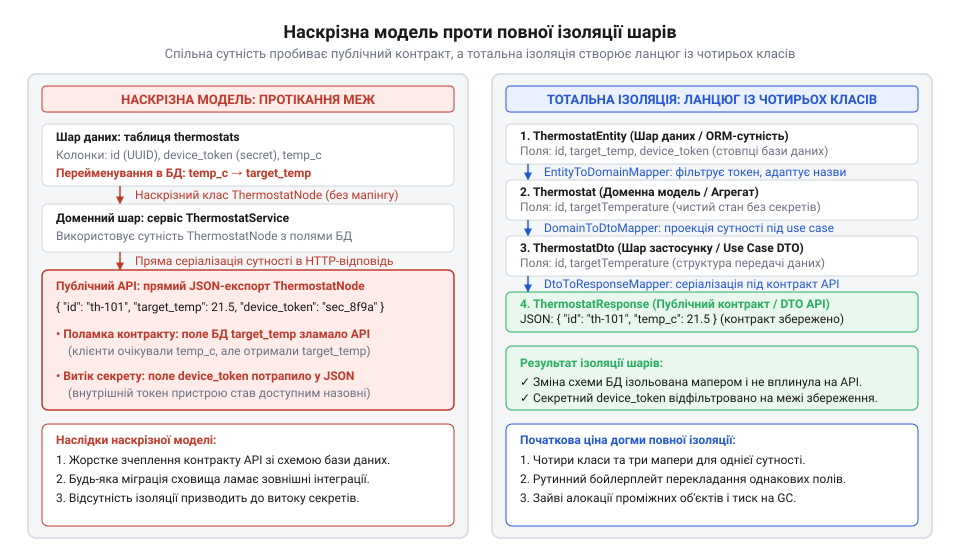
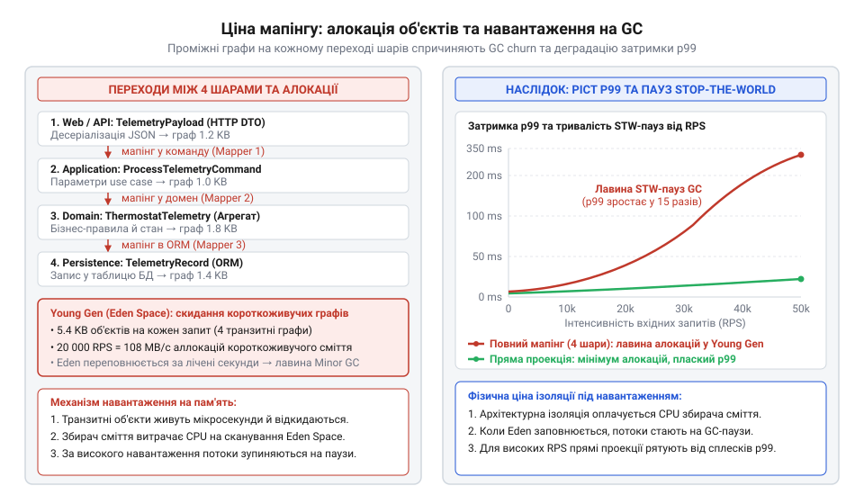
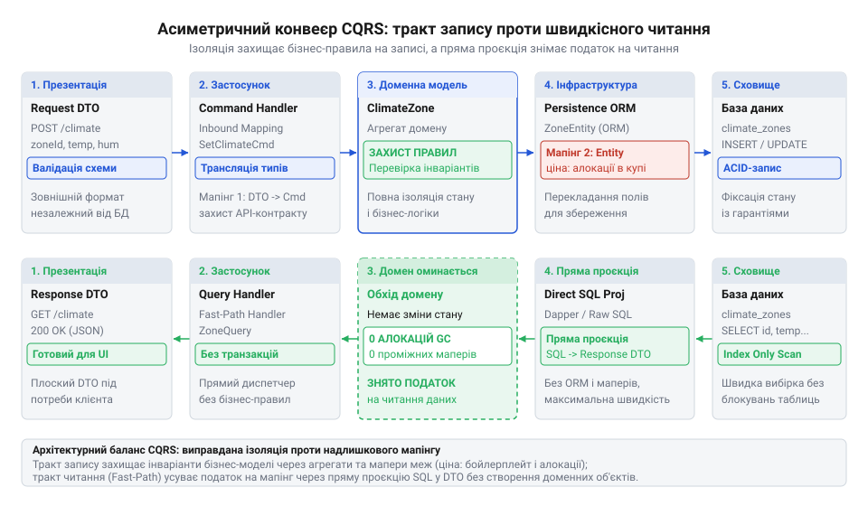
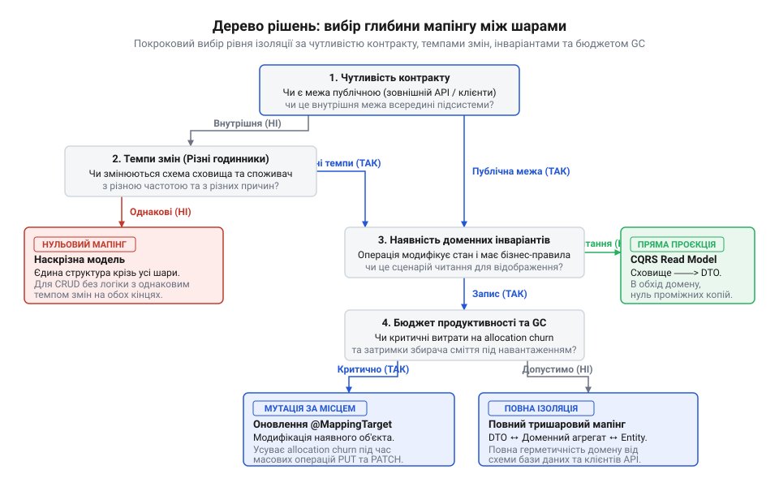

# Ціна мапінгу між шарами

<preknowlist>
- [Протікання шару](root:progarch/layer-leakage) — як саме типи та деталі реалізації бази даних чи транспортного протоколу просочуються крізь абстракції у сусідні шари за відсутності ізолюючого перетворення даних
- [Шар, що лише передає далі](root:progarch/pass-through-layer) — механізм виникнення транзитних шарів, які не виконують власної бізнес-логіки, а лише механічно перекладають однакові дані між ідентичними за структурою класами
</preknowlist>

## Спільна модель і три небезпеки відсутності меж

Бажання уникнути зайвого коду часто підштовхує до найкоротшого шляху. Коли в системі Digital Homes знадобилося надати користувачам мобільного застосунку доступ до термостатів, розробники використали наявний клас таблиці `ThermostatNode` як публічний контракт. Контролер повертав сутність сховища безпосередньо в JSON і в цей самий клас приймав HTTP-запити на оновлення температури:

```csharp
public class ThermostatNode
{
    public Guid Id { get; set; }
    public double TargetTemperature { get; set; }
    public string GatewayAccessToken { get; set; } = string.Empty; // Секретний токен Zigbee
    public bool IsMasterDevice { get; set; }                        // Прапорець координатора
}

// Контролер повертає та оновлює сутність бази напряму:
[HttpGet("{id}")]
public Task<ThermostatNode> Get(Guid id);

[HttpPut("{id}")]
public Task Update(Guid id, [FromBody] ThermostatNode incoming);
```

Економія рядків тривала до виходу системи в промислову експлуатацію, після чого спільна модель спричинила три різні аварії.

Перша аварія призвела до витоку секретів. Під час аудиту трафіку у відповіді виявили поле `"gatewayAccessToken"` — внутрішній токен шлюзу Zigbee, за допомогою якого сторонній пристрій у тій самій мережі міг керувати обладнанням без авторизації. Відсутність межі між сховищем та інтерфейсом викликала [протікання шару](root:progarch/layer-leakage).

Друга аварія зламала роботу мобільних клієнтів. Адміністратор баз даних перейменував колонку `target_temperature` на `setpoint_temp`, і розробник оновив властивість у `ThermostatNode`. Клієнтські JSON-парсери зламалися на невідомому полі: внутрішній рефакторинг таблиці автоматично зруйнував зовнішній контракт через спільну модель.

Третя аварія дозволила стороннім перехопити керування вузлами. Зловмисник надіслав запит на зміну температури зі службовим прапорцем: `{"targetTemperature": 22.0, "isMasterDevice": true}`. Фреймворк десеріалізував і зберіг значення прямо в сутність, зробивши звичайний датчик координатором мережі. Це вразливість масового призначення (від англ. @@en|mass assignment@@ або @@en|over-posting@@, від *over-* — понад міру та *post* — надсилати; несанкціонований запис у службові властивості через збіг моделі прийому з моделлю збереження).

Щоб зупинити протікання, архітектура проводить межі: кожен шар оперує власними класами. Транспортний шар використовує DTO (від англ. @@en|Data Transfer Object@@), домен — агрегати, а репозиторій — сутності бази даних. Між ними з'являється функція перетворення — мапінг (від англ. @@en|mapping@@, від пізньолат. *mappa* — полотно, креслення; перенесення значень між структурами).


*Зіставлення спільної моделі та пошарової ізоляції: спільний клас призводить до витоку секретів і зламу клієнтів, тоді як ізоляція зупиняє протікання ціною побудови ланцюга окремих моделей і маперів.*

> 🔧 **Навіщо це.**
> Ізоляція моделей захищає публічні контракти від внутрішнього рефакторингу бази даних, унеможливлює витік конфіденційних полів у відкриту мережу та блокує несанкціонований перезапис системних налаштувань через публічні ендпоінти.

## Пастка тотальної ізоляції: бойлерплейт, каскадні зміни та ерозія інкапсуляції

Впровадження окремих моделей на кожній межі ліквідувало витік даних, проте породило іншу крайність — лавину шаблонного коду (від англ. @@en|boilerplate@@), де єдиною задачею стало перекладання полів. За відсутності смислової різниці між структурами шари вироджуються в [шар, що лише передає далі](root:progarch/pass-through-layer).

Ціна повної ізоляції проявляється при першій зміні вимог. Коли в Digital Homes знадобилося додати контроль вологості `targetHumidity`, розробники зіткнулися з «дробовим хірургічним втручанням» (від англ. @@en|shotgun surgery@@; правки у безлічі файлів заради однієї вимоги). Додавання одного поля змусило синхронно змінювати шість файлів: DTO запиту, команду, агрегат, сутність сховища, DTO відповіді та мапери між ними.

Крім витрат часу, ручний мапінг несе ризик мовчазної втрати даних:

```csharp
public static void UpdateDbEntity(Thermostat aggregate, ThermostatDbEntity entity)
{
    entity.RoomName = aggregate.RoomName;
    entity.TargetTemperature = aggregate.TargetTemperature;

    // Помилка: рядок entity.TargetHumidity = aggregate.TargetHumidity пропущено.
    // Компілятор мовчить, але вологість тихо занулюється в базі.
}
```

Користувач задає вологість 50%, бачить статус успіху, але в базі лишається порожнє поле, бо одне присвоєння випадково випало під час оновлення мапера.

Прагнення усунути рутину підштовхує до бібліотек автоперекладання на базі рефлексії. Проте тут виникає конфлікт із захистом домену. Інкапсуляція існує заради збереження інваріантів (від лат. *invarians* — незмінний; бізнес-правило, яке об'єкт зобов'язаний підтримувати істинним протягом усього життєвого циклу). Наприклад, термостат забороняє температуру понад 19 °C в екологічному режимі (@@en|Eco@@):

```csharp
public sealed class Thermostat
{
    public decimal TargetTemperature { get; private set; }
    public ThermostatMode Mode { get; private set; }

    public Result ChangeMode(ThermostatMode newMode)
    {
        if (newMode == ThermostatMode.Eco && TargetTemperature > 19.0m)
            return Result.Failure("Неможливо увімкнути Eco: уставка вища за 19°C");

        Mode = newMode;
        return Result.Success();
    }
}
```

Автомапер нічого не знає про інваріанти. Він не вміє викликати бізнес-методи й вимагає конструктора без параметрів та відкритих сетерів. Щоби примусити бібліотеку працювати, розробник відкриває доступ: додає `public Thermostat() { }` і змінює приватні сетери на `public set`.

Щойно сетери стають відкритими, захист руйнується. Бібліотека заповнює властивості по черзі:

```csharp
// Мапер змінює поля покроково в обхід методу ChangeMode
thermostat.Mode = ThermostatMode.Eco;
thermostat.TargetTemperature = 26.0m; // Інваріант зламано без винятків
```

Термостат опиняється в некоректному стані: режим Eco активний при 26 °C. Домен деградував до пасивного контейнера даних під вимоги автоперекладача — анемічної моделі домену (від англ. @@en|anemic domain model@@, від грец. *αν-* — без та *αἷμα* — кров, буквально знекровлена модель без власної поведінки).

Виникає архітектурний парадокс: моделі розділяли заради захисту правил, але заради мапінгу ці правила з домену витіснили. Система платить за шарування, втрачаючи його головну перевагу — гарантовану цілісність даних.

> 🔧 **Навіщо це.**
> Розуміння ціни ізоляції рятує від фальшивої чистої архітектури. Якщо заради бібліотек мапінгу доменні сутності отримують відкриті сетери, доменний шар перетворюється на фікцію. Архітектор має або зберігати інкапсуляцію через явні фабрики, або чесно відмовитися від зайвих проміжних моделей.

## Фізичні витрати в рантаймі: пам'ять, алокації та затримки збирача сміття

На діаграмах стрілки між контролером, сервісом, доменом і репозиторієм виглядають безкоштовними. Проте у середовищі виконання кожен перехід — це фізична інструкція процесора: виділити пам'ять у купі (від лат. *allocare* — виділяти частку; @@en|heap allocation@@) та створити черговий екземпляр об'єкта. При низькому навантаженні ці витрати непомітні, але під високим потоком даних копіювання полів перетворюється на апаратне вузьке місце.

Простежмо рух одного запиту телеметрії в системі Digital Homes:

```csharp
[HttpPost("telemetry")]
public async Task<IActionResult> IngestTelemetry([FromBody] TelemetryIngestDto dto)
{
    var command = new RecordTelemetryCommand(dto);    // Алокація 1: команда
    var snapshot = TelemetrySnapshot.Create(command); // Алокація 2: доменний знімок
    var entity = new TelemetryRecordEntity(snapshot); // Алокація 3: сутність ORM
    await _repository.SaveAsync(entity);
    return Ok(new TelemetryAckDto(dto.DeviceId));     // Алокація 4: DTO відповіді
}
```

Один запит породжує в купі ланцюг об'єктів-двійників. Вони живуть лічені мікросекунди — рівно стільки, скільки триває крок конвеєра. Щойно дані перекладено далі, попередня модель стає сміттям. Коли тисячі сенсорів надсилають вимірювання одночасно, виникає безперервний потік тимчасових оболонок — бурління пам'яті (від англ. *churn* — збивати масло, вирувати; @@en|allocation churn@@).

Керування пам'яттю у керованих платформах (.NET, JVM) спирається на [поколіннєве збирання сміття](root:sf-lang/garbage-collection) (від лат. *generatio* — покоління; @@en|generational garbage collection@@). Нові екземпляри виділяються у молодшому поколінні (@@en|Young Generation@@, або Gen 0). Його обсяг обмежений, і щойно простір вичерпується, середовище запускає мале прибирання. Під навантаженням у десятки тисяч запитів за секунду воно переповнюється щомиті.

Критична проблема виникає в асинхронних конвеєрах. Коли метод очікує завершення запису в базу (`await _repository.SaveAsync(...)`), стан задачі з посиланнями на моделі зависає в купі. Якщо мале прибирання спрацьовує під час цієї паузи, збирач вважає тимчасові DTO довгоживучими й копіює їх у старше покоління — відбувається передчасне просування (від лат. *praematurus* — передчасний та *promovere* — просувати; @@en|premature promotion@@).

У старшому поколінні (Gen 2 або Tenured) короткоживучі оболонки застрягають до повного переповнення всієї купи. Очищення старшого покоління вимагає зупинки світу (від англ. *stop the world*; @@en|Stop-the-World@@, скорочено STW) — паузи робочих потоків на десятки чи сотні мілісекунд.

Через це виникає деградація затримок на 99-му перцентилі (від лат. *per centum* — на сотню; @@en|p99 latency@@). Медіанний час відгуку лишається низьким, але кожен сотий запит потрапляє на паузу STW і зависає, що провокує таймаути та перевантаження черг.


*Потік створення проміжних об'єктів на кожному переході між чотирма шарами зі скиданням короткоживучих моделей у Young Gen та графік зростання пауз Stop-the-World і затримок p99 від інтенсивності запитів; видно фізичну ціну мапінгу для збирача сміття під навантаженням.*

Фізичні витрати пам'яті викривають ціну зайвих абстракцій. Якщо між шарами немає різниці в правилах, мапінг створює [шар, що лише передає далі](root:progarch/pass-through-layer), марно споживаючи ресурси процесора.

> 🔧 **Навіщо це.**
> Розрахунок темпу виділення пам'яті та відстеження затримок p99 дають об'єктивний інженерний орієнтир: де шарова ізоляція необхідна для захисту бізнес-правил, а де механічне дублювання моделей перевантажує збирач сміття й погіршує надійність системи під навантаженням.

## Асиметрія читання та запису: усунення податку на читання через CQRS

Коли перекладання об'єктів створює вимірне фізичне навантаження на пам'ять, постає питання: чому класична архітектура вимагає однакового проходження шарів для всіх запитів? У системі розумного будинку Digital Homes понад 95% мережевого трафіку припадає на перегляд даних: користувачі перевіряють графіки температури чи вологість. Лише кілька відсотків запитів змінюють стан. Попри цю колосальну різницю, симетрична шарова схема змушує запити на читання долати абсолютно той самий багатошаровий конвеєр, що й команди запису.

Коли користувач відкриває екран кімнати, репозиторій вичитує рядки таблиць і збирає доменний агрегат: валідує діапазони чисел, створює об'єкти-значення, ініціалізує списки. Одразу після цього сервіс передає агрегат маперу для копіювання у сервісний DTO, а контролер іншим мапером формує JSON відповіді. Щойно байти пішли в мережу, доменний агрегат вирушає на прибирання сміття.

Під час читання агрегат не захистив жодного бізнес-правила. Показники сенсорів — це історичні факти, збережені в базі; їх неможливо зробити невалідними повторною перевіркою. Збирання доменної моделі лише для того, щоб витягти поля й викинути її в купу, є марнотратним податком на читання (від англ. *read* — читання та *tax* — податок; @@en|read tax@@). Доменний шар вироджується у [шар, що лише передає далі](root:progarch/pass-through-layer), спалюючи пам'ять на порожнє перекладання.

Причина цієї неефективності криється у спробі обробляти запис і читання дзеркально. Проте їхні цілі діаметрально протилежні:
- **Тракт запису (команди)** змінює стан системи. Він вимагає повної перевірки інваріантів усередині доменного агрегату. Витрати на мапінг тут виправдані: це плата за цілісність бізнес-даних.
- **Тракт читання (запити)** не модифікує стан і лише споживає факти. Його пріоритети — мінімальний час відгуку, мінімальні алокації пам'яті та точна відповідність клієнтському інтерфейсу.

Розв'язанням цієї суперечності є розділення відповідальності команд і запитів (від англ. *command* — команда, *query* — запит, *responsibility* — відповідальність, *segregation* — розділення; @@en|Command Query Responsibility Segregation@@, або [CQRS](root:progarch/cqrs-architectural-pattern)). Система розділяється на тракт команд і швидкісний тракт читання (від англ. *fast path*; @@en|fast path@@), де дані транслюються зі сховища безпосередньо у фінальну структуру через пряму проєкцію (від лат. *projectio* — кидання вперед, відображення; @@en|direct projection@@):

```csharp
// 1. Тракт запису: агрегат відновлюється заради перевірки бізнес-правил
var zone = await _repository.GetByIdAsync(command.ZoneId, ct);
zone.SetTargetTemperature(command.TargetCelsius);
await _repository.SaveAsync(zone, ct);

// 2. Тракт читання (Fast-Path): пряма вибірка зі сховища одразу у DTO відповіді
return await _connection.QuerySingleOrDefaultAsync<ZoneDashboardResponse>(
    "SELECT id, name, temperature, target_temperature FROM climate_zones WHERE id = @Id",
    new { Id = query.ZoneId });
```

Пряма проєкція читання не повертає небезпеку спільної моделі. Відповіддю залишається суворо типізований вихідний контракт `ZoneDashboardResponse`, який захищає клієнтів від деталей сховища. Якщо колонка в базі буде перейменована, контракт не зламається: достатньо оновити текст SQL-вибірки в конкретному запиті.


*Розділення тракту запису з повною валідацією інваріантів у доменному агрегаті та швидкісного тракту читання з прямою проєкцією зі сховища у контракт відповіді; видно усунення податку на читання без компромісів із безпекою.*

> 🔧 **Навіщо це.**
> Пряма проєкція для читання знімає з кучі до 80–90% короткоживучих об'єктів у системах із переважанням читання. Це ліквідує необхідність писати класи-двійники для простих вибірок і радикально знижує навантаження на збирач сміття, водночас зберігаючи строгу ізоляцію доменних правил у тракті запису.

## Спектр стратегій і практичні фільтри глибини мапінгу

Зіткнувшись із протіканням деталей сховища з одного боку та лавиною бойлерплейту й навантаженням на пам'ять з іншого, команди часто кидаються в крайнощі. Одні проголошують повну ізоляцію стандартом для кожної задачі, інші — відмовляються від меж і повертають сутності бази в контролери. Обидва підходи хибні, бо розглядають ізоляцію як релігійну догму замість технічного компромісу.

Мапінг — це архітектурний амортизатор (від фр. *amortir* — пом'якшувати, гасити). Його призначення — поглинати напругу між компонентами, що змінюються з різною швидкістю. За концепцією темпів змін (від англ. *pace layers*; @@en|pace layers@@), різні частини системи живуть за різними годинниками: публічний API мусить залишатися стабільним роками заради клієнтів, тоді як внутрішні запити чи схема бази можуть оптимізуватися щомісяця. Якщо ж дві моделі еволюціонують синхронно в одному коміті, зведення між ними шару перекладання створює лише фіктивну ізоляцію (від лат. *fictio* — вигадка, удавання; @@en|fictitious isolation@@). Розробник не отримує автономності, але сплачує щоденний податок на підтримку зайвих класів.

Ступінь розділення моделей формує спектр архітектурних стратегій:

1. **Прямі проєкції (@@en|Direct Projections@@)**. Швидкий тракт для операцій читання, де дані вибираються зі сховища безпосередньо у вихідний контракт в обхід доменного шару, що усуває транзитні алокації пам'яті.
2. **Ізоляція зовнішнього периметра (від грец. *perimetron* — обвід; @@en|Boundary-Only Mapping@@)**. Жорсткий мапінг зосереджено на зовнішніх межах сервісу: вхідні запити приймаються у DTO, а відповіді повертаються у DTO. Всередині — між прикладною логікою та сховищем — діє єдина модель. Це надійно блокує зовнішнє [протікання шару](root:progarch/layer-leakage) та захищає від [вразливості масового призначення](root:sf-security/mass-assignment-vulnerability), позбавляючи рутини підтримки двійників для внутрішніх перетворень.
3. **Повне розв'язання (від англ. *decouple* — роз'єднувати; @@en|Full Decoupling@@)**. Кожен шар володіє власною моделлю даних (DTO, команда, доменний агрегат, ORM-сутність). Цей підхід виправдовує високу ціну лише за кардинальної різниці темпів змін — наприклад, при ізоляції стратегічного ядра від мінливої бази даних.

Щоб усунути суперечки про необхідність мапінгу на конкретній межі, архітектурне рішення пропускають крізь алгоритм із чотирьох фільтрів (від лат. *filtrum* — цідилок):

- **Фільтр 1: Дельта темпів змін (`Δ_темпу`)**. Оцінює різницю швидкостей еволюції сторін межі. Якщо публічний контракт змінюється раз на рік, а таблиці — щомісяця, мапінг є критичним амортизатором. Якщо ж `Δ_темпу ≈ 0` (внутрішній модуль, де моделі правляться разом), розділення моделей є фіктивним і шкідливим.
- **Фільтр 2: Публічність і чутливість межі**. Якщо межа виходить у відкриту мережу, ізоляція периметра обов'язкова навіть за однакових темпів змін. Безпека вимагає чіткого переліку полів для захисту від витоку конфіденційного стану та несанкціонованого запису прапорців.
- **Фільтр 3: Складність інваріантів**. Якщо сутність інкапсулює нетривіальні бізнес-правила, потрібен захищений доменний агрегат. Якщо ж компонент виконує суто транзитну функцію чи збереження плоских записів (чистий CRUD), створення доменного шару лише множить транзитний код.
- **Фільтр 4: Бюджет продуктивності**. У високонавантажених вузлах із жорсткими вимогами до затримок кожен зайвий об'єкт наближає переповнення пам'яті та паузи збирача сміття, тому перевагу надають прямим проєкціям.


*Послідовний інженерний алгоритм вибору глибини мапінгу на основі оцінки темпів змін, чутливості межі, наявності бізнес-інваріантів і бюджету пам'яті; видно шлях від контексту до оптимального рівня ізоляції.*

> 🔧 **Навіщо це.**
> Чотири фільтри усувають суб'єктивні суперечки про «чистоту коду». Кожна межа розглядається через практичну призму: чи захищає мапінг контракт, чи оберігає він інваріанти і чи виправдовує апаратні витрати. Якщо відповідь негативна, мапінг відкидають як архітектурний баласт.
