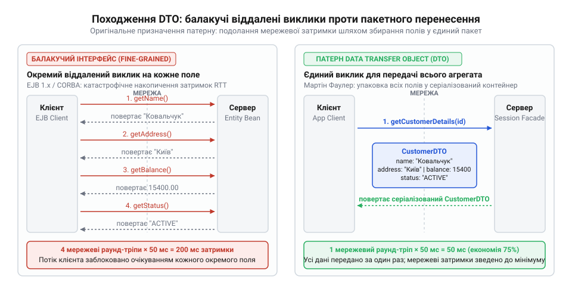
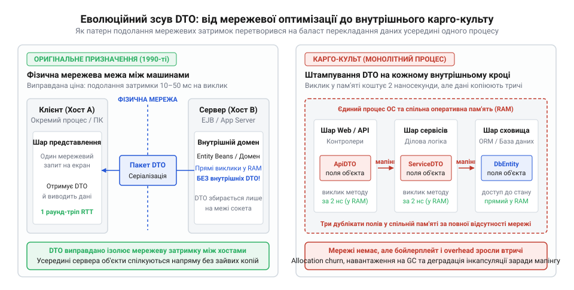
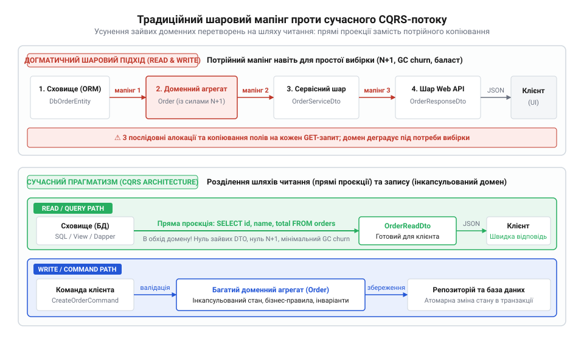

# Ціна мапінгу між шарами

<preknowlist>
- [Протікання шару](root:progarch/layer-leakage) — як саме відсутність перетворення типів між шарами призводить до витоку деталей збереження або транспортних протоколів у бізнес-ядро.
- [Шар, що лише передає далі](root:progarch/pass-through-layer) — механіка виникнення фіктивних класів-посередників, які не виконують логіки, а лише обслуговують транзитні копії DTO.
</preknowlist>

## Колапс розподілених об'єктів кінця 1990-х: передумови появи DTO

Наприкінці 1990-х років корпоративну інженерію захопила спокуслива ілюзія: ідея абсолютної [прозорості розташування](root:progarch/generations-of-transparent-calls) об'єктів (англ. @@en|location transparency@@). Тогочасні платформи розподілених обчислень — CORBA (від консорціуму OMG), DCOM від Microsoft та стандарт Enterprise JavaBeans (EJB 1.0/1.1) від Sun Microsystems — обіцяли стерти принципову різницю між викликом функції в сусідній комірці оперативної пам'яті та зверненням до сервера, розташованого на іншому континенті. Інфраструктурне проміжне програмне забезпечення (англ. @@en|middleware@@, від лат. *medius* — посередній, проміжний) генерувало клієнтські заглушки (англ. @@en|stubs@@), які перехоплювали звичайні виклики методів і непомітно для інженера брали на себе мережеві сокети, маршалінг параметрів та передачу байтів через дріт.

Проте закони фізики зруйнували цю абстракцію першими. У внутрішньопроцесному середовищі виклик методу чи читання поля — це просте розіменування вказівника процесором, яке забирає від 1 до 10 наносекунд. Мережевий же виклик у розподіленому середовищі вимагає серіалізації структури в бінарний потік, проходження стека TCP/IP, фізичної комутації пакетів, очікування черги на стороні сервера та десеріалізації відповіді. Навіть у швидкій локальній мережі такий цикл займає від кількох мілісекунд:

```
T_локальний  ≈ 5 нс          [розіменування вказівника в пам'яті процесора]
T_мережевий  ≈ 10 000 000 нс   [раунд-тріп мережевого сокета в локальній мережі]
Різниця     = T_мережевий / T_локальний
            = 10 000 000 / 5
            = 2 000 000     [уповільнення виклику в два мільйони разів]
```

Коли об'єктно-орієнтовані патерни проектування, виплекані на монолітних мовах Smalltalk та C++, без змін перенесли на віддалені компоненти, інформаційні системи зазнали продуктивного колапсу. Типовий розподілений об'єкт сховища — наприклад, сутність користувача (англ. @@en|Entity Bean@@) — проектувався за всіма канонами академічної інкапсуляції: два десятки приватних полів і відповідні публічні гетери та сетери.

Клієнтський код чи веб-сервер, намагаючись відрендерити звичайний профіль клієнта на екрані, викликав методи інтерфейсу звично й невимушено:
`user.getFirstName()`, `user.getLastName()`, `user.getEmail()`, `user.getPhone()`, `user.getAddress()`, `user.getCity()`.

Цей шаблон поведінки отримав назву «балакучий інтерфейс» (англ. @@en|chatty interface@@). Кожен окремий гетер породжував повноцінний мережевий раунд-тріп (англ. @@en|round-trip@@). Завантаження сторінки з двадцятьма атрибутами сутності перетворювалося на двадцять послідовних синхронних зупинок процесу. Мережеві канали захлиналися лавиною дрібних пакетів, операційні системи вичерпували пули сокетів, а користувацькі інтерфейси зависали на довгі секунди.


*Ліворуч — балакучий інтерфейс із послідовними мережевими раунд-тріпами на кожне поле; праворуч — патерн DTO, що агрегує стан і передає його за єдиний запит.*

Індустрія вперлася в глухий кут: гранульована об'єктна інкапсуляція виявилася фатальною для розподілених середовищ. Стало зрозуміло, що через мережу категорично неприпустимо викликати окремі поведінкові методи для кожного скалярного значення. Потрібен був спосіб упакувати всі необхідні дані в єдину структуру ще на боці сервера й доставити їх клієнту одним махом.

## Формалізація патерну Мартіном Фаулером та перша плутанина назв

Пошук виходу з кризи розподілених об'єктів змусив інженерів піти на свідомий компроміс: відокремити поведінку від передачі стану. У 2002 році британський інженер Мартін Фаулер у класичній праці «Шаблони корпоративних програмних застосунків» (англ. *Patterns of Enterprise Application Architecture*) узагальнив практичний досвід індустрії та формалізував патерн @@en|Data Transfer Object@@ (DTO, об'єкт передавання даних).

Архітектурна ідея полягала в тандемі двох рішень. На боці сервера виставлявся грубозернистий [віддалений фасад](root:progarch/remote-facade) (англ. @@en|Remote Facade@@, фасад — від фр. *façade* — передня сторона будівлі). Замість доступу до живих сутностей цей фасад за один запит збирав усі необхідні поля системи в простий серіалізований контейнер — позбавлений будь-яких бізнес-правил чи доменної логіки пасивний носій даних. Клієнт виконував рівно один мережевий виклик, отримував DTO цілком і далі працював із його полями локально в пам'яті свого процесу.

Усвідомлюючи небезпеку захоплення розподіленими абстракціями, Фаулер сформулював принцип, що став хрестоматійним: **перший закон проектування розподілених систем**:
> «Перший закон проектування розподілених систем: не розподіляйте свої об'єкти!» (англ. *First Law of Distributed Object Design: Don't distribute your objects!*).

DTO розглядався Фаулером не як ознака елегантного дизайну, а як вимушений технічний компенсатор: ціна, яку доводилося сплачувати за неминучий фізичний розрив між процесорами клієнта й сервера.

Проте народження патерну супроводжувалося серйозною термінологічною колізією, яка заплутала ціле покоління розробників. У 2001 році, на рік раніше за книгу Фаулера, автори бестселера *Core J2EE Patterns* (Діпак Алур, Джон Крупі та Ден Малкс) описали абсолютно ту саму структуру під назвою @@en|Value Object@@ (VO). Інженери Sun спиралися на мову програмування Java: оскільки DTO серіалізувався в байти й копіювався через потік сокета, він передавався «за значенням» (англ. @@en|by value@@), на відміну від самих Enterprise JavaBeans, доступ до яких відбувався «за посиланням» (англ. @@en|by reference@@).

Це спричинило фундаментальний розкол у поняттях. В об'єктно-орієнтованому проектуванні, а трохи згодом і в доменно-орієнтованому проектуванні Еріка Еванса (@@en|Domain-Driven Design@@, DDD, 2003), термін «об'єкт-значення» (англ. @@en|Value Object@@) стосувався зовсім іншого: незмінної сутності домену без власного ідентифікатора, рівність якої визначається повним збігом її внутрішніх властивостей (як грошова величина, діапазон дат чи географічна координата). Контейнер же від Sun був суто пасивним мішком полів для мережевого транспорту.

Конфлікт понять виявився настільки деструктивним, що в другому виданні *Core J2EE Patterns* автори були змушені офіційно відмовитися від назви Value Object і синхронізуватися з термінологією Фаулера, перейменувавши патерн на @@en|Transfer Object@@ (TO):

> «Через розбіжність у термінології між авторами платформи J2EE та ширшою спільнотою шаблонів проектування ми перейменували патерн Value Object на Transfer Object, щоб чітко розмежувати транспортні об'єкти та доменні поняття».

> 🔧 **Навіщо це.**
> Патерн DTO виник суто як спосіб подолання мережевої затримки. Його єдине призначення — перетворити десятки коштовних міжпроцесних викликів на один грубозернистий мережевий раунд-тріп. Створення окремого класу-дзеркала мало сенс лише там, де дані фізично перетинали межу процесу чи мережевий кабель.

На рубежі 2000-х років патерн DTO сумлінно виконував своє завдання: він захищав сервери від явища, яке сьогодні класифікують як [протікання шару](root:progarch/layer-leakage), ізолюючи структури бази даних від мережевих протоколів, і мінімізував трафік. Жодному інженеру того часу не спадало на думку впроваджувати проміжний DTO між функціями, що виконуються всередині одного процесу. Проте індустрія стояла на порозі масштабного повернення до монолітної архітектури, де корисний мережевий інструмент очікувало перетворення на обов'язковий і виснажливий бюрократичний ритуал.

## Велике повернення в моноліт і виникнення карго-культу внутрішньопроцесних DTO

До середини 2000-х років інженерне співтовариство втомилося від громіздкої розподіленості. Важковаговики J2EE з їхніми розподіленими контейнерами Enterprise JavaBeans (EJB) вимагали гігантських серверних ресурсів, повільно розгорталися та перетворювали налагодження на виснажливий процес. У 2002 році австралійський архітектор Род Джонсон (@@en|Rod Johnson@@) випустив книгу *«Expert One-on-One J2EE Design and Development»*, де довів: абсолютна більшість комерційних застосунків не має потреби у фізичному рознесенні компонентів по різних серверах. Із виходом легковагого фреймворку Spring (2003–2004) у світі Java та зміцненням платформи .NET індустрія масово повернулася до монолітного розгортання — коли вебконтролери, бізнес-сервіси й шар взаємодії з базою даних виконуються в межах одного системного процесу операційної системи та спільно використовують єдиний адресний простір оперативної пам'яті (купу — @@en|heap@@).

Зі зникненням мережевого кордону зникла й фізична необхідність у патерні DTO. Передати об'єкт між двома класами в межах одного процесу — це тривіальна операція копіювання 64-бітного покажчика в регістр процесора (лат. *indicare* — вказувати), яка триває частки наносекунди. Тут немає ані перетворення байтів на пакети, ані сокетів операційної системи, ані затримок мережевого обладнання.

Проте інженерна інерція виявилася сильнішою за фізику обчислень. Патерни, викувані для подолання мережевих затримок, перекочували всередину монолітного процесу без жодного критичного переосмислення. Сформувався класичний карго-культ (англ. @@en|cargo cult@@): сліпе відтворення зовнішньої форми ритуалу без розуміння реальних причин, які колись викликали його до життя.

Під гаслами «чистої шарової архітектури» підручники та лідери думок почали вимагати ізоляції кожного внутрішнього шару через власні класи-посередники. Проголошувалося догматичне правило: жоден шар не повинен бачити типи даних сусіднього шару. У результаті для простої операції читання сутності розробники почали створювати цілий каскад структур: `UserEntity` конвертувався в `UserDaoDto`, той перекладався в `UserServiceDto`, далі в `UserControllerDto`, і нарешті — в `UserViewModel`.


*Зсув ролі DTO в архітектурі: від фізично виправданого буфера на мережевому кордоні до ритуального перекладання полів між шарами в межах одного адресного простору.*

У пам'яті програми одночасно плодилися чотири-п'ять класів-близнюків із майже ідентичним набором полів: ідентифікатором, ім'ям, електронною поштою та статусом. Процесор витрачав робочі такти на безглузде переписування байтів із однієї комірки пам'яті в іншу, а збирач сміття захлинався від мільйонів короткоживучих об'єктів.

Цей ритуал породив класичне викривлення дизайну — [шар, що лише передає далі](root:progarch/pass-through-layer), коли сервіси переставали виконувати будь-яку бізнес-роботу, перетворюючись на транзитні станції з копіювання полів. Намагаючись механічно запобігти [протіканню шару](root:progarch/layer-leakage), розробники спорудили бюрократичні бар'єри там, де межі були чисто символічними, заплативши за це колосальним обсягом рутинного коду.

## Спроба порятунку через рефлексію: епоха AutoMapper та розплата за магію

До кінця 2000-х років розробники зіткнулися зі справжньою кризою продуктивності праці: значна частина кодових баз перетворилася на так званий «податок на мапінг». Проєкти містили кілометри одноманітного коду ручного перекладання:

```csharp
// Рутинне ручне копіювання між шарами програми
userDto.Id = userEntity.Id;
userDto.FirstName = userEntity.FirstName;
userDto.LastName = userEntity.LastName;
userDto.Email = userEntity.Email;
userDto.UpdatedAt = userEntity.UpdatedAt;
```

Будь-яке додавання нового поля в таблицю вимагало оновлення чотирьох класів і п'яти методів конвертації. Помилка в назві чи пропущений рядок ставали причиною прихованих дефектів, коли значення поля губилося дорогою до інтерфейсу. Інженерна думка прагнула усунути цю рутину: якщо назви та типи полів збігаються, машина повинна переносити їх самостійно.

Порятунок спробували знайти в бібліотеках динамічного мапінгу на основі рефлексії (лат. *reflexio* — вигинання назад, відображення). У світі Java набули популярності Dozer (створений близько 2005 року) та ModelMapper. У екосистемі .NET у 2008 році американський інженер Джиммі Боґард (@@en|Jimmy Bogard@@) випустив AutoMapper.

Ідея виглядала бездоганно: замість десятків рядків присвоювання розробник викликав один магічний метод:

```csharp
// Декларативний мапінг одного рядка
var userDto = mapper.Map<UserDto>(userEntity);
```

Під капотом бібліотека за допомогою рефлексії сканувала відкриті властивості типів під час виконання, шукала ідентичні назви полів і копіювала значення. Позірне полегшення було приголомшливим: з кодових баз зникли тисячі рядків нудного коду. Однак плата за цю магію виявилася непомірно високою й вдарила по системах із трьох несподіваних боків.

> 🔧 **Навіщо це.**
> Розуміння ціни динамічного мапінгу оберігає від типової пастки: спроба приховати архітектурний бойлерплейт за допомогою рефлексії не усуває проблему зайвих шарів, а робить зв'язки між ними неявними. Коли інструмент проектування інтерфейсу переносять всередину доменного ядра, руйнується продуктивність бази даних і надійність бізнес-правил.

Першим наслідком став нищівний удар по пам'яті — явище, відоме як збурення алокацій (англ. @@en|allocation churn@@, від лат. *allocare* — наділяти часткою). Динамічний обхід властивостей на кожен запит супроводжувався виділенням безлічі проміжних службових об'єктів: масивів параметрів, обгорток для рефлексії та операцій пакування структур (англ. @@en|boxing@@). У високонавантажених сервісах ці мільйони короткоживучих структур миттєво переповнювали наймолодше покоління пам'яті (Generation 0 у .NET або Eden у JVM). Збирач сміття змушений був запускатися щосекунди, спричиняючи непередбачувані мікропаузи (англ. @@en|stop-the-world@@) і різкі сплески часу відповіді системи.

Другим ударом стали приховані каскадні запити до баз даних — пастка лінивого завантаження (англ. @@en|lazy loading@@). Об'єктно-реляційні мапери (ORM), такі як Hibernate чи Entity Framework, відкладають завантаження пов'язаних таблиць до моменту першого звернення до властивості. Рефлексивний автоперекладач не мав уявлення про семантику полів і жадібно викликав гетери всіх знайдених властивостей. Зчитуючи поле зв'язку `order.Customer.Address`, мапер непомітно відправляв у базу окремий SQL-запит на кожну сутність у списку. Невинний виклик `mapper.Map<List<OrderDto>>(orders)` для сотні замовлень тихо породжував сотні додаткових звернень до бази даних — катастрофічну проблему N+1 (лат. *occultus* — прихований), яка миттєво вичерпувала пул з'єднань СУБД.

Третім і найбільш фатальним наслідком стало руйнування інкапсуляції (лат. *capsula* — скринька). Щоб бібліотека рефлексії могла створити об'єкт і заповнити його даними в обхід логіки, цільовий клас мусив надати публічний конструктор без параметрів та відкриті мутатори на всі властивості (`public set`). Розробники почали масово зносити валідацію в конструкторах і прибирати захист інваріантів доменних агрегатів лише для того, щоб AutoMapper міг перекласти дані. Багата бізнес-модель перетворилася на [анемічну модель](root:progarch/signs-there-is-no-model) (англ. @@en|anemic domain model@@) — звичайний мішок із даними без жодних гарантій узгодженості стану.

Згодом сам автор AutoMapper Джиммі Боґард неодноразово публікував роз'яснення та застерігав спільноту: бібліотека створювалася виключно для проектування пласких моделей на рівні вебпредставлення, а її масове використання між внутрішніми шарами стало одним із найбільших архітектурних самообманів епохи.

## Протверезіння індустрії та публічне каяття творців інструментів

На початку 2010-х років невдоволення наслідками рефлексивного мапінгу та роздутими шарами досягло критичної точки. Команди виявили, що витрачають десятки робочих годин на тиждень на підтримку нескінченних пар класів, які нічим не відрізнялися між собою, а також на виправлення загадкових аварій у продакшені, спричинених N+1 запитами чи раптовими паузами збирача сміття. Усе це робилося в ім'я абстрактних правил «ідеальної архітектури».

Переломним моментом став відкритий виступ лідерів спільноти, зокрема самих авторів популярних бібліотек. Джиммі Боґард, творець AutoMapper, опублікував серію статей і програмних доповідей, де відкрито виступив проти культу, що склався навколо його інструменту. Боґард пояснив, що створив бібліотеку лише для однієї конкретної мети: усунути рутину мапінгу між доменними моделями та моделями представлення у вебшарі. Застосування AutoMapper для копіювання даних між внутрішніми шарами він назвав важким антипатерном: якщо DTO має рівно ті самі поля, що й доменна сутність, створення такого класу є не архітектурною ізоляцією, а марною тратою часу й системних ресурсів.

Архітектурна думка почала послідовно розвінчувати головний міф, на якому тримався карго-культ DTO — догму про так звану «слабку зв'язаність» (англ. @@en|loose coupling@@, від лат. *copula* — зв'язок). Прихильники тотального мапінгу стверджували, що окремий DTO для кожного шару дозволяє змінювати базу даних або домен незалежно від зовнішнього світу. Проте в реальності внутрішньопроцесного моноліту, розміщеного в єдиному репозиторії, ця автономія виявилася міражем.

Якщо бізнес вимагає розділити поле імені на ім'я та прізвище, інженер змушений одночасно змінювати таблицю бази даних, сутність ORM, проміжний DTO сервісу, DTO контролера, конфігурацію мапера та клієнтський контракт. Класи, які мають однаковий набір полів і змінюються одночасно з однієї причини, не є слабкозв'язаними — вони мають найвищий ступінь логічного зчеплення. Клонування структур не прибирає залежності, а лише змушує розробника оновлювати чотири файли замість одного, подвоюючи ціну кожної правки.

Стало очевидним, що страх перед [протіканням шару](root:progarch/layer-leakage) породив гіршу крайність — [шар, що лише передає далі](root:progarch/pass-through-layer). Архітектурний захист перетворився на бюрократичний ритуал: намагаючись ізолювати все від усього всередині одного процесу, розробники створили величезну кількість транзитного коду, який не захищав бізнес-правила, а лише ховав їх за стіною однакових структур даних.

## Сучасний синтез: компіляційна кодогенерація, CQRS та вертикальні зрізи

Подолання кризи відбулося через відмову від універсальних правил на користь прагматичного розрізнення меж. Індустрія усвідомила, що архітектура визначається не кількістю шарів, а призначенням операції та природою межі, яку перетинають дані.

Першим кроком стало витіснення динамічної рефлексії кодогенерацією на етапі компіляції (англ. @@en|compile-time code generation@@). Там, де трансформація даних справді необхідна — на зовнішніх кордонах API, контрактів інтеграційних повідомлень або серіалізації в JSON, — мапінг перестали виконувати в рантаймі. У екосистемі Java стандартом став MapStruct (створений Гуннаром Морлінгом у 2012–2014 роках), що використовує процесори анотацій для автоматичного генерування чистого Java-коду під час складання проєкту. У .NET аналогічну роль перебрали генератори вихідного коду (Source Generators) платформи C#.

```java
// Інтерфейс декларативного мапера MapStruct
@Mapper
public interface UserMapper {
    UserMapper INSTANCE = Mappers.getMapper(UserMapper.class);

    // Під час компіляції генерується прямий код: dto.setEmail(entity.getEmail())
    UserResponseDto toDto(User user);
}
```

Компіляційний мапінг повернув системі абсолютну типобезпеку: якщо розробник перейменував або видалив поле сутності, проєкт просто не збереться, чітко вказавши на помилку до запуску тестів. Швидкість виконання такого згенерованого коду дорівнює ручному присвоюванню, а виділення службової пам'яті й навантаження на збирач сміття зведені до абсолютного нуля.

Другим і найбільш фундаментальним зрушенням став перегляд ролі шарів через призму архітектурного розділення читання та запису — [CQRS](root:sf-apps/cqrs) (англ. @@en|Command Query Responsibility Segregation@@, від лат. *segregatio* — відокремлення). Аналіз реальних систем показав, що понад 80% операцій у типовому застосунку — це просте читання для відображення даних на екрані. Традиційна шарова архітектура змушувала навіть прості вибірки проходити повне коло: з бази в ORM-сутність, із сутності в доменний об'єкт, з домену в сервісний DTO, а звідти — у контролер.


*Порівняння підходів: догматичний шаровий ланцюжок вимушеного мапінгу проти сучасного розділення потоків (CQRS), де операції читання оминають доменні перетворення.*

Підхід CQRS розділив систему на два незалежні потоки з принципово різними вимогами:

1. **Шлях читання (Queries):** оминає доменний шар повністю. Оскільки читання не змінює стан системи й не перевіряє бізнес-інваріанти, немає сенсу матеріалізувати доменні сутності. Запити проєктуються (лат. *projectio* — викидання вперед, зображення) безпосередньо з бази даних у вихідні DTO інтерфейсу за допомогою SQL або оператора вибірки ORM (`Select` у LINQ чи проєкції JPA). Це миттєво усуває каскадні виклики N+1, непотрібний оверхед ORM і проміжні мапери.
2. **Шлях мутацій (Commands):** призначений виключно для зміни стану (лат. *mutatio* — зміна). Тут інкапсуляція відновлюється в повній силі: вхідна команда ззовні передається безпосередньо в методи доменного агрегата, який самостійно контролює свою валідацію та правила.

Логічним завершенням цього руху стала [архітектура вертикальних зрізів](root:progarch/vertical-slice-architecture) (англ. @@en|vertical slice architecture@@), сформульована тим самим Джиммі Боґардом у 2018 році. Замість нарізання моноліту на горизонтальні шари, через які змушений проходити кожен запит, система структурується навколо конкретних бізнес-сценаріїв (фіч). Кожен зріз має власні, вузькоспеціалізовані моделі входу й виходу, що живуть поруч із обробником. Горизонтальні проміжні DTO остаточно зникають, оскільки між точкою входу та сховищем більше немає штучних поверхів.

> 🔧 **Навіщо це.**
> Сучасне інженерне правило вибору межі дуже просте: мапінг виправданий лише там, де існує фізичний або контрактний кордон. Якщо ви транслюєте дані назовні через публічний REST API або публікуєте повідомлення в чергу інтеграції — явний контрактний DTO обов'язковий для стабільності клієнтів. Якщо ж виклик відбувається всередині одного процесу й модуля — використовуйте прямі проєкції для читання та багаті доменні сутності для мутацій. Перетворення заради перетворення — це витрачений бюджет вашої системи.
