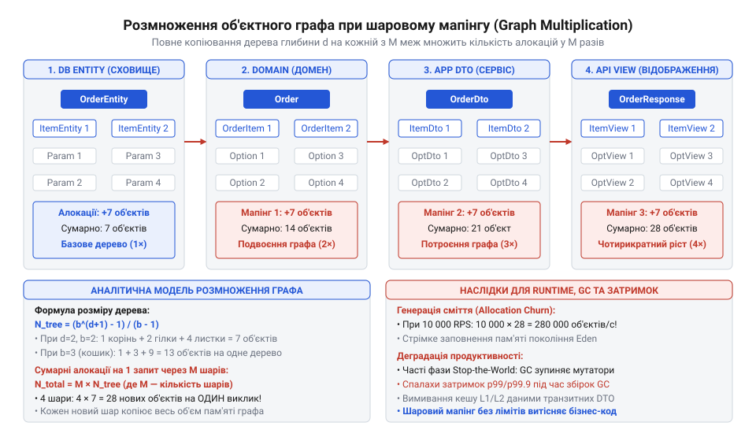
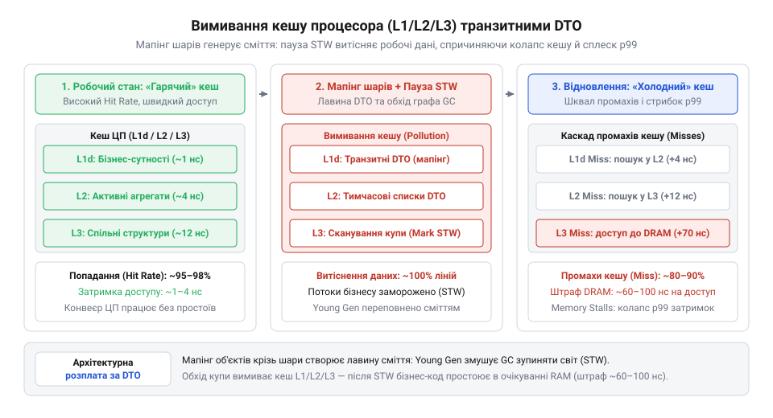
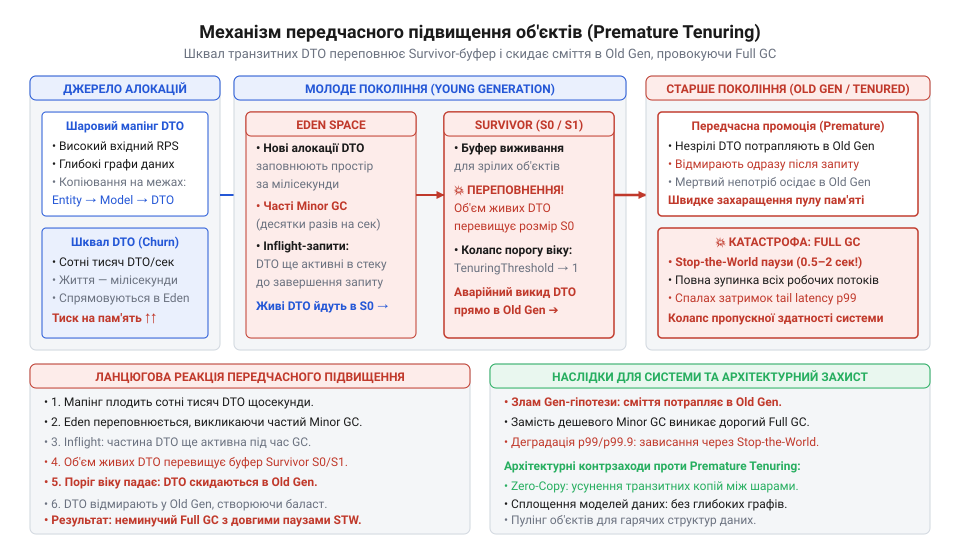
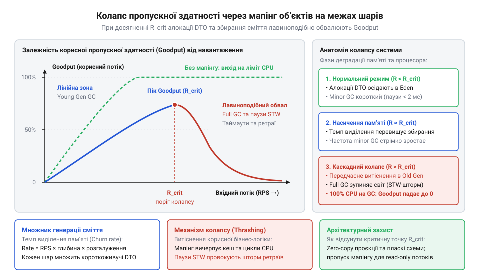
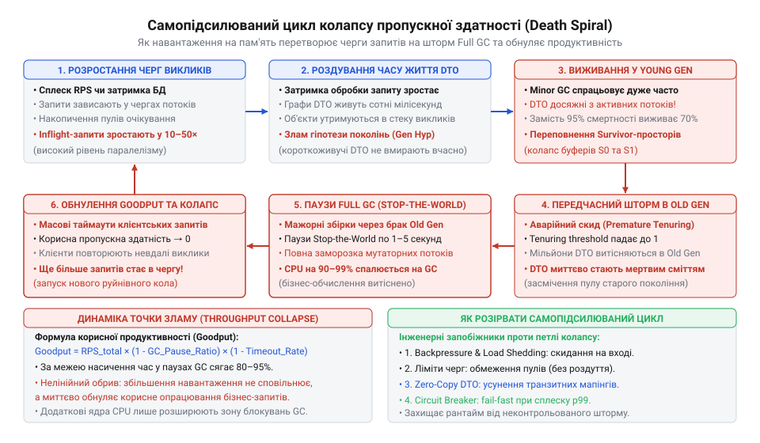

# Ціна мапінгу між шарами

<preknowlist>
- [Шар, що лише передає далі](root:progarch/pass-through-layer) — поняття транзитного DTO, механічного прокидання полів між класами та емпіричного ефекту навантаження виділення пам'яті (allocation churn)
- [Протікання шару](root:progarch/layer-leakage) — причини дублювання моделей (Entity, Domain, Response DTO) через різні годинники змін компонентів та ризики прямого пробивання шарів сутностями ORM
</preknowlist>

## Прихована ціна канонічного шарування

Побудова корпоративної системи за класичними канонами шарової архітектури починається з простої інженерної обіцянки: кожен шар має залишатися герметичним і володіти власною моделлю даних. Для типової сутності житлового комплексу створюють три окремі класи. Клас бази даних `ApartmentEntity` повторює схему реляційної таблиці зі стовпчиками та первинними ключами. Клас доменного ядра `Apartment` інкапсулює бізнес-правила нарахування комунальних тарифів і перевірку статусів заселення. Клас транспортного рівня `ApartmentResponseDto` форматує результат для клієнтського застосунку, приховуючи конфіденційні поля.

На рівні модульних тестів і перших демонстрацій така архітектура виглядає зразково. Код структурований, зони відповідальності розділені, а зміни в структурі реляційної таблиці не ламають доменну логіку (докладно механіку захисту від витоків СКБД розкрито в статті [Протікання шару](root:progarch/layer-leakage)). Проте коли сервіс потрапляє у виробниче середовище під реальне навантаження, система демонструє раптовий збій характеристик продуктивності.

Симптоми виникають без жодних змін у бізнес-коді:
1. **Розрив між середньою та граничною затримкою.** Медіанний час відповіді (перцентиль `p50`) залишається комфортним — у межах 10–15 мілісекунд. Водночас час відповіді на 99-му перцентилі (`p99`) раптово підскакує до 300–800 мілісекунд, викликаючи тайм-аути в клієнтських додатках.
2. **Нецільове вичерпання процесорного часу.** Завантаження ядер процесора досягає 90–100%, але системні профайлери показують несподівану картину: процесор майже не виконує математичних розрахунків бізнес-правил і не чекає на відповіді бази даних. До 50–70% усіх тактів процесора поглинають системні процедури виділення пам'яті в купі (від англ. @@en|heap@@) та цикли роботи збирача сміття (від англ. @@en|garbage collector@@, GC).
3. **Хвильове вимивання кешу процесора.** Швидкісні кеші процесора L1, L2 та L3 безперервно перезаписуються новими адресами пам'яті, через що навіть прості операції читання полів зазнають кеш-промахів і сповільнюються в десятки разів.

Причина цієї деградації криється у фізичній ціні мапінгу об'єктних графів. Щоб виконати один HTTP-запит на отримання списку з 50 квартир, кожна з яких містить десяток датчиків температури та показників лічильників, система змушена виконати три послідовні фази матеріалізації:
- Спочатку драйвер бази даних виділяє в купі 550 екземплярів `Entity`.
- Потім шар доступу до даних перекладає їх у 550 нових екземплярів `Domain`, а старі сутності `Entity` стають непотрібними.
- Нарешті, сервісний шар створює 550 екземплярів `DTO`, викидаючи щойно створені доменні об'єкти на смітник.

Замість роботи з однією порцією даних один запит генерує 1650 короткоживучих об'єктів. За інтенсивності трафіку у 2000 запитів на секунду (RPS) система щомиті створює та негайно відкидає понад 3.3 мільйона об'єктів. Це явище має назву навантаження виділення пам'яті (від англ. @@en|allocation churn@@, від латин. @@la|allocare@@ — розміщувати, та англ. @@en|churn@@ — збивання, колотіння; див. також [Шар, що лише передає далі](root:progarch/pass-through-layer)).

Кожен виділений у пам'яті об'єкт має свій заголовок, вирівнювання та службові метадані віртуальної машини. Коли потік короткоживучих об'єктів переповнює буфери виділення потоків (TLAB) і простір молодшого покоління пам'яті (Eden), середовище виконання змушене зупиняти всі прикладні потоки для проведення фази очищення — так званої паузи «зупинки світу» (від англ. @@en|Stop-the-World@@, STW).

Виникає фундаментальна архітектурна суперечність: прагнення до максимальної чистоти меж між шарами створює нелінійне фізичне навантаження на систему керування пам'яттю. Якщо інженер орієнтується лише на візуальну красу шарових діаграм і не враховує обсяг пам'яті, що виділяється під час кожного кроку транзиту даних, система гарантовано зіткнеться з колапсом пропускної здатності при масштабуванні.

> 🔧 **Навіщо це.**
> Розуміння кількісних закономірностей генерації сміття дає змогу архітектору перевести суперечку про «чистоту коду» в точну площину інженерних розрахунків. Замість суб'єктивних відчуттів («тут забагато класів» або «так вимагає патерн») команда отримує математичний критерій: за якої глибини об'єктних графів і якого вхідного навантаження створення окремих DTO є безпечним, а за якого вимагає переходу до наскрізних проєкцій, нульових алокацій або пулів буферів.

Щоб керувати цим компромісом усвідомлено, необхідно перейти від загальних описів до математичного апарату. Наступним кроком ми формалізуємо залежність між геометрією об'єктного графа, кількістю шарових меж і сумарним обсягом виділеної пам'яті на один запит.

## Модель об'єктного графа та мультиплікація алокацій крізь межі

У розподілених та багатошарових застосунках структура бізнес-даних рідко буває пласкою. Доменні сутності природно групуються в деревоподібні ієрархічні графи: корінь агрегату (наприклад, замовлення чи профіль будівлі в Digital Home) містить списки дочірніх компонентів, кожен із яких володіє власними вкладеними характеристиками, налаштуваннями чи модифікаторами.

Щоб запобігти явищу [протікання шару](root:progarch/layer-leakage), архітектурні патерни вимагають суворої ізоляції моделей: база даних оперує сутностями збереження (Entity), доменне ядро — чистими агрегатами, прикладний сервіс — сценарійними структурами, а транспортний адаптер — схемами передачі даних (англ. @@en|Data Transfer Object@@, DTO). Коли інформація перетинає межу між шарами, системний мапер (від англ. @@en|mapper@@; лат. *mappa* — полотно, креслення) не має права повторно використати наявний у пам'яті екземпляр: він зобов'язаний зчитати вихідний граф і сконструювати в купі абсолютно новий набір об'єктів цільового типу.

Якщо в системі присутній [шар, що лише передає далі](root:progarch/pass-through-layer), кожен такий транзитний крок дублює операцію глибокого перекладу. На перший погляд, створення кількох десятків DTO здається безкоштовним. Проте на деревоподібних структурах спрацьовує комбінаторний ефект: кількість виділень пам'яті мультиплікується (лат. *multiplicatio* — розмноження) пропорційно до глибини і розгалуженості графа на кожній межі.

### Аналітична модель деревоподібного графа

Опишемо типову структуру доменних даних як регулярне дерево з двома визначальними геометричними параметрами:
- `d` (англ. @@en|depth@@) — глибина ієрархії графа, де корінь агрегату розташований на рівні `k = 0`, а листки дерева — на рівні `k = d`.
- `b` (коефіцієнт розгалуження, англ. @@en|branching factor@@; від лат. *coefficiens* — той, що сприяє разом) — середня кількість дочірніх сутностей у кожному списку чи колекції на рівні `k`.

На довільному рівні `k` кількість об'єктів визначається показниковою залежністю `bᵏ`:
- Рівень `k = 0`: корінь дерева (наприклад, сутність `Order`), рівно `b⁰ = 1` об'єкт.
- Рівень `k = 1`: список основних елементів (рядки замовлення `OrderItem`), `b¹ = b` об'єктів.
- Рівень `k = 2`: модифікатори або атрибути кожного рядка, `b²` об'єктів.
- Рівень `k = d`: кінцеві листові елементи графа, `bᵈ` об'єктів.

Сумарна кількість об'єктних вузлів `V_tree`, що формують одне повне бізнес-дерево, є сумою геометричної прогресії:

```text
V_tree
= ∑_{k=0}^{d} bᵏ                 [сума кількості вузлів на всіх рівнях від 0 до d]
= 1 + b + b² + ... + bᵈ          [розгортання членів ряду]
= (b^{d+1} - 1) / (b - 1)         [згортання за формулою суми геометричної прогресії для b > 1]
```

Для виродженого випадку нерозгалуженої лінійної структури (`b = 1`), коли кожен об'єкт посилається строго на один вкладений екземпляр:

```text
V_tree
= ∑_{k=0}^{d} 1ᵏ                 [сума одиниць для d + 1 рівнів]
= d + 1                           [лінійний ланцюг об'єктів без розгалуження]
```

### Мультиплікація алокацій крізь ізолювальні межі

Нехай архітектура передбачає `M` операцій транзитного мапінгу між ізольованими шарами. Наприклад, проходження сутності з реляційної бази даних через доменну модель і прикладний шар у вихідне подання Web API формує `M = 3` послідовні межі трансформації:

```text
База даних (ORM Entity)
  ↓ [Межа 1: мапінг у домен]
Доменна модель (Domain Aggregate)
  ↓ [Межа 2: мапінг у прикладне DTO]
Прикладний сценарій (Use Case DTO)
  ↓ [Межа 3: мапінг у вихідний контракт]
Транспортний адаптер (REST / JSON Response)
```

Кожна межа змушує відповідний перекладач виконувати виділення пам'яті (лат. *allocatio* — розміщення, призначення частки) під новий екземпляр кожного вузла графа. Сумарна кількість короткоживучих об'єктів `N_alloc`, створених виключно механізмом шарового мапінгу під час виконання одного запиту, становить:

```text
N_alloc
= M · V_tree                     [мультиплікація об'єктного графа на M границях]
= M · (b^{d+1} - 1) / (b - 1)    [підстановка аналітичного обсягу дерева]
```

Початковий об'єктний граф, отриманий від бази даних або десеріалізований із мережевого сокета, також займає `V_tree` алокацій. Отже, повна кількість примірників у пам'яті протягом життя запиту дорівнює `(M + 1) · V_tree`. Проте чистий надлишковий податок архітектурної ізоляції визначається саме множником `M`.


*Мультиплікація об'єктного графа: кожна ізолювальна межа змушує мапер дублювати всю деревоподібну структуру даних, масштабуючи кількість короткоживучих алокацій пропорційно до кількості транзитних шарів.*

### Байтовий обсяг виділеної пам'яті запиту

Кількість об'єктів безпосередньо перетворюється на байтове навантаження на купу. У керованих середовищах виконання кожен об'єкт несе фіксовані службові накладні витрати:
- Заголовок об'єкта (англ. @@en|object header@@): маркерне слово стану (Mark Word, 8 байтів) та покажчик на метадані типу (Klass Pointer, 4–8 байтів).
- Поля посилань на дочірні вузли та примітивні типи даних (від 16 до 32 байтів).
- Вирівнювання адреси в пам'яті (англ. @@en|memory alignment padding@@) кратно 8 або 16 байтам.

Крім того, кожен нелистовий вузол дерева містить колекцію, яка сама є об'єктом-обгорткою (наприклад, `ArrayList`) із внутрішнім масивом покажчиків розміром `16 + 8 · b` байтів. Листові вузли додатково виділяють допоміжні незмінні примірники: рядки (`String`), грошові величини (`BigDecimal`) або часові мітки (`DateTime`).

Позначимо середній ваговий внесок одного вузла дерева в купі як `s_avg` (типово від 48 до 96 байтів). Тоді повний обсяг тимчасової пам'яті `S_req`, яку система виділяє під час обробки одного запиту:

```text
S_req
= N_alloc · s_avg                [загальний обсяг виділеної пам'яті]
= M · s_avg · (b^{d+1} - 1) / (b - 1) [розгорнута аналітична модель навантаження]
```

**Розрахунок обсягу алокацій для запиту читання замовлення:**
- Глибина структури даних: `d = 2` (корінь `Order` → позиції `OrderItem` → модифікатори `ItemModifier`).
- Коефіцієнт розгалуження: `b = 10` (10 позицій у кошику, по 10 параметрів на позицію).
- Кількість меж мапінгу: `M = 3` (Entity → Aggregate → Application DTO → Response DTO).
- Середня вага одного вузла: `s_avg = 64` байти.

```text
V_tree
= (10^{2+1} - 1) / (10 - 1)      [формула суми геометричної прогресії]
= (10³ - 1) / 9                  [піднесення до степеня d + 1]
= (1000 - 1) / 9                 [обчислення степеня]
= 999 / 9                        [віднімання одиниці]
= 111                            [кількість об'єктів у структурі одного графа]

N_alloc
= 3 · 111                        [множення на кількість меж мапінгу M]
= 333                            [короткоживучих об'єктів на один клієнтський запит]

S_req
= 333 · 64                       [множення кількості об'єктів на середній розмір s_avg]
= 21312                          [байт пам'яті на один запит (≈ 20.8 КіБ)]
```

Для повернення одного стандартного документа система створює 333 транзитні об'єкти сумарним обсягом понад 20 КіБ. Якщо розмір списку збільшується до `b = 20`:

```text
V_tree
= (20^{2+1} - 1) / (20 - 1)      [сума геометричної прогресії для b = 20]
= (8000 - 1) / 19                [обчислення 20³]
= 7999 / 19                      [віднімання]
= 421                            [об'єктів в одному графі]

N_alloc
= 3 · 421                        [мультиплікація на 3 шарах]
= 1263                           [об'єктів на запит]

S_req
= 1263 · 64                      [байтовий обсяг пам'яті]
= 80832                          [байт (≈ 78.9 КіБ)]
```

Лінійне зростання коефіцієнта розгалуження вдвічі спричинило чотирикратне збільшення алокаційного навантаження, а множник `M = 3` масштабував ці витрати на кожному ізолювальному шві.

> 🔧 **Навіщо це.**
> Формула мультиплікації алокацій усуває розрив між абстрактним архітектурним моделюванням та фізичною поведінкою системи в експлуатації. Вона дозволяє розробникові розрахувати точну ціну введення нового шару DTO ще до написання коду і математично довести неприпустимість створення транзитних моделей-пустушок на високонавантажених вузлах.

## Темп генерації сміття (allocation churn) та динаміка Young Gen

Одиничний запит, що виділяє двадцять чи вісімдесят кілобайтів транзитних DTO, не становить загрози для серверного процесу. Проблема виникає тоді, коли цей механізм підключається до безперервного потоку вхідних запитів.

У реальній експлуатації всі створені під час мапінгу об'єкти існують лише кілька мікросекунд — рівно стільки, скільки триває їхнє зчитування наступним шаром. Щойно відповідь сформовано й передано клієнтові, всі проміжні екземпляри втрачають кореневі посилання в стеку й перетворюються на сміття. Процес невпинного виділення та миттєвого викидання короткоживучої пам'яті називають темпом генерації сміття (англ. @@en|allocation churn@@, від @@en|churn@@ — бурхливе збивання або колочіння).

### Зв'язок темпу генерації з навантаженням системи

Нехай на сервіс надходить стаціонарний потік клієнтських запитів з інтенсивністю `R` (англ. @@en|requests per second@@, RPS, операцій на секунду). Тоді сумарний темп утворення сміття `G` (вимірюваний у байтах за секунду) є добутком інтенсивності запитів на обсяг виділеної пам'яті одного запиту `S_req`:

```text
G
= R · S_req                      [темп виділення пам'яті в купі]
= R · M · s_avg · (b^{d+1} - 1) / (b - 1) [розгорнута аналітична модель темпу]
```

Для переведення швидкості у звичні мегабайти за секунду застосовують ділення на бінарний множник `1024²`:

```text
G_MB
= G / 1048576                    [переведення байтів/с у МіБ/с]
= (R · S_req) / 1048576          [практична форма для інженерних розрахунків]
```

Якщо сервіс із нашого попереднього розрахунку (`S_req ≈ 80` КіБ) обробляє цілком штатний потік у `R = 2500` RPS, темп генерації сміття сягає:

```text
G
= 2500 · 80832                   [добуток RPS на обсяг запиту]
= 202080000                      [байт/с (≈ 192.7 МіБ/с)]
```

Система щосекунди закачує в купу майже двісті мегабайтів непотребу, який віртуальна машина мусить безперервно утилізувати.

### Фізична модель пам'яті: пул молодшого покоління (Eden)

Керовані платформи виконання (Java Virtual Machine, .NET CLR, V8) оптимізовані з урахуванням слабкої генераційної гіпотези (англ. @@en|weak generational hypothesis@@; лат. *generatio* — народження, покоління): понад 95% створених об'єктів гинуть майже одразу після виділення. Детально фізичну структуру просторів пам'яті та механізми переміщення об'єктів розбирає тема [Генераційні збирачі сміття та гіпотеза поколінь](root:sf-lang/garbage-collection).

Щоб не сканувати гігабайти пам'яті під час кожного збирання, купу розділяють на покоління. Нові об'єкти виділяються у спеціально відведеному буфері молодшого покоління — просторі Едем (англ. @@en|Eden space@@) фіксованого розміру `E` байтів (типово від 256 МіБ до кількох гігабайтів).

Виділення пам'яті в Eden відбувається надзвичайно дешево за допомогою простого зсуву вказівника (англ. @@en|bump-the-pointer@@) у локальних буферах потоків (англ. @@en|Thread-Local Allocation Buffers@@, TLAB). Проте ресурс Eden обмежений. Щойно сумарний обсяг новостворених об'єктів досягає місткості `E`, вільний простір вичерпується, і середовище примусово ініціює мінорне збирання сміття (англ. @@en|Minor GC@@ / @@en|Young GC@@).

### Час заповнення Eden та частота циклів мінорного збирання

Період часу `T_fill` (у секундах), за який вхідний потік запитів повністю заповнює вільний простір Eden місткістю `E`, визначається відношенням об'єму до темпу генерації `G`:

```text
T_fill
= E / G                          [час вичерпання простору молодшого покоління]
= E / (R · S_req)                [розгортання через параметри запиту й навантаження]
```

Частота спрацьовування збирача сміття `f_GC` (кількість циклів за секунду, вимірювана в герцах, Гц) є величиною, оберненою до часу заповнення `T_fill`:

```text
f_GC
= 1 / T_fill                     [частота як обернений період між циклами]
= G / E                          [відношення темпу генерації до розміру пулу]
= (R · S_req) / E                [залежність частоти від навантаження та мапінгу]
```

Отримана формула розкриває критичну закономірність: частота мінорного збирання сміття зростає **строго прямо пропорційно** інтенсивності вхідного навантаження `R` та обсягу мапінгу `S_req`. Якщо навантаження зростає в десять разів, збирач сміття змушений спрацьовувати вдесятеро частіше.

### Вплив частоти збирання на продуктивність і латентність

Спрощене уявлення про те, що мінорний збирач «швидкий і непомітний», розбивається об закони фізики при переході в зону високого навантаження. Зростання частоти `f_GC` провокує три взаємопов'язані системні деградації:

1. **Частка часу пауз «зупинки світу» (Stop-the-World Duty Cycle).**
Кожен запуск мінорного збирача супроводжується фазою Stop-the-World (STW), під час якої всі робочі потоки застосунку повністю зупиняються. Збирач повинен зафіксувати кореневі посилання в стеках, просканувати карти карткових посилань (Card Tables) і скопіювати вцілілі довгоживучі об'єкти до областей виживання (Survivor).
Якщо середня тривалість однієї мінорної паузи становить `t_pause` секунд (типово від 5 до 20 мс), то сумарна частка процесорного часу `α_GC`, яку система безповоротно втрачає на очікування збирача, дорівнює:

```text
α_GC
= f_GC · t_pause                 [частка часу процесора, зайнята паузами]
= (R · S_req · t_pause) / E      [аналітичний вираз накладних витрат GC]
```

2. **Засмічення процесорного кешу (Cache Pollution).**
Масивний транзитний мапінг безперервно прокачує сотні мегабайтів тимчасових структур крізь кеші L1, L2 та L3 процесора. Робочі дані реальної бізнес-логіки вимиваються службовими заголовками DTO. Процесор починає постійно простоювати в очікуванні підтягування рядків із повільної оперативної пам'яті DRAM.

3. **Стрибок латентності хвоста розподілу (p99 Tail Latency).**
Якщо середній час виконання запиту становить `t_exec`, то ймовірність `P_hit` того, що випадковий клієнтський запит зіткнеться з паузою збирання під час свого виконання, наближено описується виразом:

```text
P_hit
≈ (t_exec + t_pause) / T_fill    [ймовірність накладання запиту на паузу STW]
= (t_exec + t_pause) · f_GC      [вираз через частоту збирання]
```

При рідкісних збираннях (`f_GC = 0.05` Гц, раз на 20 секунд) на паузу натрапляє мізерна частка запитів, і метрика 99-го перцентиля (`p99`) залишається стабільною. Але коли `f_GC` досягає 2–5 Гц, інтервал `T_fill` скорочується до 200–500 мс. Ймовірність потрапити в зупинку світу зростає в десятки разів: затримка `p99` раптово стрибає на величину повної паузи `t_pause`, руйнуючи контракти SLA.


*Динаміка Young Gen під навантаженням: лінійне зростання вхідного потоку запитів скорочує інтервал між збираннями пам'яті до часток секунди, перетворюючи часті мінорні паузи збирача на головне джерело спалахів затримки p99.*

### Покроковий розрахунок поведінки мікросервісу

**Умови функціонування сервісу:**
- Розмір виділеного пулу Eden: `E = 512` МіБ = `536870912` байтів.
- Обсяг транзитних алокацій на один запит: `S_req = 100` КіБ = `102400` байтів (глибокий мапінг трьох шарів).
- Середня тривалість мінорної паузи STW: `t_pause = 10` мс = `0.01` с.

Простежимо зміну поведінки системи при зростанні вхідного потоку від спокійного до екстремального:

1. **Штатний режим: `R₁ = 200` RPS.**

```text
G₁
= 200 · 102400                   [темп генерації пам'яті]
= 20480000                       [байт/с (≈ 19.53 МіБ/с)]

T_fill₁
= 536870912 / 20480000           [час заповнення Eden]
≈ 26.21                          [секунд між запусками збирача]

f_GC₁
= 1 / 26.21                      [частота збирання сміття]
≈ 0.038                          [Гц (одне очищення на 26 секунд)]

α_GC₁
= 0.038 · 0.01                   [частка часу STW]
≈ 0.00038                        [0.038% часу процесора — вплив невідчутний]
```

2. **Пікове навантаження: `R₂ = 2000` RPS (десятиразове збільшення).**

```text
G₂
= 2000 · 102400                  [темп генерації пам'яті]
= 204800000                      [байт/с (≈ 195.31 МіБ/с)]

T_fill₂
= 536870912 / 204800000          [час заповнення Eden]
≈ 2.62                           [секунди між очищеннями]

f_GC₂
= 1 / 2.62                       [частота збирання сміття]
≈ 0.382                          [Гц (одне очищення кожні 2.6 секунди)]

α_GC₂
= 0.382 · 0.01                   [частка часу STW]
≈ 0.00382                        [0.38% часу процесора — поодинокі сплески p99]
```

3. **Стресовий сплеск: `R₃ = 5000` RPS із важчим мапінгом (`S_req = 300` КіБ = `307200` байтів).**

```text
G₃
= 5000 · 307200                  [темп генерації при важкому графі]
= 1536000000                     [байт/с (≈ 1464.84 МіБ/с ≈ 1.43 ГіБ/с)]

T_fill₃
= 536870912 / 1536000000         [час заповнення Eden]
≈ 0.35                           [секунди (350 мілісекунд між очищеннями)]

f_GC₃
= 1 / 0.35                       [частота збирання сміття]
≈ 2.86                           [Гц (майже 3 збирання щосекунди)]

α_GC₃
= 2.86 · 0.015                   [зростання t_pause до 15 мс через черги коренів]
≈ 0.0429                         [4.29% сумарного процесорного часу спалюється в STW]
```

У третьому сценарії інтервал між очищеннями скоротився до 350 мілісекунд. Збирач сміття працює майже тричі на секунду, вимиваючи процесорні кеші та створюючи неперервну серію мікрозупинок, яка паралізує стабільність часу відповіді.

Для оптимізації таких вузьких місць компілятори намагаються застосовувати скалярну заміну на основі аналізу витоку посилань, про що детальніше йдеться у матеріалі [Escape-аналіз компілятора та скалярна заміна](root:sf-lang/escape-analysis-optimization). Проте через складність і динамічну природу вкладених колекцій уникнути виділення пам'яті в купі для повних DTO-графів автоматично компілятор не здатен.

> 🔧 **Навіщо це.**
> Зв'язок `f_GC = (R · S_req) / E` пояснює, чому наївна спроба «залити проблему залізом» через збільшення розміру купи (`-Xmx`) не вирішує проблему деградації затримок. Збільшення розміру `E` подовжує час заповнення `T_fill`, але пропорційно збільшує час кожної окремої паузи `t_pause` через зростання обсягу сканування пам'яті. Єдиний системний спосіб стабілізувати роботу сервісу під високим навантаженням — це зменшення байтового податку `S_req` шляхом відмови від зайвих операцій мапінгу на транзитних архітектурних шарах.

## Частка часу зупинки світу (Stop-the-World) та вимивання кешу процесора

У попередньому розділі ми отримали формулу частки часу, яку середовище виконання відбирає у застосунку на паузи збирача сміття: `α_GC = f_GC · t_pause = (R · S_req · t_pause) / E`. При помірному навантаженні ця величина видається оманливо безпечною: частка відсотка чи один-два відсотки втраченого процесорного часу рідко викликають тривогу на графіках моніторингу. Проте інженери добре знають парадокс високонавантажених сервісів: загальне завантаження процесора залишається в межах норми, середня медіанна затримка (`p50`) майже не змінюється, але затримка на 99-му перцентилі (`p99`) раптово підскакує в десятки разів, викликаючи хвилю клієнтських тайм-аутів.

Щоб зрозуміти фізичну природу цього розриву, необхідно розглянути структуру самої паузи збирання та її апаратні наслідки для сучасного мікропроцесора.

Зупинка світу (від англійського @@en|Stop-the-World@@, скорочено @@en|STW@@) — це стан керованого середовища виконання, за якого всі прикладні потоки сервісу примусово зупиняються в точках безпеки (англ. @@en|safepoints@@), доки збирач сміття аналізує покажчики й переміщує байти пам'яті. Тривалість цієї паузи `t_pause` не є константою. Для генераційних збирачів під час збирання молодшого покоління вона складається з двох послідовних фізичних фаз:

1. **Фаза сканування коренів** (англ. @@en|root scanning@@): потоки збирача сміття обходять стеки всіх активних потоків виконання, процесорні регістри та глобальні таблиці класів, вишукуючи посилання, спрямовані в ділянку Eden. Тривалість цієї фази `t_root` залежить від кількості потоків у пулі та поточної глибини їхніх стеків викликів.
2. **Фаза евакуації живих об'єктів** (англ. @@en|evacuation@@ або @@en|scavenge@@): фізичне копіювання вцілілих об'єктів із простору Eden до простору Survivor. Якщо `S_live` — сумарний обсяг байтів живих об'єктів, зафіксованих на момент старту збирання, а `v_copy` — ефективна швидкість копіювання пам'яті між областями (байт за секунду), то тривалість паузи описується формулою:

```text
t_pause
= t_root + t_evac                      [декомпозиція фаз зупинки світу]
= t_root + (S_live / v_copy)           [час копіювання живих об'єктів]
```

Коли сервіс працює в умовах спокійного навантаження, гіпотеза поколінь виконується бездоганно: транзитні об'єкти мапінгу встигають завершити свій життєвий цикл до початку збирання. У цьому разі `S_live ≈ 0`, і пауза зводиться до швидкого очищення покажчиків: `t_pause ≈ t_root` (зазвичай від 1 до 5 мілісекунд).

Проте коли через надлишковий мапінг на транзитних архітектурних кордонах ([Шар, що лише передає далі](root:progarch/pass-through-layer)) темп генерації сміття `G = R · S_req` зростає, період заповнення простору Eden `T_fill` стрімко стискається. Коли час між очищеннями скорочується до сотень або десятків мілісекунд, він стає співмірним із тривалістю обробки самого мережевого запиту `T_req`. У результаті дедалі більша частка паралельних запитів опиняється «в польоті» (англ. @@en|in-flight@@) прямо під час настання точки безпеки. Проміжні DTO-графи цих запитів ще не звільнені й висять у реєстрах та стеках. Обсяг живих об'єктів у просторі Eden під час паузи перестає бути нульовим:

```text
S_live
= R · T_req · S_req_in_flight          [обсяг транзитної пам'яті незавершених запитів]
```

Чим вища інтенсивність `R`, тим більше половинчастих графів застає збирач у кожній паузі. Обсяг `S_live` зростає, і замість миттєвого скидання покажчика Eden середовище змушене побайтово копіювати сотні мегабайтів DTO, роздуваючи `t_pause` від кількох мілісекунд до десятків і сотень мілісекунд.

Другий удар, невидимий на рівні формул віртуальної машини, завдає апаратна архітектура процесора. Слово «кеш» походить від французького @@fr|cacher@@ — ховати, приховувати. В обчислювальних системах кеш-пам'ять приховує прірву між наносекундною швидкодією обчислювальних ядер і повільною реакцією динамічної оперативної пам'яті (DRAM).

Ієрархія кешів сучасного процесора складається з кількох рівнів із кардинально різними затримками доступу:

- **Кеш L1** (32–64 КіБ на ядро): час доступу 4–5 тактів процесора (≈ 1 наносекунда).
- **Кеш L2** (512 КіБ – 1 МіБ на ядро): час доступу 12–14 тактів (≈ 3–4 наносекунди).
- **Кеш L3** (16–64 МіБ спільний): час доступу 40–50 тактів (≈ 10–15 наносекунд).
- **Оперативна пам'ять DRAM**: час доступу 200–300 тактів (≈ 50–100 наносекунд).

Для швидкого виконання корисної бізнес-логіки критично важливо, щоб її робочий набір даних (англ. @@en|working set@@, `W_biz`) — агрегати, сутності, локальні таблиці правил — постійно перебував у гарячих рядках кешів L1 та L2.

Проте мапінг об'єктів діє як безперервний потік брудних байтів. Коли кожен запит породжує `S_req = 100 ... 300` КіБ транзитних об'єктів, цей обсяг миттєво витісняє дані бізнес-логіки з L1 і переповнює L2. Ядра процесора змушені скидати потрібні інструкції та структури даних у повільну пам'ять, записуючи на їхнє місце щойно виділені адреси буфера Eden. Це явище має назву вимивання кешу (англ. @@en|cache churn@@ або @@en|cache pollution@@), детальніше розглянуте в матеріалі [Вимивання кешу процесора та паразитна алокація](root:hw-arch/cpu-cache-pollution-and-churn).

Коли ж настає пауза Stop-the-World, потоки збирача сміття проходять терабайтними адресами пам'яті, зчитуючи заголовки й переміщуючи байти. Це остаточно вичищає кеші L1 і L2, а також відчутно вибиває лінії зі спільного кешу L3.

У мить, коли зупинка світу завершується і потік застосунку відновлює роботу, він опиняється перед порожнім, «холодним» кешем. Будь-яке звернення до полів сутностей призводить до апаратного кеш-промаху (англ. @@en|cache miss@@) та простою обчислювального конвеєра в очікуванні відповіді від DRAM. Кількість процесорних тактів на виконання однієї корисної інструкції (англ. @@en|Cycles Per Instruction@@, скорочено CPI) зростає у 2–4 рази. Відновлений потік працює у кілька разів повільніше за свою штатну швидкість, подовжуючи загальний час завершення запиту.


*Схема вимивання кеш-пам'яті L1/L2/L3: робочі лінії бізнес-даних витісняються транзитними DTO та скануванням пам'яті під час зупинки світу (STW), що спричиняє стрибок затримок після відновлення потоків.*

Тепер ми маємо всі складові, щоб формалізувати поведінку хвоста затримок. Слово «перцентиль» походить від латинського @@la|per centum@@ — на сотню. Якщо 50-й перцентиль (`p50`) відсікає половину запитів, показуючи типову швидкість, то 99-й перцентиль (`p99`) показує межу, в яку впирається один відсоток найбільш уповільнених операцій.

Нехай за відсутності збирання сміття запит на гарячому кеші виконується за базовий час:

```text
T_clean
≈ T_base                               [затримка запиту на гарячому кеші без пауз]
```

Якщо частка часу блокування `α_GC` невисока (наприклад, `0.0038` або 0.38%), то переважна більшість запитів успішно проскакує в чистому проміжку між очищеннями. Їхній час відповіді формує бездоганну й непохитну метрику `p50`.

Проте запит, виконання якого збіглося з паузою Stop-the-World, заморожується на час паузи `t_pause`, а після відновлення отримує додатковий апаратний штраф `t_cold` через роботу на вимитому кеші:

```text
T_hit
= T_base + t_pause + t_cold            [затримка запиту, що потрапив під зупинку світу]
```

Якщо `T_base = 5` мс, `t_pause = 15` мс, а затримка кеш-промахів `t_cold = 5` мс, то час відповіді такого запиту становить `25` мс — стрибок у 5 разів!

Ймовірність `P_hit` того, що поодинокий запит тривалістю `T_req` перетнеться з вікном зупинки світу тривалістю `t_pause` при частоті збирання `f_GC`, визначається сумою інтервалу виконання та тривалості самої паузи:

```text
P_hit
≈ f_GC · (T_req + t_pause)             [імовірність накладання на фазу блокування]
```

Якщо користувацька бізнес-операція складається з ланцюжка `k` послідовних або паралельних викликів внутрішніх компонентів чи мікросервісів, кожен із яких генерує власний шлейф транзитних DTO, то сумарна ймовірність спіткнутися об паузу хоча б в одній ланці стрімко зростає:

```text
P_tail
= 1 - (1 - P_hit)^k                    [імовірність натрапити на паузу в ланцюжку викликів]
```

Припустимо, що під навантаженням частота збирання сміття становить `f_GC = 2` Гц (одне збирання кожні 500 мс), тривалість запиту `T_req = 10` мс (`0.010` с), а пауза `t_pause = 15` мс (`0.015` с):

```text
P_hit
= 2 · (0.010 + 0.015)                  [розрахунок імовірності для одного виклику]
= 0.05                                 [5% запитів стикаються з паузою]
```

Якщо бізнес-операція вимагає `k = 3` внутрішніх викликів крізь межі шарів:

```text
P_tail
= 1 - (1 - 0.05)³                      [ймовірність затримки для ланцюжка з 3 кроків]
= 1 - (0.95)³                          [обчислення ймовірності відсутності збоїв]
= 1 - 0.857375                         [розкриття степеня]
≈ 0.1426                               [14.26% запитів отримують хвостовий штраф]
```

Цей феномен детально формалізовано у матеріалі [Анатомія хвостових затримок і мікросплески](root:progarch/tail-latency-fanout). Понад 14% клієнтських операцій зазнають п'ятикратного уповільнення. У той час як середня затримка `p50` продовжує показувати 5 мілісекунд, 95-й та 99-й перцентилі злітають до 25–40 мілісекунд. Метрики середнього маскують локальну катастрофу, створюючи ілюзію стабільності аж до моменту повного насичення системи.

> 🔧 **Навіщо це.**
> Інженерний аналіз затримок ніколи не повинен спиратися на медіану (`p50`) або середнє арифметичне. Справжню ціну шарового мапінгу видно виключно на високих перцентилях (`p99` та `p99.9`). Зниження кількості транзитних алокацій `S_req` розширює інтервал між очищеннями `T_fill`, скорочує ймовірність `P_hit` і захищає процесорні кеші від вимивання. Це єдиний спосіб приборкати хаос у хвості розподілу затримок без спотворення бізнес-логіки.

## Точка зламу пропускної здатності (throughput collapse)

У попередніх викладках ми бачили, як зростання частоти виділення пам'яті скорочує період заповнення Eden, збільшує тривалість пауз і деградує затримки на високих перцентилях. До певної інтенсивності вхідного потоку сервіс зберігає видимість контролю: ядра завантажені на 70–80%, запити проходять черги, клієнти отримують відповіді.

Але в керованих середовищах виконання масштабування під навантаженням має нелінійну рису. Коли вхідний потік перевищує певну критичну межу, система не просто плавно сповільнюється — вона зазнає раптового колапсу (від латинського @@la|collapsus@@ — зруйнований, упалий). Корисна пропускна здатність (від англійського @@en|throughput@@) обвалюється майже до нуля, тоді як апаратні монітори фіксують максимальну, 100-відсоткову утилізацію всіх обчислювальних ядер.

Щоб точно знайти цю межу, виведемо балансове рівняння розподілу процесорного бюджету сервера.

Розглянемо сервер із `C` апаратними процесорними ядрами. За одну фізичну секунду астрономічного часу сумарний доступний бюджет обчислювального часу становить:

```text
T_budget
= C                                    [секунд процесорного часу за одну астрономічну секунду]
```

Для успішного обслуговування одного вхідного запиту сервер витрачає процесорний час трьох фундаментальних категорій:

1. **Корисний бізнес-час `T_biz`**: чистий процесорний час виконання бізнес-правил (валідація інваріантів, фінансові розрахунки, доменна логіка).
2. **Час шарового мапінгу `T_map`**: процесорні такти, витрачені на створення об'єктів DTO, заповнення їхніх заголовків і копіювання полів через гетери, сетери або рефлексію на `M` архітектурних межах. Якщо дерево запиту містить `V_tree` вузлів, а середня вартість мапінгу одного вузла становить `t_node`:

```text
T_map
= M · V_tree · t_node                  [витрати процесора на мапінг одного запиту]
```

3. **Амортизований час утилізації пам'яті `T_gc_unit`**: частка процесорного часу, яку збирач сміття (як у фазах STW, так і у фонових потоках маркування) витрачає на утилізацію пам'яті, згенерованої саме цим запитом. Слово «амортизований» походить від французького @@fr|amortir@@ (від латинського @@la|admortire@@ — послаблювати, погашати). Якщо `γ` — питома вартість утилізації одного виділеного байта пам'яті (секунд процесорного часу на байт), а `S_req = M · V_tree · s_avg` — байтовий слід одного запиту:

```text
T_gc_unit
= γ · S_req                            [процесорна вартість збирання пам'яті одного запиту]
= γ · M · V_tree · s_avg               [підстановка байтового сліду запиту]
```

Повний процесорний час `T_req_cpu`, необхідний для обслуговування одного запиту, дорівнює сумі цих складових:

```text
T_req_cpu
= T_biz + T_map + T_gc_unit            [сумарна процесорна собівартість одного запиту]
= T_biz + (M · V_tree · t_node) + (γ · M · V_tree · s_avg) [підстановка формул складових]
= T_biz + M · V_tree · (t_node + γ · s_avg)                [винесення множника мапінгу]
```

Якщо на систему надходить вхідний потік запитів з інтенсивністю `R` (запитів на секунду, RPS), то сумарне секундне завантаження процесорних ядер описується виразом:

```text
U(R)
= R · T_req_cpu                        [сумарні витрати процесорного часу за секунду]
= R · (T_biz + M · V_tree · (t_node + γ · s_avg)) [підстановка повної собівартості]
```

Щоб черги викликів не розросталися нескінченно, завантаження процесора не повинно перевищувати максимально безпечної частки його апаратної потужності:

```text
U(R) ≤ C · η                           [критерій ненасичення обчислювальних ядер]
```

де `η < 1` — коефіцієнт допустимої утилізації (зазвичай `η ≈ 0.70 ... 0.80`, оскільки згідно з теорією масового обслуговування при наближенні завантаження до 100% час перебування в черзі прямує до нескінченності).

Підставивши формулу навантаження в умову ненасичення, отримуємо граничну рівність:

```text
R · (T_biz + M · V_tree · (t_node + γ · s_avg)) ≤ C · η   [балансове рівняння процесорного часу]
```

Розв'язавши цю нерівність відносно `R`, знаходимо аналітичний вираз для критичної інтенсивності вхідного навантаження `R_crit`:

```text
R_crit
= (C · η) / (T_biz + M · V_tree · (t_node + γ · s_avg))   [аналітична точка зламу пропускної здатності]
```

Ця формула розкриває корінь проблеми. Критична пропускна здатність сервісу обмежена не лише складністю бізнес-алгоритму `T_biz`, а знаменником, у якому кількість ізоляційних меж `M` множиться на паразитні накладні витрати `V_tree · (t_node + γ · s_avg)`.

Якщо в гонитві за формальною ізоляцією розробники прокладають надлишкові межі транзитних трансформацій ([Протікання шару](root:progarch/layer-leakage)), значення `M` зростає від 1 до 4–5. Коли паразитна частина знаменника стає співмірною з корисним часом `T_biz`, критична пропускна здатність сервісу зменшується в кілька разів задовго до того, як вичерпається обчислювальний потенціал самої бізнес-логіки.

Що ж відбувається, коли вхідний потік запитів перевищує розраховану точку зламу: `R > R_crit`?

У цей момент розгортається самопідсилювана ланцюгова реакція:

1. **Експоненційне зростання черги** (англ. @@en|queue blowup@@): Процесор утилізований на 100%, і запити більше не встигають завершуватися вчасно. Вони накопичуються у вхідних чергах з'єднань вебсервера та чергах пулів потоків.
2. **Роздування обсягу незавершених графів**: Згідно із законом Літтла, кількість запитів, які одночасно перебувають у системі, дорівнює добутку інтенсивності на час відповіді: `N_active = R · T_response`. Коли час відповіді через очікування в черзі зростає від мілісекунд до секунд, тисячі підвислих запитів утримують у пам'яті свої щойно створені проміжні DTO. Обсяг живих об'єктів `S_live` у просторі Eden стрибкоподібно зростає.
3. **Передчасне підвищення об'єктів** (англ. @@en|premature tenuring@@): Збирач сміття Young Gen більше не знаходить в Eden порожніх місць — короткоживучі DTO не встигають померти. Області Survivor миттєво переповнюються. Не маючи іншого виходу, збирач починає масово виштовхувати гігабайти транзитних DTO у простір старшого покоління (Old Gen / Tenured Gen).
4. **Параліч мажорного збирання (Full GC)**: Простір Old Gen за лічені секунди забивається мертвими транзитними об'єктами. Віртуальна машина ініціює повну зупинку світу (Full GC) для ущільнення пам'яті. Така пауза триває вже не мілісекунди, а десятки секунд, повністю заморожуючи всі процесорні ядра.
5. **Тайм-аутний і повторний шторм** (англ. @@en|retry storm@@): Клієнти, не отримавши відповіді за встановлений інтервал тайм-ауту, розривають TCP-з'єднання і надсилають повторні спроби. Ці ретрії додаються до вже переповнених черг сервера. Процесор спалює всі 100% своїх ресурсів на створення та мапінг нових DTO для клієнтів, які давно закрили з'єднання.


*Схема передчасного підвищення об'єктів (Premature Tenuring): транзитні DTO через швидке заповнення Eden переповнюють Survivor spaces і витісняються в Old Gen, де спричиняють деградацію Full GC.*

Корисна пропускна здатність сервісу `X_useful` (кількість успішно повернутих бізнес-відповідей за секунду) падає практично до нуля. Система переходить у режим молотіння (англ. @@en|thrashing@@), обслуговуючи власне сміття замість бізнес-завдань.


*Залежність корисної пропускної здатності від інтенсивності вхідного навантаження: лінійне зростання змінюється плато насичення, за яким у точці R_crit настає самопідсилюваний колапс системи через витіснення корисної бізнес-логіки обробкою черг, мапінгом та паузами збирання сміття.*

Щоб побачити дію цієї моделі в реальних числах, розрахуємо точку зламу для типового сервісу обробки замовлень на 8-ядерному сервері.

**Вхідні параметри системи:**
- Кількість ядер: `C = 8`.
- Допустимий коефіцієнт утилізації: `η = 0.80` (доступний бюджет: `C · η = 6.4` процесорні секунди на секунду).
- Чистий корисний час бізнес-логіки: `T_biz = 0.8` мс (`0.0008` с).
- Питома вартість створення й копіювання одного вузла: `t_node = 150` нс (`1.5 · 10⁻⁷` с).
- Питома вартість утилізації пам'яті збирачем: `γ = 3.0` нс/байт (`3.0 · 10⁻⁹` с/байт).
- Середній розмір об'єкта вузла: `s_avg = 64` байти.

Розглянемо два архітектурні сценарії:

1. **Архітектура А: Прагматична межа з мінімальним мапінгом (`M = 1`).**
   Об'єктний граф замовлення з `d = 2, b = 10` містить `V_tree = 111` вузлів. Дані трансформуються лише один раз на вході:

```text
T_map_A
= 1 · 111 · (1.5 · 10⁻⁷)               [витрати на єдине перетворення графа]
≈ 0.00001665                           [секунди (16.65 мікросекунди)]

T_gc_unit_A
= 3.0 · 10⁻⁹ · (1 · 111 · 64)          [амортизовані витрати на збирання сміття]
≈ 0.00002131                           [секунди (21.31 мікросекунди)]

T_req_cpu_A
= 0.0008 + 0.00001665 + 0.00002131     [сумарний процесорний час на запит]
≈ 0.000838                             [секунди (0.838 мілісекунди)]

R_crit_A
= 6.4 / 0.000838                       [критична пропускна здатність]
≈ 7638                                 [RPS (запитів на секунду)]
```

2. **Архітектура Б: Догматична ізоляція з чотирма межами мапінгу (`M = 4`).**
   Дані послідовно копіюються крізь ланцюжок: `HTTP Request DTO → UseCase Command → Domain Aggregate → ORM Persistence Entity`.

При базовому графі (`V_tree = 111` вузлів):

```text
T_map_B₁
= 4 · 111 · (1.5 · 10⁻⁷)               [витрати на 4 повні трансформації]
≈ 0.0000666                            [секунди (66.6 мікросекунди)]

T_gc_unit_B₁
= 3.0 · 10⁻⁹ · (4 · 111 · 64)          [витрати на утилізацію 4 копій графа]
≈ 0.00008525                           [секунди (85.25 мікросекунди)]

T_req_cpu_B₁
= 0.0008 + 0.0000666 + 0.00008525      [сумарний процесорний час на запит]
≈ 0.000952                             [секунди (0.952 мілісекунди)]

R_crit_B₁
= 6.4 / 0.000952                       [критична пропускна здатність]
≈ 6724                                 [RPS]
```

Лише через формальне перекладання полів сервіс утратив понад 900 RPS пропускної здатності. Але справжня прірва відкривається, коли об'єктний граф зростає: наприклад, замовлення містить більше позицій (`b = 20`, як ми розраховували у розділі 2, де `V_tree = 421` вузол), а безперервне вимивання кешу процесора збільшує час виконання бізнес-інструкцій `T_biz` на 25% (з 0.8 мс до 1.0 мс через апаратні кеш-промахи):

```text
T_map_B₂
= 4 · 421 · (1.5 · 10⁻⁷)               [мапінг важких графів на 4 межах]
≈ 0.0002526                            [секунди (252.6 мікросекунди)]

T_gc_unit_B₂
= 3.0 · 10⁻⁹ · (4 · 421 · 64)          [утилізація 105 КіБ сміття на запит]
≈ 0.0003233                            [секунди (323.3 мікросекунди)]

T_req_cpu_B₂
= 0.0010 + 0.0002526 + 0.0003233      [сумарний процесорний час запиту під тиском]
≈ 0.001576                             [секунди (1.576 мілісекунди)]

R_crit_B₂
= 6.4 / 0.001576                       [точка зламу під важким навантаженням]
≈ 4061                                 [RPS]
```

Порівняння очевидне: критична пропускна здатність сервісу обвалилася з `7638` до `4061` RPS — падіння на 47%. Якщо на обидва сервіси прийде сплеск у 5000 RPS, архітектура А опрацює його із запасом міцності, тоді як архітектура Б миттєво впаде в незворотний колапс із переповненням черг і паралічем Full GC.


*Схема самопідсилюваного циклу колапсу: черги викликів роздувають час життя DTO, збільшують розмір живих об'єктів у Young Gen, провокують передчасне витіснення в Old Gen і шторм Full GC, що остаточно обнуляє корисну пропускну здатність.*

> 🔧 **Навіщо це.**
> Архітектурні межі не є безкоштовною абстракцією. Кожна нова межа мапінгу `M` вносить у знаменник пропускної здатності прямий податок у вигляді `V_tree · (t_node + γ · s_avg)`. Якщо сумарні витрати на копіювання та прибирання сміття перевищують 20–30% від чистого часу бізнес-логіки, сервіс починає витрачати системні ресурси на обслуговування власних архітектурних прошарків. Прагматичний архітектор зобов'язаний розраховувати `R_crit` до прийняття рішень про введення проміжних DTO і свідомо зупиняти множення ізоляцій там, де темпи зміни коду не вимагають фізичного дублювання моделей.

## Інженерні межі: компроміс між чистотою ізоляції та нульовими алокаціями

Побудована математична модель може викликати у розробника хибне враження, нібито будь-яке розділення системи на архітектурні шари чи використання проміжних DTO є безумовним злом. Аж ніяк. Слово «компроміс» походить від латинського @@la|compromissum@@ — взаємна угода або поступка. Архітектурне проєктування — це завжди пошук рівноваги між двома протилежними силами: швидкістю та зручністю розвитку кодової бази з одного боку, і фізичною ефективністю її виконання на процесорі та в оперативній пам'яті — з іншого.

Завдання архітектора полягає не в сліпій відмові від ізоляційних меж, а в математично обґрунтованому виборі: де саме ціна абстракції є мізерною й виправданою, а де вона стає фатальною для життєздатності всієї системи.

Повне дублювання моделей на кожному шарі із незалежними класами сутностей (Entity, Domain Model, Request/Response DTO) є цілком безпечним і рекомендованим рішенням за наявності трьох факторів:

1. **Різні та повільні годинники змін**: схема збереження даних у базі, правила бізнес-домену та зовнішній контракт API змінюються з різною швидкістю і під впливом різних рушійних сил ([Протікання шару](root:progarch/layer-leakage)). Тут жорстка ізоляція рятує команду від заплутаного логічного зчеплення.
2. **Помірна інтенсивність трафіку**: реальне пікове навантаження на систему знаходиться далеко від критичної точки зламу (`R_peak ≪ R_crit`).
3. **Пласкі або компактні графи даних**: операції оперують простими структурами без глибоких розгалужень (`d ≤ 1`, `V_tree < 15`), де сумарний байтовий слід виділеної пам'яті на один запит не перевищує кількох кілобайтів (`S_req < 5` КіБ).

Щоб оцінити доцільність ізоляції кількісно, введемо безрозмірний коефіцієнт накладних витрат мапінгу `κ_map`. Він визначає частку процесорного часу, яку система спалює на сервісне копіювання полів і прибирання сміття, відносно чистого корисного часу виконання бізнес-алгоритму:

```text
κ_map
= (T_map + T_gc_unit) / T_biz          [коефіцієнт паразитного навантаження мапінгу]
= (M · V_tree · (t_node + γ · s_avg)) / T_biz [розгорнута форма через параметри графа]
```

Паралельно введемо коефіцієнт запасу пропускної здатності `S_cap`, який показує кратність віддаленості пікового навантаження від розрахованої точки колапсу системи:

```text
S_cap
= R_crit / R_peak                      [коефіцієнт запасу до точки зламу]
```

Спираючись на ці дві метрики, формулюється точне інженерне правило архітектурного вибору:

1. **Зелена зона (безпечна ізоляція)**:
   ```text
   κ_map ≤ 0.05  і  S_cap ≥ 3.0
   ```
   Витрати на перекладання полів і збирання сміття не перевищують 5% від корисної роботи бізнес-логіки, а пікове навантаження забирає менше третини граничної потужності процесора. У цьому режимі період заповнення Eden `T_fill` вимірюється десятками секунд, частота `f_GC` становить соті частки герца, а частка часу STW `α_GC < 0.1%`. Повне дублювання моделей на кожному з `M = 3 ... 4` шарів є цілком виправданим: мікросекундні втрати процесора повністю компенсуються автономністю модулів і чистотою меж.

2. **Жовта зона (зона пильної уваги)**:
   ```text
   0.05 < κ_map ≤ 0.25  або  1.5 ≤ S_cap < 3.0
   ```
   Накладні витрати на мапінг забирають від 5% до чверті обчислювального бюджету бізнес-коду. Сервіс починає відчувати деградацію затримок на 99-му перцентилі під час сплесків трафіку. Архітектор зобов'язаний налаштувати моніторинг темпу генерації сміття (`allocation rate`) та провести ревізію найбільш навантажених графів даних, усуваючи глибоке клонування колекцій.

3. **Червона зона (неприпустимість дублювання)**:
   ```text
   κ_map > 0.25  або  S_cap < 1.5
   ```
   Паразитні операції поглинають понад 25% корисного часу, а пікове навантаження перевищує дві третини критичної точки `R_crit`. Система перебуває на межі катастрофи: будь-який сплеск трафіку викликає накладання пауз збирача сміття, роздування черг, передчасне витіснення транзитних DTO в Old Gen і самопідсилюваний колапс.

Коли система потрапляє у жовту або червону зону, подальше збереження механічного копіювання між усіма проміжними шарами ([Шар, що лише передає далі](root:progarch/pass-through-layer)) стає прямим архітектурним шкідництвом. Для виходу з цієї зони інженер застосовує чотири стратегії мінімізації або повного усунення множників `M` та `S_req`:

1. **Наскрізні читацькі проєкції (Direct CQRS Projections)**.
   Слово «проєкція» походить від латинського @@la|projectio@@ — викидання вперед, зображення. У типовому корпоративному застосунку операції читання становлять від 80% до 95% усього обсягу запитів. Під час читання стан домену не змінюється, а бізнес-інваріанти не перевіряються. Протягування результатів через сутності ORM, доменні агрегати та кілька шарів сервісних DTO штучно створює `M = 4` копії даних заради ілюзорної чистоти.
   Замість цього операція читання проєктує необхідні поля безпосередньо з вибірки бази даних у кінцевий контракт відповіді API (наприклад, через SQL-проєкції або легковагі мапери типу Dapper). Це зменшує кількість меж до `M = 1`, а замість повнозв'язного дерева `V_tree` вибираються лише пласкі поля, що скорочує `S_req` у 5–10 разів.

2. **Нульові алокації та структури-значення (Zero-Allocation Design)**.
   У мовах із підтримкою типів значень (C#, Go, Rust, а також Java з Value Objects у межах Project Valhalla) проміжні структури передаються за значенням або виділяються безпосередньо в стеку потоку виконання, як детально розглянуто в матеріалі [Архітектура з нульовими алокаціями (Zero-Allocation)](root:progarch/zero-allocation-design).
   Оскільки пам'ять стека звільняється миттєво під час повернення з методу простим зсувом покажчика процесорного регістра, об'єкти взагалі не потрапляють у купу. Байтовий слід сміття обнуляється:
   ```text
   S_req_heap = 0  ⇒  G = 0  ⇒  f_GC = 0
   ```
   Збирач сміття повністю вимикається з критичного шляху виконання запиту.

3. **Пули об'єктів та повторне використання буферів (Object Pooling)**.
   Слово «пул» походить від англійського @@en|pool@@ — спільний фонд, резервуар. Якщо виділення пам'яті в купі неможливо уникнути через динамічний розмір структур, важкі об'єкти не викидають на розтерзання збирачу, а повертають у пул для повторного використання (наприклад, `ArrayPool<T>` у платформі .NET або `ByteBufAllocator` у бібліотеці Netty), відповідно до принципів, описаних у [Патерни пулів об'єктів та життєвий цикл буферів](root:progarch/object-pooling-patterns).
   Замість виділення пам'яті потік орендує готовий об'єкт або байтовий масив, записує в нього дані, відправляє відповідь і скидає об'єкт назад у пул. Процесорна ціна збирання сміття `γ · S_req` обнуляється, замінюючись мікроскопічною вартістю взяття об'єкта з пулу `T_pool`:
   ```text
   R_crit_zero
   = (C · η) / (T_biz + T_pool)           [гранична пропускна здатність за відсутності сміття]
   ```
   При `T_pool ≪ T_biz` пропускна здатність сервісу сягає теоретичного апаратного максимуму, обмеженого виключно швидкістю корисної бізнес-логіки.

4. **Потокова десеріалізація та нульове копіювання (Zero-Copy Streaming)**.
   Для сервісів обробки телеметрії, черг повідомлень або потокових медіаданих проміжний об'єктний граф не будується взагалі. Бінарні чи текстові пакети транслюються безпосередньо з мережевого сокета в цільовий потік або використовуються формати з прямою адресацією полів у байтовому масиві без розпакування (FlatBuffers, Cap'n Proto).


*Квадрант прийняття архітектурних рішень: вибір між повною ізоляцією DTO, наскрізними проєкціями та нульовими алокаціями залежно від коефіцієнта навантаження κ_map та темпу змін компонентів.*

> 🔧 **Навіщо це.**
> Математичний критерій `κ_map = (T_map + γ · S_req) / T_biz` дає інженеру об'єктивну мову для розмов із командою та бізнесом. Замість безплідних суперечок про те, що важливіше — «краса архітектури» чи «швидкодія», команда отримує числову лінійку. Якщо наскрізний розрахунок показує, що створення чергового шару DTO забирає лише 2% процесора і залишає трикратний запас до `R_crit`, дублювання моделей варто зберегти заради зручності розробки. Але якщо коефіцієнт `κ_map` перевищує 25%, наполягання на «чистоті шарів» перестає бути інженерною чеснотою і перетворюється на технічну короткозорість, яка веде систему просто до точки зламу.
