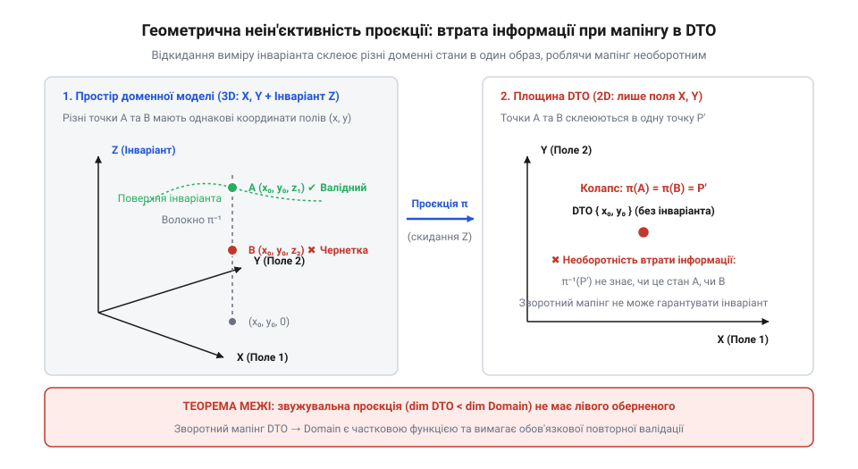
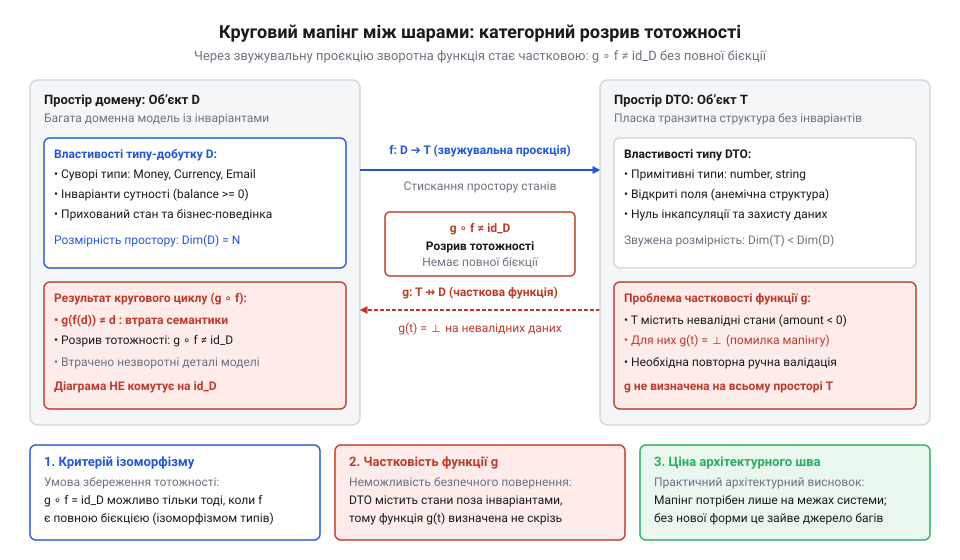

# Ціна мапінгу між шарами

<preknowlist>
- [Протікання шару](root:progarch/layer-leakage) — як абстракція шару руйнується, коли типи нижнього рівня безпосередньо виринають назовні
- [Шар, що лише передає далі](root:progarch/pass-through-layer) — симптоми та ціна створення транзитних шарів і структур, які не несуть власної логіки
</preknowlist>

## Сліпе копіювання полів і ціна ілюзії ізоляції

Інженер, що будує шарову систему, рано чи пізно стикається з рутиною: кожен архітектурний рівень вимагає власного опису одних і тих самих даних. Контролер приймає об'єкт передачі даних (@@en|Data Transfer Object@@, DTO), передає його в шар бізнес-правил, де той перетворюється на доменну сутність, а перед записом у базу даних сутність знову розбирається на поля моделі збереження. Щоб не виникло [протікання шару](root:progarch/layer-leakage), коли структури бази виринають у веб-інтерфейс, розробник пише перекладачі — мапери. Це здається простою й механічною роботою: скопіювати поле `amount` з одного класу в інший, перекласти рядок статусу та повернути новий екземпляр.

Але за цією зовнішньою простотою криється небезпечна інженерна ілюзія. Коли мапінг вважають звичайним перекладанням ключів і значень, у системі виникають дефекти, причину яких важко знайти за допомогою звичайних юніт-тестів:

1. **Пробиття доменних правил через сліпу ініціалізацію.** Доменна сутність замовлення вимагає, щоб сума була додатною, а валюта збігалася з платіжним профілем покупця. DTO контролера, створений для прийому JSON-запиту, містить звичайні скаляри: число та рядок. Якщо автоматичний мапер копіює ці поля через рефлексію або публічні сетери в обхід конструктора валідації, сутність опиняється в невалідному стані. Система приймає від'ємну ціну або неіснуючу валюту, бо захисний бар'єр домену пробито на етапі створення.
2. **Втрата зв'язності при зворотному перетворенні.** У доменній моделі адреса доставки та індекс утворюють неподільний об'єкт-значення (@@en|Value Object@@). При вивантаженні клієнту вони розплющуються у пласкі рядки `street` та `zip_code`. Коли клієнт повертає змінений DTO, зворотний мапер збирає об'єкт-значення заново, проте внутрішня цілісність втрачена: клієнт міг змінити місто, залишивши старий індекс. Мапер не знає, які поля змінювалися узгоджено, і створює розірвану комбінацію.
3. **Транзитне виснаження пам'яті.** Для простих довідників або прохідних запитів розробник будує три паралельні класи й двічі перекладає поля лише заради формального дотримання правила шарів. Виникає [шар, що лише передає далі](root:progarch/pass-through-layer): система виділяє тисячі тимчасових об'єктів у купі, навантажує збирач сміття та витрачає такти процесора на копіювання, яке не додає системі жодної ізоляції.

> 🔧 **Навіщо це.**
> Сприйняття мапінгу як механічного збігу імен полів призводить або до руйнування бізнес-правил, або до роздування системи зайвими транзитними об'єктами. Щоб точно знати, де мапінг рятує систему, а де він є паразитною витратою, потрібен математичний апарат, що описує перетворення просторів станів.

Мапінг — це не маніпуляція рядками й байтами в пам'яті. Це функціональне відображення між математичними множинами, кожна з яких має власну форму, розмірність та обмеження. Щоб з'ясувати, чому перекладання між шарами ламає інваріанти або губить інформацію, необхідно строго визначити, що являє собою схема даних кожного шару.

## Схеми даних як типи-добутки та простір станів

У мовах програмування структура даних, клас або запис об'єднує кілька полів під одним іменем. У теоретичній інформатиці та теорії типів такий зв'язок належить до [алгебраїчних типів даних](root:sf-lang/algebraic-data-types-in-memory) і називається типом-добутком (@@en|product type@@, лат. @@la|productum@@ — створене множенням).

Нехай шар системи оперує схемою даних `S`, яка складається з `n` полів. Кожне поле належить певному базовому або складеному типу: `A₁`, `A₂`, ..., `Aₙ`. Базовий тип схеми визначається як декартовий добуток (лат. @@la|Cartesius@@ — Декарт) множин значень усіх його полів:

`S = A₁ × A₂ × … × Aₙ`

Будь-який конкретний екземпляр даних `s` у цьому шарі є впорядкованим кортежем значень:

`s = (a₁, a₂, …, aₙ), де кожне aᵢ ∈ Aᵢ`

Якщо множини значень полів скінченні, загальна теоретична потужність простору станів схеми `|S|` дорівнює добутку потужностей типів кожного з полів:

`|S| = |A₁| · |A₂| · … · |Aₙ|`

Навіть у мінімальному DTO з двома полями — 32-бітним цілим числом `id` та 16-бітним полем статусу `status` — кількість теоретично можливих комбінацій сягає:

```
|S_DTO| = 2³² · 2¹⁶ = 2⁴⁸ ≈ 2.81 · 10¹⁴ станів
```

Проте реальний об'єкт бізнес-логіки не може приймати будь-який із цих трильйонів станів. Доменна сутність підпорядковується суворим бізнес-правилам — інваріантам (лат. @@la|invarians@@ — незмінний). Інваріант моделюється як логічний предикат на просторі схеми:

`P: S → Bool, де Bool = {⊤, ⊥}`

Значення `⊤` (істина) позначає, що комбінація полів є валідною з погляду правил системи, а `⊥` (хиба) — що стан неприпустимий. Тоді простір допустимих станів моделі `M` є звуженою підмножиною повного декартового простору:

`M = {s ∈ S | P(s) = ⊤} ⊆ S`

Розглянемо практичну різницю між двома шарами:
- **Шар представлення (DTO):** тут інваріант практично відсутній або зведений до синтаксичної перевірки форматів (`P_DTO(s) ≡ ⊤`). Простір станів DTO широкий і пухкий, він містить абсолютно всі комбінації символів, які користувач може надіслати в HTTP-запиті.
- **Шар домену (Entity):** тут інваріант `P_DOM` містить жорсткі обмеження (наприклад, баланс рахунку не може бути від'ємним, а дата закриття замовлення мусить бути пізнішою за дату відкриття). Простір валідних доменних станів `M_DOM` — це крихітна острівна підмножина всередині гігантського простору сирих типів:

```
|M_DOM| ≪ |S_DOM| ≤ |S_DTO|
```

> 🔧 **Навіщо це.**
> Розуміння схеми як типу-добутку з предикатом інваріанту дає інженеру математичну лінійку для вимірювання ентропії даних. Якщо клас містить п'ять полів по 32 біти, але бізнес-правило пов'язує їх так, що допустимими є лише десять комбінацій, використання загального DTO відкриває вхід для небезпечних станів, які ніколи не повинні потрапити у внутрішню пам'ять домену.

Коли дані рухаються між шарами, вони переходять із простору однієї схеми в простір іншої. Цей перехід здійснюють трансформатори, математичну поведінку яких описує категорія типів.

## Трансформатори як морфізми в категорії типів

Щоб описати перетворення даних між шарами математичною мовою, звернемося до категорії типів `Type` (грец. @@el|κατηγορία@@ — висловлювання, твердження). У цій категорії:
- **Об'єкти** — це типи даних і схеми (типи-добутки `S_API`, `S_DOM`, `S_DB`).
- **Стрілки (морфізми)** (грец. @@el|μορφή@@ — форма) — це чисті обчислювані функції, що відображають елементи одного типу в елементи іншого.

Мапер між шаром 1 та шаром 2 — це морфізм у категорії `Type`:

`f: S₁ → S₂`

Для кожного стану першої схеми `s ∈ S₁` мапер обчислює відповідний стан у другій схемі `f(s) ∈ S₂`.

Категорія гарантує виконання двох фундаментальних законів:

1. **Існування тотожного морфізму (ідентичності).** Для будь-якої схеми `S` існує морфізм `id_S: S → S`, такий що:
   `id_S(s) = s`
   В інженерному коді це відповідає ситуації, коли дані передаються між шарами без змін (наприклад, сутність використовується напряму без проміжного DTO).
2. **Асоціативність композиції.** Якщо в системі є мапер з шару представлення в шар застосунку `f: S_API → S_APP`, а далі мапер із шару застосунку в доменне ядро `g: S_APP → S_DOM`, то наскрізний перехід визначається композицією морфізмів (лат. @@la|compositio@@ — складання):
   `h = g ∘ f: S_API → S_DOM`
   де для будь-якого входу виконується `(g ∘ f)(s) = g(f(s))`. Якщо додати третій крок збереження в базу даних `k: S_DOM → S_DB`, порядок об'єднання морфізмів не впливає на кінцевий результат:
   `k ∘ (g ∘ f) = (k ∘ g) ∘ f`

Проте в архітектурі систем морфізм не може бути довільним алгоритмом. Він мусить зберігати семантичну коректність системи.

Сформулюємо **умову збереження інваріантів**:
Морфізм `f: S₁ → S₂` називається коректним відносно інваріантів, якщо для будь-якого стану `s ∈ S₁`, що задовольняє інваріант першого шару `P₁(s) = ⊤`, його образ у другому шарі обов'язково задовольняє інваріант другого шару `P₂(f(s)) = ⊤`:

`∀ s ∈ S₁: P₁(s) ⇒ P₂(f(s))`

Мовою множин це означає, що образ допустимого простору станів `M₁` під дією функції `f` мусить бути строго вкладений у допустимий простір станів `M₂`:

`f(M₁) ⊆ M₂`

Покажемо це кодом. Нехай шар API приймає координати вікна програми, а шар графічного ядра вимагає строго додатної ширини та висоти:

:::code math-schema-mapping-morphisms/ts/windowdto.ts

Якщо викликати `unsafeMap({ width: -100, height: 200 })`, умова збереження інваріантів зазнає краху:

```
pDto(dto) = ⊤
pDom(unsafeMap(dto)) = ⊥
f(M_DTO) ⊈ M_DOM
```

Наївний морфізм порушив умову коректності: точка з простору допустимих станів API перетворилася на заборонену точку в просторі домену. Ядро отримало вікно з від'ємною шириною, що призведе до збою рендерингу або нескінченного циклу обчислення геометрії.

> 🔧 **Навіщо це.**
> Формалізація маперів як морфізмів у категорії `Type` виводить перевірку архітектурних меж на рівень математичного доведення. Якщо інженер не може гарантувати, що `f(M₁) ⊆ M₂`, мапер є джерелом прихованого розмивання інваріантів, яке жоден компілятор мови без залежних типів не зможе спіймати самостійно.

Але що відбувається, коли шари мають різну кількість полів, і один шар навмисно спрощує модель іншого? Це призводить до операції проєкції, за якою стоїть фундаментальна втрата інформації.

## Звужувальні проєкції та втрата вимірів моделі

В архітектурі інформаційних систем мапінг між шарами рідко буває збереженням повної структури. Найчастіше зовнішній шар вимагає спрощеного подання: мобільний додаток не потребує повної історії аудит-логу сутності, публічний API платіжного шлюзу не повинен бачити внутрішні службові позначки черги, а аналітична вітрина отримує лише агреговані зрізи. У кожному з таких випадків модель даних шару призначення має менше вимірів, ніж модель джерела.

Математично перехід від багатої доменної моделі до звуженого об'єкта представлення моделюється як канонічна проєкція (лат. @@la|projectio@@ — кидання вперед). Нехай доменний тип-добуток складається з двох компонентів: публічних атрибутів `A` та внутрішніх полів стану `B`:

`D = A × B`

Мапер у зовнішній DTO відкидає внутрішній стан `B`, залишаючи лише частину `A`. Такий морфізм є проєкцією на перший співмножник:

`π_A: A × B → A,  де π_A(a, b) = a`

Головна алгебраїчна властивість проєкції — її неін'єктивність (лат. @@la|in-@@ — в, всередину + @@la|iacere@@ — кидати). Функція називається ін'єктивною, якщо різним вхідним елементам відповідають різні вихідні значення. Якщо внутрішній стан `B` містить хоча б два допустимі значення (`|B| ≥ 2`), проєкція неминуче склеює різні доменні стани в один і той самий DTO. Нехай маємо два різні стани сутності `(a, b₁)` та `(a, b₂)`, де `b₁ ≠ b₂`. Проєкція діє на них однаково:

```
(a, b₁) ≠ (a, b₂)
π_A(a, b₁) = a = π_A(a, b₂)
```

Множина всіх прообразів конкретного значення `a ∈ A` у вихідному просторі утворює шар або волокно (@@en|fiber@@, лат. @@la|fibra@@ — волокно) над цією точкою:

`π_A⁻¹(a) = {(a, b) ∈ A × B | b ∈ B}`

Коли система виконує мапінг `D → DTO`, вона замінює ціле волокно точок однією проєкційною міткою. Відбувається незворотна втрата розмірності простору станів.


*Звужувальна проєкція відкидає вимір внутрішнього стану домену, склеюючи множину валідних конфігурацій волокна в одну спільну точку плаского DTO.*

Якщо після виконання проєкції зовнішній клієнт повертає отриманий DTO назад у систему, відновити початковий стан сутності `(a, b)` за одним лише значенням `a` стає неможливо. Втрачений вимір `b` не міститься у DTO: він був знищений на межі шарів. Якщо система намагається знову створити сутність із DTO, їй доведеться або вигадувати значення `b` наосліп (підставляючи дефолтні значення), або виконувати додаткове читання з бази даних, щоб відновити втрачений контекст.

> 🔧 **Навіщо це.**
> Звужувальний DTO захищає внутрішній стан системи від несанкціонованого читання ззовні, але водночас робить перехід одностороннім. Якщо архітектор очікує, що сутність можна вивантажити у клієнтський інтерфейс, відредагувати й без втрат повернути назад у домен тим самим маршрутом, він припускається математичної помилки: неін'єктивна проєкція знищує інформацію назавжди.

Втрата інформації при прямому русі створює фундаментальну перешкоду для зворотного руху. Перетворення зовнішнього DTO у доменну модель натрапляє на невідповідність просторів допустимих значень.

## Зворотний мапінг як часткова функція та семантична ціна валідації

Розглянемо зворотний шлях: зовнішній клієнт надсилає запит, сформований у вигляді DTO типу `T`, і шар представлення має сконструювати з нього повноцінну доменну сутність типу `D`.

Наївний підхід розглядає цей перехід як звичайну функцію:

`g: T → D`

Однак побудувати таку функцію як тотальну (@@en|total function@@, лат. @@la|totalis@@ — цілісний, повний), визначену на всій множині `T`, у загальному випадку неможливо. Причина криється у співвідношенні інваріантів:
- Простір станів DTO `T` формується з примітивних типів (рядків, чисел, прапорців) і має надзвичайно широкий простір допустимих значень, де інваріант зазвичай відсутній: `P_T(t) ≡ ⊤`. Користувач або зовнішній сервіс може передати від'ємну ціну, порожнє ім'я або синтаксично некоректну адресу електронної пошти.
- Простір валідних доменних станів `M_D = {d ∈ D | P_D(d) = ⊤}` жорстко обмежений бізнес-правилами домену.

Оскільки простір `T` містить незліченну кількість точок, яким не відповідає жоден валідний стан домену, відображення `g` не визначене для більшості входів. Математично зворотний мапінг є частковою функцією (лат. @@la|partialis@@ — частковий):

`g: T ⇸ D`

Вона визначена лише на звуженій підмножині валідних входів `T_valid ⊂ T`:

`T_valid = {t ∈ T | ∃ d ∈ M_D: t = f(d)}`

Якщо бібліотека автоматичного мапінгу намагається виконати `g` як тотальну функцію, вона змушена або створювати сутність в обхід конструктора (що призводить до пробиття інваріантів), або підставляти довільні дефолтні значення. В обох випадках система отримує об'єкт-фальшивку, який порушує закони доменної області.

У теорії категорій часткову функцію `T ⇸ D` перетворюють на тотальний морфізм шляхом розширення кодомену до типу-суми або кодобутку (@@en|coproduct@@, @@en|sum type@@, лат. @@la|co-@@ — спільний + @@la|productum@@):

`g: T → D + E`

де `E` — це тип помилки, який фіксує порушення інваріанту, а операція `+` позначає диз'юнктне об'єднання множин (відоме в типізованих мовах як `Result<D, E>` або `Either<E, D>`). Морфізм повертає або валідну сутність `d ∈ D`, або свідчення помилки `e ∈ E`:

```
g(t) = Inl(d), якщо P_D(d) = ⊤
g(t) = Inr(e), якщо дані порушують інваріант домену
```

Продемонструємо це кодом на TypeScript, де [патерн розбирання замість валідації](root:sf-apps/parse-dont-validate-pattern) реалізує підняття часткового мапінгу до тотального морфізму:

:::code math-schema-mapping-morphisms/ts/registeruserdto.ts

Коли функція повертає `Result`, мапер ніколи не створює невалідну сутність. Якщо вхід `dto` лежить за межами валідного підпростору `T_valid`, морфізм повертає правдиве повідомлення про неможливість перекладу.

> 🔧 **Навіщо це.**
> Валідація на межі шарів — це не довільне побажання з чистоти коду, а категорна необхідність. Єдиний спосіб перетворити сирий, небезпечний простір DTO на захищений простір доменних сутностей без пробиття інваріантів — це підняти частковий мапер до тотального морфізму над типом-сумою (`Result` або `Either`).

Тепер, коли визначено прямий звужувальний морфізм і зворотний валідуючий морфізм, постає питання: чи можна замкнути цей ланцюг у коло, і за яких умов циклічний перехід `D → DTO → D` повертає точну копію початкового об'єкта?

## Умови ізоморфізму та кругова еквівалентність

У реальних додатках перетворення даних рідко буває односпрямованим. Найпоширеніший життєвий цикл інформації — це кругове перетворення (@@en|round-trip mapping@@):
1. Доменна сутність `d ∈ D` читається зі сховища або пам'яті сервісу.
2. Прямий мапер транслює її у формат зовнішнього подання: `t = f(d) ∈ T`.
3. Користувач або суміжний мікросервіс модифікує дозволені поля й повертає DTO назад.
4. Зворотний мапер реконструює сутність для збереження: `d' = g(t) = g(f(d))`.

Виникає фундаментальне архітектурне питання: за яких умов відновлений стан тотожний початковому, тобто коли `d' = d`?

Мовою теорії категорій ця вимога означає, що композиція морфізмів `g ∘ f` має бути тотожним морфізмом (ідентичністю) простору домену:

`g ∘ f = id_D`

Симетрично, якщо ми беремо валідний DTO, перетворюємо його на доменну сутність і повертаємо назад у DTO, ми очікуємо збереження початкового стану запиту:

`f ∘ g = id_T`

Якщо обидві ці рівності виконуються одночасно, кажуть, що схеми даних `D` та `T` є ізоморфними (грец. @@el|ἴσος@@ — рівний, однаковий + @@el|μορφή@@ — форма), що позначається як `D ≅ T`. Ізоморфізм означає, що попри можливі відмінності в назвах полів чи синтаксисі мови, обидві моделі мають абсолютно однаковий інформаційний зміст і топологію простору станів.

Для існування ізоморфізму між моделями необхідні й достатні дві математичні умови:
1. **Бієктивність морфізму (@@en|bijection@@, лат. @@la|bi-@@ — подвійний + @@la|iacere@@ — кидати).** Пряме відображення `f` має бути водночас ін'єктивним (жодні два різні доменні стани не дають однакового DTO) та сюр'єктивним (франц. @@fr|sur-@@ — на, зверху: для кожного можливого DTO обов'язково існує відповідний доменний стан).
2. **Еквівалентність інваріантів.** Допустимі підпростори станів мають точно збігатися:
   `∀ d ∈ D: P_D(d) ⇔ P_T(f(d))`

Якщо хоча б одна з цих умов порушується, ізоморфізм руйнується.

Як ми з'ясували раніше, типовий мапінг домену в DTO є звужувальною проєкцією `π_A: A × B → A`, де внутрішній стан `B` відкидається. Проєкція не є ін'єктивною, тому бієкція неможлива. У такому разі зворотний морфізм `g` не може відновити відкинуту координату й змушений підставляти фіксоване значення `b_default`.

Композиція `g ∘ f` замість тотожного морфізму `id_D` стає оператором ретракції (лат. @@la|retractio@@ — відтягування назад):

```
(g ∘ f)(a, b) = (a, b_default) ≠ (a, b)
g ∘ f ≠ id_D
```


*Комутативна діаграма кругового мапінгу: за відсутності бієкції між просторами зворотний перехід не замикається на тотожний морфізм id_D, утворюючи залишкову семантичну дельту.*

Різниця між початковим станом сутності та результатом кругового мапінгу утворює залишкову семантичну дельту:

`Δ(d) = d - (g ∘ f)(d)`

Якщо `Δ(d) ≠ 0`, система втрачає стан. У коді це проявляється катастрофічними прихованими побічними ефектами: користувач оновлює адресу в профілі, а при збереженні через DTO несподівано занулюється дата реєстрації, скидається прапорець верифікації облікового запису або втрачається версія оптимістичного блокування.

> 🔧 **Навіщо це.**
> Перевірка кругового мапінгу на тотожність `(g ∘ f)(d) == d` за допомогою [тестування інваріантів на основі властивостей](root:sf-release/property-based-testing) — це найшвидший спосіб виявити втрату даних на межах шарів. Якщо круговий тест для валідної сутності повертає змінений стан або скидає приховані атрибути, ваш мапінг має ненульову семантичну дельту, яка неодмінно призведе до тихих спотворень бази даних у промисловій експлуатації.

Математична неможливість ізоморфізму при звуженні ставить перед архітектором практичний вибір: коли окремі класи DTO є строгою необхідністю, а коли вони перетворюються на шкідливу бюрократію.

## Архітектурне правило доцільності DTO

Поширена інженерна помилка полягає у зведенні патерну DTO в абсолют: створення окремих класів-двійників для кожного шару за замовчуванням. Розробник малює `UserEntity`, `UserAppDto`, `UserApiDto` та `UserDbRecord`, у яких збігаються всі поля й типи. Потім пишуться або генеруються десятки рядків коду маперів, які просто перекладають значення `user.name = dto.name`.

Категорний аналіз дозволяє сформулювати чітке правило, коли створення додаткової схеми даних є виправданим, а коли — паразитною витратою.

### 1. Тривіальний ізоморфізм: коли DTO є баластом

Якщо між шаром 1 та шаром 2 схема даних має:
- однаковий набір полів однакових типів (`S₁ = A₁ × … × Aₙ` та `S₂ = A₁ × … × Aₙ`);
- тотожний предикат валідності (`P₁(s) ⇔ P₂(s)`);
- спільний життєвий цикл і однаковий темп змін,

тоді мапер між цими шарами є тривіальним ізоморфізмом `S₁ ≅ S₂`. Це фактично тотожний морфізм `id`, штучно розірваний на два різні імені класів у коді.

У цій ситуації окрема структура DTO є архітектурним шумом:
- Вона не додає безпеки, бо інваріанти шарів однакові.
- Вона породжує [шар, що лише передає далі](root:progarch/pass-through-layer), де процесор даремно витрачає такти на алокацію пам'яті в купі та перекладання полів.
- Вона створює паразитне зчеплення: будь-яка зміна поля в домені неминуче змушує змінювати той самий тип у DTO та оновлювати функцію перекладання.

Якщо між шарами існує тривіальний ізоморфізм, використання доменної моделі або спільного незмінного типу без проміжного DTO є математично й інженерно коректним рішенням.

### 2. Неізоморфні простори: коли DTO є математичною необхідністю

Окремий DTO та явний морфізм між шарами стають теоретичною необхідністю (`S₁ ≇ S₂`) виключно за наявності хоча б однієї з трьох умов:

1. **Захисне звуження простору станів (проєкція `π_A`).**
   Внутрішня модель містить приватні виміри, доступ до яких ззовні заборонено: геші паролів, службові прапорці модерації, фінансову маржу, приватні ключі. Тут DTO виступає оператором навмисної втрати розмірності, гарантуючи, що приватні координати фізично не потраплять у вихідний мережевий потік.
2. **Семантичний бар'єр валідації (підняття часткового морфізму `g: T → D + E`).**
   Зовнішній шар (веб-клієнт, сторонній вебхук, датчик IoT) постачає неперевірені дані з пухким простором допустимих значень, де можливі помилки й синтаксичне сміття. DTO слугує сирим буфером прийому, захищаючи ядро від [протікання шару](root:progarch/layer-leakage). Морфізм валідації бере на себе розрахунок предиката `P_D` і або повертає суворий доменний тип, або завершує виконання помилкою до того, як невалідний стан досягне бізнес-логіки.
3. **Різниця життєвих циклів і часова ізоляція (несумісність версій).**
   Доменна модель розвивається швидко разом із вимогами бізнесу, а зовнішній публічний API заморожений публічним контрактом версії v1. Простір станів API та простір домену розходяться в часі. DTO фіксує історичний контракт, а морфізм виконує роль перекладача між різними поколіннями моделей.

Підсумуємо це правилом прийняття рішень:

```
                    Чи є різниця між моделями?
                                |
       +------------------------+------------------------+
       |                                                 |
[S₁ ≅ S₂: однакові поля,                  [S₁ ≇ S₂: різна розмірність,
 правила та темп змін]                     інваріанти або контракти]
       |                                                 |
ТРИВІАЛЬНИЙ ІЗОМОРФІЗМ                     МАТЕМАТИЧНА НЕОБХІДНІСТЬ
       |                                                 |
DTO — транзитний баласт.                   DTO обов'язковий:
Використовуйте спільний тип.               звужувальна проєкція або
                                           валідуючий Result-мапер.
```

> 🔧 **Навіщо це.**
> Це правило дає інженеру раціональний аргумент під час проєктування та перегляду коду. Замість догматичного дублювання класів «бо так вимагає чиста архітектура», команда створює DTO лише тоді, коли між шарами дійсно змінюється розмірність простору станів або виникає потреба в піднятті часткового морфізму валідації.

Розуміння схем як типів-добутків, а трансформаторів — як морфізмів у категорії `Type` перетворює мапінг із нудної механічної роботи на точну інженерну дисципліну з прогнозованою надійністю та нульовими прихованими втратами.
