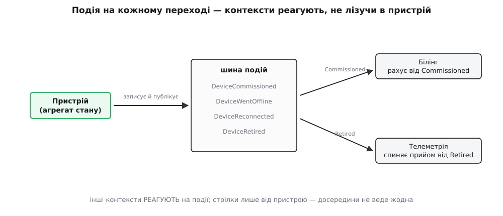
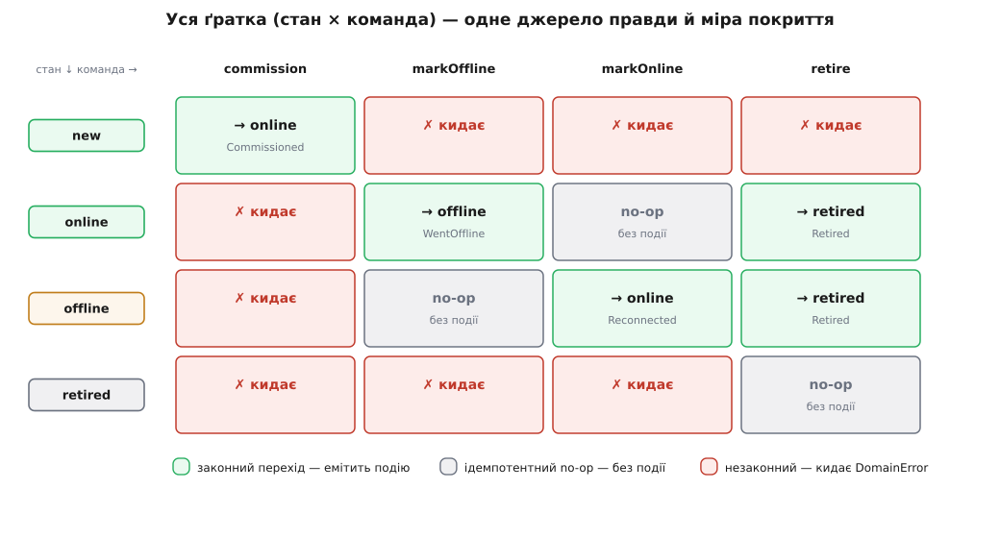

# ⚙️ Робочий автомат життєвого циклу: таблиця, події, повне покриття

Ми вже маємо чотири стани пристрою — `new → online → offline → retired` — і вартових, зашитих у методи `commission`/`markOffline`/`markOnline`/`retire`. Цього досить, щоб некоректну стадію стало нема як записати. Але від «досить» до «робоче» лишилося три речі, і кожна з них — не окраса, а те, без чого автомат не житиме в справжній системі.

Перша: правило переходу знову розтеклося — тепер по тілах чотирьох методів, і додати п'ятий стан означає обійти всі чотири. Ми піднімемо всю карту дозволеного в **одну таблицю** й змусимо кожну команду бути тонкою обгорткою над нею. Друга: пристрій живе не сам. Коли його вводять у дім, білінг має почати рахунок; коли списують — телеметрія мусить спинити прийом показів. Найгірше, що можна тут зробити, — дозволити білінгу й телеметрії **лізти в пристрій** і питати його стан. Натомість на **кожному переході** пристрій емітить доменну подію, і сусіди реагують на неї, не торкаючись пристрою. Третя: ми пообіцяли, що незаконний перехід кидає. Обіцянку треба **довести** — тестом, що параметрично пробіжить **усі** пари (стан × команда) й перевірить кожну клітину ґратки. Зберімо все це в один робочий агрегат.

## Ідея: таблиця жене вартових, вартові емітять події

Три рухи складаються в один механізм. Таблиця `TRANSITIONS` — єдине джерело правди: `(стан, команда) → новий стан`, і чого в ній нема, те заборонено. Кожна команда-метод не повторює правил — вона кличе одне спільне ядро `apply`, яке дивиться в таблицю, кидає на незаконному й **на кожному реальному переході** дописує доменну подію у внутрішній список. А тест бере ту саму таблицю за оракула й проходить нею всю ґратку 4 × 4, доводячи, що пристрій поводиться рівно так, як таблиця обіцяє. Одне джерело правди живить і поведінку, і подію, і перевірку — тож розійтися їм нема де.

## Агрегат: одна таблиця, команди над нею, подія на кожному переході

Ось повний [агрегат](root:sf-apps/aggregates-consistency) — корінь, що тримає власний інваріант життєвого циклу. Придивіться, як мало важать самі команди: уся їхня робота — назвати команду й спорядити подію; закон переходу лежить у таблиці, а механіка «перевір → перейди → запиши подію» — в одному `apply`.

:::tabs
:::code proj-dh-device-lifecycle/ts/device-lifecycle.ts
:::code proj-dh-device-lifecycle/py/device_lifecycle.py
:::

Спинімося на найтоншій деталі — на порядку двох перевірок усередині `apply`. Ідемпотентний no-op звірено **першим**, ще до таблиці: якщо команда з тих, що «уже в цільовому стані нічого не роблять», і пристрій саме там, ми мовчки виходимо — не міняючи стану й **не пишучи події**. Лише коли це не no-op, дивимося в таблицю: є рядок — переходимо й дописуємо подію, немає — кидаємо. Чому `commission` навмисно **не** серед ідемпотентних? Бо повторно ввести в дім уже введений пристрій — не безневинний повтор, а помилка, яку варто побачити; тож для нього no-op-гілки нема, і другий `commission` чесно кидає. Ця асиметрія — не недогляд, а рішення дому, записане одним рядком таблиці `IDEMPOTENT`.

І зверніть увагу, чого пристрій **не** робить: він нікого не викликає. Він лише **записує** подію в свій список — `events`/`_events` — і віддає її назовні через `pullEvents`. Це не дрібниця стилю, а вимога коректності, до якої ми ще повернемося в пастках: агрегат породжує факт, а розсилає його вже інфраструктура — після того, як стан надійно збережено.

## Події летять назовні — контексти реагують, не лізучи в пристрій

Тепер друга обіцянка з початку. Пристрій виклав події; хтось має рознести їх [іншим контекстам](root:progarch/dh-contexts-map) — білінгу й телеметрії. Робить це тонкий шар застосунку: після кожної операції він зливає події з пристрою й публікує на шину, а контексти-передплатники реагують. Пристрій про них не знає — і в цьому вся сила.

:::tabs
:::code proj-dh-device-lifecycle/ts/podii-letiat-nazovni.ts
:::code proj-dh-device-lifecycle/py/podii-letiat-nazovni.py
:::


*Подія на кожному переході — і сусідні контексти реагують, не торкаючись пристрою. Білінг рахує активні від `DeviceCommissioned` до `DeviceRetired`, телеметрія глушить прийом на `DeviceRetired`. Стрілки йдуть лише назовні: пристрій нікого не кличе, його ніхто не смикає.*

Придивіться до середнього рядка прикладу — він тихо доводить, що ми правильно розвели дві осі стану. `markOffline` шле `DeviceWentOffline`, але **не** `DeviceRetired`, і телеметрія далі приймає покази: `offline` — це «мовчить, але наш», а не «нема назавжди». Якби ці два стани зшити в один, розрядкою батарейки телеметрія б назавжди відвернулася від живого замка. Автомат не дає їх сплутати, і подія несе саме той факт, що стався, — ні на йоту більший.

> 🔧 **Навіщо це.** Спокуса зробити «простіше» звучить так: хай білінг сам питає в пристрою `device.status === "online"`, коли треба. Але тоді білінг **знає** внутрішній устрій пристрою, телеметрія знає його теж, і кожен новий контекст додає ще одну нитку, що тягнеться пристроєві в нутро. Змінив стани — полагодь усіх, хто в них зазирав. Подія розвертає залежність: пристрій оголошує **факт** мовою дому («пристрій списано»), а хто і як на нього реагує — клопіт слухачів, пристрій про них не чув. Саме тому доменну подію [винесли в окремий тактичний прийом DDD](root:sf-apps/domain-driven-design) — щоправда, не одразу: у синій книзі Еванса (2003) її як патерна ще нема; розробив і вписав її у щоденний набір Вон Вернон у «Implementing Domain-Driven Design» (2013), а сам Еванс дописав патерн згодом. Це задокументована, узгоджена історія.

## Уся ґратка як тест: покриття всіх переходів

Ми пообіцяли доказ. Ось він — тест, що не вибирає кілька «цікавих» випадків, а бере **всю** ґратку: чотири стани на чотири команди, шістнадцять клітин, жодної повз. Кожну клітину заздалегідь видно на карті.


*Уся ґратка (стан × команда) — водночас джерело правди й міра покриття. Зелених клітин п'ять (законні переходи, кожен з подією), сірих три (ідемпотентні no-op, без події), червоних вісім (кидають). Тест мусить торкнутися кожної.*

Порахуймо, щоб знати, скільки саме перевірок винні:

```
стани × команди = 4 × 4 = 16 пар — уся ґратка
  законних переходів (є в таблиці):        5   → рівно одна подія кожен
  ідемпотентних no-op (уже в цілі):        3   online·markOnline, offline·markOffline, retired·retire
  незаконних (кидають DomainError):        8   → жодної події, стан незмінний
                                          ──
                                          16   — жодної не пропущено
```

У теорії тестування автоматів це зветься **покриттям усіх переходів** (англ. *all-transitions*, воно ж *0-switch coverage* у сходинці switch-покриття, що виросла з праці Цуна Чоу про тестування скінченних автоматів, 1978) — settled-термінологія, не наша вигадка. Ось цей обхід у коді; параметр — сама пара, а очікування на кожну пару виводимо з тих самих двох таблиць:

:::tabs
:::code proj-dh-device-lifecycle/ts/all-transitions.test.ts
:::code proj-dh-device-lifecycle/py/all_transitions_test.py
:::

Один цикл із подвійним `for` замінив шістнадцять окремих тестів — і, що важливіше, **не дасть забути** жодної клітини: додаси стан `quarantined` — ґратка сама роздується до 5 × 4, і кожна нова пара мусить лягти в одну з трьох гілок. Тест доводить три речі за раз: законний перехід веде рівно куди слід і лишає **рівно одну** подію; ідемпотентний повтор мовчить і події не породжує; незаконна пара кидає, а стан по кидку **не зрушив** ні на крок. Остання перевірка — не зайва причепа: команда, що кидає вже **після** того, як зіпсувала стан, — гірша за ту, що просто забороняє.

> 🔧 **Навіщо це.** Свіп по всій ґратці ловить не той баг, що ти передбачив, а той, що проґавив. Руками пишуть тести на переходи, які **спали на думку**; забута пара — саме та, про яку ніхто не подумав, бо вона «очевидно неможлива». Параметричний обхід не має упереджень: він однаково суворо питає в кожної з шістнадцяти клітин, і `retired × markOnline`, про яку легко забути, отримує ту саму перевірку, що й щоденний `online × markOffline`.

## Ендшпіль: незаконний перехід, що не компілюється

Усе дотепер ловить незаконний перехід у **рантаймі** — `apply` кидає, коли пара не з таблиці. Можна піти на крок далі й зробити так, щоб незаконну послідовність не можна було навіть **зібрати**: закодувати стан у самому типі хендла — і тоді `mark_online` на списаному пристрої не «кине», а не існуватиме як виклик. Прийом зветься **типостан**; його механіку — фантомні типи, афінне переміщення, чому в Rust гарантія повна, а в мовах без власності слабша — розібрано [окремо, до дна](root:sf-apps/type-driven-design/proj-typestate-machine.md), і переказувати її тут не будемо. Покажемо лише, як лягає наш власний автомат дому.

:::code proj-dh-device-lifecycle/rust/main.rs

Тепер спроби зламати автомат ловить не наш `if`, а `rustc`, і двома різними помилками:

```rust
let d = Device::<New>::unpack("lock-42");
let online = d.commission("home-7");   // New → Online; d ПЕРЕМІЩЕНО в online
// d.commission("home-7");             // E0382: use of moved value `d` — старий хендл спожито
let off = online.mark_offline();       // Online → Offline
// online.retire();                    // E0382: online уже спожито mark_offline
let dead = off.retire();               // Offline → Retired
// dead.mark_online();                 // E0599: у Device<Retired> НЕМАЄ методу mark_online
// Device::<New>::unpack("z").retire();// E0599: у Device<New> НЕМАЄ retire (новий не списують)
```

Дві помилки стережуть автомат із різних боків. `E0599` (*no method*) — це «команда **не існує** в цьому стані»: `retire` на `New`, `mark_online` на `Retired`. Кінцевий стан `Retired` не має жодного методу — тому з нього фізично нема куди піти, незворотність вбудована в тип. `E0382` (*use of moved value*) — це «старий хендл **спожито** переходом»: кожен перехід бере `self` за значенням, тож повернутися до попереднього стану нема чим. Рантайм-таблиця ловила ту саму заборону пізніше й м'якше — винятком; типостан ловить її **раніше й жорсткіше** — відмовою зібратися. Ціну й межу цього вибору (вибух підписів, стан лише статичний, слабша гарантія без афінних типів) винесено в той-таки [розбір типостану](root:sf-apps/type-driven-design/proj-typestate-machine.md); тут головне побачити, що наш чотиристановий автомат дому вкладається в типи один в один.

## Складність і пастки

Механізм зібрано й доведено — але кожен його шов має гострий край, і три з них ранять глибше за інші.

**Забути ідемпотентний no-op — і система захлинеться на власному серцебитті.** Найспокусливіше «спрощення» — пустити **всі** команди однаково крізь таблицю, без окремої гілки no-op: нема рядка `(online, markOnline)` → кидай. І воно навіть здається чистішим. Аж поки в дім не прийде реальність: хаб чує пристрій щосекунди й на кожен «пульс» кличе `markOnline`, підтверджуючи зв'язок. Пристрій уже `online` — і кожен пульс тепер **кидає** `DomainError`, лог тоне в помилках, а якийсь нещасний `try` десь нагорі, злякавшись, переводить пристрій у `offline`. No-op — не поблажливість, а визнання, що в житті команда «лишайся як є» приходить постійно й мусить бути тихою. І дзеркальна половина тієї ж пастки: якщо no-op таки пропустити крізь `apply` **з** емісією події, кожен пульс породить `DeviceReconnected`, шина захлинеться, а білінг із телеметрією діятимуть на сотні фальшивих «повернень». Тому перевірка no-op стоїть **першою** й виходить **без** події: повтор у той самий стан — не подія, бо нічого не сталося.

**Емітувати подію до того, як стан збережено, — брехня, яку вже не відкликати.** Наш пристрій навмисно **записує** події в список, а не шле їх на шину зсередини `retire`. Спокуса зробити навпаки — «хай `retire` одразу публікує `DeviceRetired`» — руйнівна там, де є база. Уяви: `retire` синхронно шле подію, телеметрія на неї глушить прийом, — а транзакція, що мала зберегти новий стан, відкочується (конфлікт, збій диска). Тепер телеметрія відвернулася від пристрою, який у базі досі `online`: подія розійшлася про факт, якого не сталося. Правило тверде: **агрегат породжує подію, інфраструктура публікує її після того, як стан надійно зафіксовано** — а не в мить зміни в пам'яті. Саме тому події збираються в `pullEvents`, а `bus.publish` кличе шар застосунку **після** збереження; надійний спосіб зшити «зберегти стан» і «розіслати подію» в одне ціле — вивідна скринька (англ. *transactional outbox*), де подія лягає в ту саму транзакцію, що й стан. Список подій у пристрої — це перша, найдешевша сходинка до цієї дисципліни.

**Тест, що звіряється сам із собою, доводить менше, ніж здається.** Наш свіп бере очікування з тих самих `TRANSITIONS` і `IDEMPOTENT`, які й перевіряє. Це чесно рівно доти, доки таблиця **правильна**. Впиши хтось помилково `(NEW, "retire"): RETIRED` — і параметричний обхід слухняно перевірить, що `new × retire` веде в `retired`, і **зрадіє**: пристрій робить те, що каже таблиця, а тест звіряється з тією ж таблицею. Повне покриття переходів доводить **внутрішню несуперечність** машини зі своїм описом — але не те, що опис відповідає **наміру дому**. Тому поряд зі свіпом стоять **золоті випадки** — жменька тверджень, що записують намір **незалежно**, словами домену: «невведений не списують», «мертвий не оживе», «повтор online не спамить подію». Якщо хтось зіпсує таблицю, свіп змовчить, а золотий рядок `new.retire()` мусить кинути — і впаде. Свіп ловить пропущені клітини; золоті випадки ловлять **неправильну карту**. Потрібні обидва.

**Зшити дві осі стану в один enum — і таблиця вибухне добутком.** Остання й найпідступніша, бо на око «економна». Раз уже є один автомат — чом не всипати в той самий `status` і робочий стан замка: `new | online | offline | retired | locked | unlocked | jammed`? Бо ці слова — з **двох різних осей**: перші чотири кажуть, **де в житті** пристрій, останні три — **що він робить зараз**, поки живий. Змішавши їх, ти негайно ловиш неможливі питання: що таке перехід `locked → offline`? а `retired → jammed`? Щоб таблиця лишилась чесною, довелося б завести рядок на **кожну** пару (життєвий-стан × робочий-стан) — тобто |життя| × |робота| клітин там, де були дві незалежні машинки на |життя| + |робота|. Ознака, що ти вже в цій пастці: enum, де впереміш живуть `active`, `locked`, `paused`, `deleted`; переходи в ньому плутаються в клубок, бо ти сплів дві історії в одну нитку. Ліки — розчепити назад: життєвий цикл окремим автоматом (оцим), робочий стан — своїм, і робочий має сенс лише поки життєвий у `online`. Два малі автомати завжди простіші за один добуток.

І ось у чому підсумок усієї вправи. Ми взяли розсип вартових по методах і звели його до **однієї таблиці**, з якої тепер живе все: поведінка команд, подія на кожному переході, оракул тесту. Таблиця стала настільки явною, що її читають мовою дому, малюють однією ґраткою й покривають одним циклом. Події розвернули залежність — сусідні контексти реагують на факти, не сягаючи пристроєві в нутро. А хто хоче найтвердішої гарантії, підіймає стан у типи, і незаконний перехід перестає бути тим, що ми ловимо, стаючи тим, чого нема як **зібрати**. Один автомат, виписаний до дна, — і життєвий цикл, що досі жив неписаним договором у головах, став річчю, яку видно, читають і доводять.
