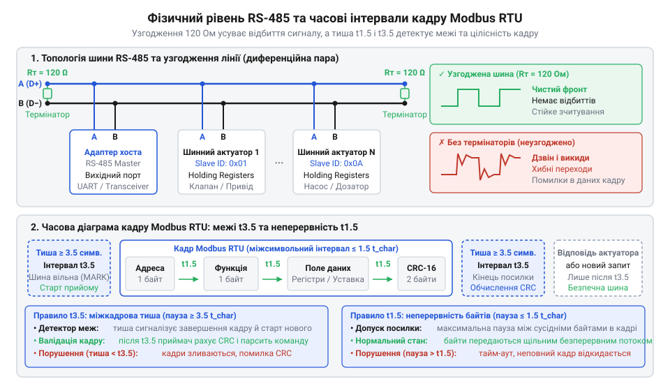
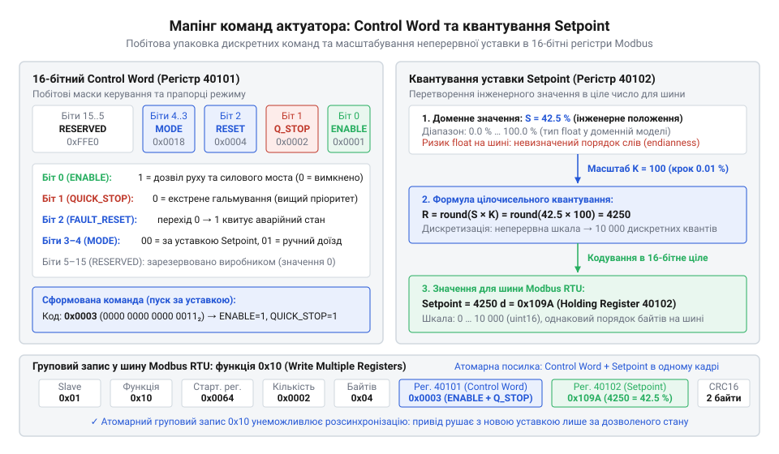

# Залізний інтерфейс і карта регістрів шинного актуатора

## Шинний стик RS-485 і кадри RTU

Коли [вихідний адаптер](root:progarch/dh-v2-hexagon) передає команду фізичному приводу, байтовий буфер виходить у довгу лінію зв'язку, схильну до електромагнітних завад. Передавання сигналу відносно спільної землі спотворює дані від найменшого стрибка потенціалу. Тому інтерфейс @@en|RS-485@@ використовує диференційну пару (від лат. *differentia* — різниця; @@en|differential pair@@) — дві лінії `A` та `B`. Приймач вимірює різницю напруг `V_A - V_B`, а не їхній рівень щодо землі. Оскільки завада однаково зсуває напругу в обох провідниках, різниця між ними лишається сталою, зберігаючи форму бітів.

Друга загроза лінії — відбиття електромагнітних хвиль. На розімкненому кінці кабелю сигнал через стрибок імпедансу відбивається назад, накладається на наступні біти й руйнує прямокутні імпульси. Щоб поглинути енергію хвилі, обидва фізичні кінці шини замикають через термінальний резистор (від лат. *terminus* — межа; @@en|termination resistor@@) номіналом 120 Ом, що дорівнює хвильовому опору витої пари.


*Диференційна пара компенсує синфазні завади, узгодження 120 Ом усуває відбиття сигналу, а паузи t1.5 і t3.5 детектують межі кадру.*

Навіть на узгодженій шині двійковий потік чутливий до пауз між байтами. Протокол @@en|Modbus RTU@@ не має стартових і стопових байтів: межі кадру визначаються винятково часом тиші. Стандарт фіксує два часові пороги:
- Інтервал `t1.5` — пауза між байтами всередині одного кадру не може перевищувати тривалості передавання 1.5 символу. Якщо затримка в коді адаптера перевищить `t1.5`, приймач шинного приводу (від лат. *actuare* — приводити в дію; @@la|актуатор@@) визнає пакет розірваним і скине буфер.
- Інтервал `t3.5` — тиша тривалістю щонайменше 3.5 символу позначає завершення кадру й сигналізує пристрою про готовність до обробки команди.

Через це адаптер ніколи не надсилає байти поодинці: пакет формується в пам'яті повністю й виштовхується в порт єдиним неперервним буфером.

## Карта регістрів зберігання шинного актуатора

Отримавши валідний кадр, мікроконтролер актуатора має спрямувати дані до відповідного вузла. Розумний @@la|актуатор@@ не надає довільного доступу до пам'яті: його стан і конфігурація структуровані у 16-бітні регістри зберігання (від лат. *registrum* — список, перелік; @@en|Holding Registers@@). Кожен регістр містить два байти, що передаються у прямому порядку (від англ. @@en|big-endian@@: старший байт іде першим).

Карта регістрів ділить пам'ять на чотири функціональні зони:
1. **Конфігурація:** мережева адреса пристрою, параметри швидкості й механічні обмеження ходу; зберігається в енергонезалежній пам'яті.
2. **Керування:** оперативні біти запуску, зупинки та цільова позиція приводу.
3. **Телеметрія** (від грец. *tele* — далеко + *metron* — міра; @@grc|телеметрія@@): фактичне положення штока, напруга й струм двигуна; доступна лише для читання.
4. **Діагностика:** прапорці заклинювання механіки, сигнали перегріву та лічильники помилок зв'язку.

Типова пастка під час адресації — розбіжність між документацією та двійковим кадром. У паспортах регістри позначають номерами з одиниці у діапазоні `40001–49999`, де префікс `4` вказує на тип пам'яті. Але всередині кадру @@en|Modbus RTU@@ передається не номер із паспорта, а зміщення (від англ. @@en|offset@@), що відлічується від нуля:

```text
offset = doc_address - 40001     [перехід від номера в паспорті до байтів запиту]
```

Для регістру `40101` адаптер мусить передати зміщення `100` (`0x0064`). Помилка на одиницю призведе до запису в сусідній регістр або виклику помилки адресації.

Для доступу до карти регістрів адаптер використовує три функції Modbus:
- `0x03` (Read Holding Registers) — вичитування блоків телеметрії та діагностики;
- `0x06` (Write Single Register) — поодинокий запис одного слова (наприклад, команди скидання аварії);
- `0x10` (Write Multiple Registers) — атомарний запис групи послідовних слів. Запис слова керування та уставки положення одним викликом `0x10` гарантує, що привід не почне рух до застарілої координати.

## Слово керування та масштабування уставки

Вихідний адаптер не може надіслати актуатору довільну команду на кшталт «відкрийся наполовину». По-перше, приводу потрібен однозначний наказ для силового каскаду: чи дозволено рух, чи увімкнено двигун і як діяти після аварії. По-друге, шина Modbus оперує виключно 16-бітними цілими числами, тому дробову інженерну величину слід закодувати без втрати точності.

Для узгодження поведінки приводу слугує @@en|Control Word@@ — 16-бітний регістр, де кожен біт працює як окремий двійковий прапорець. Замість черги повільних запитів адаптер формує єдину бітову маску (англ. @@en|bitmask@@):
- біт 0 (`ENABLE`): дозвіл роботи, що вмикає силовий міст керування;
- біт 1 (`QUICK_STOP`): швидка зупинка; за нульового рівня привід негайно гальмує;
- біт 2 (`FAULT_RESET`): скидання аварії; перехід 0 → 1 квитує помилку;
- біти 3–4 (`MODE`): режим роботи (двійкове `00` — позиціювання за уставкою, `01` — ручний доїзд).

Об'єднання прапорців у єдине слово забезпечує атомарність: прилад переходить у новий стан одночасно з отриманням команди. Запис виконують функцією Modbus `0x06` для одного слова або `0x10` для пакета регістрів.

Коли привід активовано, йому потрібна цільова уставка — @@en|Setpoint@@. У доменній моделі положення часто задають дробовим числом, наприклад відсотком відкриття від 0.0 % до 100.0 %. Передавати числа з рухомою комою прямо на шину ризиковано: порядок 16-бітних слів для 32-бітного типу у стандарті Modbus не закріплений і різниться між вендорами. Замість цього застосовують квантування (від лат. *quantum* — скільки) — розбиття неперервної шкали на дискретні кроки за допомогою масштабного коефіцієнта (англ. @@en|scale factor@@).

Щоб визначити цілочисельний код регістра `R` для фізичної уставки `S` із постійним коефіцієнтом масштабування `K`, рівним 100, адаптер множить фізичну величину на масштаб і заокруглює результат:

```
R = round(S × K)
  = round(42.5 × 100)      [підстановка уставки 42.5 % і масштабу 100]
  = 4250                   [цілочисельний код для запису в регістр]
```

Отримане ціле `4250` вміщується в один 16-бітний регістр і гарантує роздільну здатність 0.01 %. Записуючи функцією `0x10` обидва регістри — @@en|Control Word@@ та @@en|Setpoint@@ — в одному запиті, адаптер унеможливлює ситуацію, коли двигун рушає за новою уставкою зі старими бітами дозволу.


*Розкладка бітів слова керування та квантування дробової уставки: пакування команди й масштабованого значення для безпечного запису в регістри.*

## Регістри стану й діагностика аварій

Успішна відповідь на команду запису підтверджує лише те, що актуатор прийняв байти у свій буфер. Вона не гарантує, що двигун подолав опір середовища чи шток не заклинило механічною перешкодою. Вихідний адаптер не може вважати команду виконаною наосліп — системі потрібен постійний зворотний зв'язок про реальний стан виконавчого механізму.

Для цього адаптер періодично опитує пристрій функцією `0x03`. Загальний стан приводу фіксує 16-бітне @@en|Status Word@@:
- біт 0 (`READY`): самодіагностика пройдена, живлення подано, привід готовий до руху;
- біт 1 (`MOVING`): вал або шток перебувають у процесі переміщення;
- біт 2 (`TARGET_REACHED`): поточна позиція збігається з уставкою в межах заданої мертвої зони;
- біт 3 (`FAULT`): зафіксовано аварійний стан; силове живлення знято, привід заблоковано.

Якщо прапорець `FAULT` набуває одиниці, адаптер аналізує спеціалізований регістр апаратних аварій — @@en|Error Word@@. Його біти вказують на конкретну поломку вузлів приводу:
- біт 0 (`JAMMED`): заклинювання механіки; обмотки під напругою, проте сенсор не бачить обертання;
- біт 1 (`OVERCURRENT`): перевищення струмового ліміту обмоток двигуна;
- біт 2 (`OVERHEAT`): перегрів силових транзисторів H-моста;
- біт 3 (`SENSOR_FAULT`): обрив лінії або відмова внутрішнього датчика кута.

Послідовне зчитування цих параметрів окремими запитами призводить до розсинхронізації: прапорець руху може скинутися ще до того, як адаптер дізнається про перегрів. Тому телеметрію вичитують єдиним груповим кадром `0x03`, забираючи @@en|Status Word@@, фактичну позицію та @@en|Error Word@@ одночасно.

Отримані байти адаптер розбирає через бітові маски. Коли в гексагональній архітектурі [застосунок набуває форми](root:progarch/dh-v2-hexagon), вихідний адаптер захищає доменне ядро від специфіки протоколу й шини: він транслює сирі біти аварій у зрозумілі типізовані події та винятки, лишаючи бізнес-логіку чистою від регістрових подробиць.

## Протокольні винятки та таймінги опитування

Коли привід не виконує команду або лінія зв'язку повертає неочікувані дані, вихідний адаптер мусить точно встановити причину збою. Непорозуміння між рівнями відмов призводить або до безглуздих повторів запиту, або до передчасного блокування справного вузла.

Збій у взаємодії завжди належить до однієї з трьох категорій:
- **Лінійні збої:** спотворення контрольної суми @@en|CRC@@ чи знеструмлення вузла спричиняє тайм-аут (від англ. @@en|timeout@@: вичерпання часу очікування). Адаптер не знає, чи дійшов наказ, тому планує повторну спробу.
- **Протокольні відмови:** привід прийняв непошкоджений пакет, але відхилив операцію, повернувши протокольний виняток (від лат. *exceptio* — вилучення; @@en|Modbus Exception@@). Старший біт коду функції зводиться в одиницю (`код + 0x80`), а байт даних містить код помилки:
  - `01` (`Illegal Function`): функція не підтримується контролером;
  - `02` (`Illegal Data Address`): зміщення регістра відсутнє в карті пам'яті;
  - `03` (`Illegal Data Value`): уставка виходить за допустимі межі.
  Це наслідок помилки в коді адаптера — повторювати запит марно.
- **Апаратні аварії:** транзакція протокольно успішна, проте в @@en|Status Word@@ піднято біт `FAULT`, а реальну причину (заклинювання штока чи перегрів) вказує @@en|Error Word@@.

Надійність опитування гарантують два часові правила. Перше — таймаут очікування відповіді (типово 50–200 мс), що запобігає зависанню потоку через мовчазний вузол. Друге — захисна пауза між транзакціями. Отримавши відповідь або зафіксувавши таймаут, адаптер не може негайно надсилати новий кадр: напівдуплексний трансивер потребує часу на перемикання лінії, а привід — на завершення операції. Інтервал тиші тривалістю не менше `t3.5` запобігає колізіям і забезпечує стійкий шинний обмін.
