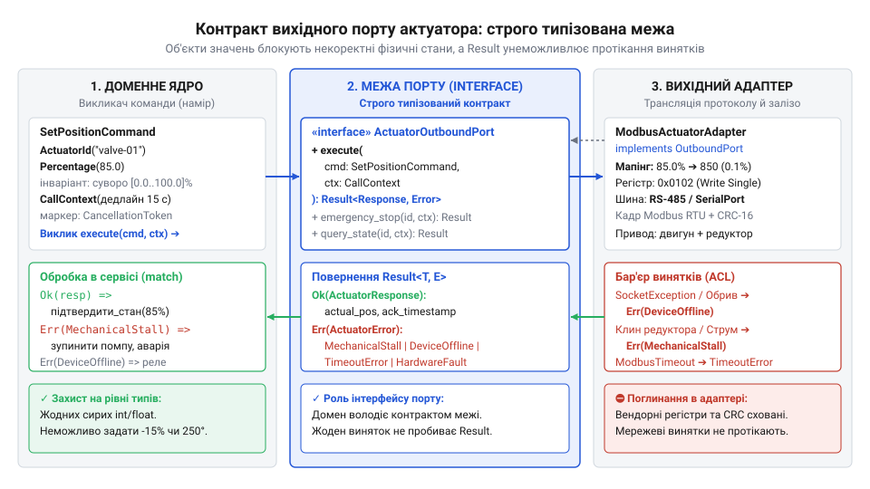
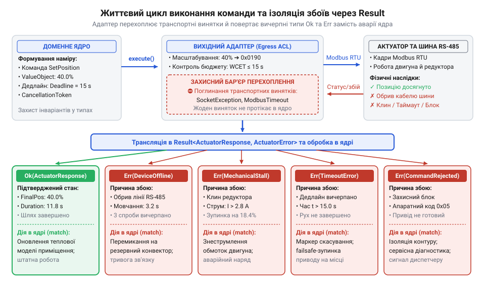

# Довідка програмного інтерфейсу вихідного порту актуатора

## Чому домен не керує залізом напряму

У системі захисту від затоплень та мікроклімату платформи Digital Homes стається важка аварія: доменний сервіс аварійного перекриття води напряму викликає функцію вендорного драйвера клапана, передаючи сирі числові значення `float` і намагаючись вручну перехоплювати транспортні винятки на кшталт `SocketException` чи `ModbusTimeoutException`. Оскільки примітивний тип не захищає інваріантів заліза, обчислювальна похибка передає від'ємний кут або значення поза фізичним сектором. Електропривод намагається довернути шток за межі упору, зрізаючи шестерні редуктора. Водночас механічне заклинювання клапана чи обрив кабелю шини RS-485 блокує всю автоматику будинку ще до повернення помилки. Коли лінію зв'язку відключено, прямий виклик драйвера змушує робочий потік синхронно чекати на відповідь від мовчазного пристрою. Стандартний час очікування разом із серією повторних спроб триває десятки секунд, тримаючи потік зайнятим. Оскільки цей самий потік розбирає чергу команд хаба, уся черга зупиняється. Наступні розпорядження для інших контурів безпеки — від аварійного перекриття газу до знеструмлення ліній — накопичуються в заблокованій черзі без виконання. Коли ж тривалий час очікування вичерпується або заклинений механізм повертає апаратний збій, драйвер викидає непередбачену помилку. Цей неперехоплений виняток пробиває стек викликів і аварійно зупиняє робочий процес усього хаба, паралізуючи всі критичні захисні сценарії будинку.

Така катастрофа виникає через пряме зчеплення бізнес-моделі з апаратурою. Коли домен оперує адресами шин, регістрами пам'яті та мережевими винятками, логіка виявляється інфікованою вендорною специфікою. Виникає та сама вада, коли вихідний [порт підміняють деталями збереження](root:progarch/port-smelling-of-storage), тільки тепер залізо протікає в бізнес-правила через команди керування. Доменне ядро стає беззахисним перед неминучими фізичними відмовами виконавчих пристроїв.

Щоб захистити систему, доменне ядро відокремлюють від апаратури строгою ізолюючою межею. Будь-який виконавчий пристрій — @@la|актуатор@@ (від лат. *actuare* — приводити в дію) — підпорядковують керованому вихідному порту (від англ. @@en|driven port@@, *drive* — приводити в дію, керувати). Порт транслює семантичні бізнес-наміри у фізичні дії: замість сирих чисел він вимагає незмінні об'єкти значень із перевіркою інваріантів на рівні типів, а вихідний адаптер бере на себе транспортні протоколи й повертає типізовані доменні результати замість руйнівних винятків.

## Команди та типізовані об'єкти значень

Коли вихідний порт приймає примітивні типи чисел `int` чи `float`, компілятор не здатний захистити залізо від програмної помилки. Виклик функції з від'ємним кутом повороту, значенням понад 100% або випадковим числовим ідентифікатором безперешкодно проходить компіляцію, але на фізичному рівні спричиняє удар штока в корпус і згоряння обмотки приводу. Примітивне число не має фізичного сенсу: воно не знає допустимих меж і не гарантує валідності наміру.

Щоб унеможливити такі аварії на рівні системи типів, контракт порту оперує виключно незмінними об'єктами значень (від англ. @@en|value object@@, *value* — значення та *object* — сутність, об'єкт). Ідентифікатор `ActuatorId` інкапсулює унікальну адресу виконавчого вузла, унеможливлюючи передачу довільних рядків чи числових індексів чужих шин. Фізичні величини виражаються окремими типами із захистом інваріантів у конструкторі: `Percentage` утримує відсоток відкриття в межах `0.0..100.0%`, `AngleDegrees` обмежує кут повороту дозволеним сектором, а `SwitchState` зводить вибір до станів увімкнено чи вимкнено. Створити екземпляр із некоректним значенням неможливо — невалідний фізичний стан відсікається ще до виклику методу порту.

Об'єкти значень поєднуються у взаємовиключні класи незмінних команд:
— `SwitchCommand` — дискретне перемикання стану пристрою;
— `SetPositionCommand` — позиціонування з передачею `Percentage` чи `AngleDegrees`;
— `CalibrateCommand` — пошук апаратного нуля та скидання енкодера;
— `EmergencyStopCommand` — негайне знеструмлення приводу чи екстрене гальмування.

Кожна команда несе обов'язкові метадані: унікальний `CommandId` для забезпечення @@la|ідемпотентності@@ (від лат. *idem* — той самий та *potens* — здатний) під час повторних викликів і часову мітку виникнення наміру, яка не дозволяє адаптеру виконувати застарілі накази після мережевих затримок. У системі, де [застосунок набуває форми](root:progarch/dh-v2-hexagon) завдяки ізоляції домену, порт приймає лише гарантовано коректні команди.

*Строго типізовані об'єкти значень та незмінні команди захищають виконавчий механізм від позадіапазонних станів ще на етапі компіляції.*

## Дедлайни та маркери скасування операцій

Програмний виклик зазвичай завершується за частки мікросекунди. Однак переміщення штока клапана чи приводу воріт — це інерційний механічний процес, що триває від кількох секунд до пів хвилини. Якщо потік виконання заблокувати на час фізичного руху, сервіс перестане реагувати на події інших сенсорів. Ба більше: якщо під час повільного закриття клапана надходить сигнал тривоги, домен не може чекати завершення операції — системі потрібен спосіб негайно змінити напрямок або зупинити рух.

Тому операції вихідного порту обов'язково приймають контекст виконання `CallContext`. Він об'єднує дві фундаментальні сутності: жорсткий @@en|дедлайн@@ (від англ. @@en|deadline@@, *dead* — мертвий та *line* — лінія, крайній строк) та @@en|маркер скасування@@ (від англ. @@en|cancellation token@@, *cancel* — скасовувати та *token* — знак, ознака).

Дедлайн визначає граничний час очікування. Його обчислюють як верхню межу часу виконання — @@en|WCET@@ (від англ. @@en|worst-case execution time@@, *worst-case* — найгірший випадок та *execution time* — час виконання): суму часу передачі команди шиною, тривалості механічного переміщення та запасу на коливання напруги живлення чи опір середовища. Порт суворо забороняє нескінченне очікування: після вичерпання дедлайну адаптер перериває блокування та повертає помилку тайм-ауту.

Маркер скасування забезпечує кероване асинхронне переривання. Отримавши сигнал скасування, адаптер не може просто закрити з'єднання: важкий механізм продовжить рух за інерцією. Адаптер зобов'язаний негайно припинити подачу імпульсів на двигун і перевести @@la|актуатор@@ у безпечний стан (@@en|failsafe state@@, від англ. @@en|fail-safe@@, *fail* — відмова та *safe* — безпечний) — увімкнути механічне гальмо або знеструмити обмотки. Завдяки цьому скасування операції в коді завжди гарантує фізичну безпеку механізму.

## Семантика Result та типізовані збої

Фізична взаємодія із залізом завжди несе ризик відмови: обрив кабелю чи заклинювання редуктора є штатними подіями зовнішнього світу, а не аварією програми. Якщо методи вихідного порту сигналізують про збої винятками, доменне ядро вимушене залежати від транспортних типів на кшталт `SerialPortException`, `ModbusTimeout` чи `ConnectionReset`. Неперехоплений апаратний виняток пробиває стек викликів і аварійно зупиняє процес хаба.

Щоб зробити кожну гілку завершення явною ще на етапі компіляції, контракт порту спирається на типізований патерн @@en|Result@@ (від лат. *resultare* — випливати як наслідок) у формі `Result<ActuatorResponse, ActuatorError>`. Метод повертає або підтверджений успіх `Ok`, або доменну помилку `Err`, змушуючи бізнес-логіку враховувати обидва варіанти без прихованих збоїв.

Успішна відповідь `ActuatorResponse` фіксує фізичні наслідки операції: підтверджений стан виконавчого пристрою, виконане переміщення та часову мітку квитування від заліза. Можливі ж відмови зведено у вичерпну закриту ієрархію `ActuatorError`:
— `DeviceOffline` — відсутність зв'язку з пристроєм на шині;
— `MechanicalStall` — перевантаження двигуна через опір чи механічне заклинювання. Адаптер виявляє цей стан апаратно за різким стрибком струму споживання приводу або за зупинкою лічильника енкодера попри активну подачу живлення. Це дозволяє негайно знеструмити обмотки для захисту редуктора ще до вичерпання дедлайну;
— `HardwareFault` — апаратна несправність схемотехніки або сенсорів;
— `CommandRejected` — відхилення наказу локальною прошивкою приводу;
— `TimeoutError` — вичерпання дедлайну операції;
— `CalibrationRequired` — збій системи координат енкодера, що вимагає калібрування.

Звідси постає непорушне правило порту: вихідний адаптер зобов'язаний самостійно перехоплювати всі низькорівневі винятки операційної системи й драйверів шин та транслювати їх у типи `ActuatorError`. Жодна протокольна деталь не повинна проникати в домен.

*Вихідний адаптер поглинає низькорівневі винятки шин і транслює фізичні відмови у типізовані гілки Result, захищаючи домен від протікання деталей зв'язку.*

## Специфікація методів та доменні сценарії

Вихідний керований порт `ActuatorOutboundPort` об'єднує типізовані команди, часовий контекст і модель результатів у непорушний контракт доменного ядра. Оскільки [одне ядро](root:progarch/one-core-many-fronts) керує всіма виконавчими пристроями будинку через єдину точку входу, інтерфейс порту складається з трьох детермінованих операцій:
— `execute(command, context)` — застосовує команди зміни фізичного стану (`SwitchCommand`, `SetPositionCommand`, `CalibrateCommand`);
— `query_state(actuator_id, context)` — опитує актуальний стан та координату пристрою без внесення змін;
— `emergency_stop(actuator_id, context)` — виконує безумовну аварійну зупинку чи знеструмлення приводу у найкоротший фізично можливий час.

Кожен метод обов'язково приймає `CallContext` із дедлайном і маркером скасування та повертає контейнер `Result<ActuatorResponse, ActuatorError>`.

У доменному сценарії захисту від аварій сервіс реагує на затоплення: конструює наказ перекриття магістрального крана `SwitchCommand` із дедлайном у `CallContext`, розрахованим за верхньою межею часу руху заслінки. Сервіс викликає `execute()` і розбирає повернену відповідь через зіставлення зі зразком (від англ. @@en|pattern matching@@, *pattern* — зразок та *match* — узгоджувати, зіставляти):
— на гілці `Ok(response)` фіксує перекриття води за квитанцією від заліза;
— на `Err(ActuatorError::MechanicalStall)` фіксує заклинювання редуктора накипом або стороннім предметом, тому запускає резервну помпу відкачування, викликає `emergency_stop()` для захисту мотора від згоряння та сповіщає власника;
— на `Err(ActuatorError::DeviceOffline)` фіксує обрив шини чи знеструмлення крана й переводить систему в тривожний режим.

Такий контракт гарантує, що апаратні відмови опрацьовуються доменною логікою без ризику падіння хаба через неперехоплені винятки.
