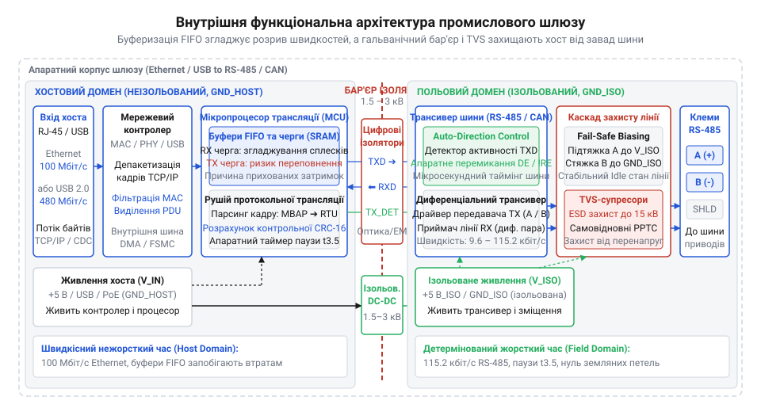
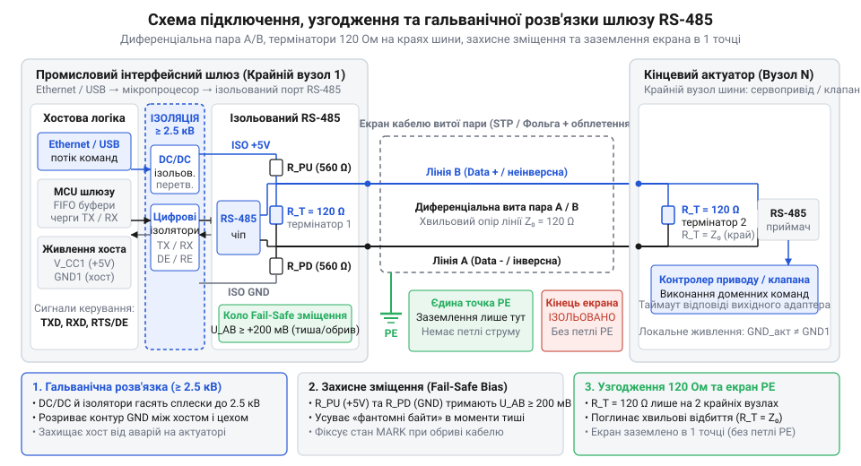

# Промисловий інтерфейсний шлюз польових шин

## Пастка прямого зв'язку з шиною

Коли [вихідний адаптер керування](root:progarch/dh-v2-hexagon) надсилає команду виконавчому пристрою — @@en|актуатору@@ (від англ. @@en|actuator@@, з лат. actus — дія), щоб повернути заслінку чи перекрити клапан, найпростішим кроком здається пряме підключення сервера до лінії зв'язку через COM-порт або дешевий перехідник USB-RS485. Проте операційна система оперує потоком байтів без гарантій жорсткого реального часу. Мережевий стек TCP/IP або диспетчер завдань ядра довільно фрагментує чи склеює байти в системних буферах. Для польових протоколів на кшталт [промислового стандарту Modbus RTU](root:com-protocol/modbus) це фатально: у них межу кадру задає суворий інтервал тиші між байтами щонайменше в 3.5 символи (@@en|t3.5@@). Щойно планувальник ОС перериває процес хоста на кілька мілісекунд, передача розривається. Польовий @@en|актуатор@@ сприймає таку випадкову паузу як кінець пакета, бракує команду через невідповідність контрольної суми й мовчки відкидає запит.

Друга перешкода полягає в напівдуплексному режимі польових шин. Лінія RS-485 передає і приймає дані по одній спільній парі провідників. Щоб уникнути зіткнення сигналів, трансивер мусить увімкнути передавач перед першим бітом кадру й миттєво перейти на прийом після останнього, звільнивши лінію для відповіді. Драйвер віртуального порту на хості не здатний забезпечити такий мікросекундний @@la|арбітраж@@ (від лат. @@la|arbiter@@ — суддя, третейський посередник). Якщо хост затримує перемикання хоча б на мілісекунду, він глушить власним передавачем початок відповіді пристрою; вимикає завчасно — обрізає хвіст власного кадру.

До часових збоїв додається пряма загроза апаратурі. Польові лінії прокладають на десятки й сотні метрів поруч із силовими кабелями, частотними перетворювачами та пускачами двигунів. Без гальванічної розв'язки заземлення сервера виявляється з'єднаним із віддаленою землею розподільчого щита. Різниця потенціалів між точками заземлення споруди створює замкнений контур — земляну петлю. Нею починають текти зрівняльні струми силою в кілька амперів, а високовольтні індуктивні сплески комутації пробивають інтерфейсні чипи та випалюють материнські плати хоста.

Ця протокольна, часова й електрична несумісність робить пряме підключення глухим кутом. Зв'язати дві різні за природою мережі може лише окремий апаратний клас — промисловий інтерфейсний @@de|шлюз@@ (від нім. @@de|Schleuse@@ — запірні ворота, англ. @@en|gateway@@): наприклад, Ethernet-to-RS485 чи USB-to-CAN. Він відокремлює нестабільне середовище хоста від фізичної шини: створює бар'єр гальванічної ізоляції до кількох кіловольт, апаратно бере на себе мікросекундний @@la|арбітраж@@ напрямку передачі та автономно перетворює нерівномірний байтовий потік на вивірені, детерміновані кадри польової лінії.

## Внутрішня анатомія та функціональні вузли

Фізичний шлях сигналу від сервера до польової лінії пролягає крізь чотири взаємопов'язані вузли шлюзу. Спершу хостовий мережевий контролер (Ethernet MAC/PHY або контролер USB) приймає пакети операційної системи й передає їх обчислювальному мікропроцесору. Процесор упорядковує потік у вбудованій пам'яті, де діє @@en|буфер FIFO@@ (від англ. @@en|FIFO@@, скорочення від @@en|first in, first out@@ — першим увійшов, першим вийшов), згладжуючи нерівномірні сплески хостової передачі. Далі потік прямує крізь бар'єр @@en|гальванічної ізоляції@@: ізольований DC-DC перетворювач живить польову частину плати незалежно від джерела сервера, а цифрові ізолятори передають логічні сигнали через ізоляційний зазор, розриваючи земляні петлі та витримуючи перенапруги до кількох кіловольт. На ізольованому боці сигнал потрапляє на шинний @@en|трансивер@@ (від англ. @@en|transceiver@@, зі слів @@en|transmitter@@ — передавач та @@en|receiver@@ — приймач) ліній RS-485 або CAN. Апаратне коло автоматичного керування напрямком (@@en|auto-direction control@@) відстежує передачу бітів і за частки мікросекунди перемикає вихідний каскад між прийомом та передачею, знімаючи з операційної системи хоста завдання напівдуплексного таймінгу.


*Внутрішня архітектура шлюзу: мережевий контролер і мікропроцесор буферизують пакети, гальванічний бар'єр усуває зрівняльні струми, а шинний трансивер автономно керує напівдуплексним перемиканням шини.*

За глибиною внутрішньої логіки та обробки кадрів шлюзи поділяють на два класи. Прозорий послідовний міст (@@en|transparent bridge@@, або raw serial-to-Ethernet) працює як простий ретранслятор: він загортає сирий байтовий потік у пакети TCP або UDP без перевірки їхнього змісту. Міст не знає структури протоколу й не контролює межі повідомлень, тому випадкова мережева затримка чи фрагментація сокета знову розриває польовий кадр. Натомість повноцінний [протокольний шлюз Modbus](root:com-protocol/modbus) бере контроль над протоколом на себе: він розбирає службовий @@en|MBAP-заголовок@@ (від англ. @@en|MBAP@@, скорочення від @@en|Modbus Application Protocol@@ — прикладний протокол Modbus), перевіряє цілісність кадру, генерує та звіряє контрольну суму @@en|CRC-16@@ (від англ. @@en|CRC@@, скорочення від @@en|cyclic redundancy check@@ — циклічна надлишкова перевірка) й апаратно витримує міжсимвольний інтервал тиші @@en|t3.5@@. Завдяки цій автономності [вихідний адаптер керування](root:progarch/dh-v2-hexagon) взаємодіє зі стабільним детермінованим каналом, захищеним від затримок планувальника операційної системи.

## Буфери FIFO та приховані затримки

Помилково вважати, що промисловий шлюз миттєво транслює байти з мережі Ethernet у польову шину. Між хостом і польовим обладнанням лежить прірва швидкостей: хостовий контролер передає пакети на швидкості 100 Мбіт/с або 480 Мбіт/с у разі @@en|USB@@, тоді як лінія @@en|RS-485@@ зазвичай працює в діапазоні від 9600 до 115200 бод. Щоби компенсувати цей розрив, мікропроцесор шлюзу змушений зберігати вхідні кадри у внутрішньому буфері «першим прийшов — першим пішов» (англ. *first in, first out*, @@en|FIFO@@).

Поки хостовий застосунок надсилає поодинокі команди з великими паузами, затримка непомітна. Проте коли сервіс опитування починає масове зчитування регістрів, буфер шлюзу швидко заповнюється. Мережевий контролер приймає пачку запитів за мікросекунди, але в напівдуплексну лінію RS-485 кадри виходять повільно: кожен байт вимагає десятків мікросекунд на серіалізацію, після чого трансивер перемикається на прийом і чекає на фізичну відповідь приводу. У черзі накопичуються мілісекунди очікування, утворюючи приховану апаратну затримку. Її не фіксує мережева карта сервера, але вона стрімко збільшує @@en|джитер@@ (англ. *jitter* — коливання, тремтіння) — розкид часу відгуку, що стрибає від кількох мілісекунд до секунд.

Найгірший сценарій настає при переповненні буфера FIFO. Не маючи вільної пам'яті, шлюз мовчки відкидає вхідні пакети хоста без жодних повідомлень про помилку. Одночасно виникає ефект блокування початку черги (англ. *head-of-line blocking*, від *head of line* — початок черги та *blocking* — перекриття, @@en|head-of-line blocking@@): якщо перший запит у черзі адресований знеструмленому чи пошкодженому @@en|актуатору@@, шлюз багаторазово намагається отримати від нього відповідь у шині, витримуючи апаратні інтервали очікування. Усі наступні команди в буфері — навіть адресовані повністю справним пристроям сусідніх вузлів — виявляються намертво заблокованими, що призводить до повної втрати керованості польовою лінією.

## Розрахунок таймаутів та узгодження адаптера

Коли вихідний адаптер програмного ядра не враховує апаратну буферизацію шлюзу, виникає пастка розсинхронізації, або ковзання відповідей. Припустімо, адаптер надіслав запит A і встановив жорсткий програмний @@en|таймаут@@ (англ. *timeout* — вичерпання часу) у 50 мс. Через накопичення черги у шлюзі відповідь A не встигає повернутися вчасно. Адаптер передчасно фіксує помилку, скидає очікування і відправляє в той самий канал наступний запит B. Тим часом шлюз вичитує запит A з черги, нарешті транслює його в шину й отримує від приводу запізнілу відповідь A. Оскільки в низькорівневих польових кадрах RS-485 немає наскрізних міток транзакцій, шлюз передає хосту відповідь A, а програмний адаптер помилково зіставляє її із запитом B. Відбувається підміна даних: покази датчика температури потрапляють у змінну тиску, а підтвердження зупинки конвеєра інтерпретується як успішний запуск насоса.

Щоб уникнути ковзання, бюджет таймауту повинен покривати повний фізичний маршрут кадру. Він ураховує кругову затримку мережі хост-шлюз `T[net]`, час очікування в черзі шлюзу `T[queue]`, тривалість передачі запиту й відповіді в шині з витримкою інтервалів `t3.5` `T[bus]`, тривалість обробки команди мікроконтролером приводу `T[dev]` та інженерний запас `T[margin]`.

Перед відправленням кадру адаптер обчислює граничний ліміт очікування:

```text
T[timeout]
= T[net] + T[queue] + T[bus] + T[dev] + T[margin]      [бюджет повного циклу транзакції]
```

Цей вираз підтверджує: навіть за нульової затримки мережі `T[net]` час передачі низькошвидкісною лінією та черга шлюзу складають переважну частку витрат.

**Розрахунок робочого таймауту для шини RS-485 на швидкості 9600 бод:**

```text
T[timeout]
= 4 + 0 + 24 + 10 + 20      [підстановка значень у мілісекундах]
= 58 мс                     [підсумок бюджету для порожньої черги]
```

У розрахунку час шини `T[bus]` відповідає двом кадрам по 8 байтів (160 біт на лінії з паузами `t3.5`). Якщо в буфері шлюзу накопичилося лише два попередні запити, доданок `T[queue]` зросте щонайменше на 70 мс, вимагаючи відповідного збільшення таймауту адаптера.

Крім таймінгів, адаптер мусить обробляти протокольні помилки перетворювача. Якщо пам'ять буферів вичерпано, шлюз повертає виняток `0x0A` (Gateway Path Unavailable). Отримавши `0x0A`, адаптер зобов'язаний застосувати експоненційне сповільнення відправлення (англ. *back off* — відступати, @@en|backoff@@), припиняючи перевантаження шлюзу. Якщо ж шлюз виконав передачу в шину, але адресований вузол промовчав, повертається код `0x0B` (Gateway Target Device Failed to Respond). На відміну від втрати зв'язку зі шлюзом, код `0x0B` свідчить про аварію конкретного актуатора: адаптер фіксує збій приводу, не розриваючи транспортного з'єднання з рештою лінії. Розібрати повний перелік діагностичних статусів і специфіку обробки помилок шлюзів та ведених вузлів допоможуть [коди винятків протоколу Modbus](root:com-protocol/modbus).

Для запобігання розсинхронізації у [вихідних адаптерах застосунку](root:progarch/dh-v2-hexagon) запити до однієї послідовної шини суворо серіалізують: новий запит відправляється лише після отримання відповіді на попередній або після повного скидання черги сокета.

## Дворівневий контроль зв'язку та збоїв

Коли програмний адаптер надсилає команди через шлюз, виникає спокуса сприймати мережеве з'єднання як прямий канал до кожного приводу. Відкритий сокет @@en|TCP@@ та успішні відповіді шлюзу на мережевий пінг створюють ілюзію повної справності: система вважає зв'язок надійним, навіть якщо кабель @@en|RS-485@@ фізично перебито, а кінцевий привід знеструмлено. Ще небезпечнішою є зворотна помилка: коли один пошкоджений @@en|актуатор@@ перестає відповідати, наївний адаптер сприймає це як розрив зв'язку і перезапускає сокет шлюзу. Скидання сокета спустошує апаратний буфер @@en|FIFO@@ шлюзу та перериває виконання команд для десятків інших, справних пристроїв на спільній шині. Локальний збій одного вузла спричиняє каскадну відмову (англ. *cascading failure* — лавиноподібне поширення збою, @@en|cascading failure@@) усього польового сегмента.

Щоб локальна аварія не руйнувала загальний обмін, [вихідний адаптер системи](root:progarch/dh-v2-hexagon) розділяє моніторинг на два незалежні автомати станів:

- **Стан каналу транспорту** (англ. *transport link state*, @@en|transport link state@@) контролює виключно з'єднання між хостом і шлюзом. Він відстежує активність сокета, мережеву затримку хост-шлюз та періодичні зондувальні запити (англ. *keep-alive* — підтримка життєдіяльності, @@en|keep-alive@@). Якщо шлюз втрачає живлення або мережевий кабель від'єднано, адаптер фіксує аварію транспорту й маркує недоступним увесь сегмент.
- **Логічний стан пристрою** (англ. *device logical state*, @@en|device logical state@@) ведеться окремо для кожного актуатора на лінії. Він фіксує лічильники помилок контрольної суми @@en|CRC-16@@, послідовні @@en|таймаути@@ транзакцій та специфічні коди винятків (зокрема `0x0B`). Якщо конкретний привід не відповідає, прапор недоступності виставляється лише для нього.

Така ізоляція відмов (англ. *fault isolation* — відокремлення пошкоджень, @@en|fault isolation@@) локалізує збій окремого актуатора без деградації всієї шини. Несправний привід адаптер тимчасово вилучає з черги активного опитування, запобігаючи затримкам і блокуванню лінії, тоді як опитування інших вузлів триває у штатному режимі. Доменне ядро отримує точний доменний статус недоступності конкретного актуатора замість хибного повідомлення про аварію шлюзу, що дозволяє автоматиці продовжувати роботу непошкоджених контурів.

## Схеми підключення, узгодження та граблі

Для [вихідного адаптера керування](root:progarch/dh-v2-hexagon) детермінізм польової шини починається з фізичного монтажу. Лінії @@en|RS-485@@ та CAN передають диференціальний сигнал через виту пару (англ. @@en|twisted pair@@) суворо за топологією спільної шини без випадкових зірок. Електромагнітна хвиля, дійшовши розімкненого кінця кабелю, відбивається назад і накладається на наступні біти кадру, спотворюючи дані. Щоб поглинути енергію хвилі, на двох крайніх вузлах лінії встановлюють узгоджувальні термінатори (від лат. @@la|terminare@@ — обмежувати, класти край, @@en|terminator@@) номіналом 120 Ом, що відповідає хвильовому опору кабелю. Коли обмін припиняється, усі @@en|трансивери@@ переходять у стан високого імпедансу, і лінія залишається без активного потенціалу. Електромагнітні наведення можуть коливати напругу навколо нуля, провокуючи хибний стартовий біт. Цьому запобігає коло захисного зміщення (від англ. @@en|fail-safe@@ — безпечний при відмові та @@en|bias@@ — зміщення, @@en|fail-safe biasing@@): резистори підтяжки лінії A до живлення, а лінії B — до землі утримують різницю потенціалів понад 200 мВ, гарантуючи стійку логічну одиницю в паузах передачі.


*Електричне узгодження шини RS-485: термінатори на крайніх вузлах гасять відбиття хвиль, захисне зміщення стабілізує паузу, а одноточкове заземлення екрана усуває струми земляних петель.*

Польове обладнання живиться від різних розподільчих щитів будівлі з нерівними потенціалами заземлення. Вбудована @@en|гальванічна ізоляція@@ шлюзу (до 1.5–3 кВ) розриває спільне коло, захищаючи напівпровідники від випалювання. При цьому екран кабелю вимагає суворого правила монтажу: його заземлюють виключно в одній точці — на шині захисного заземлення (англ. @@en|protective earth@@, PE) головної шафи керування. Підключення екрана до землі з обох кінців замикає земляну петлю (англ. @@en|ground loop@@), якою починають циркулювати зрівняльні струми силою в кілька амперів, що спотворюють корисний сигнал і руйнують мікросхеми.

Обираючи клас шлюзу під проєктні вимоги, інженер оцінює пропускну здатність процесора черг, кількість незалежних польових портів для ізоляції аварійних ділянок, клас гальванічної ізоляції, підтримку мультимайстерності та резервування каналів живлення й мережі. В експлуатації типовими граблями стають помилкова термінація посередині лінії (що просаджує опір нижче 60 Ом і гасить амплітуду сигналу), підключення приладів довгими бічними відгалуженнями (від англ. @@en|stub@@ — пеньок, відросток, @@en|stubs@@) замість шлейфу, двостороннє заземлення екрана та перегрів пристрою в герметичній шафі без конвекції.
