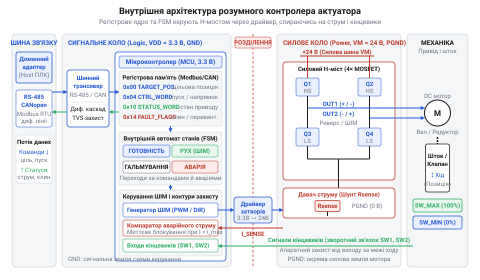
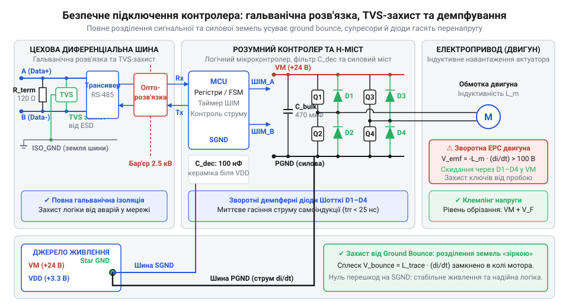

# Розумний контролер актуатора з цифровим шинним інтерфейсом

## Чому приводу потрібен власний контролер

Коли у [гексагональній формі застосунку](root:progarch/dh-v2-hexagon) вихідний адаптер має відчинити вентиляційну заслінку, перекрити кульовий кран опалення чи засунути ригель замка, виникає спокуса прямого керування. Здається простим під'єднати силові транзистори приводу безпосередньо до виводів центрального процесора й перемикати напругу кодом операційної системи. Проте будь-який виконавчий механізм — актуатор (від англ. @@en|actuator@@, з лат. *actuare* — приводити в рух) — підпорядкований законам механіки та електродинаміки, які несумісні з поведінкою загальної ОС.

Планувальник звичайної ОС розподіляє процесорний час між десятками процесів і не забезпечує детермінованого відгуку — жорсткого реального часу (англ. @@en|hard real-time@@). Навіть випадкове витіснення потоку на десятки мілісекунд утворює часове тремтіння — джитер (від англ. @@en|jitter@@ — тремтіти). Нестабільні затримки збивають таймінги широтно-імпульсної модуляції та профілі розгону й гальмування: двигун смикається, пропускає кроки або втрачає крутний момент.

Наслідки програмного зависання ще небезпечніші. Якщо керувальний процес зависне або впаде з помилкою в мить, коли силові ключі відкриті, живлення обмоток не вимкнеться. Двигун рухатиметься до упору, де ротор механічно заклинить, але напруга надходитиме далі. У нерухомому двигуні зникає проти-ЕРС, струм обмоток стрибає до максимального рівня — виникає струм заклинювання (англ. @@en|stall current@@). Без миттєвого апаратного відсікання зусилля вала зрізає шестерні редуктора, а струм короткого замикання за лічені секунди розплавляє ізоляцію та спалює обмотки.

Прямому керуванню заважають і польові лінії зв'язку. Якщо силові ключі стоять у центральному хабі, довгі кабелі до виконавчих механізмів збирають і випромінюють електромагнітні завади від комутації важких індуктивних струмів, а опір лінії спричиняє просідання напруги живлення.

Тому програмне смикання силовими ключами неприпустиме. Контур жорсткого реального часу виносять безпосередньо до механізму в окремий компонент — розумний контролер актуатора. Він локально вимірює струм, за мікросекунди відсікає аварійне перевантаження, стежить за кінцевими вимикачами й керує мотором. Верхній же рівень взаємодіє з ним через надійну цифрову шину, передаючи дискретні високорівневі інструкції та приймаючи структуровану телеметрію.

## Внутрішня анатомія та функціональні вузли

Щоб автономно керувати двигуном і зняти вимоги жорсткого реального часу із зовнішньої системи, розумний контролер @@en|актуатора@@ об'єднує на одній платі чотири функціональні вузли.

Перший вузол — цифровий @@en|шинний трансивер@@ (англ. *transceiver*, від *transmitter* — передавач та *receiver* — приймач). Він перетворює фізичний @@en|диференційний сигнал@@ (лат. *differentia* — різниця) польової шини на послідовний потік логічних рівнів, захищаючи цифрові кола від синфазних завад у довгих лініях зв'язку.

Другий вузол — обчислювальний @@en|мікроконтролер@@. Це локальне ядро пристрою, яке містить @@en|регістрову пам'ять@@ і виконує вбудований @@en|автомат станів@@. Мікроконтролер обробляє кадри зовнішньої шини, оновлює регістри конфігурації, уставок і телеметрії, а також самостійно розраховує траєкторію руху, формуючи імпульси керування для ключів.

Третій вузол — силовий каскад на @@en|польових транзисторах@@, увімкнених за схемою @@en|H-моста@@ (англ. *H-bridge*, за формою літери «H», у перемичці якої стоїть навантаження). Почергове відкриття діагональних пар ключів змінює напрямок струму в обмотці для реверсу, а @@en|широтно-імпульсна модуляція@@ (@@en|ШІМ@@) дозує напругу, регулюючи швидкість і крутний момент.

Четвертий вузол — контур @@en|зворотного зв'язку@@, що фіксує фізичний стан механіки. До нього входять @@en|енкодер@@ (англ. *encoder*, від *code* — код) кута повороту вала, @@en|кінцеві вимикачі@@ крайніх положень та @@en|токовимірювальний шунт@@ (англ. *shunt* — відгалужувати) — низькоомний резистор у силовій шині живлення моста.


*Функціональні вузли контролера: шинний трансивер приймає кадри, мікроконтролер керує станом за регістрами, H-міст комутує живлення, а давачі струму й положення замикають захист безпосередньо на платі.*

Локальне ядро контролера синхронізує ці вузли безперервним апаратним циклом. Сигнал із токовимірювального шунта заведено безпосередньо на внутрішній компаратор мікроконтролера. Коли струм досягає порогу заклинювання або шток тисне на кінцевий вимикач, апаратне переривання гасить імпульси @@en|ШІМ@@ за частки мікросекунди. Це рятує редуктор і обмотки від вигорання ще до того, як зовнішній комп'ютер узагалі дізнається про подію. Керуюча програма взаємодіє з приводом лише через верхньорівневі команди: вона записує цільову уставку в регістр і зчитує готовий стан через @@en|трансивер@@, не втручаючись у мікросекундну комутацію @@en|H-моста@@.

## Регістрова модель та автомат станів

Зовнішній цифровій шині розумний контролер відкривається не набором окремих виводів, а @@la|картою регістрів@@ (від лат. *registrum* — список) у внутрішній пам'яті @@en|мікроконтролера@@. Цей адресний простір логічно поділений на три функціональні зони: конфігурацію, уставки та телеметрію. Регістри конфігурації фіксують жорсткі межі роботи — ліміти струму, максимальну швидкість і прискорення, які софт записує під час ініціалізації приводу. Регістри уставок (англ. @@en|setpoint@@ — задана точка) приймають оперативні наміри: цільову координату вала в імпульсах @@en|енкодера@@ чи кутових градусах, робочу швидкість і біти пуску. Регістри @@el|телеметрії@@ (від грец. *tele* — далеко та *metron* — вимірювати) доступні зовнішньому хосту лише для зчитування: через них контролер повертає фактичне положення штока, виміряний струм @@en|токовимірювального шунта@@ та прапорці діагностики.

Безпосередній рух механіки визначає локальний @@en|автомат станів@@, що синхронізує значення регістрів із сигналами давачів. У стані готовності (англ. @@en|Ready@@ або @@en|Idle@@) силові ключі знеструмлені або очікують пуску, аварійні прапорці очищені, а контролер чекає на запис нової уставки. Щойно софт передає цільову координату, автомат переходить у стан руху (англ. @@en|Moving@@): обчислювач активує @@en|H-міст@@, формує плавний розгін через @@en|ШІМ@@ і безперервно відстежує пройдену відстань за енкодером. Досягнувши цілі, контролер перемикається в стан утримання позиції (англ. @@en|Holding@@): він або подає обмежений струм утримання для опору зовнішньому навантаженню, або закорочує обмотки для електродинамічного стопоріння вала, виставляючи в регістрі статусу біт завершення маневру.

Вирішальна перевага внутрішнього автомата станів полягає в автономній роботі апаратних захистів. Якщо шток затискає перешкода і виникає @@en|струм заклинювання@@, або спрацьовує аварійний @@en|кінцевий вимикач@@ крайнього положення, внутрішній компаратор за частки мікросекунди генерує переривання. Мікроконтролер миттєво переводить ключі H-моста у високоімпедансний стан, повністю знеструмлюючи обмотки мотора ще до того, як від перегріву постраждає ізоляція чи зуби редуктора. Одночасно автомат переходить у стан аварії (англ. @@en|Fault@@ або @@en|Stall@@) і виставляє біт аварійного вимкнення в регістрі статусу телеметрії. Пристрій блокує будь-яке подальше переміщення без жодного очікування вказівок від центрального сервера. Центральна система виявить аварію лише під час чергового опитування регістра статусу шиною, але привід уже фізично захищений, а повторний запуск вимагає усвідомленого скидання біта помилки через регістр керування.

## Узгодження шинних циклів з інерцією

Польова шина зв'язку є пакетним середовищем зі скінченною швидкістю передачі та накладними витратами на службові байти. Програмна система не здатна й не повинна транслювати в лінію неперервний потік мікросекундних імпульсів для кожного кроку мотора: це миттєво вичерпало б пропускну здатність шини. Тому розумний контролер приймає виключно дискретні інструкції нового цільового стану: кінцеву координату й бажану швидкість. Локальний обчислювач самостійно розгортає цю високорівневу уставку в неперервний @@en|профіль руху@@ (англ. @@en|motion profile@@), генеруючи мікрокроки апаратно.

Така архітектура робить динаміку керування дискретною в часі. Загальна затримка реакції приводу `t_delay` від виникнення наміру в софті до подачі напруги на обмотки мотора складається з часу очікування вікна опитування `t_wait`, тривалості передачі кадру шиною `t_tx` та часу обробки команди @@en|мікроконтролером@@ `t_cpu`:

```
t_delay
= t_wait + t_tx + t_cpu          [сума складових шинного циклу]
```

Оскільки центральний вузол зв'язку опитує підлеглі пристрої циклічно з @@en|періодом опитування@@ (англ. @@en|polling period@@) `T_poll`, очікування вікна передачі сягає тривалості повного циклу (`t_wait ≤ T_poll`). Через це актуатор стартує із затримкою у десятки мілісекунд після команди програми, а показники телеметрії в регістрах відображають фізичний стан не неперервно, а квантованими зрізами з відставанням на один шинний інтервал.

Звідси випливає критичний архітектурний принцип: зовнішній [вихідний адаптер](root:progarch/dh-v2-hexagon) зобов'язаний узгоджувати темп відправлення команд із фізичною інерцією механіки. Ротор, шестерні редуктора й виконавчий шток мають власну масу, тому переміщення між точками фізично вимагає фіксованого часу на розгін, рівномірний рух і гальмування.

Якщо адаптер у швидкому програмному циклі бомбардуватиме контролер новими уставками швидше за цю механічну динаміку, система аварійно руйнується. Спроба змінити завдання до завершення попереднього маневру спричиняє механічний @@en|зрив кроків@@ ротора, який не встигає за стрибкоподібним зміщенням магнітного поля статора. Примусове гальмування ротора на ходу змушує ключі @@en|H-моста@@ комутувати важкі струмові перехідні процеси, що перегріває силовий каскад і викликає хибне спрацьовування апаратного струмового захисту. До того ж мікроконтролер переповнює вхідний @@en|шинний буфер@@, витрачаючи процесорний час на парсинг надлишкових пакетів замість плавного розрахунку форми @@en|ШІМ@@. Зовнішній адаптер зобов'язаний надсилати нову цільову уставку лише тоді, коли привід досяг попередньої цілі й перейшов у стан готовності, або суворо дозувати оновлення з огляду на інерційний час відгуку заліза.

## Безпечне підключення та електричний захист

Під час монтажу розумного контролера найбільша небезпека полягає у змішуванні силових кіл двигуна з цифровою логікою. Комутація обмоток мотора супроводжується імпульсними струмами в одиниці або десятки амперів із крутими фронтами наростання `di/dt`. Якщо силова частина та чутлива електроніка ділять спільний зворотний провідник, паразитна індуктивність та опір дроту породжують різкий сплеск напруги. Виникає @@en|ground bounce@@ (від англ. *ground* — земля та *bounce* — відскок; стрибок потенціалу землі): потенціал внутрішньої сигнальної землі раптово підскакує вгору відносно зовнішніх ліній. Цей перепад виводить напругу за межі абсолютного максимуму логічних входів і випалює @@en|мікроконтролер@@ та @@en|шинний трансивер@@.

Розпіновка на клемнику пристрою спеціально розділяє вразливі контури: силове живлення мотора (`V_PWR`, `PGND`) підключають окремою парою товстих дротів від силового джерела, а чутливу цифрову логіку (`V_LOGIC`, `GND`) та шину — від стабілізованого живлення. Щоб запобігти утворенню @@en|земляних петель@@ (англ. @@en|ground loop@@), землі `PGND` та `GND` у жодному разі не закорочують на клемнику, а з'єднують суворо в одній спільній точці — «зіркою» безпосередньо біля джерела живлення.


*Безпечна схема підключення контролера: розділені силові й сигнальні землі запобігають стрибкам потенціалу, гальванічна розв'язка та TVS-діоди захищають шину, а демпферні діоди гасять індуктивні викиди двигуна.*

Щоб відкинути різницю потенціалів між віддаленими вузлами в польових умовах, лінії даних підключають через @@it|гальванічну розв'язку@@ (від імені італ. фізика Луїджі Гальвані; англ. @@en|galvanic isolation@@). Цифрові ізолятори або оптопари з ізольованим DC-DC перетворювачем фізично розривають провідний контакт між польовою шиною та мікроконтролером, виключаючи вирівнювальні струми.

Друга критична загроза — магнітна енергія обмоток двигуна. У момент закриття транзисторів @@en|H-моста@@ струм через індуктивність не може зникнути миттєво, утворюючи високовольтний викид — @@uk|зворотну ЕРС@@ (від електрорушійна сила; англ. @@en|back-EMF@@). Її напруга в рази перевищує напругу живлення і здатна пробити напівпровідникові переходи ключів. Для безпечного скидання цієї енергії паралельно кожному ключу встановлюють швидкі демпферні діоди (від нім. *dämpfen* — глушити; @@en|flyback diodes@@), які повертають струм самоіндукції в лінію живлення.

Зовнішній захист диференційної пари завершують напівпровідникові @@la|супресори@@ (від лат. *supprimere* — придушувати; @@en|TVS-діоди@@) та узгоджувальний резистор. TVS-діоди миттєво відкриваються при електростатичних розрядах і скидають перенапругу на заземлений корпус, а термінальний резистор (від лат. *terminus* — межа; @@la|термінатор@@) 120 Ом на кінцях шини поглинає відбиття електромагнітної хвилі.

## Критерії вибору та інженерні граблі

На принциповій схемі автоматики розумний контролер @@en|актуатора@@ вирізняється поєднанням @@en|шинного трансивера@@, цифрового ядра та силових ключів двигуна. Помилка у виборі пристрою руйнує систему: слабкий драйвер згорить під навантаженням, а невідповідний мотор зірве синхронізацію руху. Для простих приводів достатньо @@la|колекторних двигунів@@ (від лат. *collector* — збирач; англ. @@en|brushed DC@@), керованих одним @@en|H-мостом@@. Фіксація точних кутів без давачів вимагає двофазних @@en|крокових двигунів@@ (англ. @@en|stepper@@, від *step* — крок), а висока швидкість і ресурс потребують @@en|безколекторних двигунів@@ (англ. @@en|BLDC@@, від *brushless DC*) із трифазною комутацією ключів. За структурою контуру пристрої поділяють на розімкнені (англ. @@en|open-loop@@ — розімкнена петля), де контролер видає кроки наосліп, та замкнені (англ. @@en|closed-loop@@ — замкнена петля; @@en|сервопетля@@), де @@en|мікроконтролер@@ через @@en|енкодер@@ у реальному часі компенсує відставання вала й усуває @@en|зрив кроків@@.

Інженерний вибір пристрою визначає компроміс між швидкістю, точністю, утримуючим моментом і бюджетом живлення. Вентиляційні шибери чи запірні клапани вимагають повільного руху з великим зусиллям через редуктор, де критично тримати положення. @@en|Кроковий двигун@@ забезпечує високий момент утримання в стані @@en|Holding@@, проте постійно споживає повний струм і гріється у спокої. Черв'ячна передача з @@la|колекторним двигуном@@ фіксує шток механічно без витрат енергії, але поступається в плавності. Коли ж задача потребує високої динаміки за суворого ліміту живлення, обирають @@en|безколекторний двигун@@ із замкненою @@en|сервопетлею@@, який дозує струм точно під поточне навантаження.

Навіть бездоганно обраний контролер створює аварії через типові інженерні граблі монтажу й експлуатації. Перша проблема — просідання живлення (англ. @@en|brownout@@ — спад напруги): пусковий струм мотора створює падіння напруги на довгих підвідних дротах, через що живлення логіки просідає нижче критичної межі, викликаючи циклічний перезапуск @@en|мікроконтролера@@. Друга загроза — перегрів: у закритих шафах керування без тепловідведення ключі розсіюють потужність і швидко провокують аварійне теплове вимкнення. Третя пастка — обрив лінії зв'язку: якщо в конфігурації вимкнено @@en|сторожовий таймер шини@@ (англ. @@en|bus watchdog@@, від *watch dog* — сторожовий пес), при втраті пакетів контролер безконтрольно продовжує рух за старою уставкою, ламаючи механічні упори. Нарешті, механічні люфти й мікропроковзування поступово накопичують похибку положення, тому система вимагає регулярного калібрування в нуль (англ. @@en|homing@@, від *home* — дім; вихід у нуль) по @@en|кінцевих вимикачах@@ після кожного старту та скидання.
