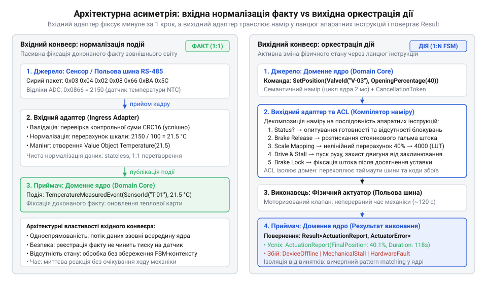
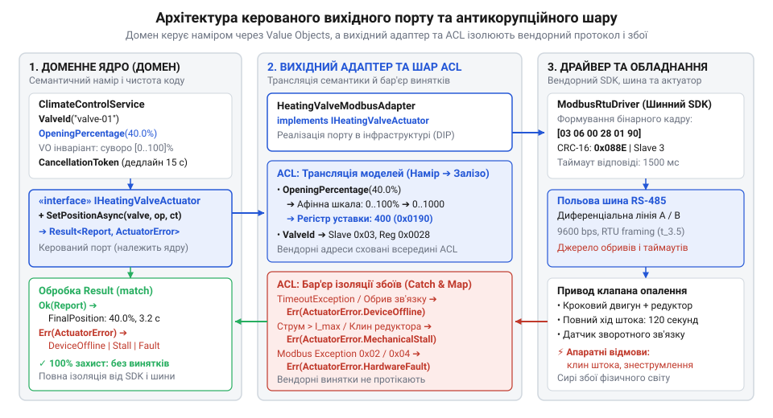
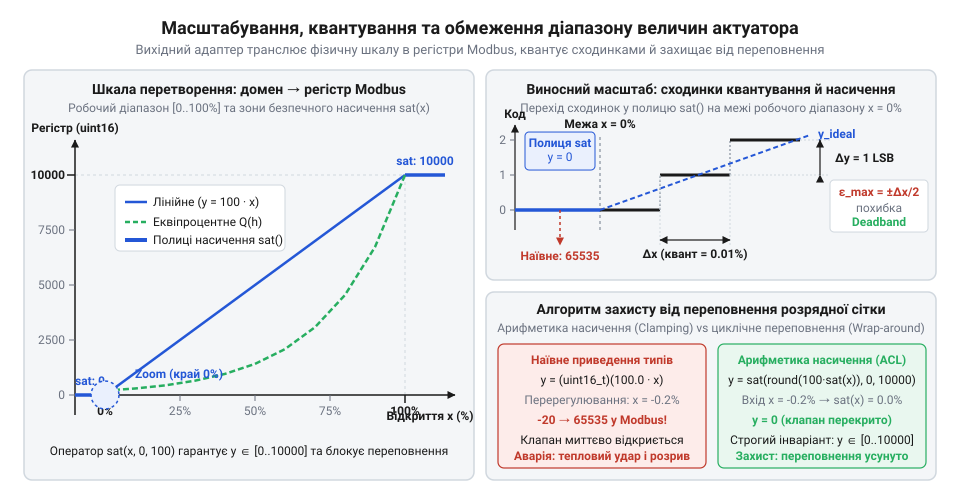
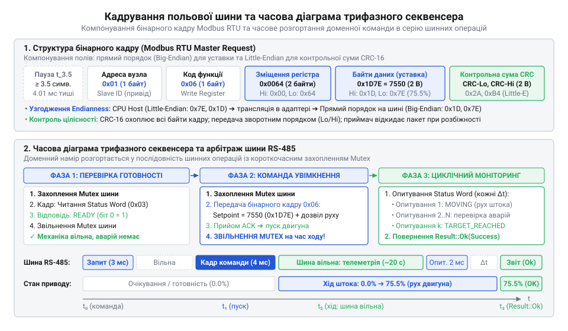
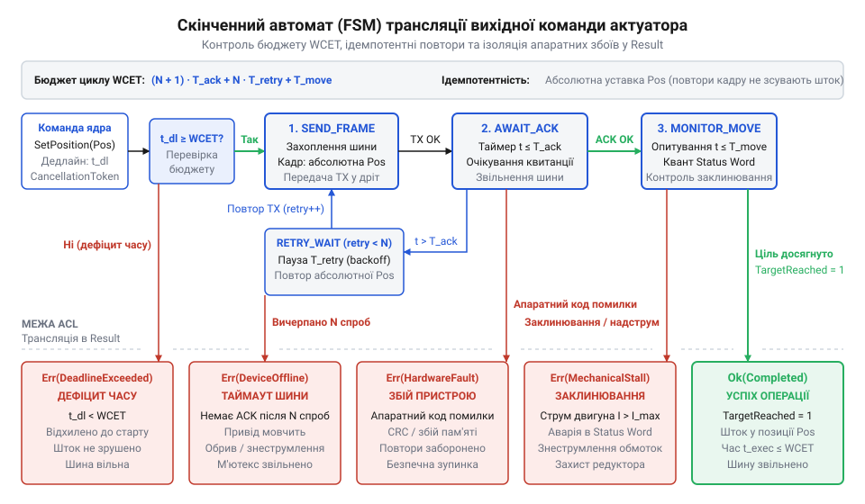

# Трансляція доменних команд у протоколи актуаторів

## Пастка прямої серіалізації доменних команд

Кімната на північному боці будинку стрімко охолоджується, і служба мікроклімату платформи Digital Homes ухвалює просте доменне рішення: збільшити подачу теплоносія, встановивши опалювальний клапан на 40% пропускної здатності. Якщо розробник звик до веброзробки, де мережевий адаптер лише перетворює сутність у JSON для зовнішнього REST API, виникає спокуса вчинити так само й з апаратурою: передати число 40 напряму драйверу або змусити доменний сервіс записати його у відповідний регістр пристрою. Здається, що різниця полягає лише в транспорті: замість HTTP-запиту відправляється бінарний пакет польової шини. Проте фізичний світ влаштований інакше.

У наївній реалізації доменний сервіс тримає пряме посилання на шинний шлюз і сам оперує апаратною адресацією:

```csharp
// Наївне керування: доменне ядро прив'язане до конкретних регістрів пристрою
public class ClimateControlService
{
    public void RegulateHeating(DeviceId valveId, int targetPercent)
    {
        _modbusGateway.WriteSingleRegister(
            slaveAddress: 0x03,
            registerAddress: 0x0028,
            value: (ushort)targetPercent
        );
    }
}
```

Такий підхід успішно працює на стенді, але зазнає краху за першої ж заміни обладнання на об'єкті. Коли штатний клапан виходить з ладу, монтажники встановлюють доступний аналог іншого виробника. Новий прилад також підтримує протокол [Modbus RTU](root:com-protocol/modbus), але його внутрішня логіка інверсна: нуль відповідає повному відкриттю штока, а число 1000 — повному перекриттю. До того ж його цифро-аналоговий перетворювач очікує сітку 0–1000 замість звичних 0–100%. Отримавши від доменного сервісу число 40, новий механізм сприймає його не як 40% тепла, а відкривається лише на 4%, через що кімната промерзає. Гірше того: колишня адреса пам'яті `0x0028` у новій прошивці відсутня. Прилад повертає апаратну помилку `0x02`, шина RS-485 зависає на три секунди в очікуванні відповіді, а сирий виняток драйвера пробиває стек викликів і валить усе доменне ядро. Типовою спробою тимчасового виправлення стає впровадження розгалуження `if/else` за моделлю пристрою безпосередньо в доменний код: для нового клапана на місці інвертують розрахунок, масштабують сітку та підставляють нову адресу регістру. Проте такий крок лише поглиблює вендорне зчеплення: замість ізоляції доменне ядро накопичує знання про апаратні ревізії, чужі формати даних і номери регістрів. З кожною наступною заміною обладнання чи зміною прошивки доменні сервіси обростають новими гілками умов, перетворюючи чисту бізнес-логіку на крихкий каталог апаратних винятків.

Причина аварії полягає в підміні понять: вихідну дію сприйняли як просту серіалізацію даних. У типових інформаційних системах вихідний адаптер транслює сутність у документ, де кожне поле зберігає своє значення. Проте фізичний @@la|актуатор@@ (від лат. *actuare* — приводити в дію) не зберігає бізнес-даних — він перетворює керівний сигнал на механічний рух. @@la|Актуатор@@ нічого не знає про відсотки комфорту чи бізнес-правила мікроклімату: він оперує виключно регістрами пам'яті, кроками двигуна, калібрувальними кривими та байтовими зміщеннями. Якщо доменні класи починають знати про номери регістрів або часові інтервали шини, бізнес-логіка виявляється інфікованою вендорними деталями. Це прояв тієї самої вади, що й [порт, що пахне сховищем](root:progarch/port-smelling-of-storage), тільки тепер залізо протікає в бізнес-правила через вихідні команди.

Ця криза несумісності добре знайома промисловій інженерії: у 1980–1990-х роках під час так званих [війн польових шин](root:progarch/dh-egress-actuator-protocol-mapping/hist-opc-standardization-and-fieldbus-isolation.md) диспетчерські програми SCADA писали напряму під закриті протоколи конкретних виробників, через що заміна звичайного виконавчого механізму вимагала повної переробки бізнес-логіки системи. Проблему подолали лише тоді, коли створили виділений шар стандартизованих серверів пристроїв, які повністю відділили намір диспетчера від протоколу фізичної шини.

Щоб захистити систему від подібних аварій, вихідний потік команд вимагає повноцінного перекладу семантики. Доменне ядро повинно висловлювати лише чистий намір — наприклад, перевести привід у стан «відкрито на 40%» із зазначенням допустимого дедлайну. Перетворення цього наміру на послідовність бінарних інструкцій, перерахунок шкал, узгодження адресації та безпечне перехоплення апаратних збоїв бере на себе виділений @@en|вихідний адаптер@@ (від англ. *egress adapter*, лат. *egressus* — вихід). Його серцевиною стає [антикорупційний шар](root:sf-apps/anti-corruption-layer) (від англ. *anti-corruption layer*, @@en|ACL@@, лат. *corruptio* — псування), який ізолює домен від чужорідної вендорної моделі, перетворюючи специфічні коди помилок апаратури на передбачувані бізнес-результати.

## Семантичний намір проти фізичних інструкцій

У класичній гексагональній архітектурі вхідні та вихідні адаптери виглядають оманливо симетричними: обидва розташовані на межі шестикутника і з'єднують ядро із зовнішнім середовищем. Через цю графічну подібність легко припустити, що їхні завдання дзеркальні: якщо вхідний адаптер розпаковує мережевий пакет у доменну подію, то вихідний нібито має лише перетворити команду на зворотний пакет. Проте за зовнішньою симетрією портів криється фундаментальна асиметрія фізичного світу.

Вхідний адаптер обслуговує потік спостереження: він здійснює [трансляцію подій сенсорів](root:sf-apps/ingress-sensor-event-translation), фіксуючи зміни середовища. Датчик виміряв температуру повітря, перевів напругу в цифровий код і відправив кадри польовою шиною. Отримана інформація — доконаний факт матеріального світу: у приміщенні вже є 21.5 °C незалежно від стану нашої програми. Завдання вхідного адаптера суто пасивне: перевірити цілісність кадру, перерахувати апаратні відліки у градуси Цельсія та зафіксувати подію в доменному ядрі. Реєстрація факту не чинить зворотного тиску на датчик і не здатна пошкодити його механіку.

Вихідний потік має протилежну природу: це не спостереження за минулим, а примусова зміна майбутнього. Коли доменний сервіс вирішує встановити положення клапана на 40%, він формулює @@gr|семантичний@@ (від грец. *semantikos* — значущий) намір — опис бажаного кінцевого стану. Бізнес-ядро не знає деталей виконавчого механізму й не оперує фазами обмоток, часом комутації реле чи струмовими петлями. Механічний привод не здатний стати сорокавідсотковим миттєво. Щоб втілити бажання ядра в рух металу, @@en|вихідний адаптер@@ виступає компілятором наміру, який розкладає одну декларативну команду на імперативну послідовність дій.


*Архітектурна асиметрія потоків даних: вхідний адаптер нормалізує доконаний факт зовнішнього світу, тоді як вихідний адаптер оркеструє активну зміну фізичного стану через послідовність низькорівневих операцій.*

Щоб змінити положення штока клапана, @@en|вихідний адаптер@@ не може обмежитися відправкою одного числа в порт. Спершу він опитує регістр стану пристрою, щоб переконатися в наявності живлення та відсутності захисного блокування. Далі адаптер надсилає команду розтискання стоянкового гальма, яке утримує шток від зміщення під тиском теплоносія. Якщо привод втратив координати після перезапуску, адаптер ініціює калібрувальне вирівнювання за нульовим кінцевим вимикачем. Лише після цього він розраховує тривалість подачі напруги або кількість кроків двигуна й запускає переміщення, одночасно вимірюючи струм обмоток для виявлення механічного заклинювання штока. Коли датчик положення підтверджує досягнення цілі, адаптер знову блокує гальмо та повертає в ядро структурований доменний результат.

Ця багатоетапна процедура зумовлена тим, що адаптер узгоджує дві принципово різні шкали часу. Доменне ядро працює в дискретному часі процесора, де бізнес-рішення ухвалюються за мікросекунди, а робочий цикл керування триває лише 2 мілісекунди. Фізичний @@la|актуатор@@ підпорядкований неперервному часу механіки: повний робочий хід штока моторизованого клапана опалення зазвичай триває близько 120 секунд через високе передавальне число редуктора та вимогу плавного руху для захисту труб від гідравлічних ударів. За час, потрібний механізму для одного повного переміщення, процесор устигає завершити 60 000 доменних циклів — прірва між часовими доменами сягає п'яти порядків величини. Розгін масивних вузлів, подолання сили тертя та плавне гальмування потребують десятків секунд, а польова шина зв'язку накладає жорсткі обмеження на частоту звернень. Без адаптера, що бере на себе цей асинхронний розрив, пряме керування призводить до краху: синхронне очікування приводу заблокувало б ядро на дві хвилини й позбавило систему реактивності, а надсилання нових намірів на кожному 2-мілісекундному такті переповнило б чергу шини та зламало б шестерні редуктора.

Подібне архітектурне розділення випробуване десятиліттями експлуатації критичних систем: в авіоніці під час впровадження [електродистанційного керування польотом](root:progarch/dh-egress-actuator-protocol-mapping/hist-fly-by-wire-actuator-decoupling.md) механічний зв'язок між пілотом і рульовими поверхнями замінили цифровими шинами даних. Бортові комп'ютери обчислюють високорівневий польотний намір — кутові швидкості й коефіцієнт підйомної сили, — а безпосередній рух штоків гідроприводів оркеструють спеціалізовані блоки керування актуаторами. Обчислювальне ядро літака повністю ізольоване від фізики приводів, що гарантує стійкість до апаратних збоїв ліній зв'язку без краху системи керування.

## Проєктування чистого вихідного порту керування

Коли доменному сервісу потрібно віддати команду виконавчому механізму, виникає спокуса оголосити простий інтерфейс із примітивними типами — наприклад, `void SetValveOpening(int valveId, float percent)`. Такий підхід здається лаконічним, але створює три критичні дефекти на межі домену. По-перше, примітивне число не захищає власні межі: метод технічно прийме значення -50% чи 999.0%, які фізично неможливі для клапана. Якщо перекласти валідацію на драйвер, доменне ядро втратить контроль над власними інваріантами. По-друге, метод приховує часову природу фізичного світу. Переміщення масивного штока триває десятки секунд; якщо за цей час виникла пожежна тривога або система мікроклімату змінила режим, вихідну операцію потрібно негайно скасувати. По-третє, повернення типу `void` ігнорує ненадійність середовища: будь-який транспортний збій призведе до того, що сирий мережевий виняток проб'є межу ядра.

Щоб усунути ці вади, доменне ядро формулює керований вихідний порт (від англ. @@en|driven port@@, *drive* — приводити в дію, керувати). Контракт порту належить виключно домену та оперує лише його типами. Замість сирих чисел порт вимагає строго типізований об'єкт значення (англ. @@en|value object@@) — наприклад, `OpeningPercentage`. Він інкапсулює бізнес-інваріант ще в момент власного створення, гарантуючи допустимий діапазон від 0 до 100% і відсікаючи хибні команди до їхнього виходу з ядра. Приватний конструктор унеможливлює створення об'єкта в обхід правил, а статичний фабричний метод відсікає будь-які аномальні значення ще на етапі ініціалізації:

:::code dh-egress-actuator-protocol-mapping-d/cs/openingpercentage.cs

Якщо аргумент є нечисловим значенням (`double.IsNaN`) або виходить за допустимі межі, фабрика повертає типізовану помилку, тому об'єкт із фізично некоректним станом у принципі не може виникнути в пам'яті. Завдяки цьому вихідному порту більше не потрібні захисні перевірки діапазону: сама наявність типу `OpeningPercentage` гарантує валідність величини за власною побудовою. Для керування часом операції контракт приймає маркер скасування (англ. @@en|cancellation token@@), який передає дедлайн виконання. Замість винятків або повернення порожнього типу `void`, що ігнорує ненадійність середовища, порт повертає патерн результату (англ. @@en|result pattern@@) — типізовану обгортку `Result<ActuationReport, ActuatorError>`. У разі штатного виконання операції доменне ядро отримує не формальне підтвердження, а деталізований доменний звіт `ActuationReport`. Він фіксує об'єктивні наслідки дії у матеріальному світі: фактично досягнуте положення штока (`FinalPosition`), яке через механічний люфт чи крок апаратної сітки може відхилятися від уставки, та реальну тривалість маневру (`Duration`), за якою сервіс моніторингу виявляє зношення редуктора й зростання тертя задовго до аварії. У разі збою результатом стає строго закрита ієрархія доменних помилок `ActuatorError`, організована як абстрактний запис із приватним конструктором і фіксованим переліком запечатаних підтипів: `DeviceOffline` (із тривалістю мовчання шини), `MechanicalStallDetected` (із координатою зупинки та зафіксованим моментом опору) і `HardwareFault` (із діагностичним повідомленням про внутрішню відмову електроніки). Завдяки такій замкненості типів доменний сервіс опрацьовує результат через вичерпне зіставлення зразків (від англ. @@en|pattern matching@@, *pattern* — зразок, *match* — зіставляти): конструкція `switch (result)` аналізує всі можливі наслідки без ризикованої гілки за замовчуванням (`default`). Зіставивши результат зі зразками, бізнес-сервіс виконує точні дії: на звіт `ActuationReport` оновлює теплову модель кімнати; на помилку `DeviceOffline` перемикає обігрів на резервний конвектор замість падіння всього процесу через сирий виняток таймауту; на `MechanicalStallDetected` негайно надсилає команду знеструмлення, захищаючи обмотки заклиненого двигуна від перегорання, і реєструє аварійний наряд; а на `HardwareFault` надійно ізолює пошкоджений контур. Якщо в майбутньому контракт порту поповниться новим класом апаратних відмов, компілятор негайно вимагатиме додати відповідну гілку в кожен доменний сервіс, унеможливлюючи приховане ігнорування аварійного стану.

```csharp
// Чистий контракт вихідного порту в доменному ядрі
public interface IHeatingValveActuator
{
    ValueTask<Result<ActuationReport, ActuatorError>> SetPositionAsync(
        ValveId valveId,
        OpeningPercentage targetOpening,
        CancellationToken cancellationToken
    );
}
```


*Архітектурна схема керованого вихідного порту (Driven Port) та антикорупційного шару: доменне ядро повністю ізольоване від вендорних SDK, адрес регістрів і транспортних винятків.*

Реалізація цього порту розташована за межами домену — у шарі інфраструктури. Її ядром виступає @@en|вихідний адаптер@@, який містить @@en|ACL@@. Антикорупційний шар виконує двосторонній переклад: на вході він транслює доменний `OpeningPercentage` у вендорні структури драйвера — номери регістрів або бінарні кадри, — а на виході перехоплює всі технічні збої транспорту. Якщо обірвано кабель польової шини або пристрій повернув апаратний код несправності, адаптер не кидає системних винятків, а перетворює збій на типізовану помилку `ActuatorError`. Домен отримує передбачуваний бізнес-статус і може зреагувати на нього переходом на аварійний контур обігріву.

Така організація порту робить домен повністю незалежним від фізичного обладнання. Повні сигнатури методів та структуру контрактів визначає [програмний інтерфейс вихідного порту](root:progarch/dh-egress-actuator-protocol-mapping/api-actuator-outbound-port.md), закріплений у специфікації платформи. Якщо монтажники замінять клапан Modbus на аналог із протоколом BACnet чи бездротовим керуванням, доменний код не зазнає жодних змін: достатньо розгорнути новий адаптер із новим антикорупційним шаром.

## Масштабування величин та похибки квантування

Коли доменне ядро передає команду встановити положення штока клапана на 75.5 %, воно оперує неперервним числом із рухомою комою в @@en|value object@@. Виконавчий механізм на польовій шині не знає про відсотки: контролер приводу сприймає виключно цілі числа в регістрі — наприклад, шістнадцятибітні значення від 0 до 10000 або дискретні відліки напруги. Якщо @@en|egress adapter@@ спробує наївно помножити дріб на коефіцієнт або просто відкинути десяткову частину, система неминуче зіткнеться з двома збоями: спотворенням фізичного процесу регулювання та апаратним переповненням пам'яті.

Пряме узгодження шкал виконує афінне перетворення (лат. *affinis* — споріднений; @@en|affine mapping@@) — лінійне відображення відрізка доменних значень на відрізок значень регістра. Для збереження пропорцій цільове значення регістра `R` у діапазоні `[R_min, R_max]` розраховують із поточної доменної величини `D` через відношення до ширини вхідного інтервалу `[D_min, D_max]`:

```
R
= R_min + (D - D_min) · (R_max - R_min) / (D_max - D_min)    [лінійна пропорція]
```

Отримане дійсне число округлюють до найближчого цілого, що дає точну дискретну уставку для пристрою.

Проте математично коректна пропорція ламається на межах діапазону. Через накопичення похибок у регуляторі або коливання вимірювань доменна модель здатна видати уставку, що формально виходить за край: наприклад, `-0.2 %` чи `100.1 %`. Якщо передати ці числа у формулу без попередньої перевірки, беззнаковий шістнадцятибітний регістр переповниться й спричинить числовий перекрут (англ. *integer overflow*): значення `100.1 %` скинеться в мінімум, а `-0.2 %` перетвориться на 65535. У контурі опалення це означає раптове повне відкриття або перекриття потоку. Щоб унеможливити таку аварію, адаптер застосовує обмеження діапазону (англ. *clamp* — затискач; @@en|clamping@@): будь-яка величина, менша за `D_min`, насичується до мінімальної межі, а більша за `D_max` — до максимальної ще до початку розрахунку регістра. Проте навіть усередині дозволеного діапазону на розробника чекає пастка проміжного переповнення (англ. *intermediate overflow*), коли масштабування виконують у цілочисельній арифметиці. Аби уникнути втрати точності через цілочисельне ділення (яке одразу зрізало б дріб до нуля), множення в чисельнику `(D - D_min) · (R_max - R_min)` завжди проводять до операції ділення. Якщо цей проміжний добуток обчислювати у шістнадцятибітній розрядності цільового регістра, то для штатної уставки 75 % число `75 · 10000 = 750000` вийде за межу 65535: процесор скине переповнені розряди, залишивши 29104, і після ділення на 100 актуатор замість очікуваного значення 7500 отримає код 291, тобто клапан хибно закриється до 2.91 %. Тому антикорупційний шар адаптера зобов'язаний розширювати розрядність чисельника до 32 або 64 бітів ще до виконання ділення, або виконувати розрахунок у числах із рухомою комою перед фінальним округленням.

Однак лінійної математики недостатньо, якщо сам виконавчий механізм нелінійний. Регулювальні клапани теплопостачання мають еквіпроцентну характеристику (лат. *aequalis* — рівний; @@en|equal percentage@@): однаковий приріст ходу штока викликає однаковий відсотковий приріст пропускної здатності від її поточного значення. Якщо шток відкритий лише на 10 %, переміщення ще на 10 % змінює тепловіддачу незначно, тоді як ті самі 10 % біля повного відкриття спричиняють лавиноподібне зростання потоку теплоносія. Якщо домен прагне лінійно керувати тепловою потужністю, [антикорупційний шар адаптера](root:sf-apps/anti-corruption-layer) змушений компенсувати фізику клапана зворотною логарифмічною функцією, перетворюючи лінійний намір бізнесу на нелінійну криву переміщення приводу. Якщо пряма пропускна здатність регулювального органа залежить від відносного ходу штока `h` (від 0.0 у закритому стані до 1.0 при повному відкритті) за експоненційним законом `u = R_v^(h - 1)`, де `R_v` — діапазон регулювання клапана (англ. *range* — розмах; @@en|rangeability@@, відношення найбільшої регульованої витрати до найменшої, зазвичай від 25 до 50), то для бажаної відносної частки теплової потужності `u` цільове положення приводу `h` розраховують через натуральний логарифм `ln`:

```
h
= 1 + ln(u) / ln(R_v)    [обернення експоненціальної характеристики клапана]
```

Цей вираз компенсує спадну тепловіддачу радіатора: на малих уставках шток клапана переміщується на значно більшу відстань, ніж біля повного відкриття, вирівнюючи загальну чутливість контуру. Проте на краях шкали неперервна математика ламається: якщо домен задає витрату `u`, меншу за фізичний поріг керованості `1 / R_v` (для `R_v = 50` це 0.02, тобто 2 %), логарифм видає від'ємне значення `h < 0`, а в нулі взагалі прямує до мінус нескінченності. Тому антикорупційний шар спершу застосовує насичення: за будь-якої уставки `u ≤ 1 / R_v` привід безумовно переводиться в нульове положення `h = 0`, надійно відсікаючи зону паразитного витоку. Попри математичну строгість формули, безпосереднє обчислення трансцендентного логарифма на польовому рівні коштує занадто дорого. Апаратні мікроконтролери у складі [розумних контролерів актуаторів](root:progarch/dh-egress-actuator-protocol-mapping/comp-smart-actuator-controller.md) зазвичай позбавлені апаратного співпроцесора чисел із рухомою комою (англ. @@en|floating-point unit@@, @@en|FPU@@). Програмна емуляція функції `ln` у бібліотеках мов C чи C++ займає сотні процесорних тактів, породжує коливання часу виконання в циклі регулювання та створює ризик аварійного переповнення або генерації нечислового значення @@en|NaN@@ при нульових уставках. Щоб усунути важкі трансцендентні обчислення на мікроконтролерах, антикорупційний шар переносить нелінійну залежність у таблицю попередніх розрахунків (англ. *look up* — відшукувати; @@en|look-up table@@, або @@en|LUT@@): значення зворотної кривої для фіксованої кількості вузлів — наприклад, 64 чи 256 рівнів — одноразово розраховують на етапі ініціалізації або компіляції та розміщують у постійній пам'яті як компактний масив цілих чисел регістра. Отримуючи доменну команду, адаптер за константний час `O(1)` обирає два сусідні опорні значення за старшими бітами вхідної величини, а точне проміжне положення штока знаходить швидкою кусково-лінійною інтерполяцією за допомогою базових операцій цілочисельного множення та бітового зсуву. Такий підхід повністю позбавляє контролер від повільних бібліотек рухомої коми, зводить час розрахунку до кількох машинних інструкцій і забезпечує детермінований відгук без втрати роздільної здатності приводу. Детальніший [математичний апарат перетворення величин](root:progarch/dh-egress-actuator-protocol-mapping/math-actuator-scale-quantization-mapping.md) описує кусково-лінійні наближення таких залежностей для ощадливих обчислень.


*Зіставлення лінійного масштабування, еквіпроцентної кривої та розрядної сітки регістра: насичення відсікає небезпечні стрибки на межах, а сходинки квантування обмежують роздільну здатність приводу.*

Будь-який цифровий регістр має скінченну кількість розрядів, тому неперервна величина неминуче розбивається на сходинки сітки. Похибка квантування (лат. *quantus* — скільки; @@en|quantization error@@) визначає граничну точність, з якою цифровий пристрій здатний відтворити неперервний доменний намір. Відстань між сусідніми значеннями регістра у фізичних одиницях задає крок дискретизації `q` для кількості рівнів `N`:

```
q
= (D_max - D_min) / (N - 1)    [розподіл інтервалу на N рівнів]
```

Оскільки число округлюють до найближчого рівня сітки, найбільша абсолютна помилка становить половину кроку: `ε_max = q / 2`.

**Перевірка 10-бітного ШІМ-керування для діапазону 0.0–100.0 % із допустимою похибкою домену 0.05 %:**

```
q
= (100.0 - 0.0) / (1024 - 1)    [ділення шкали на 1023 кроки]
= 100.0 / 1023                  [спрощення дробу]
≈ 0.09775 %                     [крок сітки]

ε_max
= q / 2                         [найгірше округлення]
= 0.09775 / 2                   [половина кроку]
≈ 0.04888 %                     [максимальна похибка]
```

Розрахована гранична похибка `0.04888 %` менша за дозволений бізнес-допуск `0.05 %`, тому десятибітної розрядності достатньо для цього актуатора. Якби бізнес-правило вимагало регулювання з точністю `0.01 %`, адаптер на етапі запуску сигналізував би про непридатність апаратного каналу.

Вихідне масштабування — це не проста конвертація типів, а захисний бар'єр. Він ізолює ядро від специфіки приводу: @@en|clamping@@ рятує від апаратних аварій при виході за межі, нелінійні калібрувальні криві узгоджують намір із фізикою гідравліки, а розрахунок квантування підтверджує, що апаратна сітка взагалі здатна задовольнити контракт порту.

## Низькорівневе кадрування та керування шиною

Розраховане вихідним адаптером цілочисельне значення регістра — наприклад, `7550` для відкриття клапана — не здатне самостійно потрапити в електродвигун. Між математичною пропорцією та кристалом мікроконтролера лежить фізичний дріт польової шини. Якщо просто передати сирі байти числа в послідовний порт, контролер приводу проігнорує повідомлення або сприйме його як шум: залізо вимагає чіткого оформлення даних у пакети. Правила побудови таких повідомлень визначає [кадрування та серіалізація пакетів](root:com-protocol/frame-parsing), перетворюючи числову уставку на канонічний кадр протоколу.

Кадр стандарту [промислового протоколу Modbus](root:com-protocol/modbus) об'єднує адресу веденого вузла на шині, код операції запису (наприклад, `0x06` або `0x10`), адресу цільового регістра, байти корисного навантаження та перевірочну послідовність. Проте виконавчі механізми рідко приводяться в рух записом однієї лише уставки: щоб пристрій дозволив рух, спершу треба виставити відповідні біти у слові керування (англ. *control word*; @@en|control word@@). Адаптер накладає бітові маски, керуючи логікою апаратного захисту: у типовому шістнадцятибітному регістрі біт 0 (`0x0001`) вмикає живлення силовими ключами, біт 3 (`0x0008`) дає безпосередній дозвіл роботи, а біт 4 (`0x0010`) активує запуск профілю переміщення до заданої позиції. Якщо ж механіка заблокована через аварію або спрацьовування кінцевого вимикача, актуатор ігнорує нові уставки, доки адаптер не виконає скидання аварії через виставлення біта 7 (`0x0080`). Оскільки внутрішній автомат станів приводу зазвичай реагує лише на висхідний фронт сигналу, адаптер мусить явно передати перехід цього біта з `0` в `1`, інакше апаратура мовчки відкине нове завдання без жодної протокольної помилки на шині.

Тут виникає критична апаратна несумісність: порядок байтів (англ. *endianness*; @@en|endianness@@). Серверні процесори з архітектурою x86 або ARM у більшості операційних систем застосовують зворотний порядок байтів (англ. *little-endian*; @@en|little-endian@@), де молодший байт записується першим. Промислові шинні протоколи історично спираються на прямий порядок байтів (англ. *big-endian*; @@en|big-endian@@), передаючи старший байт на початку. Якщо адаптер не розверне байти під час пакування кадру, уставка `0x1D7E` (7550) опиниться в регістрі як `0x7E1D` (32285), миттєво відправивши шток клапана в аварійне зашкалювання. Завершує формування пакету циклічний надлишковий код (англ. @@en|cyclic redundancy check@@, @@en|CRC@@; лат. *redundantia* — надлишок) — шістнадцятибітна контрольна сума CRC-16, без якої приймач відкине надісланий кадр. Як організувати таке побітове пакування бітових полів, узгодження порядку байтів і лічильників повідомлень, детально розкриває [пакувальник бінарних кадрів](root:progarch/dh-egress-actuator-protocol-mapping/proj-can-actuator-frame-packer.md) для шини CAN.

Сформувати коректний двійковий пакет — лише половина завдання. На відміну від повнодуплексного Ethernet, польові лінії RS-485 є напівдуплексними монопольними середовищами: дріт один, і одночасна передача двома вузлами спричиняє колізію та руйнування сигналів. Тому адаптер бере на себе арбітраж шини (лат. *arbitratus* — розсуд, посередництво; @@la|арбітраж@@). Усі вихідні звернення шикуються в послідовну чергу через м'ютекс (англ. *mutex*, від *mutual exclusion* — взаємне виключення; @@en|mutex@@). Крім монопольного захоплення порту, фізичний рівень вимагає витримування часових пауз: у Modbus RTU межі між кадрами позначаються не байтами-роздільниками, а періодом тиші тривалістю щонайменше 3.5 символи (`t_3.5`).

Для швидкості передачі `B` у бодах і довжини символу в 11 бітів (один старт-біт, вісім бітів даних, біт парності та один стоп-біт) тривалість одного символу `t_char` та мінімальна пауза між кадрами `t_3.5` розраховуються безпосередньо:

```
t_char
= 11 / B                         [час передачі 11 бітів символу]
= 11 / 9600                      [підстановка швидкості 9600 бод]
≈ 0.001146 с                     [1.146 мілісекунди]

t_3.5
= 3.5 · t_char                   [вимога стандарту до паузи тиші]
= 3.5 · 0.001146                 [підстановка часу символу]
≈ 0.00401 с                      [тривалість захисного інтервалу]
```

Ці чотири мілісекунди фізичної тиші на лінії — непорушна вимога протоколу. Якщо програмний цикл спробує надіслати наступний пакет раніше, трансивер [контролера розумного приводу](root:progarch/dh-egress-actuator-protocol-mapping/comp-smart-actuator-controller.md) склеїть байти двох повідомлень у спотворений блок і відкине команду. Точні електричні вимоги та карти зміщень містить [довідка карти регістрів актуатора](root:progarch/dh-egress-actuator-protocol-mapping/api-actuator-modbus-registers.md).


*Компонування бінарного кадру та часове розгортання доменної команди: адаптер узгоджує порядок байтів, розраховує контрольну суму та оркеструє серію шинних операцій для контролю завершення маневру.*

Оскільки механічний вузол не переміщується миттєво, успішний запис кадру в шину не означає завершення дії. Адаптер будує протокольний секвенсер (лат. *sequentia* — послідовність; @@en|sequencer@@):
1) зчитує слово стану (англ. *status word*; @@en|status word@@), підтверджуючи готовність механіки до руху;
2) передає кадр із новою уставкою та прапорцем дозволу руху в @@en|control word@@;
3) переходить у циклічне опитування @@en|status word@@ з фіксованим інтервалом, очікуючи прапорця досягнення цільової позиції.

Проте механічний рух клапана чи приводу заслінки триває від кількох секунд до десятків секунд. Якщо адаптер безперервно утримує @@en|mutex@@ шини протягом усього цього часу, напівдуплексний канал RS-485 виявляється повністю монополізованим. Жоден інший вузол не може вийти на лінію: телеметрія польових сенсорів завмирає, а черга команд до сусідніх актуаторів зазнає таймаутів. Аби уникнути блокування спільного середовища, секвенсер захоплює м'ютекс виключно на короткий квант транзакції читання — лічені мілісекунди на передачу запиту й отримання відповіді, — і негайно звільняє шину на період паузи між опитуваннями, дозволяючи іншим пристроям вільно чергувати свій трафік. Одночасно секвенсер не може сліпо очікувати лише біт досягнення цільової позиції. Під час руху привід здатен зіткнутися з механічною перешкодою, зазнати заклинювання, перевищити граничний струм або впертися в кінцевий вимикач. У таких аварійних ситуаціях внутрішній контролер актуатора припиняє переміщення й виставляє біти тривоги в @@en|status word@@. Секвенсер зобов'язаний перевіряти ці аварійні прапорці на кожній ітерації: виявивши ознаку збою, адаптер негайно перериває опитування, скидає біти дозволу в @@en|control word@@ для захисту двигуна й транслює апаратний стан у типізовану доменну помилку, не марнуючи час на очікування мертвого таймауту. Лише за безаварійного досягнення уставки доменне ядро дістає звіт про завершення операції. Програмну реалізацію такої поведінки надає [шлюзовий секвенсер багатоетапного приводу](root:progarch/dh-egress-actuator-protocol-mapping/proj-stateful-actuator-sequencer-gateway.md), забезпечуючи безпечний відкат і своєчасне знеструмлення заклиненої механіки.

## Ізоляція апаратних збоїв та таймаутів

У лабораторному середовищі кожен надісланий пакет підтверджується пристроєм за кілька мілісекунд. На реальному об'єкті польова шина прокладена поруч із силовими трасами двигунів: індуктивні перешкоди спотворюють біти, вібрація послаблює контакт у клемній колодці, [промисловий шлюз шини](root:progarch/dh-egress-actuator-protocol-mapping/comp-fieldbus-serial-gateway.md) переповнює внутрішній буфер черги через перевантаження, а сам шток клапана може заклинити накип або сміття. Якщо вихідний адаптер зависне в нескінченному очікуванні відповіді від замовклого порту, потоки застосунку вичерпаються за лічені секунди.

Щоб система поводилася детерміновано за будь-яких відмов, життєвий цикл трансляції команди організовують як скінченний автомат (англ. *finite-state machine*; @@en|FSM@@). Автомат регламентує чіткі переходи між станами: підготовка кадру, захоплення шини через @@en|mutex@@, передача повідомлення, очікування квитування та повторні спроби. Повна [автоматна модель трансляції](root:progarch/dh-egress-actuator-protocol-mapping/math-egress-fsm-and-timeout-probability.md) описує ймовірність успішної доставки пакетів і математично доводить стійкість переходів між цими фазами.

Адаптер обчислює верхню межу затримки (англ. *worst-case execution time*; @@en|WCET@@) для допустимої кількості повторних спроб `N`, таймауту очікування квитування `T_ack`, паузи між повторами `T_retry` та максимального часу механічного переміщення `T_move`:

```
WCET
= (N + 1) · T_ack + N · T_retry + T_move    [бюджет повного циклу операції]
```

Якщо дедлайн, переданий доменом у @@en|cancellation token@@, виявляється меншим за розрахований `WCET`, адаптер відкидає команду ще до виходу в дріт: починати фізичний рух за завідомо нездійсненного часового бюджету небезпечно, оскільки раптове скасування операції на півдорозі залишить клапан у непередбачуваному проміжному стані.

Найнебезпечніша аварія польової лінії — втрата квитування (англ. *acknowledgment*, @@en|ACK@@). Привід прийняв пакет і почав переміщення штока, але зворотна відповідь спотворилася шумом. З погляду адаптера стався таймаут. Якщо операція не має властивості [ідемпотентності керування пристроями](root:sf-distributed/actuator-command-idempotency-and-compensation) (лат. *idem* — той самий + *potens* — здатний; @@la|ідемпотентність@@), повторна спроба призведе до аварії. Якщо команда вимагала «повернути шток на +20 градусів», повторний запис поверне його вже на 40, зламавши редуктор об механічний обмежувач. Тому вихідний адаптер транслює лише абсолютні координати: замість відносного зсуву він передає цільову точку «встановити положення 60%». Повторний запис абсолютного числа є строго ідемпотентним: скільки б разів кадр не надсилався через втрату квитувань, привід зупиниться в тій самій фізичній точці.


*Автомат станів вихідного адаптера: контроль часового бюджету WCET, забезпечення ідемпотентності через абсолютні уставки та трансляція апаратних відмов у типізовані доменні помилки.*

Невдача передачі часто спричинена не поодинокою електричною перешкодою, а перевантаженням буфера в послідовному шлюзі. Якщо адаптер одразу надсилає повторні кадри з однаковою паузою, виникає лавина запитів: буфер переповнюється, шлюз скидає пакети, а зв'язок остаточно паралізується. Щоб розвантажити канал передачі, адаптер застосовує алгоритм експоненційного відступу (англ. *exponential backoff*; @@en|exponential backoff@@): з кожною наступною невдалою спробою він подвоює паузу між повторами (`T_retry`, `2 · T_retry`, `4 · T_retry`), даючи внутрішній черзі шлюзу час спорожнитися. Аби кілька паралельних адаптерів на спільній шині не надсилали повтори одночасно й не спричиняли нових колізій, до розрахованої паузи додають випадкове тремтіння (англ. *jitter*; @@en|jitter@@) — невеликий псевдовипадковий часовий зсув. Цей механізм має ціну: експоненційне подовження пауз швидко вичерпує закладений бюджет `WCET` і сповільнює реакцію на відмову. Крім того, алгоритм безсилий перед апаратним обривом: якщо кабель пошкоджено або пристрій знеструмлено, відступи лише затягують марне очікування. Тому якщо шина залишається німою кілька спроб поспіль або датчик струму фіксує перевантаження через механічний затиск, адаптер задіює аварійний розмикач (англ. *circuit breaker*; @@en|circuit breaker@@): знеструмлює силовий міст двигуна та тимчасово блокує нові виклики до втручання оператора. Подібну логіку безпечного захисту механіки ілюструє [секвенсер багатоетапного приводу](root:progarch/dh-egress-actuator-protocol-mapping/proj-stateful-actuator-sequencer-gateway.md).

На завершальному етапі адаптер перекладає залізні статуси на мову домену:
- відсутність відповіді після вичерпання спроб перетворюється на типізовану помилку `DeviceOffline`;
- перевищення струму або сигнал кінцевика — на `MechanicalStallDetected`;
- пошкодження пам'яті контролера чи збій конфігурації — на `HardwareFault`.

Жоден виняток вводу-виводу, жоден апаратний код не потрапляє в доменне ядро. Адаптер упаковує статус у @@en|result pattern@@, повертаючи в чисту модель передбачувану доменну помилку, як це демонструє [вихідний адаптер клапана](root:progarch/dh-egress-actuator-protocol-mapping/proj-dh-modbus-actuator-adapter.md).
