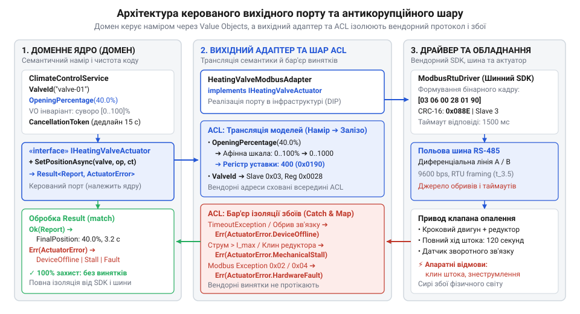

# Трансляція доменних команд у протоколи актуаторів

## Пастка прямої серіалізації доменних команд

Запис у базу даних фіксує стан миттєво: збережене значення не потребує часу на появу. Коли розробники @@en|Digital Homes@@ спробували так само керувати сервоприводом опалення через пряму @@en|серіалізацію@@ (від лат. series — ряд) чисел у регістри шлюзу, кімнати промерзли. Нова сумісна партія клапанів вимагала інших одиниць кута й іншого струму, а бізнес-код відправляв старі сирі байти.

@@en|Актуатор@@ (від лат. actus — рух, дія) не зберігає дані, а змінює фізичний світ. Він підкоряється законам механіки: має інерцію, час ходу й кінцеві ресурси перемикань. Коли ядро безпосередньо пише байти в шину, виникає [порт, що пахне сховищем](root:progarch/port-smelling-of-storage). Будь-яка зміна моделі приладу вимагає розгалужень у бізнес-правилах, перетворюючи чисту доменну логіку на каталог апаратних винятків.

## Чистий контракт керованого вихідного порту

Щоб залізо не протікало в ядро, намір виражають через керований вихідний порт. У системі, де [застосунок набуває форми](root:progarch/dh-v2-hexagon), інтерфейс порту оперує виключно бізнес-поняттями, а не шинними кадрами.

Захист від некоректних команд забезпечують доменні @@en|об'єкти-значення@@. Замість примітивних чисел метод порту приймає типізовані величини — кут відкриття чи цільову температуру, які перевіряють фізичний діапазон під час створення.

У коді цей принцип втілює сигнатура методу керованого порту: вона приймає перевірений @@en|об'єкт-значення@@, маркер скасування для обмеження часу та повертає типізований результат замість системних винятків:

```csharp
// Чистий контракт вихідного порту в доменному ядрі
public interface IHeatingValveActuator
{
    ValueTask<Result<ActuationReport, ActuatorError>> SetPositionAsync(
        ValveId valveId,
        OpeningPercentage targetOpening,
        CancellationToken cancellationToken
    );
}
```

Фізичний рух триває секунди, тому синхронне очікування заблокувало б систему. Контракт вимагає передавати маркер скасування з @@en|дедлайном@@ (англ. dead line — крайня межа), що задає граничний бюджет часу на дію. Метод порту повертає типізований @@en|Result@@ із закритою таксономією доменних помилок: механічне заклинювання, недосяжність пристрою або вичерпання дедлайну. Це примушує ядро опрацювати наслідки через @@en|зіставлення зразків@@ без протікання транспортних винятків.

## Оркестрація команд у вихідному адаптері

Трансляцію доменного наміру у фізичну дію виконує вихідний адаптер, організований як [антикорупційний шар](root:sf-apps/anti-corruption-layer).


*Вихідний адаптер узгоджує шкали, покроково керує шиною та перетворює апаратні збої на доменні результати.*

Адаптер перераховує доменні величини в апаратні кроки приводу й жорстко обмежує діапазон безпечними конструктивними межами. Роботу веде секвенсер: він перевіряє слово стану пристрою, подає живлення та передає керувальні кадри. Коли рухома частина досягає фізичного упору, вал двигуна блокується, а струм в обмотках стрибкоподібно зростає. Щоб двигун не перегорів, а редуктор не зламався, спрацьовує захисне вимкнення за перевищенням струму: схема миттєво відсікає живлення. Подію фіксує біт у слові стану: адаптер дізнається про зупинку на межі без окремих кінцевих вимикачів. Відмова від додаткових датчиків здешевлює конструкцію, але має ціну: загусле на холоді мастило чи зношення механіки створюють зайвий опір, і захист хибно знеструмлює привід посеред нормального ходу.

На напівдуплексній шині квитування нерідко губляться через завади. Відносна команда «повернути на 10 градусів» у разі повторного надсилання призведе до аварії. Адаптер транслює намір лише в абсолютні координати, гарантуючи @@en|ідемпотентність@@ (від лат. idem — той самий і potens — здатний): багаторазове надсилання кадру залишає пристрій у тому самому положенні. Якщо механіка заклинює чи вичерпується бюджет часу, адаптер безпечно повертає доменну помилку.
